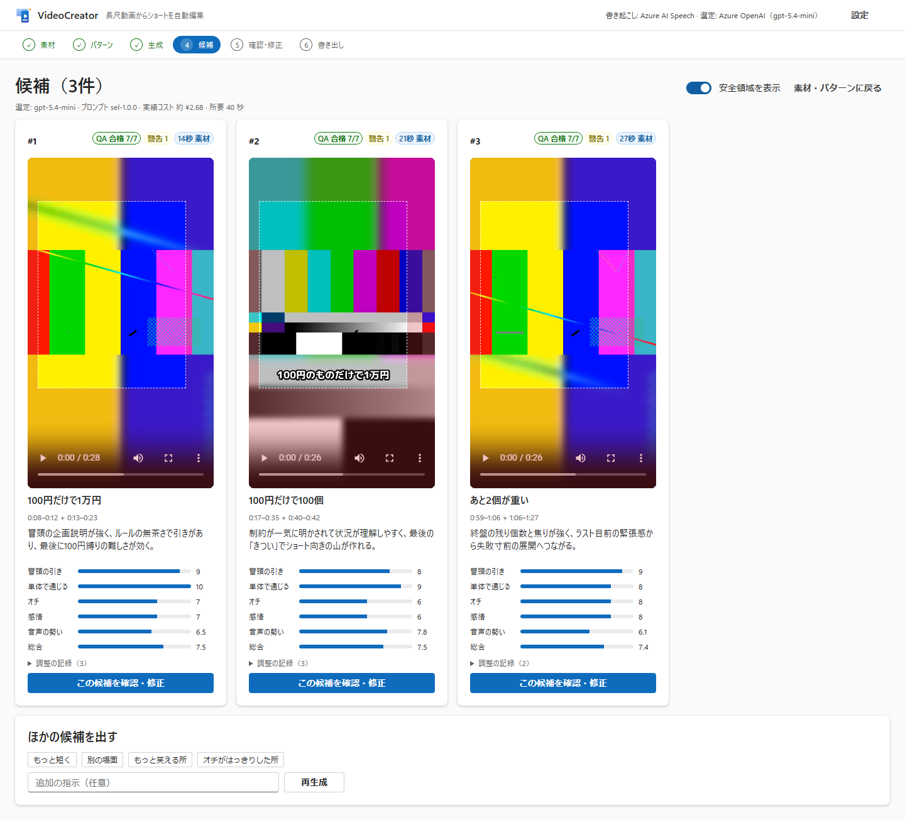

# VideoCreator

長尺の動画を選んで **編集パターンを選ぶだけ** で、AI が見どころを探し、字幕・強調テロップ付きの **縦型ショート（1080×1920）** を自動で作るローカル Web アプリです。



- 要件: [docs/PRD.md](docs/PRD.md) / 調査: [work/VideoCreator-AnalyticsReport.md](work/VideoCreator-AnalyticsReport.md)
- 実装と検証の記録: [docs/IMPLEMENTATION.md](docs/IMPLEMENTATION.md)

## 主な機能

| | |
|---|---|
| 素材 | ドラッグ＆ドロップ／フルパス指定。ffprobe で検証（VFR・回転・音声なしを検出）。権利確認を必須化 |
| 書き起こし | Azure AI Speech **Fast Transcription**（単語タイムスタンプ・話者分離・フレーズリスト、キーレス認証） |
| 選定 | Azure OpenAI（**Structured Outputs**）または **GitHub Copilot（OS にインストール済みの CLI を SDK から呼び出し）**。長尺は信号で絞り込んで分割・再ランキング。失敗時は音声の盛り上がりで選ぶ |
| 編集 | 文の境界にスナップ、尺合わせ、コールドオープン（先出し）、無音のジャンプカット＋パンチイン、9:16 ぼかし背景 |
| テロップ | 日本語の改行規則（助詞・小書き文字で始めない、バランスの良い2分割）、強調・フック・見出し、はみ出し防止の自動縮小 |
| 品質 | 自動 QA（PRD §13）: 尺・解像度・**−14 LUFS / −1 dBTP**・**テロップの安全領域を実測**・発話途中切り・**テロップの事実確認**・権利。ハード違反は書き出しを禁止 |
| 出力 | MP4（H.264/AAC）・SRT・編集計画 JSON・ASS・サムネイル3枚・投稿用メタデータ案 |
| 前編・後編 | **本数（2〜20本）か1本あたりの長さ（例: 15分）を指定**すると（選ぶとその場で1本あたりの長さの目安を表示。書き起こし済みなら無音カット後の推定）、長尺全体を同じ編集（字幕・強調・ジャンプカット・縦型化・QA）で **前編/後編（3本なら中編、4本以上は第n話）** に分けます。分け目は時計ではなく **話題の切れ目**（AI の章分け＋語彙の変化＋間＋話題転換語）から、本数どおり・長さがそろうよう動的計画法で選びます（話題の切れ目が足りず話題の途中で分けた箇所は警告）。各パートは「見どころの先出し → 前のパートのおさらい → 本編（章ごとの見出し） → 『〜につづく』と次の予告」の構成。投稿用メタデータには YouTube の条件を満たすチャプターとシリーズのリンク欄が入ります（3分を超えるため #Shorts は付けません） |
| オープニング・クロージング | チャンネルの **オープニング／クロージング動画** を「3. 生成する」でフォルダーごと登録（ファイル名の Opening / Closing で判別、9:16 と 16:9 があれば出力に合う方を自動選択、権利確認が必須）。オープニングは先出しの見どころのあと、クロージングは最後に入り、音量は本編に合わせてから全体を −14 LUFS に正規化。**出力（1080×1920）より小さい動画は登録時に一度だけ高画質化**（lanczos の拡大に、AI 超解像 Real-ESRGAN の輪郭の細部だけを加える方式。その動画自体で lanczos より元に忠実になるかを VMAF・XPSNR で実測し、なる場合だけ使う。GPU で 1 本 1〜2 分、裏で実行） |
| 場面転換のツッコミカード | 話題が変わる所（ショートは元動画で先へ飛ぶ継ぎ目、シリーズは章の頭）に、直前の場面を止めた **約1秒のツッコミカード**（「いや、そこ？」など。登録した画像も可）と効果音を入れる。AI の文は承認するまで書き出せない。確認画面で文字の編集・承認・個別のオン/オフ。字幕・効果音・チャプターは挿入物の分だけ自動でずれ、カードの上には字幕を出さない（[実装と検証](docs/IMPLEMENTATION.md#10-オープニングクロージング場面転換のツッコミカード)） |

編集パターン: **P1〜P9 のすべて**が利用可能です（BGM・効果音、ツッコミ・擬音テロップ、顔追従の縦型化、複数カメラ切り替え、ビート同期、早送りを含む。[presets/](presets)）。長い動画の絞り込み（節約／標準／全文）は画面で選べます。

オープニング・クロージングの登録は、**「フォルダーを選ぶ（OS の画面）」で Windows 標準のフォルダー選択**を使えます。選択後に権利を確認して「登録」を押してください。フルパスの手入力も残し、キャンセル時は入力を変更しません。

カード画像がない場合は、**「動画からカード画像を作る」**で権利確認済みの元動画から最大2〜6枚（既定4枚）の代表画像を抽出できます。映像の変化・明るさ・時間分布を使い、黒画面・白画面・類似画像を除きます（静止画に近い動画では指定枚数より少なくなる場合があります。意味上の見どころを保証するものではありません）。画像と元動画の時刻を画面で確認できます。外部 AI に送信せず、プロジェクト内の `scene-cards` に PNG を保存します。登録済みの共通画像や作成済み画像は上書きしません。作成後は場面転換がオンになり、**その後に生成・再生成する候補**で画像を順番に使います。共通の登録済みカード画像がある場合はそちらを優先します。文字カード・AI の文の承認フローは変更せず、抽出元の権利確認を外すと画像を使った書き出しも禁止します。

「1. 素材を選ぶ」のファイル選択／ドラッグ＆ドロップは、128 MiB を超える MOV などの大きな動画にも対応し、素材ファイルの受信サイズにアプリ独自の上限は設けません。受信中は一時フォルダ（`ASPNETCORE_TEMP`、未設定なら OS の一時フォルダ）にバッファし、プロジェクトの `assets` フォルダへコピーするため、両方に素材サイズ分の空き容量が必要です。同じドライブなら合計で素材サイズの約2倍を確保してください。**フルパス指定ならこのコピーは不要**です（元ファイルを参照します）。ほかの API の受信上限は変更しません。

## 必要なもの

- Windows 10/11（x64 / ARM64）とインターネット接続。**ほかのソフトは `run.cmd` が自動で入れます**（下記）
- Azure（字幕のための書き起こしに必要。選定用の AI は任意で、「ローカルのみ」にすると AI 選定を使いません）: AI Services リソース（Speech + `gpt-chat-latest` のデプロイ）と、利用者への `Cognitive Services User` / `Cognitive Services OpenAI User` ロール。キーは使わず、Azure CLI のサインインで認証します
- GitHub Copilot を使う場合: GitHub Copilot CLI（`run.cmd --setup --with-copilot` で導入）にサインイン済み

## セットアップと起動

**かんたん起動（Windows）**: リポジトリ直下の `run.cmd` をダブルクリック（またはターミナルで `.\run.cmd`）。

1. 初回だけ、足りないものを自動で導入・設定します（2 回目以降はすぐ起動）
2. ビルドしてアプリを起動し、ブラウザで <http://127.0.0.1:8765/> が開きます
3. 終了するときは、開いたウィンドウを閉じるか Ctrl+C を押します

初回のセットアップ（[scripts/setup.ps1](scripts/setup.ps1)）が行うこと。Windows 標準の Windows PowerShell 5.1 で動くので、事前に入れるものはありません。何度実行しても、入っているものは飛ばします。

| 対象 | 方法 |
|---|---|
| .NET SDK 10（`global.json` を満たすもの） | winget。winget がない PC では公式の `dotnet-install.ps1` でユーザー領域に導入（管理者権限不要） |
| FFmpeg・日本語フォント・顔検出モデル・高画質化モデル | [scripts/get-tools.ps1](scripts/get-tools.ps1) で `tools/` に取得（モデルはハッシュ検証） |
| Azure CLI | winget。ない場合は公式 MSI（管理者の確認が出ます） |
| Azure へのサインイン | 未サインインなら `az login` の画面を開きます |
| Azure の疎通確認 | 設定済みの Speech と OpenAI に、**実際のトークンで最小の要求**（1 秒の無音の書き起こし、短い応答）を送り、HTTP 応答で判定。403（ロール不足）なら付与コマンドを表示し、同意すれば自分に付与します |
| GitHub Copilot CLI | 任意。`--with-copilot` を付けたときだけ導入 |

結果は一覧で表示されます（`OK` / `INSTALLED` / `WARN` / `FAIL`）。`FAIL` があると起動しません。Azure の問題は `WARN` で、アプリは起動しますが字幕が付きません。

| コマンド | 内容 |
|---|---|
| `run.cmd` | 初回はセットアップしてから起動。2 回目以降は簡易チェックだけで起動 |
| `run.cmd --check` | 何も変更せずに状態を確認（Azure の疎通確認を含む） |
| `run.cmd --setup` | セットアップをやり直してから起動（ロール付与後や PC の構成を変えたとき） |
| `--with-copilot` / `--assign-roles` / `--skip-azure` / `--non-interactive` / `--no-start` | Copilot CLI も導入 / 不足ロールを確認なしで付与 / Azure を扱わない / 確認やサインイン画面を出さない / セットアップだけで起動しない |

補足: アプリは `DefaultAzureCredential` で認証します。Visual Studio に別のアカウントでサインインしている場合はそちらが先に使われることがあるため、`AZURE_TOKEN_CREDENTIALS=AzureCliCredential` を設定すると Azure CLI のサインインに固定できます。

**手動で起動する場合**

```powershell
powershell -ExecutionPolicy Bypass -File scripts/setup.ps1   # 初回のみ（-CheckOnly で確認だけ）
dotnet run --project src/VideoCreator.App -c Release
# → http://127.0.0.1:8765/ がブラウザで開きます
```

`src/VideoCreator.App/appsettings.json` の `VideoCreator` セクションで設定します。

| キー | 既定 | 説明 |
|---|---|---|
| `Asr:Endpoint` | — | `https://<resource>.cognitiveservices.azure.com/`（カスタムドメイン必須） |
| `Llm:Provider` | `azure-openai` | `azure-openai` / `copilot` / `none`（画面の「設定」からも切替可） |
| `Llm:Endpoint` / `Deployment` | — / `gpt-chat-latest` | `https://<resource>.cognitiveservices.azure.com/openai/v1` |
| `Llm:SingleCallCharBudget` | 12000 | これを超える書き起こしは信号で絞り込み分割（NFR-COST-03）。品質優先なら大きくする |
| `LocalOnly` | false | true で AI（LLM）による選定を使わない（字幕のための書き起こしは Azure AI Speech を使います） |
| `DataDir` / `ProjectsDir` | `%LOCALAPPDATA%\VideoCreator` / `ビデオ\VideoCreator` | データベース・キャッシュ / プロジェクトと書き出し先 |
| `Dictionary` | [] | 固有名詞（書き起こしのフレーズリストとテロップの事実確認に使用） |

## テスト

```powershell
dotnet test --project tests/VideoCreator.Tests   # 120 件（FFmpeg・顔検出モデルを使う結合テストを含む。tools/ が必要）
cd ui; npm ci; node e2e.mjs ..\path\to\video.mp4 # 起動中のアプリに対する E2E（OS の Microsoft Edge をヘッドレスで使用）
```

`spikes/*.cs` は機能ごとに本体へ組み込む前に作った検証プログラムです（`dotnet run spikes/01-ingest.cs` のように単体で実行）。

## 構成

```
src/VideoCreator.Core   取り込み・信号・ASR・選定・制約ソルバ・テロップ・ASS・レンダラ・QA・保存（SQLite）
src/VideoCreator.App    ASP.NET Core（127.0.0.1 のみ）＋ Fluent 2 Web Components の UI
presets/                編集パターン P1〜P9（JSON、アプリ更新なしで調整可能）
tests/                  xUnit v3
ui/                     Fluent UI バンドル（esbuild）、アイコン生成、E2E
spikes/                 検証用の小さなプログラム
```

設計の要点（PRD §6.1）: **AI は「決める」、レンダラは「決定的に作る」**。AI の出力は編集計画（JSON）に落とし、動画はその JSON だけから FFmpeg で生成します。ハード制約はプロンプトに頼らずコードで強制します。

## セキュリティ

- 127.0.0.1 のみで待ち受け、認証なし（単一ユーザーのローカル利用）。DNS リバインディング対策（Host 検証）と、状態を変える API に独自ヘッダー `X-VideoCreator: 1` を要求（クロスサイトからは送れない）。CSP 付き
- Azure はキーレス（`DefaultAzureCredential`）。リソースはローカル認証を無効化
- クラウドに送るのは音声と書き起こしテキストのみ（映像フレームは送らない）
- FFmpeg は引数配列で起動（シェルを使わない）。ASS の制御文字はエスケープ。書き込みはプロジェクトフォルダ内に限定

## ライセンス

MIT（[LICENSE](LICENSE)）。同梱を想定するフォント M PLUS 1p は SIL Open Font License、FFmpeg（BtbN GPL ビルド）は GPL、高画質化モデル Real-ESRGAN realesr-animevideov3（Xintao Wang）は BSD 3-Clause です（`scripts/get-tools.ps1` で取得し、リポジトリには含めません）。
