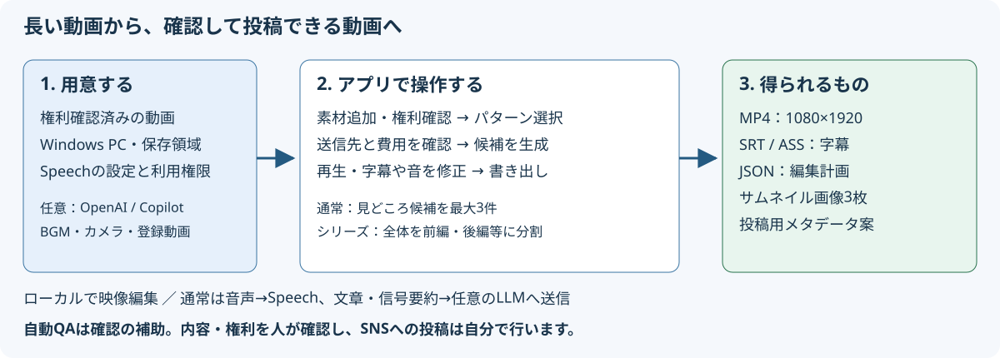

# VideoCreator

<!-- language-nav -->
[日本語](README.md) | [English](users-guide/en/start.md) | [한국어](users-guide/ko/start.md) | [简体中文](users-guide/zh-CN/start.md)
<!-- /language-nav -->

[はじめに](README.md) / [ガイド目次](users-guide/README.md) / [詳細概要](users-guide/overview.md) / [エンジニア向け](users-guide/technical-reference.md)

**動画編集が初めてでも、社内動画から字幕付きの短い動画を作れます。**
自分のPCで動画を選び、編集パターンを指定して、候補を確認・修正してから保存します。SNSや社内サイトへの投稿は自動では行いません。

## まず準備すること

- **使ってよい動画を1本**：発話のある数分程度のMP4など。出演者・資料・音楽の利用許諾と、社外サービスへの送信可否を確認します。
- **Windows 10/11のPC、インターネット、空き容量**：初回は必要ツールを導入します。会社のインストール規則に従ってください。
- **管理者からの引き継ぎ**：利用アカウント、Speechの接続先・権限、設定済みファイル、費用負担先、問い合わせ先を確認してください。接続先が分からない場合は推測せず管理者へ依頼します。

> **「ローカルアプリ」でも完全オフラインではありません。** 通常は音声をAzure Speechへ送り、AIを使う場合は書き起こしも設定したサービスへ送ります。LLMを使わない設定でもSpeech通信は残ります。キー・トークンを文書や問い合わせに貼り付けないでください。

## 最初の1本

1. [クイックスタート](users-guide/quickstart.md)で管理者との準備を確認し、承認された配布物・設定で起動します。ソース版は展開先の `run.cmd` をダブルクリックします。
2. ブラウザーでプロジェクトを作成し、動画1本を追加して権利を確認します。
3. **P4「切り抜き（長尺→30秒）」**、シリーズはオフ、絞り込みは標準を選び、送信先・費用を確認して生成します。
4. 候補を再生し、字幕・発言の意味・映り方・音を確認して承認し、書き出します。
5. 完成MP4を最後まで再生します。**保存先からMP4と字幕を開けたら最初の成功です。** 投稿は社内ルールに従い自分で行います。

うまくいかない場合は連続で再生成せず、[困ったとき](users-guide/troubleshooting.md)へ。`FAIL` はローカル部品、`WARN` は警告です。画面が開いても字幕生成の準備が済んだとは限りません。時刻・操作・エラーコード・アプリのバージョンを控えて管理者に相談し、動画や機密字幕は添付しないでください。

## 必要な説明を開く

| 目的 | 読むもの |
|---|---|
| 準備から保存まで順番に進める | [クイックスタート](users-guide/quickstart.md) |
| ボタンの意味・操作・用語を調べる | [利用者ガイド目次](users-guide/README.md) / [画面説明](users-guide/screens.md) |
| エラー・警告・バックアップ | [トラブルシューティング](users-guide/troubleshooting.md) |
| 機能詳細・配布版・従来のセットアップ手順 | [詳細概要](users-guide/overview.md) |
| エンジニアが安全に変更する | [テクニカルリファレンス](users-guide/technical-reference.md) / [設定・API](users-guide/configuration-api.md) |
| Azureの準備・共有利用者の追加・キー／Entra ID認証 | [Azure の準備と認証](users-guide/azure-access.md) |
| 検証・ビルド・リリースの根拠 | [検証と保守](users-guide/verification.md) / [詳細概要](users-guide/overview.md) |

画面の表示言語と動画の言語は別です。字幕は自動翻訳されません。動画言語を変えたら新しく候補を生成してください。より詳しい機能、配布、バージョン管理、テスト、構成、セキュリティの説明は、削除せず[詳細概要](users-guide/overview.md)へ移しました。

[要件](docs/PRD.md) / [実装・検証記録](docs/IMPLEMENTATION.md) / [調査](docs/VideoCreator-AnalyticsReport.md) / [制作方針](users-guide/documentation-brief.md) / [MIT License](LICENSE) / [第三者ライセンス](THIRD-PARTY-NOTICES.txt)
