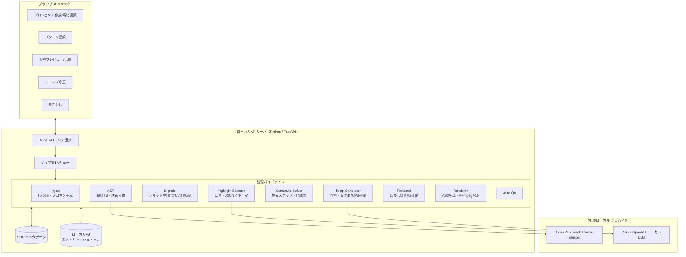
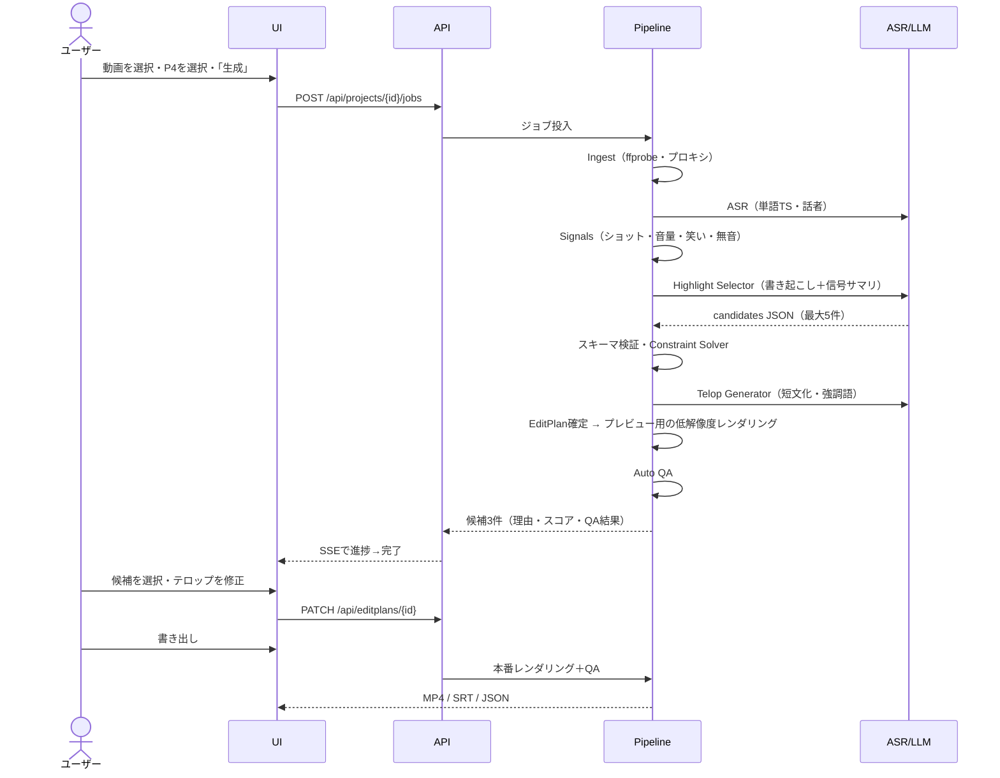
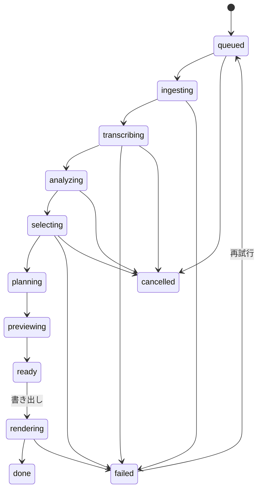
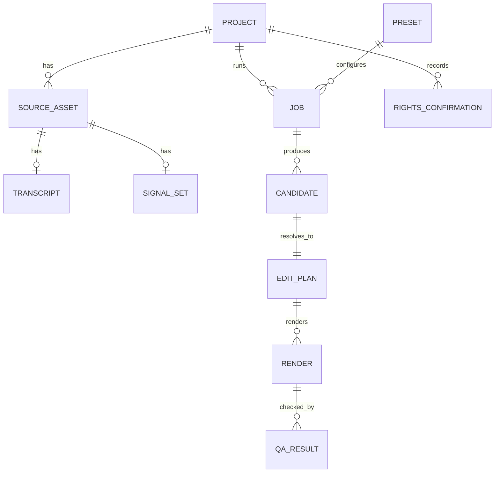

# VideoCreator — Product Requirements Definition (PRD)

| 項目 | 内容 |
|---|---|
| 文書ID | VC-PRD-001 |
| 版 | 1.1（v1.1 実装反映: NFR-SEC-04 改訂、FR-SEL-10 絞り込みの選択、P1/P3/P5/P7/P8 を利用可能に） |
| 作成日 | 2026-11-07 |
| ステータス | Draft（レビュー待ち） |
| 根拠資料 | [VideoCreator 調査レポート](../work/VideoCreator-AnalyticsReport.md)（以下「レポート」。節番号は `R§x.y` と表記） |
| 対象読者 | プロダクトオーナー、開発者、QA、デザイナー |

---

## 目次

1. [背景と目的](#1-背景と目的)
2. [用語定義](#2-用語定義)
3. [ペルソナとユースケース](#3-ペルソナとユースケース)
4. [スコープ](#4-スコープ)
5. [前提・制約・依存関係](#5-前提制約依存関係)
6. [システム概要とアーキテクチャ](#6-システム概要とアーキテクチャ)
7. [機能要件](#7-機能要件)
8. [編集パターン（プリセット）仕様](#8-編集パターンプリセット仕様)
9. [データモデル](#9-データモデル)
10. [API 仕様](#10-api-仕様)
11. [UI/UX 要件](#11-uiux-要件)
12. [非機能要件](#12-非機能要件)
13. [自動QA仕様](#13-自動qa仕様)
14. [受け入れ基準](#14-受け入れ基準)
15. [KPI・評価計画](#15-kpi評価計画)
16. [リスク・法務・倫理](#16-リスク法務倫理)
17. [リリース計画（マイルストーン）](#17-リリース計画マイルストーン)
18. [未決事項](#18-未決事項)
19. [トレーサビリティ（レポート ↔ 要件）](#19-トレーサビリティレポート--要件)
20. [付録](#20-付録)

---

## 1. 背景と目的

### 1.1 背景

- 1時間以上の長尺動画（配信アーカイブ、対談、講義、Vlog素材）から、YouTube Shorts / TikTok 向けの30秒前後の縦型動画を作る作業は、人手では1本あたり数時間かかる。
- レポートの分析により、人気動画の編集は次の**測れる変数**に分解できることが分かった（R§0, R§3）。
  - 冒頭フックの秒数
  - 再エンゲージの間隔
  - ショット長とその「揃い方」
  - テロップの文字数・速度・サイズ・位置
  - ラウドネス
  - ループ構造
- これらの変数を**プリセット（編集パターン）**として固定すれば、AIと決定的なレンダラーの組み合わせで自動化できる（R§5）。

### 1.2 プロダクトのビジョン

> **「動画を選んで、パターンを選ぶだけで、見ていて楽しいショート動画の候補が出てくる」**

### 1.3 目的（Goals）

| ID | 目的 | 測定方法 |
|---|---|---|
| G-1 | 長尺1本から、公開可能な縦型ショート候補を自動生成する | 候補の自動QA合格率（§13）、ユーザーの採用率（§15） |
| G-2 | エンタメ性の高い編集（フック・テンポ・テロップ・ループ）をプリセットで再現する | 盲検一対比較でベースラインに勝つ（§15.2） |
| G-3 | プラットフォーム制約（尺・比率・安全領域・音量）を**確実に**満たす | 自動QAのハード制約違反 0件 |
| G-4 | 高度な編集スキルを不要にし、操作を「選ぶ・確認する・直す」に限定する | タスク完了までの操作数・時間（§15.3） |
| G-5 | 権利・AI開示・事実の正確さを守る | 権利確認フローの完了率、テロップ忠実性QAの違反 0件 |

### 1.4 非目的（Non-Goals）

| ID | やらないこと | 理由 |
|---|---|---|
| NG-1 | 本格的なタイムライン編集UI（多トラック、キーフレーム、カラーグレーディング） | 「高度な編集機能は不要」という要件のため。プロ用NLEとは競合しない |
| NG-2 | 本人の声・顔をAIで合成し、「言っていないこと」を言わせる | 倫理・YouTubeのAI開示ポリシー（R§2, R§5.7） |
| NG-3 | 他者の動画のダウンロードや、URLからのクリップ生成 | 利用規約・著作権（R§1.3, R§5.7） |
| NG-4 | v1.0 での SNS への自動投稿 | API審査・アカウント連携のリスク。v2以降で検討する |
| NG-5 | 推薦アルゴリズムの攻略やバズの保証 | アルゴリズムの内部は非公開。指標の改善は目指すが、保証はしない |

---

## 2. 用語定義

| 用語 | 定義 |
|---|---|
| ソース動画 | ユーザーが選択する入力動画ファイル |
| プロジェクト | 1回の編集作業の単位。1本以上のソース動画と生成結果を束ねる |
| 編集パターン / プリセット | 編集ルールのパラメータ集合（P1〜P9、§8） |
| 候補（Candidate） | AIが選んだハイライト区間の組と、そのスコア・理由 |
| 編集計画（EditPlan） | 候補を制約ソルバで確定させた、**決定的にレンダリング可能な**編集指示（EDL相当。§9.3） |
| レンダリング | EditPlan から FFmpeg で動画ファイルを生成する処理 |
| テロップ | 画面上の文字表示の総称。型は①〜⑥（§7.6） |
| 安全領域（Safe Zone） | 縦型プラットフォームのUI（ボタン・キャプション等）に隠れない画面領域（R§2.1） |
| フック | 動画冒頭で視聴の継続を促す要素（結果・異常・問い・強い主張） |
| ループ | 動画の末尾が冒頭に意味的・視覚的につながっている構造 |
| CPS | Characters Per Second。字幕の表示速度 |
| LUFS / dBTP | ラウドネス（ITU-R BS.1770）/ True Peak |
| ASL | Average Shot Length。平均ショット長 |
| パンチイン | 1.1〜1.2倍程度のデジタルズームで、擬似的にカメラを切り替える演出 |

---

## 3. ペルソナとユースケース

### 3.1 ペルソナ

| ID | ペルソナ | 状況 | 主なニーズ | 対応パターン |
|---|---|---|---|---|
| PS-1 | 個人配信者（ゲーム実況・雑談） | 毎週2〜3時間の配信アーカイブがある | 笑い・リアクションの瞬間を手早くShorts化したい | P4, P1, P3 |
| PS-2 | ビジネス系チャンネル運営者 | 対談・講義を毎週1時間収録している。複数カメラあり | 要点テロップ付きの切り抜き、対談のカメラ切替 | P4, P6, P7 |
| PS-3 | 趣味クリエイター（料理・DIY・旅） | 長い工程の素材がある | 工程を圧縮したテンポの良い動画、音を活かした動画 | P8, P5, P9 |
| PS-4 | 企業広報・マーケター | セミナー動画やイベント映像がある | ブランドを損なわず、テロップが正確な短尺動画 | P4, P6 |

### 3.2 ユーザーストーリー

| ID | ストーリー | 優先度 |
|---|---|---|
| US-01 | PS-1として、2時間の配信アーカイブを選んで「切り抜き」を選ぶだけで、30秒の縦型候補を3本得たい。手作業で場面を探す時間をなくすため | Must |
| US-02 | すべてのユーザーとして、各候補が**なぜ選ばれたか**（理由・スコア）を見たい。採用の判断を速くするため | Must |
| US-03 | すべてのユーザーとして、テロップの誤字だけを簡単に直したい。タイムライン編集はしたくない | Must |
| US-04 | すべてのユーザーとして、出力が Shorts / TikTok の仕様（尺・比率・音量・UIに隠れない字幕）を満たすことを保証してほしい | Must |
| US-05 | PS-2として、2台のカメラ映像と1本の音声を選び、話者に合わせて自動でカメラを切り替えたい | Should |
| US-06 | PS-1として、バラエティ番組風のツッコミテロップを付けたい。ただし不適切な表現が出ないよう、公開前に必ず確認したい | Should |
| US-07 | PS-3として、テロップもBGMも無い、環境音だけのミニマルな編集を選びたい | Should |
| US-08 | すべてのユーザーとして、気に入らない候補を「もっと短く」「別の場面」などの指示で再生成したい | Should |
| US-09 | PS-4として、テロップ中の固有名詞・数字が元の発言と一致していることを保証してほしい | Must |
| US-10 | すべてのユーザーとして、生成した動画・字幕ファイル（SRT）・編集計画（JSON）を保存したい | Must |
| US-11 | すべてのユーザーとして、機密素材のため、生成AIを使わずローカルだけで処理するモードを選びたい | Could |
| US-12 | PS-2として、1本の長尺から横型の3〜5分ダイジェストも作りたい | Could |

---

## 4. スコープ

### 4.1 MoSCoW

| 区分 | 範囲 |
|---|---|
| **Must（MVP: v0.1〜v1.0）** | ソース動画1本の取り込み、書き起こし、信号抽出、LLMハイライト選定、制約ソルバ、9:16リフレーム（ぼかし背景）、テロップ①②④、ASS焼き込み、loudnorm、自動QA、候補3本のプレビュー、テロップ修正UI、書き出し（MP4/SRT/JSON）。パターンは **P4 切り抜き**、P6 解説、P2 一発ネタ・ループ |
| **Should（v1.x）** | 顔追従リフレーム、テロップ③（ツッコミ）・⑤（擬音/SE）・⑥（カウンター）、BGMダッキングと効果音、再生成の指示。パターンは P1、P3、P7（複数素材スイッチング）、P8、P9 |
| **Could（v2）** | P5（ビート同期）、横型ダイジェスト、ローカルLLMのみのモード、マルチモーダルLLMによる映像理解、バッチ処理、英語UI・英語字幕 |
| **Won't（本PRDの対象外）** | NG-1〜NG-5 |

### 4.2 対応する入出力

| 区分 | 仕様 |
|---|---|
| 入力コンテナ | MP4, MOV, MKV, WebM |
| 入力コーデック | H.264, H.265/HEVC, VP9, AV1, ProRes（FFmpegでデコードできるもの） |
| 入力解像度 | 720p〜4K（4Kは内部で1080pに縮小して処理） |
| 入力の長さ | 10秒〜3時間（3時間を超える場合はエラーにせず、警告して分割を提案） |
| 入力の音声 | 必須（無音の動画は P9 以外で警告） |
| 出力映像 | H.264 High、1080×1920（9:16）、ソースのfps（最大60、既定30）、CRF 18〜20、`+faststart` |
| 出力音声 | AAC-LC、48kHz、ステレオ、192kbps、−14 LUFS ±1、TP ≤ −1.0 dBTP |
| 付随出力 | SRT（テロップ①の全文）、EditPlan JSON（§9.3）、サムネイル候補PNG（3枚） |

---

## 5. 前提・制約・依存関係

### 5.1 前提（Assumptions）

| ID | 前提 | 妥当性の確認方法 |
|---|---|---|
| A-1 | リポジトリに既存のアプリは無いため、新規開発とする | 2026-11-07時点で、リポジトリには LICENSE と work/ のみ |
| A-2 | 実行形態は**ローカル実行のWebアプリ**（ブラウザUI＋ローカルのAPIサーバ）とする。素材が大きく、アップロードを避けたいため | §18 の未決事項 Q-1 で最終決定 |
| A-3 | 主要言語は日本語（UI・字幕）。英語は v2 で対応する | Q-5 |
| A-4 | 生成AIは、**プロバイダを差し替えられる抽象層**の背後で使う。既定は Azure AI Speech と Azure OpenAI（Microsoft Foundry） | Q-2 |
| A-5 | ユーザーは、自分が権利を持つ（または許諾を得た）素材だけを扱う | 取り込み時の権利確認（FR-ING-06） |

### 5.2 制約（Constraints）— レポートの一次情報に基づくハード制約

| ID | 制約 | 出典 |
|---|---|---|
| C-1 | YouTube Shorts は縦長または正方形で、最大180秒 | R§2 [S1] |
| C-2 | Shorts用の楽曲は1曲あたり最大90秒（曲によっては60秒/30秒） | R§2 [S1] |
| C-3 | 日本語字幕は1行最大13全角文字（縦型の本プロダクトでは14字まで許容）、最大2行。全文字幕は毎秒4〜6文字 | R§2, R§3.3 [S5] |
| C-4 | テロップは安全領域内に置く。1080×1920 で上250px・下580px・右160px・左60pxを避ける（見出しは上から300pxの位置に置いてよい） | R§2.1 [S11][S12] |
| C-5 | 音量は −14 LUFS、True Peak ≤ −1 dBTP | R§2, R§3.4 [S7] |
| C-6 | 写実的なAI生成・改変を含む場合、投稿時に「AI use」の開示が必要であることをユーザーに通知する | R§2 [S9] |
| C-7 | YouTube の A/B テストは Shorts に対応していないため、Shorts の効果検証は準実験で行う | R§6.3 [S10] |

### 5.3 外部依存

| ID | 依存 | 用途 | 代替 |
|---|---|---|---|
| D-1 | FFmpeg 7.x 以降（win-x64 / win-arm64 / macOS / Linux 版を同梱） | デコード・解析・合成・エンコード | なし（必須） |
| D-2 | 音声認識：Azure AI Speech（バッチ文字起こし、単語タイムスタンプ、話者分離） | 書き起こし | faster-whisper（ローカル） |
| D-3 | LLM：Azure OpenAI / Microsoft Foundry（JSONスキーマ出力に対応したモデル） | ハイライト選定・テロップ短文化 | OpenAI互換のローカルLLM（Could） |
| D-4 | PySceneDetect（AdaptiveDetector） | ショット境界の検出 | FFmpeg の `select='gt(scene,x)'` |
| D-5 | 顔検出（MediaPipe Face Detection 等） | 顔追従リフレーム（Should） | ぼかし背景方式（Must） |
| D-6 | 日本語フォント（同梱・焼き込みが可能なライセンスのもの。例：Noto Sans JP、M PLUS 系） | テロップ描画 | OSフォント（Yu Gothic UI 等。ライセンス確認が必要） |

> **注**: レポートの検証では Windows の Yu Gothic UI を使った（R§5.5）。製品には**再配布できるOFLフォント**を同梱する（Q-6）。

---

## 6. システム概要とアーキテクチャ

### 6.1 設計原則

| ID | 原則 | 理由 |
|---|---|---|
| AP-1 | **AIは「決める」、レンダラーは「決定的に作る」**。LLMの出力は EditPlan（JSON）に落とし込み、レンダリングは EditPlan だけを入力とする決定的な処理にする | 再現性、テストのしやすさ、人による修正のしやすさ |
| AP-2 | **LLMだけに判断させない**。音量・笑い・ショット境界などの数値信号と合議させる | ハルシネーション対策（R§5.3） |
| AP-3 | **ハード制約はコードで保証する**。尺・比率・安全領域・音量・CPSはプロンプトに頼らず、ソルバとQAで強制する | G-3 |
| AP-4 | **プロバイダを抽象化する**。ASR・LLM・顔検出はインターフェースの背後に置く | ベンダーロックインの回避、ローカルモード（US-11） |
| AP-5 | **ステージごとに成果物をキャッシュする**。書き起こし・信号は1回だけ計算し、プリセットを変えたときは再利用する | 性能・コスト |

### 6.2 コンポーネント構成



### 6.3 処理シーケンス（P4 切り抜き）



### 6.4 ジョブの状態遷移



---

## 7. 機能要件

要件IDの形式は `FR-<領域>-<連番>`。優先度は M=Must、S=Should、C=Could。

### 7.1 プロジェクトと素材の取り込み（ING）

| ID | 要件 | 優先度 | 根拠 |
|---|---|---|---|
| FR-ING-01 | ユーザーはローカルの動画ファイルを1本以上選択して、プロジェクトを作成できる | M | R§5.1 |
| FR-ING-02 | システムは ffprobe で尺・解像度・fps・音声チャンネル・回転メタデータを取得し、§4.2 の範囲外であれば理由を付けて拒否または警告する | M | §4.2 |
| FR-ING-03 | システムは解析用のプロキシ（720p相当の映像と、16kHzモノラルのWAV）を生成してキャッシュする | M | AP-5 |
| FR-ING-04 | 可変フレームレート（VFR）の入力は、解析前に固定フレームレートとして扱えるよう正規化する | M | R§5.5 の timebase 問題 |
| FR-ING-05 | 複数の素材を選択した場合、音声の相互相関で自動同期し、ずれ（ms）を表示する | S | R§3.6 |
| FR-ING-06 | 取り込み時に「この素材の権利を持っている／許諾を得ている」の確認チェックを必須とし、記録を残す | M | R§5.7, A-5 |
| FR-ING-07 | 同じファイル（ハッシュが一致するもの）を再度取り込んだ場合、既存の解析キャッシュを再利用する | S | AP-5 |

### 7.2 書き起こし（ASR）

| ID | 要件 | 優先度 | 根拠 |
|---|---|---|---|
| FR-ASR-01 | 単語（日本語では形態素・文字列単位）ごとに開始・終了時刻の付いた書き起こしを生成する | M | R§5.3-1 |
| FR-ASR-02 | 話者分離（最大4話者）を行い、各発話に話者IDを付ける | M | R§3.6 |
| FR-ASR-03 | 句読点が欠けた日本語について、文の境界を再推定する（LLMまたはルール） | M | R§5.3-1 |
| FR-ASR-04 | ASRのプロバイダを設定で切り替えられる（Azure AI Speech / faster-whisper） | M | AP-4, D-2 |
| FR-ASR-05 | ユーザーが用語辞書（固有名詞・製品名）を登録でき、ASRのフレーズリストとテロップの照合に使う | S | US-09 |
| FR-ASR-06 | 書き起こしを編集可能なテキストとしてUIに表示し、誤認識を手で修正できる | S | US-03 |

### 7.3 信号抽出（SIG）

| ID | 要件 | 優先度 | 根拠 |
|---|---|---|---|
| FR-SIG-01 | ショット境界を検出する（PySceneDetect AdaptiveDetector。既定は `adaptive_threshold=3.0`、`min_scene_len=15` フレーム） | M | R§5.3, [S24] |
| FR-SIG-02 | 音量（短時間 RMS / LUFS-M、100ms刻み）の時系列と、その急上昇点を算出する | M | R§5.3-2 |
| FR-SIG-03 | 無音区間を検出する（閾値 −40dBFS。最小長は §8 のプリセット値） | M | R§3.2 |
| FR-SIG-04 | 笑い・歓声・拍手の区間を検出する（音響イベント分類器） | S | R§5.3-2 |
| FR-SIG-05 | ASR から話速（文字/秒）の時系列を算出する | S | R§5.3-2 |
| FR-SIG-06 | 顔の位置・数を 2fps でサンプリングし、時系列で保存する | S | R§5.3-6 |
| FR-SIG-07 | 信号サマリ（上位Nのピーク時刻と種類）を、LLM 入力用の JSON として生成する。トークン上限内に収める | M | R§5.4 |

### 7.4 ハイライト選定（SEL）

| ID | 要件 | 優先度 | 根拠 |
|---|---|---|---|
| FR-SEL-01 | LLMに、タイムスタンプ付きの書き起こし・信号サマリ・選択したパターンの規則を渡し、§20.2 の JSON スキーマで最大5候補を返させる | M | R§5.4 |
| FR-SEL-02 | LLMの応答をスキーマ検証する。不合格なら最大2回まで再試行し、それでも失敗した場合は信号ベースのフォールバック選定（ピーク±15秒）を行う | M | AP-2 |
| FR-SEL-03 | 書き起こしがコンテキスト長を超える場合は、10分程度のチャンクに分けて候補を出し、最後に全体で再ランキングする（map-reduce） | M | 1時間を超える入力 |
| FR-SEL-04 | 各候補に `hook / standalone / payoff / emotion`（0〜10）のスコアと、1文の選定理由を付ける | M | R§5.4, US-02 |
| FR-SEL-05 | 信号スコアとLLMスコアを合成して最終スコアを出す（既定の重みは LLM 0.6、信号 0.4。設定で変更可能） | M | AP-2 |
| FR-SEL-06 | 指示語（「それ」「あれ」「これ」など）で始まる区間や、前提知識なしでは意味が通らない区間は、standalone スコアを減点する | M | R§5.7 |
| FR-SEL-07 | 候補区間の前後±30秒もLLMに渡し、「切り出しによって元の意図が変わらないか」を自己検査させる。変わる場合は除外する | S | R§5.7 |
| FR-SEL-08 | 互いに重なる候補（IoU > 0.5）は重複として統合し、異なる場面から3件を提示する | M | US-01 |
| FR-SEL-09 | ユーザーの再生成指示（「もっと短く」「別の場面」「もっと笑える所」）を受け付け、既に出した候補を除外して再選定する | S | US-08 |

### 7.5 制約ソルバ（SOL）

| ID | 要件 | 優先度 | 根拠 |
|---|---|---|---|
| FR-SOL-01 | 区間の端を「文末」かつ「ショット境界または無音」に最も近い点へスナップする（探索窓は ±1.5秒） | M | R§5.3-4 |
| FR-SOL-02 | 区間の端の ±150ms に単語が跨らないことを保証する（発話途中のカットを禁止） | M | R§5.6 |
| FR-SOL-03 | 合計の尺をプリセットの範囲（例：P4 は 25〜35秒）に収める。長すぎる場合はスコアの低い文から削り、短すぎる場合は前後の文を追加する | M | R§5.2 |
| FR-SOL-04 | 複数の区間を結合する場合は、最も強い区間（hookスコアが最大のもの）を先頭に置く（コールドオープン）。ただし、時系列を逆転させると意味が変わる場合は時系列順を保つ | M | R§3.1, R§5.3-4 |
| FR-SOL-05 | プリセットで無音除去が有効な場合、閾値以上の無音を削る（ジャンプカット）。削った後も、各ショットはプリセットの最小ショット長以上にする | M | R§3.2 |
| FR-SOL-06 | ループが有効な場合、末尾の文と冒頭の文の意味的なつながり（LLMで判定）、または末尾と冒頭のフレームの類似度（SSIM）を評価し、スコアの高い末尾位置を選ぶ | S | R§3.5 |
| FR-SOL-07 | ソルバの出力は EditPlan（§9.3）とする。同じ入力・同じ設定からは同じ EditPlan を生成する（決定性。LLMの呼び出しは除く） | M | AP-1 |

### 7.6 テロップ生成（TEL）

テロップの型（R§3.3）：①発話字幕、②強調、③ツッコミ/心の声、④状況説明（見出し）、⑤擬音・SE、⑥数値・カウンター。

| ID | 要件 | 優先度 | 根拠 |
|---|---|---|---|
| FR-TEL-01 | ①発話字幕を ASR から生成する。1行の文字数上限はプリセット値（既定14字）、行数は縦型では既定1行（最大2行） | M | C-3 |
| FR-TEL-02 | ①の各字幕イベントの表示速度を、プリセットの上限（既定6文字/秒）以下にする。上限を超える場合は、分割 → 表示時間の延長 → LLMによる短縮（言い換えではなく削減）の順で解消する | M | C-3, [S5] |
| FR-TEL-03 | 改行は句読点・文節の境界で行い、助詞の前では改行しない（日本語の改行規則） | M | R§3.3 |
| FR-TEL-04 | ②強調テロップ：LLMが候補ごとに最大3語のキーワードを抽出し、黄色・1.2〜1.3倍・ポップアニメで表示する | M | R§3.3 |
| FR-TEL-05 | ④見出し：候補ごとに16字以内の見出しを生成し、画面上部（上から300px）にボックス付きで表示する | M | R§3.3 |
| FR-TEL-06 | ③ツッコミテロップ：P1/P3 でユーザーが明示的に有効にした場合だけ生成する。生成したテロップは**未承認**状態とし、ユーザーが承認するまで書き出しを許可しない | S | R§5.7, US-06 |
| FR-TEL-07 | ⑤擬音/SEテロップ：笑い・驚き・無音（「シーン…」）の信号区間に、プリセットの辞書から選んで表示し、対応する効果音を同期させる | S | R§3.3, R§3.4 |
| FR-TEL-08 | ⑥カウンター：書き起こし中の数値・日数・金額をLLMで抽出し、「DAY 3」「¥1,000,000」などの形式で表示する | S | R§3.1 |
| FR-TEL-09 | **忠実性チェック**：テロップ②③④⑥に含まれる固有名詞・数字は、元の書き起こし（またはユーザー辞書）に存在しなければならない。存在しない場合は自動で除去し、警告を出す | M | R§5.6, US-09 |
| FR-TEL-10 | 色の意味付けを統一する（白=発話、黄=強調、赤=驚き/警告、水色=補足）。P7 では話者ごとに字幕の色を固定できる | M | R§3.3 |
| FR-TEL-11 | テロップのスタイルをテーマとして保存し、プロジェクト間で再利用できる | C | — |

### 7.7 リフレーム（RFM）

| ID | 要件 | 優先度 | 根拠 |
|---|---|---|---|
| FR-RFM-01 | 16:9のソースを9:16にする「ぼかし背景」方式：背景は拡大・クロップ・boxblur(20:2)、前景は幅1080に縮小して、中央から120px上に配置する | M | R§5.5(A) |
| FR-RFM-02 | 「顔追従クロップ」方式：顔が1つの区間では、顔を中心に9:16でクロップする。クロップ位置は平滑化（1秒以上の移動平均と最大速度の制限）し、瞬時の移動はショット境界でのみ行う | S | R§5.3-6 |
| FR-RFM-03 | 顔が2つ以上ある区間や、顔を検出できない区間では、自動で「ぼかし背景」方式に戻す | S | R§5.3-6 |
| FR-RFM-04 | ソースが既に9:16または1:1の場合は、リフレームせずに 1080×1920 に収める（1:1は上下に背景を付ける） | M | C-1 |
| FR-RFM-05 | パンチイン：プリセットで指定された区間（強調語の発話時、2区間目以降など）に、1.10〜1.20倍のズームを適用する | M | R§3.2, R§5.5(A) |

### 7.8 複数素材のスイッチング（SWT）— P7

| ID | 要件 | 優先度 | 根拠 |
|---|---|---|---|
| FR-SWT-01 | 各カメラに話者（またはマイク）を割り当てられる。話者分離と顔の位置による自動割当と、手動での修正に対応する | S | R§3.6 |
| FR-SWT-02 | 話している人のカメラを選ぶ。各ショットの最小ホールドは既定2.0秒（1.5〜2.5秒で設定可能） | S | R§3.6 |
| FR-SWT-03 | 聞き手側で笑いや驚き（音響イベント・表情）が起きた場合、0.8〜1.5秒のリアクションショットを挿入する | S | R§3.6 |
| FR-SWT-04 | ワイドカメラが割り当てられている場合、セクションの冒頭と、既定45秒（30〜60秒で設定可能）ごとにワイドショットを挿入する | S | R§3.6 |
| FR-SWT-05 | 切替は既定でハードカットとする。クロスフェード（0.2〜0.4秒）は場面転換にのみ使う | S | R§3.6 |
| FR-SWT-06 | 音声は、ユーザーが指定した1本のマスタートラックを通しで使う（カメラ切替に合わせて音声を切り替えない） | S | R§3.6 |
| FR-SWT-07 | `xfade` を使う場合は、両方の入力を `settb=AVTB,fps=<出力fps>` で正規化する | S | R§5.5(C) で実際に発生した不具合 |

### 7.9 音声処理（AUD）

| ID | 要件 | 優先度 | 根拠 |
|---|---|---|---|
| FR-AUD-01 | 出力音声を `loudnorm` で −14 LUFS、TP −1.5 dBTP、LRA 11 に正規化する（2パスを推奨） | M | C-5 |
| FR-AUD-02 | BGM（ユーザーが用意したもの、または同梱のライセンス済みライブラリ）を追加でき、発話中は −12〜−18 dB ダッキングする（`sidechaincompress`） | S | R§3.4, R§5.5(D) |
| FR-AUD-03 | テロップ⑤と同期して効果音を挿入する（同梱のSE。ライセンスを明記する） | S | R§3.4 |
| FR-AUD-04 | オチの直前に「無音演出」（BGMを 0.3〜1.0秒ミュート）を入れられる | C | R§3.4 |
| FR-AUD-05 | 市販楽曲を自動で付けることはしない。ユーザーが追加した楽曲については権利確認を求める | M | C-2, R§5.7 |

### 7.10 レンダリングと書き出し（RND / EXP）

| ID | 要件 | 優先度 | 根拠 |
|---|---|---|---|
| FR-RND-01 | EditPlan から ASS ファイルと FFmpeg の filtergraph を生成し、1回のFFmpeg実行でレンダリングする | M | R§5.5 |
| FR-RND-02 | プレビュー用に低解像度（540×960、ultrafast）でレンダリングし、候補ごとに15秒以内（目標）で表示する | M | US-02 |
| FR-RND-03 | 本番レンダリングは §4.2 の出力仕様に従う | M | §4.2 |
| FR-RND-04 | FFmpegのコマンドライン・バージョン・標準エラー出力をジョブログに保存する（再現性と障害解析のため） | M | AP-1 |
| FR-EXP-01 | MP4、SRT、EditPlan JSON、サムネイル候補PNG（3枚）を出力フォルダに書き出す | M | US-10 |
| FR-EXP-02 | ファイル名は `<プロジェクト名>_<パターンID>_<候補番号>_<YYYYMMDD-HHMM>.mp4` とする | M | — |
| FR-EXP-03 | 書き出し時に、投稿用メタデータ案（タイトル候補3件・説明文・ハッシュタグ）をテキストで出力する。元動画へのリンクを記入する欄も含める | S | R§2 [S2] |
| FR-EXP-04 | AIで写実的な改変を加えた場合（例：生成した映像を挿入した場合）は、書き出し画面に「AI use の開示が必要です」と表示する | M | C-6 |

### 7.11 人による確認と修正（REV）

| ID | 要件 | 優先度 | 根拠 |
|---|---|---|---|
| FR-REV-01 | 候補一覧に、プレビュー動画、4軸のスコア、選定理由、QA結果（合格/警告/不合格）を表示する | M | US-02 |
| FR-REV-02 | テロップの文字を一覧形式で直接修正できる。修正後は、CPS・文字数・安全領域のQAをその場で再評価する | M | US-03 |
| FR-REV-03 | 区間の開始・終了を文単位（前後の文へ±1文）で微調整できる。フレーム単位のタイムラインは提供しない | S | NG-1 |
| FR-REV-04 | テロップを個別に、または型ごとに一括で ON/OFF できる | M | US-07 |
| FR-REV-05 | 未承認のツッコミテロップ（FR-TEL-06）がある間は、書き出しボタンを無効にする | S | R§5.7 |

---

## 8. 編集パターン（プリセット）仕様

### 8.1 パターン一覧と既定値

数値のうち「目標値（要校正）」は、レポートの経験則に基づく（R§3.2）。§15.5 の手順で校正する。

| ID | 名称 | 尺(秒) | フック上限(秒) | 目標ASL(秒)※ | 無音除去(秒) | パンチイン | テロップ型 | 音 | ループ | リリース |
|---|---|---|---|---|---|---|---|---|---|---|
| P1 | ハイテンション・チャレンジ | 25–45 | 1.5 | 0.8–1.5 | 0.4 | 多 | ①②④⑤⑥ | アップテンポのBGM＋SE多め | 任意 | v1.x |
| P2 | 一発ネタ・ループ | 15–25 | 1.0 | 1.0–2.0 | 0.5 | 少 | ①② | 原音中心 | **必須** | MVP |
| P3 | バラエティ・テロップ | 25–60 | 2.0 | 1.0–2.5 | 0.5 | 中 | ①②③④⑤ | SE多め | 任意 | v1.x |
| P4 | 切り抜き（長尺→30秒） | 25–35 | 2.0 | 1.5–3.0 | 0.7 | 中 | ①②④ | 原音＋任意のBGM | 推奨 | **MVP** |
| P5 | ビート同期モンタージュ | 15–60 | 1.5 | ビート間隔 | — | 少 | ④ | BGM主導 | 任意 | v2 |
| P6 | 解説・講義 | 30–60 | 2.0 | 2.0–4.0 | 0.6 | 中 | ①②④⑥ | 原音＋薄いBGM | 任意 | MVP |
| P7 | 対談スイッチング | 30–60 | 2.0 | 2.0–6.0（話者切替） | 1.2 | 少 | ①②④＋話者色 | 原音（マスター1本） | 任意 | v1.x |
| P8 | プロセス圧縮（料理/DIY） | 20–60 | 1.5 | 1.0–2.0（完成品は長め） | 0.5 | 少 | ②④⑥ | 原音（ASMR）重視 | 推奨 | v1.x |
| P9 | ミニマル/環境音 | 30–90 | 3.0 | 3.0–8.0 | なし | なし | なし（既定） | 原音のみ | 任意 | v1.x |

※ 目標ASL＝目標値（要校正）。

### 8.2 パターンの組み合わせ規則

- ユーザーは**主パターンを1つ**と、**修飾パターンを0個以上**選ぶ。修飾として使えるのは、P2のループ性、P3のテロップ、P5のBGM同期。
- 衝突したときの優先順位は、ハード制約（C-1〜C-7） ＞ 主パターン ＞ 修飾パターン。
- 禁止する組み合わせ：P9 と P3（「テロップ無し」と「テロップ多用」が矛盾するため）。UIでは選択できないようにする。

### 8.3 プリセットのデータ形式

プリセットはJSONファイル（`presets/*.json`）で定義し、§20.1 の JSON Schema で検証する。アプリを更新しなくても、プリセットを追加・調整できる。

---

## 9. データモデル

### 9.1 エンティティの関係



### 9.2 主要エンティティ

| エンティティ | 主な属性 |
|---|---|
| Project | id, name, created_at, language, output_dir |
| SourceAsset | id, project_id, path, sha256, duration_s, width, height, fps, vfr(bool), audio_channels, role(`main`/`camA`/`camB`/`wide`/`audio_master`), sync_offset_ms |
| RightsConfirmation | id, project_id, asset_id, confirmed_by, confirmed_at, statement_version |
| Transcript | asset_id, provider, model_version, language, words[{id,t0,t1,text,speaker,conf}], sentences[{t0,t1,text,speaker}] |
| SignalSet | asset_id, shots[{t0,t1}], loudness_100ms[], silences[{t0,t1}], events[{t0,t1,type:laugh/cheer/applause,conf}], speech_rate[], faces[{t,boxes[]}] |
| Preset | id, version, json（§20.1） |
| Job | id, project_id, preset_ids[], status（§6.4）, progress, started_at, finished_at, error_code, llm_model, llm_prompt_version, seed |
| Candidate | id, job_id, rank, segments[{asset_id,t0,t1}], scores{hook,standalone,payoff,emotion,signal,final}, reason, hook_text, headline, emphasis_words[] |
| EditPlan | §9.3 |
| Render | id, editplan_id, kind(`preview`/`final`), path, ffmpeg_version, command, duration_s, created_at |
| QAResult | render_id, check_id, status(`pass`/`warn`/`fail`), measured, threshold, message |

### 9.3 EditPlan（決定的レンダリングの入力）

EditPlan は本システムの**中心となる成果物**である。人による修正は、すべて EditPlan への差分として記録する。

```json
{
  "schema_version": "1.0",
  "editplan_id": "ep_01J9Z8EXAMPLE",
  "preset": {"id": "P4", "version": "1.0.0"},
  "canvas": {"width": 1080, "height": 1920, "fps": 30},
  "timeline": [
    {
      "clip_id": "c1",
      "asset_id": "a_main",
      "src_in": 812.04,
      "src_out": 819.88,
      "reframe": {"mode": "blur_bg", "fg_offset_y": -120},
      "zoom": {"scale": 1.0},
      "transition_in": {"type": "cut"}
    },
    {
      "clip_id": "c2",
      "asset_id": "a_main",
      "src_in": 845.10,
      "src_out": 855.02,
      "reframe": {"mode": "blur_bg", "fg_offset_y": -120},
      "zoom": {"scale": 1.15},
      "transition_in": {"type": "cut"}
    }
  ],
  "telops": [
    {"id": "t1", "type": "headline", "start": 0.0, "end": 2.5, "text": "まさかの結末…！", "style": "Hook", "approved": true},
    {"id": "t2", "type": "caption", "start": 0.2, "end": 2.4, "text": "今日は1時間で", "style": "Caption", "source_word_ids": ["w1201", "w1202"], "approved": true},
    {"id": "t3", "type": "emphasis", "start": 2.4, "end": 4.6, "text": "100万円使い切る", "style": "Emph", "animation": "pop", "approved": true}
  ],
  "audio": {
    "master": "a_main",
    "bgm": null,
    "sfx": [],
    "loudnorm": {"I": -14, "TP": -1.5, "LRA": 11}
  },
  "provenance": {
    "job_id": "job_01J9Z7EXAMPLE",
    "candidate_id": "cand_02",
    "llm_model": "<deployment-name>",
    "prompt_version": "sel-1.0.0",
    "edits": [{"at": "2026-11-07T10:12:00+09:00", "op": "replace_text", "target": "t3", "from": "100万使い切る", "to": "100万円使い切る"}]
  }
}
```

- 時刻の単位は秒（小数点以下3桁）。`src_in/src_out` はソース上の時刻、`telops.start/end` は出力上の時刻。
- `source_word_ids` によって、テロップと元の発話を対応付けて追跡できるようにする（FR-TEL-09 の忠実性チェックに使う）。

---

## 10. API 仕様

ローカルAPI（既定は `http://127.0.0.1:8765`）。v1.0 では、認証を設けない代わりにローカルループバックでのみ待ち受ける（§12.4）。

| メソッド | パス | 説明 | 主なレスポンス |
|---|---|---|---|
| POST | `/api/projects` | プロジェクトを作成 | 201 `{id}` |
| PATCH | `/api/projects/{id}` | プロジェクト名を変更 `{name}`（表示名のみ。保存先フォルダと保存済みのパスは変えない。以後の書き出しファイル名に反映） | 200 `Project` / 404 / 422 空・80文字超・制御文字 |
| POST | `/api/projects/{id}/assets` | 素材を登録（ローカルパスを指定）し、ffprobeで解析 | 201 `SourceAsset` / 422 範囲外 |
| POST | `/api/projects/{id}/rights` | 権利確認を記録 | 201 |
| GET | `/api/presets` | プリセットの一覧 | 200 `Preset[]` |
| POST | `/api/projects/{id}/jobs` | 生成ジョブを開始 `{preset_ids, options}` | 202 `{job_id}` / 409 権利確認が未完了 |
| GET | `/api/jobs/{job_id}` | ジョブの状態 | 200 `Job` |
| GET | `/api/jobs/{job_id}/events` | 進捗（Server-Sent Events） | `stage`, `progress`, `message` |
| POST | `/api/jobs/{job_id}/cancel` | キャンセル | 202 |
| GET | `/api/jobs/{job_id}/candidates` | 候補の一覧（スコア・理由・プレビューURL・QA） | 200 `Candidate[]` |
| POST | `/api/jobs/{job_id}/regenerate` | 再生成 `{instruction, exclude_candidate_ids}` | 202 |
| GET | `/api/editplans/{id}` | EditPlan を取得 | 200 |
| PATCH | `/api/editplans/{id}` | テロップの修正・区間の微調整（JSON Patch） | 200 ＋ QAの再評価結果 |
| POST | `/api/editplans/{id}/render` | 本番レンダリング | 202 `{render_id}` |
| GET | `/api/renders/{id}` | レンダリング結果・QA結果・ファイルパス | 200 |
| GET | `/api/media/{render_id}` | プレビュー動画の配信（Range対応） | 206 |

### 10.1 エラーコード

| コード | HTTP | 意味 | ユーザーへの表示・対処 |
|---|---|---|---|
| E-ING-UNSUPPORTED | 422 | 対応していないコーデック・コンテナ | 対応形式の一覧と変換方法を表示する |
| E-ING-NOAUDIO | 422 | 音声トラックが無い | P9 を提案する |
| E-RIGHTS-REQUIRED | 409 | 権利確認が完了していない | 確認ダイアログへ誘導する |
| E-ASR-PROVIDER | 502 | ASRプロバイダのエラー・タイムアウト | 指数バックオフで3回まで再試行する。失敗したらローカルASRへの切替を提案する |
| E-LLM-SCHEMA | 502 | LLMの応答がスキーマに合わない | 2回再試行した後、信号ベースのフォールバックを行う（FR-SEL-02） |
| E-LLM-QUOTA | 429 | レート制限・クォータ超過 | 待ち時間を表示し、自動で再開する |
| E-SOL-INFEASIBLE | 422 | 制約を満たす区間が見つからない | プリセットの尺を緩めるか、別のパターンを提案する |
| E-RND-FFMPEG | 500 | FFmpegの実行に失敗 | ログIDを表示する。標準エラー出力はジョブログに保存する |
| E-QA-HARDFAIL | 422 | ハード制約のQAに不合格 | 違反した項目を表示し、書き出しを禁止する |
| E-DISK-SPACE | 507 | ディスク容量が不足 | 必要な容量（推定値）を表示する |

---

## 11. UI/UX 要件

### 11.1 画面一覧

| ID | 画面 | 主要な要素 |
|---|---|---|
| SC-1 | ホーム | 最近のプロジェクト、「新規作成」 |
| SC-2 | 素材選択 | ファイル選択（ドラッグ＆ドロップ）、メタデータの表示、役割の割当（P7）、権利確認のチェック |
| SC-3 | パターン選択 | P1〜P9 のカード（説明・向いているジャンル・**実例動画へのリンク**（R§4））、出力形式（9:16 / 尺）、詳細設定（折りたたみ） |
| SC-4 | 進捗 | ステージ別の進捗バー、推定残り時間、キャンセル |
| SC-5 | 候補比較 | 3候補の縦型プレビューを並べて表示、スコアのレーダーチャート、選定理由、QAバッジ、「再生成」 |
| SC-6 | 確認・修正 | プレビュー＋テロップ一覧（型ごとに色分け、文字数とCPSを即時表示、承認チェック）、区間の±1文調整 |
| SC-7 | 書き出し | 出力仕様、QAレポート、投稿用メタデータ案、AI開示の注意、出力フォルダを開く |

### 11.2 UX 要件

| ID | 要件 | 優先度 |
|---|---|---|
| UX-01 | 素材選択から候補表示までのクリック数を5回以下にする（ファイル選択・権利確認・パターン選択・生成・候補選択） | M |
| UX-02 | プレビューに、TikTok/Shorts の安全領域オーバーレイを ON/OFF で重ねられる | M |
| UX-03 | パターンカードには、そのパターンが何をするかを「冒頭」「テンポ」「テロップ」「音」の4項目について、各1行で表示する | M |
| UX-04 | 失敗時は専門用語を使わず、「何が起きたか」と「次に何をすればよいか」を表示する | M |
| UX-05 | 長時間の処理中にブラウザを閉じてもジョブを継続し、再び開いたときに復帰できる | S |
| UX-06 | キーボード操作とスクリーンリーダーに対応する（WCAG 2.2 AA を目標とする） | S |

---

## 12. 非機能要件

### 12.1 性能（目標値。リファレンス環境は 8コアCPU、16GB RAM、SSD、GPU無し、クラウドのASR/LLMを使用）

| ID | 指標 | 目標 |
|---|---|---|
| NFR-PERF-01 | 60分・1080pの入力で、P4の候補3本がプレビュー表示されるまでの時間 | p50 で 15分以内、p90 で 25分以内 |
| NFR-PERF-02 | 同じ素材でパターンを変えたときの再生成時間（書き起こし・信号はキャッシュ済み） | 2分以内 |
| NFR-PERF-03 | 30秒ショートの本番レンダリング（1080×1920） | 60秒以内 |
| NFR-PERF-04 | テロップ修正後のQA再評価 | 1秒以内 |
| NFR-PERF-05 | ピークメモリ | 4GB以下（3時間の入力時） |
| NFR-PERF-06 | 作業用ディスク | 最大で入力サイズの1.5倍＋1GB。開始時に空き容量を確認する |

### 12.2 品質・信頼性

| ID | 要件 |
|---|---|
| NFR-REL-01 | 書き出し済みのファイルで、ハード制約QA（§13 の H-*）の不合格を 0件にする（不合格時は書き出しをブロックするため） |
| NFR-REL-02 | パイプラインの各ステージを冪等にする。途中で失敗しても、完了済みステージの成果物から再開できる |
| NFR-REL-03 | 外部APIの一時的な障害に対して、指数バックオフ（1秒、4秒、16秒）で再試行する |
| NFR-REL-04 | 同じ EditPlan と同じ FFmpeg バージョンからは、フレーム単位で同一の映像を出力する（ハッシュで比較する。エンコーダのスレッド数は固定する） |

### 12.3 コスト

| ID | 要件 |
|---|---|
| NFR-COST-01 | 60分の入力1本あたりのクラウドAIコスト（ASRの分数・LLMのトークン数）を、ジョブ開始前に見積もって表示する |
| NFR-COST-02 | 書き起こしと信号は、1素材につき1回だけ計算する（キャッシュ） |
| NFR-COST-03 | チャンク化と信号による事前の絞り込みで、LLMへの入力トークンを、書き起こし全文を送る場合の50%以下にする（目標） |

### 12.4 セキュリティ・プライバシー

| ID | 要件 |
|---|---|
| NFR-SEC-01 | APIサーバは 127.0.0.1 でのみ待ち受ける。v1.0 では外部公開をサポートしない |
| NFR-SEC-02 | クラウドの資格情報は OS の資格情報ストア（Windows Credential Manager 等）に保存し、平文の設定ファイルに書かない。Azure ではキーレス認証（Entra ID / DefaultAzureCredential）を推奨する |
| NFR-SEC-03 | クラウドへ送るのは**音声と書き起こしテキストのみ**とし、映像フレームは送らない（v2 のマルチモーダル機能はオプトイン） |
| NFR-SEC-04 | 「ローカルのみモード」（US-11）では、**AI（LLM）への送信を行わない**。字幕は必須のため、書き起こし（Azure AI Speech）は引き続き使う（v1.1 で改訂。v1.0 は「外部送信ゼロ」だったが、字幕なしの動画になるため変更） |
| NFR-SEC-05 | ユーザーが指定したパスは正規化して検証し、プロジェクトディレクトリの外への書き込みを禁止する（パストラバーサル対策） |
| NFR-SEC-06 | FFmpeg の引数は配列で渡し、シェルを経由しない（コマンドインジェクション対策）。ASS内のテキストはエスケープする（`{`、`}`、`\`） |
| NFR-SEC-07 | 既定のログレベルでは、書き起こし全文や資格情報をログに出力しない |

### 12.5 保守性・移植性

| ID | 要件 |
|---|---|
| NFR-MNT-01 | 対応OSは Windows 11（x64/arm64）、macOS 14以降（arm64）、Ubuntu 22.04以降 |
| NFR-MNT-02 | FFmpeg を同梱し、起動時にバージョンと必要なフィルタ（`subtitles`/libass、`loudnorm`、`xfade`、`sidechaincompress`、`boxblur`）の有無を確認する |
| NFR-MNT-03 | プロンプトはバージョン付きのファイルで管理し、EditPlan の provenance に記録する |
| NFR-MNT-04 | ソルバ・テロップ整形・QA・ASS生成の単体テストのカバレッジを 90% 以上にする |

### 12.6 観測性

| ID | 要件 |
|---|---|
| NFR-OBS-01 | ジョブごとに、ステージ別の所要時間、外部APIの呼び出し回数、トークン数、エラーを構造化ログ（JSON Lines）で記録する |
| NFR-OBS-02 | 匿名の利用統計（パターン別の採用率など）は、ユーザーがオプトインした場合だけ収集する |

---

## 13. 自動QA仕様

H = ハード（不合格なら書き出しを禁止）、S = ソフト（警告のみ）。

| ID | 区分 | チェック | 閾値 | 測定方法 |
|---|---|---|---|---|
| H-01 | H | 尺 | プリセットの範囲内、かつ 180秒以下 | ffprobe `format.duration` |
| H-02 | H | 解像度・比率 | 1080×1920 | ffprobe |
| H-03 | H | 積分ラウドネス | −14 ± 1 LUFS | `loudnorm=print_format=summary`（Input Integrated） |
| H-04 | H | True Peak | −1.0 dBTP 以下 | 同上 |
| H-05 | H | テロップの安全領域 | 本文テロップの矩形が、下580px・右160px・上250px・左60px の領域に入らない（見出しを除く） | ASSのスタイルと libass のレイアウト結果から計算 |
| H-06 | H | 発話途中のカット | 区間端の ±150ms に単語が跨っていない | ASRの単語タイムスタンプ |
| H-07 | H | テロップの忠実性 | ②③④⑥の固有名詞・数字が、書き起こし（またはユーザー辞書）に存在する | 正規化後の文字列照合 |
| H-08 | H | 未承認のテロップ | `approved=false` のテロップが 0件 | EditPlan |
| H-09 | H | 権利確認 | すべての素材に RightsConfirmation がある | DB |
| S-01 | S | 字幕速度 | ①の各イベントが 6文字/秒以下 | ASSの解析 |
| S-02 | S | 1行の文字数 | 14全角文字以下（半角は0.5文字として数える） | ASSの解析 |
| S-03 | S | 冒頭フック | 最初の2秒以内に、発話・音量ピーク・大きな動き（フレーム差分）のいずれかがある | ASR＋信号 |
| S-04 | S | 最短ショット | プリセットの最小値以上 | EditPlan |
| S-05 | S | テロップと顔の重なり | テロップの矩形と顔の矩形の重なりが30%未満 | 顔検出＋レイアウト |
| S-06 | S | 黒フレーム・フリーズ | 0.5秒以上の黒画面・静止が無い（P9は除外） | FFmpeg の `blackdetect`、`freezedetect` |
| S-07 | S | 冒頭が指示語 | 最初の文が指示語で始まらない | 書き起こし |

QAの結果は QAResult として保存し、SC-5 と SC-7 に表示する。

---

## 14. 受け入れ基準

### 14.1 MVP（P4）の受け入れテスト

| ID | シナリオ（Given / When / Then） |
|---|---|
| AT-01 | **Given** 60分・1080p・日本語の対談動画（テストコーパス TC-JA-60）と、権利確認済みのプロジェクトがある **When** P4 を選んで生成する **Then** 25分以内に候補3本が表示され、各候補に4軸のスコアと理由が付き、3本とも H-01〜H-09 に合格している |
| AT-02 | **Given** AT-01 の候補がある **When** 本番レンダリングを行う **Then** ffprobe で 1080×1920・25〜35秒、loudnorm で −14±1 LUFS・TP −1.0 dBTP 以下が測定される |
| AT-03 | **Given** 候補の EditPlan がある **When** 同じ環境で2回レンダリングする **Then** 映像ストリームのハッシュが一致する（NFR-REL-04） |
| AT-04 | **Given** 区間の端が文の途中にある候補（意図的に作ったLLM応答のモック）がある **When** ソルバを通す **Then** 端が文末に移動し、H-06 に合格する |
| AT-05 | **Given** 書き起こしに存在しない数字「500万円」を含む強調テロップ（モック）がある **When** QA を実行する **Then** H-07 で不合格になり、そのテロップは除去され、警告が表示される |
| AT-06 | **Given** 14字を超える字幕がある **When** テロップを生成する **Then** 句読点または文節の境界で分割され、S-02 に合格する |
| AT-07 | **Given** LLM が2回続けてスキーマに合わない応答を返す（モック） **When** 選定を行う **Then** 信号ベースのフォールバックで候補が生成され、UI に「AI選定に失敗したため音声の盛り上がりから選びました」と表示される |
| AT-08 | **Given** 権利確認が完了していないプロジェクトがある **When** 生成を開始する **Then** 409 E-RIGHTS-REQUIRED が返り、確認ダイアログが表示される |
| AT-09 | **Given** テロップの修正UIを開いている **When** テロップを編集して22字にする **Then** 1秒以内に S-02 の警告が表示される |
| AT-10 | **Given** ローカルのみモードである **When** P4 の生成を最後まで実行する **Then** 外部ホストへの通信が0件である（パケットキャプチャまたはプロキシで検証する） |
| AT-11 | **Given** 縦型（9:16）のソースがある **When** P4 を実行する **Then** リフレームが適用されず、黒帯もぼかし背景も無い 1080×1920 が出力される |
| AT-12 | **Given** 本番レンダリングの出力がある **When** 安全領域オーバーレイを重ねる **Then** 本文テロップが UI 領域に重ならず、H-05 の判定結果と目視の結果が一致する |

### 14.2 品質の受け入れ基準（MVPのリリース判定）

| ID | 基準 |
|---|---|
| QG-01 | テストコーパス（§15.1）の全素材で、書き出しまで到達した候補のハード制約QA合格率が 100% |
| QG-02 | 盲検一対比較（§15.2）で、P4 の出力が「ランダムな30秒」に対して勝率70%以上、「冒頭の30秒」に対して勝率60%以上（95%信頼区間の下限が50%を超える） |
| QG-03 | Mr. HiSum のサブセット（会話系のカテゴリを優先して抽出した200本）で、選定区間と「最も再生された部分」の上位区間の重なりが、ランダム選択より統計的に有意に高い |
| QG-04 | テロップの文字誤り率（人手で正解を作った10素材で測定）が、ASR単体の文字誤り率より悪化していない |

---

## 15. KPI・評価計画

### 15.1 テストコーパス

| ID | 内容 | 用途 |
|---|---|---|
| TC-JA-60 | 日本語・対談・60分・2カメラ（社内で収録し、権利処理済み） | P4/P7 |
| TC-JA-LEC | 日本語・講義・45分・1カメラ | P6 |
| TC-JA-GAME | 日本語・ゲーム配信・120分（許諾済み） | P4/P1/P3 |
| TC-COOK | 料理の工程・30分・環境音あり | P8/P9 |
| TC-VERT | 縦型のソース・5分 | FR-RFM-04 |
| TC-EDGE | VFR、長い無音区間、音声無し、4K、HEVC、回転メタデータあり | 異常系 |
| Mr. HiSum | 31,892本（YouTube「最も再生された部分」の統計がラベル） | 選定のオフライン評価（R§6.1, [S23]） |

### 15.2 オフライン評価

1. **盲検一対比較**：制作に関わっていない評価者5名以上で行う。ペアの提示順はランダムにする。質問は「どちらをもっと見たいか」と「どちらが内容を正しく伝えているか」の2つ。
2. **選定精度**：Mr. HiSum で Hit@1 と mAP を測り、ベースライン（ランダム、音量ピーク）と比較する。
3. **自動QAの統計**：ハード/ソフト違反率をプリセット別に回帰テストで追跡する。

### 15.3 プロダクトKPI（リリース後。オプトインのテレメトリ）

| KPI | 定義 | 目標（初期値。運用しながら調整する） |
|---|---|---|
| 候補採用率 | 書き出された候補数 / 提示された候補数 | 40%以上 |
| 修正なし採用率 | テロップの修正が0件のまま書き出された割合 | 25%以上 |
| 完了までの時間 | 素材選択から書き出しまでの操作時間（処理の待ち時間を除く） | 5分以内 |
| 再生成率 | 再生成を1回以上行ったジョブの割合 | 参考指標 |

### 15.4 プラットフォーム上の成果（ユーザーが任意で入力する。YouTube Analytics API との連携は v2）

| 指標 | 意味 | 出典 |
|---|---|---|
| 視聴を選んだ割合（Stayed to watch） | フックの評価 | R§6.3 [S3] |
| 平均視聴率・リテンション曲線 | テンポ・構成の評価 | R§6.3 |
| 関連動画から長尺への流入 | 切り抜きによる本編への送客 | R§2 [S2] |

- Shorts では A/B テストができないため（C-7）、同じ素材から作った別パターンを時期をずらして公開し、自チャンネルの過去の中央値と比べる準実験で評価する。

### 15.5 プリセット値の校正

- 許諾済みの素材について `scenedetect -i input.mp4 detect-adaptive list-scenes` でショット長の分布を測り、§8.1 の目標ASLを更新する（R§6.2）。
- 校正の結果は、プリセットの `version` を上げて記録する。

---

## 16. リスク・法務・倫理

| ID | リスク | 影響 | 発生可能性 | 対策 |
|---|---|---|---|---|
| RK-01 | 無断の切り抜きによる権利侵害 | 高 | 中 | FR-ING-06 の権利確認、NG-3（URL入力を設けない）、市販楽曲を自動で付けない（FR-AUD-05） |
| RK-02 | 文脈を外した切り出しによる誤解・名誉毀損 | 高 | 中 | FR-SEL-06/07、人による確認（§7.11）、standalone スコア |
| RK-03 | LLMのハルシネーションによる誤ったテロップ | 高 | 中 | H-07 の忠実性チェック、`source_word_ids` による追跡 |
| RK-04 | ツッコミテロップでの侮辱的・差別的な表現 | 高 | 低〜中 | オプトイン、未承認状態（H-08）、コンテンツフィルタ（Azure AI Content Safety 等）を通す |
| RK-05 | AI開示義務の見落とし | 中 | 低 | FR-EXP-04、本人の音声・顔を合成しない（NG-2） |
| RK-06 | 機密素材のクラウド送信 | 高 | 中 | NFR-SEC-03（映像は送らない）、ローカルのみモード、送信前の同意ダイアログ |
| RK-07 | プラットフォーム仕様の変更（尺・安全領域など） | 中 | 高 | 制約をプリセット・設定ファイルに切り出し、アプリを更新しなくても修正できるようにする |
| RK-08 | 同梱フォント・SE・BGMのライセンス違反 | 中 | 低 | OFL/CC0 などライセンスが明確な素材だけを使い、`THIRD_PARTY_NOTICES` に記載する |
| RK-09 | 処理時間・コストが期待を上回る | 中 | 中 | NFR-COST-01 の事前見積もり、キャッシュ、チャンク化 |
| RK-10 | 「速いほど良い」という編集への画一化 | 中 | 中 | P9 など低速のパターンを用意する（R§4.4） |
| RK-11 | 転載動画を公式の動画と誤認する（レポート作成時に実際に発生） | 低 | 中 | 実例のリンクは、投稿者名で公式性を確認してから掲載する（R§付録A） |

---

## 17. リリース計画（マイルストーン）

| マイルストーン | 内容 | 終了条件 |
|---|---|---|
| **M0 技術検証** | FFmpeg レシピ（R§5.5）のライブラリ化、ASS生成、EditPlan からのレンダリング、QA の H-01〜H-05 | 合成映像で AT-02/AT-03/AT-11/AT-12 に合格 |
| **M1 MVP α（P4）** | 取り込み、ASR、信号（ショット/音量/無音）、LLM選定、ソルバ、テロップ①②④、ぼかし背景、候補3本のUI | AT-01〜AT-09 に合格 |
| **M2 MVP β（P2, P6）** | ループの評価、無音除去、⑥カウンター（P6）、テロップ修正UIの完成、コスト見積もり | QG-01 と QG-04 に合格 |
| **M3 v1.0** | ローカルのみモード、エラー処理、インストーラ、ドキュメント | QG-02、QG-03、AT-10 に合格 |
| M4 v1.1 | 顔追従、P1/P3（③⑤、SE、BGMダッキング）、P8/P9 | パターン別の盲検評価で勝率60%以上 |
| M5 v1.2 | 複数素材の同期と P7 スイッチング | P7 の受け入れテスト（話者の一致率90%以上）に合格 |
| M6 v2 | P5、横型ダイジェスト、マルチモーダル理解、Analytics 連携、英語対応 | 別途 PRD を作成する |

---

## 18. 未決事項

| ID | 論点 | 選択肢 | 暫定の決定 | 決定期限 |
|---|---|---|---|---|
| Q-1 | 実行形態 | (a) ローカルWebアプリ (b) デスクトップアプリ（Tauri/Electron） (c) クラウドSaaS | (a)。v1.0 で (b) として包むことも検討する | M0の終了時 |
| Q-2 | 既定のAIプロバイダ | Azure AI Speech + Azure OpenAI / Whisper + ローカルLLM | Azure（品質と話者分離のため）。ローカルは代替とする | M0の終了時 |
| Q-3 | LLMのモデル・デプロイ名 | — | JSONスキーマ出力に対応し、日本語性能が高いもの。M1でオフライン評価して決める | M1 |
| Q-4 | 笑い・歓声の検出器 | 既存の音響イベントモデル / 自前で学習 | 既存モデルを評価してから決める | M1 |
| Q-5 | 英語対応の時期 | v1.x / v2 | v2 | M3 |
| Q-6 | 同梱フォント | Noto Sans JP / M PLUS 1p / BIZ UDPGothic など | 太字の視認性で比較評価して決める（OFLのものに限定） | M0 |
| Q-7 | 認証付きのリモートアクセス | 不要 / 将来必要 | v1.0 では不要 | M3 |

---

## 19. トレーサビリティ（レポート ↔ 要件）

| レポートの節 | 内容 | 対応する要件 |
|---|---|---|
| R§0, R§2 | プラットフォームのハード制約 | C-1〜C-7, H-01〜H-05, FR-AUD-01, §4.2 |
| R§2.1 | 安全領域 | C-4, H-05, UX-02, AT-12 |
| R§3.1 | 冒頭フック・再エンゲージ・コールドオープン | FR-SOL-04, S-03, §8.1「フック上限」, FR-TEL-08 |
| R§3.2 | ショット長の“塊”、ジャンプカット、パンチイン | FR-SOL-05, FR-RFM-05, §8.1「目標ASL」, §15.5 |
| R§3.3 | テロップの6類型・サイズ・位置・CPS | FR-TEL-01〜11, S-01, S-02, H-05 |
| R§3.4 | ラウドネス・ダッキング・SE・音なし視聴 | FR-AUD-01〜05, FR-TEL-01 |
| R§3.5 | ループとペイオフ | FR-SOL-06, P2 |
| R§3.6 | マルチカメラのスイッチング規則 | FR-SWT-01〜07, FR-ING-05 |
| R§4 | 実例動画とパターンの対応 | §8.1, SC-3（パターンカードの実例リンク） |
| R§4.4 | 「速さ一択」の否定 | P9, RK-10 |
| R§5.1〜5.3 | UX・パターンカタログ・パイプライン | §6, §7, §8, §11 |
| R§5.4 | LLMプロンプト・採点軸 | FR-SEL-01, FR-SEL-04, §20.2 |
| R§5.5 | 検証済みのFFmpegレシピ・timebaseの落とし穴 | FR-RFM-01, FR-RND-01, FR-SWT-07, FR-ING-04, M0 |
| R§5.6 | 自動QA | §13 |
| R§5.7 | 失敗モードとガードレール | FR-SEL-06/07, FR-TEL-06/09, FR-AUD-05, §16 |
| R§5.8 | 生成AIの使い所 | D-2, D-3, AP-4, NFR-SEC-03 |
| R§6 | 評価計画 | §14.2, §15 |
| R§付録A | 実例動画の検証と、転載の誤認 | RK-11 |

---

## 20. 付録

### 20.1 プリセットの JSON Schema（抜粋）

```json
{
  "$schema": "https://json-schema.org/draft/2020-12/schema",
  "$id": "https://videocreator.local/schemas/preset.schema.json",
  "title": "VideoCreator Preset",
  "type": "object",
  "required": ["id", "version", "name", "target", "hook", "cut", "telop", "audio", "loop"],
  "properties": {
    "id": {"type": "string", "pattern": "^P[0-9]+$"},
    "version": {"type": "string", "pattern": "^[0-9]+\\.[0-9]+\\.[0-9]+$"},
    "name": {"type": "string"},
    "target": {
      "type": "object",
      "required": ["aspect", "duration_sec"],
      "properties": {
        "aspect": {"enum": ["9:16", "1:1", "16:9"]},
        "duration_sec": {"type": "array", "items": {"type": "number", "minimum": 5, "maximum": 180}, "minItems": 2, "maxItems": 2}
      }
    },
    "hook": {
      "type": "object",
      "required": ["max_sec"],
      "properties": {
        "max_sec": {"type": "number", "minimum": 0.5, "maximum": 5},
        "prefer": {"type": "array", "items": {"enum": ["strong_claim", "laughter", "surprise", "question", "result"]}}
      }
    },
    "cut": {
      "type": "object",
      "properties": {
        "remove_silence_over_sec": {"type": ["number", "null"], "minimum": 0.2},
        "min_shot_sec": {"type": "number", "minimum": 0.3},
        "target_asl_sec": {"type": "array", "items": {"type": "number"}, "minItems": 2, "maxItems": 2},
        "snap_to": {"type": "array", "items": {"enum": ["sentence_end", "shot_boundary", "silence"]}},
        "punch_in_scale": {"type": "number", "minimum": 1.0, "maximum": 1.3}
      }
    },
    "telop": {
      "type": "object",
      "properties": {
        "types": {"type": "array", "items": {"enum": ["caption", "emphasis", "tsukkomi", "headline", "sfx", "counter"]}},
        "caption": {
          "type": "object",
          "properties": {
            "font_px": {"type": "integer", "minimum": 48, "maximum": 120},
            "max_chars_per_line": {"type": "integer", "minimum": 8, "maximum": 16},
            "max_lines": {"type": "integer", "minimum": 1, "maximum": 2},
            "max_cps": {"type": "number", "minimum": 3, "maximum": 10},
            "margin_v": {"type": "integer", "minimum": 580},
            "margin_r": {"type": "integer", "minimum": 160}
          }
        }
      }
    },
    "audio": {
      "type": "object",
      "properties": {
        "loudnorm": {"type": "object", "properties": {"I": {"const": -14}, "TP": {"type": "number", "maximum": -1.0}}},
        "bgm_duck_db": {"type": "number", "minimum": -24, "maximum": 0},
        "sfx": {"enum": ["none", "light", "heavy"]}
      }
    },
    "loop": {"type": "object", "properties": {"enabled": {"type": "boolean"}, "required": {"type": "boolean"}}}
  }
}
```

### 20.2 ハイライト選定の LLM 出力 JSON Schema

```json
{
  "$schema": "https://json-schema.org/draft/2020-12/schema",
  "title": "HighlightCandidates",
  "type": "object",
  "required": ["candidates"],
  "additionalProperties": false,
  "properties": {
    "candidates": {
      "type": "array",
      "maxItems": 5,
      "items": {
        "type": "object",
        "required": ["segments", "hook_text", "headline", "emphasis_words", "reason", "scores"],
        "additionalProperties": false,
        "properties": {
          "segments": {
            "type": "array",
            "minItems": 1,
            "maxItems": 4,
            "items": {
              "type": "object",
              "required": ["start", "end"],
              "additionalProperties": false,
              "properties": {"start": {"type": "number", "minimum": 0}, "end": {"type": "number", "minimum": 0}}
            }
          },
          "hook_text": {"type": "string", "maxLength": 14},
          "headline": {"type": "string", "maxLength": 16},
          "emphasis_words": {"type": "array", "items": {"type": "string"}, "maxItems": 3},
          "reason": {"type": "string", "maxLength": 120},
          "scores": {
            "type": "object",
            "required": ["hook", "standalone", "payoff", "emotion"],
            "additionalProperties": false,
            "properties": {
              "hook": {"type": "integer", "minimum": 0, "maximum": 10},
              "standalone": {"type": "integer", "minimum": 0, "maximum": 10},
              "payoff": {"type": "integer", "minimum": 0, "maximum": 10},
              "emotion": {"type": "integer", "minimum": 0, "maximum": 10}
            }
          }
        }
      }
    }
  }
}
```

### 20.3 P4 プリセットの例（§20.1 に適合）

```json
{
  "id": "P4",
  "version": "1.0.0",
  "name": "切り抜き（長尺→30秒）",
  "target": {"aspect": "9:16", "duration_sec": [25, 35]},
  "hook": {"max_sec": 2.0, "prefer": ["strong_claim", "laughter", "surprise"]},
  "cut": {"remove_silence_over_sec": 0.7, "min_shot_sec": 1.0, "target_asl_sec": [1.5, 3.0], "snap_to": ["sentence_end", "shot_boundary"], "punch_in_scale": 1.15},
  "telop": {
    "types": ["caption", "emphasis", "headline"],
    "caption": {"font_px": 78, "max_chars_per_line": 14, "max_lines": 1, "max_cps": 6, "margin_v": 620, "margin_r": 160}
  },
  "audio": {"loudnorm": {"I": -14, "TP": -1.5}, "bgm_duck_db": -15, "sfx": "light"},
  "loop": {"enabled": true, "required": false}
}
```

### 20.4 推奨の技術スタック（前提 A-2/A-4 に基づく）

| 層 | 技術 | 理由 |
|---|---|---|
| フロントエンド | React + TypeScript + Vite | 動画プレビューと状態管理のエコシステムが充実している |
| API | Python 3.12 + FastAPI + Pydantic v2 | 音声・映像処理ライブラリ（PySceneDetect、faster-whisper）との親和性が高く、スキーマ検証ができる |
| ジョブ | プロセス内ワーカー（asyncio + プロセスプール）。将来 RQ/Celery へ移行できる設計にする | ローカル実行で依存関係を少なくするため |
| 永続化 | SQLite（SQLModel）＋ ローカルFS | 単一ユーザー・ローカル実行のため |
| 映像処理 | FFmpeg 7.x（同梱）、libass | 検証済み（R§5.5） |
| AI | Azure AI Speech SDK、Azure OpenAI（Foundry）SDK、faster-whisper | §5.3 |
| テスト | pytest、Playwright（E2E）、合成映像（`testsrc2`、`sine`）によるレンダリングのゴールデンテスト | AT-02/03/11/12 を CI で自動化するため |

### 20.5 参考資料

- [VideoCreator 調査レポート](../work/VideoCreator-AnalyticsReport.md)（参考文献 S1〜S25 を含む）
