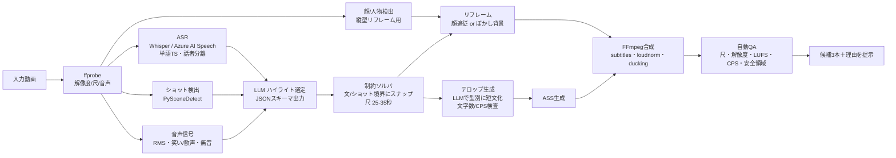

# VideoCreator 調査レポート：人気SNS動画の編集スタイル分析と「パターン選択型・自動編集」機能の設計

- 作成日: 2026-11-07
- 対象: YouTube（長尺 / Shorts）・TikTok を中心としたソーシャル動画
- 重視する観点: **エンターテインメント性（見ていて楽しいこと）**
- 想定機能: 「動画を1つ（または複数）選ぶ → 編集パターンを選ぶ → 自動で編集される」。生成AIの利用可、高度な編集機能は不要

---

## 0. エグゼクティブサマリー

1. **人気動画の編集は「感覚」ではなく、ほぼ測れる変数に分解できる。** 本レポートでは、(a) 冒頭フックの秒数、(b) 再エンゲージ（見せ場）の間隔、(c) ショット長とその「揃い方」、(d) テロップの文字数・秒あたり文字数・サイズ・位置、(e) 音量（LUFS）と効果音、(f) ループ構造、の6変数に落とし込み、ジャンル別のプリセット値を提示する（§3, §4）。
2. **動かせない制約は一次情報で確定できる。** Shorts は「正方形または縦長・最大3分」（2024-10-15以降のアップロード）、TikTok広告ガイドは「フックを最初の6秒、主題を最初の3秒」「テキストは毎秒5〜10語」、Netflix日本語字幕は「1行13全角文字・最大2行・毎秒4文字」、YouTube は再生時に約 −14 LUFS へ音量を下げる（上げはしない）。これらを自動編集の**ハード制約**にする（§2）。
3. **「楽しさ」を生む編集の核は3つ。** ①冒頭1〜3秒で「結果・異常・問い」を見せる（期待の提示）、②数秒ごとの視覚/聴覚の変化（カット・ズーム・テロップ・SE）で「まだ何か起こる」と知らせる、③オチ（ペイオフ）を明確にし、終わりを冒頭へ繋いでループさせる。日本ではこれに**テレビ由来の“ツッコミ/強調テロップ”文化**が乗る（§3.3）。
4. **ただし「速いほど良い」は誤り。** Primitive Technology のように**ナレーション・BGM・テロップ無しで数千万再生**のスタイルも成立している。ジャンルに合ったテンポを選ぶことが本質で、本機能は「速さ」ではなく「パターン」を選ばせる設計にすべき（§4）。
5. **実装は既存部品で十分可能。** 書き起こし（Whisper / Azure AI Speech）→ 信号抽出（シーン検出・音量・笑い/歓声・顔）→ **LLMによるハイライト候補の構造化出力** → 文/ショット境界へのスナップ → 9:16リフレーム → ASSテロップ → loudnorm → 書き出し、のパイプラインで構成する。本レポートのFFmpegレシピは**実際に実行して出力を検証済み**（1080×1920・26秒・−14.0 LUFS、§5.5）。
6. **正しさの検証は「自分たち以外」に委ねる。** YouTube Studio の「Stayed to watch（視聴を継続）」率・平均視聴率、公開データセット（Mr. HiSum = YouTube「最も再生された部分」統計を正解ラベルにした31,892本）でのオフライン評価、第三者による盲検の一対比較評価を組み合わせる。なお **YouTube の A/B テスト機能は Shorts 非対応**なので、Shorts の評価設計には注意が必要（§6）。

---

## 1. このレポートの作り方（プロンプトの深化と方法論）

### 1.1 依頼を「より深く」するための4点

| 観点 | 内容 |
|---|---|
| (1) トップ専門家が追加でやること | 「人気スタイル」を印象で語らず、**リテンション曲線・平均ショット長(ASL)・字幕の文字数/秒・LUFS**などの指標に分解する。ジャンル×尺ごとに**再現可能なパラメータ表**にする。自動編集の**失敗モード**（文脈切れ・発話途中のカット・テロップの誤り・UIによる字幕の隠れ・権利侵害）を先に定義する。評価計画まで設計する。 |
| (2) 最も生の素材 | プラットフォームの一次仕様（YouTube Help、TikTok広告ヘルプ）、字幕の業界標準（Netflix Timed Text Style Guide、BBC字幕ガイドライン）、査読論文（ショット長の歴史的変化、ハイライト検出データセット）、トップ制作会社の内部ガイド原文（MrBeast社の制作マニュアル）、**動画そのもの**（URLを oEmbed API で実在確認） |
| (3) 具体的な手法とツール | 書き起こし（Whisper / Azure AI Speech、単語タイムスタンプ・話者分離）、ショット検出（PySceneDetect）、音声エネルギー/笑い検出、顔検出によるリフレーム、LLMによるハイライト採点（JSONスキーマ出力）、FFmpeg（trim/concat/xfade/subtitles(ASS)/loudnorm） |
| (4) 第三者による検証 | 公式ドキュメント・論文の出典明記、YouTube/TikTok oEmbed API による動画の実在確認、FFmpeg/ffprobe による出力の機械検証、YouTube Studio 指標による実地計測、別人による盲検評価、公開データセットでのベンチマーク |

### 1.2 書き直したプロンプト

> 人気のSNS動画（YouTube長尺・Shorts・TikTok）の編集スタイルを、一次情報（プラットフォーム公式仕様、字幕ガイドライン、学術研究、トップクリエイターの制作ガイド）に基づき、**測れる指標**（フック秒数、再エンゲージ間隔、ショット長、字幕の文字数/秒・サイズ・位置、ラウドネス、ループ構造）に分解して分析せよ。エンタメ性を重視し、エンタメ／ビジネス／趣味のジャンル別編集パターンを「自動編集アプリがそのまま使えるパラメータ表」として定義せよ。実在を検証した例示動画を提示し、1本の長尺→30秒ショート、複数素材のスイッチング、テロップ表現を、生成AI＋FFmpegで実装する設計（パイプライン、LLMプロンプト、**実行検証済み**のFFmpegコマンド、失敗モード、評価方法）を示し、`work\VideoCreator-AnalyticsReport.md` に保存せよ。出典を全て明記し、検証できなかった主張は「仮説」と明示すること。

### 1.3 方法と限界

- **方法**: 一次情報の取得（公式ヘルプ・論文・ガイド原文）→ 数値の抽出 → 実在動画の oEmbed 検証（2026-11-07実施、§4 の全URL）→ FFmpegでのレシピ実行と ffprobe/loudnorm による出力検証（§5.5）。
- **限界（正直に記す）**:
  - YouTube/TikTok の利用規約上、他者動画をダウンロードしてフレーム単位でショット長を計測することは行っていない。§3 のショット長の目安は**実務上の経験則（仮説）**であり、§6.2 の手順で自社素材・許諾済み素材で計測して校正すること。
  - 二次情報（業界ブログ）由来の統計（例: 「TikTok広告の63%が3秒以内に主題」など）は出典の一次性が弱いため、本文では**参考値**として扱い、設計上の根拠には使っていない。
  - アルゴリズム（推薦）の内部は非公開。本レポートは「公式に示される指標」と「編集で操作できる変数」の関係に限定している。

---

## 2. 一次情報で確定できる「動かせない制約」

自動編集エンジンはこれらを**ハード制約**として扱う。

| 項目 | 値 | 出典（一次） |
|---|---|---|
| YouTube Shorts の判定 | 正方形または縦長、最大3分（2024-10-15以降アップロード分） | YouTube Help「Understand three-minute YouTube Shorts」[S1] |
| Shorts の楽曲 | Shorts音源ライブラリの多くの曲は3分Short内で最大90秒（曲により60/30秒） | 同上 [S1] |
| 長尺→Shorts 化（公式機能） | Studio の「クリップとショート」で文字起こしから範囲選択して Short 化。**元動画が「関連動画」として自動リンク** | YouTube Help [S2] |
| Shorts の初期判断指標 | 「How many chose to view（視聴を選んだ割合 vs スワイプ）」 | YouTube Help「Content tab analytics」[S3] |
| TikTok 広告の推奨 | 9:16、720p以上、音あり。**フックは最初の6秒、主題（提案）は最初の3秒**。テキストは**毎秒5〜10語** | TikTok Ads「Creative best practices」(2025-06更新) [S4] |
| 日本語字幕（業界標準） | 横書き**1行最大13全角文字**、**最大2行**、**毎秒4文字まで**、上部配置は原則避ける、白・ゴシック系 | Netflix Japanese Timed Text Style Guide [S5] |
| 英語字幕（参考） | BBC：160〜180 wpm、行長は16:9画面幅の68%以内、原則2行 | BBC Subtitle Guidelines（要約: [S6]） |
| ラウドネス | YouTube は約 −14 LUFS を基準に**大きい音を下げる（小さい音は上げない）**。True Peak −1 dBTP 程度を推奨 | [S7]（YouTube「統計情報（詳細）」の content loudness で各自検証可能） |
| 音なし視聴 | 公共の場で69%が音なし視聴、字幕利用者の80%は聴覚障害なし（米5,616人調査） | Verizon Media × Publicis Media 調査（報道: [S8]） |
| 生成AIの開示 | 実在人物が言っていないことを言わせる・実在の出来事を改変する等、**写実的なAI生成/改変は開示必須** | YouTube Help「Disclosing use of GenAI content」[S9] |
| A/Bテスト | タイトル/サムネイルを最大3案、**総再生時間（watch time）で勝者決定。Shorts は対象外** | YouTube Help「A/B test titles & thumbnails」[S10] |

### 2.1 縦型画面の「安全領域（Safe Zone）」

TikTok と YouTube Shorts は**公式のピクセル値を公開していない**（TikTok は「形式・キャプション長で変わる」としてオーバーレイ素材のみ提供、Meta は Reels 広告で「上14%・下35%・左右6%」と数値を公開）[S11]。複数プラットフォーム共通で安全側に倒すなら、1080×1920 で **上 ≈250px・下 ≈580〜670px・右 ≈160〜190px・左 ≈60px を避ける**（中央およそ 860×1100px が安全）[S11][S12]。

→ 本機能のテロップ既定値: **本文字幕は下端から620px上（MarginV=620）、右マージン160px**。フック見出しは上端から300px。

---

## 3. 人気動画の「編集文法」を指標に分解する

### 3.1 注意の構造：最初の1分（Shortsなら最初の1秒）がすべて

**MrBeast 社の制作マニュアル（“How to Succeed in MrBeast Production”）**は、自社動画の秒単位分析から、以下の分単位フレームを定めている [S13][S14]：

| 時間帯 | 指示 | 編集上の翻訳 |
|---|---|---|
| 0–1分 | タイトル/サムネイルの約束と**完全一致**（物の色まで）、最良の素材を先頭に | 冒頭に「結果・最大の見せ場」を先出し（コールドオープン） |
| 1–3分 | 「狂った進行」— 1日目だけでなく何日分も進める | 時間圧縮（モンタージュ、日数カウンター） |
| 3分 | 第1の再エンゲージ（ここでしか見られないスペクタクル） | 見せ場を約3分おきに配置 |
| 3–6分 | 速い場面転換、シンプルで刺激的な内容 | ショット長を短めに揃える |
| 6分 | 第2の再エンゲージ | 同上 |
| 6分〜 | 「後半」は視聴者が中だるみ→構成で引っ張る | 予告（「最後に〇〇が…」）、カウントダウン |

同マニュアルは、典型的な動画で「**最初の60秒で2,100万人が離脱する**」と述べ、主要指標を **CTR・平均視聴時間(AVD)・平均視聴率(AVP)** に置いている [S14]。

**Shorts/TikTok への写像**: 長尺の「1分」は縦型では「**1〜3秒**」に圧縮される。YouTube は Shorts で「視聴を選んだ割合 vs スワイプ」を独立指標として提示しており [S3]、TikTok は「主題は3秒以内・フックは6秒以内」を推奨している [S4]。

### 3.2 カットとペース：「速さ」より「揃い方」

- **査読研究**: Cutting らは1935〜2005年のハリウッド映画150本をショット単位で解析し、隣接ショットの長さの**相関が年々高まり、1/f 型のパターンに近づいた**ことを示した（アクションは短いショットの塊、会話は長いショットの塊）[S15]。
  → 示唆: 良い編集は「全部速い」ではなく、**似た長さのショットを“塊”にし、塊ごとにテンポを変える**（緩→急→緩）。
- **ジャンプカット（無音・言いよどみの除去）**: 解説・トーク系 YouTube の標準手法。実務上、単独話者は 0.6〜0.8秒以上の無音、対談は 1.2〜1.5秒以上の無音のみ削る（会話の“間”を残す）とされる [S16]。
- **パンチイン（擬似ズーム）**: 単一カメラでも 1.1〜1.2倍のデジタルズームを強調箇所に入れると「カメラが2台ある」ようなリズムが出る。§5.5 で検証済み。
- **ショット長の目安（仮説・要校正）**:

| フォーマット | 目安ASL | 根拠の強さ |
|---|---|---|
| エンタメ Shorts/TikTok（チャレンジ・リアクション） | 0.8〜2.0秒 | 経験則（仮説） |
| 解説/ビジネス Shorts | 2〜4秒（テロップ切替で変化を作る） | 経験則（仮説） |
| エンタメ長尺（チャレンジ・企画） | 2〜4秒、見せ場前後で1秒未満の塊 | MrBeast指針「速い場面転換」[S14]＋経験則 |
| 対談・ポッドキャスト長尺 | 5〜15秒（話者切替主体） | 経験則（仮説） |
| 趣味（料理・DIY）プロセス系 | 工程は早送り/1〜2秒、完成品は長め | 経験則（仮説） |

### 3.3 テロップと字幕：日本のテレビ文法を縦型に移植する

日本のテレビでは、テロップは「内容の理解促進」から**制作者の思考（ツッコミ・強調）を自然言語で表示するもの**へと拡大し、多用への批判もある（早稲田大学・瀬戸口ら）[S17]。つまり**種類を区別して、量を管理する**ことが重要。

**テロップの類型（本機能での実装単位）**

| 型 | 役割 | 表現 | 自動生成の可否 |
|---|---|---|---|
| ① 発話字幕（全文） | 音なし視聴対応 | 白文字＋黒縁、下部、1行最大13〜16字 | ◎ ASRから |
| ② 強調テロップ | キーワードを大きく・色で | 黄/赤、1.2〜1.3倍、ポップ（拡大→戻る）アニメ | ◎ LLMがキーワード抽出 |
| ③ ツッコミ/心の声 | 笑いの“補助線” | 斜め・吹き出し・別色、画面上部や話者横 | ○ LLMが生成（**誤り・不適切のリスク大→要確認UI**） |
| ④ 状況説明（見出し） | 文脈を与える | 上部の帯（ボックス）、常時表示 | ◎ LLMが要約 |
| ⑤ 擬音・SEテロップ | リアクション誇張 | 「ドーン」「シーン…」等、効果音と同期 | ○ 笑い/歓声/無音検出から |
| ⑥ 数値・カウンター | 進行感（MrBeast型） | 「DAY 3」「残り10秒」「¥1,000,000」 | ○ LLMが抽出 |

**サイズ・配置・速度の既定値（1080×1920基準）**

| パラメータ | 既定値 | 根拠 |
|---|---|---|
| 本文フォントサイズ | 72〜84px（強調は 96〜110px） | 13字×約78px ≈ 1,014px で幅に収まる（Netflix 13字/行 [S5] を縦型幅に換算） |
| 1行の文字数 | 最大13〜16全角文字、最大2行（縦型は**1行推奨**） | [S5]、縦型は狭いため1行化 [S6] |
| 表示速度 | 字幕全文は**毎秒4〜6文字**目安。ショートの強調テロップは語単位で速く出してよい | Netflix日本語 4文字/秒 [S5]、TikTok 5〜10語/秒 [S4] |
| 縁取り | 黒縁 6〜9px＋影2〜3px（背景色に依存しない可読性） | §5.5 の検証で、黄色背景上の黄色テロップも黒縁で可読であることを確認 |
| 位置 | 下端から約620px上、右160pxを避ける。上部は見出し専用 | §2.1 安全領域 |
| 色の意味付け | 白=発話、黄=強調、赤=驚き/危険、水色=補足、話者ごとに色固定 | テレビ慣習（経験則） |

### 3.4 音：楽しさの半分は音で作られる

- **ラウドネス**: 書き出し前に `loudnorm=I=-14:TP=-1.5` で揃える。YouTube は大きすぎる音を下げるだけで、小さい音は上げないため、小さい動画は“損”をする [S7]。
- **BGMダッキング**: 話者の声がある間はBGMを −12〜−18dB 下げる（FFmpeg `sidechaincompress`）。
- **効果音（SE）**: テロップ型⑤と同期。笑い・驚き・オチの直前の「無音（シーン…）」は**音を消すこと自体が演出**。
- **音なし視聴前提**: 69%が公共の場で音なし視聴 [S8] → 字幕は必須。逆に TikTok は「音あり」が前提の文化 [S4] なので、**字幕と音の両方で成立**させる。

### 3.5 ループとペイオフ

- Shorts/TikTok で再生され続ける動画は**終わりが冒頭に自然につながる**（最後のセリフが冒頭の問いに答える、最後のフレームが最初のフレームと一致）。
- YouTube は 2025-03-31 以降、Shorts の再生/リプレイ開始ごとに視聴回数をカウントしている（二次情報: [S18]）。ループは指標上も有利。
- 実例: **Zach King** のマジック動画（TikTok歴代最多再生、§4）は、15〜20秒で「問い（ありえない映像）→種明かし→再視聴したくなる」構造。

### 3.6 複数素材のスイッチング（マルチカメラ／素材切替）

テレビのスイッチャー（技術監督）の規則を、自動化できる形にすると次の通り [S16][S19]：

1. **話している人を映す**（話者分離 or マイク別音量で判定）。
2. **最小ホールド時間**: 1ショット最低1.5〜2.5秒（早すぎる切替は落ち着かない）。
3. **リアクションショット**: 笑い・驚きが聞き手側で起きたら聞き手に切る（エンタメ性の源泉）。
4. **ワイドショット**: セクション冒頭と、一定間隔（例: 30〜60秒）で全体を見せて空間を再確認。
5. **切替はジェスチャー/発話の切れ目で**。「動きがある方」ではなく「意味がある方」を映す。
6. **音声は常に1本のマスター**を通す（切替で音量・環境音が飛ばないように）。
7. **トランジションはハードカットが基本**。クロスフェード等は時間経過・場面転換のみ（0.2〜0.4秒）。

---

## 4. 実例動画（2026-11-07 oEmbed APIで実在確認済み）

> 再生回数は変動するため記載していない。各URLは `https://www.youtube.com/oembed?url=...` / `https://www.tiktok.com/oembed?url=...` で投稿者名・タイトルが返ることを確認した。「観察ポイント」は本機能のパターンへの対応付け。

### 4.1 エンターテインメント

| 動画 | 種別 | 観察ポイント → 対応パターン |
|---|---|---|
| MrBeast「$456,000 Squid Game In Real Life!」<https://www.youtube.com/watch?v=0e3GPea1Tyg> | 長尺企画 | 冒頭で賞金・規模を即提示、脱落カウンターで進行感、数分ごとの見せ場 → **P1 ハイテンション・チャレンジ** |
| MrBeast「I Spent 50 Hours Buried Alive」<https://www.youtube.com/watch?v=9bqk6ZUsKyA> | 長尺企画 | 時間カウンター（経過時間テロップ）、時間圧縮のモンタージュ → **P1**／⑥カウンター |
| MrBeast「Katana Vs Bullet」<https://www.youtube.com/shorts/L5kIXRdwGAI> | Short | 1行で状況が分かる問い→スロー→結果、の一点突破 → **P2 一発ネタ・ループ** |
| Zach King（TikTok歴代最多再生とされる Harry Potter ほうき）<https://www.tiktok.com/@zachking/video/6768504823336815877> | TikTok | 冒頭から“ありえない映像”、種明かし、再視聴誘発のループ → **P2** |
| Bella Poarch「M to the B」<https://www.tiktok.com/@bellapoarch/video/6862153058223197445> | TikTok | 音（楽曲）主導、表情のクローズアップ、ビートに同期した編集 → **P5 ビート同期** |
| 東海オンエア「定番の行き先を提案してしまったら即帰宅の京都旅！！！」<https://www.youtube.com/watch?v=SJdhLwEKDc4> | 長尺バラエティ | タイトル自体が「ルール」＝見る理由。日本のバラエティ型テロップ（ツッコミ・強調）→ **P3 バラエティ・テロップ** |
| HikakinClipTV「ジャンケンに勝たせてくれるヒカキン」<https://www.youtube.com/watch?v=rYNxkATSgk0> | 公式切り抜きShort | **長尺→短尺の公式切り抜き**。リアクション1点を切り出す → **P4 切り抜き（長尺→30秒）** |
| Mark Rober「Glitter Bomb 1.0 vs Porch Pirates」<https://www.youtube.com/watch?v=xoxhDk-hwuo> | 長尺（科学×エンタメ） | 動機→制作→ペイオフ（犯人のリアクション）の物語構造、リアクション映像の連打 |

### 4.2 ビジネス・解説

| 動画 | 種別 | 観察ポイント → 対応パターン |
|---|---|---|
| 中田敦彦のYouTube大学 <https://www.youtube.com/watch?v=qh5t4WMroyU> | 長尺講義 | 1人語り×高テンションの話芸、見出しテロップで章立て → **P6 解説・講義** |
| PIVOT 公式チャンネル <https://www.youtube.com/watch?v=JOE7Y_b7RlE> | 長尺対談 | 情報量の多いタイトル、対談のマルチカメラ、要点テロップ → **P7 対談スイッチング** |
| The Diary Of A CEO <https://www.youtube.com/watch?v=a1mI-ozLyYM> | 長尺ポッドキャスト | 冒頭に最も強い発言を先出し（コールドオープン）、映画的なマルチカメラ → **P7**／**P4** |
| Joe Rogan Experience #1169 - Elon Musk <https://www.youtube.com/watch?v=ycPr5-27vSI> | 2時間超ポッドキャスト | 「1時間超→短尺」の典型素材。長尺本体は編集最小、価値は**切り抜き側**で生まれる → **P4** |
| Ali Abdaal「How I Manage My Time - 10 Time Management Tips」<https://www.youtube.com/watch?v=iONDebHX9qk> | 長尺解説 | 番号付きリスト構造、B-roll とテキストの組み合わせ → **P6** |
| Veritasium「The Most Misunderstood Concept in Physics」<https://www.youtube.com/watch?v=DxL2HoqLbyA> | 長尺科学解説 | 問いで始め、実演で答える。テンポは遅めでも“問い”で引っ張る |
| 【ゆっくり解説】自ら梅毒に感染？狂気の医師ジョン・ハンター <https://www.youtube.com/watch?v=Bk308b1JqGc> | 日本特有フォーマット | 合成音声＋キャラクター＋**全文テロップ**。テロップが主役の日本的解説形式 |

### 4.3 趣味・ライフスタイル

| 動画 | 種別 | 観察ポイント → 対応パターン |
|---|---|---|
| Nick DiGiovanni「MasterChef Potatoes」<https://www.youtube.com/watch?v=HE_rKC9B6BY> | 料理Short | 工程を超短カットで圧縮、完成品の“音”（ASMR）と試食リアクション → **P8 プロセス圧縮** |
| Casey Neistat「DO WHAT YOU CAN'T」<https://www.youtube.com/watch?v=jG7dSXcfVqE> | Vlog | 音楽に乗せた高速モンタージュ、タイムラプス → **P5 ビート同期** |
| Primitive Technology「Tiled Roof Hut」<https://www.youtube.com/watch?v=P73REgj-3UE> | 長尺DIY | **ナレーション・BGM・テロップ無し**、環境音のみ。工程の“確かさ”が娯楽になる反例 → **P9 ミニマル/環境音** |
| Kurzgesagt「The Egg - A Short Story」<https://www.youtube.com/watch?v=h6fcK_fRYaI> | アニメーション | ナレーション主導、映像は常に動く（静止させない） |

### 4.4 実例から導いた共通原則（ジャンル横断）

1. **最初の画は「結果」か「異常」か「問い」**（MrBeast・Zach King・Veritasium・Diary of a CEO で共通）
2. **見る理由（ルール・賭け金・問い）を1行で言語化**し、タイトルとテロップで反復（東海オンエア・MrBeast）
3. **数秒ごとに“何かが変わる”**：カット・ズーム・テロップ・SE（ただしジャンルにより周期は大きく違う）
4. **リアクションは最強の素材**（Mark Rober・HikakinClipTV）
5. **例外を認める**：Primitive Technology のように、テンポではなく**没入**で勝つ形式もある → 「速くする」一択の自動編集は失敗する

---

## 5. 自動編集機能の設計

### 5.1 ユーザー体験（最小構成）

```
[1] 動画を選ぶ（1本 or 複数本）
[2] 出力形式を選ぶ： 縦型ショート(15/30/60秒) / 横型ダイジェスト(3〜5分)
[3] パターンを選ぶ（複数選択可、下表 P1〜P9）
[4] 「生成」→ 候補を3本提示（各候補に「なぜ選んだか」の理由と採点）
[5] 確認：テロップの誤字・不適切表現だけを直すUI → 書き出し
```

高度な編集UI（タイムライン）は持たず、**候補選択＋テロップ修正**に限定する。

### 5.2 編集パターン・カタログ（プリセット）

| ID | パターン名 | 向くジャンル | 主なパラメータ |
|---|---|---|---|
| P1 | ハイテンション・チャレンジ | エンタメ | フック≤1.5秒、ASL 0.8〜1.5秒、パンチイン多め、カウンター⑥、SE多め、BGMアップテンポ |
| P2 | 一発ネタ・ループ | エンタメ | 15〜25秒、問い→結果、末尾を冒頭に接続、テロップ最小 |
| P3 | バラエティ・テロップ | エンタメ（日本） | テロップ①②③⑤をフル活用、ツッコミはLLM生成（要確認）、ワイプ（話者小窓） |
| P4 | 切り抜き（長尺→30秒） | 全ジャンル | 最強発言/リアクションを先頭へ、文境界でカット、見出し④、元動画への誘導 |
| P5 | ビート同期モンタージュ | 趣味/Vlog | BGMのビート検出に合わせてカット、テロップ最小 |
| P6 | 解説・講義（要点テロップ） | ビジネス | 無音除去0.6秒、要点②④、番号付き章立て、ASL 2〜4秒 |
| P7 | 対談スイッチング | ビジネス/ポッドキャスト | 話者切替、最小ホールド2秒、リアクションショット、ワイド定期挿入 |
| P8 | プロセス圧縮（料理/DIY） | 趣味 | 工程は1〜2秒/早送り、完成品と“音”は長め、Before/After |
| P9 | ミニマル/環境音 | 趣味 | テロップ無し、BGM無し、長めのショット、色・音量の整えのみ |

プリセットはデータとして持つ（例）:

```json
{
  "id": "P4",
  "name": "切り抜き（長尺→30秒）",
  "target": {"aspect": "9:16", "duration_sec": [25, 35]},
  "hook": {"max_sec": 2.0, "prefer": ["strong_claim", "laughter", "surprise"]},
  "cut": {"remove_silence_over_sec": 0.7, "snap_to": ["sentence_end", "shot_boundary"], "punch_in_scale": 1.15},
  "telop": {
    "types": ["caption", "emphasis", "headline"],
    "caption": {"font_px": 78, "max_chars_per_line": 14, "max_lines": 1, "max_cps": 6, "margin_v": 620, "margin_r": 160},
    "emphasis": {"font_px": 100, "color": "yellow", "animation": "pop"},
    "headline": {"position": "top", "margin_v": 300, "box": true}
  },
  "audio": {"loudnorm": {"I": -14, "TP": -1.5}, "bgm_duck_db": -15, "sfx": "light"},
  "loop": {"enabled": true}
}
```

### 5.3 パイプライン



**各段の要点**

1. **ASR**: 単語タイムスタンプ必須（Whisper の `word_timestamps=True`、Azure AI Speech の word-level timestamps / diarization）。日本語は句読点が欠けやすいので、LLMで文境界を再推定する。
2. **信号抽出（“盛り上がり”の生データ）**: 音量の急上昇、笑い/歓声、話速の上昇、ショット切替の密度、顔の数の変化。LLM だけに任せず、**数値信号との合議**にする（LLM の“もっともらしい誤り”を抑える）。
3. **LLMハイライト選定**: 書き起こし（タイムスタンプ付き）と信号の要約を入力し、候補区間を**構造化JSON**で返させる。
4. **制約ソルバ**: 区間端を「文末」かつ「ショット境界 or 無音」へスナップ（発話途中切りを防止）。複数区間を結合する場合、**最強区間を先頭**（コールドオープン）、結論を末尾、可能なら末尾→冒頭の意味的接続（ループ）。
5. **テロップ生成**: ASR全文 → ①字幕は13〜14字で改行・CPS検査、②強調語抽出、④見出し要約、③ツッコミは**オプトイン＋必ず人が確認**。
6. **リフレーム**: 顔が1人→顔中心で 9:16 クロップ（スムージング必須）。2人以上/顔なし→**ぼかし背景＋中央に16:9**（YouTube公式の Shorts 化もプレビューでぼかしクロップを使う [S2]）。
7. **自動QA**: §5.6。

### 5.4 LLM プロンプト（ハイライト選定）

```text
[System]
あなたはYouTube/TikTokのショート動画編集者です。与えられた書き起こし（秒付き）と
音声・映像の信号から、30秒前後のショート候補を最大5つ選びます。
規則:
- 冒頭2秒以内に「結果・驚き・強い主張・問い」のいずれかが来ること
- 発話の途中で始めたり終えたりしないこと（start/end は文の境界）
- 文脈なしで意味が通ること（代名詞「それ」「あれ」で始まる区間は避ける）
- 誇張・事実と異なる要約をしないこと。書き起こしにない内容をテロップにしない
- 出力は指定のJSONスキーマのみ

[User]
パターン: P4 切り抜き / 目標尺: 25-35秒 / 言語: 日本語
信号サマリ: {"laughter":[[812.4,815.0],...], "loudness_peaks":[...], "shots":[...]}
書き起こし:
[00:13:32.1] じゃあ100万円を1時間で使い切ります
...

[出力JSONスキーマ]
{
  "candidates": [{
    "segments": [{"start": 812.0, "end": 829.5}],
    "hook_text": "string(<=14字)",
    "headline": "string(<=16字)",
    "emphasis_words": ["string"],
    "reason": "なぜ面白いか(1文)",
    "scores": {"hook": 0-10, "standalone": 0-10, "payoff": 0-10, "emotion": 0-10}
  }]
}
```

採点軸は商用ツールの公開説明（OpusClip の Hook/Flow/Value/Trend [S20]）と研究データセット（QVHighlights の5段階 saliency [S21]）を参考に、**hook / standalone（単体で通じるか）/ payoff / emotion** の4軸とした。

### 5.5 FFmpeg レシピ（実行検証済み）

検証環境: FFmpeg N-128532（2026-11-06ビルド, win-arm64）。合成テスト映像（1920×1080, 60秒, 音声付き）で実行し、ffprobe と loudnorm で出力を確認した。

**(A) 長尺→縦型ショート**：3区間を抽出→2区間目にパンチイン→結合→ぼかし背景で 9:16 化→ASSテロップ焼き込み→−14 LUFS

```powershell
$fc = @(
 "[0:v]trim=10:18,setpts=PTS-STARTPTS[v1];[0:a]atrim=10:18,asetpts=PTS-STARTPTS[a1]",
 "[0:v]trim=30:40,setpts=PTS-STARTPTS,scale=iw*1.15:ih*1.15,crop=1920:1080[v2];[0:a]atrim=30:40,asetpts=PTS-STARTPTS[a2]",
 "[0:v]trim=50:58,setpts=PTS-STARTPTS[v3];[0:a]atrim=50:58,asetpts=PTS-STARTPTS[a3]",
 "[v1][a1][v2][a2][v3][a3]concat=n=3:v=1:a=1[cv][ca]",
 "[cv]split[fg0][bg0]",
 "[bg0]scale=1080:1920:force_original_aspect_ratio=increase,crop=1080:1920,boxblur=20:2[bg]",
 "[fg0]scale=1080:-2[fg]",
 "[bg][fg]overlay=(W-w)/2:(H-h)/2-120,subtitles=telop.ass[vout]",
 "[ca]loudnorm=I=-14:TP=-1.5:LRA=11[aout]"
) -join ';'
ffmpeg -y -i src.mp4 -filter_complex $fc -map "[vout]" -map "[aout]" `
  -c:v libx264 -preset veryfast -crf 20 -c:a aac -b:a 192k -ar 48000 -movflags +faststart short.mp4
```

検証結果: `short.mp4: duration=26.000000 video=1080x1920`、`Input Integrated: -14.0 LUFS`。

**(B) テロップ（ASS）**：発話字幕・強調（ポップアニメ）・フック見出し（ボックス）

```ini
[Script Info]
ScriptType: v4.00+
PlayResX: 1080
PlayResY: 1920

[V4+ Styles]
Format: Name, Fontname, Fontsize, PrimaryColour, SecondaryColour, OutlineColour, BackColour, Bold, Italic, Underline, StrikeOut, ScaleX, ScaleY, Spacing, Angle, BorderStyle, Outline, Shadow, Alignment, MarginL, MarginR, MarginV, Encoding
Style: Caption,Yu Gothic UI,78,&H00FFFFFF,&H0000FFFF,&H00000000,&H80000000,-1,0,0,0,100,100,0,0,1,7,2,2,90,160,620,1
Style: Emph,Yu Gothic UI,96,&H0000F0FF,&H0000FFFF,&H00000000,&H80000000,-1,0,0,0,100,100,0,0,1,9,3,2,90,160,620,1
Style: Hook,Yu Gothic UI,88,&H00FFFFFF,&H0000FFFF,&H000000C0,&H00000000,-1,0,0,0,100,100,0,0,3,14,0,8,90,160,300,1

[Events]
Format: Layer, Start, End, Style, Name, MarginL, MarginR, MarginV, Effect, Text
Dialogue: 1,0:00:00.00,0:00:02.50,Hook,,0,0,0,,{\fad(80,0)}まさかの結末…！
Dialogue: 0,0:00:00.20,0:00:02.40,Caption,,0,0,0,,{\t(0,120,\fscx112\fscy112)\t(120,240,\fscx100\fscy100)}今日は1時間で
Dialogue: 0,0:00:02.40,0:00:04.60,Emph,,0,0,0,,{\t(0,120,\fscx115\fscy115)\t(120,240,\fscx100\fscy100)}100万円使い切る
Dialogue: 0,0:00:08.00,0:00:10.50,Caption,,0,0,0,,ここで{\c&H0000F0FF&}予想外{\c&HFFFFFF&}の展開
```

- ASSの色は `&HAABBGGRR`（BGR順）。`&H0000F0FF` は黄色。
- `BorderStyle=3` はボックス背景（見出し用）、`1` は縁取り（字幕用）。
- `Alignment=2` は下中央、`8` は上中央。`MarginV=620` で TikTok/Shorts の下部UIを回避。
- 検証で、3秒目のフレームに「100万円使い切る」が黄色＋黒縁で、下部UI帯より上に描画されることを目視確認した。

**(C) 複数素材のスイッチング**：カメラA→B（ハードカット）→A（0.3秒クロスフェード）

```powershell
$fc2 = "[0:v]trim=0:5,setpts=PTS-STARTPTS[a];[1:v]trim=5:10,setpts=PTS-STARTPTS[b];" +
       "[0:v]trim=10:15,setpts=PTS-STARTPTS[c];" +
       "[a][b]concat=n=2:v=1:a=0,settb=AVTB,fps=30[ab];[c]settb=AVTB,fps=30[c2];" +
       "[ab][c2]xfade=transition=fade:duration=0.3:offset=9.7[v]"
ffmpeg -y -i camA.mp4 -i camB.mp4 -filter_complex $fc2 -map "[v]" -map 0:a -t 14.7 -c:v libx264 -c:a aac switch.mp4
```

検証結果: `switch.mp4: duration=14.700000 video=1920x1080`。
**落とし穴（実際に遭遇）**: `concat` 後の出力と `trim` 直後の入力はタイムベースが異なり、`xfade` が `First input link main timebase ... do not match` で失敗する。**`settb=AVTB,fps=30` で両入力を正規化**すると解決する。

**(D) BGMダッキング（参考・構文）**

```text
[1:a]volume=0.5[bgm];[bgm][0:a]sidechaincompress=threshold=0.03:ratio=8:attack=20:release=300[ducked];
[0:a][ducked]amix=inputs=2:duration=first,loudnorm=I=-14:TP=-1.5[aout]
```

### 5.6 自動QA（出力前のチェック項目）

| チェック | 閾値 | 方法 |
|---|---|---|
| 尺 | プリセットの範囲内（例 25〜35秒）、Shortsは≤180秒 | ffprobe |
| 解像度/比率 | 1080×1920（9:16） | ffprobe |
| ラウドネス | −14 ±1 LUFS、TP ≤ −1 dBTP | `loudnorm=print_format=summary` |
| 字幕速度 | 字幕1件あたり ≤6文字/秒（全文字幕）、1行≤14字 | ASS解析 |
| 安全領域 | テロップ矩形が下580px/右160px/上250pxに侵入しない（見出し除く） | ASSのMargin値から計算 |
| 発話途中切り | 区間端の±150ms に単語が跨っていない | ASR単語TS |
| 冒頭フック | 最初の2秒に発話 or 大きな音/動き | ASR＋音量＋フレーム差分 |
| テロップの忠実性 | テロップ内の固有名詞・数字が書き起こしに存在 | 文字列照合（LLM生成文のハルシネーション検出） |

### 5.7 失敗モードとガードレール

| 失敗モード | 例 | 対策 |
|---|---|---|
| 文脈切れ | 「それが一番ヤバい」で始まる | standalone スコア、指示語で始まる区間を減点 |
| 意味の改変 | 皮肉を本気の主張として切り出す | 区間前後±30秒も LLM に渡し「元の意図と一致するか」を自己検査 |
| テロップの誤り・不適切 | ツッコミが侮辱的、数字の誤り | ツッコミはオプトイン、数字・固有名詞の照合QA、人の確認UI |
| 権利 | 他人の配信の無断切り抜き、市販楽曲 | 切り抜きは**権利者の許諾範囲**のみ（日本では公式に切り抜きガイドラインを出す配信者もいる [S22]）、BGMはライセンス済みライブラリのみ |
| AI生成の開示 | AI音声で本人が言っていないことを言わせる | 本人音声の合成は行わない。写実的なAI改変がある場合は YouTube の「AI use」開示 [S9] |
| UIに隠れる | 字幕が「いいね」ボタンに重なる | 安全領域QA |
| 速すぎて読めない | 1秒に20文字 | CPS QA、テロップを短文化 |
| 全部同じテンポ | どの動画も同じに見える | パターン別ASL・“塊”構造（§3.2）、P9 のような低速パターンも用意 |

### 5.8 生成AIの使い所（Azure を使う場合の例）

| 処理 | 選択肢 |
|---|---|
| 書き起こし・話者分離 | Azure AI Speech（バッチ文字起こし、話者分離、単語タイムスタンプ）／OpenAI Whisper（ローカル可） |
| ハイライト選定・テロップ短文化 | Azure OpenAI / Microsoft Foundry 上のLLM（JSONスキーマ出力） |
| 映像理解（任意） | マルチモーダルLLMにキーフレーム数枚を渡し「何が起きているか」を補助情報化 |
| 処理基盤 | ローカル（FFmpeg同梱）で開始し、重い処理だけクラウドへ |

---

## 6. 評価計画（あなたや私以外が「正しい」と示す仕組み）

### 6.1 オフライン評価（公開前）

1. **ハイライト選定の精度**: Mr. HiSum（YouTube「最も再生された部分」統計＝5万人以上の視聴行動を正解ラベルにした31,892本）[S23] や QVHighlights（10,000本超、人手のsaliency） [S21] で、選定区間と“最も再生された部分”の一致度（mAP / Hit@1）を測る。
   - 自分のチャンネルの長尺動画なら、YouTube Studio の**「最も再生された部分」**が最良の正解ラベルになる。
2. **盲検の一対比較**: 同じ素材から「本機能の出力」と「ベースライン（ランダム30秒 / 冒頭30秒）」を作り、制作に関わっていない評価者5名以上が「どちらをもっと見たいか」を選ぶ。勝率と信頼区間を報告。
3. **機械QA**: §5.6 を全出力に適用し、違反率を記録。

### 6.2 ショット長などの“仮説値”の校正手順

自社素材または許諾済み素材に対して：

```bash
scenedetect -i input.mp4 detect-adaptive list-scenes   # ショット境界一覧（CSV）
```

→ ショット長の平均・中央値・隣接相関（Cutting らの指標 [S15]）を算出し、§3.2 の表を更新する。

### 6.3 オンライン評価（公開後）

| 指標 | 意味 | 取得場所 |
|---|---|---|
| How many chose to view / Stayed to watch | 冒頭で離脱しなかった割合（フックの評価） | YouTube Studio（Shorts）[S3] |
| 平均視聴率（APV）・リテンション曲線 | 構成・テンポの評価 | YouTube Studio |
| 再生回数 / インプレッション | 総合 | YouTube Studio / TikTok Analytics |
| 関連動画経由の長尺流入 | 切り抜きが本編に送客したか | YouTube Studio（Shorts の関連動画リンク [S2]） |

- **注意**: YouTube の A/B テストは**タイトル/サムネイルのみ、Shorts 非対応** [S10]。Shorts の編集パターン比較は、同一素材から作った複数パターンを**時期をずらして公開**し、同チャンネルの中央値と比較する準実験になる。普遍的なベンチマーク値は存在しないため、**自チャンネルの過去中央値との相対比較**で判断する。

---

## 7. 結論と次のアクション

1. まず **P4（切り抜き：長尺→30秒）** を最初の実装対象にする。最も需要が大きく、「ASR＋LLM選定＋ぼかし背景9:16＋ASS字幕＋loudnorm」の最小構成で成立し、本レポートのレシピで技術検証済み。
2. 次に **P6（解説・講義）** と **P3（バラエティ・テロップ）** を追加。P3 のツッコミテロップは確認UIとセットで。
3. 複数素材は **P7（対談スイッチング）** から。話者判定はマイク別音量→話者分離の順に高度化。
4. 全パターンに §5.6 の自動QA、§6 の評価を最初から組み込む。

---

## 参考文献（一次情報を優先）

- [S1] YouTube Help, “Understand three-minute YouTube Shorts”. <https://support.google.com/youtube/answer/15424877>
- [S2] YouTube Help, “Video clips and Shorts in YouTube Studio”. <https://support.google.com/youtube/answer/15824265> ／ “Create YouTube Shorts from your videos”. <https://support.google.com/youtube/answer/12836917>
- [S3] YouTube Help, “Content tab analytics tips – Shorts”. <https://support.google.com/youtube/answer/12942217>
- [S4] TikTok Ads Help, “Creative best practices for performance ads” (Last updated June 2025). <https://ads.tiktok.com/help/article/creative-best-practices>
- [S5] Netflix Partner Help Center, “Japanese Timed Text Style Guide”（I.5 文字数制限、I.14 行数、I.16 位置、I.19 読速度）. <https://partnerhelp.netflixstudios.com/hc/en-us/articles/215767517-Japanese-Timed-Text-Style-Guide>
- [S6] BBC Subtitle Guidelines（要約）. <https://www.clevercast.com/bbc-subtitling-guidelines/> ／ 原典: <https://www.bbc.co.uk/accessibility/forproducts/guides/subtitles/>
- [S7] LOUDMETER, “YouTube LUFS: −14 LUFS Normalization Explained”（YouTube「統計情報（詳細）」での確認方法を含む）. <https://www.loudmeter.net/youtube-loudness>
- [S8] Streaming Media, “80% of Video Caption Users Aren't Hearing Impaired, Finds Verizon” (2019). <https://www.streamingmedia.com/Articles/ReadArticle.aspx?ArticleID=131860>
- [S9] YouTube Help, “Disclosing use of GenAI content”. <https://support.google.com/youtube/answer/14328491>
- [S10] YouTube Help, “A/B test titles & thumbnails”. <https://support.google.com/youtube/answer/16391400>
- [S11] CapQA, “Social media safe zones: pixel reference” (2026-09-11). <https://capqa.app/guides/social-media-safe-zones>
- [S12] ReelMind, “TikTok Safe Zone Overlay”. <https://reelmind.ai/blogs/tiktok-safe-zone-overlay-essential-framing-guidelines>
- [S13] “How to Succeed in MrBeast Production”（原文PDFの変換版）. <https://manuals.plus/m/54dc97c41faebbcd9e295bc7463eb6b332faa85d5abddbc908cab21104c9bd1e>
- [S14] Daniel Scrivner, “How to Succeed in MrBeast Production” summary (2025-08-15). <https://www.danielscrivner.com/how-to-succeed-in-mrbeast-production-summary/>
- [S15] Cutting, J. E., DeLong, J. E., & Nothelfer, C. E. (2010). Attention and the evolution of Hollywood film. *Psychological Science*, 21(3), 432–439. doi:10.1177/0956797610361679. <https://pubmed.ncbi.nlm.nih.gov/20424081/>
- [S16] EditBuddy, “How to Edit a Multicam Podcast”（最小ホールド・無音閾値）. <https://editbuddy.app/blog/how-to-edit-multicam-podcast-premiere-pro>
- [S17] 瀬戸口史・坂井滋和「テレビ番組におけるテロップ表示に関する一考察」映像情報メディア学会. <https://www.jstage.jst.go.jp/article/itetaikai/2003w/0/2003w_0_17/_pdf/-char/ja>
- [S18] Creator Essentials, “Viewed vs. Swiped Away”（2025-03-31からのShorts視聴回数カウント変更に言及）. <https://www.creatoressentials.com/glossary/viewed-vs-swiped-away/>
- [S19] Mellius, “Multicam Editing Workflow”. <https://www.melliusai.com/multicam-edit>
- [S20] OpusClip virality score の解説（Hook / Flow / Value / Trend）. <https://artificial-intelligence-wiki.com/ai-for-content-creators/ai-image-and-video-generation/opus-clip-viral-score-explained/>
- [S21] Lei, J., Berg, T. L., & Bansal, M. (2021). QVHighlights: Detecting Moments and Highlights in Videos via Natural Language Queries. NeurIPS 2021. <https://arxiv.org/abs/2107.09609>
- [S22] NoLang「YouTubeの切り抜き動画の作り方｜許可・著作権・収益化の確かめ方」(2026-10-24). <https://no-lang.com/learn/youtube-kirinuki-guide> ／ モノリス法律事務所「切り抜き動画のルール」. <https://monolith.law/youtuber-vtuber/youtuber-clippedvideo-rules>
- [S23] Sul, J. et al. (2023). Mr. HiSum: A Large-scale Dataset for Video Highlight Detection and Summarization. NeurIPS 2023 Datasets and Benchmarks. <https://papers.nips.cc/paper/2023/file/7f880e3a325b06e3601af1384a653038-Paper-Datasets_and_Benchmarks.pdf> ／ <https://github.com/MRHiSum/MR.HiSum>
- [S24] PySceneDetect Documentation, Detectors. <https://www.scenedetect.com/docs/latest/api/detectors.html>
- [S25] Mark, G. (2023). *Attention Span*. Hanover Square Press.（画面上の注意は平均47秒で移る、という知見。テンポ設計の背景として参照）

### 付録A：実例動画の検証ログ（2026-11-07, oEmbed）

| ID / URL | 返却された投稿者 | 返却されたタイトル |
|---|---|---|
| 0e3GPea1Tyg | MrBeast | $456,000 Squid Game In Real Life! |
| 9bqk6ZUsKyA | MrBeast | I Spent 50 Hours Buried Alive |
| xoxhDk-hwuo | Mark Rober | Glitter Bomb 1.0 vs Porch Pirates |
| h6fcK_fRYaI | Kurzgesagt – In a Nutshell | The Egg - A Short Story |
| ycPr5-27vSI | PowerfulJRE | Joe Rogan Experience #1169 - Elon Musk |
| jG7dSXcfVqE | CaseyNeistat | DO WHAT YOU CAN'T |
| DxL2HoqLbyA | Veritasium | The Most Misunderstood Concept in Physics |
| P73REgj-3UE | Primitive Technology | Primitive Technology: Tiled Roof Hut |
| iONDebHX9qk | Ali Abdaal | How I Manage My Time - 10 Time Management Tips |
| qh5t4WMroyU | 中田敦彦のYouTube大学 - NAKATA UNIVERSITY | 【消費減税】食料品8%→1%で物価高から救われる？… |
| JOE7Y_b7RlE | PIVOT 公式チャンネル | 【高校バスケ レベル高すぎ】… |
| SJdhLwEKDc4 | 東海オンエア | 定番の行き先を提案してしまったら即帰宅の京都旅！！！ |
| rYNxkATSgk0 | HikakinClipTV | ジャンケンに勝たせてくれるヒカキン |
| HE_rKC9B6BY | Nick DiGiovanni | MasterChef Potatoes |
| a1mI-ozLyYM | The Diary Of A CEO | Iran War Expert: … |
| Bk308b1JqGc | 五回目は正直【ゆっくり解説】 | 【ゆっくり解説】自ら梅毒に感染？狂気の医師ジョン・ハンター |
| L5kIXRdwGAI (Shorts) | MrBeast | Katana Vs Bullet |

> 検証で除外した例: 検索で最初に見つかった `4VXVfj0mEX4`（"Katana vs bullet @MrBeast"）は oEmbed の投稿者が **MrBeast ではない第三者（転載）** だったため不採用とした。人気動画を例示する際は、タイトルではなく**投稿者名で公式性を確認**する必要がある（自動切り抜き機能でも同じ問題が起こる）。
| TikTok 6768504823336815877 | @zachking | oEmbed 応答あり |
| TikTok 6862153058223197445 | @bellapoarch | oEmbed 応答あり |
