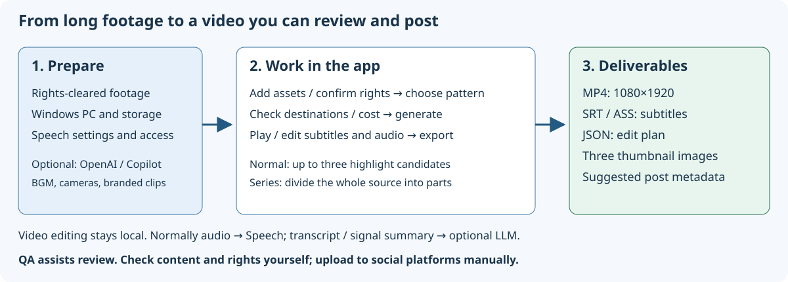

# VideoCreator

A local web app that automatically finds highlights and produces **vertical shorts (1080×1920)** with subtitles and emphasis captions: choose a long video, then **choose an editing pattern**.

Documentation: [日本語](../../README.md) / **English** / [简体中文](../zh-CN/README.md) / [한국어](../ko/README.md).

## First-time users: preparation → operation → deliverables

**Create subtitled videos from footage you have permission to use, and review them before posting.** Selecting footage does not publish it. Compare and revise candidates, export the files, and post them yourself.

| What you need | What you do in the app | What you get |
|---|---|---|
| Windows 10/11 (x64 / ARM64), Internet, storage | Install prerequisites and launch with `run.cmd` | A local web app in your PC's browser |
| An authorized MP4 / MOV / MKV / WebM (10 seconds–3 hours); speech if you need subtitles | Create a project, add assets, confirm rights | Source analysis and timestamped transcription |
| **Your own** Azure Speech-compatible resource, endpoint, and permissions; a Microsoft Foundry deployment or signed-in Copilot CLI for AI selection | Choose a pattern, check costs and destinations, generate | Up to three short candidates and low-resolution previews (sometimes fewer than three) |
| Time to review | Check subtitles, sound, framing; revise and export | Vertical MP4 (1080×1920, H.264/AAC), SRT, ASS, edit-plan JSON, three thumbnails, proposed posting metadata |



Start with **one video + P4 “Clip (long video → 30 seconds)” + Standard narrowing**. Series mode divides the whole source into installments rather than selecting highlights. Try BGM, multiple cameras, opening clips, and transitions after successfully exporting your first video.

> **Important:** Although this is a local web app, it normally sends audio to Azure Speech for subtitles. “Do not use LLM” / “No-LLM mode” does not mean completely offline. Rights checkboxes and automatic QA do not guarantee actual authorization, faithful content, or compliance with posting-platform rules. Example endpoints belong to the distributor: replace them with your own. Setup does not create Azure resources or rewrite endpoints.

### Display language and video language

The **UI display language and project video language are independent**. Choose the video language on the project screen. Supported video languages are Japanese (`ja-JP`), English (`en-US`), Simplified Chinese (`zh-CN`), and Korean (`ko-KR`). The Project field is `language`; the API's snake_case representation is also `language`. Changing the interface language does not change a project's video language. The browser stores UI language separately. Existing edit plans preserve their original language; generate new candidates after changing project language. Chinese/Korean rendering requires the matching fonts downloaded by `scripts/get-tools.ps1`, and explicitly fails if they are missing.

### Guides

- [User guide index](users-guide/README.md): reading paths and terminology
- [Quickstart](users-guide/quickstart.md): preparation and your first video
- [Screens and components](users-guide/screens.md): SVG screenshots of the real app and what controls mean
- [Troubleshooting and QA](users-guide/troubleshooting.md)
- [Technical reference for software engineers](users-guide/technical-reference.md): architecture, data/timelines, extension points
- [Configuration and API reference](users-guide/configuration-api.md)
- [Documentation verification and screenshot regeneration](users-guide/verification.md)
- [Documentation brief and requirement/verification mapping](users-guide/documentation-brief.md)


Screenshots embed actual app captures in SVG. Their subtitles are test data, not recognition results for the synthetic footage/audio. Displayed costs are calculated estimates, not charges incurred in this verification.

- Requirements: [docs/PRD.md](docs/PRD.md) / research: [docs/VideoCreator-AnalyticsReport.md](docs/VideoCreator-AnalyticsReport.md)
- Implementation and verification history: [docs/IMPLEMENTATION.md](docs/IMPLEMENTATION.md)

## Main features

| | |
|---|---|
| Assets | Drag/drop or full path; ffprobe validation (VFR, rotation, missing audio); mandatory rights confirmation |
| Transcription | Azure AI Speech **Fast Transcription** (word timestamps, diarization, phrase lists, keyless authentication) |
| Selection | Microsoft Foundry (**Structured Outputs**) or **GitHub Copilot (SDK invokes the CLI installed on the OS)**. Long sources are signal-filtered, split, and reranked. Falls back to audio excitement when selection fails |
| Editing | Sentence-boundary snapping, duration adjustment, cold opens (highlight teasers), silence jump cuts + punch-ins, 9:16 blurred backgrounds |
| Captions | Japanese line-breaking rules (no initial particles/small kana, balanced two-way splits), emphasis, hooks, headings, automatic shrinking to prevent overflow |
| Quality | Automatic QA (PRD §13): duration, resolution, **−14 LUFS / −1 dBTP**, **measured caption safe areas**, speech truncation, **caption factuality**, rights. Hard violations block export |
| Output | MP4 (H.264/AAC), SRT, edit-plan JSON, ASS, three thumbnails, proposed posting metadata |
| Series | Specify **2–20 parts or a duration per part (e.g. 15 minutes)**; immediately see an estimated part length (after estimated silence removal when a transcript exists). The whole source receives the same subtitles, emphasis, jump cuts, vertical framing, and QA, divided into **first/last parts (a middle part for three; episode n for four or more)**. Boundaries follow **topics**, not the clock: AI chapters, lexical/semantic embedding changes, and topic-transition expressions. **Topic boundaries are the primary candidates; modest duration imbalance is preferable to breaking a topic.** Only insufficient boundaries trigger a warning and length-first fallback. Dynamic programming combines topic and **discourse boundaries** (complete preceding sentences, whether the next sentence depends on the previous one—“so,” “because,” etc.—laughter endings, fades/cuts), to produce the requested count and balanced lengths. Avoids unfinished speech (“…but,” “this is a little…”); pauses recover sentence endings missing punctuation. Warns about within-topic splits and incomplete endings; see [implementation §§14–15](docs/IMPLEMENTATION.md). Each part contains “highlight teaser → recap → main content with chapter headings → continuation notice and next-part teaser.” Metadata includes YouTube-eligible chapters and series-link placeholders (no #Shorts for videos longer than three minutes) |
| Opening / closing | Register a folder of channel **opening/closing videos** under “3. Generate.” Filenames containing Opening / Closing identify roles; matching 9:16 or 16:9 variants are selected automatically. Rights confirmation is mandatory. The opening follows the highlight teaser; the closing comes last. Volume is matched to the main video, then the whole output is normalized to −14 LUFS. **Clips smaller than the output (1080×1920) are enhanced once during registration**: lanczos enlargement plus only contour details from Real-ESRGAN AI super-resolution. VMAF/XPSNR measured on that same clip must show better source fidelity than lanczos before enhancement is used. Runs in the background; approximately 1–2 minutes per clip on GPU |
| Reaction freeze cards | After a P3 AI reaction or at a topic transition, insert a **2–3 second (default 2.5 s) card that pauses footage and source audio**. A registered image (or original background panel) fills the screen; text pops in, card-specific BGM plays, then the video resumes. AI derives **the audience's reaction** (“Come on!”, “Awesome!”, sympathy/praise/reactions) from adjacent scenes; fixed phrases are used without AI. Choose Auto (default), overlay reaction captions (no freeze), or Cards. Auto freezes only after completed utterances with a pause; ongoing exchanges, proximity to another card, or total freeze time above 10% use overlays instead. Notes explain the choice. AI text blocks export until approved. Review lets you edit, approve, or individually disable text. Subtitles, sound effects, and chapters shift automatically by inserted durations; normal subtitles do not appear over cards ([implementation and verification](docs/IMPLEMENTATION.md)) |
| Automatic multi-asset synchronization | Synchronize cameras/screen recordings of the same scene from **audio with subframe precision**. Searches the entire recording despite start times minutes apart, handles audio tracks starting later than video, and measures/corrects **clock drift (ppm)** in long recordings. Accepts only agreement across multiple windows; shows offset (ms), drift, matching-window count. Assets without audio use capture timestamps and show warnings |
| Screen explanation (P10) | Automatically distinguishes **PC screen recording + presenter camera** using low motion and face presence, with reasoning displayed. During screen activity or screen-referencing speech (“here,” “click”), uses **screen + circular presenter inset**; during idle screens, switches to **full-screen presenter**. Vertical output **automatically zooms/pans to the active area** for readable text, positions the inset away from active/text-dense areas, and keeps captions off the screen ([implementation and verification](docs/IMPLEMENTATION.md)) |

All **P1–P10 editing patterns** are available, including BGM/SFX, reaction/onomatopoeia captions, face-following vertical framing, multicamera switching, screen + inset, beat synchronization, and fast-forward ([presets](../../presets)). Long-source narrowing (Economy / Standard / Full text) is selectable in the UI.

Use **“Choose folder…”** for opening/closing registration: the standard .NET `FolderBrowserDialog` has Explorer-style address bar, search, Quick Access, and remembers the previous folder. Confirm rights after selection, then click Register. Manual full-path entry remains available; Cancel leaves input unchanged.

Without a card image, choose **Create / Do not create** under **“Create transition images from video”** per project (default Do not create; existing projects with images default Create). Create extracts 2–6 representative frames (default four) from rights-confirmed sources or **registered opening/closing clips** (vertical/horizontal variants). Registration's rights confirmation authorizes those clips; arbitrary unregistered files cannot be supplied. Unregistering a clip disables images derived from it. Do not create retains existing images but excludes them from subsequently generated candidates (transitions become text cards). Visual change, brightness, and time distribution reject black/white/similar frames; nearly static footage can yield fewer images. This does not guarantee semantic highlights. Review images and source times on screen. PNGs stay in project `scene-cards`; no external AI receives them. Registered shared images and previously created images are not overwritten. Extraction enables transitions and cycles images through **subsequently generated/regenerated candidates**. Shared registered card images take precedence. Text-card and AI-text approval flows remain unchanged; revoking source rights also blocks image-based exports.

During “3. Generate,” export, and “Update preview,” bars show **overall progress** and **the running subtask's progress**. Proxy creation, shot detection, preview composition, and export measure FFmpeg `-progress` (output time / output duration); overall progress never moves backward. Transcription/AI selection use an indeterminate animated bar rather than invented percentages. Measured subtasks also estimate remaining time from elapsed time. Preview-refresh progress is available at `GET /api/editplans/{id}/preview/progress` ([progress.http](../../src/VideoCreator.App/progress.http)).

On Candidates (also series), click **“Approve this content”** per candidate, then batch-export **one or several** approved selections. Approval records an edit-plan SHA-256 fingerprint, approver, and time. Changes in Review produce “Modified after approval (reapproval required)” and block export. Hard-QA failures cannot be approved. Batch export validates every selection first: if any is unapproved, modified, exporting, or failing, **none starts**, and reasons appear. Export proceeds sequentially by rank (part order for series), using the approved snapshot even if edited while queued. Each candidate shows progress, completed-video links, or failure reasons. Queued exports can be canceled; active exports finish to avoid partial files. Individual exports from Review remain available ([exports.http](../../src/VideoCreator.App/exports.http)).

In **Settings → Project storage**, type a folder or select it with the OS “Choose folder…” dialog, then explicitly choose **Move everything / Do not move** (no default). “Review details” lists projects, other files, total size, same-drive status, free space, and problems before applying. Same-drive moves rename directories; cross-drive moves copy, verify file counts/sizes, then remove originals. Stored absolute paths to moved assets (uploads, BGM, previews, exports, transition images, registered openings, etc.) are rewritten in one transaction; historical FFmpeg command records stay unchanged. Name collisions, insufficient space, nested/self/project-folder destinations, or generation/export in progress prevent any move. A locked item stops the process and lists moved and retained items (both remain usable). After interruption, startup automatically recovers from data-folder `projects-move.json`. With Do not move, deleting a project still recycles its original folder ([projects-dir.http](../../src/VideoCreator.App/projects-dir.http)).

File selection/drag-and-drop in “1. Choose assets” supports large MOVs above 128 MiB without an app-specific asset request limit. Incoming data buffers in `ASPNETCORE_TEMP` (OS temporary folder if unset), then copies to project `assets`; both locations need the source size in free space. On one drive allow roughly twice the source size. **Full-path input avoids this copy** by referencing the original. Other API request limits are unchanged.

## Requirements

- Windows 10/11 (x64 / ARM64) and Internet. **`run.cmd` installs the other software automatically** (below).
- Azure (required for transcription/subtitles; AI selection optional): a Fast Transcription-compatible resource, your own endpoint, and `Cognitive Services User` for the user. Microsoft Foundry additionally needs a compatible model deployment and `Cognitive Services OpenAI User`. Keyless authentication uses an Azure CLI or equivalent sign-in. See [quickstart](users-guide/quickstart.md#2-prepare-your-cloud-settings).
- For GitHub Copilot: signed-in GitHub Copilot CLI (install with `run.cmd --setup --with-copilot`).

## Setup and launch

**Easy launch (Windows):** double-click root `run.cmd` (or run `.\run.cmd` in a terminal).

1. First run installs/configures missing prerequisites; later runs perform quick checks.
2. Every launch builds current sources, starts the app, then opens <http://127.0.0.1:8765/> in the **installed/configured Windows default browser** (or the configured-port URL). `run.cmd` explicitly enables browser launch; it installs no browser and creates no profiles. Failure to open shows a warning/URL. Build failure, `--check`, and `--no-start` launch neither app nor browser.
3. Close the launch window or press Ctrl+C to stop.

First-run [scripts/setup.ps1](../../scripts/setup.ps1) runs under built-in Windows PowerShell 5.1; no prior installation is needed. Reruns skip installed components.

| Component | Method |
|---|---|
| .NET SDK 10 satisfying `global.json` | winget; without winget, official `dotnet-install.ps1` installs per user without administrator access |
| FFmpeg, Japanese font, face detector, enhancement model | [scripts/get-tools.ps1](../../scripts/get-tools.ps1) downloads to `tools/`; model hashes verified |
| Azure CLI | winget, or official MSI with administrator prompt |
| Azure sign-in | Opens `az login` if not signed in |
| Azure connectivity | **Minimal requests with real tokens** to configured Speech/OpenAI (one-second silent transcription, short response); checks HTTP responses. For 403 (missing roles), displays assignment command and assigns to the user on consent |
| GitHub Copilot CLI | Optional; installed only with `--with-copilot` |

Results show `OK` / `INSTALLED` / `WARN` / `FAIL`. Any `FAIL` prevents launch. Azure issues are `WARN`: the app starts, but subtitles will not work.

| Command | Behavior |
|---|---|
| `run.cmd` | Initial setup or later quick checks, then always build and launch |
| `run.cmd --check` | Inspect without changing anything (includes Azure connectivity) |
| `run.cmd --setup` | Repeat setup then launch (after role assignments or PC changes) |
| `--with-copilot` / `--assign-roles` / `--skip-azure` / `--non-interactive` / `--no-start` | Install Copilot CLI / assign missing roles without confirmation / skip Azure / no prompts or sign-in windows / setup only |

The app uses `DefaultAzureCredential`. A different Visual Studio account may take precedence; set `AZURE_TOKEN_CREDENTIALS=AzureCliCredential` to force Azure CLI credentials.

**Manual launch**

```powershell
powershell -ExecutionPolicy Bypass -File scripts/setup.ps1   # First run only; -CheckOnly just checks
dotnet run --project src/VideoCreator.App -c Release
# → Opens http://127.0.0.1:8765/ in your browser
```

Configure the `VideoCreator` section of `src/VideoCreator.App/appsettings.json`.

| Key | Default | Description |
|---|---|---|
| `Asr:Endpoint` | — | `https://<resource>.cognitiveservices.azure.com/` (custom domain required) |
| `Llm:Provider` | `azure-openai` | `azure-openai` / `copilot` / `none` (also selectable in Settings) |
| `Llm:Endpoint` / `Deployment` | — / `gpt-chat-latest` | `https://<resource>.cognitiveservices.azure.com/openai/v1` |
| `Llm:SingleCallCharBudget` | 12000 | Longer transcripts are signal-filtered and split (NFR-COST-03); increase for quality |
| `LocalOnly` | false | true disables AI (LLM) selection; subtitles still use Azure AI Speech |
| `DataDir` / `ProjectsDir` | `%LOCALAPPDATA%\VideoCreator` / `Videos\VideoCreator` | Database/cache / projects and exports (`ProjectsDir` is editable in Settings; the UI value takes precedence) |
| `Dictionary` | [] | Proper nouns for transcription phrase lists and caption factuality checks |

## Versioning

Root [Directory.Build.props](../../Directory.Build.props) `VersionPrefix` is the single source for app version, shared by App/Core assemblies and `dotnet build` / `dotnet publish`. Find it in Settings → App version, `GET /api/health` `version`, and startup logs. `informational_version` and UI Build information include the SDK-added Git commit identifier (`+...`) for Git builds, but do not identify uncommitted changes.

Follow Semantic Versioning (`MAJOR.MINOR.PATCH`): breaking changes increase MAJOR, compatible features MINOR, fixes PATCH. `ui/package.json` identifies private UI build tooling, not the app. Preset and stored-data schema versions are independent.

Release steps:

1. Update `VersionPrefix` in `Directory.Build.props`, without duplicate `.csproj` values.
2. Run the tests/build below; inspect Settings and `/api/health`.
3. After committing, tag that commit `v<version>` (e.g. `v1.0.0`). Tags record releases; they do not set versions. Do not retarget published tags.

```powershell
dotnet test --project tests\VideoCreator.Tests --filter-class "*VersionTests"
dotnet build src\VideoCreator.App -c Release
# Verify a running app's API and Settings in Edge (requires ui dependencies)
node ui\verify-version.mjs http://127.0.0.1:8765 1.0.0
# Produce distribution artifacts only if needed
dotnet publish src\VideoCreator.App -c Release
# Prerelease example (omit VersionSuffix for stable releases)
dotnet build src\VideoCreator.App -c Release -p:VersionSuffix=rc.1
```

Assembly/file numeric versions use SDK-standard `MAJOR.MINOR.PATCH.0`; display/product versions use `MAJOR.MINOR.PATCH[-suffix][+commit]`. Rebuild normally after prerelease verification to restore stable artifacts.

## Tests

```powershell
dotnet test --project tests/VideoCreator.Tests   # 151 tests, including FFmpeg/face-model integration tests; requires tools/
cd ui; npm ci; node e2e.mjs ..\path\to\video.mp4 # Running-app E2E; headless OS Microsoft Edge
```

`spikes/*.cs` are standalone proofs made before integrating features (e.g. `dotnet run spikes/01-ingest.cs`).

## Structure

```
src/VideoCreator.Core   Ingest, signals, ASR, selection, constraint solver, captions, ASS, renderer, QA, SQLite storage
src/VideoCreator.App    ASP.NET Core (127.0.0.1 only) + Fluent 2 Web Components UI
presets/                P1–P10 editing patterns (JSON; adjustable without app updates)
tests/                  xUnit v3
ui/                     Fluent UI bundle (esbuild), icon generation, E2E
spikes/                 Small verification programs
```

Design principle (PRD §6.1): **AI decides; the renderer builds deterministically.** AI decisions become an edit-plan JSON; FFmpeg generates footage solely from it. Code, not prompts, enforces hard constraints.

## Security

- Listens only on 127.0.0.1, without authentication (single-user local use). Host validation prevents DNS rebinding; mutating APIs require `X-VideoCreator: 1` (cross-site requests cannot send it). CSP enabled.
- Keyless Azure (`DefaultAzureCredential`); local authentication disabled on resources.
- Only audio and transcript text go to cloud services, not video frames.
- FFmpeg starts with an argument array, without a shell. ASS control characters are escaped. Writes are confined to project directories.

## License

MIT ([LICENSE](../../LICENSE)). Intended font M PLUS 1p uses SIL Open Font License; FFmpeg (BtbN GPL build) uses GPL; Real-ESRGAN realesr-animevideov3 enhancement model (Xintao Wang) uses BSD 3-Clause. These are downloaded by `scripts/get-tools.ps1`, not included in the repository.
