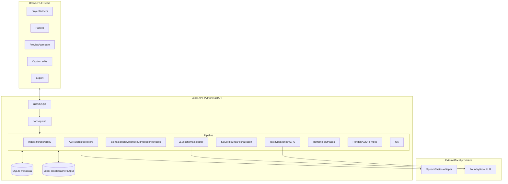
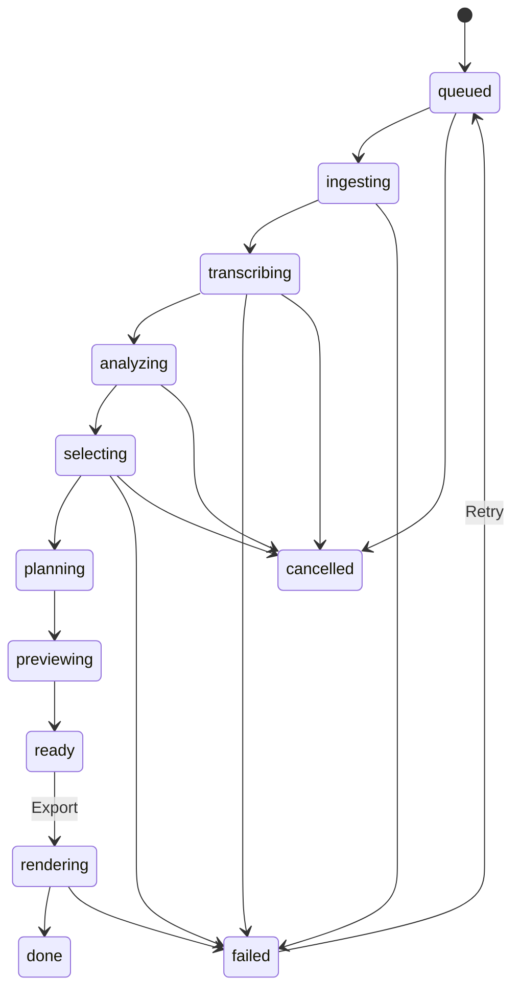
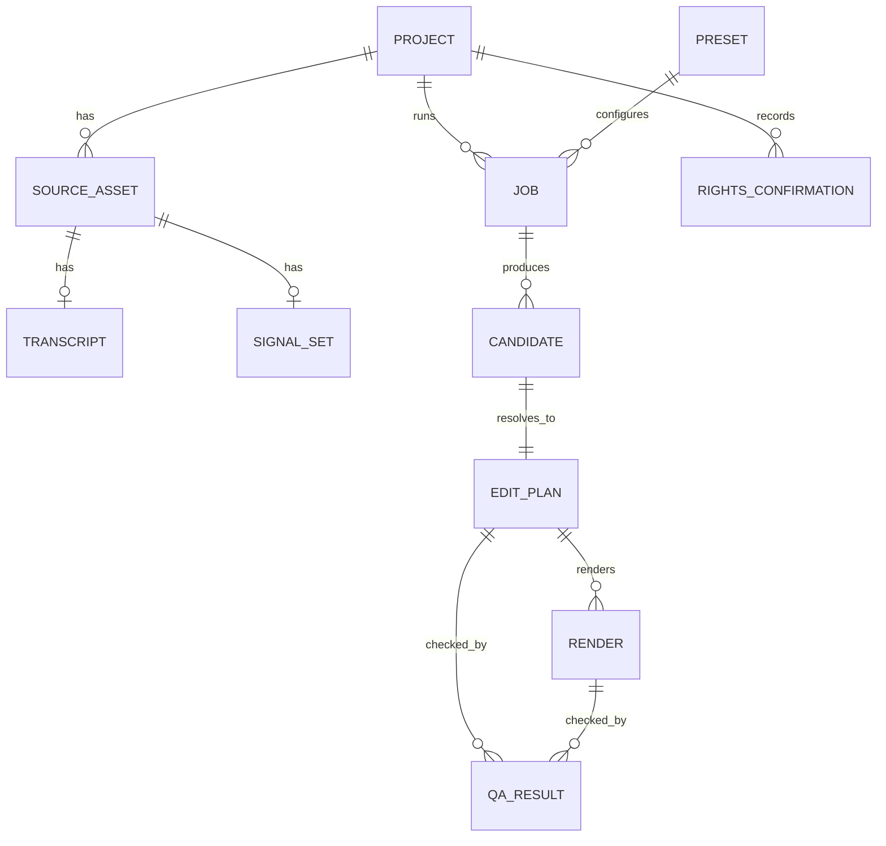

# VideoCreator — Product Requirements Definition (PRD)

[↑ Documentation map](../README.md) | [日本語](../../../docs/PRD.md) | **English** | [简体中文](../../zh-CN/docs/PRD.md) | [한국어](../../ko/docs/PRD.md)


| Item | Value |
|---|---|
| Document ID | VC-PRD-001 |
| Version | 1.2.7 (copy posting text and timestamped chapters for exported videos) |
| Created | 2026-11-07 |
| Updated | 2026-11-10 |
| Status | Draft, awaiting review |
| Evidence | [Research report](VideoCreator-AnalyticsReport.md), called “report”; its sections use `R§x.y` |
| Audience | Product owners, developers, QA, designers |

### Revision history

| Version | Date | Changes | Classification |
|---|---|---|---|
| 1.0 | 2026-11-07 | Initial | — |
| 1.1 | 2026-11-07 | Reflect implementation: revise NFR-SEC-04 (ASR still transmits in local-only), add FR-SEL-10 scope selection, ship P1/P3/P8, preview P5/P7 (§17) | Implementation |
| 1.2 | 2026-11-08 | Audit: (1) rename US-11 no-LLM, disclose destinations (NFR-SEC-04/AT-10/RK-06), define full offline separately in v2; (2) split QG-01 leakage/completion/count/first-pass with denominators; (3) rename H-07 unsupported-token check, add H-11/S-09/FR-REV-06/AT-13 speech grounding; (4) staged QA/not_run; (5) define infeasible CPS behavior, full SRT exempt; (6) up to three, explain shortages AT-14; (7) strength/source/date in §5.2, C-8/S-10 copyright claims over one minute; (8) preregister blind analysis §15.2; (9) plan_hash binds approvals/QA/render/artifacts FR-REV-07; (10) expand reproduction conditions NFR-REL-04; (11) repair evidence links, preview-release notation, missing FR-SEL-10 definition | Existing: no-LLM-but-ASR behavior, CandidateApproval.PlanHash invalidation, FR-SEL-10; others new requirements |
| 1.2.1 | 2026-11-08 | Implement/verify labels/destinations, QA stages/not_run/hash, ≤0.5 s subtitle extension/clip limits, decoded-frame comparison/provenance; static-library identity via executable SHA-256. Add §15.6 uncalibrated targets/shipping blockers | Implementation; designated AT-01, real-cloud AT-10, gates still not passed ([report](IMPLEMENTATION.md)) |
| 1.2.2 | 2026-11-08 | Complete P4 both modes on authorized 18-minute footage; distinguish ASR/LLM HTTP methods/paths for AT-10; suppress authentication-child Azure CLI telemetry in app environment | AT-10 passes this CLI setup; AT-01/13–15/gates remain not passed ([traffic verification](IMPLEMENTATION.md)) |
| 1.2.3 | 2026-11-09 | H-11/S-09, short rejection/count reasons, approval/QA/output invalidation, render-race rejection/quarantine; separate camera/chapter S-13/14 | AT-13–15 pass counterexamples/real FFmpeg/API/Edge fixture. AT-01 intentionally incomplete per user. QG-01–04 lack real corpus/independent sheets/reference labels; thresholds/denominators unchanged ([record](IMPLEMENTATION.md)) |
| 1.2.4 | 2026-11-10 | Repair button incorrectly shown for impossible repairs: FR-REV-11 preflight/buttons, FR-REV-12 reasons, word-based rather than caption-ID acceptance in FR-REV-09; §13.3 advice/classes; define existing S-11/12 and Q-9 source gap; AT-16 promise/result consistency, AT-17 verbatim repair; record S-01 vs real speech in §15.6/Q-8 | Implemented; AT-16/17 automated pass. Six-char threshold unchanged ([report](IMPLEMENTATION.md)) |
| 1.2.5 | 2026-11-10 | Multiple videos from one Job: Stage 5 individual review, Stage 6 batch. Add US-13, FR-REV-13/14, FR-EXP-05/06; document approval/batch APIs, E-NOT-APPROVED/E-EXPORT-BUSY, exports stage; SC-5–7, AT-18/19, Q-10 code consistency | Existing implementation reflected; AT-18 Edge with mock APIs, AT-19 real Kestrel/FFmpeg pass; Q-10 records unchanged behavior |
| 1.2.6 | 2026-11-10 | Decide Q-10(b), align batch/single render codes: per candidate unapproved→changed→hard-fail→busy, include code and QA/render_id detail; top status/code earliest applicable across all, single selection same as direct. Update FR-EXP-05/§10/AT-19 | Code changes, all-or-none preflight/reason list unchanged; real tests pass |
| 1.2.7 | 2026-11-10 | Copy engaging YouTube/Viva Engage descriptions and `00:00 Chapter title`: US-14/Should, official C-9, FR-EXP-07–09, masked-only transcript in FR-EXP-03, GET/POST post, SC-7, AT-20/21, Q-11 | Includes fixing unmasked transcript transmission. PostCopyTests pass; AT-21 authorized 541.6 s production output/Edge pass. Unverified platform behavior labeled “contents,” not asserted |

---

## Contents

1. [Background/goals](#1-background-and-goals)
2. [Terms](#2-terms)
3. [Personas/use cases](#3-personas-and-use-cases)
4. [Scope](#4-scope)
5. [Assumptions/constraints/dependencies](#5-assumptions-constraints-dependencies)
6. [Architecture](#6-system-and-architecture)
7. [Functional requirements](#7-functional-requirements)
8. [Patterns](#8-editing-pattern-specification)
9. [Models](#9-data-model)
10. [API](#10-api)
11. [UI/UX](#11-uiux)
12. [Nonfunctional](#12-nonfunctional-requirements)
13. [QA](#13-automatic-qa)
14. [Acceptance](#14-acceptance)
15. [Evaluation](#15-kpis-and-evaluation)
16. [Risks](#16-risks-law-ethics)
17. [Releases](#17-release-milestones)
18. [Open decisions](#18-open-decisions)
19. [Traceability](#19-traceability)
20. [Appendices](#20-appendices)

---

## 1. Background and goals

### 1.1 Background

- Turning >1-hour streams/interviews/lectures/Vlogs into ~30-second vertical Shorts/TikTok manually takes hours per output.
- Report R§0/R§3 decomposes popular editing into **measurable variables**: opening-hook duration, re-engagement interval, shot length/consistency, caption length/speed/size/position, loudness, looping.
- Fixing these as **pattern presets** allows AI + deterministic rendering automation (R§5).

### 1.2 Vision

> **Select footage, select a pattern, receive enjoyable short candidates.**

### 1.3 Goals

| ID | Goal | Measure |
|---|---|---|
| G-1 | Automatically generate publishable vertical candidates from one long source | Completion/count fulfillment/pre-edit QA QG-01; adoption §15 |
| G-2 | Reproduce entertaining hooks/tempo/captions/loops with presets | Beat baseline in blind pairs §15.2 |
| G-3 | **Reliably** meet duration/aspect/safe-zone/loudness constraints | Zero exported hard violations of official/internal mandatory §5.2 |
| G-4 | No advanced editing skills; only select/review/correct | Actions/time §15.3 |
| G-5 | Rights/AI disclosure/factual accuracy | Rights-flow completion; zero H-07/H-11 violations **and** zero human-audit factual errors (AT-13 counterexamples/export samples). Automation alone does not guarantee accuracy |

### 1.4 Non-goals

| ID | Excluded | Reason |
|---|---|---|
| NG-1 | Multitrack/keyframes/grading timeline | No advanced editing; not competing with professional NLE |
| NG-2 | Synthesized voice/face saying unspoken words | Ethics/disclosure R§2/5.7 |
| NG-3 | Downloading others' videos/URL clipping | Terms/copyright R§1.3/5.7 |
| NG-4 | Automatic social posting in v1.0 | API/account risk; reconsider v2 |
| NG-5 | Gaming recommendations/guaranteeing virality | Private algorithms; aim to improve, not guarantee |

---

## 2. Terms

| Term | Definition |
|---|---|
| Source video | User-selected input file |
| Project | One editing workspace, one or more sources/results |
| Pattern/preset | Editing parameter set P1–P9 (§8) |
| Candidate | AI-selected ranges/scores/reasons |
| EditPlan | Solver-resolved, **deterministically renderable** EDL-like JSON (§9.3) |
| Rendering | FFmpeg file generation from EditPlan |
| Caption/telop | All on-screen text, types ①–⑥ (§7.6) |
| Safe Zone | Region not covered by platform buttons/captions R§2.1 |
| Hook | Opening result/anomaly/question/claim retaining attention |
| Loop | Semantic/visual ending-to-opening connection |
| CPS | Characters per second |
| LUFS/dBTP | ITU-R BS.1770 loudness / True Peak |
| ASL | Average shot length |
| Punch-in | Approximately 1.1–1.2× digital simulated camera change |
| No-LLM mode | No selection/text LLM (US-11); audio still sent to ASR, default Speech. Compatibility setting remains `LocalOnly` |
| Fully offline | Local ASR/LLM, zero external transmission; v2 §4.1 |
| plan_hash | Canonical EditPlan JSON SHA-256, EditPlanFingerprint; binds approval/QA/render/artifacts |

---

## 3. Personas and use cases

### 3.1 Personas

| ID | Persona | Situation | Need | Patterns |
|---|---|---|---|---|
| PS-1 | Solo gaming/chat streamer | Weekly 2–3-hour archives | Quickly clip laughs/reactions | P4/P1/P3 |
| PS-2 | Business channel | Weekly hour interviews/lectures, multicam | Key-point clips/switching | P4/P6/P7 |
| PS-3 | Cooking/DIY/travel creator | Long process footage | Compress tempo/preserve sound | P8/P5/P9 |
| PS-4 | Corporate PR/marketing | Seminars/events | Accurate captions, brand safety | P4/P6 |

### 3.2 User stories

| ID | Story | Priority |
|---|---|---|
| US-01 | PS-1: select two-hour archive + Clip, receive up to three 30-second vertical candidates without searching manually; know count/reason if insufficient | Must |
| US-02 | All: reasons/scores for faster adoption decisions | Must |
| US-03 | All: easily correct text, no timeline | Must |
| US-04 | All: output meets duration/aspect/loudness/visible-caption specifications | Must |
| US-05 | PS-2: two cameras + one audio, automatic speaker switching | Should |
| US-06 | PS-1: television-style reactions, mandatory review before publication | Should |
| US-07 | PS-3: no text/BGM, ambient minimal editing | Should |
| US-08 | All: regenerate “shorter/another scene” | Should |
| US-09 | PS-4: names/numbers match speech | Must |
| US-10 | All: save video/SRT/JSON | Must |
| US-11 | All: no LLM for confidential footage; know external data/destinations (transcription audio only) beforehand | Could |
| US-12 | PS-2: 3–5-minute landscape digest | Could |
| US-13 | All: individually review/approve same-pattern candidates/parts, export together without losing review/export status | Should |
| US-14 | All: copy enjoyable YouTube/Viva Engage description and `00:00 Chapter title` list; avoid writing copy and manually locating chapters | Should |

---

## 4. Scope

### 4.1 MoSCoW

| Class | Scope |
|---|---|
| **Must (MVP v0.1–v1.0)** | One source, ASR, signals, LLM highlights, solver, blur 9:16, text①②④, ASS, loudnorm, QA, up to three previews, text corrections, MP4/SRT/JSON; **P4**, P6, P2 |
| **Should (v1.x)** | Face tracking, text③⑤⑥, BGM ducking/SFX, regeneration instructions, same-Job individual review/batch export (US-13, distinct from Could batch processing), copy posting text/chapters US-14 without posting; P1/P3/P7/P8/P9 |
| **Could (v2)** | P5, landscape digest, fully local ASR/LLM zero-transmission mode, multimodal visual understanding, batch processing, English UI/subtitles |
| **Won't** | NG-1–NG-5 |

### 4.2 Inputs/outputs

| Class | Specification |
|---|---|
| Containers | MP4/MOV/MKV/WebM |
| Codecs | H.264/H.265/VP9/AV1/ProRes decodable by FFmpeg |
| Resolution | 720p–4K; internally downscale 4K to1080p |
| Duration | 10 s–3 h; >3 h warn/suggest split, not error. Below preset minimum/few scenes may yield fewer than three FR-SEL-08 |
| Audio | Required; silent warns except P9 |
| Video output | H.264 High,1080×1920, source fps≤60/default30, CRF18–20,+faststart |
| Audio output | AAC-LC48k stereo192kbps,−14±1 LUFS,TP≤−1 dBTP |
| Sidecars | Full selected speech SRT, distinct from burned-in①/exempt S-01; EditPlan JSON; three PNG thumbnails; same plan_hash |

---

## 5. Assumptions, constraints, dependencies

### 5.1 Assumptions

| ID | Assumption | Verification |
|---|---|---|
| A-1 | Greenfield, no existing app | Only LICENSE/work on2026-11-07 |
| A-2 | **Local web app**, browser + API, avoids uploading large files | Q-1 final |
| A-3 | UI/docs Japanese/English/Simplified Chinese/Korean. Per-project video language independently propagates through ASR/verbatim subtitles/decorative text/rendering/post copy. No automatic subtitle translation | Q-5 |
| A-4 | Swappable AI abstraction; default Speech/Foundry | Q-2 |
| A-5 | Only owned/authorized sources | FR-ING-06 |

### 5.2 Constraint strengths and sources

Only official/internal mandatory constraints may become hard H checks. External standards/recommendations require explicit internal adoption and rationale.

- **Official mandatory:** platform conditions; failure can block delivery.
- **External standard:** another organization's delivery standard, not inherently binding.
- **Internal mandatory:** product's own quality commitments, hard QA.
- **Recommendation/hypothesis:** heuristics/secondary sources; calibrate §15.5.

| ID | Constraint | Class | Source/date |
|---|---|---|---|
| C-1 | Square/vertical Shorts≤180 s, uploads since2024-10-15 | Official | YouTube15424877 verified2026-11-08; R§2 S1 |
| C-2 | Shorts music≤90 s/track, some60/30 | Official | Same |
| C-3 | Burned① default≤14 full-width/line,≤2 lines,≤6 CPS; relax Netflix13/2/4 for fast vertical. S-01/02 soft | Internal informed by external | Netflix/R§2/3.3 S5 |
| C-4 | Avoid top250/bottom580/right160/left60 at1080×1920; headings permitted300top. No official pixel guarantee; conservative approximation from report ranges bottom580–670/right160–190. Adopt H-05 | Internal adopted recommendation | R§2.1 S11/12 secondary |
| C-5 | −14±1 LUFS,TP≤−1; avoid quiet audio because YouTube attenuates only. H-03/04 | Internal adopted recommendation | R§2/3.4 S7 secondary |
| C-6 | Notify AI-use disclosure when realistic synthesis/alteration | Official | R§2 S9 |
| C-7 | No Shorts A/B; quasi-experiment | Official evaluation limit | R§6.3 S10 |
| C-8 | >1-minute Shorts with active Content ID/manual claim blocked worldwide, unplayable/unrecommended/unmonetizable;≤1-minute unchanged | Official | YouTube15424877 original verified2026-11-08 |
| C-9 | Chapters start00:00,≥3 ascending,each≥10 s; otherwise not chapters | Official | YouTube9884579 verified2026-11-10 |

> C-8: >60 s (P9 up to90) with user music/third-party assets warns S-10. Update official-source verification dates as policies change RK-07.

### 5.3 Dependencies

| ID | Dependency | Use | Alternative |
|---|---|---|---|
| D-1 | Bundled FFmpeg≥7.x win-x64/arm64/macOS/Linux | Decode/analyze/render/encode | None |
| D-2 | Speech batch/word times/diarization | ASR | Local faster-whisper |
| D-3 | Foundry schema-output model | Highlights/text shortening | Local OpenAI-compatible LLM Could |
| D-4 | PySceneDetect AdaptiveDetector | Shots | FFmpeg select scene |
| D-5 | MediaPipe-like face detector | Should tracking | Must blur |
| D-6 | Redistributable/burnable Japanese font, e.g.Noto Sans JP/M PLUS | Text | OS Yu Gothic UI after license check |

> Report used Yu Gothic UI. Product bundles **redistributable OFL fonts** Q-6.

---

## 6. System and architecture

### 6.1 Principles

| ID | Principle | Why |
|---|---|---|
| AP-1 | **AI decides, renderer builds deterministically** from EditPlan JSON alone | Reproduction/tests/human edits |
| AP-2 | **Not LLM alone**: combine volume/laughter/shots | Hallucinations R§5.3 |
| AP-3 | **Hard limits in code**, not prompts: solver/QA duration/aspect/safe/loudness; approach CPS/line limits through formatting, leave impossible remainder soft S-01/02 for humans, prioritizing fidelity | G-3/C-3 |
| AP-4 | Interfaces for ASR/LLM/faces | Avoid lock-in/no-LLM/future offline |
| AP-5 | Stage caches reuse transcripts/signals across presets | Cost/performance |

### 6.2 Components



### 6.3 P4 sequence

```mermaid
sequenceDiagram
  actor U as User
  participant UI
  participant API
  participant P as Pipeline
  participant AI as ASR/LLM
  U->>UI: Select source/P4/Generate
  UI->>API: POST /api/projects/{id}/jobs
  API->>P: Enqueue
  P->>P: Ingest/proxy
  P->>AI: ASR words/speakers
  P->>P: Shots/volume/laughter/silence
  P->>AI: Transcript/signals selection
  AI-->>P: Up to five candidates JSON
  P->>P: Schema/solver
  P->>AI: Shortening/emphasis
  P->>P: EditPlan/hash/plan QA/low-res render
  P->>P: Preview QA
  P-->>API: Up to three/reasons/scores/staged QA
  API-->>UI: SSE progress/completion
  U->>UI: Select/correct
  UI->>API: PATCH /api/editplans/{id}
  U->>UI: Export
  API->>P: Final render/QA; abort changed hash
  P-->>UI: MP4/SRT/JSON, same hash
```

### 6.4 Job states



---

## 7. Functional requirements

IDs `FR-<area>-<sequence>`; M Must/S Should/C Could.

### 7.1 Projects/ingestion (ING)

| ID | Requirement | Priority | Basis |
|---|---|---|---|
| FR-ING-01 | Users can create a project by selecting one or more local video files. | M | R§5.1 |
| FR-ING-02 | Use ffprobe to obtain duration, resolution, fps, audio channels, and rotation metadata. Reject or warn with a reason when outside §4.2. | M | §4.2 |
| FR-ING-03 | Generate and cache analysis proxies: approximately 720p video and 16 kHz mono WAV audio. | M | AP-5 |
| FR-ING-04 | Normalize variable-frame-rate inputs before analysis so they can be handled as fixed frame rate. | M | Timebase issue in R§5.5 |
| FR-ING-05 | When multiple sources are selected, synchronize automatically using audio cross-correlation and display the offset in milliseconds. | S | R§3.6 |
| FR-ING-06 | Require “I own this material or have permission to use it” confirmation during ingestion, retaining a record. | M | R§5.7/A-5 |
| FR-ING-07 | Reuse existing analysis caches when the same file, identified by matching hash, is ingested again. | S | AP-5 |
| FR-ING-08 | For every generation, let users choose existing-cache reuse, the default, or restarting analysis. Before redo, disclose additional cost and replacement of corrected transcripts. | S | AP-5 |

### 7.2 ASR

| ID | Requirement | Priority | Basis |
|---|---|---|---|
| FR-ASR-01 | Generate transcripts with start/end times for every word, or Japanese morpheme/string unit. | M | R§5.3-1 |
| FR-ASR-02 | Diarize up to four speakers and attach a speaker ID to every utterance. | M | R§3.6 |
| FR-ASR-03 | Reestimate sentence boundaries for Japanese transcripts lacking punctuation, using rules or an LLM. | M | R§5.3-1 |
| FR-ASR-04 | Allow switching ASR providers through configuration: Azure AI Speech or faster-whisper. | M | AP-4/D-2 |
| FR-ASR-05 | Let users register a terminology dictionary of proper/product names, used for ASR phrase lists and telop matching. | S | US-09 |
| FR-ASR-06 | Display the transcript as editable UI text so users can correct recognition errors manually. | S | US-03 |

### 7.3 Signals (SIG)

| ID | Requirement | Priority | Basis |
|---|---|---|---|
| FR-SIG-01 | Detect shot boundaries with PySceneDetect AdaptiveDetector; default `adaptive_threshold=3.0`, `min_scene_len=15` frames. | M | R§5.3/S24 |
| FR-SIG-02 | Calculate a short-time RMS/LUFS-M volume series at 100 ms intervals and its rapid rises. | M | R§5.3-2 |
| FR-SIG-03 | Detect silence at −40 dBFS, using the preset minimum duration in §8. | M | R§3.2 |
| FR-SIG-04 | Detect laughter, cheering, and applause intervals with an acoustic-event classifier. | S | R§5.3-2 |
| FR-SIG-05 | Derive a speech-rate time series, characters/second, from ASR. | S | R§5.3-2 |
| FR-SIG-06 | Sample face locations/counts at 2 fps and store them as time series. | S | R§5.3-6 |
| FR-SIG-07 | Generate an LLM-input JSON signal summary containing the top N peak times/types, within the token budget. | M | R§5.4 |

### 7.4 Selection (SEL)

| ID | Requirement | Priority | Basis |
|---|---|---|---|
| FR-SEL-01 | Give the LLM timestamped transcripts, signal summaries, and selected-pattern rules; request up to five candidates conforming to §20.2 JSON schema. | M | R§5.4 |
| FR-SEL-02 | Validate responses against the schema. Retry at most twice after failure, then use signal-based fallback selection, peak±15 seconds. | M | AP-2 |
| FR-SEL-03 | If transcript exceeds context length, select in roughly ten-minute chunks, then rerank globally using map-reduce. | M | Inputs over one hour |
| FR-SEL-04 | Attach `hook`, `standalone`, `payoff`, and `emotion` scores, each 0–10, plus a one-sentence selection reason. | M | R§5.4/US-02 |
| FR-SEL-05 | Combine signal and LLM scores into a final score. Configurable defaults: LLM0.6, signals0.4. | M | AP-2 |
| FR-SEL-06 | Penalize standalone scores for intervals beginning with demonstratives such as “that/this,” or requiring prior knowledge to understand. | M | R§5.7 |
| FR-SEL-07 | Give the LLM the surrounding ±30 seconds to self-check whether extraction changes the original intent. Exclude candidates if it does. | S | R§5.7 |
| FR-SEL-08 | Merge overlapping candidates with IoU>0.5 as duplicates; present **at most three distinct scenes**. If fewer meet duration FR-SOL-03/quality constraints, never pad with overlapping or invalid intervals. Show actual count/reason, e.g. “Ten-second source below P4's25-second minimum,” or “Only one qualifying scene.” Zero candidates returns `E-SOL-INFEASIBLE`. | M | US-01 |
| FR-SEL-09 | Accept “shorter,” “another scene,” or “funnier” regeneration instructions, excluding previously presented candidates when reselecting. | S | US-08 |
| FR-SEL-10 | For long input, offer Economy/Standard,default/Full narrowing. Show AI transmission amount and cost estimate for every option before selection. Full bypasses narrowing and is outside the NFR-COST-03 target. | S | NFR-COST-01/03 |

### 7.5 Solver (SOL)

| ID | Requirement | Priority | Basis |
|---|---|---|---|
| FR-SOL-01 | Snap interval edges to the nearest sentence ending that is also a shot boundary or silence, searching±1.5 seconds. | M | R§5.3-4 |
| FR-SOL-02 | Guarantee no word straddles±150 ms around an interval edge; prohibit cuts during speech. | M | R§5.6 |
| FR-SOL-03 | Keep total duration within preset limits, e.g.P4 25–35 seconds. Remove lowest-scoring sentences if too long; add neighboring sentences if too short. | M | R§5.2 |
| FR-SOL-04 | When combining intervals, place the strongest hook first as a cold open. Preserve chronological order if reversal would change meaning. | M | R§3.1/5.3-4 |
| FR-SOL-05 | If silence removal is enabled, jump-cut silence above its threshold, while retaining every shot's preset minimum length. | M | R§3.2 |
| FR-SOL-06 | If looping is enabled, evaluate semantic ending/opening sentence connection with an LLM, or frame similarity with SSIM, then choose the highest-scoring endpoint. | S | R§3.5 |
| FR-SOL-07 | Output an EditPlan,§9.3. Identical inputs/settings produce identical plans, deterministically, excluding LLM calls. | M | AP-1 |

### 7.6 Captions (TEL)

Types: ①verbatim speech,②emphasis,③reaction/inner voice,④context heading,⑤onomatopoeia/SFX,⑥numeric counter.

| ID | Requirement | Priority | Basis |
|---|---|---|---|
| FR-TEL-01 | Generate verbatim captions① from ASR. Preset character maximum defaults to14per line; portrait defaults to one line,maximum two. | M | C-3 |
| FR-TEL-02 | Keep ① speech captions verbatim during generation and automatic repair. Do not paraphrase, summarize, omit, or delete words; retain fillers, endings, backchannels, and repetitions, except explicit masking and presentation punctuation/spacing. Approach the preset speed limit, default six characters/second, through splits, merges, boundary adjustments, and display extension that preserve wording/order. Extend at most 0.5 seconds beyond speech, never overlap the next caption or exceed clip bounds. If unresolved, retain text, show S-01 warning and an unrepairable reason. If exporting with acknowledgment, record it in EditPlan provenance. SRT also contains full wording. Distinguish decorative text/cards: appearance-first AI revisions may change wording while preserving facts, evidence, and negation, and require approval. | M | C-3/AP-3/S5 |
| FR-TEL-03 | Break at punctuation/phrase boundaries,not before particles/auxiliary verbs. Follow JIS X4051line-start prohibitions,closing brackets,punctuation,small kana,long-vowel marks,etc.;line-end prohibitions,opening brackets,etc.;and inseparable number-unit pairs,English words,and katakana words. Automatically select caption length within both preset limits and rendered width determined by font,horizontal scaling,outline,and safe zone,considering phrases,breathing pauses,and minimum0.8-second display. Shrink an oversized single word's font rather than splitting it. | M | R§3.3 |
| FR-TEL-04 | For ② emphasis, have the LLM extract at most three keywords per candidate and display each at every occurrence inside the selected range. Where emphasis is sparse, supplement with short exact speech phrases roughly every four seconds, without adding silence events, duplicate overlays, or wording identical to simultaneous captions. Use preset colors/sizes and pop animation. | M | R§3.3 |
| FR-TEL-05 | Generate a heading≤16characters per candidate and display it in a box300px from the top. | M | R§3.3 |
| FR-TEL-06 | Generate P1/P3 editorial reactions③ only when explicitly enabled. Created text is **unapproved**; block export until the user approves. | S | R§5.7/US-06 |
| FR-TEL-07 | For laughter/surprise/silence signals,choose onomatopoeia/effect text⑤ from the preset dictionary,e.g.“Silence…,”and synchronize the corresponding sound effect. | S | R§3.3/3.4 |
| FR-TEL-08 | Extract numbers,days,and amounts with an LLM;display counters⑥ such as “DAY3” or “¥1,000,000.” | S | R§3.1 |
| FR-TEL-09 | **Unsupported-token check:**proper names/numbers in②③④⑥must exist in the original transcript or user dictionary. Automatically remove unsupported text and warn. This detects invented tokens only;it does not guarantee consistency with what was said. FR-TEL-12and FR-REV-06check that consistency. | M | R§5.6/US-09 |
| FR-TEL-10 | Standardize color semantics:white=speech,yellow=emphasis,red=surprise/warning,cyan=supplement. P7 allows fixed per-speaker caption colors. | M | R§3.3 |
| FR-TEL-11 | Save caption styles as themes reusable across projects. | C | — |
| FR-TEL-12 | **Speech grounding:** ②④⑥ containing proper names/numbers require evidence `source_word_ids` from transcribed speech within the candidate interval. Verify (a) normalized names/numbers occur in that linked speech; occurrence elsewhere or only in the dictionary is insufficient; (b) number/unit/subject pairings, e.g. Company A/B, match speech; (c) speaker attribution, such as P7 speaker color, matches the linked speaker; (d) negation in linked speech, but absent from text, triggers S-09, e.g. Japanese “ない,” “ず,” “ません,” “じゃない.” Reactions ③ are not summaries and are exempt from (a)–(c); approval FR-TEL-06 covers them. If ASR misrecognition omits a word, correct the transcript through FR-ASR-06 before reevaluating. | M | US-09/G-5/RK-03 |
| FR-TEL-13 | **Face-avoiding placement:**in newly generated plans,place②–⑥and hooks at fixed positions clear of detected faces,captions,and other decorations throughout their entire display. Analyze portrait footage too;account for crop tracking,zoom,speed,switching,and insets. Reserve the full face-motion range plus32pxmargin and maximum1.12pop scale. If analysis is insufficient or no safe position exists,hide only the decoration and explain in candidate notes. Do not alter①/SRTwording/times. Face detection at2fpsis an estimate,not a guarantee against missed faces/fast movement. Regenerate existing plans to apply. | M | US-07/TEL-02 |

### 7.7 Reframing (RFM)

| ID | Requirement | Priority | Basis |
|---|---|---|---|
| FR-RFM-01 | Convert16:9to9:16 with blurred background:enlarge/crop/`boxblur=20:2`;foreground width1080,position120px above center. | M | R§5.5A |
| FR-RFM-02 | Face-following crop:with exactly one face,crop9:16around it. Smooth position with≥1-second moving average/maximum speed;instant jumps only at shot boundaries. | S | R§5.3-6 |
| FR-RFM-03 | Automatically fall back to blurred background for multiple faces or no detected face. | S | R§5.3-6 |
| FR-RFM-04 | Fit existing9:16or1:1into1080×1920without reframing;add top/bottom background for square sources. | M | C-1 |
| FR-RFM-05 | Apply1.10–1.20×punch-ins to preset-designated intervals,such as emphasis speech or clips after the first. | M | R§3.2/5.5A |

### 7.8 Switching (SWT), P7

| ID | Requirement | Priority | Basis |
|---|---|---|---|
| FR-SWT-01 | Assign speakers/microphones to cameras,automatically using diarization/face positions,with manual correction. | S | R§3.6 |
| FR-SWT-02 | Choose the active speaker's camera. Hold each shot≥2seconds by default,configurable1.5–2.5seconds. | S | R§3.6 |
| FR-SWT-03 | On listener laughter/surprise detected acoustically or by expression,insert a0.8–1.5-second reaction shot. | S | R§3.6 |
| FR-SWT-04 | If a wide camera is assigned,insert wide shots at section starts and every45seconds by default,configurable30–60. | S | R§3.6 |
| FR-SWT-05 | Default to hard cuts. Use0.2–0.4-second crossfades only for scene changes. | S | R§3.6 |
| FR-SWT-06 | Use one user-selected master audio track throughout;camera switching must not switch audio. | S | R§3.6 |
| FR-SWT-07 | When using`xfade`,normalize both inputs with`settb=AVTB,fps=<output fps>`. | S | R§5.5C actual defect |

### 7.9 Audio (AUD)

| ID | Requirement | Priority | Basis |
|---|---|---|---|
| FR-AUD-01 | Normalize output with`loudnorm`to−14LUFS,TP−1.5dBTP,LRA11;two passes recommended. | M | C-5 |
| FR-AUD-02 | Add user-supplied BGM or bundled licensed-library tracks. Allow registering several user tracks together per project. Measure each track's ITU-R BS.1770/EBU R128 loudness, FFmpeg `ebur128`, usable portion excluding leading/trailing silence/fades, tempo, spectral-flux onsets, and spectral-centroid brightness. Duck 0.25 seconds before transcript word times, remaining ducked across gaps <0.8 seconds. Target voice−BGM difference defaults 14 LU, minimum 10 LU; Torcoli et al., JAES 2019, recommend Commentary over Music ≥10 LU. Correct differing track loudness; duck more deeply for quieter speech or musical peaks. Old EditPlans retain `sidechaincompress`. | S | R§3.4/5.5D |
| FR-AUD-08 | **Automatically select for scenes:**divide body into≥20-second scenes at the video's own role switches,transition cards,chapters,crossfades,and source jumps. Use Viterbi dynamic programming to minimize mismatch between scene energy,speech rate/voice/laughter,and track energy,tempo/onsets/brightness,plus switching cost. Use equal-power crossfades,completed inside BGM-stopping inserts. Continue the same track uninterrupted across adjacent scenes;loop only usable portions. Show selection reasons with measured values. | S | R§3.4 |
| FR-AUD-09 | Before export,review allows changing each scene's track,including automatic/no BGM,and gain−12…+6dB;global speech-time voice gap10–30LU;and non-speech BGMlevel0–30LUbelow voice. Record changes in EditPlan. Preview/final measure identically processed voice/BGMstems with`ebur128`,displaying speech-time difference as S-15. | S | US-02 |
| FR-AUD-03 | Synchronize bundled licensed SFX to effect text⑤. | S | R§3.4 |
| FR-AUD-04 | Silence BGM for0.3–1second before a payoff. | C | R§3.4 |
| FR-AUD-05 | Never add commercial tracks automatically;require rights confirmation for user-provided music. | M | C-2/R§5.7 |

### 7.10 Rendering/export (RND/EXP)

| ID | Requirement | Priority | Basis |
|---|---|---|---|
| FR-RND-01 | Generate ASS/filtergraph from EditPlan and complete rendering in one FFmpeg execution. | M | R§5.5 |
| FR-RND-02 | Generate540×960ultrafast previews,target≤15seconds/candidate. They are not final-quality output;mark production-only checks`not_run`. | M | US-02 |
| FR-RND-03 | Render final output to§4.2specifications. | M | §4.2 |
| FR-RND-04 | Log FFmpeg command lines,version,and standard error. | M | AP-1 |
| FR-EXP-01 | Export MP4/SRT/EditPlan/three PNG thumbnails from the same finalized`plan_hash`;include that hash in JSON. | M | US-10/REV-07 |
| FR-EXP-02 | Use filename`<project>_<pattern>_<candidate>_<YYYYMMDD-HHMM>.mp4`. | M | — |
| FR-EXP-03 | Output text metadata with three title suggestions,description,hashtags,and source-link placeholder. Send only transcripts with Job-level masking applied to the LLM. | S | R§2 S2 |
| FR-EXP-04 | When realistic AI synthesis/alteration occurs,display a notice that disclosure is required. | M | C-6 |
| FR-EXP-05 | **Batch export:** export multiple videos from one Job in one request. (1) Before starting anything, validate every selection in the same order as individual export: unapproved, EditPlan changed since approval/hash mismatch, hard plan failure, export busy. If any is blocked, start none and return per-video reasons/codes consistent with single export (§10.1/Q-10). (2) Render accepted videos serially in rank/series-part order, not concurrently. (3) Use the accepted EditPlan snapshot; reject plan/approval changes while queued/rendering, FR-REV-07. (4) Cancel queued videos individually; do not interrupt active rendering or leave partial files. (5) Continue others after failure/cancellation and report results separately. (6) Follow FR-EXP-01–03 with noncolliding filenames. | S | US-13/REV-07/REL-01 |
| FR-EXP-06 | **Export list:** Stage 6 lists all Job videos and states. Initially select approved, unexported videos; use FR-EXP-05 for batching, with per-video progress/results. Persist `exports` as workflow location, but not checkbox selections. | S | US-13/UX-05 |
| FR-EXP-07 | **Posting text/chapter copy:** save `<video>.post.json` after final rendering and append pasteable text to metadata.md; show copy fields/character counts at completion. ① YouTube: ≤5,000 characters, engaging visible lead ≤60 characters, introduction, 2–3 highlights, chapters, call to action, ≤5 hashtags; add #Shorts for portrait videos ≤3 minutes. ② Viva Engage: ≤10,000 characters, warm professional lead ≤80 characters, introduction, highlights, contents, ≤3 topics. ③ Chapters use `00:00 Title` lines. **Code, never AI, calculates final-output times**, including opening/cards/ending. Use opening, main chapters (series chapters or scene/asset changes), ending; reaction cards shift times but are not chapters. Start 00:00, merge intervals <10 seconds, omit final chapter <10 seconds. If fewer than three remain or C-9 otherwise fails, omit with reason. Engage is not bound by C-9 but merges <3-second intervals. Prefer plan card/series/opening/ending labels. AI may supply ≤20-character titles only for untitled sections or spoken series labels not shown onscreen, e.g. “Starting recording.” | S | US-14/C-9/§4.2 |
| FR-EXP-08 | **Copy safety:** provide only masked transcript/chapter speech to the LLM. Validate each AI field; reject excess length, URLs, times, masked terms, or numbers/katakana/Latin tokens absent from speech. Chapter tokens must occur within that chapter. Instruct against unsupported sensationalism/exaggeration. If lead, internal-post lead, introduction, or at least two highlights are missing, retry rejected portions once with reasons while retaining valid parts. Show masked rejection notes. No LLM, failure, or malformed responses fall back to heading/chapter templates, never fail export. Automated checks exclude kanji proper names; the user must verify them. | S | US-14/REV-06/SEC-04/H-10/NG-2 |
| FR-EXP-09 | **Alternative text:** regenerate under FR-EXP-07/08, overwriting post.json. Provide previous YouTube copy and request a different angle/highlights/opening/wording without changing facts/times. Direct screen edits remain the copy target across progress refreshes. | S | US-14 |

### 7.11 Human review (REV)

| ID | Requirement | Priority | Basis |
|---|---|---|---|
| FR-REV-01 | Show candidate preview,four scores,reason,and staged QA statuses:pass/warn/fail/not_run. | M | US-02 |
| FR-REV-02 | Allow inline telop editing;immediately recalculate plan checks for CPS,length,safe areas,unsupported tokens,and grounding. | M | US-03 |
| FR-REV-03 | Adjust start/end by one sentence forward/backward,without a frame-level timeline. | S | NG-1 |
| FR-REV-04 | Toggle individual telops or entire types on/off. | M | US-07 |
| FR-REV-05 | Disable export while any reaction remains unapproved. | S | R§5.7 |
| FR-REV-06 | For names/numbers in②④⑥,display linked original speech,speaker,and source times side by side for human review. | M | G-5/US-09 |
| FR-REV-07 | **Version consistency:** changing EditPlan changes `plan_hash`. Treat earlier approval/QA/rendering as stale; block export until reapproval, reevaluation, and rerendering. If the plan changes during final rendering, do not export that result. | M | H-08/AP-1 |
| FR-REV-08 | **Automatic-check panel:** display independent results on the right of “5. Review/edit.” For each failure/warning show final-video timecode, target caption/telop/card, reason, and recommended fix. Selecting a finding seeks preview and highlights the corresponding telop. | M | US-02/03 |
| FR-REV-09 | **Automatic repair:** offer panel-wide “Automatically repair with Copilot” and per-check “Repair this check.” Try rules first; use Microsoft Foundry or GitHub Copilot LLM for decorative wording/cards. Run every plan QA check after each proposal; accept only if the targeted issue disappears without worsened/new findings. Record provenance and allow undo. Keep skipped findings with counts/reasons. For ① S-01/S-02/S-08, splitting/merging changes caption IDs, so compare `source_word_ids`: targeted words must leave findings without newly implicated words. Methods follow §13.3. | M | US-03/AP-3/REV-07 |
| FR-REV-10 | **Repair scope:** preserve ① verbatim speech under FR-TEL-02. Change only display timing, splits, or merges with neighbors, never words/order. Do not use LLM paraphrasing, summaries, omission, or deletion. Mechanically compare full wording and source-word sequence before/after; reject mismatches. Decorative text/cards may be AI-revised for appearance, preserving facts/evidence/negation and resetting approval for human review. | M | TEL-02/G-5/H-08 |
| FR-REV-11 | **Repairability preflight:** whenever displaying checks after retrieval/edit/repair/undo, assess each finding without executing repair, using the same proposals/criteria. Classify `rule`, `ai` only if configured, or none. Show per-check repair button and “rule/AI repair available” only for ≥1 fixable finding; indicate target count. Zero shows “Cannot automatically repair,” without a button. Global repair shows target check/finding counts and disables at zero. Say “N targeted,” not guaranteed: earlier repairs may consume slack needed by later findings. | M | US-03/REV-09 |
| FR-REV-12 | **Unrepairable reasons:** show a reason per finding, grouped under “N cannot be repaired automatically,” with counts per reason. For S-01 use transcript-word times: “Speech X characters/second; even extending through surrounding available time gives Y, limit Z,” demonstrating that the longest verbatim display still exceeds the limit. Leave warnings and never delete words merely to reduce counts. | M | TEL-02/REV-09/11 |
| FR-REV-13 | **Per-video review order:** for ≥2 Job videos, Stage 5 reviews individually. (1) Show previous/next/selector, “Video i/N,” and every status. (2) Primary “Approve and go to next video (name)” approves only current video, then finds next unapproved, wrapping but excluding current. (3) Reload immediately after approval so approvals elsewhere do not cause revisits; if all others approved, show “Approve and continue to export” and open export list. (4) Offer approve/return-to-candidates; individual early export is secondary. (5) Do not duplicate current-hash approval. (6) Disable all approval buttons on hard plan failure. (7) Single-video primary remains “Approve this content and export.” | S | US-13/REV-07 |
| FR-REV-14 | **Approval/export progress:** for ≥2 Job videos, candidate/series/export lists show “Approved n/N · Exported m/N,” and unreviewed/approved/reapproval required/exporting/exported states. Link first unapproved and export list. Workflow Review/edit goes to first unapproved; Export goes to list. Editing after approval marks reapproval required and excludes it from approved count. | S | US-13/REV-07 |

---

## 8. Editing pattern specification

### 8.1 Defaults

ASL **targets require calibration**, from report heuristics R§3.2/§15.5.

| ID | Name | Seconds | Hook max | ASL target | Silence removal | Punch | Text | Sound | Loop | Release |
|---|---|---|---|---|---|---|---|---|---|---|
| P1 | High-energy challenge |25–45|1.5|.8–1.5|.4|Many|①②④⑤⑥|Upbeat BGM/manySFX|Optional|v1.x|
| P2 | One-shot/loop |15–25|1|1–2|.5|Few|①②|Original|**Required**|MVP|
| P3 | Variety |25–60|2|1–2.5|.5|Medium|①②③④⑤|ManySFX|Optional|v1.x|
| P4 | Long→30s clip |25–35|2|1.5–3|.7|Medium|①②④|Original/optionalBGM|Recommended|**MVP**|
| P5 | Beat montage |15–60|1.5|Beat interval|—|Few|④|BGM-led|Optional|v2|
| P6 | Explanation/lecture |30–60|2|2–4|.6|Medium|①②④⑥|Original/lightBGM|Optional|MVP|
| P7 | Interview |30–60|2|2–6 speaker|1.2|Few|①②④/speaker colors|One master|Optional|v1.x|
| P8 | Process/cooking/DIY |20–60|1.5|1–2,longer result|.5|Few|②④⑥|ASMR|Recommended|v1.x|
| P9 | Minimal/ambient |30–90|3|3–8|None|None|None default|Original only|Optional|v1.x|

### 8.2 Combination

- One main + zero or more modifiers: P2 looping, P3 captions, P5 beat sync.
- Official/internal hard limits > main > modifier.
- Forbid P9+P3 contradictory caption policies in UI.

### 8.3 Format

`presets/*.json`, schema§20.1; add/tune without app updates.

---

## 9. Data model

### 9.1 Relationships



### 9.2 Entities

| Entity | Attributes |
|---|---|
| Project | id,name,created_at,language,output_dir |
| SourceAsset | id,project_id,path,sha256,duration_s,width,height,fps,vfr(bool),audio_channels,role(main/camA/camB/wide/audio_master),sync_offset_ms |
| RightsConfirmation | id,project_id,asset_id,confirmed_by,confirmed_at,statement_version |
| Transcript | asset_id,provider,model_version,language,words[{id,t0,t1,text,speaker,conf}],sentences[{t0,t1,text,speaker}] |
| SignalSet | asset_id,shots[{t0,t1}],loudness_100ms[],silences[{t0,t1}],events[{t0,t1,type:laugh/cheer/applause,conf}],speech_rate[],faces[{t,boxes[]}] |
| Preset | id,version,json§20.1 |
| Job | id,project_id,preset_ids[],status§6.4,progress,started_at,finished_at,error_code,llm_model,llm_prompt_version,seed |
| Candidate | id,job_id,rank,segments[{asset_id,t0,t1}],scores{hook,standalone,payoff,emotion,signal,final},reason,hook_text,headline,emphasis_words[],approval{at,by,plan_hash} |
| EditPlan | §9.3,including plan_hash |
| Render | id,editplan_id,kind(preview/final),path,ffmpeg_version,reproducibility{plan_hash,ffmpeg_sha256,buildconf_sha256,text_library_info,font_sha256[{path,sha256}],preset{id,version},preset_sha256,source_sha256[{path,sha256}],encoder_threads} saved final,commands[],duration,created_at |
| QAResult | editplan_id,plan_hash,stage(plan/preview/final),render_id(null for plan),check_id,status(pass/warn/fail/not_run),measured,threshold,message |

### 9.3 EditPlan: deterministic rendering input

The **central artifact**; all human changes are diffs.

```json
{
  "schema_version": "1.0",
  "editplan_id": "ep_01J9Z8EXAMPLE",
  "plan_hash": "sha256:<canonical JSON hash excluding plan_hash itself>",
  "preset": {"id": "P4", "version": "1.0.0"},
  "canvas": {"width": 1080, "height": 1920, "fps": 30},
  "timeline": [
    {
      "clip_id": "c1",
      "asset_id": "a_main",
      "src_in": 812.04,
      "src_out": 819.88,
      "reframe": {"mode": "blur_bg", "fg_offset_y": -120},
      "zoom": {"scale": 1.0},
      "transition_in": {"type": "cut"}
    },
    {
      "clip_id": "c2",
      "asset_id": "a_main",
      "src_in": 845.10,
      "src_out": 855.02,
      "reframe": {"mode": "blur_bg", "fg_offset_y": -120},
      "zoom": {"scale": 1.15},
      "transition_in": {"type": "cut"}
    }
  ],
  "telops": [
    {"id": "t1", "type": "headline", "start": 0.0, "end": 2.5, "text": "An unexpected ending!", "style": "Hook", "approved": true},
    {"id": "t2", "type": "caption", "start": 0.2, "end": 2.4, "text": "Today, in one hour", "style": "Caption", "source_word_ids": ["w1201", "w1202"], "approved": true},
    {"id": "t3", "type": "emphasis", "start": 2.4, "end": 4.6, "text": "Spend one million yen", "style": "Emph", "animation": "pop", "source_word_ids": ["w1203", "w1204", "w1205"], "approved": true}
  ],
  "audio": {
    "master": "a_main",
    "bgm": null,
    "sfx": [],
    "loudnorm": {"I": -14, "TP": -1.5, "LRA": 11}
  },
  "provenance": {
    "job_id": "job_01J9Z7EXAMPLE",
    "candidate_id": "cand_02",
    "llm_model": "<deployment-name>",
    "prompt_version": "sel-1.0.0",
    "edits": [{"at": "2026-11-07T10:12:00+09:00", "op": "replace_text", "target": "t3", "from": "Spend a million", "to": "Spend one million yen"}]
  }
}
```

- Seconds to three decimals; src_in/out source, telops.start/end output.
- source_word_ids trace text to speech for unsupported-token/grounding checks.
- Hash canonical JSON excluding itself (EditPlanFingerprint). Text/range/BGM/inserts edits change it. Candidate approval/QA/Render valid only if current hash matches FR-REV-07.

---

## 10. API

Local default `http://127.0.0.1:8765`; v1.0 has no authentication and listens only on loopback (§12.4).

| Method | Path | Purpose | Response |
|---|---|---|---|
| POST | `/api/projects` | Create |201 `{id}`|
| GET | `/api/projects/{id}` | Details; valid last stage/resources in resume_state |200 project/assets/jobs /404|
| PATCH | `/api/projects/{id}` | `{name}` display only, not folders/paths; future export names |200 Project/404/422 empty,>80chars,control chars|
| PUT | `/api/projects/{id}/generation-settings` | Persist pattern/options |200 ProjectGenerationSettings/404/422|
| PUT | `/api/projects/{id}/workflow-state` | Last stage/resource;exports requires job_id/ready-or-done |200 ProjectWorkflowState/404/422 invalid stage/ownership|
| DELETE | `/api/projects/{id}` | Delete descendants(assets/rights/jobs/candidates/plans/renders/BGM),qa and unshared cache; recycle app-created direct ProjectsDir folder, preserve unmanaged/path originals. Failed folder deletion leaves DB unchanged |200 `{folder: removed\|missing\|kept, documents, cache_dirs}`/404/409 E-PROJECT-BUSY or E-FILE-IN-USE|
| POST | `/api/projects/{id}/assets` | Local path registration/ffprobe |201 SourceAsset/422|
| POST | `/api/projects/{id}/rights` | Record rights |201|
| GET | `/api/presets` | List |200 Preset[]|
| POST | `/api/projects/{id}/jobs` | `{preset_ids,options}` |202 `{job_id}`/409 unconfirmed rights|
| GET | `/api/jobs/{job_id}` | State |200 Job|
| GET | `/api/jobs/{job_id}/events` | SSE |stage/progress/message|
| POST | `/api/jobs/{job_id}/cancel` | Cancel |202|
| GET | `/api/jobs/{job_id}/candidates` | Scores/reasons/preview/QA,approval including stale,latest export,valid final_render_id |200 Candidate[]|
| PUT | `/api/jobs/{job_id}/candidates/{id}/approval` | `{approved}` current hash, false revoke |200 `{candidate_id,approval}`/404/409 E-PLAN-STALE busy/422 E-QA-HARDFAIL|
| POST | `/api/jobs/{job_id}/exports` | `{candidate_ids}` all-or-zero preflight |202 `{exports:[{candidate_id,render_id}]}` rank/part order;404 outside Job;422 empty. Invalid top-priority404 E-NOT-FOUND missing plan→409 E-NOT-APPROVED→409 E-PLAN-STALE→422 E-QA-HARDFAIL→409 E-EXPORT-BUSY. Per-detail `{candidate_id,name,code,reason,detail}`; QA results or busy render_id |
| POST | `/api/jobs/{job_id}/regenerate` | instruction/exclude_candidate_ids |202|
| GET | `/api/editplans/{id}` | Plan/hash/plan QA; issue repair/note,advice.fixable/remaining |200|
| PATCH | `/api/editplans/{id}` | Text/range JSON Patch |200 new hash/QA|
| POST | `/api/editplans/{id}/qa/repair` | `{check_ids}`, omitted all |200 `{repair:{repair_id,changes,skipped,fixed_count},result}`,no id if unchanged;409 E-PLAN-STALE concurrent/busy|
| POST | `/api/editplans/{id}/qa/repair/{repair_id}/undo` | Restore exact pre-repair plan/hash |200/404 E-NOT-FOUND/409 E-PLAN-STALE later edits|
| POST | `/api/editplans/{id}/render` | Final, current hash; mismatch409 |202 `{render_id}`/409 E-PLAN-STALE,E-NOT-APPROVED,E-EXPORT-BUSY/422 E-QA-HARDFAIL|
| POST | `/api/renders/{id}/cancel` | Queued only |200/409|
| GET | `/api/renders/{id}` | Render/QA/paths |200|
| GET | `/api/renders/{id}/post` | Saved post.json or generate/save |200 PostKit `{youtube,engage,chapters,outline[{start,title,kind,fixed}],source(ai/template),notes[],duration}`/404 E-NOT-FOUND nonfinal/no candidate/409 E-PLAN-STALE|
| POST | `/api/renders/{id}/post` | Alternative overwrite |Same|
| GET | `/api/media/{render_id}` | Range preview |206|

### 10.1 Errors

| Code | HTTP | Meaning | User action |
|---|---|---|---|
| E-ING-UNSUPPORTED |422|Unsupported codec/container|Show formats/conversion|
| E-ING-NOAUDIO |422|No audio|Suggest P9|
| E-RIGHTS-REQUIRED |409|Incomplete rights|Confirmation dialog|
| E-ASR-PROVIDER |502|ASR failure/timeout|Up to3 exponential retries,then suggest local|
| E-LLM-SCHEMA |502|Invalid response|Two retries,signal fallback|
| E-LLM-QUOTA |429|Rate/quota|Show wait,auto resume|
| E-SOL-INFEASIBLE |422|Zero feasible ranges|Explain short source; relax duration/other pattern.1–2 not errors,show count/reason|
| E-RND-FFMPEG |500|Render failure|Log ID,stderr in job log|
| E-QA-HARDFAIL |422|Hard violation|Show checks,block export|
| E-PLAN-STALE |409|Approval/QA/render hash differs|Modified since review;repeat review/render|
| E-NOT-APPROVED |409|Unapproved individual/batch|List blocked videos/reasons,nothing exported,go Review|
| E-EXPORT-BUSY |409|Already queued/rendering|Wait|
| E-DISK-SPACE |507|Insufficient space|Estimated requirement|

---

## 11. UI/UX

### 11.1 Screens

| ID | Screen | Elements |
|---|---|---|
| SC-1 | Home | Recent projects/New |
| SC-2 | Assets | Drag/drop,metadata,roles P7,rights |
| SC-3 | Pattern | P1–P9 cards,description/genre/**real example links** R§4,aspect/duration,collapsed advanced |
| SC-4 | Progress | Stages/bars/ETA/cancel |
| SC-5 | Compare | ≤3 vertical previews,radar scores/reasons/staged badges/not_run/shortage reason/regenerate;≥2 review/export progress/next link |
| SC-6 | Review/edit | Preview/type-colored text list,live length/CPS/approvals,name-number source speech,±1sentence;≥2 switch/approve-next |
| SC-7 | Export | Specs/QA/metadata/disclosure/folder. Completed YouTube/Engage/chapters copy fields/counts/alternative/rejected-word/omission notes.≥2 Job export list |

### 11.2 UX

| ID | Requirement | Priority |
|---|---|---|
| UX-01 | ≤5clicks assets→candidates (choose/rights/pattern/generate/candidate) |M|
| UX-02 | Safe overlay toggle |M|
| UX-03 | Cards one line each opening/tempo/text/audio |M|
| UX-04 | Plain-language what happened/next step |M|
| UX-05 | Browser close continues jobs,resume |S|
| UX-06 | Keyboard/screen readers,target WCAG2.2AA |S|

---

## 12. Nonfunctional requirements

### 12.1 Performance targets

Reference:8-coreCPU,16GBRAM,SSD,noGPU,cloud ASR/LLM.

| ID | Metric | Target |
|---|---|---|
| NFR-PERF-01 |60min1080p→three P4 previews|p50≤15min,p90≤25min|
| NFR-PERF-02 |Cached different-pattern generation|≤2min|
| NFR-PERF-03 |30s1080×1920 final|≤60s|
| NFR-PERF-04 |QA after text edit|≤1s|
| NFR-PERF-05 |Peak memory,3h source|≤4GB|
| NFR-PERF-06 |Working disk|≤1.5×source+1GB;precheck|

### 12.2 Quality/reliability

| ID | Requirement |
|---|---|
| NFR-REL-01 |Never export files with hard QA failures or stale plan hashes. Blocking guarantees zero leakage under QG-01(a); candidate pass rate is measured separately under (d).|
| NFR-REL-02 |Make pipeline stages idempotent and reuse completed artifacts when resuming interrupted jobs.|
| NFR-REL-03 |Retry transient API failures with exponential backoff of 1/4/16 seconds.|
| NFR-REL-04 |Guarantee identical decoded-frame hashes only when all are fixed: (1) `plan_hash`; (2) FFmpeg version/executable SHA-256/build-configuration SHA-256; (3) published libass API/source/FriBidi/HarfBuzz identities; fix unpublished statically linked FreeType/etc. through executable hash, never guessed versions; (4) font hashes; (5) preset ID/version/content hash; (6) source/BGM/SFX/insert hashes freshly calculated from actual files, not cached values; (7) encoder thread count. Save every condition in final `Render.reproducibility`. Dynamic builds or different operating systems are outside the guarantee.|

### 12.3 Cost

| ID | Requirement |
|---|---|
| NFR-COST-01 |Before starting a job, estimate costs for a 60-minute input using ASR minutes and LLM tokens.|
| NFR-COST-02 |Compute transcription/signals once per source and cache them.|
| NFR-COST-03 |Target at least 50% fewer input tokens than full-transcript input by chunking and signal-based narrowing.|

### 12.4 Security/privacy

| ID | Requirement |
|---|---|
| NFR-SEC-01 |Listen only on 127.0.0.1; no public network exposure in v1.|
| NFR-SEC-02 |Store credentials in the OS credential store, never plaintext. Prefer Entra ID/DefaultAzureCredential.|
| NFR-SEC-03 |Send **only audio/transcripts**, never video frames. Multimodal v2 requires opt-in.|
| NFR-SEC-04 |No-LLM/`LocalOnly` sends **nothing to LLM endpoints**, but required subtitles still send audio to ASR. Avoid misleading “local only/offline” labels. Disclose ASR destination and transmitted data before starting. Zero-transmission local ASR belongs to v2. Original v1 zero-transmission wording changed in v1.1 because it prevented captions; v1.2 corrects naming/destination disclosure.|
| NFR-SEC-05 |Normalize/validate paths and prevent writes outside the project directory.|
| NFR-SEC-06 |Pass argument arrays without a shell; escape ASS braces/backslashes.|
| NFR-SEC-07 |Do not log full transcripts or credentials by default.|

### 12.5 Maintainability/portability

| ID | Requirement |
|---|---|
| NFR-MNT-01 |Support Windows 11 x64/arm64, macOS 14+ arm64, and Ubuntu 22.04+.|
| NFR-MNT-02 |Bundle FFmpeg and check its version/required filters at startup: subtitles/libass, loudnorm, xfade, sidechaincompress, and boxblur.|
| NFR-MNT-03 |Manage prompts as versioned files and record the prompt version in provenance.|
| NFR-MNT-04 |Target ≥90% unit-test coverage for solver, text generation, QA, and ASS generation.|

### 12.6 Observability

| ID | Requirement |
|---|---|
| NFR-OBS-01 |Record per-job stage durations, API call counts, tokens, and errors in JSON Lines.|
| NFR-OBS-02 |Collect anonymous adoption telemetry only with user opt-in.|

---

## 13. Automatic QA

Hard checks H block export; soft checks S warn.

### 13.1 Stages/status

Store each QAResult with its `plan_hash` and stage.

| Stage | Target | When |
|---|---|---|
| plan |Plan/transcript/DB/generated ASS layout1080×1920|Commit/edit|
| preview |540×960 render|After preview|
| final |§4.2 final|After render,before export|

- Evaluate only checks applicable to the current stage. Other checks remain `not_run`, never `pass`.
- APIs aggregate stages, distinguishing the same check ID in different stages. Preview H-02–H-04 are stored as final-stage checks with `not_run`.
- Candidate screens display plan/preview results. Production-only checks say “Not run—checked on export.”
- Export requires **all plan/final hard checks for the current hash to pass**. `not_run` is insufficient.

### 13.2 Checks

| ID | Class | Check | Threshold | Method | Stage |
|---|---|---|---|---|---|
| H-01 |H|Duration|Preset and≤180s C1|Plan total/final ffprobe duration|plan,final|
| H-02 |H|Resolution/aspect|1080×1920|ffprobe|final|
| H-03 |H|Integrated|−14±1LUFS|loudnorm Input Integrated|final|
| H-04 |H|TruePeak|≤−1dBTP|Same|final|
| H-05 |H|Safe text|No bottom580/right160/top250/left60 intrusion,headings exempt|ASS/libass layout|plan,final|
| H-06 |H|Mid-speech cut|No word spanning edge±150ms|ASR|plan|
| H-07 |H|Unsupported tokens|②③④⑥names/numbers in transcript/dictionary,not meaning|Normalized string|plan|
| H-08 |H|Unapproved/stale|Zero unapproved text,current candidate hash|Plan/approval|plan|
| H-09 |H|Rights|Every asset confirmation|DB|plan|
| H-10 |H|Masking if configured|No target in text/cards,all transcript occurrences beeped|Plan/transcript|plan|
| H-11 |H|Grounding|②④⑥names/numbers linked in-range word IDs,TEL12a–c|Normalized plan/transcript|plan|
| S-01 |S|Subtitle speed|①≤6CPS,unresolved TEL02 remainder|ASS|plan|
| S-02 |S|Line length|≤14full-width,half=.5;subtitle cap also preset/render width|ASS|plan|
| S-03 |S|Hook|Speech/peak/motion≤2s|ASR/signals|plan|
| S-04 |S|Minimum shot|Preset minimum|Plan|plan|
| S-05 |S|Face overlap|No text/face intersection;face-protection hidden decoration warns with reason|Faces/layout;final redetect start/middle/end,preview hidden reasons|preview,final|
| S-06 |S|Black/freeze|None≥.5s,exceptP9|blackdetect/freezedetect|preview,final|
| S-07 |S|Demonstrative opening|No initial demonstrative|Transcript|plan|
| S-08 |S|Japanese line rules|JIS initial/final;continuation not particle/auxiliary,manual too|Plan/transcript|plan|
| S-09 |S|Dropped negation|Grounded②④⑥omits speech negation|Plan/transcript|plan|
| S-10 |S|>1min claim|>60s with user music/third party:warn worldwide block on active claim|Plan duration/BGM/inserts|plan|
| S-11 |S|Series platform length|≤60min implemented TikTok cap,source/date missing Q9|Total incl.inserts|plan|
| S-12 |S|Opening/closing resolution|Enabled noncard inserts≤1.05×upscale;enhance registration then assess resolution|Plan|plan|
| S-13 |S|P7speaker/camera|≥90% selected matches greatest speech amount|Plan/ASR/assignments|plan|
| S-14 |S|Series chapters|00:00,≥3,each≥10s|Final-time converted|plan|
| S-15 |S|Voice−BGM|Integrated400ms speech blocks≥10LU and≥target−1.5|Identical render-processed stems ebur128|preview/final|

Persist results and display them in SC-5/SC-7. H-11 conservatively checks contiguous number/unit/subject expressions, contiguous in-range source IDs, and speakers; it does not prove complete semantic truth. Dictionary occurrence alone is insufficient. A valid paraphrase that fails must be rewritten closer to the source or relinked; human approval cannot override this check. S-09 recognizes specified negations, not every possible negation or meaning reversal.

### 13.3 Advice and repair classes

Repair classes are deterministic `rule`, LLM plus QA `ai`, or `manual`. Even rule/AI advice becomes `none` when preflight finds zero repairable findings. Always rerun QA and preserve ① verbatim.

| ID | Advice | Class |
|---|---|---|
| H-01 |Adjust/regenerate ranges/settings to preset|manual|
| H-02–04 |Re-export,reduce BGM/SFX for loudness|manual|
| H-05 |Shorten/disable overflowing decoration|manual|
| H-06 |Move edge to word boundary|manual|
| H-07 |Remove unsupported numbers/names,use speech wording,approval|ai|
| H-08 |Read/approve,never autoapprove|manual|
| H-09 |Confirm rights|manual|
| H-10 |Mask text/cards;audio requires remask/regenerate|rule;audio-only manual|
| H-11 |Relink in-range evidence by rules;otherwise speech-faithful LLM rewrite/approval|ai;rule withoutLLM where feasible|
| S-01 |Extend into slack≤.5s after/.25before,no next/clip overflow;merge/redistribute boundary words;unresolved warning/reason|rule|
| S-02 |①split at words/reassign overflow;decorations LLMshorten grounded/approval|rule captions/ai|
| S-03–07,13,14 |Per-check source/range/settings regeneration steps|manual|
| S-08 |Move initial particle/auxiliary backward;else repartition/merge|rule|
| S-09 |Restore grounded negation,approval|ai|
| S-11 |Shorter parts/regenerate|manual|
| S-12 |Replace with≥output-resolution packaging|manual|

- Splits, merges, and word reassignment must never cross speaker changes, cuts, or pauses >0.6 seconds. A later split starts at its first word's spoken time.
- Final-only H-02–H-04 and preview/final S-05/S-06 are excluded from plan-stage repair.
- S-10 is a warning without a repair class; the user decides whether to use third-party material.

---

## 14. Acceptance

### 14.1 MVP P4 tests

| ID | Given / When / Then |
|---|---|
| AT-01 |**Given** a rights-confirmed project with the60-minute1080pJapanese interview TC-JA-60,**when** generating P4,**then** show three candidates within25minutes,each with four score axes and reasons. All three pass plan-stage H-01/H-05–H-11;final-only H-02–H-04show`not_run`. TC-JA-60contains enough qualifying scenes: insufficient candidate count fails this test.|
| AT-02 |**Given** an AT-01candidate,**when** rendering production output,**then** ffprobe measures1080×1920and25–35seconds;loudnorm measures−14±1LUFS and TruePeak≤−1.0dBTP;all final-stage H-01–H-05are`pass`.|
| AT-03 |**Given** a candidate's EditPlan,**when** rendering twice in the same environment with NFR-REL-04conditions(1)–(7)fixed,**then** every decoded-frame hash,`-f framemd5`,matches,and both Render records contain identical conditions(1)–(7).|
| AT-04 |**Given** a mock LLM candidate whose interval ends mid-sentence,**when** processed by the solver,**then** move its edges to sentence boundaries and pass H-06.|
| AT-05 |**Given** mock emphasis containing“five million yen,”absent from the transcript,**when** running QA,**then** fail H-07,remove that telop,and show a warning.|
| AT-06 |**Given** a caption exceeding14characters,**when** generating telops,**then** split at punctuation/phrase boundaries and pass S-02.|
| AT-07 |**Given** two consecutive schema-invalid mock LLM responses,**when** selecting highlights,**then** generate candidates through signal fallback and explain in UI:“AI selection failed,so scenes were chosen from audio excitement.”|
| AT-08 |**Given** incomplete project rights confirmation,**when** starting generation,**then** return409`E-RIGHTS-REQUIRED`and display confirmation.|
| AT-09 |**Given** the text editor,**when** changing a telop to22characters,**then** display S-02warning within one second.|
| AT-10 |**Given** no-LLM mode,`LocalOnly=true`,**when** completing P4generation and recording app/child-process traffic,including FFmpeg/authentication children,by packet capture or proxy,**then** the only external destinations are the ASR endpoint,default Azure AI Speech,and necessary Entra ID authentication;LLM traffic is zero. Unrelated attempts,such as telemetry,also fail. Show destinations before starting. Normal-mode positive control must detect LLM traffic with the same method. If ASR/LLM share a host,distinguish HTTPmethod/path,not only IP/hostname. Do not retain credentials/audio/transcript bodies in traffic logs.|
| AT-11 |**Given**9:16source,**when** running P4,**then** produce1080×1920without reframing,black bars,or blurred background.|
| AT-12 |**Given** final output,**when** overlaying safe areas,**then** body text does not intersect platform UI,and H-05agrees with visual inspection.|
| AT-13 |**Given** fixed counterexample mocks:(1)speech“Company A:one million yen;Company B:five million yen”with text“Company A:five million yen”;(2)“did not sell”with“sold”;(3)P7speaker B's speech shown in speaker A's color;(4)a dictionary-only product name absent from selected speech. **When** running QA,**then**(1)(3)(4)fail H-11,and(2)warns S-09. The same test confirms H-07alone incorrectly passes(1)–(3).|
| AT-14 |**Given** mocks(a)ten-second source and(b)only one qualifying scene,**when** generating P4,**then**(a)returns`E-SOL-INFEASIBLE`and explains that source is shorter than P4's25-second minimum;(b)shows exactly one candidate and a shortage reason. Never pad with overlapping/out-of-spec ranges.|
| AT-15 |**Given** an approved candidate with final QA,**when** changing a monetary amount or editing EditPlan during final rendering,**then**`plan_hash`changes,approval/QA/render are shown invalidated,and export returns409`E-PLAN-STALE`.|
| AT-16 |**Given** two mock①captions:(a)an overlong line without neighbors;(b)15characters/second speech between other speakers' captions. **When** retrieving the plan/checks,repairing S-01then S-02and undoing,**then**(1)preflight predicts S-02`rule`,one fixable finding,and S-01`none`,zero,with“15.0characters/second”reason for(b),FR-REV-11/12;(2)S-01changes nothing,zero repairs,unchanged hash,no undo target,and returns reason;(3)S-02splits(a)at a word boundary,passes without adding S-01findings,preserves concatenated wording/ordered`source_word_ids`,and records provenance;(4)undo restores original hash.|
| AT-17 |**Given** caption-speed/line-length warnings and mock LLM shortening/filler/repetition-deletion suggestions,**when** repairing,**then** change not one character of①speech captions,including fillers/repetitions,and never send their wording to LLM. Unfixable timing/splitting/merging leaves verbatim warnings with reasons. Only decorative text may be AI-shortened;it becomes unapproved.|
| AT-18 |**Given** three unapproved videos in a UI-fixture Job,**when** opening first Review/edit and approve-next,approving second and returning,opening approved first and returning,then approving-next from second after third was approved elsewhere,finally opening third and approve-export/batching,**then**(1)candidate list starts“Approved0/3”with first-unapproved link and export-step link;(2)review shows“Video1/3,”all-video status selector,and next video's name;(3)only viewed video is approved before moving to second;(4)returning shows2/3and next third;(5)current approval is not duplicated;(6)fresh third approval elsewhere sends second to export list,not back to third;(7)last video's main button is“Approve and continue to export”;(8)export list persists as resume location,preselects three approved/unexported videos,submits one request,and shows per-video result links,FR-REV-13/14/FR-EXP-06.|
| AT-19 |**Given** three actually renderable candidates,**when** attempting unapproved export,approving two/editing one/batching,revoking rights then approving/exporting singly/in batch/mixed with unapproved,approving three and requesting out of order,canceling queued third,re-requesting busy videos,and editing queued plans,**then**(1)unapproved returns409`E-NOT-APPROVED`,changed batch409`E-PLAN-STALE`with only changed candidate in coded`detail`;neither starts anything;(2)hard failure blocks approval/single/batch with422`E-QA-HARDFAIL`and batch check details;mixed-unapproved top error409`E-NOT-APPROVED`,individual codes retained;(3)accept rank order,third`cancelled`,others`done`;(4)busy single/batch409`E-EXPORT-BUSY`,queued/rendering edit409`E-PLAN-STALE`,exported JSON equals accepted snapshot;(5)two distinct1080×1920final files include posting metadata,FR-EXP-05.|
| AT-20 |**Given** opening/scene/reaction/ending inserts,masked words,and mock LLM(a)forbidden words/times/URLs/unspoken numbers/katakana or(b)malformed output,plus no-LLM,short<3chapter,spoken-but-unshown series-heading,and emoji cases,**when** creating posting text,**then**(1)chapter times include inserts,reaction cards are not chapters,start00:00and satisfy C-9;(2)reject(a)'s invalid parts,show masked reasons,and retry exactly once with reason;(3)malformed/no-LLM uses templates without failure;(4)omit chapters for short videos with reason;(5)AI changes only spoken-unshown chapter titles,not visible headings;(6)alternative request includes previous wording/asks another angle;(7)emoji masking does not fail,FR-EXP-07–09.|
| AT-21 |**Given** authorized actual-footage final export with opening/ending,**when** opening completion in real Edge,editing/copying text,and requesting alternative,**then**(1)posting duration differs from ffprobe≤0.1seconds;(2)chapter frames/SRTmatch chapter content,e.g.ending timestamp really shows ending;(3)edits persist after several seconds and clipboard matches;(4)alternative differs;(5)no page errors,FR-EXP-07–09.|

### 14.2 MVP quality release gates

| ID | Criterion |
|---|---|
| QG-01 |All corpus§15.1 excludingHiSum×targetpatterns,measure separately:(a)**leakage0** hardfail/stale exported,denominator exportedfiles,zerooutputs does not change zero-count condition;(b)**completion≥95%**initial/M2review,ready withoutfailed/startedjobs,exclude correctly rejected EDGEinputs and separately validate rejection;(c)**three fulfillment100%**JA60/LEC/GAME jobs;(d)**initial hardpass≥90%**initial/M2review,allplanhardpass before edits/presentedcandidates;zero-candidate cases separately count/reason|
| QG-02 |Preregistered pairs:P4beatsB1≥70%,B2≥60%;both source-cluster bootstrap95%lower>50%|
| QG-03 |HiSum200conversation-prioritized,record randomseed;mean timeIoU against top10% replay ranges>same-length random1000/video;paired one-sided permutation10000,p<.05|
| QG-04 |Ten human-reference sources:CER(captions)−CER(ASR),same ranges/normalization;source-bootstrap95%upper≤+.5**percentage points**,uncalibrated initial proposal§15.6|

---

## 15. KPIs and evaluation

### 15.1 Corpus

| ID | Contents | Use |
|---|---|---|
| TC-JA-60 |Authorized in-house60minJapanese2camera interview|P4/P7|
| TC-JA-LEC |45minJapanese1camera lecture|P6|
| TC-JA-GAME |Authorized120mingame stream|P4/P1/P3|
| TC-COOK |30mincooking/ambient|P8/P9|
| TC-VERT |5minportrait|RFM04|
| TC-EDGE |VFR/longsilence/noaudio/4K/HEVC/rotation|Failures|
| Mr.HiSum |31,892replay-statistic-labeled videos|Selection R§6.1/S23|

### 15.2 Offline

1. **Blind paired comparison:** freeze the following analysis plan before evaluation. Any changes require a version increment and record before evaluating.
   - **Comparisons:** compare P4 output with B1 “random30seconds” and B2 “first30seconds.” Apply **the same reframing, captions, and loudness processing** to both baselines, isolating the **effect of scene selection**, used for QG-02. B3 uses the same P4 interval without editing to study **editing effects** as a reference, not a pass/fail criterion.
   - **Sample:** at least20authorized sources from the test corpus plus extra footage. Make one pair per source for each comparison. At least five judges uninvolved in production evaluate every pair. Randomize presentation order and left/right placement; record the seed.
   - **Questions:** “Which would you like to watch more?” is primary and determines QG-02. “Which conveys the content more accurately?” is secondary. Both are forced choice, without ties.
   - **Analysis:** win rate is the fraction of all judgments choosing P4. Compute95%confidence intervals by source-cluster bootstrap,10,000replications: different judges' ratings of the same source are not independent. Also report mixed-effects logistic regression with judge/source random effects as sensitivity analysis.
   - **Retention:** keep raw judgeID/pairID/presentation order/response records, stimulus videos and their`plan_hash`,analysis scripts,and random seeds so independent parties can recalculate wins/confidence intervals.
2. **Selection accuracy:** measure Hit@1/mAP on Mr.HiSum against random and loudness-peak baselines. QG-03 judgment follows§14.2.
3. **Automatic QA statistics:** track hard/soft violation rates by preset and stage,§13.1,in regression tests.

### 15.3 Product KPIs (postrelease opt-in)

| KPI | Definition | Initial adjustable target |
|---|---|---|
| Adoption |Exported/presented|≥40%|
| No-edit adoption |Exported with zero text edits|≥25%|
| Active completion time |Select→export excluding waits|≤5min|
| Regeneration |Jobs≥1regen|Reference|

### 15.4 Platform outcomes

Users may enter these voluntarily. YouTube Analytics API integration is planned forv2.

| Metric | Meaning | Source |
|---|---|---|
| Stayed to watch |Hook|R§6.3S3|
| APV/retention |Tempo/structure|R§6.3|
| Related→longform |Original referral|R§2S2|

Because Shorts lack A/B testing,C-7,publish different patterns from the same source at staggered times and compare against the channel's historical median as a quasi-experiment.

### 15.5 Calibration

- Measure shot-duration distributions on authorized footage with`scenedetect -i input.mp4 detect-adaptive list-scenes`,then update target ASL in§8.1,R§6.2.
- Record calibration results by incrementing the preset's`version`.

### 15.6 Initial values and gates

**As of2026-11-09,there is no evidence calibrating the values below on actual footage. AT-13–AT-15implementation verification is complete,but unit/synthetic success is neither a quality-gate pass nor proof that thresholds are valid.**

| Target | Established | Missing/evidence needed |
|---|---|---|
| QG-01(a)zero leakage,(c)100%three-candidate fulfillment |Tests verify rejection of wrong numbers/speakers/dictionary-only claims and short sources,actual one-scene generation,refusal to distribute stale results,and race quarantine.|No complete designated-corpus×pattern outputs/job logs. Implementation-test counts are not gate denominators. Holding AT-01 does not permit removing TC-JA-60from QG-01.|
| QG-01(b)95%completion,(d)90%initial hard pass |Denominators/verdict conditions are defined.|No designated-corpus job logs/first-candidate QA;neither rates nor thresholds' validity verified. At M2retain source/version/failure reasons/denominators;report observations and binomial95%confidence intervals.|
| QG-02win rates/confidence intervals |Comparison/blinding/analysis plan defined.|Missing≥20authorized sources' P4/B1/B2outputs and raw independent≥5judge sheets. AI scores/repeated use of one video do not substitute.|
| QG-03time IoU/p-value |Sample size,repetitions,and significance threshold defined.|Missing fixed200-video subset/seed,top10%replay labels,and P4selections. Authorized18-minute footage lacks replay labels and cannot substitute.|
| FR-TEL-02extension≤0.5seconds |Code/boundary tests enforce cap,next-caption/clip limits. Long silence does not extend further;unreadably fast captions retain text and warnings.|Maximum readability/synchronization tolerance is uncalibrated. Independent Japanese readers must blindly compare0/0.25/0.5-second extension variants.|
| S-01six characters/second |Twelve real P3/P4plans without LLM,520–570captions each,2026-11-09:median7.6CPS;91%gaps<0.1seconds,median gap0;verbatim timing repair has limited scope. Prediction/actual agreement:S-02 66/66,S-08 3/3,H-11 9/9,S-01 346/359,96%.|Internal six-CPS limit relaxes Netflix's four,but suitability for verbatim speech remains unverified,Q-8. Never reduce warning counts by changing thresholds without independent-reader evidence. Thirteen S-01mismatches arise when prior repairs consume available slack;show“N targeted,”not guaranteed.|
| QG-04CER+0.5percentage points |Equivalent to0.005CER,not a relative0.5%change.|Missing ten human references,ASR,and captions. Apply identical NFKC/whitespace-punctuation removal order,speaker/range restrictions,and Levenshtein CER. Calculate per-source caption−ASR differences;bootstrap10,000,seed20261108,2.5th/97.5thpercentiles. Report zero-upper-bound sensitivity too. Audit names/numbers/negation separately;low overall CER cannot offset those errors.|

- Product owner/QA decide initial targets using measured distributions and the planned analysis. Changing thresholds after evaluation requires a version increment,reason,and reevaluation on held-out material.
- Retain authorized human labels/raw sheets so third parties can reproduce results.
- Until QG-01–QG-04measurement/calibration completes,M2/M3are **not passed**. “The user will evaluate later” is not completion.
- Predominantly synthetic fixtures do not replace real TC-JA-60or ten human references. The [implementation report](IMPLEMENTATION.md) distinguishes implementation verification from shipping.
- AT-10passed for this setup with authorized18-minute footage and a normal-mode positive control;communication evidence is not AT-01/quality-gate evidence.
- [Report](IMPLEMENTATION.md) records AT-13–AT-15and missing gate inputs. Never fill unmeasured rates/confidence intervals/p-values with zero or“pass.”

---

## 16. Risks, law, ethics

| ID | Risk | Impact | Likelihood | Mitigation |
|---|---|---|---|---|
| RK-01 |Unauthorized clipping|High|Medium|RightsING06,noURLNG3,noautomaticcommercialmusic|
| RK-02 |Context-loss defamation|High|Medium|SEL06/07,humanreview,standalone|
| RK-03 |Invented tokens/wrong pairing/dropped negation|High|Medium|H07/H11/S09,REV06,AT13|
| RK-04 |Insulting/discriminatory reactions|High|Low–medium|Optin,H08,ContentSafety|
| RK-05 |Missed disclosure|Medium|Low|EXP04,no face/voice synthesis|
| RK-06 |Confidential cloud transmission|High|Medium|No frames,noLLM but ASR disclosed,consent. Zero-transmission-required footage wait for v2offline|
| RK-07 |Platform changes|Medium|High|Externalize constraints/presets|
| RK-08 |Font/SFX/BGM license|Medium|Low|OFL/CC0,THIRD_PARTY_NOTICES|
| RK-09 |Time/cost expectations|Medium|Medium|Estimates/cache/chunks|
| RK-10 |Uniform speed-first editing|Medium|Medium|SlowP9R§4.4|
| RK-11 |Repost mistaken official,actually occurred|Low|Medium|Verify author before examples|

---

## 17. Release milestones

| Milestone | Work | Exit |
|---|---|---|
| **M0 feasibility** |Recipes/ASS/plan render/H01–05|SyntheticAT02/03/11/12|
| **M1 MVPαP4** |Ingest/ASR/shot-volume-silence/LLM/solver/①②④/blur/≤3UI|AT01–09/13–17|
| **M2 MVPβP2/P6** |Loop/silence/counterP6/review/cost|QG01/04|
| **M3v1.0** |NoLLM/errors/installer/docs|QG02/03/AT10|
| M4v1.1 |Face/P1/P3③⑤/SFX/ducking/P8/P9|Blindpatternwin≥60%§15.2|
| M5v1.2 |Multisync/P7|Speaker≥90%acceptance|
| M6v2 |P5/landscape/offline/multimodal/Analytics/English|SeparatePRD|

> **Preview:**v1.1 made P5/P7 selectable early. Formal release awaitsM5P7/M6P5 exits;UI must label preview until then.

---

## 18. Open decisions

| ID | Issue | Options | Provisional decision | Deadline |
|---|---|---|---|---|
| Q-1 |Form|Localweb/Tauri-Electron/cloud|Localweb,consider wrapperv1|M0|
| Q-2 |AI|Azure/Whisper-local|Azure quality/diarization,localfallback|M0|
| Q-3 |Deployment|—|Schema-capable,goodJapanese,offlineevalM1|M1|
| Q-4 |Laughter/cheers|Existing/selftrained|Evaluateexistingfirst|M1|
| Q-5 | Supported languages | Japanese / English / Simplified Chinese / Korean | All four supported in UI, documentation, and video processing; UI/video languages separate | Implemented; real-speech accuracy still requires evaluation per language |
| Q-6 |Font|NotoJP/MPLUS1p/BIZUDPGothic|Compareboldreadability,OFLonly|M0|
| Q-7 |Authremote|None/future|Nonev1|M3|
| Q-8 |VerbatimS01|Keep6/separatecap/minimumduration|(a)keep6,no deletion,reasons;readerstudy§15.6|M2|
| Q-9 |S11sixtyminsource|OfficialTikTok/source-date or abolish|(a)verify;unchangedsoftuntilthen|M2|
| Q-10 |Batchhard/busycodes|409NOT-APPROVEDall or single-compatible422QA/409BUSY|**(b)decided2026-11-10user**,per-candidate orderedcode,top earliest;all-or-none/reasons unchangedv1.2.6|Decided|
| Q-11 |Engagetimecodesclickable?Shortsplayerchapters?|Official+realpostverify or withhold|(b)Engage“contents”notlinks,Shorts“maynotdisplay”|M2|

---

## 19. Traceability

| Report | Subject | Requirements |
|---|---|---|
| R§0/2 |Platform limits|C1–8,H01–05,S10,AUD01,§4.2|
| R§2.1 |Safezone|C4,H05,UX02,AT12|
| R§3.1 |Hook/reengagement/coldopen|SOL04,S03,§8.1,TEL08|
| R§3.2 |Shotclusters/jumps/punch|SOL05,RFM05,ASL§8.1/15.5|
| R§3.3 |Sixtexttypes/size/position/CPS|TEL01–12,S01/02,H05|
| R§3.4 |Loudness/duck/SFX/muted|AUD01–05,TEL01|
| R§3.5 |Loop/payoff|SOL06,P2|
| R§3.6 |Multicam|SWT01–07,ING05|
| R§4 |Examples/patterns|§8.1,SC3|
| R§4.4 |Not speed-only|P9,RK10|
| R§5.1–3 |UX/catalog/pipeline|§6/7/8/11|
| R§5.4 |Prompt/scores|SEL01/04,§20.2|
| R§5.5 |Recipes/timebase|RFM01,RND01,SWT07,ING04,M0|
| R§5.6 |QA incl.H07/H11/S09/advice§13.3|§13,REV08–12,AT16/17|
| R§5.7 |Failures/guards|SEL06/07,TEL06/09/12,REV06/07,AUD05,§16|
| R§5.8 |AIroles|D2/3,AP4,SEC03|
| R§6 |Evaluation|§14.2/15|
| RAppendixA |Official/repost verification|RK11|
| Outside report:YouTube15424877 verified2026-11-08 |>1minuteclaims|C8,S10|
| User2026-11-10 |Individualreview/batch|US13,REV13/14,EXP05/06,SC5–7,AT18/19,Q10|
| YouTube9884579 verified2026-11-10 |00:00/≥3/ascending/≥10s|C9,EXP07|
| User2026-11-10 |EngagingYouTube/Engagecopy/chapters|US14,EXP03/07–09,§10,SC7,AT20/21,Q11|

---

## 20. Appendices

### 20.1 Preset JSON Schema excerpt

```json
{
  "$schema": "https://json-schema.org/draft/2020-12/schema",
  "$id": "https://videocreator.local/schemas/preset.schema.json",
  "title": "VideoCreator Preset",
  "type": "object",
  "required": ["id", "version", "name", "target", "hook", "cut", "telop", "audio", "loop"],
  "properties": {
    "id": {"type": "string", "pattern": "^P[0-9]+$"},
    "version": {"type": "string", "pattern": "^[0-9]+\\.[0-9]+\\.[0-9]+$"},
    "name": {"type": "string"},
    "target": {
      "type": "object",
      "required": ["aspect", "duration_sec"],
      "properties": {
        "aspect": {"enum": ["9:16", "1:1", "16:9"]},
        "duration_sec": {"type": "array", "items": {"type": "number", "minimum": 5, "maximum": 180}, "minItems": 2, "maxItems": 2}
      }
    },
    "hook": {
      "type": "object",
      "required": ["max_sec"],
      "properties": {
        "max_sec": {"type": "number", "minimum": 0.5, "maximum": 5},
        "prefer": {"type": "array", "items": {"enum": ["strong_claim", "laughter", "surprise", "question", "result"]}}
      }
    },
    "cut": {
      "type": "object",
      "properties": {
        "remove_silence_over_sec": {"type": ["number", "null"], "minimum": 0.2},
        "min_shot_sec": {"type": "number", "minimum": 0.3},
        "target_asl_sec": {"type": "array", "items": {"type": "number"}, "minItems": 2, "maxItems": 2},
        "snap_to": {"type": "array", "items": {"enum": ["sentence_end", "shot_boundary", "silence"]}},
        "punch_in_scale": {"type": "number", "minimum": 1.0, "maximum": 1.3}
      }
    },
    "telop": {
      "type": "object",
      "properties": {
        "types": {"type": "array", "items": {"enum": ["caption", "emphasis", "tsukkomi", "headline", "sfx", "counter"]}},
        "look": {"enum": ["standard", "variety"]},
        "caption": {
          "type": "object",
          "properties": {
            "font_px": {"type": "integer", "minimum": 48, "maximum": 128},
            "max_chars_per_line": {"type": "integer", "minimum": 8, "maximum": 16},
            "max_lines": {"type": "integer", "minimum": 1, "maximum": 2},
            "max_cps": {"type": "number", "minimum": 3, "maximum": 10},
            "margin_v": {"type": "integer", "minimum": 580},
            "margin_r": {"type": "integer", "minimum": 160}
          }
        }
      }
    },
    "audio": {
      "type": "object",
      "properties": {
        "loudnorm": {"type": "object", "properties": {"I": {"const": -14}, "TP": {"type": "number", "maximum": -1.0}}},
        "bgm_duck_db": {"type": "number", "minimum": -24, "maximum": 0},
        "sfx": {"enum": ["none", "light", "heavy"]}
      }
    },
    "loop": {"type": "object", "properties": {"enabled": {"type": "boolean"}, "required": {"type": "boolean"}}}
  }
}
```

### 20.2 Highlight LLM output schema

```json
{
  "$schema": "https://json-schema.org/draft/2020-12/schema",
  "title": "HighlightCandidates",
  "type": "object",
  "required": ["candidates"],
  "additionalProperties": false,
  "properties": {
    "candidates": {
      "type": "array",
      "maxItems": 5,
      "items": {
        "type": "object",
        "required": ["segments", "hook_text", "headline", "emphasis_words", "reason", "scores"],
        "additionalProperties": false,
        "properties": {
          "segments": {
            "type": "array",
            "minItems": 1,
            "maxItems": 4,
            "items": {
              "type": "object",
              "required": ["start", "end"],
              "additionalProperties": false,
              "properties": {"start": {"type": "number", "minimum": 0}, "end": {"type": "number", "minimum": 0}}
            }
          },
          "hook_text": {"type": "string", "maxLength": 14},
          "headline": {"type": "string", "maxLength": 16},
          "emphasis_words": {"type": "array", "items": {"type": "string"}, "maxItems": 3},
          "reason": {"type": "string", "maxLength": 120},
          "scores": {
            "type": "object",
            "required": ["hook", "standalone", "payoff", "emotion"],
            "additionalProperties": false,
            "properties": {
              "hook": {"type": "integer", "minimum": 0, "maximum": 10},
              "standalone": {"type": "integer", "minimum": 0, "maximum": 10},
              "payoff": {"type": "integer", "minimum": 0, "maximum": 10},
              "emotion": {"type": "integer", "minimum": 0, "maximum": 10}
            }
          }
        }
      }
    }
  }
}
```

### 20.3 Conforming P4 example

```json
{
  "id": "P4",
  "version": "1.0.0",
  "name": "Clip (long video → 30 seconds)",
  "target": {"aspect": "9:16", "duration_sec": [25, 35]},
  "hook": {"max_sec": 2.0, "prefer": ["strong_claim", "laughter", "surprise"]},
  "cut": {"remove_silence_over_sec": 0.7, "min_shot_sec": 1.0, "target_asl_sec": [1.5, 3.0], "snap_to": ["sentence_end", "shot_boundary"], "punch_in_scale": 1.15},
  "telop": {
    "types": ["caption", "emphasis", "headline"],
    "caption": {"font_px": 78, "max_chars_per_line": 14, "max_lines": 1, "max_cps": 6, "margin_v": 620, "margin_r": 160}
  },
  "audio": {"loudnorm": {"I": -14, "TP": -1.5}, "bgm_duck_db": -15, "sfx": "light"},
  "loop": {"enabled": true, "required": false}
}
```

### 20.4 Recommended stack, assumptions A2/A4

| Layer | Technology | Reason |
|---|---|---|
| Frontend |React/TypeScript/Vite|Preview/state ecosystem|
| API |Python3.12/FastAPI/Pydanticv2|Media-library fit/schema|
| Jobs |Inprocessasyncio/processpool,futureRQ/Celery|Minimal local dependencies|
| Persistence |SQLiteSQLModel/localFS|Single local user|
| Video |BundledFFmpeg7/libass|VerifiedR§5.5|
| AI |SpeechSDK/FoundrySDK/faster-whisper|§5.3|
| Tests |pytest/Playwright/testsrc2+sine goldenrenders|CIAT02/03/11/12|

### 20.5 References

- [Research report](VideoCreator-AnalyticsReport.md), references S1–S25.
---

[↑ Documentation map](../README.md) | [日本語](../../../docs/PRD.md) | **English** | [简体中文](../../zh-CN/docs/PRD.md) | [한국어](../../ko/docs/PRD.md)
