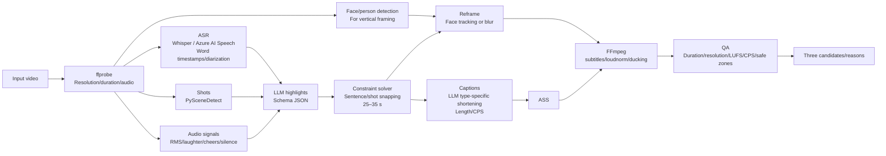

# VideoCreator Research Report: editing styles of popular social videos and a pattern-selection automatic editor

- Date: 2026-11-07
- Scope: social video, particularly YouTube (long-form / Shorts) and TikTok
- Priority: **entertainment—enjoyable viewing**
- Feature: “select one or several videos → choose an editing pattern → automatic editing.” Generative AI allowed; advanced editing controls unnecessary.

---

## 0. Executive summary

1. **Popular editing can largely be decomposed into measurable variables, not intuition:** (a) hook duration, (b) re-engagement/highlight interval, (c) shot length and consistency, (d) caption length/CPS/size/position, (e) LUFS/SFX, (f) looping. Genre presets are proposed in §§3–4.
2. **Primary sources establish immovable constraints:** Shorts are square/vertical and ≤3 minutes for uploads from 2024-10-15; TikTok ads recommend a hook within six seconds, proposition within three, text 5–10 words/s; Netflix Japanese subtitles use 13 full-width characters/line, two lines, four characters/s; YouTube attenuates to approximately −14 LUFS but does not amplify. Treat these as automatic-editing **hard constraints** (§2).
3. **Three ingredients of entertainment:** show result/anomaly/question in 1–3 seconds; introduce visual/audio changes every few seconds to promise more; provide payoff and connect ending to beginning. Japanese television-derived **reaction/emphasis captions** add another layer (§3.3).
4. **Faster is not necessarily better:** Primitive Technology reaches tens of millions with **no narration/BGM/captions**. Genre-appropriate tempo matters; select patterns, not speed (§4).
5. **Existing components suffice:** transcription (Whisper/Speech) → signals (scenes/volume/laughter/cheers/faces) → **structured LLM highlight proposals** → sentence/shot snapping → 9:16 → ASS → loudnorm → export. FFmpeg recipes were **executed and verified**, 1080×1920, 26 seconds, −14.0 LUFS (§5.5).
6. **Let independent evidence judge:** Studio Stayed to watch/APV, public datasets (Mr. HiSum: 31,892 videos labeled from “most replayed”), blind pairwise judgments. YouTube **A/B testing does not support Shorts**, affecting evaluation (§6).

---

## 1. How this report was made: deepening the prompt and methodology

### 1.1 Four ways to deepen the request

| Perspective | Approach |
|---|---|
| (1) What experts add | Replace impressions with retention curves, ASL, caption CPS, LUFS; reproducible genre×duration parameters. Define context loss, mid-speech cuts, caption errors, UI obstruction, rights failures first; design evaluation |
| (2) Rawest materials | Official YouTube/TikTok specifications, Netflix/BBC subtitle standards, peer-reviewed shot-length/highlight-dataset papers, original MrBeast production guide, **actual videos verified via oEmbed** |
| (3) Methods/tools | Whisper/Speech word timestamps/diarization, PySceneDetect, energy/laughter, face reframing, schema-constrained LLM scoring, FFmpeg trim/concat/xfade/subtitles/loudnorm |
| (4) Independent verification | Cited official sources/papers, oEmbed existence, FFmpeg/ffprobe measurements, Studio analytics, independent blind review, public benchmarks |

### 1.2 Rewritten prompt

> Analyze popular YouTube long-form/Shorts and TikTok editing using primary platform specifications, subtitle standards, research, and creator guides. Decompose into **measurable** hook duration, re-engagement interval, shot length, caption CPS/size/position, loudness, loop structure. Prioritize entertainment and define entertainment/business/hobby patterns as directly usable app parameter tables. Provide existence-verified examples and a generative-AI/FFmpeg design for long-video→30-second shorts, multisource switching, captions: pipeline, LLM prompt, **execution-verified** commands, failures, evaluation. Save to `work\VideoCreator-AnalyticsReport.md`. Cite every source and label unverified claims hypotheses.

### 1.3 Method and limits

- **Method:** primary sources → numeric extraction → oEmbed verification (2026-11-07, all §4 URLs) → FFmpeg execution and ffprobe/loudnorm verification (§5.5).
- **Limits, explicitly:**
  - No downloading others' videos for frame-level shot measurements under YouTube/TikTok terms. §3 shot-length estimates are **practical heuristics/hypotheses**; calibrate on owned/authorized footage (§6.2).
  - Weakly primary secondary statistics (“63% of TikTok ads introduce the proposition in three seconds,” etc.) are **reference figures**, not design foundations.
  - Recommendation internals are private. This report relates publicly documented metrics to editor-controllable variables only.

---

## 2. Primary-source “immovable constraints”

Treat these as **hard constraints** in the editing engine.

| Item | Value | Primary source |
|---|---|---|
| Shorts classification | Square/vertical, ≤3 min, uploads since 2024-10-15 | YouTube “Understand three-minute YouTube Shorts” [S1] |
| Shorts music | Many library tracks allow 90 seconds in three-minute Shorts, some 60/30 | [S1] |
| Official long→Short | Studio Clips and Shorts selects transcript ranges; **automatically links original as related video** | [S2] |
| Initial Shorts metric | How many chose to view versus swiped | Content tab analytics [S3] |
| TikTok ads | 9:16, ≥720p, sound; **hook within six seconds, proposition within three; 5–10 words/s** | Creative best practices, June 2025 [S4] |
| Japanese subtitle standard | Horizontal **≤13 full-width chars/line**, **≤2 lines**, **≤4 chars/s**, generally avoid top; white sans-serif | Netflix [S5] |
| English reference | BBC 160–180 wpm, ≤68% of 16:9 width, generally two lines | [S6] |
| Loudness | YouTube **turns down loud audio, does not turn up quiet audio**, about −14 LUFS; recommended TP around −1 dBTP | [S7]; inspect Stats for nerds content loudness |
| Silent viewing | 69% muted in public; 80% of caption users not hearing impaired; US n=5,616 | Verizon/Publicis, reported [S8] |
| Generative AI disclosure | **Realistic synthetic/altered content requires disclosure**, e.g. making real people say things they did not or altering real events | [S9] |
| A/B | Up to three title/thumbnail variants; winner by **watch time; excludes Shorts** | [S10] |

### 2.1 Vertical safe zones

TikTok/YouTube Shorts publish **no fixed official pixel values**. TikTok supplies overlays varying by format/caption length; Meta Reels ads publish top 14%, bottom 35%, sides 6% [S11]. Conservative cross-platform 1080×1920 framing avoids **top ≈250 px, bottom ≈580–670 px, right ≈160–190 px, left ≈60 px**, leaving about 860×1100 centrally [S11][S12].

→ Default captions **620 px above bottom (MarginV=620), right margin 160 px**; hook headings 300 px from top.

---

## 3. Decomposing popular editing grammar

### 3.1 Attention: the first minute (first second for Shorts)

**How to Succeed in MrBeast Production**, based on second-by-second analysis [S13][S14]:

| Time | Instruction | Editing translation |
|---|---|---|
| 0–1 min | **Exactly fulfill** title/thumbnail promise, even object colors; best footage first | Cold-open result/biggest spectacle |
| 1–3 min | “Crazy progression,” advance multiple days, not just day one | Compression montage/day counters |
| 3 min | First re-engagement, exclusive spectacle | Highlight about every three minutes |
| 3–6 min | Fast transitions, simple exciting content | Consistently short shots |
| 6 min | Second re-engagement | Same |
| 6 min onward | Avoid second-half sag through structure | Foreshadowing/countdowns |

The guide says a typical video loses **21 million viewers in its first 60 seconds** and prioritizes **CTR, AVD, AVP** [S14].

**Mapping to Shorts/TikTok:** one long-form minute compresses into **1–3 seconds**. Shorts exposes chose-to-view/swipe [S3]; TikTok recommends proposition ≤3 seconds, hook ≤6 [S4].

### 3.2 Cuts and pacing: consistency rather than speed

- **Peer-reviewed:** Cutting et al. analyzed 150 Hollywood films, 1935–2005; adjacent shot lengths became increasingly correlated, approaching **1/f patterns** (short action clusters, longer dialogue clusters) [S15]. Implication: **cluster similarly timed shots and change tempo between clusters**, slow→fast→slow.
- **Jump cuts:** standard for explanations/talk. Practitioner thresholds: remove solo silence ≥0.6–0.8 s, conversation ≥1.2–1.5 s, retaining conversational pauses [S16].
- **Punch-ins:** 1.1–1.2× digital emphasis zooms give a single camera two-camera rhythm; verified §5.5.
- **Shot-length guides (hypotheses requiring calibration):**

| Format | ASL guide | Evidence strength |
|---|---|---|
| Entertainment Shorts/TikTok challenge/reaction | 0.8–2.0 s | Heuristic/hypothesis |
| Explanation/business Shorts | 2–4 s; captions supply changes | Heuristic/hypothesis |
| Long entertainment/challenges | 2–4 s, subsecond clusters around highlights | MrBeast fast transitions [S14] + heuristic |
| Long interview/podcast | 5–15 s, speaker-driven | Heuristic/hypothesis |
| Cooking/DIY | Process fast-forward/1–2 s, longer finished product | Heuristic/hypothesis |

### 3.3 Captions: Japanese television grammar in vertical video

Japanese television captions evolved from comprehension assistance into **natural-language representations of producers' reactions/emphasis**, with criticism of overuse (Setoguchi et al., Waseda) [S17]. **Distinguish types and control density.**

| Type | Role | Presentation | Automation |
|---|---|---|---|
| ① Verbatim subtitles | Muted viewing | White/black outline, low, 13–16 chars/line | ASR |
| ② Emphasis | Enlarge/color keywords | Yellow/red, 1.2–1.3×, pop enlargement/reset | LLM keyword extraction |
| ③ Reaction/inner voice | Humor scaffolding | Tilt/bubble/other color near speaker/top | LLM, **high error/inappropriateness risk: review UI** |
| ④ Heading/context | Establish context | Persistent top box/band | LLM summary |
| ⑤ Onomatopoeia/SFX | Exaggerate reactions | “Boom,” “Silence…” synchronized to effects | Laughter/cheers/silence |
| ⑥ Counters/numbers | Progress, MrBeast-style | DAY 3 / 10 seconds left / ¥1,000,000 | LLM extraction |

**1080×1920 defaults**

| Parameter | Default | Rationale |
|---|---|---|
| Body size | 72–84 px; emphasis 96–110 | 13×78≈1,014 px; Netflix 13 chars adapted to vertical [S5] |
| Line length | 13–16 full-width chars, ≤2 lines; **one recommended vertically** | [S5][S6] |
| Speed | Verbatim **4–6 chars/s**; word-level emphasis may be faster | Netflix 4 chars/s; TikTok 5–10 words/s |
| Outline | Black 6–9 px + shadow 2–3 px | Yellow on yellow remained readable in §5.5 |
| Position | Bottom 620 px; avoid right 160; top headings only | §2.1 |
| Color semantics | White speech, yellow emphasis, red surprise/danger, cyan supplement, fixed speaker colors | TV convention/heuristic |

### 3.4 Audio: half the enjoyment

- **Loudness:** `loudnorm=I=-14:TP=-1.5` before export; quiet videos lose out because YouTube only attenuates [S7].
- **BGM ducking:** reduce 12–18 dB during speech (`sidechaincompress`).
- **SFX:** synchronized with type ⑤; silence before laughter/surprise/payoff is itself an effect.
- **Muted viewing:** 69% in public [S8] makes captions essential. TikTok's sound-on culture [S4] means **both captions and sound must work**.

### 3.5 Loops and payoff

- Repeatable Shorts naturally connect ending to beginning: final response answers opening, final frame matches first.
- Since 2025-03-31 YouTube counts each Shorts play/replay start (secondary [S18]); loops help metrics.
- Zach King's broom magic (§4) uses 15–20 seconds of impossible-image question → reveal → desire to rewatch.

### 3.6 Multisource switching

Automatable television technical-director rules [S16][S19]:

1. Show speaker, identified by diarization/microphone volume.
2. Minimum hold 1.5–2.5 seconds; rapid switching unsettles.
3. Listener reaction shots for laughter/surprise.
4. Wide shots at section starts/every 30–60 seconds to reestablish space.
5. Switch at gesture/speech boundaries, toward meaning rather than merely motion.
6. One continuous audio master avoids volume/ambience jumps.
7. Hard cuts normally; 0.2–0.4-second crossfades for time/scene changes only.

---

## 4. Example videos (oEmbed verified 2026-11-07)

> Views omitted because they fluctuate. YouTube/TikTok oEmbed returned author/title for each URL. Observation points map examples to app patterns.

### 4.1 Entertainment

| Video | Format | Observation → pattern |
|---|---|---|
| MrBeast “$456,000 Squid Game In Real Life!” <https://www.youtube.com/watch?v=0e3GPea1Tyg> | Long challenge | Immediate prize/scale, elimination counters, periodic spectacles → **P1 High-energy challenge** |
| MrBeast “I Spent 50 Hours Buried Alive” <https://www.youtube.com/watch?v=9bqk6ZUsKyA> | Long challenge | Elapsed-time captions/compression montage → **P1**, counter ⑥ |
| MrBeast “Katana Vs Bullet” <https://www.youtube.com/shorts/L5kIXRdwGAI> | Short | One-line question → slow motion → result → **P2 One-shot/loop** |
| Zach King Harry Potter broom, reportedly TikTok's most viewed <https://www.tiktok.com/@zachking/video/6768504823336815877> | TikTok | Impossible opening, reveal, loop → **P2** |
| Bella Poarch “M to the B” <https://www.tiktok.com/@bellapoarch/video/6862153058223197445> | TikTok | Music-led expression closeup/beat edits → **P5 Beat sync** |
| Tokai On Air “Kyoto trip: immediately go home if you suggest a standard destination!” <https://www.youtube.com/watch?v=SJdhLwEKDc4> | Long variety | Title gives rule/reason to watch; TV reaction/emphasis captions → **P3 Variety** |
| HikakinClipTV “Hikakin lets you win rock-paper-scissors” <https://www.youtube.com/watch?v=rYNxkATSgk0> | Official clip Short | **Official long→short**, one reaction → **P4 Clip** |
| Mark Rober “Glitter Bomb 1.0 vs Porch Pirates” <https://www.youtube.com/watch?v=xoxhDk-hwuo> | Long science entertainment | Motivation → construction → thief-reaction payoff; reaction sequences |

### 4.2 Business/explanation

| Video | Format | Observation → pattern |
|---|---|---|
| NAKATA UNIVERSITY <https://www.youtube.com/watch?v=qh5t4WMroyU> | Long lecture | Energetic solo delivery, chapter headings → **P6 Lecture** |
| PIVOT <https://www.youtube.com/watch?v=JOE7Y_b7RlE> | Long interview | Information-rich titles, multicam/key points → **P7 Interview** |
| The Diary Of A CEO <https://www.youtube.com/watch?v=a1mI-ozLyYM> | Long podcast | Strongest quote cold open, cinematic cameras → **P7/P4** |
| Joe Rogan #1169 Elon Musk <https://www.youtube.com/watch?v=ycPr5-27vSI> | >2-hour podcast | Typical >1-hour clipping source; little original editing, value in **clips** → **P4** |
| Ali Abdaal “How I Manage My Time - 10 Time Management Tips” <https://www.youtube.com/watch?v=iONDebHX9qk> | Long explanation | Numbered list/B-roll/text → **P6** |
| Veritasium “The Most Misunderstood Concept in Physics” <https://www.youtube.com/watch?v=DxL2HoqLbyA> | Long science | Question answered by demonstration; question sustains slower pace |
| Yukkuri explanation: “John Hunter, the mad doctor who infected himself with syphilis?” <https://www.youtube.com/watch?v=Bk308b1JqGc> | Japanese format | Synthetic voices/characters/**full captions**; caption-led explanation |

### 4.3 Hobby/lifestyle

| Video | Format | Observation → pattern |
|---|---|---|
| Nick DiGiovanni “MasterChef Potatoes” <https://www.youtube.com/watch?v=HE_rKC9B6BY> | Cooking Short | Tiny process cuts, finished-food ASMR/tasting → **P8 Process** |
| Casey Neistat “DO WHAT YOU CAN'T” <https://www.youtube.com/watch?v=jG7dSXcfVqE> | Vlog | Music montage/timelapse → **P5** |
| Primitive Technology “Tiled Roof Hut” <https://www.youtube.com/watch?v=P73REgj-3UE> | Long DIY | **No narration/BGM/captions**; convincing process/ambient immersion → **P9 Minimal** |
| Kurzgesagt “The Egg - A Short Story” <https://www.youtube.com/watch?v=h6fcK_fRYaI> | Animation | Narration-led, continuously moving visuals |

### 4.4 Cross-genre principles

1. First image: result/anomaly/question (MrBeast/Zach King/Veritasium/Diary).
2. Put viewing reason—rule/stakes/question—in one line, repeat in title/captions.
3. Something changes every few seconds: cut/zoom/text/SFX, genre-dependent intervals.
4. Reactions are strongest assets (Rober/Hikakin).
5. Allow exceptions: immersion, not tempo, wins for Primitive Technology; speed-only automation fails.

---

## 5. Automatic-editor design

### 5.1 Minimal user experience

```
[1] Select one or several videos
[2] Output: vertical short (15/30/60 s) / landscape digest (3–5 min)
[3] Select patterns (multiple allowed; P1–P9 below)
[4] Generate → three candidates with reasons/scores
[5] Review: only caption typos/inappropriate text → export
```

No advanced timeline UI; **candidate selection + caption corrections** only.

### 5.2 Pattern catalog

| ID | Name | Genre | Main parameters |
|---|---|---|---|
| P1 | High-energy challenge | Entertainment | Hook≤1.5 s, ASL 0.8–1.5 s, frequent punch-ins/counters/SFX, upbeat BGM |
| P2 | One-shot/loop | Entertainment | 15–25 s, question→result, ending→opening, minimal captions |
| P3 | Variety captions | Japanese entertainment | Types ①②③⑤, reviewed LLM reactions, presenter inset |
| P4 | Clip long→30 s | All | Strongest quote/reaction first, sentence cuts, heading ④, source referral |
| P5 | Beat montage | Hobby/Vlog | Beat-detected cuts, minimal text |
| P6 | Explanation/lecture | Business | Silence >0.6 s removed, ②④, numbered chapters, ASL 2–4 s |
| P7 | Interview switching | Business/podcast | Speaker cuts, 2 s hold, reactions, periodic wide |
| P8 | Process compression | Hobby | 1–2 s/fast process, longer result/sound, before/after |
| P9 | Minimal/ambient | Hobby | No captions/BGM, longer shots, color/loudness only |

Store presets as data:

```json
{
  "id": "P4",
  "name": "Clip (long video → 30 seconds)",
  "target": {"aspect": "9:16", "duration_sec": [25, 35]},
  "hook": {"max_sec": 2.0, "prefer": ["strong_claim", "laughter", "surprise"]},
  "cut": {"remove_silence_over_sec": 0.7, "snap_to": ["sentence_end", "shot_boundary"], "punch_in_scale": 1.15},
  "telop": {
    "types": ["caption", "emphasis", "headline"],
    "caption": {"font_px": 78, "max_chars_per_line": 14, "max_lines": 1, "max_cps": 6, "margin_v": 620, "margin_r": 160},
    "emphasis": {"font_px": 100, "color": "yellow", "animation": "pop"},
    "headline": {"position": "top", "margin_v": 300, "box": true}
  },
  "audio": {"loudnorm": {"I": -14, "TP": -1.5}, "bgm_duck_db": -15, "sfx": "light"},
  "loop": {"enabled": true}
}
```

### 5.3 Pipeline



**Stage details**

1. **ASR:** mandatory word timestamps (`word_timestamps=True` or Speech word-level/diarization). Reestimate Japanese sentence boundaries with LLM when punctuation missing.
2. **Signals:** volume spikes/laughter/cheers/speech acceleration/shot density/face-count change. **Combine numerical signals with LLM** to limit plausible errors.
3. **LLM:** timestamped transcript + signal summary → structured candidate JSON.
4. **Solver:** snap to sentence end plus shot/silence; strongest segment first, conclusion last, semantic loop where possible.
5. **Captions:** verbatim 13–14-char splits/CPS; emphasis extraction; heading summary; reactions **opt-in and mandatory human review**.
6. **Reframe:** one face → smoothed face-centered 9:16; multiple/none → **blur + centered 16:9**, as official YouTube preview also does [S2].
7. **QA:** §5.6.

### 5.4 Highlight-selection LLM prompt

```text
[System]
You edit YouTube/TikTok Shorts. From timestamped transcription and audio/video
signals choose up to five approximately 30-second candidates.
Rules:
- A result, surprise, strong claim, or question within two seconds.
- Never start/end mid-utterance; sentence boundaries only.
- Understandable without context; avoid initial "that"/"it".
- No exaggeration/unfaithful summaries or captions absent from transcription.
- Return only the specified JSON schema.

[User]
Pattern: P4 Clip / target: 25–35 s / language: Japanese
Signals: {"laughter":[[812.4,815.0],...], "loudness_peaks":[...], "shots":[...]}
Transcript:
[00:13:32.1] Then I'll spend one million yen in one hour.
...

[Output JSON schema]
{
  "candidates": [{
    "segments": [{"start": 812.0, "end": 829.5}],
    "hook_text": "string(<=14 characters)",
    "headline": "string(<=16 characters)",
    "emphasis_words": ["string"],
    "reason": "Why engaging (one sentence)",
    "scores": {"hook": 0-10, "standalone": 0-10, "payoff": 0-10, "emotion": 0-10}
  }]
}
```

Axes **hook/standalone/payoff/emotion** draw on OpusClip Hook/Flow/Value/Trend [S20] and QVHighlights five-level saliency [S21].

### 5.5 FFmpeg recipes (executed)

Environment: FFmpeg N-128532, 2026-11-06 win-arm64 build; synthetic 1920×1080, 60-second video with audio; ffprobe/loudnorm verified.

**(A) Long→vertical:** extract three ranges, punch in second, concatenate, blurred 9:16, ASS, −14 LUFS.

```powershell
$fc = @(
 "[0:v]trim=10:18,setpts=PTS-STARTPTS[v1];[0:a]atrim=10:18,asetpts=PTS-STARTPTS[a1]",
 "[0:v]trim=30:40,setpts=PTS-STARTPTS,scale=iw*1.15:ih*1.15,crop=1920:1080[v2];[0:a]atrim=30:40,asetpts=PTS-STARTPTS[a2]",
 "[0:v]trim=50:58,setpts=PTS-STARTPTS[v3];[0:a]atrim=50:58,asetpts=PTS-STARTPTS[a3]",
 "[v1][a1][v2][a2][v3][a3]concat=n=3:v=1:a=1[cv][ca]",
 "[cv]split[fg0][bg0]",
 "[bg0]scale=1080:1920:force_original_aspect_ratio=increase,crop=1080:1920,boxblur=20:2[bg]",
 "[fg0]scale=1080:-2[fg]",
 "[bg][fg]overlay=(W-w)/2:(H-h)/2-120,subtitles=telop.ass[vout]",
 "[ca]loudnorm=I=-14:TP=-1.5:LRA=11[aout]"
) -join ';'
ffmpeg -y -i src.mp4 -filter_complex $fc -map "[vout]" -map "[aout]" `
  -c:v libx264 -preset veryfast -crf 20 -c:a aac -b:a 192k -ar 48000 -movflags +faststart short.mp4
```

Result: `short.mp4: duration=26.000000 video=1080x1920`, `Input Integrated: -14.0 LUFS`.

**(B) ASS:** speech, pop emphasis, boxed hook.

```ini
[Script Info]
ScriptType: v4.00+
PlayResX: 1080
PlayResY: 1920

[V4+ Styles]
Format: Name, Fontname, Fontsize, PrimaryColour, SecondaryColour, OutlineColour, BackColour, Bold, Italic, Underline, StrikeOut, ScaleX, ScaleY, Spacing, Angle, BorderStyle, Outline, Shadow, Alignment, MarginL, MarginR, MarginV, Encoding
Style: Caption,Yu Gothic UI,78,&H00FFFFFF,&H0000FFFF,&H00000000,&H80000000,-1,0,0,0,100,100,0,0,1,7,2,2,90,160,620,1
Style: Emph,Yu Gothic UI,96,&H0000F0FF,&H0000FFFF,&H00000000,&H80000000,-1,0,0,0,100,100,0,0,1,9,3,2,90,160,620,1
Style: Hook,Yu Gothic UI,88,&H00FFFFFF,&H0000FFFF,&H000000C0,&H00000000,-1,0,0,0,100,100,0,0,3,14,0,8,90,160,300,1

[Events]
Format: Layer, Start, End, Style, Name, MarginL, MarginR, MarginV, Effect, Text
Dialogue: 1,0:00:00.00,0:00:02.50,Hook,,0,0,0,,{\fad(80,0)}An unexpected ending!
Dialogue: 0,0:00:00.20,0:00:02.40,Caption,,0,0,0,,{\t(0,120,\fscx112\fscy112)\t(120,240,\fscx100\fscy100)}Today, in one hour
Dialogue: 0,0:00:02.40,0:00:04.60,Emph,,0,0,0,,{\t(0,120,\fscx115\fscy115)\t(120,240,\fscx100\fscy100)}Spend one million yen
Dialogue: 0,0:00:08.00,0:00:10.50,Caption,,0,0,0,,An {\c&H0000F0FF&}unexpected{\c&HFFFFFF&} turn
```

- Colors `&HAABBGGRR` (BGR); `&H0000F0FF` yellow.
- BorderStyle 3 boxed heading, 1 outlined subtitle.
- Alignment 2 bottom-center, 8 top-center; MarginV 620 avoids lower UI.
- Original Japanese test visually confirmed the million-yen caption yellow/black, above lower UI at second three.

**(C) Cameras:** A→B hard cut→A 0.3-second fade.

```powershell
$fc2 = "[0:v]trim=0:5,setpts=PTS-STARTPTS[a];[1:v]trim=5:10,setpts=PTS-STARTPTS[b];" +
       "[0:v]trim=10:15,setpts=PTS-STARTPTS[c];" +
       "[a][b]concat=n=2:v=1:a=0,settb=AVTB,fps=30[ab];[c]settb=AVTB,fps=30[c2];" +
       "[ab][c2]xfade=transition=fade:duration=0.3:offset=9.7[v]"
ffmpeg -y -i camA.mp4 -i camB.mp4 -filter_complex $fc2 -map "[v]" -map 0:a -t 14.7 -c:v libx264 -c:a aac switch.mp4
```

Result `switch.mp4: duration=14.700000 video=1920x1080`. **Encountered pitfall:** concat/trim timebases differ; xfade fails “First input link main timebase ... do not match.” Normalize both with **`settb=AVTB,fps=30`**.

**(D) Ducking syntax reference**

```text
[1:a]volume=0.5[bgm];[bgm][0:a]sidechaincompress=threshold=0.03:ratio=8:attack=20:release=300[ducked];
[0:a][ducked]amix=inputs=2:duration=first,loudnorm=I=-14:TP=-1.5[aout]
```

### 5.6 Automatic QA before output

| Check | Threshold | Method |
|---|---|---|
| Duration | Preset range e.g. 25–35 s; Shorts≤180 | ffprobe |
| Resolution/aspect | 1080×1920, 9:16 | ffprobe |
| Loudness | −14±1 LUFS, TP≤−1 dBTP | loudnorm summary |
| Subtitle speed | ≤6 chars/s, ≤14/line | ASS |
| Safe zones | No bottom580/right160/top250 intrusion except headings | ASS margins |
| Speech truncation | No word spans range edge ±150 ms | ASR word timestamps |
| Hook | Speech/loud sound/motion in first two seconds | ASR/volume/frame difference |
| Fidelity | Names/numbers present in transcript | String matching, hallucination check |

### 5.7 Failures and guardrails

| Failure | Example | Guard |
|---|---|---|
| Context loss | Starts “That's the worst” | Standalone score, demonstrative penalty |
| Meaning changed | Sarcasm treated literally | Give LLM ±30 s context, check intent |
| Wrong/offensive captions | Insults/wrong numbers | Opt-in reactions, token QA, human UI |
| Rights | Unauthorized clips/commercial music | Rights-holder permission only; Japanese clipping policies [S22]; licensed BGM |
| AI disclosure | Synthesized statements never spoken | No voice cloning; disclose realistic alteration [S9] |
| UI obstruction | Like button covers text | Safe-zone QA |
| Unreadable speed | 20 chars/s | CPS/shortening |
| Uniform pacing | All videos identical | Pattern-specific ASL/clusters; slow P9 |

### 5.8 Generative AI roles (Azure example)

| Task | Options |
|---|---|
| ASR/diarization | Speech batch/word timestamps or local Whisper |
| Highlights/caption shortening | Foundry LLM/schema |
| Optional visual understanding | A few multimodal keyframes for supplementary scene context |
| Processing | Start local/bundled FFmpeg; offload only heavy work |

---

## 6. Evaluation: independent correctness

### 6.1 Offline, before release

1. **Highlight accuracy:** Mr. HiSum 31,892 videos labeled by >50,000-viewer replay behavior [S23], QVHighlights >10,000 human-saliency videos [S21]; mAP/Hit@1 overlap. Own channel's “most replayed” is the best ground truth.
2. **Blind pairwise:** same-source app versus random/first 30 seconds; ≥5 uninvolved judges choose which they want to watch. Report win rate/confidence intervals.
3. **Mechanical QA:** §5.6 all outputs; record violations.

### 6.2 Calibrate hypothetical shot lengths

Owned/authorized sources:

```bash
scenedetect -i input.mp4 detect-adaptive list-scenes   # Shot-boundary CSV
```

Compute mean/median/adjacent correlation (Cutting [S15]); update §3.2.

### 6.3 Online, after publication

| Metric | Meaning | Source |
|---|---|---|
| Chose to view / Stayed to watch | Opening survival/hook | Shorts Studio [S3] |
| APV/retention | Structure/tempo | Studio |
| Views/impressions | Overall | Studio/TikTok Analytics |
| Related-video long-form traffic | Clip conversion to original | Studio [S2] |

**Caution:** YouTube A/B covers titles/thumbnails only, not Shorts [S10]. Publish same-source pattern variants at staggered times and compare channel medians: quasi-experiment, not randomized A/B. No universal benchmark; judge **relative to your own historical median**.

---

## 7. Conclusions and next actions

1. Implement **P4** first: highest demand, minimal ASR + LLM + blurred 9:16 + ASS + loudnorm, technically verified here.
2. Add **P6** and **P3**, reactions with review UI.
3. Start multisource with **P7**, microphone energy before advanced diarization.
4. Include §5.6 QA and §6 evaluation from the beginning.

---

## References (primary preferred)

- [S1] YouTube, “Understand three-minute YouTube Shorts.” <https://support.google.com/youtube/answer/15424877>
- [S2] YouTube, “Video clips and Shorts in YouTube Studio.” <https://support.google.com/youtube/answer/15824265> / “Create YouTube Shorts from your videos.” <https://support.google.com/youtube/answer/12836917>
- [S3] “Content tab analytics tips – Shorts.” <https://support.google.com/youtube/answer/12942217>
- [S4] TikTok “Creative best practices for performance ads,” June 2025. <https://ads.tiktok.com/help/article/creative-best-practices>
- [S5] Netflix Japanese Timed Text Style Guide, I.5 length/I.14 lines/I.16 position/I.19 speed. <https://partnerhelp.netflixstudios.com/hc/en-us/articles/215767517-Japanese-Timed-Text-Style-Guide>
- [S6] BBC summary <https://www.clevercast.com/bbc-subtitling-guidelines/> / original <https://www.bbc.co.uk/accessibility/forproducts/guides/subtitles/>
- [S7] LOUDMETER “YouTube LUFS: −14 LUFS Normalization Explained,” including Stats for nerds verification. <https://www.loudmeter.net/youtube-loudness>
- [S8] Streaming Media, “80% of Video Caption Users Aren't Hearing Impaired, Finds Verizon” (2019). <https://www.streamingmedia.com/Articles/ReadArticle.aspx?ArticleID=131860>
- [S9] YouTube “Disclosing use of GenAI content.” <https://support.google.com/youtube/answer/14328491>
- [S10] YouTube “A/B test titles & thumbnails.” <https://support.google.com/youtube/answer/16391400>
- [S11] CapQA, “Social media safe zones: pixel reference,” 2026-09-11. <https://capqa.app/guides/social-media-safe-zones>
- [S12] ReelMind, “TikTok Safe Zone Overlay.” <https://reelmind.ai/blogs/tiktok-safe-zone-overlay-essential-framing-guidelines>
- [S13] “How to Succeed in MrBeast Production,” converted original PDF. <https://manuals.plus/m/54dc97c41faebbcd9e295bc7463eb6b332faa85d5abddbc908cab21104c9bd1e>
- [S14] Daniel Scrivner summary, 2025-08-15. <https://www.danielscrivner.com/how-to-succeed-in-mrbeast-production-summary/>
- [S15] Cutting, DeLong, Nothelfer (2010), Attention and the evolution of Hollywood film. *Psychological Science* 21(3), 432–439, doi:10.1177/0956797610361679. <https://pubmed.ncbi.nlm.nih.gov/20424081/>
- [S16] EditBuddy, multicam hold/silence thresholds. <https://editbuddy.app/blog/how-to-edit-multicam-podcast-premiere-pro>
- [S17] Setoguchi/Sakai, “A study of television caption display,” ITE. <https://www.jstage.jst.go.jp/article/itetaikai/2003w/0/2003w_0_17/_pdf/-char/ja>
- [S18] Creator Essentials, “Viewed vs. Swiped Away,” Shorts counting change from 2025-03-31. <https://www.creatoressentials.com/glossary/viewed-vs-swiped-away/>
- [S19] Mellius “Multicam Editing Workflow.” <https://www.melliusai.com/multicam-edit>
- [S20] OpusClip Hook/Flow/Value/Trend explanation. <https://artificial-intelligence-wiki.com/ai-for-content-creators/ai-image-and-video-generation/opus-clip-viral-score-explained/>
- [S21] Lei/Berg/Bansal (2021), QVHighlights, NeurIPS. <https://arxiv.org/abs/2107.09609>
- [S22] NoLang clipping/permission/copyright/monetization guide, 2026-10-24. <https://no-lang.com/learn/youtube-kirinuki-guide> / Monolith rules <https://monolith.law/youtuber-vtuber/youtuber-clippedvideo-rules>
- [S23] Sul et al. (2023), Mr. HiSum, NeurIPS Datasets and Benchmarks. <https://papers.nips.cc/paper/2023/file/7f880e3a325b06e3601af1384a653038-Paper-Datasets_and_Benchmarks.pdf> / <https://github.com/MRHiSum/MR.HiSum>
- [S24] PySceneDetect detectors. <https://www.scenedetect.com/docs/latest/api/detectors.html>
- [S25] Mark (2023), *Attention Span*, Hanover Square Press; average screen attention shifts after 47 seconds, background for pacing.

### Appendix A: oEmbed log (2026-11-07)

| ID/URL | Returned author | Returned title (English rendering where Japanese) |
|---|---|---|
| 0e3GPea1Tyg | MrBeast | $456,000 Squid Game In Real Life! |
| 9bqk6ZUsKyA | MrBeast | I Spent 50 Hours Buried Alive |
| xoxhDk-hwuo | Mark Rober | Glitter Bomb 1.0 vs Porch Pirates |
| h6fcK_fRYaI | Kurzgesagt – In a Nutshell | The Egg - A Short Story |
| ycPr5-27vSI | PowerfulJRE | Joe Rogan Experience #1169 - Elon Musk |
| jG7dSXcfVqE | CaseyNeistat | DO WHAT YOU CAN'T |
| DxL2HoqLbyA | Veritasium | The Most Misunderstood Concept in Physics |
| P73REgj-3UE | Primitive Technology | Primitive Technology: Tiled Roof Hut |
| iONDebHX9qk | Ali Abdaal | How I Manage My Time - 10 Time Management Tips |
| qh5t4WMroyU | NAKATA UNIVERSITY | Consumption-tax cut: food 8%→1%, relief from inflation?… |
| JOE7Y_b7RlE | PIVOT official | High-school basketball: the level is too high… |
| SJdhLwEKDc4 | Tokai On Air | Kyoto trip: suggest a standard destination and go home! |
| rYNxkATSgk0 | HikakinClipTV | Hikakin lets you win rock-paper-scissors |
| HE_rKC9B6BY | Nick DiGiovanni | MasterChef Potatoes |
| a1mI-ozLyYM | The Diary Of A CEO | Iran War Expert: … |
| Bk308b1JqGc | Fifth Time's the Charm (Yukkuri explanation) | John Hunter, the mad doctor who infected himself with syphilis? |
| L5kIXRdwGAI (Shorts) | MrBeast | Katana Vs Bullet |

> Excluded `4VXVfj0mEX4` (“Katana vs bullet @MrBeast”): oEmbed identified **a third-party reposter, not MrBeast**. Verify official status by **author**, not title; automatic clipping faces the same issue.

| TikTok URL ID | Author | Result |
|---|---|---|
| 6768504823336815877 | @zachking | oEmbed response |
| 6862153058223197445 | @bellapoarch | oEmbed response |
