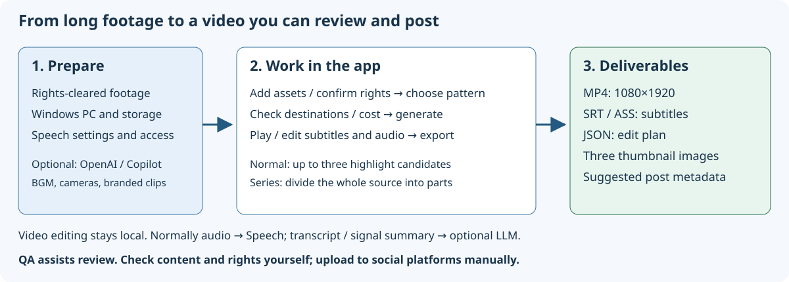

# VideoCreator User Guide

[App README](../README.md)

Guides: [日本語](../../../users-guide/README.md) / **English** / [简体中文](../../zh-CN/users-guide/README.md) / [한국어](../../ko/users-guide/README.md).

For users unfamiliar with video editing/development and software engineers customizing the implementation. Based on the current implementation and real screens.

## Read for your goal

| Goal | Document |
|---|---|
| Launch and make your first video | [Quickstart](quickstart.md) |
| Understand buttons, fields, switches | [Screens and components](screens.md) |
| Resolve failures/warnings | [Troubleshooting](troubleshooting.md) |
| Understand and modify processing/data structures | [Technical reference](technical-reference.md) |
| Use startup settings/APIs | [Configuration and API](configuration-api.md) |
| Understand evidence, verification scope, screenshot recreation | [Verification and maintenance](verification.md) |
| Understand the production policy (expert perspectives, primary sources, methods, third-party review) and requirement mapping | [Documentation brief](documentation-brief.md) |

## Terms to know first

- **Project:** a workspace grouping assets, candidates, edits, and exports.
- **Asset:** source footage. Full-path addition references the original file.
- **Pattern / preset:** editing policy for duration, tempo, captions, sound.
- **Candidate:** a proposed choice of scenes, not a publishable file.
- **Preview:** a low-resolution review video; quality and QA differ from final export.
- **Caption:** on-screen text, including subtitles, emphasis, hooks, headings.
- **Edit plan:** JSON recording cuts, text, sound, and insertions.
- **QA:** automatic checks. Human content/rights review is still required after passing.
- **Export:** making publication-ready video and related files from an edit plan. Does not post to social platforms.

## Diagrams and screenshots

Schematics are editable vector SVG. Screenshots are also SVG files, but **embed PNG captures from a real browser**. They are neither imagined screens nor fully vectorized pixels. Existing Japanese screenshots are historical captures, not evidence that the translated UI was verified in those images.

Examples use synthetic test patterns, sine waves, and an existing transcript fixture. Unlike normal speech footage, subtitles do not match the audio. `http://127.0.0.1:1` is a verification setting to prevent cloud transmission, not a production endpoint. See [verification](verification.md).
