# Screens and components

[↑ Documentation map](../README.md) | [日本語](../../../users-guide/screens.md) | **English** | [简体中文](../../zh-CN/users-guide/screens.md) | [한국어](../../ko/users-guide/screens.md)

[App README](../README.md) / [Guide index](README.md) / [First video](quickstart.md) / [QA/errors](troubleshooting.md) / [Configuration/API](configuration-api.md)

Examples captured the 2026-11-08 implementation in Microsoft Edge, viewport 1440×1000; long pages use full-page captures. Controls vary with PC width, pattern, asset count. Scroll **inside each column**.

## Shared controls

| Component | Meaning/action |
|---|---|
| Top-left VideoCreator logo | Project list; does not stop work |
| Top-right transcription/selection | Current providers; availability also depends on connection/permissions |
| Settings | AI selector, destinations, storage, tools |
| Assets → Pattern → Generate → Candidates → Review/edit → Export | Workflow position: blue current, check completed; not navigation tabs |
| Show safe area | Preview guide against posting-UI overlap; does not alter video |
| Messages/badges | Success/warnings/errors/approvals; read text/codes, not just colors |

## 1. Project list

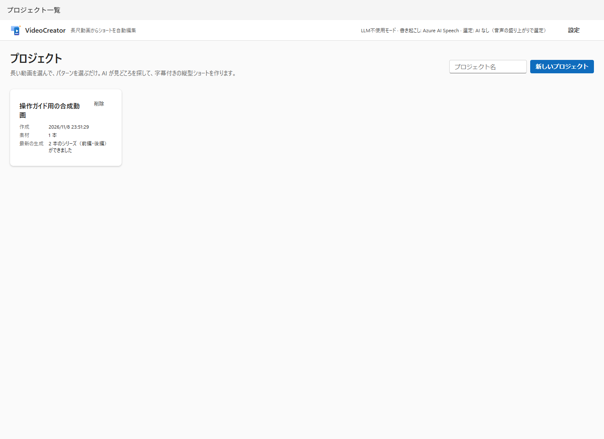

| Component | Meaning/caution |
|---|---|
| Project name / New project | Creates work; empty allowed, distinctive names recommended |
| Project card | Name opens work; created time, asset count, latest generation |
| Delete | Confirmation; managed folder recycled, analysis/edit DB records deleted |

**Deletion is cleanup, not finishing work.** Full-path originals remain; uploaded assets/exports go to Recycle Bin with the project. Restoring only the folder does not restore DB edits. Wait for completion/cancel when busy.

## 2. Assets, pattern, generation

These are **three columns of one project screen**, not separate screens.

Top **Rename** opens save/cancel input. Storage path also appears. Renaming does not move folders.

### Left: assets

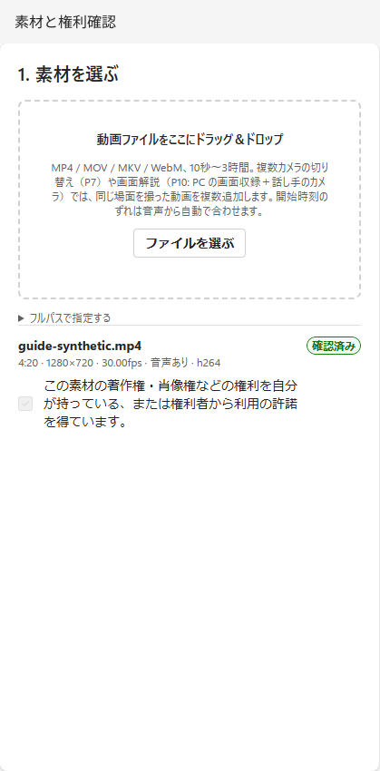

| Component | Meaning/decision |
|---|---|
| Drop zone / Choose file | Upload/copy PC footage into project |
| Specify full path → Add | Reference absolute path, e.g. `C:\Videos\talk.mp4`; unquoted easiest |
| Asset information | Name/duration/display resolution/fps/VFR/audio/codec |
| Warnings | Rotation/VFR/no audio; visible video does not guarantee subtitles |
| Confirm rights / Confirmed | Personally check copyright/likeness etc.; confirmed checkbox not editable |
| Role (multiple assets) | Master/camera/wide/audio master/screen; affects P7/P10 |
| Speaker (multiple assets) | Camera's speaker 1–8 in transcript appearance order; blank automatic/unset |
| Offset (seconds)/sync | Camera time relative to master audio; inspect evidence/residual/drift before manual changes |

P7 needs ≥2 simultaneous cameras; P10 screen + presenter. Not synchronization of unrelated events. Automatic sync is imperfect; failures/out-of-range warn or fall back to master.

### Center: patterns

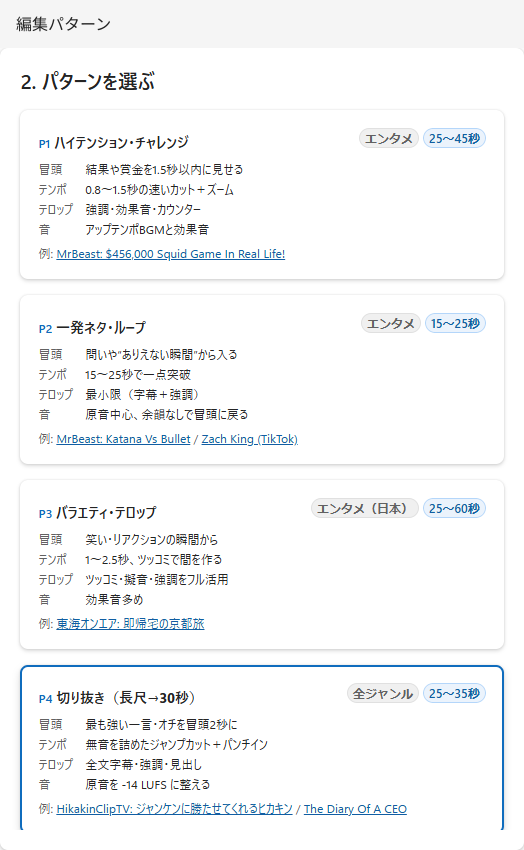

Selected card has blue border. **Opening/tempo/captions/audio** describe policy; seconds are short main-content targets. “Example” links external footage, not guaranteed app output. Scroll to P10.

| ID | Name | Main target | Use |
|---|---|---|---|
| P1 | High-energy challenge | 25–45 s | Challenges/results/reactions |
| P2 | One-shot gag / loop | 15–25 s | Brief punch/loop to start |
| P3 | Variety captions | 25–60 s | Humor/heavy decoration/reactions |
| P4 | Clip (long → 30 s) | 25–35 s | Recommended first; speech highlights |
| P5 | Beat-sync montage | 15–60 s | Cuts to BGM beats |
| P6 | Explanation/lecture (key points) | 30–60 s | Informative explanation |
| P7 | Interview switching | 30–60 s | Simultaneous cameras |
| P8 | Process compression (cooking/DIY) | 20–60 s | Fast-forward low-activity processes |
| P9 | Minimal/ambient | 30–90 s | Little decoration/original sound |
| P10 | Screen explanation (screen/inset) | 30–60 s | PC screen + presenter |

These are not source durations. Inserts extend totals; series uses other rules. Changing preset `target.aspect` alone does not make all screens/QA landscape-capable.

### Right: basic generation

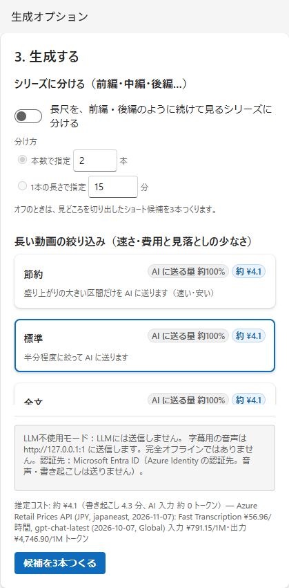

| Component | Meaning/caution |
|---|---|
| Divide into series | Off: highlights; on: whole source into consecutive parts |
| By count | 2–20; balance lengths at topic boundaries |
| By duration | 1–60 min, 0.5 min step; approximate, not identical |
| Split estimate | After assets added; estimates after silence removal when transcript exists |
| Economy | Strong-excitement ranges for long videos; cost/speed first, may miss quiet importance |
| Standard | Transmission/omission balance |
| Full text | Uses all text; may split requests, not necessarily one huge call |
| Cost/amount sent | Internal unit prices/estimates, not billing guarantee; short sources can match across all scopes |
| Destinations | Always above button: audio→ASR, text/signal summary→LLM, authentication; ASR independent of LLM. Cost breakdown expands amounts/costs |
| Create 3 candidates | Requires assets/rights; shows blockers. Up to three results; estimated cost beside button |

Groups: Series, Long-video narrowing, Audio, Opening/closing/transitions, Previous analysis. Click headings to expand/collapse; collapsed headings summarize settings (“BGM Auto / SFX On / Reactions Off”). Expansion persists in this browser. Packaging initially collapsed; series collapses narrowing because full text is sent. Scroll to Created patterns.

Series supports speech-based P1–P4/P6/P7/P9/P10, not P5/P8. Specify one split method. **Each part must retain at least one minute after silence removal.** Teasers/recaps/headings/next previews make total duration differ from main splits.

### Lower right: audio, masking, inserts

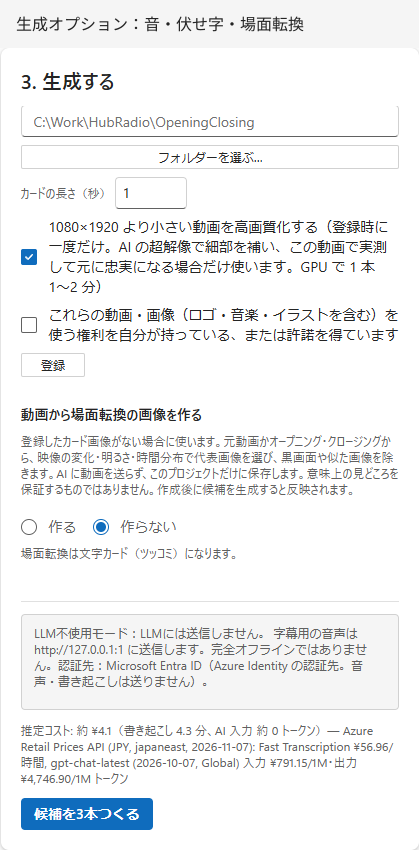

| Component | Meaning/caution |
|---|---|
| BGM | Pattern default / none / automatic per scene (own registered tracks, else three built-ins) / whole-video track. All duck during speech; pattern target, normally ≥14 LU below voice |
| SFX | Pop/boom effects on/off |
| Let AI suggest reactions | P3 only; read/approve before export |
| Reaction presentation | Appears when enabled: Auto default (cards only at speech boundaries, overlays elsewhere; reasons in notes) / overlay / card (freeze 2–3 s, image/text/BGM) |
| Mask words | Japanese/ordinary comma separated; `●` text, beep audio. Does not anonymize source/transcript |
| Own BGM | Batch audio selection, rights registration scoped to project; enables scene auto. Shows loudness/tempo/energy (calm/normal/lively)/usable region excluding leading/trailing silence. Remove unregisters unless plan references it |
| Insert opening/closing | Available with shared registrations; opening after teaser, closing last |
| Transition cards | Brief still/text/SFX at changes; AI audience reaction/praise text requires approval |
| Register/reregister | Folder video names containing `Opening` / `Closing`, PNG/JPG card images; shared across projects |
| Choose folder… | Windows picker; cancel unchanged; check taskbar if hidden |
| Card duration | 2–3 s, default 2.5; full-screen image/panel + text + dedicated BGM, then source resumes. Card BGM plays even when main BGM none |
| Enhance small videos | Background after registration; measured acceptance, environment-dependent timing |
| Unregister | Removes shared registration; existing candidate plans do not automatically rebuild |
| Create transition images from video | Default Do not create; source or registered Opening/Closing, max 2–6 frames |

Local extraction rejects black/white/similar images, not AI semantic highlights. Affects **newly generated candidates**. Turning off retains files. Shared card images take priority.

### Subtitle/caption proper nouns

At the project bottom register people/places/companies/organizations/products/works. Enter desired spelling, optionally pronunciation and likely ASR variants. Next generation uses phrases as ASR hints and canonical spellings for caption proper-noun matching. Type is organizational only; ASR receives spelling/pronunciation/variants.

Saved transcripts/word timecodes do not change. A changed dictionary triggers new transcription on next candidate generation. Hints do not guarantee accuracy; review audio/subtitles and correct transcripts as necessary. Word times come from recognition.

## 3. Generation progress

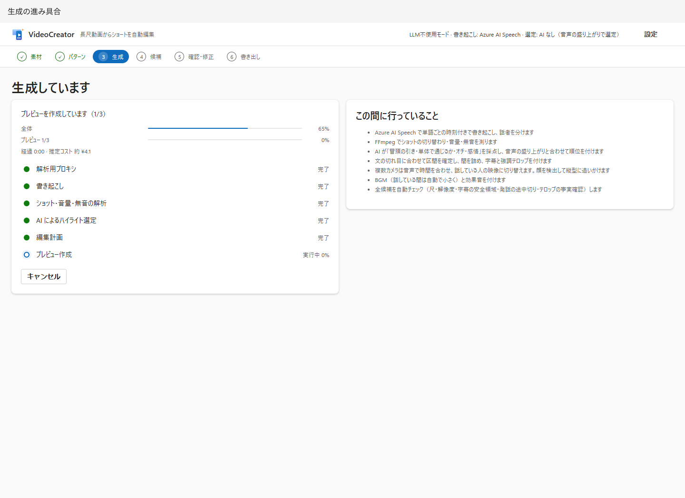

| Component | Meaning |
|---|---|
| Overall bar | Pipeline progress, not constant-rate clock |
| Current task bar | Measured when possible; indeterminate otherwise |
| Elapsed/remaining | Elapsed since opening screen; remaining estimated for current measurable task |
| Stages | Proxy → transcription → signals → selection → plan → preview |
| What is happening | Normal descriptions; cache/no AI/pattern can differ |
| Cancel | Stops generation, not an export cancellation |

Leaving the screen does not stop server work. On failure/cancel, read reasons and Return to project to fix conditions.

## 4. Candidates and series

| Component | Meaning/caution |
|---|---|
| Number/title/reason | Rank/evidence; AI/signal proposals, not popularity guarantees |
| “n seconds source” / source times | Selected range, not final after cuts/teaser |
| Preview/player | Watch/listen; low-res, not final-quality judgment |
| Hook/self-contained/payoff/emotion | Content assessment; signal fallback need not imply AI understanding |
| Audio energy/overall | Signals/composite; indicative 0–10 |
| Signal-based | AI missing/failed, volume-first fallback |
| QA badges | Plan passes/warnings versus final not-run |
| Adjustment record | Corrections/constraint reasons |
| Review/edit | Open candidate editor |
| Regenerate with instructions | Find alternatives; semantic instructions may not apply without AI |
| Return to assets/patterns | Change pattern/options |

Series replaces rank/scores with first/middle/last or episode order, source main ranges, split reasons, chapters. Change count/duration in project and regenerate to alter boundaries.

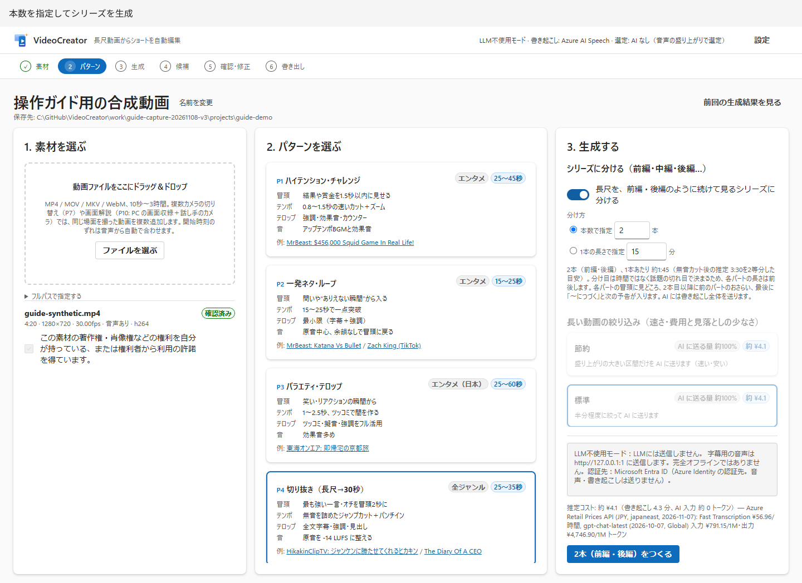

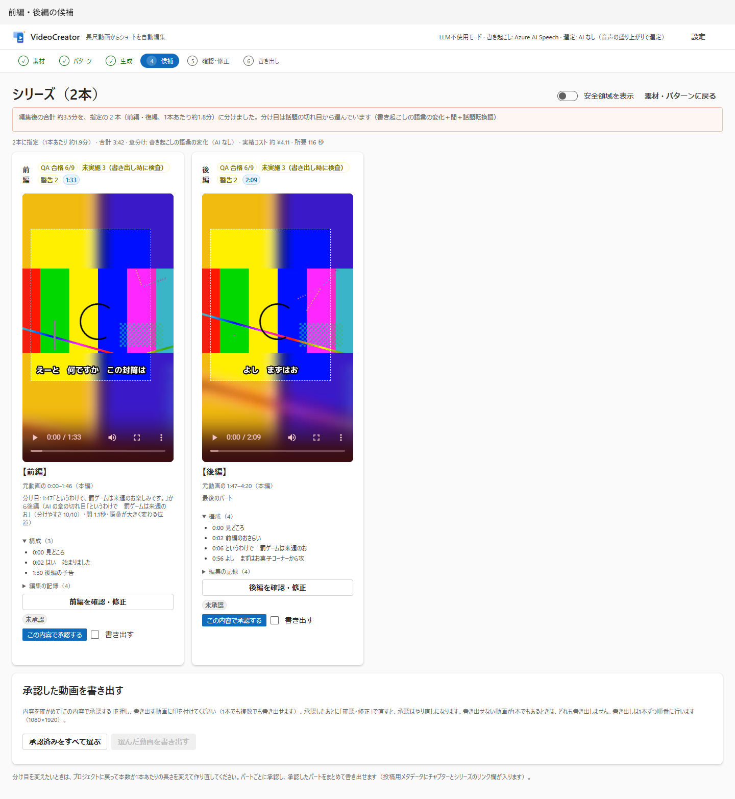

### Approve and batch export

| Component | Meaning |
|---|---|
| Approve this content | Record review of **the current plan** |
| Unapproved/approved/modified after approval | Edits require reapproval |
| Revoke/approve again | Update judgment |
| Export checkbox | Select approved/not-exporting candidates |
| Select all approved | Selection aid, not automatic approval |
| Export selected videos | All validated first; any invalid starts none; sequential rank/part order |
| Progress/open exported video | Per-candidate state/completed file |
| Cancel queued | Unstarted only; active completes |

### Review videos individually, export together

With ≥2 videos in one pattern (Job), **Review progress** appears above candidates.

| Component | Meaning |
|---|---|
| Approved n / N · Exported m / N | Approved count includes exporting/exported; completed count |
| Review next unapproved (name) | First unapproved video editor |
| Proceed to export (n approved) | Stage 6 list; primary button if any approved |
| Per-video state | Unreviewed/approved/reapproval/exporting/exported; name opens editor |

Workflow Review/edit links first unreviewed; Export links export list.

## 5. Review/edit

| Component | Meaning/action |
|---|---|
| Update preview | Rerender after edits; do not judge old preview |
| Duration/main/total/cut/caption counts | Plan data; total includes enabled inserts |
| Captions/transitions | One final-time-ordered table for text/opening/transition/reaction cards/closing. Top switches bulk-enable captions/emphasis/headings/onomatopoeia/reactions/opening/transition cards/closing; reactions include overlays and cards |
| Opening/card rows | Position/duration/text/enabled. Card text ≤20 chars. Freeze full-screen: similar-aspect images fill; others fit over blurred copy |
| Approve all reactions/cards | Personally read AI text. Human-rewritten card text recorded as human |
| Cuts (video/speed) | Source/duration/speed/face tracking/screen zoom/inset; not general timeline editing |
| BGM/SFX | Audio/BGM chooses none/per-scene/whole track, speech-to-BGM difference 10–30 LU (10 LU approximate intelligibility floor), nonspeech BGM. Per scene: times, energy/measurements, track (auto/none possible), −12–+6 dB, rationale. Band shows track flow/ducking (height = reduction); blue playback line. Update preview measures actual speech difference (S-15). P5 track locked to beat cuts; volume editable |
| Correct transcript | Words within used range; times unchanged, captions regenerated; manual caption edits may be overwritten |
| Start/end one sentence earlier/later | Short boundaries; source/duration limits may prevent |
| Automatic checks | Immediate plan QA, not final loudness/resolution |
| Approve/revoke check review | Save/revoke review record/time |
| Bulk check approval | All performed/unapproved, including pass; excludes not-run |
| Approve/export (1080×1920) | Single video; approve current then export |
| Approve only and return | Single video; save approval, candidates |

With ≥2 same-pattern videos, heading controls change:

| Component | Meaning/action |
|---|---|
| ‹ Previous / Video i / N selector / Next › | Switch within pattern; options show review state |
| Approve/next (name) | Approve current; next unapproved, wrapping |
| Approve/proceed to export | When all others approved; Stage 6 |
| Approve/return to candidates | Save, inspect progress |
| Export only this now (1080×1920) | Approve/export without list |

Already-current approvals are not duplicated. Hard failures disable all approval buttons.

Check-review approval records “I reviewed this”; it neither turns fail/warn into pass nor releases export gates. Separate from text/card approval; persisted across reload, invalidated by edits/result changes.

Series boundaries cannot change here. Transcript UI currently replans, potentially producing a series restriction error. Correct series subtitles in caption rows; for underlying transcript correction, use a short workflow and inspect [API restrictions](configuration-api.md#editing-operations).

### Caption table

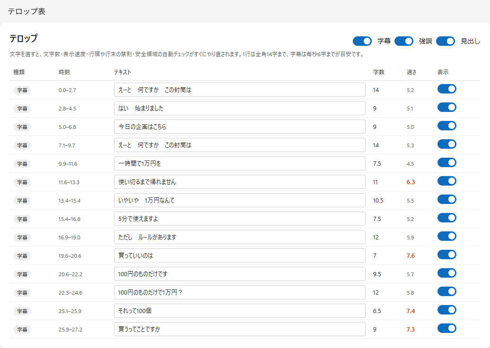

| Field/control | Meaning |
|---|---|
| Type | Subtitle=speech, emphasis=key words, hook=opening draw, heading=topic, reaction=commentary, onomatopoeia=sound text, counter=numbers |
| Time | Final-video seconds, including inserts |
| Text | Edit; blur saves. 40-character input cap does not imply readability/safe placement |
| Length | Full-width equivalent (half-width about 0.5); width guide |
| Speed | Full-width chars/second; excessive unreadable |
| Row switch | Individual enable/disable, disabled faint |
| Type switch | Bulk show/hide |
| Approval | Review unapproved AI text; reactions need explicit approval |

Restoring masked terms/numbers/names manually may fail QA. Prioritize readable faithful content, not merely clearing warnings.

## 6. Export

### Export list (multiple videos)

Open via Candidates **Proceed to export** or last video's **Approve/proceed** (`#/job/{id}/exports`). Reopens here after app restart.

| Component | Meaning |
|---|---|
| Review progress | Approved/exported counts, unapproved links |
| Video rows | Name/title/duration/QA/editor/approval/export selection |
| Export checkbox | Initially selects approved not-yet-exported |
| Export selected | Same batch processing; all validated, any failure starts none |
| Progress/open exported | Per-video state/completion |
| Final video/location | Automatically shows final player per completed video; play/seek/safe guides/absolute path/copy/**Open folder** |
| Posting copy | Saved read-only YouTube/Viva Engage/chapters, individual Copy. Missing: **Create posting text**; opening list alone does not generate |
| Other artifacts/previews | Expand per-file paths/Open/Save. Image previews; SRT/ASS/Markdown/JSON text **Preview contents**, first 65,536 chars plus full link |

Previous final remains inspectable during re-export. Edit-invalidated results are not shown as current. Missing/play/copy/folder failures show per video; select text + Ctrl+C if copy fails. After moving/deleting files, **Reload artifacts**.

### Completion

While exporting: composition, loudness, QA, related-file creation. Afterwards:

| Component | Meaning |
|---|---|
| Candidates (review others)/export list | Return to other same-pattern work |
| Hard-pass count | Plan/final results; row count differs from distinct IDs |
| Final video | Review at final quality |
| Location/copy/open folder | Absolute path, copy, select completed file in Explorer; messages on failure |
| File links | Browser-open/save MP4/SRT/ASS/JSON/metadata |
| Thumbnails | Three choices; set on platform yourself |
| QA | ID/state/measurement/criterion/plan/final |
| Posting text (copy/paste) | Shared read-only snippets: YouTube ≤5,000 chars, Viva Engage ≤10,000, chapters `00:00 Title`. Counts, red over limit. Copy; revise at destination. Generate if absent; Create another proposal. Yellow rejected-word/reason warnings; chapter omission reason replaces chapter field |
| Collapsed records | Commands/reproduction data; remove secrets/personal paths before sharing |

## 7. Settings

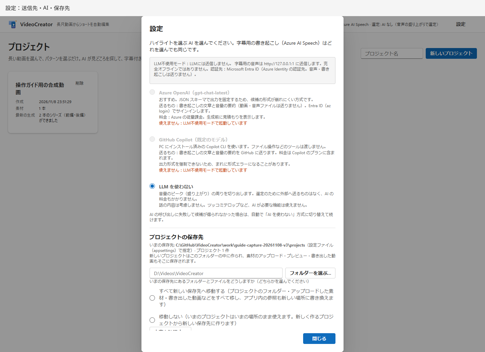

| Component | Meaning/caution |
|---|---|
| Foundry/Copilot/no LLM | Highlight selection; immediate server change. Close is not Save |
| Unavailable | Missing endpoint/CLI, forced no-LLM startup |
| Destinations | Audio/text/authentication; no LLM ≠ no ASR |
| Current storage/count | New-project location, existing count |
| New storage/choose folder | Not DB/cache DataDir |
| Move everything/do not move | Includes root files in current storage / only new projects at new location |
| Review details | Sizes/space/items/problems; no move yet |
| Apply after review | Actually changes; refuses busy/collisions |
| FFmpeg/missing filters/CLI/pattern count | Diagnostics; mask personal CLI paths before sharing |
| Close | Closes dialog |

AI choice is Runtime-only, restored from startup on restart. UI storage persists in DB, takes precedence. Do not manually move folders back after relocation; see [recovery cautions](troubleshooting.md#storage-and-backups).

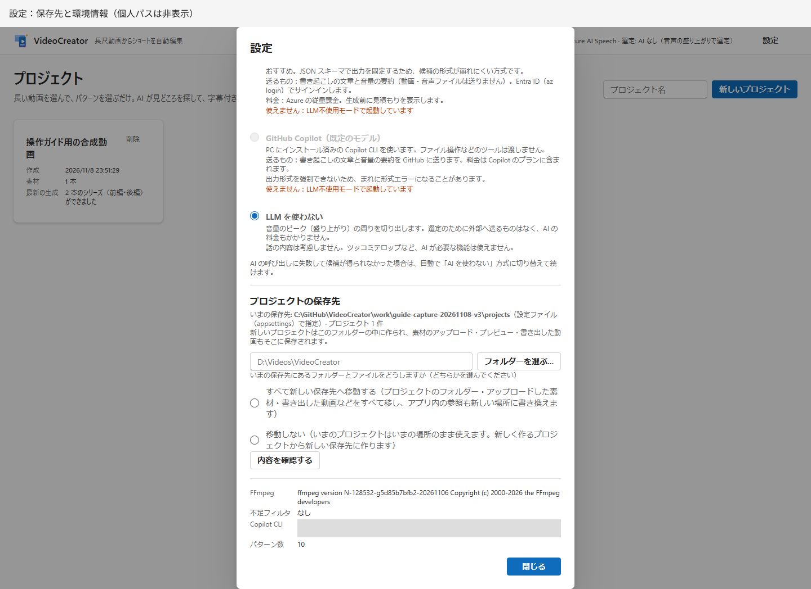
---

[↑ Documentation map](../README.md) | [日本語](../../../users-guide/screens.md) | **English** | [简体中文](../../zh-CN/users-guide/screens.md) | [한국어](../../ko/users-guide/screens.md)
