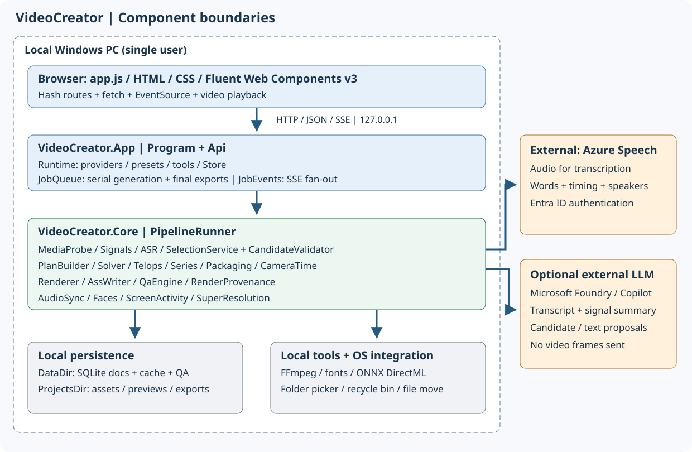
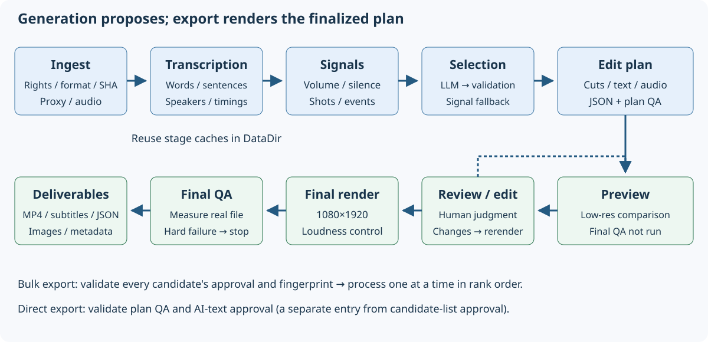
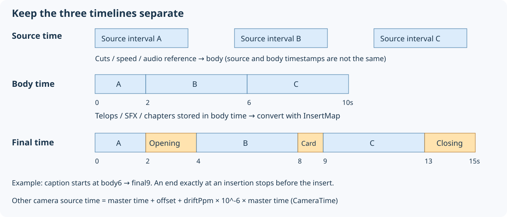

# Technical reference for software engineers

[↑ Documentation map](../README.md) | [日本語](../../../users-guide/technical-reference.md) | **English** | [简体中文](../../zh-CN/users-guide/technical-reference.md) | [한국어](../../ko/users-guide/technical-reference.md)


[App README](../README.md) / [Guide index](README.md) / [Quickstart](quickstart.md) / [Screens](screens.md) / [Troubleshooting](troubleshooting.md) / [Configuration/API](configuration-api.md) / [Verification](verification.md)

Applies to the current C#/.NET 10 implementation: a single-user local Windows web app, not a general video-editing library or multiuser service. Design requirements: [PRD](../docs/PRD.md); historical measurements: [implementation report](../docs/IMPLEMENTATION.md). Historical results are not proof of passing under current conditions.

## 1. Components



| Layer | Responsibility / entry point |
|---|---|
| Browser UI | [index.html](../../../src/VideoCreator.App/wwwroot/index.html), [app.js](../../../src/VideoCreator.App/wwwroot/js/app.js), [app.css](../../../src/VideoCreator.App/wwwroot/css/app.css): vanilla ES modules, Fluent Web Components v3, hash routing |
| Hosting/HTTP | [Program.cs](../../../src/VideoCreator.App/Program.cs): IPv4 loopback Kestrel, Host validation, custom header, exceptions, CSP; not an authenticated public server |
| API | [Api.cs](../../../src/VideoCreator.App/Api.cs): validation, CRUD, approvals, batch acceptance, preview/export entry |
| Runtime | [Runtime.cs](../../../src/VideoCreator.App/Runtime.cs): configures FFmpeg, Store, Presets, ASR, LLM, audio/face services; LLM runtime switching |
| Background | [JobQueue.cs](../../../src/VideoCreator.App/JobQueue.cs): single worker serializes generation/final export; holds SSE JobEvents/export state |
| OS | [FolderPicker.cs](../../../src/VideoCreator.App/FolderPicker.cs), [ProjectDeletion.cs](../../../src/VideoCreator.App/ProjectDeletion.cs), [ProjectsLocation.cs](../../../src/VideoCreator.App/ProjectsLocation.cs): picker, recycle bin, move/recovery |
| Optional work | [SceneCardService.cs](../../../src/VideoCreator.App/SceneCardService.cs), [BrandKitWorker.cs](../../../src/VideoCreator.App/BrandKitWorker.cs): card extraction/registered-clip enhancement |
| Pipeline | [PipelineRunner.cs](../../../src/VideoCreator.Core/Pipeline/PipelineRunner.cs): stages, cache, progress, rendering, QA, outputs |
| Media/analysis | [MediaProbe](../../../src/VideoCreator.Core/Media/MediaProbe.cs), [SignalExtractor](../../../src/VideoCreator.Core/Signals/SignalExtractor.cs), [AudioSync](../../../src/VideoCreator.Core/Audio/AudioSync.cs), [FaceService](../../../src/VideoCreator.Core/Faces/FaceService.cs), [ScreenActivity](../../../src/VideoCreator.Core/Media/ScreenActivity.cs) |
| ASR/selection | [AzureFastTranscriber](../../../src/VideoCreator.Core/Asr/AzureFastTranscriber.cs), [Providers](../../../src/VideoCreator.Core/Selection/Providers.cs), [SelectionService](../../../src/VideoCreator.Core/Selection/SelectionService.cs), [CandidateValidator](../../../src/VideoCreator.Core/Selection/CandidateValidator.cs) |
| Planning | [PlanBuilder](../../../src/VideoCreator.Core/Planning/PlanBuilder.cs), [Solver](../../../src/VideoCreator.Core/Planning/Solver.cs), [Planners](../../../src/VideoCreator.Core/Planning/Planners.cs), [ScreenPlanner](../../../src/VideoCreator.Core/Planning/ScreenPlanner.cs), [Series](../../../src/VideoCreator.Core/Planning/Series.cs), [TelopBuilder](../../../src/VideoCreator.Core/Planning/TelopBuilder.cs) |
| Rendering/QA | [Renderer](../../../src/VideoCreator.Core/Rendering/Renderer.cs), [AssWriter](../../../src/VideoCreator.Core/Rendering/AssWriter.cs), [QaEngine](../../../src/VideoCreator.Core/Qa/QaEngine.cs), [RenderProvenance](../../../src/VideoCreator.Core/Rendering/RenderProvenance.cs) |
| Storage/schemas | [Store](../../../src/VideoCreator.Core/Storage/Store.cs), [Models](../../../src/VideoCreator.Core/Models/Models.cs), [Json](../../../src/VideoCreator.Core/Json.cs), [Preset](../../../src/VideoCreator.Core/Presets/Preset.cs) |

App/Tests target `net10.0-windows`; Core `net10.0`. [App csproj](../../../src/VideoCreator.App/VideoCreator.App.csproj) uses Windows Forms. [Core csproj](../../../src/VideoCreator.Core/VideoCreator.Core.csproj) references DirectML ONNX Runtime etc.; Core's TFM alone does not imply all features are cross-platform.

## 2. Generation and export



1. **Ingest:** existence/format/duration validation, SHA-256, proxy, analysis audio; multisource audio master, sync, roles.
2. **Transcribe:** ITranscriber returns words/sentences/speakers/times; dictionary phrase list; cache reuse.
3. **Signals:** shots, 100 ms volume, silence, events; fallback selection evidence.
4. **Select:** validate/correct/deduplicate IHighlightSelector outputs; split/filter long sources, rerank when needed; signal fallback.
5. **Plan:** Solver clips, preset speech/switch/speed/beat/screen planners, series, face tracking, captions, audio, inserts, masking.
6. **Preview:** render plan, save stage-appropriate QA, show up to three candidates.
7. **Edit:** PlanEditor updates/history/plan QA; explicit preview refresh; plan changes invalidate candidate approval fingerprints.
8. **Final output:** preflight hard plan QA; 1080×1920 rendering, loudness, final QA. Commit publication outputs only when all hard checks pass; create SRT/ASS/plan/thumbnails/metadata.

**Boundary:** AI proposes ranges/text. Renderer builds from confirmed plans/assets. Prompts alone do not ensure constraints. Users retain final responsibility for meaning/rights.

## 3. Models and persistence

| Model | Storage/relationships |
|---|---|
| Project | Folder, language, card settings; parent of Assets/Rights/Jobs |
| SourceAsset | Absolute path, SHA-256, MediaInfo, role, speaker, sync |
| Transcript / Word / Sentence | Cached JSON; word IDs/times underpin captions/cuts/factuality |
| SignalSet | Cached shots/silence/volume/events |
| Job | Options/state/costs/stage timings/warnings/candidate IDs |
| Candidate | Job child; range/reason/score/EditPlan/preview Render IDs/approval |
| EditPlan | Project child; Canvas/Timeline/Telops/Audio/Inserts/Series/Provenance |
| Render | EditPlan child; preview/final, files, Outputs, staged QA, reproduction record |
| BrandKit / BgmTrack / setting | Shared/project audio registrations and storage settings |

Store is a SQLite JSON-document store, `docs(kind,id,parent,json,updated)`. Shared `Json.Options` uses snake_case/string enums. Files and DB are separate; exported JSON is not a full-project import format/API.

Cache: DataDir `cache\<first 16 source SHA-256 characters>`. Transcription keys include ASR Name/dictionary; signals use `signals.v2.json` (shots/fades/volume); face/screen caches also exist. **Changing ASR endpoint/locale does not necessarily invalidate transcripts.** Test collision/compatibility/invalidation policy for new providers/algorithms.

Absolute path changes use [StorePaths](../../../src/VideoCreator.Core/Storage/StorePaths.cs) rerooting. Same-drive rename or cross-drive copy plus count/size verification, then transactional JSON references. This is not cryptographic verification of all file contents.

## 4. Three distinct timelines



1. **Source/master:** word/source times. Other cameras use `SourceAsset.CameraTime(masterT, masterId)` = `masterT + offset + driftPpm × 10^-6 × masterT`.
2. **Edited main:** accumulated `(src_out-src_in)/speed`; captions/SFX/series chapters planned here.
3. **Final file:** main with Opening/Card/Closing insertions; [InsertMap](../../../src/VideoCreator.Core/Planning/Packaging.cs) converts. Starts at insertion points map after insert; ends map before it.

Example: a 2-second opening at main time 2, a 1-second card at main time 6: a subtitle starting at main 6 starts at final 9. Spanning captions split around cards, never overlay them. Insertion offsets cannot substitute for clip speed/camera synchronization.

## 5. Approval, QA, reproducibility

- `CandidateApproval` records approver/time/`EditPlanFingerprint.Of(plan)` SHA-256, not signatures/user authentication.
- Batch preflight verifies membership, approval, fingerprint, busy state, plan QA for every candidate; any failure starts none. Queued work uses approved snapshots.
- Direct render from Review does not require candidate approval, but requires AI-text approvals/plan QA. The two entrances do not have identical approval rules.
- All-or-zero acceptance is not atomic all-file success after execution starts; individual runtime failures appear per candidate.
- Preserve QA `Stage`, `PlanHash`, `not_run`; do not reuse old/preview results as final passes.
- `Render.Reproducibility`: plan/FFmpeg/buildconf/font/preset/source hashes, text-library information, encoder threads. Compare **decoded frames**, not just container bytes.
- Reproduction requires matching assets/plans/tools/fonts/environment; no guarantee that a fresh LLM call proposes identical candidates.

## 6. Customization entry points and tests

| Change | Location / conditions | Tests |
|---|---|---|
| Duration/tempo/audio/decor defaults | [presets](../../../presets), PresetStore.Validate; `P<number>` ID, semver; restart | [PlanningTests](../../../tests/VideoCreator.Tests/PlanningTests.cs), [VarietyTests](../../../tests/VideoCreator.Tests/VarietyTests.cs) |
| Font/outline/line breaking | Share AssWriter Metrics/Band/CaptionLineChars, JapaneseText, TelopBuilder; no divergent tables for rendering/shrinking/QA | [CaptionLayoutTests](../../../tests/VideoCreator.Tests/CaptionLayoutTests.cs), [JapaneseTextTests](../../../tests/VideoCreator.Tests/JapaneseTextTests.cs), [RenderingTests](../../../tests/VideoCreator.Tests/RenderingTests.cs) |
| Candidate proposals | IHighlightSelector, Providers, SelectionPrompt, SelectionService, Runtime/settings UI; align validation/retries/fallback/cost/destinations | [SelectionTests](../../../tests/VideoCreator.Tests/SelectionTests.cs), [V12Tests](../../../tests/VideoCreator.Tests/V12Tests.cs) |
| ASR | ITranscriber, Runtime, settings/destinations/cache keys; preserve word IDs/times/speakers/sentences | [PlanningTests](../../../tests/VideoCreator.Tests/PlanningTests.cs); separately measure real-footage timing/accuracy |
| Camera/screen editing | AudioSync, CameraTime, SwitchPlanner, ScreenPlanner; aligned PCM via AudioSync.TimelineFilter | [MultiSourceTests](../../../tests/VideoCreator.Tests/MultiSourceTests.cs), [V11Tests](../../../tests/VideoCreator.Tests/V11Tests.cs) |
| Series/inserts | Series, Packaging, InsertMap; align captions/SRT/QA/metadata times | [SeriesTests](../../../tests/VideoCreator.Tests/SeriesTests.cs), [PackagingTests](../../../tests/VideoCreator.Tests/PackagingTests.cs), [SceneCardTests](../../../tests/VideoCreator.Tests/SceneCardTests.cs) |
| Posting copy/chapters | Planning PostCopy; code converts chapter times with InsertMap, never AI. Send masked transcript only; use text passing PostCopy.Check (length/URLs/times/masking/unsupported words). Rejected parts retry once with reasons | [PostCopyTests](../../../tests/VideoCreator.Tests/PostCopyTests.cs) |
| UI controls | app.js/app.css/Fluent v3; checkbox/switch field label/input slots; preserve esc(), event rerendering, keyboard access | [E2E](../../../ui/e2e.mjs), [v1.1 E2E](../../../ui/e2e-v11.mjs), actual Edge |
| API/approval/storage | Api/Models/Store/JobQueue/ProjectsLocation; snake_case, coded errors, reapproval, path boundaries | [ApprovalExportTests](../../../tests/VideoCreator.Tests/ApprovalExportTests.cs), [ProjectsLocationTests](../../../tests/VideoCreator.Tests/ProjectsLocationTests.cs), [RenderRecordTests](../../../tests/VideoCreator.Tests/RenderRecordTests.cs) |

Minimal new preset: copy existing JSON; change ID/version/name/needed fields; restart. New planners also require PlanBuilder/PresetStore allow-list changes; adding a JSON name alone adds no implementation.

Canvas/export UI/QA assume vertical 1080×1920. Landscape requires consistent changes/tests. Public networking requires separate authentication/authorization/CSRF/file-access/job-isolation design, not just changing Listen.

FFmpeg uses argument arrays. Preserve `-nostdin` for raw-frame pipe subprocesses. Do not extend through shell-concatenated commands; preserve ASS/user/LLM escaping.

## 7. Build and test

From repository root; no need to reacquire already-installed tools.

```powershell
pwsh scripts\get-tools.ps1
dotnet build src\VideoCreator.App\VideoCreator.App.csproj -c Release
dotnet test --project tests\VideoCreator.Tests
```

[global.json](../../../global.json) selects Microsoft.Testing.Platform. Test counts change; do not use a fixed count as acceptance. UI bundle: [ui/package.json](../../../ui/package.json) `npm run build`. Against a running app: `node e2e.mjs <video> <URL>`. E2E may use paid external services/update existing screenshots; isolate storage.

Documentation-production checks are recorded separately in [verification](verification.md).
---

[↑ Documentation map](../README.md) | [日本語](../../../users-guide/technical-reference.md) | **English** | [简体中文](../../zh-CN/users-guide/technical-reference.md) | [한국어](../../ko/users-guide/technical-reference.md)
