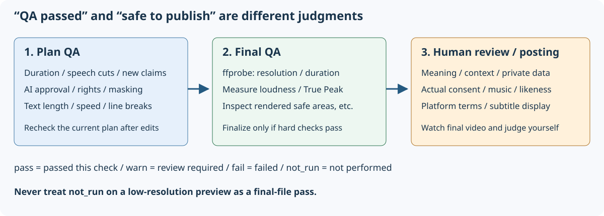

# Troubleshooting: errors, QA, storage

[App README](../README.md) / [Guide index](README.md) / [Quickstart](quickstart.md) / [Screens](screens.md) / [Configuration/API](configuration-api.md) / [Verification](verification.md)

## Isolate the problem first

1. Is the launch terminal running? Opening a browser does not start the server.
2. Are Settings' providers/destinations **your own**?
3. Check source audio, duration, rights, selected pattern.
4. Record failed stage, error code, QA ID/measurements. Never share sign-in tokens.
5. Correct conditions before retrying; do not repeatedly retry unchanged settings without diagnosis.

## Common symptoms

| Symptom/code | Check / next action |
|---|---|
| Cannot launch, missing tools | Inspect `FAIL` in `.\run.cmd --check`; reinstall with `.\run.cmd --setup`. Ask administrators about offline/install restrictions |
| Browser cannot connect | Use startup-log URL, default `http://127.0.0.1:8765/`; changed port means changed URL. Other PCs cannot connect by design |
| Port already in use | Check existing instance; do not indiscriminately stop processes. Choose another port |
| `E-RIGHTS-REQUIRED` | Confirm every source's rights; separately confirm BGM/registered clips/images |
| `E-ING-UNSUPPORTED` | Check path, real format, video track, 10-second–3-hour duration; renaming an extension does not fix encoding |
| Receive/copy failure | Check temporary/project free space; consider full-path reference for large sources |
| `E-ASR-PROVIDER`, 401 | Check own endpoint, Internet, `az login` into resource tenant |
| Speech/OpenAI 403 | Ask administrator about user roles/network restrictions; management-plane access is not data-processing access |
| Signed into Azure but authentication fails | Set `AZURE_TOKEN_CREDENTIALS=AzureCliCredential` in launch environment if another account takes precedence |
| 429/transient service errors | Check rate limits/capacity/service status; wait if automatic retries fail |
| Missing subtitles/transcript | No source audio, disabled/unconfigured ASR? LLM does not replace ASR |
| Only “signal-based” candidates | LLM unconfigured/unavailable/invalid responses; fallback keeps running but does not understand content |
| Quiet important scene absent | Choose Full text. Without AI, volume dominates; consider AI settings/another pattern |
| `E-SOL-INFEASIBLE` | No feasible range; try more speech/longer footage or another pattern |
| P7/P10 fails | Check simultaneous sources, audio, roles, sync; distinguish screen/presenter for P10 |
| Series fails | Check speech source, supported pattern, count/duration; review within-topic split warnings |
| “Preview is outdated” | Plan changes are saved; refresh preview before judging |
| `E-NOT-APPROVED` | Review/approve unapproved videos. Batch errors list each video's reason (unapproved, modified, plan-QA failure, exporting); any failure starts nothing. Code is first applicable reason, matching single export |
| `E-EXPORT-BUSY` | Wait for that plan's export (individual/batch) |
| `E-QA-HARDFAIL` | See QA table. Fix plan failures; inspect measurements/rendering for final-file failures. Batch lists failing checks by video |
| `E-RND-FFMPEG` | Check free space, FFmpeg/filters, source existence, output permissions |
| `E-PROJECT-BUSY`, cannot delete | Wait for generation/export; generation and queued exports can be canceled |
| `E-FILE-IN-USE` | Close apps holding project files and retry |
| Storage move fails | Check running jobs, name collisions, space, nested destinations; read failed/remaining items |

Setup `--check` also makes connectivity requests. Obtain data-use authorization before testing external transmission with organizational footage.

## Read QA correctly

- **pass:** that check meets that stage's criteria.
- **warn:** review needed, even if export remains possible.
- **fail:** `H-` hard checks block export.
- **not_run:** not measured yet; final-only checks show this in previews.
- **plan:** checks current edit plan; **final:** measures completed file.

| ID | Check | Action / limitations |
|---|---|---|
| H-01 | Duration | Short main content must fit pattern; total including inserts has separate rules. Adjust ranges/inserts. Series uses series duration |
| H-02 | Resolution/aspect | Final 1080×1920; low-resolution preview is not final pass |
| H-03 | Loudness | Final target −14 LUFS ±1 LU; silent sources may not satisfy it |
| H-04 | True Peak | Final ≤−1 dBTP; adjust and remeasure |
| H-05 | Caption safe area | Check placement/length/font; final measures actual rendering, not guide lines alone |
| H-06 | Mid-utterance cuts | Adjust by sentence; ASR tolerance ±150 ms. P5 may warn because beats take priority |
| H-07 | Unsupported caption tokens | Checks numbers/proper tokens against transcript/dictionary; **not full semantic/contextual fact-checking** |
| H-08 | Unapproved captions/cards | Read and approve AI text or disable it |
| H-09 | Asset rights | Confirm used footage/images/inserts; checkboxes are not legal proof |
| H-10 | Masking (when configured) | Ensure manual edits did not restore masked terms. Applies to outputs, not anonymization of sources/cache/cloud inputs |
| S-01 / S-02 / S-08 | Subtitle speed/line width/line-break rules | Shorten without changing meaning; check reading speed/natural breaks |
| Other S checks | Hooks/decorations/black frames etc. | Compare messages/measurements/criteria with footage. Definitions: [QaEngine](../../../src/VideoCreator.Core/Qa/QaEngine.cs) |

Pass counts are not fixed: H-01/H-05 can appear in both plan/final rows; masking and other checks are conditional. **Passing hard QA means passing those automatic tests, not guaranteed fidelity, rights, privacy, popularity, or platform approval.**

Failed final MP4s may move to project `rejected`; do not treat them as successful publishable files.

## Storage and backups

| Location | Contents |
|---|---|
| DataDir (default `%LOCALAPPDATA%\VideoCreator`) | SQLite DB, transcript/signal cache, QA workspace, audio assets |
| ProjectsDir (default VideoCreator in Windows Videos) | Per-project asset copies, previews, exports, card images |
| External full-path references | Source/registered videos; separately back up files outside managed folders |

Recommended: finish processing, stop the app, then back up DataDir, every actual project folder, and external references together. SQLite uses WAL: avoid copying only one live DB file. Backups contain audio, transcripts, personal paths; handle appropriately.

Change storage through Settings. Do not move leaves old projects in place. Move includes other files in the current storage root. **It does not move DataDir or unmanaged external references.**

If interrupted, record failed/remaining items and close locked files. Next startup recovers using `projects-move.json`. Do not manually delete the journal or change only DB absolute paths.

Startup requeues unfinished generation and reuses available stage caches. **Unstarted final-export queues are in memory**, so interrupted batch exports are not guaranteed to resume. Check completed files and re-export remaining candidates.
