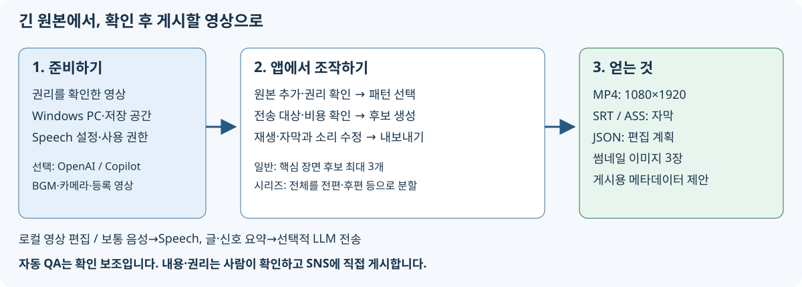

# VideoCreator

[English](../en/README.md) | [简体中文](../zh-CN/README.md) | 한국어 | [日本語](../../README.md)

### 표시 언어와 동영상 언어

화면의 언어 선택에서 일본어·영어·중국어(간체)·한국어를 선택할 수 있습니다. 표시 언어는 브라우저에 저장되며 동영상 언어와 독립적입니다. 프로젝트 화면의 동영상 언어(`ja-JP` / `en-US` / `zh-CN` / `ko-KR`)는 원본 발화에 맞추세요. 자막은 원래 언어의 발화를 그대로 유지하며 자동 번역하지 않습니다. 훅·제목·반응 문구·장면 전환 카드·시리즈 라벨·게시용 문장도 동영상 언어를 사용합니다. 기존 편집 계획은 생성 당시의 언어를 유지하므로 동영상 언어를 바꾸면 새로 생성하세요.

중국어·한국어 렌더링에는 `scripts/get-tools.ps1`에서 받는 Noto Sans CJK SC / KR(OFL)이 필요합니다. 없으면 내보내기 시 명시적인 오류를 반환합니다. 번역 문서는 `locales/`에 원문과 같은 구조로 배치합니다. 기존 일본어 스크린샷은 번역 문서에서도 촬영 당시의 실제 화면으로 취급합니다.

긴 동영상을 고르고 **편집 패턴만 선택**하면 AI가 핵심 장면을 찾아 자막·강조 텔롭을 넣은 **세로형 짧은 영상(1080×1920)**을 자동으로 만드는 로컬 웹 앱입니다.

## 처음 사용하는 분께: 준비 → 조작 → 결과물

**사용 권리를 가진 원본으로 게시 전에 확인할 수 있는 자막 영상을 만드는 앱입니다.** 원본을 고른 것만으로 공개되지 않습니다. 후보를 비교·수정하고 내보낸 파일을 직접 게시합니다.

| 준비할 것 | 앱에서 할 일 | 얻는 것 |
|---|---|---|
| Windows 10/11(x64 / ARM64), 인터넷, 저장 공간 | `run.cmd`로 필수 도구 설치·실행 | 본인 PC 브라우저에서 사용하는 로컬 웹 앱 |
| 이용 허가를 확인한 MP4 / MOV / MKV / WebM(10초~3시간). 자막이 필요하면 발화 영상 | 프로젝트 생성, 원본 추가·권리 확인 | 원본 분석 정보·시간 포함 전사 |
| **본인** Azure Speech 지원 리소스·엔드포인트·사용 권한. AI 선정 시 Microsoft Foundry 배포 또는 로그인된 Copilot CLI | 패턴 선택, 비용·전송 대상 확인 후 생성 | 최대 3개 짧은 영상 후보·저해상도 미리 보기(조건에 따라 3개 미만) |
| 내용 확인 시간 | 자막·소리·추출 구간 확인, 필요시 수정·내보내기 | 세로 MP4(1080×1920, H.264/AAC), SRT, ASS, 편집 계획 JSON, 썸네일 3장, 게시용 메타데이터 제안 |



처음에는 **동영상 한 편+P4 「클립 추출(긴 영상→30초)」+표준 필터링**을 권장합니다. 시리즈를 켜면 핵심 장면 후보 대신 긴 영상 전체를 전편·후편 등으로 나눕니다. BGM, 다중 카메라, 오프닝, 장면 전환은 먼저 한 편을 내보낸 뒤 시도하세요.

> **중요**: 로컬 웹 앱이지만 보통 자막용 음성을 Azure Speech로 전송합니다. 「LLM 미사용」「LLM 미사용 모드」는 완전한 오프라인이 아닙니다. 화면 권리 확인·자동 QA도 실제 이용 허가·내용 충실성·게시 대상 약관을 보장하지 않습니다. 예시 엔드포인트는 배포자의 것이므로 본인 값으로 바꾸세요. 설정은 Azure 리소스 생성·엔드포인트 변경까지 수행하지 않습니다.

### 가이드

- [사용자 가이드 목차](users-guide/README.md): 목적별 읽기·용어
- [빠른 시작](users-guide/quickstart.md): 준비·첫 영상
- [화면·구성 요소 설명](users-guide/screens.md): 실제 화면 SVG 스크린샷·조작 의미
- [문제 해결·QA 읽기](users-guide/troubleshooting.md)
- [소프트웨어 엔지니어용 기술 참조](users-guide/technical-reference.md): 구성도, 데이터·시간축, 확장 위치
- [설정·API 참조](users-guide/configuration-api.md)
- [자료 검증·스크린샷 재생성](users-guide/verification.md)
- [제작 방침·요구 사항·검증 결과 대응](users-guide/documentation-brief.md)


스크린샷은 실제 앱 캡처를 SVG에 삽입한 것입니다. 표시 자막은 테스트용이며 합성 영상·음성의 인식 결과가 아닙니다. 화면 비용은 계산값이지 이번 실제 과금 내역은 아닙니다.

- 요구 사항: [docs/PRD.md](docs/PRD.md) / 조사: [docs/VideoCreator-AnalyticsReport.md](docs/VideoCreator-AnalyticsReport.md)
- 구현·검증 기록: [docs/IMPLEMENTATION.md](docs/IMPLEMENTATION.md)

## 주요 기능

| | |
|---|---|
| 원본 | 끌어서 놓기/전체 경로 지정. ffprobe 검증(VFR·회전·음성 없음 탐지). 권리 확인 필수 |
| 전사 | Azure AI Speech **Fast Transcription**(단어 타임스탬프·화자 분리·구문 목록, 키 없는 인증) |
| 선정 | Microsoft Foundry(**Structured Outputs**) 또는 **GitHub Copilot(OS에 설치된 CLI를 SDK로 호출)**. 긴 영상은 신호 필터링·분할·재순위화. 실패 시 음성 고조 구간으로 선정 |
| 편집 | 문장 경계 스냅, 길이 맞춤, 콜드 오픈(선공개), 무음 점프 컷+펀치인, 9:16 흐린 배경 |
| 텔롭 | 일본어 줄바꿈 규칙(조사·작은 글자로 시작하지 않음, 균형 잡힌 2분할), 강조·훅·제목, 넘침 방지 자동 축소 |
| 품질 | 자동 QA(PRD §13): 길이·해상도·**−14 LUFS / −1 dBTP**·**텔롭 안전 영역 실측**·발화 중 컷·**텔롭 사실 확인**·권리. 하드 위반은 내보내기 금지 |
| 출력 | MP4(H.264/AAC)·SRT·편집 계획 JSON·ASS·썸네일 3장·게시용 메타데이터 제안 |
| 전편·후편 | **편수(2~20) 또는 편당 길이(예: 15분)**를 지정하면(선택 즉시 편당 길이 기준, 전사 완료 시 무음 컷 후 추정 표시) 긴 영상 전체를 동일 편집(자막·강조·점프 컷·세로형·QA)으로 **전편/후편(3편은 중편, 4편 이상은 제n화)**으로 나눕니다. 경계는 시계가 아니라 **주제 경계**(AI 챕터+어휘·의미(임베딩) 변화+전환어. **먼저 주제 경계만 후보로 삼고 길이가 다소 달라도 경계를 우선**. 부족할 때만 경고 후 길이 우선)와 **발화 경계**(앞 문장 완결 여부, 다음이 「그래서」「그러니까」처럼 이어지는지, 웃음 직후인지, 영상 암전·컷)를 바탕으로 동적 계획법을 써서 편수·균등 길이를 맞춥니다. 「그렇지만」「이거 좀」 같은 미완결 부분을 피하고 전사에 마침표가 빠진 문장 끝도 쉼으로 보완합니다(주제 도중 분할·말 도중 끝난 파트는 경고. [docs/IMPLEMENTATION.md §14·§15](docs/IMPLEMENTATION.md)). 각 파트는 「핵심 장면 선공개→이전 파트 요약→본편(챕터 제목)→『~에 계속』·다음 예고」. 메타데이터에는 YouTube 조건을 충족한 챕터·시리즈 링크란이 포함됩니다(3분 초과이므로 #Shorts 없음) |
| 오프닝·클로징 | 채널 **오프닝/클로징 영상**을 「3. 생성」에서 폴더 단위 등록(파일명 Opening / Closing으로 판별, 9:16·16:9가 있으면 출력에 맞게 선택, 권리 확인 필수). 오프닝은 선공개 뒤, 클로징은 마지막. 음량을 본편에 맞춘 뒤 전체 −14 LUFS 정규화. **출력(1080×1920)보다 작은 영상은 등록 시 한 번만 화질 개선**(lanczos 확대에 AI 초해상도 Real-ESRGAN 윤곽 세부만 추가. 해당 영상에서 lanczos보다 원본에 충실한지 VMAF·XPSNR 실측 후 유리할 때만 사용. GPU로 한 편 1~2분, 백그라운드) |
| 반응 정지 카드 | AI 반응 코멘트(P3)는 발언 직후, 전환 카드는 주제 전환에 영상·원음을 멈추는 **2~3초(기본 2.5초) 카드** 삽입. 등록 이미지 전체 화면(없으면 자체 배경 패널) 위 문자가 팝업되고 카드 전용 BGM 후 본편 재개. AI가 앞뒤 장면으로 **시청자 반응**(「말도 안 돼!」「멋진데!」 같은 코멘트·칭찬·공감)을 작성(AI 없으면 정형문). 「자동(기본)/반응 텔롭(영상 정지 없음)/카드」 선택 가능. 자동은 발언이 끝나고 쉼이 있는 곳만 카드, 문답 중·다른 카드 근처·정지 시간이 본편 10% 초과이면 오버레이(이유는 메모). AI 글은 승인 전 내보내기 불가. 확인 화면에서 수정·승인·개별 켜기/끄기. 자막·효과음·챕터는 삽입만큼 자동 이동, 카드 위 일반 자막 없음([구현·검증](docs/IMPLEMENTATION.md#10-오프닝클로징장면-전환의-반응-카드)) |
| 다중 원본 자동 동기화 | 같은 장면의 여러 카메라·화면 녹화를 **음성으로 1프레임 미만 자동 동기화**. 녹화 시작이 몇 분 달라도 전체에서 탐색하며 음성 트랙이 영상보다 늦게 시작하는 파일도 올바로 처리, 장기 녹화 **시계 어긋남(ppm)도 측정·보정**. 여러 구간이 일치할 때만 채택, 어긋남(ms)·드리프트·일치 구간 수 표시. 음성 없는 원본은 촬영 시간으로 맞추고 경고 |
| 화면 해설(P10) | **PC 화면 녹화+발표자 카메라** 자동 구분(낮은 움직임·얼굴 유무, 근거 표시). 화면 조작 중(「여기」「클릭」 등 화면 지시 발화 포함)은 **화면+발표자 원형 인셋**, 화면이 멈추면 **발표자 전체 화면**. 세로형은 글이 읽히도록 **조작 위치로 자동 줌·팬**, 인셋은 조작·글자 많은 곳을 피해 모서리에 배치, 텔롭은 화면과 겹치지 않음([구현·검증](docs/IMPLEMENTATION.md#11-다중-원본-자동-동기화와-화면-해설p10-화면-녹화발표자-인셋)) |

편집 패턴 **P1~P10 모두** 사용 가능합니다(BGM·효과음, 반응·의성어 텔롭, 얼굴 추적 세로화, 다중 카메라 전환, 화면 녹화+인셋, 비트 동기, 배속 포함. [presets/](../../presets)). 긴 영상 필터링(절약/표준/전체 텍스트)은 화면에서 선택합니다.

오프닝·클로징 등록은 **「폴더 선택…」의 폴더 선택 화면**(.NET 표준 `FolderBrowserDialog`. 탐색기와 같은 주소창·검색·빠른 접근, 이전 폴더 기억)을 사용할 수 있습니다. 선택 후 권리 확인·「등록」을 누르세요. 전체 경로 수동 입력도 유지하며 취소 시 입력은 바뀌지 않습니다.

카드 이미지가 없다면 **「영상에서 장면 전환 이미지 만들기」**에서 프로젝트별 [만들기]/[만들지 않음]을 선택합니다(기본 [만들지 않음], 기존 이미지 프로젝트는 [만들기]). 만들기를 고르면 권리 확인된 원본 또는 **등록된 오프닝·클로징 영상**(세로·가로 각 버전)에서 최대 2~6장(기본 4장)을 추출할 수 있습니다. 오프닝·클로징은 등록 시 권리 확인을 근거로 사용하며 미등록 파일은 지정할 수 없습니다. 등록 해제하면 해당 이미지도 사용하지 않습니다. 만들지 않음은 생성 파일을 지우지 않고 이후 후보에서 사용하지 않습니다(전환은 문자 카드). 영상 변화·밝기·시간 분포를 이용하고 검정·흰색·유사 이미지를 제외합니다(정지 영상은 지정 수보다 적을 수 있으며 의미상 핵심 장면 보장 아님). 이미지·원본 시간을 화면에서 확인할 수 있습니다. 외부 AI 전송 없이 프로젝트 `scene-cards`에 PNG를 저장하며 공통·생성 이미지를 덮어쓰지 않습니다. 생성 후 전환이 켜지고 **이후 생성·재생성 후보**에서 순서대로 사용합니다. 공통 등록 이미지가 있으면 우선합니다. 문자 카드·AI 글 승인 흐름은 유지하며 추출 원본 권리 확인이 해제되면 이미지 사용 내보내기도 막습니다.

「3. 생성」·내보내기·「미리 보기 업데이트」 중에는 **전체 진행률**과 **현재 하위 작업 진행률**을 표시합니다. 프록시·샷 탐지·미리 보기 합성·내보내기는 FFmpeg `-progress`(출력 완료 시간÷출력 길이) 실측이며 전체 막대는 역행하지 않습니다. 전사·AI 선정 등 측정 불가 처리는 숫자를 만들지 않고 불확정 막대를 표시합니다. 실측 중 하위 작업은 경과 시간으로 남은 시간도 추정합니다. 재미리 보기 진행률은 `GET /api/editplans/{id}/preview/progress`([progress.http](../../src/VideoCreator.App/progress.http)).

후보 화면(시리즈도 동일)에서 후보별 **「이 내용으로 승인」** 후 **하나 또는 여러 개**를 선택해 일괄 내보낼 수 있습니다. 당시 편집 계획 SHA-256 지문·승인자·일시를 기록합니다. 승인 후 확인·수정으로 바꾸면 「승인 후 수정됨(재승인 필요)」으로 바뀌며 재승인 전 내보낼 수 없습니다. 하드 QA 실패 후보는 승인 불가입니다. 일괄은 전체 사전 검증 후 하나라도 미승인·수정됨·처리 중·실패이면 **모두 시작하지 않고** 이유를 표시합니다. 순위(시리즈는 파트)순 한 편씩 처리하고 대기 중 편집하더라도 승인 시점 내용으로 내보냅니다. 각 후보에 진행률·완료 링크·실패 이유, 대기 중 취소를 표시합니다(실행 중은 불완전 파일을 남기지 않도록 끝까지 처리). 확인·수정의 개별 내보내기도 계속 사용할 수 있습니다([exports.http](../../src/VideoCreator.App/exports.http)).

**[설정]→「프로젝트 저장 위치」**에서 폴더를 입력하거나 OS 「폴더 선택…」으로 고르고 현재 내용을 [모두 이동]/[이동하지 않음] 중 선택합니다(기본 선택 없음). 「내용 확인」으로 프로젝트·기타 파일·합계 크기·같은 드라이브 여부·여유·문제를 확인 후 변경합니다. 같은 드라이브는 폴더 rename, 다른 드라이브는 복사·파일 수/크기 대조 후 원본을 지웁니다. 저장된 절대 경로(업로드·BGM·미리 보기·내보내기·전환 이미지·오프닝 등) 중 이동 대상을 참조하는 경로는 단일 트랜잭션으로 갱신합니다(기록 FFmpeg 명령은 유지). 동명 충돌·용량 부족·자기 내부 또는 프로젝트 내부 선택·생성/내보내기 중이면 이동하지 않습니다. 사용 중 파일 등으로 도중 실패하면 중단하고 이동·잔여 항목을 표시하며 양쪽을 계속 쓸 수 있습니다. 앱이 중지되어도 다음 실행 시 데이터 폴더 `projects-move.json`으로 자동 복구합니다. 이동하지 않음을 골라도 옛 위치 프로젝트 삭제는 폴더째 휴지통 이동합니다([projects-dir.http](../../src/VideoCreator.App/projects-dir.http)).

「1. 원본 선택」 파일 선택/드롭은 128 MiB 초과 MOV 등 큰 파일을 지원하며 앱 자체 수신 크기 상한을 두지 않습니다. `ASPNETCORE_TEMP`(미설정 시 OS 임시 폴더)에 버퍼링한 뒤 프로젝트 `assets`로 복사하므로 두 곳에 각각 원본 크기 여유가 필요합니다. 같은 드라이브라면 약 2배를 확보하세요. **전체 경로면 복사가 필요 없습니다**(원본 참조). 다른 API 상한은 바꾸지 않습니다.

## 필요한 것

- Windows 10/11(x64 / ARM64)·인터넷. **다른 소프트웨어는 `run.cmd`가 자동 설치**(아래).
- Azure(자막 전사 필수, 선정 AI 선택): Fast Transcription 리소스·본인 엔드포인트·사용자 `Cognitive Services User` 역할. Microsoft Foundry도 쓸 때만 지원 모델 배포·`Cognitive Services OpenAI User` 필요. 키 대신 Azure CLI 등 로그인 인증. [빠른 시작](users-guide/quickstart.md#2-본인의-클라우드-설정-준비하기).
- GitHub Copilot 사용 시: GitHub Copilot CLI(`run.cmd --setup --with-copilot` 설치) 로그인 완료.

## 설정과 실행

**간편 실행(Windows)**: 저장소 루트 `run.cmd` 두 번 클릭(또는 터미널 `.\run.cmd`).

1. 처음만 부족한 항목 자동 설치·설정(이후 간단 검사).
2. 매번 현재 소스 빌드·실행 후 **PC에 설치·구성된 Windows 기본 브라우저**로 <http://127.0.0.1:8765/> 열기(포트 변경 시 해당 URL). `run.cmd`는 브라우저 열기를 명시 활성화하며 추가 설치·프로필 생성은 하지 않습니다. 실패 시 경고·URL 표시. 빌드 실패·`--check`·`--no-start`는 앱·브라우저 모두 시작하지 않습니다.
3. 종료는 열린 창을 닫거나 Ctrl+C.

초기 설정([scripts/setup.ps1](../../scripts/setup.ps1))이 하는 일. 기본 Windows PowerShell 5.1에서 동작하므로 사전 설치가 필요 없습니다. 반복 실행해도 설치된 것은 건너뜁니다.

| 대상 | 방법 |
|---|---|
| .NET SDK 10(`global.json` 충족) | winget. 없으면 공식 `dotnet-install.ps1`로 사용자 영역 설치(관리자 불필요) |
| FFmpeg·일본어 글꼴·얼굴 모델·화질 모델 | [scripts/get-tools.ps1](../../scripts/get-tools.ps1)로 `tools/` 획득(모델 해시 검증) |
| Azure CLI | winget. 없으면 공식 MSI(관리자 확인) |
| Azure 로그인 | 미로그인 시 `az login` 화면 |
| Azure 연결 검사 | 설정 Speech·OpenAI에 **실제 토큰 최소 요청**(1초 무음 전사·짧은 응답), HTTP 판정. 403 역할 부족이면 부여 명령 표시, 동의 시 본인에게 부여 |
| GitHub Copilot CLI | 선택. `--with-copilot`일 때만 설치 |

결과는 `OK` / `INSTALLED` / `WARN` / `FAIL`. `FAIL`이면 시작하지 않습니다. Azure 문제는 `WARN`으로 앱은 시작하지만 자막이 붙지 않습니다.

| 명령 | 내용 |
|---|---|
| `run.cmd` | 첫 설정·이후 간단 검사, 매번 빌드 후 실행 |
| `run.cmd --check` | 변경 없이 상태 확인(Azure 연결 포함) |
| `run.cmd --setup` | 설정 재실행 후 시작(역할 부여·PC 구성 변경 후) |
| `--with-copilot` / `--assign-roles` / `--skip-azure` / `--non-interactive` / `--no-start` | Copilot CLI 설치/부족 역할 확인 없이 부여/Azure 미처리/확인·로그인 화면 없음/설정만 수행 |

참고: 앱은 `DefaultAzureCredential`로 인증합니다. Visual Studio의 다른 계정이 우선할 수 있으므로 `AZURE_TOKEN_CREDENTIALS=AzureCliCredential`로 Azure CLI 로그인을 고정할 수 있습니다.

**수동 실행**

```powershell
powershell -ExecutionPolicy Bypass -File scripts/setup.ps1   # 처음만(-CheckOnly는 확인만)
dotnet run --project src/VideoCreator.App -c Release
# → http://127.0.0.1:8765/ 브라우저 열기
```

`src/VideoCreator.App/appsettings.json`의 `VideoCreator`에서 설정합니다.

| 키 | 기본값 | 설명 |
|---|---|---|
| `Asr:Endpoint` | — | `https://<resource>.cognitiveservices.azure.com/`(사용자 지정 도메인 필수) |
| `Llm:Provider` | `azure-openai` | `azure-openai` / `copilot` / `none`(화면 설정 전환 가능) |
| `Llm:Endpoint` / `Deployment` | — / `gpt-chat-latest` | `https://<resource>.cognitiveservices.azure.com/openai/v1` |
| `Llm:SingleCallCharBudget` | 12000 | 초과 전사는 신호 필터링·분할(NFR-COST-03). 품질 우선 시 증가 |
| `LocalOnly` | false | true는 AI(LLM) 선정 미사용(자막 전사는 Azure AI Speech) |
| `DataDir` / `ProjectsDir` | `%LOCALAPPDATA%\VideoCreator` / `동영상\VideoCreator` | DB·캐시/프로젝트·내보내기 위치(ProjectsDir 화면 설정 가능, 화면 선택 우선) |
| `Dictionary` | [] | 고유명사(전사 구문 목록·텔롭 사실 확인) |

## 버전 관리

앱 버전은 루트 [Directory.Build.props](../../Directory.Build.props)의 `VersionPrefix`만으로 관리합니다. App/Core 어셈블리, `dotnet build`/`dotnet publish` 결과물 공통 적용입니다. 설정의 앱 버전, `GET /api/health`의 `version`, 시작 로그로 확인합니다. `informational_version`·화면 빌드 정보에는 Git 빌드 시 .NET SDK의 커밋 ID(`+...`)도 포함됩니다. 미커밋 변경 내용까지 식별하지는 않습니다.

Semantic Versioning(`MAJOR.MINOR.PATCH`)을 따라 호환성 파괴는 MAJOR, 호환 기능 추가는 MINOR, 수정은 PATCH를 올립니다. `ui/package.json` 버전은 비공개 UI 빌드 도구용이지 앱 버전이 아닙니다. 프리셋·저장 스키마 버전도 독립적입니다.

릴리스 절차:

1. `Directory.Build.props`의 `VersionPrefix` 갱신. `.csproj` 중복 지정 금지.
2. 아래 테스트·빌드 실행, 설정 화면·`/api/health` 확인.
3. 커밋 후 해당 커밋에 `v<version>`(예: `v1.0.0`) 태그. 태그는 기록용이며 버전을 자동 변경하지 않습니다. 공개 태그는 재지정하지 않습니다.

```powershell
dotnet test --project tests\VideoCreator.Tests --filter-class "*VersionTests"
dotnet build src\VideoCreator.App -c Release
# 실행 중 앱 API·설정 화면 Edge 검증(ui 의존성 필요)
node ui\verify-version.mjs http://127.0.0.1:8765 1.0.0
# 필요한 경우에만 배포 결과물 생성
dotnet publish src\VideoCreator.App -c Release
# 사전 릴리스 예(정식 버전은 VersionSuffix 미지정)
dotnet build src\VideoCreator.App -c Release -p:VersionSuffix=rc.1
```

어셈블리·파일 숫자 버전은 SDK 표준 `MAJOR.MINOR.PATCH.0`, 표시·제품 버전은 `MAJOR.MINOR.PATCH[-suffix][+commit]`입니다. 사전 릴리스 검증 후 일반 빌드를 다시 실행해 정식 결과물로 되돌리세요.

## 테스트

```powershell
dotnet test --project tests/VideoCreator.Tests   # 151개(FFmpeg·얼굴 모델 결합 테스트 포함, tools/ 필요)
cd ui; npm ci; node e2e.mjs ..\path\to\video.mp4 # 실행 중 앱 E2E(OS Microsoft Edge 헤드리스)
```

`spikes/*.cs`는 기능별 본체 통합 전 검증 프로그램입니다(`dotnet run spikes/01-ingest.cs`처럼 단독 실행).

## 구성

```
src/VideoCreator.Core   가져오기·신호·ASR·선정·제약 솔버·텔롭·ASS·렌더러·QA·저장(SQLite)
src/VideoCreator.App    ASP.NET Core(127.0.0.1 전용)+Fluent 2 Web Components UI
presets/                편집 패턴 P1~P10(JSON, 앱 갱신 없이 조정 가능)
tests/                  xUnit v3
ui/                     Fluent UI 번들(esbuild), 아이콘 생성, E2E
spikes/                 작은 검증 프로그램
```

설계 핵심(PRD §6.1): **AI는 「결정」하고 렌더러는 「결정적으로 생성」합니다.** AI 출력을 편집 계획 JSON으로 바꾸고 영상은 해당 JSON만으로 FFmpeg 생성합니다. 하드 제약은 프롬프트에 의존하지 않고 코드로 강제합니다.

## 보안

- 127.0.0.1 전용, 인증 없음(단일 사용자 로컬). DNS 리바인딩 방어(Host 검증), 상태 변경 API에 교차 사이트에서 보낼 수 없는 `X-VideoCreator: 1` 요구. CSP 적용.
- Azure 키 없음(`DefaultAzureCredential`). 리소스 로컬 인증 비활성화.
- 클라우드는 음성·전사 텍스트만 전송(영상 프레임 미전송).
- FFmpeg 인수 배열 실행(셸 없음). ASS 제어 문자 이스케이프. 프로젝트 폴더 내 쓰기 제한.

## 라이선스

MIT([LICENSE](../../LICENSE)). 포함 예정 M PLUS 1p는 SIL Open Font License, FFmpeg(BtbN GPL 빌드)는 GPL, Real-ESRGAN realesr-animevideov3(Xintao Wang)는 BSD 3-Clause입니다(`scripts/get-tools.ps1`로 받으며 저장소 미포함).
