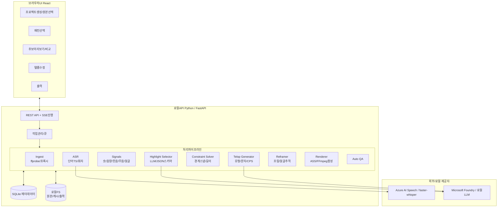
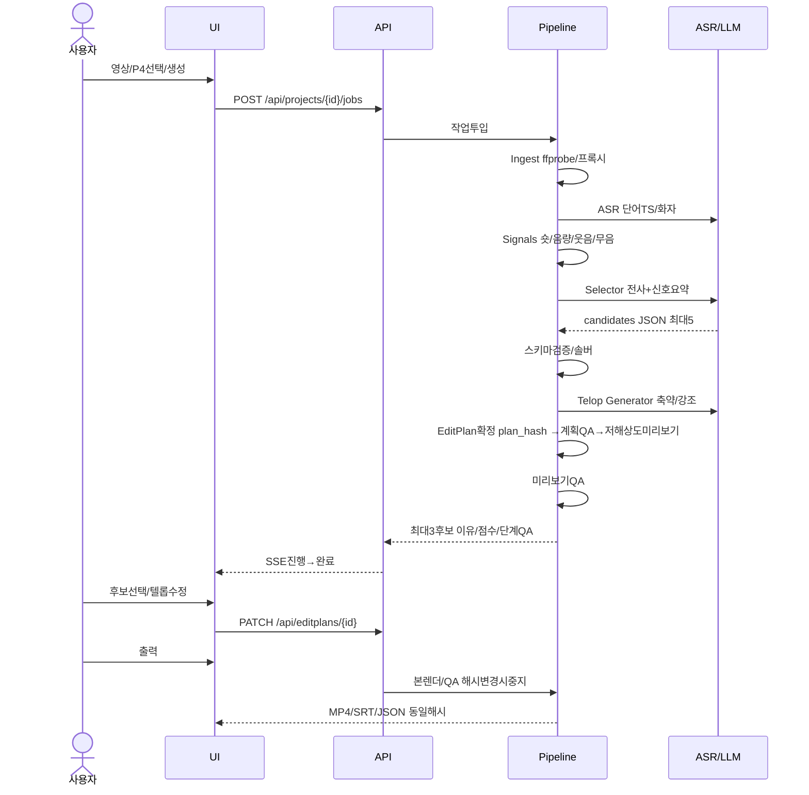
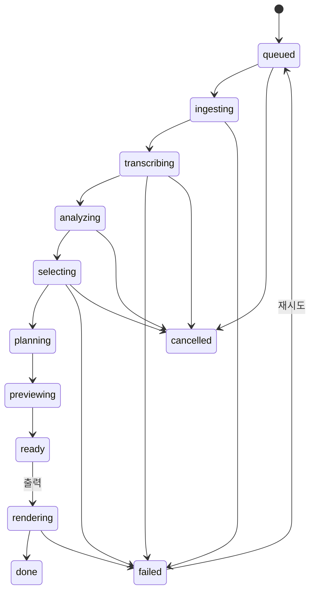
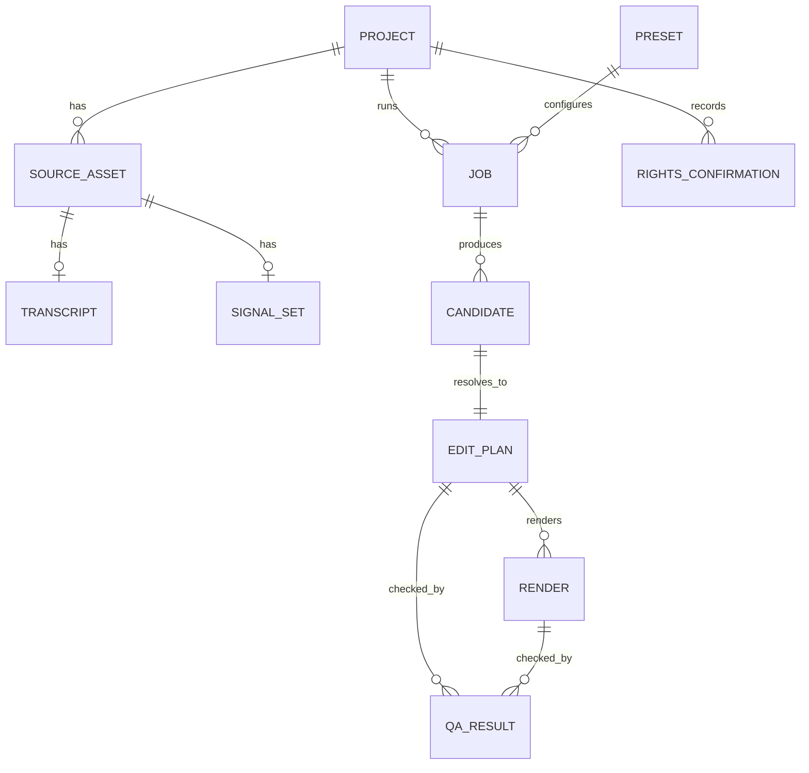

# VideoCreator — 제품 요구 사항 정의(PRD)

[↑ 문서 안내](../README.md) | [日本語](../../../docs/PRD.md) | [English](../../en/docs/PRD.md) | [简体中文](../../zh-CN/docs/PRD.md) | **한국어**


| 항목 | 내용 |
|---|---|
| 문서 ID | VC-PRD-001 |
| 버전 | 1.2.7(출력 영상 게시용 문장·타임코드 챕터 복사 지원) |
| 작성일 | 2026-11-07 |
| 최종 갱신일 | 2026-11-10 |
| 상태 | Draft(검토 대기) |
| 근거 | [VideoCreator 조사 보고서](./VideoCreator-AnalyticsReport.md)(이하 보고서, 절 번호 `R§x.y`) |
| 독자 | 제품 책임자·개발자·QA·디자이너 |

### 개정 이력

| 버전 | 날짜 | 변경 내용 | 구분 |
|---|---|---|---|
| 1.0 | 2026-11-07 | 초판 | — |
| 1.1 | 2026-11-07 | v1.1 구현 반영: NFR-SEC-04 개정(로컬 전용도 전사 전송), FR-SEL-10 필터링 선택 추가, P1/P3/P8 제공·P5/P7 사전 제공(§17) | 구현 반영 |
| 1.2 | 2026-11-08 | 감사 반영. ①US-11을 LLM 미사용 모드로 개명·대상 명시(NFR-SEC-04/AT-10/RK-06), 완전 오프라인은 v2 별도 정의 ②QG-01 유출/완료/편수/첫 통과 4지표·분모 정의 ③H-07 미등장어 검사로 개명·발화 대응 H-11/S-09/FR-REV-06/AT-13 추가 ④QA 계획/미리 보기/본 단계·not_run 도입 ⑤CPS 미충족 처리·전문 SRT는 CPS 제외 ⑥최대3후보·부족 표시(AT-14) ⑦§5.2 강도/출처/확인일·C-8 1분 초과 Shorts 저작권·S-10 ⑧사전 고정 맹검 분석(§15.2) ⑨plan_hash로 승인/QA/렌더/부가 출력 연결(FR-REV-07) ⑩재현 고정 조건 확대(NFR-REL-04) ⑪근거 링크2곳·§17 사전제공 표기·미정의 FR-SEL-10을§7.4 정의 | ①LLM 없이 전사 전송·⑨승인 무효화 CandidateApproval.PlanHash·FR-SEL-10은 기존 구현, 나머지 신규 요구 |
| 1.2.1 | 2026-11-08 | 모드명·ASR/인증 대상·QA 단계/not_run/해시·자막 연장0.5초/클립 경계·복호 프레임 비교/재현 저장 구현·검증. 정적 링크 비공개 라이브러리 버전은 실행 SHA-256 고정. 미교정 목표·출시 차단 조건 §15.6 추가 | 구현/검증 반영. 지정 AT-01·실통신 AT-10·품질 게이트 미통과([검증](IMPLEMENTATION.md#21-prd-121-재검증)) |
| 1.2.2 | 2026-11-08 | 허가된18분 실제영상 P4 양모드 완료·ASR/LLM HTTP 메서드/경로 구별 AT-10, 인증 자식 Azure CLI 텔레메트리 앱 환경에서 억제 | 해당 CLI 인증 AT-10 통과, AT-01/13~15/게이트 미통과([통신](IMPLEMENTATION.md#22-at-10-실제-통신-검증)) |
| 1.2.3 | 2026-11-09 | H-11 대응·S-09 부정누락·짧은 원본 거부/후보부족·승인/QA/출력 무효화·경합 거부/격리 구현, 기존 카메라/챕터는 S-13/14 분리 | AT-13~15 지정 반례·실FFmpeg/API·Edge UI픽스처 통과. AT-01 사용자 보류. QG-01~04 실제 코퍼스/독립표/참조라벨 없어 미통과·임계/분모 불변([검증](IMPLEMENTATION.md#23-at-13at-15-구현과-검증)) |
| 1.2.4 | 2026-11-10 | 불가 지적에도 복구 버튼이 나온 문제 개정. ①FR-REV-11 사전판정/버튼·12 불가이유 ②09 채택 비교는 id 아닌 단어 ③§13.3 권장/복구구분·미정의S-11/12 정의·Q-9 상한출처 ④AT-16 약속/결과·17 원문보존 ⑤§15.6/Q-8에6자/초와 실제속도 차 기록 | ①~④기구현·AT16/17 자동통과,⑤기준불변([검증](IMPLEMENTATION.md#17-자동-검사-권장-수정copilot-자동-복구오른쪽-타임코드-패널)) |
| 1.2.5 | 2026-11-10 | 한 Job 여러 후보/파트를5확인수정에서 개별·6출력에서 일괄 처리.①US13 ②REV13 확인순서/14 진행·EXP05 전건검증/06 목록/작업위치 ③§10 후보승인/일괄 API·E-NOT-APPROVED/E-EXPORT-BUSY·exports단계 ④SC5~7 ⑤AT18 UI/19 전건사전 ⑥Q10 오류통일 | ②~⑤기구현·AT18 Edge모의API·AT19 실Kestrel/FFmpeg 통과,⑥동작불변기록([검증](IMPLEMENTATION.md#18-한-패턴의-여러-영상을-개별-확인일괄-출력)) |
| 1.2.6 | 2026-11-10 | Q10(b), 일괄 코드를 단일 POST editplans/render와 통일.①후보별 미승인→승인후변경→하드실패→출력중 순·detail.code 단일동일·하드결과/출력render_id 포함 ②가장 우선 판정으로 전체상태/코드·1개선택=단일 ③EXP05/§10/오류/AT19/Q10 갱신 | ①②코드변경·전건검증/하나불가면전체미시작/이유목록 유지·실Kestrel/FFmpeg AT19통과([검증](IMPLEMENTATION.md#18-한-패턴의-여러-영상을-개별-확인일괄-출력)) |
| 1.2.7 | 2026-11-10 | YouTube/Viva Engage 소개용 즐거운 설명·00:00 챕터 복사.①US14/Should ②공식원문C9 ③EXP07 문장/챕터·08 AI안전·09 재안·03 가린 전사만LLM ④GET/POST renders/post ⑤SC7 ⑥AT20 규칙/21 실제시각/화면 ⑦Q11 Engage타임코드/Shorts챕터 | ①~⑥기구현·③가리기전 전사전송 결함 수정 포함. AT20 PostCopyTests·AT21 허가실제541.6초 본출력/Edge 통과.⑦미확인이라 목차로 표시·단정금지 |
---

## 목차

1. [배경·목적](#1-배경목적)
2. [용어](#2-용어)
3. [페르소나·사례](#3-페르소나사례)
4. [범위](#4-범위)
5. [전제·제약·의존성](#5-전제제약의존성)
6. [시스템·아키텍처](#6-시스템아키텍처)
7. [기능 요구](#7-기능-요구)
8. [패턴 규격](#8-편집-패턴프리셋-규격)
9. [데이터 모델](#9-데이터-모델)
10. [API](#10-api-규격)
11. [UI/UX](#11-uiux-요구)
12. [비기능 요구](#12-비기능-요구)
13. [자동 QA](#13-자동-qa-규격)
14. [수용 기준](#14-수용-기준)
15. [KPI·평가](#15-kpi평가-계획)
16. [위험·법무·윤리](#16-위험법무윤리)
17. [릴리스 계획](#17-릴리스-계획마일스톤)
18. [미결 사항](#18-미결-사항)
19. [추적성](#19-추적성보고서--요구)
20. [부록](#20-부록)

---

## 1. 배경·목적

### 1.1 배경

- 1시간 이상 방송 아카이브·대담·강의·Vlog에서 Shorts/TikTok용 약30초 세로영상을 수작업하면 편당 수시간이 걸립니다.
- 인기 편집은 다음 **측정 변수**로 분해됩니다(R§0/§3).
  - 첫 훅 길이
  - 재참여 간격
  - 숏 길이·균등성
  - 텔롭 문자 수·속도·크기·위치
  - 라우드니스
  - 루프 구조
- 이를 **프리셋(편집 패턴)**으로 고정하면 AI·결정적 렌더러로 자동화할 수 있습니다(R§5).

### 1.2 제품 비전

> **영상·패턴만 선택하면 보는 재미가 있는 짧은 영상 후보가 나온다.**

### 1.3 목표(Goals)

| ID | 목표 | 측정 |
|---|---|---|
| G-1 | 긴 영상 하나에서 게시 가능한 세로 영상 후보를 자동 생성한다. | 완료율·요구 수량 충족률·수정 전 QA(QG-01)·사용자 채택률(§15) |
| G-2 | 훅·템포·텔롭·루프의 재미를 프리셋으로 재현한다. | 맹검 쌍대 비교에서 기준선보다 우세(§15.2) |
| G-3 | 길이·비율·안전영역·음량을 **확실히** 충족한다. | §5.2 공식필수/자사필수 하드 위반 출력0건 |
| G-4 | 고급 편집 기술 없이 선택·확인·수정만으로 완료한다. | 완료까지 조작 수·시간(§15.3) |
| G-5 | 권리·AI 공개·사실 정확성을 지킨다. | 권리확인 완료율, H-07 미등장어/H-11 대응 위반0건 **및** AT-13 반례/출력표본 사람 감사의 사실오류0건. 자동검사만으로 정확성을 보장하지 않는다. |

### 1.4 비목표(Non-Goals)

| ID | 제외 | 이유 |
|---|---|---|
| NG-1 | 다중트랙·키프레임·색보정 타임라인 | 고급 편집을 목표로 하지 않으며 전문 NLE와 경쟁하지 않는다. |
| NG-2 | AI 얼굴·목소리로 하지 않은 말을 합성 | 윤리·YouTube 공개 정책(R§2/5.7) |
| NG-3 | 타인 영상 다운로드·URL 추출 | 약관·저작권(R§1.3/5.7) |
| NG-4 | v1.0 SNS 자동 게시 | API 심사·계정 위험이 있어 v2 이후 검토한다. |
| NG-5 | 추천 알고리즘 공략·인기 보장 | 알고리즘은 비공개이며 개선만 목표로 한다. |

---

## 2. 용어

| 용어 | 정의 |
|---|---|
| 원본 영상 | 선택한 입력 파일 |
| 프로젝트 | 편집 단위·1개 이상 원본과 결과 묶음 |
| 패턴/프리셋 | 규칙 매개변수(P1~P9,§8) |
| 후보 Candidate | AI하이라이트 구간·점수·이유 |
| EditPlan | 솔버가 확정한 **결정적 렌더 가능** 지시(EDL,§9.3) |
| 렌더링 | EditPlan→FFmpeg 파일 생성 |
| 텔롭 | 화면 문자 총칭·①~⑥(§7.6) |
| 안전 영역 | 플랫폼 버튼/캡션에 안 가리는 영역(R§2.1) |
| 훅 | 시작 시청유지 요소(결과/이상/질문/강한주장) |
| 루프 | 끝·처음 의미/시각 연결 |
| CPS | 초당문자·자막 속도 |
| LUFS / dBTP | 라우드니스 ITU-R BS.1770 / True Peak |
| ASL | 평균 숏 길이 |
| 펀치인 | 1.1~1.2배 디지털줌·가상 카메라 전환 |
| LLM미사용 | 선정/텔롭LLM 없음(US11), 전사용음성은 ASR(기본Azure)에 전송. 호환 설정키 LocalOnly 유지 |
| 완전오프라인 | ASR/LLM로컬·외부전송0·v2정의(§4.1) |
| plan_hash | 정규화계획JSON SHA-256(EditPlanFingerprint), 버전·승인/QA/렌더/부가출력 연결(§9.3) |

---

## 3. 페르소나·사례

### 3.1 페르소나

| ID | 페르소나 | 상황 | 요구 | 패턴 |
|---|---|---|---|---|
| PS-1 | 개인방송 게임/잡담 | 매주2~3시간 아카이브 | 웃음/반응 빠른쇼츠 | P4, P1, P3 |
| PS-2 | 비즈니스채널 | 주1시간대담/강의·다중카메라 | 요점텔롭·카메라전환 | P4, P6, P7 |
| PS-3 | 요리/DIY/여행취미 | 긴과정원본 | 템포압축·소리활용 | P8, P5, P9 |
| PS-4 | 기업홍보/마케팅 | 세미나/행사 | 브랜드보호·정확한짧은텔롭 | P4, P6 |

### 3.2 사용자 스토리

| ID | 스토리 | 우선순위 |
|---|---|---|
| US-01 | PS-1은2시간 방송과 클립 패턴만 선택하여30초 세로 영상 최대3개를 받고, 부족하면 수량·이유를 알아 수동 탐색을 없애고 싶다. | Must |
| US-02 | 모든 사용자는 선정 **이유·점수**를 보고 채택 판단 시간을 줄이고 싶다. | Must |
| US-03 | 모든 사용자는 타임라인 없이 자막 오타만 쉽게 수정하고 싶다. | Must |
| US-04 | 모든 사용자는 Shorts/TikTok 길이·비율·음량·UI에 가리지 않음을 보장받고 싶다. | Must |
| US-05 | PS-2는 카메라2개와 음성1개로 발화자 자동 전환을 하고 싶다. | Should |
| US-06 | PS-1은 예능 리액션을 쓰되 부적절함을 막도록 공개 전에 반드시 확인하고 싶다. | Should |
| US-07 | PS-3은 텔롭·BGM 없이 환경음을 살린 미니멀 영상을 만들고 싶다. | Should |
| US-08 | 모든 사용자는 더 짧게·다른 장면 등의 지시로 재생성하고 싶다. | Should |
| US-09 | PS-4는 숫자·고유명사가 원발화와 일치함을 보장받고 싶다. | Must |
| US-10 | 모든 사용자는 영상·SRT·EditPlan JSON을 저장하고 싶다. | Must |
| US-11 | 기밀 원본에서 LLM을 쓰지 않고 전사용 음성만 외부 전송됨과 그 대상을 사전 확인하고 싶다. | Could |
| US-12 | PS-2는 긴 영상 하나에서 가로3~5분 요약을 만들고 싶다. | Could |
| US-13 | 같은 패턴의 여러 후보·파트를 하나씩 확인·승인한 후 일괄 출력하고 확인·출력 상태를 추적하고 싶다. | Should |
| US-14 | 완료 후 YouTube·사내Engage용 재미있는 하이라이트 설명과00:00 챕터를 복사하여 글 작성·시각 수집 수고를 줄이고 싶다. | Should |

---

## 4. 범위

### 4.1 MoSCoW

| 구분 | 범위 |
|---|---|
| **Must(MVP v0.1~1.0)** | 원본1개·전사·신호·LLM선정·솔버·9:16 흐린배경·텔롭①②④·ASS·loudnorm·QA·최대3개 미리보기·문구수정·MP4/SRT/JSON. 대상은 **P4클립**, P6해설, P2단발루프다. |
| **Should(v1.x)** | 얼굴추적,③리액션·⑤의성어/SFX·⑥카운터, BGM더킹/SFX, 재생성지시, 동일Job 개별확인/일괄출력(US-13, Could배치와 별개), 게시문/챕터 복사(US-14, 게시 자체는 하지 않음). P1/P3/P7다중전환/P8/P9. |
| **Could(v2)** | P5비트동기·가로요약·ASR/LLM 외부전송0인 완전오프라인·멀티모달 이해·배치·영어UI/자막(역사적 계획). |
| **Won't(제외)** | NG-1~NG-5 |

### 4.2 지원 입출력

| 구분 | 규격 |
|---|---|
| 입력 컨테이너 | MP4, MOV, MKV, WebM |
| 코덱 | H.264, H.265/HEVC, VP9, AV1, ProRes(FFmpeg 디코드 가능) |
| 해상도 | 720p~4K(내부1080p 축소) |
| 길이 | 10초~3시간(초과는 오류 대신 경고·분할 제안). 프리셋 최소보다 짧거나 적합 장면 부족이면3개 미만 가능(FR-SEL-08) |
| 음성 | 필수(무음은 P9 외 경고) |
| 출력 영상 | H.264 High·1080×1920(9:16)·원본fps(최대60/기본30)·CRF18~20·+faststart |
| 출력 음성 | AAC-LC·48kHz·스테레오·192kbps·−14LUFS±1·TP≤−1.0dBTP |
| 부가 출력 | SRT 구간 발화전문(합성①과 별개·S01속도 제외), EditPlanJSON§9.3·PNG3장. 동일plan_hash 계획에서 전부 생성(FR-REV-07) |

---

## 5. 전제·제약·의존성

### 5.1 전제(Assumptions)

| ID | 전제 | 타당성 확인 |
|---|---|---|
| A-1 | 기존 앱이 없어 신규 개발한다. | 2026-11-07에는 LICENSE/work만 존재 |
| A-2 | 큰 원본 업로드를 피하도록 **로컬 웹앱**(브라우저UI+로컬API)으로 한다. | §18 Q-1에서 최종 결정 |
| A-3 | UI·문서는 일본어·영어·간체중국어·한국어를 지원한다. 프로젝트 영상언어는 별도이며 ASR·원문자막·연출·렌더·게시문에 전달한다. 자막 자동번역은 하지 않는다. | Q-5 |
| A-4 | AI는 **교체 가능한 제공자 추상층** 뒤에 두며 기본은 Azure Speech/Foundry다. | Q-2 |
| A-5 | 소유하거나 허가받은 원본만 처리한다. | FR-ING-06 권리확인 |

### 5.2 제약(Constraints) — 강도·출처

제약은 네 강도로 나눕니다. 하드 H-*는 공식 필수·자사 필수만 가능합니다. 타사 기준·권장/가설은 자사 필수로 채택하고 이유를 기록한 경우만 하드로 삼습니다.

- **공식필수**: 공식 플랫폼 조건, 위반 시 배포불가·차단 등 불이익.
- **타사기준**: 타사/업계 납품 기준, 자체로 제품 구속 안 함.
- **자사필수**: 품질 보증 자체 조건, 하드QA.
- **권장/가설**: 경험/2차자료 수치, §15.5 교정.

| ID | 제약 | 구분 | 출처(확인일) |
|---|---|---|---|
| C-1 | 2024-10-15 이후 Shorts는 세로·정사각형이며 최대180초다. | 공식필수 | Help15424877 원문2026-11-08·R§2[S1] |
| C-2 | Shorts 곡별 최대90초이며 곡에 따라60/30초다. | 공식필수 | 위와 같음 |
| C-3 | 합성① 기본은 행당전각14자·최대2행·초당6자다. Netflix의13자/2행/4자보다 세로쇼츠의 빠른 템포에 맞춰 완화했다. S-02문자수/S-01속도는 소프트다. | 타사 참고 자사기준 | Netflix Japanese Timed Text Style Guide·R§2/3.3[S5] |
| C-4 | 1080×1920 본문은 위250/아래580/우160/좌60px를 피하며 제목은 위300px를 허용한다. 공식 픽셀은 비공개라 여러 추정을 안전측으로 통합했다(보고서 하580~670/우160~190). H-05는 자사필수다. | 권장→자사필수 | R§2.1[S11][S12] 모두2차 |
| C-5 | 통합−14±1LUFS·TP≤−1dBTP다. YouTube는 약−14를 넘으면 낮추지만 작은 음성은 높이지 않으므로 저음량 방지를 위해 H-03/04를 필수화한다. | 권장→자사필수 | R§2/3.4[S7]2차 |
| C-6 | 사실적 AI 생성·변형이면 게시 시 AI use 공개가 필요함을 알린다. | 공식필수 | R§2[S9] |
| C-7 | Shorts는 YouTube A/B 미지원이므로 준실험으로 검증한다. | 공식 평가제약 | R§6.3[S10] |
| C-8 | 1분 초과 Shorts는 유효 Content ID/수동저작권 청구가 있으면 전세계 차단되어 재생·추천·수익화가 불가하다. 1분 이하는 변경되지 않는다. | 공식필수 | Help15424877 Third-party claimed content… 원문2026-11-08 |
| C-9 | 설명 챕터는00:00부터3개 이상 오름차순이며 각10초 이상이다. 미충족 목록은 챕터로 취급되지 않는다. | 공식필수 | Help9884579 Video chapters 원문2026-11-10 |
> **주의**:60초 초과(P9 최대90초)이며 사용자 곡 등 제3자 원본이 있으면 S-10을 경고합니다. 공식 규격 변경(RK-07)에 맞춰 확인일을 갱신합니다.

### 5.3 외부 의존성

| ID | 의존 | 용도 | 대안 |
|---|---|---|---|
| D-1 | FFmpeg7.x이후 win-x64/arm64/macOS/Linux동봉 | 디코드/분석/합성/인코드 | 없음·필수 |
| D-2 | AzureSpeech 배치/단어시각/화자분리 | 전사 | 로컬faster-whisper |
| D-3 | Foundry JSON스키마모델 | 선정/문구축약 | OpenAI호환로컬LLM Could |
| D-4 | PySceneDetect AdaptiveDetector | 숏경계 | FFmpeg select='gt(scene,x)' |
| D-5 | MediaPipe등 얼굴 | 추적리프레임Should | 흐림Must |
| D-6 | 동봉/합성허가 일본어폰트 NotoSansJP/MPLUS | 텔롭 | YuGothicUI등OS·라이선스확인 |

> 보고서 검증은 Windows Yu Gothic UI(R§5.5). 제품은 **재배포 가능한 OFL** 동봉(Q6).

---

## 6. 시스템·아키텍처

### 6.1 설계 원칙

| ID | 원칙 | 이유 |
|---|---|---|
| AP-1 | **AI가 결정하고 렌더러가 결정적으로 제작한다.** LLM 출력은 계획 JSON이며 렌더러 입력은 계획뿐이다. | 재현성·테스트·수정 편의 |
| AP-2 | **LLM 단독으로 판단하지 않는다.** 음량·웃음·숏 신호와 합의한다. | 환각 대응 R§5.3 |
| AP-3 | **하드는 코드로 보장한다.** 길이·비율·안전·음량은 솔버/QA로 강제하며 프롬프트에 의존하지 않는다. CPS·문자수는 가깝게 맞추되 남으면 S-01/02 경고로 두고 원발화 충실성을 우선해 사용자가 판단한다. | G-3/C-3 |
| AP-4 | **제공자를 추상화한다.** ASR·LLM·얼굴 검출을 인터페이스로 분리한다. | 종속 회피·US-11·향후 오프라인 |
| AP-5 | **단계마다 캐시한다.** 전사·신호는 한 번 계산하고 패턴 변경 시 재사용한다. | 성능·비용 |

### 6.2 구성 요소



### 6.3 처리 시퀀스(P4 클립)



### 6.4 작업 상태 전이



---

## 7. 기능 요구

요구ID는 `FR-<영역>-<일련번호>`, M=Must/S=Should/C=Could입니다.

### 7.1 프로젝트·원본 수집(ING)

| ID | 요구 | 우선순위 | 근거 |
|---|---|---|---|
| FR-ING-01 | 로컬 영상 파일을 하나 이상 선택하여 프로젝트를 생성할 수 있어야 한다. | M | R§5.1 |
| FR-ING-02 | ffprobe로 길이·해상도·fps·음성 채널·회전을 수집한다. §4.2 범위 밖 입력은 이유와 함께 거부하거나 경고한다. | M | §4.2 |
| FR-ING-03 | 분석용 720p 영상과 16kHz 모노 WAV 프록시를 생성하여 캐시한다. | M | AP-5 |
| FR-ING-04 | 분석 전에 VFR을 정규화하여 CFR처럼 처리할 수 있게 한다. | M | R§5.5 timebase |
| FR-ING-05 | 여러 원본은 음성 상호상관으로 동기화하고 오차를 ms로 표시한다. | S | R§3.6 |
| FR-ING-06 | 소유권 또는 사용 허가 확인 체크를 필수로 받고 기록한다. | M | R§5.7,A-5 |
| FR-ING-07 | 같은 해시의 파일을 다시 수집할 때 캐시를 재사용한다. | S | AP-5 |
| FR-ING-08 | 생성할 때마다 기존 분석 재사용(기본값)과 처음부터 재분석 중 선택하게 한다. 추가 비용과 수정된 전사를 대체한다는 점을 미리 표시한다. | S | AP-5 |

### 7.2 전사(ASR)

| ID | 요구 | 우선순위 | 근거 |
|---|---|---|---|
| FR-ASR-01 | 단어별(일본어는 형태소 또는 문자열 단위) 시작·종료 시각을 포함한 전사를 생성한다. | M | R§5.3-1 |
| FR-ASR-02 | 최대 네 명을 화자 분리하고 발화마다 화자 ID를 붙인다. | M | R§3.6 |
| FR-ASR-03 | 문장부호가 없는 일본어 전사는 LLM 또는 규칙으로 문장 경계를 다시 추정한다. | M | R§5.3-1 |
| FR-ASR-04 | 설정으로 Azure Speech와 faster-whisper를 교체할 수 있게 한다. | M | AP-4,D-2 |
| FR-ASR-05 | 고유명사·제품명 사전을 등록하여 ASR 구절 목록과 텔롭 대조에 사용한다. | S | US-09 |
| FR-ASR-06 | UI에서 전사 텍스트를 편집하여 인식 오류를 수동 수정할 수 있게 한다. | S | US-03 |

### 7.3 신호 추출(SIG)

| ID | 요구 | 우선순위 | 근거 |
|---|---|---|---|
| FR-SIG-01 | PySceneDetect AdaptiveDetector로 숏 경계를 검출한다. 기본값은 adaptive_threshold=3.0, min_scene_len=15프레임이다. | M | R§5.3,[S24] |
| FR-SIG-02 | 100ms 단위 RMS/LUFS-M 음량 시계열과 급증 지점을 계산한다. | M | R§5.3-2 |
| FR-SIG-03 | −40dBFS 이하의 무음을 검출한다. 최소 무음 길이는 §8 프리셋 값으로 정한다. | M | R§3.2 |
| FR-SIG-04 | 음향 이벤트 분류기로 웃음·환호·박수를 검출한다. | S | R§5.3-2 |
| FR-SIG-05 | ASR 결과에서 초당 문자 수로 발화 속도 시계열을 계산한다. | S | R§5.3-2 |
| FR-SIG-06 | 2fps로 표본을 추출하여 얼굴 위치·수의 시계열을 저장한다. | S | R§5.3-6 |
| FR-SIG-07 | 상위 N개 피크의 시각·유형을 토큰 상한 이내 JSON으로 요약하여 LLM에 전달한다. | M | R§5.4 |

### 7.4 하이라이트 선정(SEL)

| ID | 요구 | 우선순위 | 근거 |
|---|---|---|---|
| FR-SEL-01 | 시각 포함 전사·신호 요약·패턴 규칙을 LLM에 전달하여 §20.2 스키마로 최대 다섯 후보를 받는다. | M | R§5.4 |
| FR-SEL-02 | 스키마 검증에 실패하면 최대 두 번 재시도한다. 계속 실패하면 신호 피크 전후 15초로 대체한다. | M | AP-2 |
| FR-SEL-03 | 컨텍스트 창을 넘는 전사는 약 10분 단위로 나누고 마지막에 전체 후보 순위를 다시 매긴다(map-reduce). | M | 1시간 초과 입력 |
| FR-SEL-04 | hook/standalone/payoff/emotion 각 0~10점과 한 문장 선정 이유를 반환한다. | M | R§5.4,US-02 |
| FR-SEL-05 | LLM 점수와 신호 점수를 기본 0.6:0.4로 합성하며 가중치는 설정할 수 있게 한다. | M | AP-2 |
| FR-SEL-06 | 일본어 지시어 それ/あれ/これ 등으로 시작하거나 사전 지식이 필요한 구간은 standalone 점수를 낮춘다. | M | R§5.7 |
| FR-SEL-07 | 앞뒤 30초 문맥도 LLM에 제공하고 잘라내기로 의도가 변하는지 자체 검사하여 변하는 구간을 제외한다. | S | R§5.7 |
| FR-SEL-08 | IoU>0.5 중복을 통합하여 다른 장면 **최대 세 개**를 제시한다. FR-SOL-03 길이·품질을 충족하는 장면이 부족하면 중복이나 조건 밖 구간으로 채우지 않는다. 실제 수와 이유(10초 원본이 P4 최소25초 미달, 적합 장면이 하나뿐 등)를 표시하며 0개면 E-SOL-INFEASIBLE를 반환한다. | M | US-01 |
| FR-SEL-09 | 더 짧게·다른 장면·더 재미있게 등의 재생성 지시를 받아 기존 후보를 제외하고 다시 선정한다. | S | US-08 |
| FR-SEL-10 | 긴 입력에서 LLM 전송 범위를 절약·표준(기본)·전문 중 선택하게 하고 선택 전에 예상 전송량·비용을 표시한다. 전문 모드는 사전 필터 없이 전송하며 NFR-COST-03 토큰 감축 목표에서 제외한다. | S | NFR-COST-01,03 |

### 7.5 제약 솔버(SOL)

| ID | 요구 | 우선순위 | 근거 |
|---|---|---|---|
| FR-SOL-01 | 후보 양끝을 ±1.5초 안의 문장 끝이면서 숏 경계·무음에 가장 가까운 위치로 스냅한다. | M | R§5.3-4 |
| FR-SOL-02 | 구간 끝 ±150ms에 단어가 걸치지 않게 하여 발화 도중 잘라내지 않는다. | M | R§5.6 |
| FR-SOL-03 | 패턴 길이(P4:25~35초)에 맞춘다. 길면 낮은 점수 문장을 제거하고 짧으면 앞뒤를 추가한다. | M | R§5.2 |
| FR-SOL-04 | 구간 결합 시 hook 점수가 가장 높은 부분을 선공개한다. 순서 역전으로 의미가 달라지면 시간순을 유지한다. | M | R§3.1/5.3-4 |
| FR-SOL-05 | 무음 제거가 활성화되면 임계값 이상 무음을 점프컷으로 제거하되 이후에도 최소 숏 길이를 보장한다. | M | R§3.2 |
| FR-SOL-06 | 루프 활성 시 끝·첫 문장의 LLM 의미 점수 또는 프레임 SSIM으로 가장 적합한 종료 위치를 찾는다. | S | R§3.5 |
| FR-SOL-07 | §9.3 EditPlan을 출력한다. 입력·설정이 같으면 결과도 같아야 한다(LLM 호출 제외). | M | AP-1 |

### 7.6 텔롭 생성(TEL)

유형(R§3.3):①발화자막②강조③반응/속마음④상황/제목⑤의성어/SFX⑥수치/카운터.

| ID | 요구 | 우선순위 | 근거 |
|---|---|---|---|
| FR-TEL-01 | ASR에서 ①발화 자막을 생성한다. 기본 행당14자, 세로 영상 기본1행·최대2행이다. | M | C-3 |
| FR-TEL-02 | 생성·복구 모두 원발화 그대로 유지한다. 바꿔쓰기·요약·어구 생략·삭제를 금지하며 머뭇거림·어미·맞장구·반복도 남긴다(명시적 가림·표시용 부호/공백 제외). 순서·어구를 보존하는 분할·결합·경계 조정·표시 연장으로 기본6자/초에 가깝게 한다. 연장은 발화 끝에서 최대0.5초이며 다음 자막 중첩·영상 밖 표시는 금지한다. 불가능해도 삭제하지 않고 S-01 경고·이유를 남긴다. 경고를 알고 출력한 사실은 provenance에 기록한다. SRT에는 전문을 포함한다. 연출 텔롭·카드는 별개로 외형을 우선하되 사실·근거·부정을 보존하고 AI 수정 후 승인을 요구한다. | M | C-3,AP-3,[S5] |
| FR-TEL-03 | 문장부호·문절에서 개행하고 조사·조동사 바로 앞에서는 나누지 않는다. JIS X 4051 행두 금칙(닫는 괄호·부호·작은 가나·장음), 행말 금칙(여는 괄호), 분리 금지(숫자와 단위·영단어·가타카나)를 지킨다. 프리셋과 렌더링 폭(폰트·장체·테두리·안전 영역) 이내에서 문절·호흡·최소0.8초를 고려해 자막 길이를 자동 결정한다. 단어 하나가 초과하면 단어를 나누지 않고 폰트를 줄인다. | M | R§3.3 |
| FR-TEL-04 | ②는 후보당 최대3개 키워드를 추출 구간의 등장 위치마다 표시한다. 적으면 원문 짧은 구절로 약4초마다 보완하되 무음·동일 자막 문구·중복으로 늘리지 않는다. 프리셋 색·크기와 팝업을 적용한다. | M | R§3.3 |
| FR-TEL-05 | ④는 후보별16자 이내 제목을 상단300px 박스에 표시한다. | M | R§3.3 |
| FR-TEL-06 | ③은 P1/P3에서 명시적으로 활성화했을 때만 **미승인** 상태로 생성하며 승인 전에는 출력할 수 없다. | S | R§5.7,US-06 |
| FR-TEL-07 | ⑤는 웃음·놀람·무음(일본어 예:「シーン…」) 신호를 프리셋 사전으로 변환하고 SFX와 동기화한다. | S | R§3.3/3.4 |
| FR-TEL-08 | ⑥는 LLM으로 전사의 숫자·일수·금액을 검출하여 DAY3/¥1,000,000 등으로 표시한다. | S | R§3.1 |
| FR-TEL-09 | **미등장어 검사**: ②③④⑥의 고유명사·숫자는 전사 또는 사용자 사전에 있어야 한다. 없으면 제거하고 경고한다. 조작한 단어를 검출할 뿐 내용 일치 검증은 FR-TEL-12/FR-REV-06에서 수행한다. | M | R§5.6,US-09 |
| FR-TEL-10 | 흰색은 발화, 노랑은 강조, 빨강은 놀람·경고, 하늘색은 보충에 쓴다. P7은 화자별 고정색도 가능하게 한다. | M | R§3.3 |
| FR-TEL-11 | 텔롭 테마를 저장하여 다른 프로젝트에서도 재사용할 수 있게 한다. | C | — |
| FR-TEL-12 | **발화 대응 검사**: 고유명사·숫자가 있는 ②④⑥는 후보 구간 발화에 source_word_ids로 연결해야 한다. (a)정규화된 어구가 연결 발화에 존재하며 다른 위치·사전만은 불가 (b)숫자·단위·대상 A/B가 일치 (c)P7 등에서 화자 일치 (d)일본어 ない/ず/ません/じゃない 등 부정 누락은 S-09 경고. 발화 요약이 아닌 ③은(a)~(c) 제외하되 FR-TEL-06 승인은 필요하다. ASR 누락이면 FR-ASR-06으로 수정 후 재평가한다. | M | US-09,G-5,RK-03 |
| FR-TEL-13 | **얼굴 회피**: 새로 만드는 ②~⑥와 훅은 전체 표시 기간 동안 얼굴·자막·다른 연출과 겹치지 않는 고정 위치를 고른다. 세로 영상도 분석하고 추적·줌·배속·전환·인셋을 반영하며 얼굴 이동 영역+32px와 최대 팝업1.12배를 확보한다. 정보 부족/안전한 위치 없음이면 연출만 숨기고 이유를 남긴다. ①/SRT 문구·시각은 바꾸지 않는다. 2fps 추정이므로 검출 누락·급격한 움직임까지 보장하지 못한다. 기존 계획에 적용하려면 재생성한다. | M | US-07,FR-TEL-02 |

### 7.7 리프레임(RFM)

| ID | 요구 | 우선순위 | 근거 |
|---|---|---|---|
| FR-RFM-01 | 16:9→9:16은 확대·크롭 배경에 boxblur=20:2를 적용하고 전경 폭1080을 중앙보다120px 위에 배치한다. | M | R§5.5(A) |
| FR-RFM-02 | 얼굴 하나이면 얼굴 중심9:16로 추적한다. 1초 이상 이동평균과 최대 이동속도로 흔들림을 억제하며 즉시 이동은 숏 경계에서만 허용한다. | S | R§5.3-6 |
| FR-RFM-03 | 얼굴이 둘 이상이거나 검출되지 않으면 흐린 배경 방식으로 자동 복귀한다. | S | R§5.3-6 |
| FR-RFM-04 | 9:16/1:1 원본은 리프레임 없이1080×1920으로 맞춘다. 정사각형은 상하 배경을 추가한다. | M | C-1 |
| FR-RFM-05 | 강조 발화·두 번째 이후 등 프리셋 지정 구간에1.10~1.20배 펀치인을 적용한다. | M | R§3.2/5.5(A) |

### 7.8 다중 원본 전환(SWT) — P7

| ID | 요구 | 우선순위 | 근거 |
|---|---|---|---|
| FR-SWT-01 | 화자·마이크와 카메라의 대응을 화자 분리/얼굴로 자동 추정하고 수동 지정도 가능하게 한다. | S | R§3.6 |
| FR-SWT-02 | 현재 말하는 사람의 카메라를 선택한다. 최소 유지시간은 기본2초이며1.5~2.5초로 설정할 수 있다. | S | R§3.6 |
| FR-SWT-03 | 듣는 사람의 웃음·놀람이 음향/표정에서 검출되면0.8~1.5초 리액션 숏을 삽입한다. | S | R§3.6 |
| FR-SWT-04 | 와이드 카메라가 배정되면 절 시작과 기본45초마다(30~60초 설정) 와이드로 돌아간다. | S | R§3.6 |
| FR-SWT-05 | 기본은 하드컷이며0.2~0.4초 크로스페이드는 장면 전환에만 허용한다. | S | R§3.6 |
| FR-SWT-06 | 지정 마스터 음성 하나를 연속 사용하고 카메라 전환에 따라 음성을 바꾸지 않는다. | S | R§3.6 |
| FR-SWT-07 | xfade의 두 입력 모두 settb=AVTB, fps=<출력fps>로 정규화한다. | S | R§5.5(C) 실제 결함 |

### 7.9 음성 처리(AUD)

| ID | 요구 | 우선순위 | 근거 |
|---|---|---|---|
| FR-AUD-01 | loudnorm으로 출력 음성을 −14LUFS, TP−1.5dBTP, LRA11로 정규화한다. 2패스를 권장한다. | M | C-5 |
| FR-AUD-02 | 사용자 곡 또는 동봉 라이선스 라이브러리 BGM을 추가할 수 있다. 프로젝트에 여러 곡을 일괄 등록하고 곡마다 라우드니스(ITU-R BS.1770/EBU R128, FFmpeg ebur128), 사용 가능 부분(양끝 무음·페이드 제외), 템포, 음의 시작(스펙트럼 플럭스 onset), 밝기(스펙트럼 중심)를 측정한다. 전사 단어 시각보다0.25초 먼저 BGM을 낮추고0.8초 미만 말 사이에는 낮춘 상태를 유지한다. 발화 중 목소리−BGM 차는 기본14LU·하한10LU(Torcoli 외 JAES2019 Commentary over Music≥10LU)에 맞춘다. 곡별 라우드니스로 곡 음량차를 보정하고 작은 목소리·곡의 고조 부분에서는 더 깊게 낮춘다. 이전 계획은 기존 sidechaincompress를 유지한다. | S | R§3.4/5.5(D) |
| FR-AUD-08 | 장면에 따라 자동 선곡할 때 역할 전환·장면 카드·챕터·크로스페이드·원본 점프를 경계로 본편을20초 이상 장면으로 나눈다. 장면 에너지(발화 속도·목소리·웃음)와 곡 에너지(템포·onset·밝기)의 거리 및 교체 비용을 합친 Viterbi 동적 계획법으로 선곡한다. 교체는 등전력 크로스페이드이며 BGM이 멈추는 삽입물에서는 삽입물 안에서 끝낸다. 동일 곡 연속 장면은 계속 재생하고 루프는 사용 가능 부분만 반복한다. 선정 이유로 측정값을 표시한다. | S | R§3.4 |
| FR-AUD-09 | 출력 전 확인 화면에서 장면별 곡(자동 복귀·BGM 없음 포함), 음량−12~+6dB, 전체 발화 중 목소리 차10~30LU와 무발화 BGM 크기(목소리보다0~30LU 작게)를 바꾸고 계획에 기록한다. 미리보기·본 출력에서 동일 처리로 만든 분리 목소리/BGM을 ebur128로 측정하여 발화 중 차를 S-15로 표시한다. | S | US-02 |
| FR-AUD-03 | ⑤와 동기화하여 동봉 효과음을 삽입하고 라이선스를 명시한다. | S | R§3.4 |
| FR-AUD-04 | 결말 직전에 BGM을0.3~1초 음소거하는 무음 연출을 넣을 수 있게 한다. | C | R§3.4 |
| FR-AUD-05 | 상용 곡을 자동으로 붙이지 않는다. 사용자가 추가한 곡에는 권리 확인을 요구한다. | M | C-2,R§5.7 |

### 7.10 렌더링·내보내기(RND/EXP)

| ID | 요구 | 우선순위 | 근거 |
|---|---|---|---|
| FR-RND-01 | EditPlan에서 ASS와 FFmpeg filtergraph를 생성하여 FFmpeg 한 번 실행으로 렌더링한다. | M | R§5.5 |
| FR-RND-02 | 미리보기는540×960/ultrafast로 렌더링하여 후보당15초 이내 표시를 목표로 한다. §4.2 본 규격이 아니므로 본 출력에서만 측정할 QA는 not_run으로 둔다(§13.1). | M | US-02 |
| FR-RND-03 | 본 렌더링은 §4.2 출력 규격을 따른다. | M | §4.2 |
| FR-RND-04 | 재현성과 장애 분석을 위해 FFmpeg 명령줄·버전·표준오류를 작업 로그에 저장한다. | M | AP-1 |
| FR-EXP-01 | MP4/SRT/EditPlan JSON/썸네일 PNG후보3장을 출력 폴더에 쓴다. 모두 본 렌더링과 동일 plan_hash의 계획에서 만들고 JSON에도 plan_hash를 포함한다. | M | US-10,FR-REV-07 |
| FR-EXP-02 | 파일명은 `<프로젝트명>_<패턴ID>_<후보번호>_<YYYYMMDD-HHMM>.mp4`로 한다. | M | — |
| FR-EXP-03 | 출력 시 제목 후보3개·설명·해시태그 메타데이터안을 텍스트로 저장하고 원영상 링크 기입란도 넣는다. LLM에는 Job 지정 가림어를 적용한 뒤의 전사만 전달한다. | S | R§2[S2] |
| FR-EXP-04 | 사실적인 AI 변형(생성 영상 삽입 등)이면 출력 화면에 AI use 공개가 필요하다고 표시한다. | M | C-6 |
| FR-EXP-05 | **일괄 출력**: 같은 Job 여러 영상을 한 요청으로 출력한다. ①모든 선택 영상을 먼저 검증한다. 후보마다 단일과 같은 순서인 미승인→승인후계획해시변경→계획하드실패→출력중으로 판정한다. 하나라도 해당하면 아무것도 시작하지 않고 영상별 이유·코드를 반환한다. 응답 코드는 단일과 통일한다(§10.1/Q-10). ②순위/시리즈 파트순으로 하나씩 본 렌더하며 동시 렌더하지 않는다. ③접수 시점 계획을 사용하고 대기·출력 중 계획/승인 변경을 거부한다(FR-REV-07). ④대기는 개별 취소 가능하나 미완 파일을 남기지 않도록 진행 중에는 멈추지 않는다. ⑤한 개 실패/취소 후에도 나머지를 계속하고 결과는 개별 표시한다. ⑥FR-EXP-01~03을 따르며 파일명이 겹치지 않는다. | S | US-13,FR-REV-07,NFR-REL-01 |
| FR-EXP-06 | **출력 목록**: 6단계에 Job 전체 영상을 상태와 함께 나열한다. 승인·미출력 영상을 기본 선택하고 FR-EXP-05로 일괄 처리한다. 개별 진행과 결과 링크를 표시한다. 작업 위치 exports로 저장하여 다음에 여기서 재개하되 선택 조합은 저장하지 않는다. | S | US-13,UX-05 |
| FR-EXP-07 | **게시문·챕터**: 본 출력 후 다음3종을 `<영상파일명>.post.json`에 저장하고 `.metadata.md` 끝에도 붙여넣기 쉬운 형식으로 덧붙인다. SC-7에 각각 입력란·복사버튼·문자수를 표시한다. ①**YouTube 설명**≤5000자: 더보기 앞에 보이는 재미있는 첫 권유≤60자, 소개, 하이라이트2~3개, 챕터, 시청 권유, 태그≤5 순서이며3분 이내 세로영상에는#Shorts를 붙인다. ②**Viva Engage 게시문**≤10000자: 동료에게 권하는 정중하고 친근한 첫문장≤80자, 소개, 하이라이트, 목차, 주제태그≤3. ③**챕터**는 `00:00 장 제목`을 행별로 나열한다. **시각은 앱이 계산하며 AI에게 작성시키지 않는다.** 출력파일 시각으로 OP·카드·ED 길이를 반영한다. OP/본편(시리즈는 챕터, 그밖에는 장면카드·원본전환)/ED로 나누며 리액션 카드는 시각만 이동시키고 장은 아니다. C-9에 맞춰00:00부터 시작하고10초 미만은 이웃에 합치며 끝의10초 미만 장은 제외한다. 3개 미만 등 미충족이면 챕터를 붙이지 않고 이유를 표시한다. Engage 목차는 C-9에 묶이지 않지만3초 미만 간격은 합친다. 계획의 카드·챕터·OP/ED 제목을 우선한다. 화면 제목이 없는 시리즈 장 중 발화 첫머리를 그대로 쓴 제목(「撮り始めますね」 등) 또는 무제목 장에만 AI의20자 이내 제목을 사용한다. | S | US-14,C-9,§4.2 |
| FR-EXP-08 | **게시문 안전**: ①가림 적용 전사·장별 발화만 LLM에 전달한다. ②AI 문장별 검사 후 통과한 것만 사용한다. 실패 조건은 문자수 초과/URL/00:00 같은 시각/가림어/전사에 없는 숫자·가타카나·영단어의 다섯 가지이며 챕터 제목은 해당 장 발화 어구에 한한다. ③내용과 다른 충격·시청주의 등의 낚시와 단정적 과장을 하지 말라고 지시한다. ④실패 부분 때문에 첫문장·사내 첫문장·소개 중 빈칸 또는 하이라이트2개 미만이 되면 이유를 첨부하여 한 번만 재생성한다. 통과한 것은 남기고 부족분만 보충한다. ⑤미사용어·이유는 가린 뒤 화면 주의로 표시한다. ⑥LLM 미사용/실패/형식위반이면 제목·장 제목 템플릿으로 만들어 출력 자체를 실패시키지 않는다. 한자 고유명사는②검사 밖이므로 게시 전 사용자가 확인한다. | S | US-14,FR-REV-06,NFR-SEC-04,H-10,NG-2 |
| FR-EXP-09 | **다른 안**: 완료 화면 버튼으로 FR-EXP-07/08에 따라 다시 만들고 post.json을 덮어쓴다. 이전 YouTube문을 LLM에 전달하여 같은 사실 범위에서 하이라이트·도입·표현의 다른 관점을 요청한다. 챕터 시각은 불변이다. 화면 수동 수정문도 복사 대상이며 진행 갱신으로 사라지지 않는다. | S | US-14 |

### 7.11 사람 확인·수정(REV)

| ID | 요구 | 우선순위 | 근거 |
|---|---|---|---|
| FR-REV-01 | 후보 목록에 미리보기·4축 점수·이유·단계별 QA 통과/경고/실패/미실시를 표시한다. | M | US-02 |
| FR-REV-02 | 목록에서 텔롭을 직접 수정하며 즉시 계획 QA의 CPS·문자수·안전·미등장어·발화대응(H-07/H-11)을 재평가한다. | M | US-03 |
| FR-REV-03 | 구간 양끝을 앞뒤 한 문장 단위로 조정한다. 프레임 타임라인은 제공하지 않는다. | S | NG-1 |
| FR-REV-04 | 텔롭 개별 또는 유형 전체를 ON/OFF할 수 있게 한다. | M | US-07 |
| FR-REV-05 | 미승인 리액션 텔롭(FR-TEL-06)이 있으면 출력 버튼을 비활성화한다. | S | R§5.7 |
| FR-REV-06 | ②④⑥ 고유명사·숫자 옆에 연결된 원발화·화자·시각을 표시하여 사용자가 발화 일치를 확인하게 한다. | M | G-5,US-09 |
| FR-REV-07 | **버전 일관성**: 계획 변경으로 해시가 바뀌면 이전 승인/QA/렌더는 stale이다. 재승인·재평가·재렌더 전 출력은 금지한다. 본 렌더 도중 바뀌면 그 결과도 출력하지 않는다. | M | H-08,AP-1 |
| FR-REV-08 | **자동 검사 패널**: 5확인·수정 오른쪽에 독립 표시한다. 실패·경고마다 최종 영상 타임코드·대상(자막/텔롭/카드)·이유·권장 수정을 보여준다. 선택하면 해당 시각으로 탐색하고 텔롭을 강조한다. | M | US-02,US-03 |
| FR-REV-09 | **자동 복구**: 전체 Copilot 자동복구와 항목별 복구 버튼을 제공한다. 규칙부터 시도하고 텔롭·카드 문구는 Foundry/Copilot으로 수정한다. 매 안마다 계획 QA 전체를 다시 실행하여 대상 지적 해소·타항목 악화 없음·새 지적 없음일 때만 채택한다. provenance에 기록하며 실행 취소 가능하게 한다. 불가 항목은 건수·이유와 함께 남긴다. ①의 S-01/S-02/S-08은 분할·결합으로 ID가 바뀌므로 source_word_ids로 판단한다. 지적 단어가 해소되고 새로 지적된 단어가 늘지 않으면 성공으로 본다. 방법은§13.3이다. | M | US-03,AP-3,FR-REV-07 |
| FR-REV-10 | **범위**: ①는 FR-TEL-02대로 발화 그대로 유지한다. 바꿀 수 있는 것은 표시시간·구분·이웃 결합뿐이며 어구·순서는 불변이다. LLM 바꿔쓰기/요약/생략/삭제를 금지한다. 전후 전문과 원발화 단어 순서의 일치를 기계 확인하여 다르면 거부한다. 연출/카드는 외형 우선 LLM 수정이 가능하나 사실·근거·부정을 보존하고 미승인으로 사람 확인을 요구한다. | M | FR-TEL-02,G-5,H-08 |
| FR-REV-11 | **가능성 사전판정**: 조회·수정·복구·취소 후 검사결과 표시 때마다 실행 없이 지적별 판정한다. 실제 복구와 같은 후보/기준으로 표시·실행 차이를 막는다. rule/설정된LLM만ai/자동불가의 세 구분이다. 가능 지적≥1인 항목에만 개별 버튼·대상수를 표시한다. 0이면 자동불가로 표시하고 버튼을 숨긴다. 자동/AI 가능 표기도≥1일 때만 한다. 전체 버튼 아래 대상 항목수·건수를 표시하고0이면 비활성화한다. 앞 복구가 여유시간을 써서 뒤 복구가 불가할 수 있으므로 결과를 보장하는 고쳐짐 대신 N건 대상이라고 표시한다. | M | US-03,FR-REV-09 |
| FR-REV-12 | **불가 이유**: 지적마다 이유를 보여주고 항목 안에서 자동불가N건과 이유별 건수로 묶는다. S-01은 전사 단어시각으로 계산한 발화 초당X자/앞뒤 최대연장도Y자(기준Z자)를 표시하여 어구불변 최대시간도 기준초과임을 설명한다. 경고로 남기고 건수를 줄이려고 어구를 삭제하지 않는다(FR-TEL-02). | M | FR-TEL-02,FR-REV-09,FR-REV-11 |
| FR-REV-13 | **확인 순서**: Job 영상≥2이면5단계에서 하나씩 확인한다. ①상단 이전/다음/목록선택·i/N·각 상태(REV14) ②주버튼은 승인후다음(영상명), 현재만 승인하고 다음 미승인으로 이동·끝에서는 처음부터 찾되 현재 제외 ③승인 직후 최신조회로 경로를 결정하여 다른 화면의 승인본으로 돌아가지 않음·나머지 모두승인이면 승인후출력목록(EXP06) ④승인후후보복귀 제공·한개먼저출력은 보조버튼 ⑤현재해시 승인 중복기록 금지 ⑥계획 하드실패 중 모든 승인 비활성 ⑦영상1개는 기존 승인후출력을 주버튼으로 유지. | S | US-13,FR-REV-07 |
| FR-REV-14 | **진행 표시**: Job 영상≥2이면 후보(시리즈 포함)·출력목록에 승인n/N·출력m/N과 미확인/승인/재승인필요/출력중/완료 상태를 표시한다. 첫 미승인 영상과 출력목록 링크를 둔다. 단계의 확인수정은 첫 미승인, 출력은 목록으로 이동한다. 승인후 계획변경은 재승인필요이며 승인수에서 제외한다. | S | US-13,FR-REV-07 |

---

## 8. 편집 패턴(프리셋) 규격

### 8.1 패턴 목록·기본값

교정이 필요한 목표값은 보고서 경험칙(R§3.2)이며 §15.5로 교정합니다.

| ID | 이름 | 길이초 | 훅상한초 | 목표ASL초※ | 무음제거초 | 펀치인 | 텔롭 | 소리 | 루프 | 릴리스 |
|---|---|---|---|---|---|---|---|---|---|---|
| P1 | 하이텐션도전 | 25–45 | 1.5 | 0.8–1.5 | 0.4 | 많음 | ①②④⑤⑥ | 빠른BGM/SFX많음 | 선택 | v1.x |
| P2 | 단발루프 | 15–25 | 1.0 | 1.0–2.0 | 0.5 | 적음 | ①② | 원음중심 | **필수** | MVP |
| P3 | 예능텔롭 | 25–60 | 2.0 | 1.0–2.5 | 0.5 | 중간 | ①②③④⑤ | SFX많음 | 선택 | v1.x |
| P4 | 클립장편→30초 | 25–35 | 2.0 | 1.5–3.0 | 0.7 | 중간 | ①②④ | 원음+선택BGM | 권장 | **MVP** |
| P5 | 비트몽타주 | 15–60 | 1.5 | 비트간격 | — | 적음 | ④ | BGM주도 | 선택 | v2 |
| P6 | 해설강의 | 30–60 | 2.0 | 2.0–4.0 | 0.6 | 중간 | ①②④⑥ | 원음+작은BGM | 선택 | MVP |
| P7 | 대담전환 | 30–60 | 2.0 | 2.0–6.0화자전환 | 1.2 | 적음 | ①②④화자색 | 마스터1원음 | 선택 | v1.x |
| P8 | 요리/DIY과정압축 | 20–60 | 1.5 | 1.0–2.0완성길게 | 0.5 | 적음 | ②④⑥ | ASMR원음우선 | 권장 | v1.x |
| P9 | 미니멀환경음 | 30–90 | 3.0 | 3.0–8.0 | 없음 | 없음 | 기본없음 | 원음만 | 선택 | v1.x |

※ 목표ASL은 교정이 필요한 목표값입니다.

### 8.2 조합 규칙

- **주패턴1·수식0개이상**. 수식은P2루프/P3텔롭/P5BGM동기.
- 충돌은 공식/자사하드 > 주패턴 > 수식.
- P9+P3금지(텔롭없음/다용충돌),UI선택불가.

### 8.3 프리셋 데이터 형식

`presets/*.json` 정의·§20.1스키마검증, 앱 갱신 없이 추가/조정.

---

## 9. 데이터 모델

### 9.1 엔터티 관계



### 9.2 주요 엔터티

| 엔터티 | 주요 속성 |
|---|---|
| Project | id, name, created_at, language, output_dir |
| SourceAsset | id, project_id, path, sha256, duration_s, width, height, fps, vfr(bool), audio_channels, role(`main`/`camA`/`camB`/`wide`/`audio_master`), sync_offset_ms |
| RightsConfirmation | id, project_id, asset_id, confirmed_by, confirmed_at, statement_version |
| Transcript | asset_id, provider, model_version, language, words[{id,t0,t1,text,speaker,conf}], sentences[{t0,t1,text,speaker}] |
| SignalSet | asset_id, shots[{t0,t1}], loudness_100ms[], silences[{t0,t1}], events[{t0,t1,type:laugh/cheer/applause,conf}], speech_rate[], faces[{t,boxes[]}] |
| Preset | id, version, json(§20.1) |
| Job | id, project_id, preset_ids[], status(§6.4), progress, started_at, finished_at, error_code, llm_model, llm_prompt_version, seed |
| Candidate | id, job_id, rank, segments[{asset_id,t0,t1}], scores{hook,standalone,payoff,emotion,signal,final}, reason, hook_text, headline, emphasis_words[], approval{at, by, plan_hash} |
| EditPlan | §9.3(plan_hash포함) |
| Render | id, editplan_id, kind(`preview`/`final`), path, ffmpeg_version, reproducibility{plan_hash, ffmpeg_sha256, buildconf_sha256, text_library_info, font_sha256[{path,sha256}], preset{id,version}, preset_sha256, source_sha256[{path,sha256}], encoder_threads}(본저장), commands[], duration, created_at |
| QAResult | editplan_id, plan_hash, stage(`plan`/`preview`/`final`), render_id(plan단계null), check_id, status(`pass`/`warn`/`fail`/`not_run`), measured, threshold, message |

### 9.3 EditPlan(결정적 렌더링 입력)

EditPlan은 **중심 산출물**이며 모든 사람 수정을 계획 차이로 기록합니다.

```json
{
  "schema_version": "1.0",
  "editplan_id": "ep_01J9Z8EXAMPLE",
  "plan_hash": "sha256:<정규화JSON해시·plan_hash자체제외>",
  "preset": {"id": "P4", "version": "1.0.0"},
  "canvas": {"width": 1080, "height": 1920, "fps": 30},
  "timeline": [
    {
      "clip_id": "c1",
      "asset_id": "a_main",
      "src_in": 812.04,
      "src_out": 819.88,
      "reframe": {"mode": "blur_bg", "fg_offset_y": -120},
      "zoom": {"scale": 1.0},
      "transition_in": {"type": "cut"}
    },
    {
      "clip_id": "c2",
      "asset_id": "a_main",
      "src_in": 845.10,
      "src_out": 855.02,
      "reframe": {"mode": "blur_bg", "fg_offset_y": -120},
      "zoom": {"scale": 1.15},
      "transition_in": {"type": "cut"}
    }
  ],
  "telops": [
    {"id": "t1", "type": "headline", "start": 0.0, "end": 2.5, "text": "まさかの結末…！", "style": "Hook", "approved": true},
    {"id": "t2", "type": "caption", "start": 0.2, "end": 2.4, "text": "今日は1時間で", "style": "Caption", "source_word_ids": ["w1201", "w1202"], "approved": true},
    {"id": "t3", "type": "emphasis", "start": 2.4, "end": 4.6, "text": "100万円使い切る", "style": "Emph", "animation": "pop", "source_word_ids": ["w1203", "w1204", "w1205"], "approved": true}
  ],
  "audio": {
    "master": "a_main",
    "bgm": null,
    "sfx": [],
    "loudnorm": {"I": -14, "TP": -1.5, "LRA": 11}
  },
  "provenance": {
    "job_id": "job_01J9Z7EXAMPLE",
    "candidate_id": "cand_02",
    "llm_model": "<deployment-name>",
    "prompt_version": "sel-1.0.0",
    "edits": [{"at": "2026-11-07T10:12:00+09:00", "op": "replace_text", "target": "t3", "from": "100万使い切る", "to": "100万円使い切る"}]
  }
}
```

- 시각은 소수3자리 초. src_in/out은 원본·telops.start/end는출력.
- source_word_ids로원발화추적·TEL09미등장/TEL12대응에사용.
- 자체제외정규화JSON SHA-256(EditPlanFingerprint). 문자/구간/BGM/삽입편집시변경. Candidate.approval/QAResult/Render에기록·현재해시일치만유효(REV07).

---

## 10. API 규격

로컬 API의 기본 주소는 `http://127.0.0.1:8765`입니다. v1.0은 인증을 제공하지 않는 대신 로컬 루프백에서만 수신합니다(§12.4).

| 메서드 | 경로 | 설명 | 주요 응답 |
|---|---|---|---|
| POST | `/api/projects` | 프로젝트를 생성한다. | 201 `{id}` |
| GET | `/api/projects/{id}` | 상세를 조회한다. 마지막 표시 단계와 유효 대상 리소스를 resume_state로 반환한다. | 200 Project·원본·작업 등 /404 |
| PATCH | `/api/projects/{id}` | `{name}` 표시명만 변경한다. 저장 폴더·기존 경로는 불변이며 이후 출력파일명에 반영한다. | 200 Project/404/422 빈 값·80자 초과·제어문자 |
| PUT | `/api/projects/{id}/generation-settings` | 패턴·생성 옵션을 저장한다. | 200 ProjectGenerationSettings/404/422 잘못된 패턴·설정 |
| PUT | `/api/projects/{id}/workflow-state` | 마지막 단계·대상을 저장한다. exports는 job_id 필수이며 Job ready/done에서만 가능하다(FR-EXP-06). | 200 ProjectWorkflowState/404/422 단계·프로젝트 소유관계 오류 |
| DELETE | `/api/projects/{id}` | DB 하위 원본·권리·작업·후보·계획·출력·BGM과 파생 qa/, 다른 프로젝트가 쓰지 않는 cache/를 삭제한다. ProjectsDir 직하 앱 생성 폴더는 휴지통으로 옮기되 관리 밖 폴더·경로 지정 원영상은 남긴다. 폴더 삭제 실패 시 DB도 바꾸지 않는다. | 200 `{folder: removed\|missing\|kept, documents, cache_dirs}`/404/409 E-PROJECT-BUSY(생성·출력 중)/409 E-FILE-IN-USE |
| POST | `/api/projects/{id}/assets` | 로컬 경로로 원본을 등록하고 ffprobe 분석한다. | 201 SourceAsset/422 범위 밖 |
| POST | `/api/projects/{id}/rights` | 권리 확인을 기록한다. | 201 |
| GET | `/api/presets` | 프리셋 목록을 조회한다. | 200 Preset[] |
| POST | `/api/projects/{id}/jobs` | `{preset_ids,options}`로 생성 작업을 시작한다. | 202 `{job_id}`/409 권리 미완료 |
| GET | `/api/jobs/{job_id}` | 작업 상태를 조회한다. | 200 Job |
| GET | `/api/jobs/{job_id}/events` | SSE로 진행을 전송한다. | stage/progress/message |
| POST | `/api/jobs/{job_id}/cancel` | 작업을 취소한다. | 202 |
| GET | `/api/jobs/{job_id}/candidates` | 후보 점수·이유·미리보기URL·QA를 조회한다. 영상별 approval(stale 포함), 최근 export, 유효 final_render_id도 반환한다(FR-REV-14). | 200 Candidate[] |
| PUT | `/api/jobs/{job_id}/candidates/{id}/approval` | `{approved}`를 현재 해시에 연결한다. false는 취소한다(FR-REV-07/13). | 200 `{candidate_id,approval}`/404/409 E-PLAN-STALE(출력 중)/422 E-QA-HARDFAIL(계획 하드실패) |
| POST | `/api/jobs/{job_id}/exports` | `{candidate_ids}` 전건을 사전 검증하고 하나라도 불가하면 아무것도 시작하지 않는다(FR-EXP-05). | 202 `{exports:[{candidate_id,render_id}]}` 순위/파트순. 404 목록 밖 후보/422 빈 선택. 불가 후보가 있으면 어느 후보든 해당한 최우선 코드:404 E-NOT-FOUND(계획없음)→409 E-NOT-APPROVED→409 E-PLAN-STALE→422 E-QA-HARDFAIL→409 E-EXPORT-BUSY. detail은 후보별 `{candidate_id,name,code,reason,detail}`이며 내부 detail은 하드 검사결과 또는 진행중 `{render_id}`다. |
| POST | `/api/jobs/{job_id}/regenerate` | `{instruction,exclude_candidate_ids}`로 재생성한다. | 202 |
| GET | `/api/editplans/{id}` | EditPlan을 조회한다. | 200+plan_hash+계획QA. 지적별 repair/note와 항목별 advice.fixable/remaining을 포함한다(FR-REV-11/12). |
| PATCH | `/api/editplans/{id}` | 텔롭·구간을 JSON Patch로 수정한다. | 200+새 해시+계획QA 재평가 |
| POST | `/api/editplans/{id}/qa/repair` | `{check_ids}`로 자동 복구하며 생략하면 전체 항목이다(FR-REV-09). | 200 `{repair:{repair_id,changes,skipped,fixed_count},result}`. 변경 없으면 repair_id 없음. 409 E-PLAN-STALE(복구 중 편집 경합/출력 중). |
| POST | `/api/editplans/{id}/qa/repair/{repair_id}/undo` | 복구 직전 EditPlan과 해시를 그대로 복원한다. | 200/404 E-NOT-FOUND/409 E-PLAN-STALE(복구 후 편집됨) |
| POST | `/api/editplans/{id}/render` | 현재 plan_hash를 지정하여 본 렌더링한다. 불일치면409다. | 202 `{render_id}`/409 E-PLAN-STALE·E-NOT-APPROVED·E-EXPORT-BUSY/422 E-QA-HARDFAIL |
| POST | `/api/renders/{id}/cancel` | 대기 출력을 취소한다. 진행 중은 멈추지 않는다(FR-EXP-05). | 200/409 |
| GET | `/api/renders/{id}` | 렌더·QA 결과·파일 경로를 조회한다. | 200 |
| GET | `/api/renders/{id}/post` | 본출력 게시문·챕터(FR-EXP-07). post.json이 있으면 반환하고 없으면 만들어 저장한다. | 200 `PostKit {youtube, engage, chapters, outline[{start, title, kind, fixed}], source(ai/template), notes[], duration}`/404 E-NOT-FOUND(본출력 아님/후보 없음)/409 E-PLAN-STALE |
| POST | `/api/renders/{id}/post` | 다른 안을 생성하여 post.json을 덮어쓴다(FR-EXP-09). | GET과 동일 |
| GET | `/api/media/{render_id}` | Range를 지원하여 미리보기를 전송한다. | 206 |

### 10.1 오류 코드

| 코드 | HTTP | 의미 | 사용자 표시·대처 |
|---|---|---|---|
| E-ING-UNSUPPORTED | 422 | 미지원코덱/컨테이너 | 지원목록·변환안내 |
| E-ING-NOAUDIO | 422 | 음성없음 | P9제안 |
| E-RIGHTS-REQUIRED | 409 | 권리미완 | 확인대화 |
| E-ASR-PROVIDER | 502 | ASR오류/시간초과 | 지수최대3재시도·실패시로컬제안 |
| E-LLM-SCHEMA | 502 | 스키마불일치 | 2재시도후신호SEL02 |
| E-LLM-QUOTA | 429 | 속도/할당량 | 대기표시·자동재개 |
| E-SOL-INFEASIBLE | 422 | 적합구간0 | 최소길이미달등이유·길이완화/다른패턴제안·1~2는오류아닌수/이유SEL08 |
| E-RND-FFMPEG | 500 | 실행실패 | 로그ID·stderr저장 |
| E-QA-HARDFAIL | 422 | 하드실패 | 항목표시·출력금지 |
| E-PLAN-STALE | 409 | 승인/QA/렌더해시현재불일치 | 확인후수정안내·재확인/렌더REV07 |
| E-NOT-APPROVED | 409 | 단일/일괄미승인 | 불가영상/이유·전체미출력표시·확인수정EXP05 |
| E-EXPORT-BUSY | 409 | 동일대기/출력중 | 완료대기 |
| E-DISK-SPACE | 507 | 공간부족 | 필요추정공간 |

---

## 11. UI/UX 요구

### 11.1 화면 목록

| ID | 화면 | 요소 |
|---|---|---|
| SC-1 | 홈 | 최근프로젝트·신규 |
| SC-2 | 원본 | 드래그파일·메타·P7역할·권리 |
| SC-3 | 패턴 | P1~9설명/장르/**실례링크**R§4·9:16/길이·접는상세 |
| SC-4 | 진행 | 단계바/남은시간/취소 |
| SC-5 | 비교 | 최대3세로병렬·레이더점수/이유/단계QA미실시구별·부족이유·재생성.≥2면승인/출력진행·다음확인링크REV14 |
| SC-6 | 확인수정 | 미리보기/유형색목록/즉시문자CPS/승인/숫자명칭근거REV06·±1문장.≥2전환/승인후다음REV13 |
| SC-7 | 출력 | 규격/QA/메타/AI주의/폴더열기·완료후YouTube/Engage/챕터복사란·버튼/다른안/문자수/미사용어/챕터없음이유EXP07~09.≥2목록선택일괄EXP06 |

### 11.2 UX 요구

| ID | 요구 | 우선순위 |
|---|---|---|
| UX-01 | 원본→후보≤5클릭(파일/권리/패턴/생성/후보선택) | M |
| UX-02 | 미리보기TikTok/Shorts안전오버레이ON/OFF | M |
| UX-03 | 카드첫머리/템포/텔롭/소리4항목각1행 | M |
| UX-04 | 실패전문어없이발생/다음행동 | M |
| UX-05 | 브라우저닫아도작업계속·재열기복귀 | S |
| UX-06 | 키보드/스크린리더·WCAG2.2AA목표 | S |

---

## 12. 비기능 요구

### 12.1 성능(목표·기준8코어/16GB/SSD/GPU없음/클라우드ASR·LLM)

| ID | 지표 | 목표 |
|---|---|---|
| NFR-PERF-01 | 60분1080p→P4후보3미리보기 | p50≤15분/p90≤25분 |
| NFR-PERF-02 | 동일원본패턴변경·전사신호캐시 | ≤2분 |
| NFR-PERF-03 | 30초1080×1920본렌더 | ≤60초 |
| NFR-PERF-04 | 문자수정재QA | ≤1초 |
| NFR-PERF-05 | 피크메모리 | 3시간입력≤4GB |
| NFR-PERF-06 | 작업디스크 | 최대입력1.5배+1GB·시작시여유확인 |

### 12.2 품질·신뢰성

| ID | 요구 |
|---|---|
| NFR-REL-01 | §13 H-* 하드실패 또는 해시 무효 파일의 출력을 차단하여 유출0건을 보장한다. 차단 건수는 QG-01(a), 통과율 자체는 별도 QG-01(d)로 측정한다. |
| NFR-REL-02 | 각 단계를 멱등하게 만들고 실패하면 완료된 단계 산출물부터 재개한다. |
| NFR-REL-03 | 외부 API 일시 장애는1/4/16초 지수 백오프로 재시도한다. |
| NFR-REL-04 | 다음 조건이 모두 같으면 복호 프레임 해시 기준으로 프레임 단위 동일 영상을 출력한다. (1)계획 plan_hash (2)FFmpeg 버전·실행파일SHA-256·buildconf SHA-256 (3)공개 libass API/source 및 FriBidi/HarfBuzz 식별정보. 정적 링크 FreeType 등 버전이 비공개면(2) 실행파일 해시로 내장 라이브러리를 고정하고 버전을 추측하지 않는다. (4)동봉 폰트 SHA-256 (5)프리셋 id/version/내용 SHA-256 (6)실사용 원본/BGM/SE/삽입파일 SHA-256. 캐시를 신뢰하지 않고 파일에서 다시 계산한다. (7)고정 인코더 스레드 수. 모두 본 Render.reproducibility에 기록한다. 동적 링크나 다른 OS의 동일성은 보장 범위 밖이다. |

### 12.3 비용

| ID | 요구 |
|---|---|
| NFR-COST-01 | 60분원본별ASR분/LLM토큰비용시작전추정 |
| NFR-COST-02 | 원본당전사/신호1회캐시 |
| NFR-COST-03 | 청크/신호필터로전문대비LLM입력≤50%목표 |

### 12.4 보안·프라이버시

| ID | 요구 |
|---|---|
| NFR-SEC-01 | API는127.0.0.1에서만 수신하며 v1.0은 외부 공개를 지원하지 않는다. |
| NFR-SEC-02 | 자격정보는 Windows Credential Manager 등 OS 저장소에 보관하고 평문 설정에 쓰지 않는다. Azure는 Entra ID/DefaultAzureCredential 키리스 인증을 권장한다. |
| NFR-SEC-03 | **음성·전사 텍스트만** 클라우드로 보내며 영상 프레임은 보내지 않는다(v2 멀티모달은 선택 동의). |
| NFR-SEC-04 | LLM 미사용 모드(US-11, 설정키 LocalOnly)는 **LLM 전송을 하지 않는다**. 자막이 필수이므로 음성은 ASR(기본 Azure Speech)에 보낸다. UI에서 로컬전용·오프라인 등 무전송을 오해시키는 이름을 쓰지 않는다. 시작 전에 외부 전송 유무와 ASR 엔드포인트를 표시한다. 외부전송0은 v2 완전오프라인/로컬ASR(§4.1)에서 구현한다. v1.0의 전송0 정의는 자막 없는 영상이 되는 문제로 v1.1에 개정했고 v1.2에 명칭·대상 표시를 정비했다. |
| NFR-SEC-05 | 사용자 경로를 정규화·검증하고 프로젝트 밖 쓰기를 금지하여 경로 순회를 방지한다. |
| NFR-SEC-06 | 명령 주입 방지를 위해 FFmpeg 인수를 배열로 전달하고 셸을 거치지 않는다. ASS의 `{` `}` `\`를 이스케이프한다. |
| NFR-SEC-07 | 기본 로그 수준에서는 전사 전문·자격정보를 남기지 않는다. |

### 12.5 유지보수·이식성

| ID | 요구 |
|---|---|
| NFR-MNT-01 | 지원 OS는 Windows11 x64/arm64, macOS14 이후 arm64, Ubuntu22.04 이후다. |
| NFR-MNT-02 | FFmpeg를 동봉하고 시작 시 버전과 필수 필터 subtitles/libass·loudnorm·xfade·sidechaincompress·boxblur의 존재를 확인한다. |
| NFR-MNT-03 | 프롬프트는 버전 파일로 관리하고 EditPlan provenance에 기록한다. |
| NFR-MNT-04 | 솔버·텔롭 정리·QA·ASS 생성 단위테스트 커버리지는90% 이상으로 한다. |

### 12.6 관측성

| ID | 요구 |
|---|---|
| NFR-OBS-01 | Job별 단계 시간·외부API 횟수·토큰·오류를 JSON Lines 구조 로그에 기록한다. |
| NFR-OBS-02 | 패턴별 채택률 등 익명 사용통계는 사용자가 동의한 경우에만 수집한다. |

---

## 13. 자동 QA 규격

H=하드(실패 시 출력 금지), S=소프트(경고만).

### 13.1 적용 단계·상태

QA는 다음 세 단계에서 수행합니다. 각 결과를 plan_hash·stage와 함께 QAResult에 기록합니다.

| 단계 | 대상 | 시점 |
|---|---|---|
| `plan` | EditPlan·전사·DB와 계획에서 생성한 ASS의1080×1920 캔버스 배치 | 계획 확정·수정 시(FR-REV-02) |
| `preview` | 540×960 미리보기 렌더 결과 | 미리보기 생성 후 |
| `final` | §4.2 규격 본 렌더 결과 | 본 렌더 후, 출력 전 |

- 검사마다 적용 단계에서만 합격을 판정합니다. 다른 단계는 not_run(미실시)으로 기록하며 통과로 취급하지 않습니다.
- 후보·본 API는 단계별 결과를 함께 반환합니다. 같은 검사ID라도 stage가 다르면 별도 결과입니다. 미리보기 H-02~H-04는 예정 stage=final/status=not_run으로 기록합니다.
- SC-5는 plan/preview 결과를 표시하고 final 전용은 미실시(출력 시 검사)로 표시합니다.
- 출력하려면 현재 해시의 plan/final 전 하드항목이 pass여야 하며 not_run은 불가합니다.

### 13.2 검사 항목

| ID | 구분 | 검사 | 임계값 | 측정 | 단계 |
|---|---|---|---|---|---|
| H-01 | H | 길이 | 프리셋 범위 안이며180초 이하(C-1) | plan:계획 합계 / final:ffprobe format.duration | plan, final |
| H-02 | H | 해상도·비율 | 1080×1920 | ffprobe | final |
| H-03 | H | 통합 라우드니스 | −14±1LUFS(C-5) | loudnorm=print_format=summary의 Input Integrated | final |
| H-04 | H | True Peak | −1dBTP 이하(C-5) | 위와 같음 | final |
| H-05 | H | 텔롭 안전영역 | 본문 사각형이 하580/우160/상250/좌60px 영역에 들어가지 않음. 제목 제외(C-4). | ASS 스타일·libass 배치로 계산 | plan, final |
| H-06 | H | 발화 도중 컷 | 구간 끝 ±150ms에 단어가 걸치지 않음 | ASR 단어 시각 | plan |
| H-07 | H | 미등장어 | ②③④⑥의 명칭·숫자가 전사/사용자사전에 존재. 존재만 검사하며 내용 일치는 H-11. | 정규화 문자열 대조 | plan |
| H-08 | H | 미승인·무효승인 | approved=false 텔롭0건이며 후보 승인 해시가 현재 계획과 일치(FR-REV-07) | 계획+Candidate.approval | plan |
| H-09 | H | 권리 확인 | 모든 원본에 RightsConfirmation 존재 | DB | plan |
| H-10 | H | 가림 | 지정된 경우만. 텔롭·카드에 단어가 남지 않고 전사의 모든 등장을 삐 소리로 덮음 | 계획+전사 | plan |
| H-11 | H | 발화 대응 | 명칭·숫자가 있는②④⑥가 구간 발화에 source_word_ids로 연결되고 FR-TEL-12(a)~(c) 충족 | 계획+전사 정규화 대조 | plan |
| S-01 | S | 자막 속도 | ①각 이벤트≤6자/초(C-3). FR-TEL-02 미해소 부분 경고 | ASS 분석 | plan |
| S-02 | S | 행 문자수 | 전각≤14/반각0.5. 자막 표시행을 프리셋·렌더폭 상한으로 판정 | ASS 분석 | plan |
| S-03 | S | 첫 훅 | 첫2초 안에 발화·음량피크·큰 움직임(프레임차분) 중 하나 존재 | ASR+신호 | plan |
| S-04 | S | 최소 숏 | 프리셋 최소값 이상 | EditPlan | plan |
| S-05 | S | 얼굴 중첩 | 얼굴·텔롭 사각형이 교차하지 않음. 얼굴 보호로 연출을 숨겨도 이유와 함께 경고 | 얼굴+배치. final은 시작·중간·끝 부근 재검출, preview는 숨김 이유 | preview, final |
| S-06 | S | 검정·정지 | 0.5초 이상 검정/정지가 없음(P9 제외) | FFmpeg blackdetect/freezedetect | preview, final |
| S-07 | S | 첫 지시어 | 첫 문장이 지시어로 시작하지 않음 | 전사 | plan |
| S-08 | S | 자막 금칙 | 표시행의 JIS X 4051 행두·행말 금칙과 후속 자막 조사·조동사 시작 금지. 수동수정도 포함 | 계획+전사 | plan |
| S-09 | S | 부정 누락 | ②④⑥의 연결 발화에는 부정이 있으나 텔롭에는 없음(FR-TEL-12d) | 계획+전사 | plan |
| S-10 | S | 1분 초과 저작권 | 60초 초과이며 사용자 추가곡 등 제3자 원본이 있으면 유효 청구 시 전세계 차단 경고(C-8) | 길이·BGM·삽입 계획 | plan |
| S-11 | S | 시리즈 게시 상한 | 각 출력≤60분. TikTok 상한으로 구현한 값이나 출처·확인일 미등록이며 Q-9에서 확정 | 삽입 포함 출력 길이 | plan |
| S-12 | S | OP·ED 해상도 | 유효 삽입물(카드 제외)을 출력에 맞추려고1.05배 넘게 확대하지 않음. 작은 원본은 등록시 고화질화한 뒤 해상도로 판정 | 삽입·출력 해상도 | plan |
| S-13 | S | P7 화자·카메라 | 발화량 최대 화자 카메라와 선택 카메라가90% 이상 구간에서 일치 | 계획+ASR화자시각+원본화자배정 | plan |
| S-14 | S | 시리즈 챕터 | 00:00 시작·3개 이상·각10초 이상 | 삽입 포함 출력 시각으로 변환한 챕터 | plan |
| S-15 | S | 발화·BGM 차 | 발화400ms 블록 통합차가≥10LU이며 계획 목표−1.5LU 이상(FR-AUD-02) | 출력과 동일 처리한 목소리/BGM을 ebur128 측정 | preview / final |

결과는 QAResult저장·SC5/SC7표시.

H11은 보수적 어구 대조이며 완전 의미사실검증이 아닙니다. 연속 수치/단위/대상·구간 연속ID·화자를 확인하며 사전만은 근거가 아닙니다. 정확한 바꿔쓰기라도 실패하면 원문에 가깝게 수정·근거 재지정합니다. 사람 승인만으로 해제하지 않습니다. S09도 정의된 부정만 검출하여 모든 부정/의미반전을 보장하지 않습니다.

### 13.3 권장 수정·자동 복구 구분

실패·경고에는 다음 권장 수정을 표시합니다(FR-REV-08). 구분은 rule(규칙), ai(LLM 수정 후 QA), manual(사람)입니다. rule/ai도 FR-REV-11 사전판정에서 가능한 지적이0이면 none(자동불가)을 표시합니다. 모든 복구는§13.2 재판정으로 확인하며(FR-REV-09) ①의 어구를 바꾸지 않습니다(FR-TEL-02/FR-REV-10).

| ID | 권장 수정 | 구분 |
|---|---|---|
| H-01 | 구간을 조정하거나 조건을 바꿔 재생성하여 프리셋 길이에 맞춘다. | manual |
| H-02~H-04 | 재출력한다. BGM·SFX를 낮추면 H-03/04 충족에 유리하다. | manual |
| H-05 | 넘친 텔롭을 줄이거나 비활성화한다. | manual |
| H-06 | 구간 끝을 단어 경계까지 옮긴다. | manual |
| H-07 | 발화에 없는 숫자·명칭을 빼고 발화 그대로 바꾼다. 승인이 필요하다. | ai |
| H-08 | 내용을 확인하고 승인한다. 자동 승인하지 않는다. | manual |
| H-09 | 원본 권리를 확인한다. | manual |
| H-10 | 텔롭·카드 잔류어를 가린다. 음성에 남으면 가림 설정 후 다시 생성한다. | rule(음성만이면 manual) |
| H-11 | 규칙으로 구간 근거를 재연결한다. 불가하면 LLM으로 근거 발화 그대로 수정하고 승인받는다. | ai(규칙 가능은 LLM 없어도 rule) |
| S-01 | 앞뒤 여유로 표시를 늘린다(끝에서 최대0.5초·시작0.25초 전까지, 다음 자막·영상 밖 금지). 부족하면 이웃 결합·경계단어 재배정한다. 불가하면 경고·FR-REV-12 이유를 남긴다. | rule |
| S-02 | ①는 단어 경계2분할/넘친단어 이웃재배정. ②~⑥는 근거에 따라 LLM 축약 후 승인받는다. | 자막만 rule/그밖 ai |
| S-03~S-07,S-13,S-14 | 구간·원본·설정을 바꾸어 재생성하는 등 항목별 절차를 표시한다. | manual |
| S-08 | 첫 조사·조동사를 앞 자막 끝으로 옮긴다. 들어가지 않거나 행두금칙으로 시작하면 경계 재배정·앞뒤 결합한다. | rule |
| S-09 | 근거의 부정을 복원하고 승인받는다. | ai |
| S-11 | 편당 길이를 줄여 재생성한다. | manual |
| S-12 | 출력 해상도 이상의 OP·ED 원본으로 교체한다. | manual |

- 분할·결합·재배정은 화자 변경·컷·0.6초 초과 쉼을 넘지 않습니다. 분할 후반은 첫 단어가 발화되는 시각부터 표시합니다.
- 렌더 결과 전용 final H-02~H-04와 preview/final S-05/S-06은 계획 단계 자동복구에서 제외합니다.
- S-10은 C-8 경고만 표시하며 권장수정·구분은 없습니다. 제3자 원본 사용은 사용자가 결정합니다.

---

## 14. 수용 기준

### 14.1 MVP(P4) 수용 테스트

| ID | 시나리오(Given / When / Then) |
|---|---|
| AT-01 | **Given** 권리 확인을 마친 프로젝트와 60분·1080p 일본어 대담 TC-JA-60이 있다. **When** P4로 생성한다. **Then** 25분 이내 후보 3개가 각각 4축 점수와 이유를 포함하여 표시된다. 모두 plan 하드 H-01/H-05~H-11을 통과하며 final에서만 검사할 H-02~H-04는 not_run이다. TC-JA-60에는 적합 장면이 충분하므로 후보 부족은 실패다. |
| AT-02 | **Given** AT-01 후보. **When** 본 렌더링. **Then** ffprobe는 1080×1920/25~35초, loudnorm은 −14±1 LUFS/TP≤−1 dBTP를 측정하고 final H-01~H-05가 모두 pass다. |
| AT-03 | **Given** 후보 EditPlan. **When** NFR-REL-04의 (1)~(7)을 고정한 동일 환경에서 두 번 렌더링한다. **Then** 복호 프레임 해시 `-f framemd5`가 전 프레임에서 일치하고 두 Render의 (1)~(7) 기록도 일치한다. |
| AT-04 | **Given** 끝이 문장 중간인 후보(의도적으로 만든 LLM 모의 응답). **When** 솔버 처리. **Then** 끝이 문장 끝으로 이동하고 H-06을 통과한다. |
| AT-05 | **Given** 전사에 없는 「500万円」를 포함한 강조 텔롭 모의 데이터. **When** QA. **Then** H-07 실패, 해당 텔롭 제거, 경고 표시. |
| AT-06 | **Given** 14자 초과 자막. **When** 텔롭 생성. **Then** 문장부호/문절 경계에서 분할하여 S-02를 통과한다. |
| AT-07 | **Given** LLM이 연속 두 번 스키마 위반 모의 응답을 반환한다. **When** 선정. **Then** 신호 대체로 후보를 만들고 UI에 AI 선정 실패로 음성이 고조되는 부분을 골랐다고 표시한다. |
| AT-08 | **Given** 권리 확인 미완료 프로젝트. **When** 생성 시작. **Then** 409 E-RIGHTS-REQUIRED와 확인 대화상자. |
| AT-09 | **Given** 텔롭 수정 UI. **When** 22자로 편집. **Then** 1초 이내 S-02 경고. |
| AT-10 | **Given** LLM 미사용 `LocalOnly=true`. **When** P4 생성을 끝까지 실행하며 앱과 자식 프로세스(ffmpeg/인증 자식 포함)의 외부 통신을 패킷 캡처/프록시로 기록한다. **Then** 대상은 ASR 엔드포인트(기본 Azure AI Speech와 인증 Entra ID)뿐이며 LLM 통신은 0건이다. 무관한 텔레메트리 등의 시도도 실패다. 시작 전에 UI가 전송 대상을 표시한다. 양성 대조인 일반 모드에서는 같은 방식으로 LLM 통신이 검출된다. ASR/LLM이 같은 호스트면 IP/호스트명뿐 아니라 HTTP 메서드/경로로 구별하고 자격 정보·음성·전사 본문은 통신 로그에 저장하지 않는다. |
| AT-11 | **Given** 9:16 세로 원본. **When** P4. **Then** 리프레임 없이 검은 띠/흐린 배경이 없는 1080×1920 출력. |
| AT-12 | **Given** 본 렌더 출력. **When** 안전 영역을 겹친다. **Then** 본문 텔롭이 UI에 겹치지 않고 H-05와 육안 결과가 일치한다. |
| AT-13 | **Given** 고정 반례 모음: (1) 발화 A사100만엔/B사500만엔에 텔롭 A사500만엔 (2) 안 팔렸다에 팔렸다 (3) P7 화자B 발화를 A색으로 표시 (4) 사전에만 있고 해당 구간 발화에는 없는 제품명. **When** QA. **Then** (1)(3)(4)는 H-11 실패, (2)는 S-09 경고. H-07만으로는 (1)~(3)이 통과한다는 것도 같은 테스트에서 확인한다. |
| AT-14 | **Given** (a)10초 원본 (b)적합 장면이 하나인 모의 원본. **When** P4 생성. **Then** (a)는 E-SOL-INFEASIBLE와 P4 최소25초보다 짧다는 안내, (b)는 후보1개와 부족 이유. 중첩/조건 밖 구간으로 수를 부풀리지 않는다. |
| AT-15 | **Given** 승인/본QA 완료 후보. **When** 텔롭 금액을 바꾸거나 본 렌더 중 EditPlan을 변경한다. **Then** plan_hash가 바뀌고 승인/QA/렌더가 무효로 표시되며 출력은 409 E-PLAN-STALE로 거부된다. |
| AT-16 | **Given** ①자막2개가 있는 모의 EditPlan: (a)이웃 없고 한 행 상한 초과 (b)다른 화자 사이에 있으며 발화 자체가 초당15자. **When** 계획을 받아 자동 검사를 표시하고 S-01→S-02 순서로 해당 항목 복구 후 실행 취소한다. **Then** (1)사전에 S-02 rule/가능1, S-01 none/가능0이며 (b)는 초당15.0자를 포함한 이유를 표시한다(REV11/12). (2)S-01은 변경0/해시불변/취소대상없음으로 이유를 반환한다. (3)S-02는 (a)를 단어 경계로 2분할하여 통과시키고 S-01 지적을 늘리지 않는다. 전체 문자열과 source_word_ids 순서는 이전과 같고 provenance에 기록한다. (4)취소하면 이전 해시와 일치한다. |
| AT-17 | **Given** 속도/행 문자수 경고가 있고 모의 LLM이 자막 축약/머뭇거림·반복 삭제를 제안한다. **When** 자동 복구. **Then** ①는 머뭇거림/반복까지 한 글자도 바뀌지 않고 LLM에도 보내지 않는다. 시간/분할/결합으로 불가능한 지적은 발화 그대로 유지한 이유와 경고를 남긴다. 연출 텔롭만 LLM이 줄이고 미승인이 된다. |
| AT-18 | **Given** 미승인 영상3개의 Job UI 픽스처. **When** 첫 후보 확인·수정에서 승인후다음을 누르고 두 번째는 승인후후보복귀로 돌아간다. 승인된 첫 번째를 열었다 돌아간다. 두 번째 화면을 연 뒤 다른 화면에서 세 번째를 승인하고, 두 번째에서 승인후다음을 누른다. 마지막으로 세 번째를 열어 승인후출력으로 가서 일괄 출력한다. **Then** (1)목록에 승인0/3·첫 미승인 링크가 있고 단계 표시에서 출력목록으로 갈 수 있다. (2)확인 화면은 영상1/3·상태별3개 전환목록·다음 영상명이 있는 주버튼을 표시한다. (3)보던 하나만 승인 요청하고 두 번째로 간다. (4)후보 복귀 시 승인2/3이며 다음은 세 번째다. (5)현재 승인 영상은 중복 기록하지 않는다. (6)세 번째가 다른 화면에서 승인됐으면 두 번째에서 세 번째로 돌아가지 않고 출력목록으로 간다. (7)마지막 주버튼은 승인후출력이며 목록으로 간다. (8)출력목록은 작업위치로 저장되고 승인/미출력3개가 초기 선택되어 한 요청으로 출력되며 개별 결과링크가 나타난다(FR-REV-13/14,FR-EXP-06). |
| AT-19 | **Given** 실제 렌더 가능한 후보3개의 Job. **When** 미승인 출력, 2개 승인 후 하나의 계획을 바꾼 일괄출력, 권리확인을 해제한 후보 승인, 권리해제 승인후보의 단일/일괄과 미승인혼합 출력을 시험한다. 이어3개를 승인해 순서 없이 요청하고 세 번째 대기취소, 출력 중 동일영상 단일/일괄 재요청, 대기계획 변경을 시험한다. **Then** (1)미승인은409 E-NOT-APPROVED, 변경후일괄은409 E-PLAN-STALE이며 detail에는 변경후보만 같은코드로 나온다. 둘 다 시작0건이다. (2)하드실패는 승인 불가이며 승인/단일/일괄 모두422 E-QA-HARDFAIL, 일괄에는 실패검사 결과가 포함된다. 미승인혼합은409 E-NOT-APPROVED이며 각 항목은 자체코드를 가진다. (3)순위순 접수, 세 번째cancelled/나머지done. (4)출력중 재요청은 단일/일괄409 E-EXPORT-BUSY, 대기·출력중 계획변경은409 E-PLAN-STALE이며 출력JSON은 접수시점과 같다. (5)두 본출력은 별도파일이며1080×1920·게시메타를 포함한다(FR-EXP-05). |
| AT-20 | **Given** OP·장면카드·리액션카드·ED를 포함한 계획과 가림어·모의LLM. LLM은(a)가림어·시각·URL·발화없는숫자/가타카나 (b)형식오류를 반환한다. LLM없음,3장미만짧은영상,화면제목없는시리즈구어장,이모지문장도 있다. **When** 게시문을 만든다. **Then** (1)삽입길이를 반영한 출력후시각을 쓰며 리액션카드는 장이 아니고00:00/C-9를 충족한다. (2)(a)실패부분을 쓰지 않고 이유를 가린채 주의에 표시하며 이유첨부 재생성은1회뿐이다. (3)(b)/LLM없음은 템플릿으로 성공한다. (4)짧은영상은 챕터없이 이유를 표시한다. (5)구어장만AI제목으로 바꾸고 화면제목은 유지한다. (6)다른안은 이전문장을LLM에 주고 다른관점을 요청한다. (7)이모지가 있어도 가림처리는 실패하지 않는다(FR-EXP-07~09). |
| AT-21 | **Given** 허가 실영상에서 OP/ED를 포함해 본 출력한 영상. **When** 실제Edge 완료화면에서 문장을 수정·복사하고 다른안을 누른다. **Then** (1)ffprobe 영상길이와 게시문 길이차≤0.1초 (2)챕터시각 프레임·SRT가 해당 장 내용과 일치한다(ED챕터시각은ED영상). (3)수정문이 몇초 후에도 남고 클립보드와 일치한다. (4)새 문장이 이전과 다르다. (5)페이지 오류가 없다(FR-EXP-07~09). |
### 14.2 품질 수용 기준(MVP 출시 판정)

| ID | 기준 |
|---|---|
| QG-01 | §15.1 전체원본×대상패턴(Mr.HiSum제외)에서 다음을 별도 측정한다. (a)**불량유출**: 하드실패/해시무효 출력0건. 분모는 출력파일수이며 출력0개여도 합격조건0건은 불변이다. (b)**완료율**: failed없이ready 도달≥95%(초기목표/M2재검토). 분모는 시작작업이며 TC-EDGE 중§4.2입력규격으로 거부한 것은 제외하되 거부의 정확성을 별도 확인한다. (c)**수량충족**: TC-JA-60/TC-JA-LEC/TC-JA-GAME에서3후보100%. 분모는 해당원본×패턴 작업수다. (d)**최초하드통과**: 사용자수정 전 plan 전하드 통과≥90%(초기/M2재검토). 분모는 제시후보수이며0후보 조합은 건수·이유를 별도 보고한다. |
| QG-02 | §15.2 맹검쌍대에서 P4가 B1무작위30초+동일편집에≥70%, B2첫30초+동일편집에≥60% 승률이어야 한다. 원본단위 클러스터부트스트랩95%CI 하한도 둘 다50%를 넘어야 한다. |
| QG-03 | 대화 우선 추출한 Mr.HiSum200개 부분집합에서 시드를 기록한다. 선정구간과 최다재생 상위10%구간의 평균 시간IoU가 같은길이 무작위구간(원본당1000회) 평균보다 높아야 한다. 대응 단측 순열10000회에서p<0.05다. |
| QG-04 | 수작업정답10원본에서①CER와 ASR단독CER 차이(텔롭−ASR)의 원본단위부트스트랩95%CI 상한≤+0.5**퍼센트포인트**. 초기미교정 제안이며 타당성·절차는§15.6이다. 같은범위·정규화로 차이를 구한다. |

---

## 15. KPI·평가 계획

### 15.1 테스트 코퍼스

| ID | 내용 | 용도 |
|---|---|---|
| TC-JA-60 | 일본어 대담60분/2카메라·사내촬영/권리완료 | P4/P7 |
| TC-JA-LEC | 일본어강의45분/1카메라 | P6 |
| TC-JA-GAME | 일본어게임방송120분/허가완료 | P4/P1/P3 |
| TC-COOK | 요리과정30분/환경음 | P8/P9 |
| TC-VERT | 세로원본5분 | FR-RFM-04 |
| TC-EDGE | VFR/긴무음/음성없음/4K/HEVC/회전메타 | 오류경로 |
| Mr. HiSum | 31,892개·YouTube최다재생통계라벨 | 오프라인선정평가R§6.1/[S23] |

### 15.2 오프라인 평가

1. **맹검 쌍대 비교**: 시작 전에 다음 분석 계획을 고정합니다. 변경은 평가 전에 버전을 올려 기록합니다.
   - **비교 대상**: P4 대 B1 무작위30초/B2 첫30초에 동일 리프레임·텔롭·음량 편집을 적용하여 **장면 선정 효과**만 비교하고 QG-02에 사용합니다. B3 동일구간/무편집은 **편집 효과** 참고이며 합격 판정에 쓰지 않습니다.
   - **표본**: 코퍼스/추가 허가 원본≥20개, 원본당 비교별1쌍. 제작에 관여하지 않은 평가자≥5명이 모두 전쌍을 평가합니다. 제시순서/좌우배치는 무작위이며 시드를 기록합니다.
   - **질문**: 주평가/QG02는 어느 쪽을 더 보고 싶은가, 부평가는 어느 쪽이 정확히 전달하는가. 둘 다 강제선택이며 같음을 고를 수 없습니다.
   - **분석**: 전체 판단 중 P4 선택 비율을 승률로 합니다. 같은 원본의 여러 평가자는 독립이 아니므로 원본 단위 클러스터 부트스트랩10000회로95%CI를 구합니다. 평가자/원본을 확률효과로 둔 혼합효과 로지스틱 회귀도 민감도 분석으로 병기합니다.
   - **보존**: 평가자ID/쌍ID/순서/응답 원자료, 자극영상/해시, 분석스크립트/시드를 보존하여 제3자가 승률/CI를 재계산하게 합니다.
2. **선정 정확도**: Mr.HiSum Hit@1/mAP와 무작위/음량피크 기준선을 비교합니다. QG03 판정은§14.2입니다.
3. **자동QA 통계**: 회귀테스트에서 프리셋·단계별(§13.1) 하드/소프트 위반율을 추적합니다.

### 15.3 제품 KPI(출시 후 선택형 텔레메트리)

| KPI | 정의 | 초기 목표·운영 조정 |
|---|---|---|
| 후보채택 | 출력수/제시수 | ≥40% |
| 무수정채택 | 텔롭수정0출력비율 | ≥25% |
| 완료시간 | 원본선택→출력조작·처리대기제외 | ≤5분 |
| 재생성 | ≥1회재생성Job비율 | 참고 |

### 15.4 플랫폼 성과(사용자 선택 입력·YouTube Analytics API는 v2)

| 지표 | 의미 | 출처 |
|---|---|---|
| 시청선택비율Stayed to watch | 훅평가 | R§6.3 [S3] |
| 평균시청률/유지곡선 | 템포/구성평가 | R§6.3 |
| 관련영상→긴영상유입 | 클립→본편유입 | R§2 [S2] |

- Shorts는 A/B가 불가하므로(C7) 동일원본 다른패턴을 시차 공개하여 채널 과거 중앙값과 비교하는 준실험으로 평가합니다.

### 15.5 프리셋 값 교정

- 허가원본에서 `scenedetect -i input.mp4 detect-adaptive list-scenes`로 숏길이분포를 측정하여 §8.1 ASL목표를 갱신합니다(R§6.2).
- 결과는 프리셋 version을 올려 기록합니다.

### 15.6 초기값의 검증 상태와 품질 게이트 취급

**2026-11-09 현재 아래 값을 실제 원본으로 교정한 증거는 없습니다. AT13~15 구현 검증은 완료했지만 단위테스트/합성영상 성공은 품질게이트 통과나 값 타당성의 증명이 아닙니다.**

| 대상 | 확인 사항 | 미확인·필요 증거 |
|---|---|---|
| QG-01(a)유출0/(c)후보3개100% | 부정확 수치·화자·사전주장 거부, 짧은원본 거부,1장면 실생성, 무효배포 거부·경합격리를 테스트했다. | 지정 전체원본×패턴 실출력·Job로그가 없다. 구현테스트 수를 분모로 쓰지 않는다. AT-01 보류는 TC-JA-60 제외 허가가 아니다. |
| QG-01(b)95%/(d)90% | 분모·판정기준 정의 완료. | §15.1 작업결과·후보첫QA가 없어 율과 목표타당성은 미검증이다. M2에서 원본·버전·실패이유·분모를 저장하고 관측값과 이항95%CI를 보고한다. |
| QG-02 승률·CI | §15.2 대상·맹검·분석 고정 완료. | 허가20원본 이상, 각각P4/B1/B2출력, 제작무관5명 이상 원평가표가 없다. AI점수·원본1개반복을 독립평가자·20원본 대신 쓰지 않는다. |
| QG-03 IoU·순열 | 표본수·반복수·유의수준 정의 완료. | Mr.HiSum 고정200부분집합·시드·상위10%참조·선정구간이 없다. 허가18분 영상1개에는 해당 재생통계 라벨이 없다. |
| FR-TEL-02 최대0.5초 | 코드에서 상한·다음자막·클립끝을 제한한다. 긴 무음도 연장≤0.5초이며 읽기 어려운 속도는 본문을 삭제하지 않고 S-01 경고임을 경계테스트로 확인했다. | 가독성·허용 가능한 발화차이는 미교정이다. 제작무관 일본어화자가 동일자막 무연장/0.25초/0.5초를 맹검비교하여 가독성·동기감으로 초기값을 정한다. |
| S-01 축어6자/초 | 실제12개(P3/P4,각520~570자막,LLM없음,2026-11-09) 발화속도 중앙값7.6자/초. 간격91%는0.1초 미만/중앙값0초다. 어구불변 시간·분할·결합 복구는 일부만 가능하고 잔류는 발화 자체 속도 경고다. 사전/실제 일치는 S-02 66/66,S-08 3/3,H-11 9/9,S-01 346/359(96%)다. | 6자/초는 Netflix일본어4자/초를 세로용으로 완화한 자사C-3이며 축어자막 타당성은 미교정(Q-8)이다. 무관 일본어화자 가독평가 없이 경고 감소 목적으로 변경하지 않는다. 불일치13건은 앞 자막 복구가 여유시간을 써서 발생하며 FR-REV-11 N건대상 표시로 다룬다. |
| QG-04 +0.5포인트 | CER0.005이며 상대0.5%와 다르다. | 정답10원본·대응ASR/자막이 없다. 양쪽에 같은 순서로 Unicode NFKC·공백/문장부호 제외를 적용하고 화자별 동일범위 Levenshtein을 계산한다. 원본별차이를 만들어10000회 재표본(seed=20261108)한 평균차의2.5/97.5백분위를 보고한다. 상한0도 민감도분석하고 명칭·수치·부정오류는 CER로 상쇄하지 않고 별도 보고한다. |

- 제품오너/QA는 위 데이터/분석으로 초기목표 채택을 기록합니다. 평가후 변경하면 버전/이유를 남기고 보류 원본으로 재평가합니다.
- 허가 원본에서 정답/평가표를 만들고 제3자의 동일입력 재계산을 위해 보존합니다.
- QG01~04 실측/교정이 미완이면 M2/M3게이트는 **미통과**입니다. 나중에 사용자가 평가한다는 말로 완료조건을 대체하지 않습니다.
- 기존 합성 중심 원본은 실제TC-JA-60대담/정답10원본의 대체가 아닙니다. 부분구현검증/출시판정은 [보고서](IMPLEMENTATION.md#21-prd-121-재검증)에서 분리합니다.
- AT10은 허가18분실영상/일반모드양성대조로 이번구성에서 통과했습니다([실통신](IMPLEMENTATION.md#22-at-10-실제-통신-검증)). 이는 통신제한 증거이지 AT01/품질게이트 증거가 아닙니다.
- AT13~15결과와 QG01~04미입수증거는 [이번검증](IMPLEMENTATION.md#23-at-13at-15-구현과-검증)에 기록합니다. 게이트율/CI/p값은 미측정이며 0이나통과로 채우지 않습니다.

---

## 16. 위험·법무·윤리

| ID | 위험 | 영향 | 발생 가능성 | 대책 |
|---|---|---|---|---|
| RK-01 | 무단클립권리침해 | 높음 | 중간 | ING06권리/NG3URL없음/AUD05상용곡자동없음 |
| RK-02 | 문맥왜곡오해/명예훼손 | 높음 | 중간 | SEL06/07·사람§7.11·standalone |
| RK-03 | 환각텔롭·조작어/수치혼동/부정누락 | 높음 | 중간 | H07·H11/S09발화대조·REV06사람·AT13반례 |
| RK-04 | 리액션모욕/차별 | 높음 | 낮음~중간 | 선택/미승인H08/ContentSafety등필터 |
| RK-05 | AI공개의무누락 | 중간 | 낮음 | EXP04/NG2본인음성얼굴합성없음 |
| RK-06 | 기밀클라우드전송 | 높음 | 중간 | SEC03영상없음/LLM미사용·음성ASR시작전표시SEC04/전송전동의. 무전송필수원본은v2완전오프라인까지취급금지안내. |
| RK-07 | 길이/안전등플랫폼변경 | 중간 | 높음 | 프리셋/설정분리·앱갱신없이수정 |
| RK-08 | 폰트/SE/BGM라이선스위반 | 중간 | 낮음 | OFL/CC0등명확원본만/THIRD_PARTY_NOTICES |
| RK-09 | 시간/비용초과 | 중간 | 중간 | COST01사전추정/캐시/청크 |
| RK-10 | 빠름일변도획일화 | 중간 | 중간 | P9저속R§4.4 |
| RK-11 | 재게시를공식오인·보고서때실발생 | 낮음 | 중간 | 게시자이름공식확인후실례링크R부록A |

---

## 17. 릴리스 계획·마일스톤

| 마일스톤 | 내용 | 종료 조건 |
|---|---|---|
| **M0기술검증** | R§5.5레시피라이브러리/ASS/계획렌더/H01~05 | 합성AT02/03/11/12통과 |
| **M1MVPα P4** | 입력/ASR/숏·음량·무음/LLM/솔버/①②④/흐린배경/최대3UI | AT01~09/13~17통과 |
| **M2MVPβ P2/P6** | 루프평가/무음제거/⑥P6/UI완성/비용 | QG01/04통과 |
| **M3v1.0** | LLM미사용/오류/설치/문서 | QG02/03/AT10통과 |
| M4v1.1 | 얼굴추적/P1·P3③⑤SE/BGM더킹/P8·P9 | §15.2패턴맹검승률≥60% |
| M5v1.2 | 다중동기화/P7전환 | P7화자일치≥90%수용통과 |
| M6v2 | P5/가로요약/완전오프라인/멀티모달/Analytics/영어 | 별도PRD |

> **선행 제공 주의**: P5/P7은 v1.1구현부터 선택 가능합니다(이력1.1). 정식은 M5(P7)/M6(P5)종료조건 통과시이며 그전 UI는 선행 제공임을 알립니다.

---

## 18. 미결 사항

| ID | 논점 | 선택지 | 잠정 결정 | 기한 |
|---|---|---|---|---|
| Q-1 | 실행형태 | (a)로컬웹 (b)Tauri/Electron데스크톱 (c)SaaS | a·v1에서b포장도검토 | M0끝 |
| Q-2 | 기본AI | AzureSpeech+Foundry/Whisper+로컬LLM | 품질/화자분리Azure·로컬대안 | M0끝 |
| Q-3 | LLM모델/배포명 | — | JSON스키마/일본어우수·M1오프라인평가결정 | M1 |
| Q-4 | 웃음/환호검출 | 기존음향모델/자체학습 | 기존평가후결정 | M1 |
| Q-5 | 지원언어 | 일본어/영어/간체중국어/한국어 | UI/문서/영상4언어·UI와영상분리 | 구현완료·실음성정확도언어별평가필요 |
| Q-6 | 동봉폰트 | NotoSansJP/MPLUS1p/BIZUDPGothic등 | OFL한정굵은글씨시인성비교 | M0 |
| Q-7 | 인증원격 | 불필요/향후필요 | v1불필요 | M3 |
| Q-8 | 축어S01기준 | a6자/초경고유지 b별도상한 c최소표시시간 | a·어구삭제없이불가이유REV12·§15.6가독결과결정 | M2 |
| Q-9 | S11 60분출처 | aTikTok공식확인/§5.2출처일자 b미확인시폐지 | a·확인전값불변경고 | M2 |
| Q-10 | 일괄하드실패/진행오류 | a409E-NOT-APPROVED/이유별 b단일동일422E-QA-HARDFAIL/409E-EXPORT-BUSY | **b결정**2026-11-10사용자. 후보별단일순서/코드·응답최우선코드. 전체사전검증/미시작/이유목록불변1.2.6 | 결정 |
| Q-11 | 1Engage00:00위치링크여부 2≤3분Shorts챕터재생바여부 | a공식/실게시확인C표출처일자 b확인전단정금지 | b·Engage목차로표시/링크라안함·Shorts미표시가능주의EXP07 | M2 |
---

## 19. 추적성·보고서 ↔ 요구

| 보고서 절 | 내용 | 대응 요구 |
|---|---|---|
| R§0,R§2 | 플랫폼하드 | C-1~C-8,H-01~H-05,S-10,FR-AUD-01,§4.2 |
| R§2.1 | 안전영역 | C-4,H-05,UX-02,AT-12 |
| R§3.1 | 훅/재참여/콜드오픈 | FR-SOL-04,S-03,§8.1훅상한,FR-TEL-08 |
| R§3.2 | 숏길이묶음/점프컷/펀치인 | FR-SOL-05,FR-RFM-05,§8.1ASL,§15.5 |
| R§3.3 | 6유형/크기/위치/CPS | FR-TEL-01~12,S-01,S-02,H-05 |
| R§3.4 | 음량/더킹/SE/무음시청 | FR-AUD-01~05,FR-TEL-01 |
| R§3.5 | 루프/페이오프 | FR-SOL-06,P2 |
| R§3.6 | 다중카메라전환 | FR-SWT-01~07,FR-ING-05 |
| R§4 | 실례/패턴대응 | §8.1,SC-3카드실례 |
| R§4.4 | 빠름일변도반대 | P9,RK-10 |
| R§5.1~5.3 | UX/패턴목록/파이프라인 | §6,§7,§8,§11 |
| R§5.4 | LLM프롬프트/점수축 | FR-SEL-01,FR-SEL-04,§20.2 |
| R§5.5 | 검증FFmpeg/timebase함정 | FR-RFM-01,FR-RND-01,FR-SWT-07,FR-ING-04,M0 |
| R§5.6 | 자동QA | §13H07/H11/S09포함·권장수정/구분§13.3,FR-REV-08~12,AT-16,AT-17 |
| R§5.7 | 실패/보호장치 | FR-SEL-06/07,FR-TEL-06/09/12,FR-REV-06/07,FR-AUD-05,§16 |
| R§5.8 | 생성AI용도 | D-2,D-3,AP-4,NFR-SEC-03 |
| R§6 | 평가 | §14.2,§15 |
| R부록A | 실례검증/재게시오인 | RK-11 |
| 보고서밖YouTubeHelp15424877 | >1분Shorts저작권차단·2026-11-08원문확인 | C-8,S-10 |
| 보고서밖사용자요구2026-11-10 | 한프로젝트다중영상개별확인/일괄출력 | US-13,FR-REV-13,FR-REV-14,FR-EXP-05,FR-EXP-06,SC-5~SC-7,AT-18,AT-19,Q-10 |
| 보고서밖YouTubeHelp9884579 | 설명챕터00:00/≥3/오름/각≥10초·2026-11-10확인 | C-9,FR-EXP-07 |
| 보고서밖사용자요구2026-11-10 | YouTube/Engage재미있는소개문/시각챕터복사 | US-14,FR-EXP-03,FR-EXP-07~09,§10,SC-7,AT-20,AT-21,Q-11 |
---

## 20. 부록

### 20.1 프리셋 JSON Schema(발췌)

```json
{
  "$schema": "https://json-schema.org/draft/2020-12/schema",
  "$id": "https://videocreator.local/schemas/preset.schema.json",
  "title": "VideoCreator Preset",
  "type": "object",
  "required": ["id", "version", "name", "target", "hook", "cut", "telop", "audio", "loop"],
  "properties": {
    "id": {"type": "string", "pattern": "^P[0-9]+$"},
    "version": {"type": "string", "pattern": "^[0-9]+\\.[0-9]+\\.[0-9]+$"},
    "name": {"type": "string"},
    "target": {
      "type": "object",
      "required": ["aspect", "duration_sec"],
      "properties": {
        "aspect": {"enum": ["9:16", "1:1", "16:9"]},
        "duration_sec": {"type": "array", "items": {"type": "number", "minimum": 5, "maximum": 180}, "minItems": 2, "maxItems": 2}
      }
    },
    "hook": {
      "type": "object",
      "required": ["max_sec"],
      "properties": {
        "max_sec": {"type": "number", "minimum": 0.5, "maximum": 5},
        "prefer": {"type": "array", "items": {"enum": ["strong_claim", "laughter", "surprise", "question", "result"]}}
      }
    },
    "cut": {
      "type": "object",
      "properties": {
        "remove_silence_over_sec": {"type": ["number", "null"], "minimum": 0.2},
        "min_shot_sec": {"type": "number", "minimum": 0.3},
        "target_asl_sec": {"type": "array", "items": {"type": "number"}, "minItems": 2, "maxItems": 2},
        "snap_to": {"type": "array", "items": {"enum": ["sentence_end", "shot_boundary", "silence"]}},
        "punch_in_scale": {"type": "number", "minimum": 1.0, "maximum": 1.3}
      }
    },
    "telop": {
      "type": "object",
      "properties": {
        "types": {"type": "array", "items": {"enum": ["caption", "emphasis", "tsukkomi", "headline", "sfx", "counter"]}},
        "look": {"enum": ["standard", "variety"]},
        "caption": {
          "type": "object",
          "properties": {
            "font_px": {"type": "integer", "minimum": 48, "maximum": 128},
            "max_chars_per_line": {"type": "integer", "minimum": 8, "maximum": 16},
            "max_lines": {"type": "integer", "minimum": 1, "maximum": 2},
            "max_cps": {"type": "number", "minimum": 3, "maximum": 10},
            "margin_v": {"type": "integer", "minimum": 580},
            "margin_r": {"type": "integer", "minimum": 160}
          }
        }
      }
    },
    "audio": {
      "type": "object",
      "properties": {
        "loudnorm": {"type": "object", "properties": {"I": {"const": -14}, "TP": {"type": "number", "maximum": -1.0}}},
        "bgm_duck_db": {"type": "number", "minimum": -24, "maximum": 0},
        "sfx": {"enum": ["none", "light", "heavy"]}
      }
    },
    "loop": {"type": "object", "properties": {"enabled": {"type": "boolean"}, "required": {"type": "boolean"}}}
  }
}
```

### 20.2 하이라이트 선정 LLM 출력 JSON Schema

```json
{
  "$schema": "https://json-schema.org/draft/2020-12/schema",
  "title": "HighlightCandidates",
  "type": "object",
  "required": ["candidates"],
  "additionalProperties": false,
  "properties": {
    "candidates": {
      "type": "array",
      "maxItems": 5,
      "items": {
        "type": "object",
        "required": ["segments", "hook_text", "headline", "emphasis_words", "reason", "scores"],
        "additionalProperties": false,
        "properties": {
          "segments": {
            "type": "array",
            "minItems": 1,
            "maxItems": 4,
            "items": {
              "type": "object",
              "required": ["start", "end"],
              "additionalProperties": false,
              "properties": {"start": {"type": "number", "minimum": 0}, "end": {"type": "number", "minimum": 0}}
            }
          },
          "hook_text": {"type": "string", "maxLength": 14},
          "headline": {"type": "string", "maxLength": 16},
          "emphasis_words": {"type": "array", "items": {"type": "string"}, "maxItems": 3},
          "reason": {"type": "string", "maxLength": 120},
          "scores": {
            "type": "object",
            "required": ["hook", "standalone", "payoff", "emotion"],
            "additionalProperties": false,
            "properties": {
              "hook": {"type": "integer", "minimum": 0, "maximum": 10},
              "standalone": {"type": "integer", "minimum": 0, "maximum": 10},
              "payoff": {"type": "integer", "minimum": 0, "maximum": 10},
              "emotion": {"type": "integer", "minimum": 0, "maximum": 10}
            }
          }
        }
      }
    }
  }
}
```

### 20.3 P4 프리셋 예(§20.1 준수)

```json
{
  "id": "P4",
  "version": "1.0.0",
  "name": "클립(긴 영상→30초)",
  "target": {"aspect": "9:16", "duration_sec": [25, 35]},
  "hook": {"max_sec": 2.0, "prefer": ["strong_claim", "laughter", "surprise"]},
  "cut": {"remove_silence_over_sec": 0.7, "min_shot_sec": 1.0, "target_asl_sec": [1.5, 3.0], "snap_to": ["sentence_end", "shot_boundary"], "punch_in_scale": 1.15},
  "telop": {
    "types": ["caption", "emphasis", "headline"],
    "caption": {"font_px": 78, "max_chars_per_line": 14, "max_lines": 1, "max_cps": 6, "margin_v": 620, "margin_r": 160}
  },
  "audio": {"loudnorm": {"I": -14, "TP": -1.5}, "bgm_duck_db": -15, "sfx": "light"},
  "loop": {"enabled": true, "required": false}
}
```

### 20.4 권장 기술 스택(전제 A-2/A-4)

| 계층 | 기술 | 이유 |
|---|---|---|
| 프런트 | React + TypeScript + Vite | 미리보기/상태관리생태계 |
| API | Python3.12 + FastAPI + Pydanticv2 | PySceneDetect/faster-whisper음영상친화·스키마검증 |
| 작업 | 프로세스내asyncio+풀·향후RQ/Celery이전가능설계 | 로컬의존최소화 |
| 저장 | SQLite(SQLModel)+로컬FS | 단일사용자로컬 |
| 영상 | FFmpeg7.x동봉/libass | R§5.5검증 |
| AI | Azure AI Speech SDK/Microsoft Foundry SDK/faster-whisper | §5.3 |
| 테스트 | pytest/PlaywrightE2E/testsrc2·sine합성렌더골든 | CI AT02/03/11/12자동화 |

### 20.5 참고 자료

- [VideoCreator 조사 보고서](./VideoCreator-AnalyticsReport.md)(참고문헌 S1~S25 포함)
---

[↑ 문서 안내](../README.md) | [日本語](../../../docs/PRD.md) | [English](../../en/docs/PRD.md) | [简体中文](../../zh-CN/docs/PRD.md) | **한국어**
