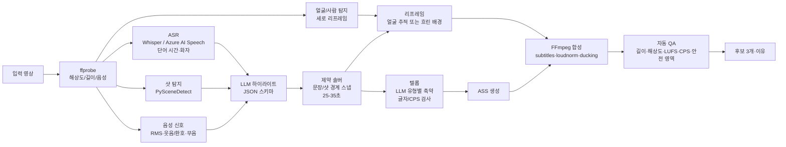

# VideoCreator 조사 보고서: 인기 SNS 영상 편집 스타일 분석과 「패턴 선택형 자동 편집」 기능 설계

- 작성일: 2026-11-07
- 대상: YouTube(긴 영상/Shorts)·TikTok 중심 소셜 영상
- 중점: **오락성(보는 즐거움)**
- 예상 기능: 「영상 하나(또는 여러 개) 선택→편집 패턴 선택→자동 편집」. 생성 AI 사용 가능, 고급 편집 기능 불필요

---

## 0. 요약

1. **인기 편집은 「감각」이 아니라 대부분 측정 변수로 분해할 수 있습니다.** (a) 도입 훅 초수, (b) 재참여 장면 간격, (c) 샷 길이·균일성, (d) 텔롭 글자 수·초당 글자·크기·위치, (e) 음량(LUFS)·효과음, (f) 루프 구조의 여섯 변수로 정리하고 장르별 프리셋을 제시합니다(§3, §4).
2. **바꿀 수 없는 제약은 1차 정보로 확정합니다.** Shorts는 정사각형/세로·최대 3분(2024-10-15 이후 업로드), TikTok 광고는 첫 6초 훅·첫 3초 주제·초당 5~10단어, Netflix 일본어 자막은 행당 전각 13자·2행·초당 4자, YouTube는 약 −14 LUFS로 낮추기만 합니다. 이를 자동 편집 **하드 제약**으로 합니다(§2).
3. **즐거운 편집의 핵심은 세 가지입니다.** ① 1~3초 내 결과·이상·질문으로 기대 제시, ② 몇 초마다 컷·줌·텔롭·SE 변화로 다음 사건 예고, ③ 명확한 결말과 도입부 연결 루프. 일본은 **TV 유래 반응·강조 텔롭 문화**가 더해집니다(§3.3).
4. **「빠를수록 좋다」는 틀립니다.** Primitive Technology처럼 **내레이션·BGM·텔롭 없이 수천만 조회** 스타일도 성립합니다. 장르별 템포가 본질이며 속도가 아니라 패턴을 고르게 해야 합니다(§4).
5. **기존 구성 요소로 구현 가능합니다.** 전사(Whisper/Azure AI Speech)→신호(장면·음량·웃음/환호·얼굴)→**LLM 하이라이트 구조화 출력**→문장/샷 경계 스냅→9:16 리프레임→ASS 텔롭→loudnorm→내보내기. FFmpeg 레시피는 **실행·출력 검증 완료**입니다(1080×1920·26초·−14.0 LUFS, §5.5).
6. **정확성 검증은 외부에 맡깁니다.** YouTube Studio Stayed to watch·평균 시청률, 공개 Mr. HiSum(「가장 많이 재생된 부분」 통계 정답 31,892편) 오프라인 평가, 제3자 블라인드 쌍대 비교를 결합합니다. **YouTube A/B 테스트는 Shorts 미지원**이므로 주의합니다(§6).

---

## 1. 보고서 작성법(프롬프트 심화와 방법론)

### 1.1 의뢰를 더 깊게 만드는 네 관점

| 관점 | 내용 |
|---|---|
| (1) 최고 전문가가 추가로 할 일 | 인기 스타일을 인상 대신 **유지율 곡선·평균 샷 길이(ASL)·초당 자막 글자·LUFS**로 분해. 장르×길이별 **재현 가능한 매개변수 표** 작성. 맥락 단절·발화 중 컷·오자막·UI 가림·권리 침해 등의 실패 모드를 먼저 정의하고 평가 계획 설계 |
| (2) 가장 원시적인 자료 | 플랫폼 1차 사양(YouTube Help·TikTok 광고 도움말), 자막 표준(Netflix Timed Text Style Guide·BBC), 동료 심사 논문(샷 길이 변화·하이라이트 데이터셋), 최상위 제작사 내부 가이드 원문(MrBeast 제작 매뉴얼), **영상 자체**(oEmbed API로 URL 실재 확인) |
| (3) 구체 방법·도구 | 전사(Whisper/Azure AI Speech, 단어 시간·화자 분리), PySceneDetect 샷 탐지, 음성 에너지/웃음 탐지, 얼굴 리프레임, LLM 하이라이트 채점(JSON 스키마), FFmpeg(trim/concat/xfade/subtitles(ASS)/loudnorm) |
| (4) 제3자 검증 | 공식 문서·논문 출처, YouTube/TikTok oEmbed 실재 확인, FFmpeg/ffprobe 기계 검증, Studio 실측, 타인 블라인드 평가, 공개 데이터셋 벤치마크 |

### 1.2 다시 쓴 프롬프트

> 인기 SNS 영상(YouTube 긴 영상·Shorts·TikTok) 편집 스타일을 플랫폼 공식 사양, 자막 가이드, 학술 연구, 최고 창작자 제작 가이드 등 1차 정보에 근거해 **측정 지표**(훅 초수, 재참여 간격, 샷 길이, 자막 글자/초·크기·위치, 라우드니스, 루프)로 분해해 분석하라. 오락성을 중시하고 엔터테인먼트/비즈니스/취미별 패턴을 자동 편집 앱이 바로 사용할 매개변수 표로 정의하라. 실재 검증 예시 영상을 제시하고 긴 영상→30초, 복수 원본 전환, 텔롭을 생성 AI+FFmpeg로 구현하는 설계(파이프라인, 프롬프트, **실행 검증된** 명령, 실패 모드, 평가법)를 `work\VideoCreator-AnalyticsReport.md`에 저장하라. 모든 출처를 밝히고 미검증 주장은 가설로 명시하라.

### 1.3 방법과 한계

- **방법**: 공식 도움말·논문·원문 획득→수치 추출→영상 oEmbed 검증(2026-11-07, §4 전체 URL)→FFmpeg 실행·ffprobe/loudnorm 검증(§5.5).
- **한계(명시)**:
  - 약관상 타인 영상을 다운로드해 프레임별 샷 길이를 측정하지 않았습니다. §3 값은 **실무 경험칙(가설)**이므로 §6.2대로 자사·허가 원본으로 보정해야 합니다.
  - 업계 블로그의 「TikTok 광고 63%가 3초 내 주제」 등 통계는 1차성이 약해 **참고값**이며 설계 근거로 사용하지 않습니다.
  - 추천 알고리즘 내부는 비공개입니다. 공식 지표와 편집으로 조절할 변수의 관계로 범위를 제한합니다.

---

## 2. 1차 정보로 확정할 「불변 제약」

자동 편집 엔진은 다음을 **하드 제약**으로 취급합니다.

| 항목 | 값 | 출처(1차) |
|---|---|---|
| YouTube Shorts 판정 | 정사각형 또는 세로, 최대 3분(2024-10-15 이후 업로드) | YouTube Help 「Understand three-minute YouTube Shorts」 [S1] |
| Shorts 음악 | 라이브러리 다수 곡은 3분 Shorts에서 최대 90초(곡별 60/30초) | [S1] |
| 긴 영상→Shorts 공식 기능 | Studio 클립·쇼츠에서 전사로 범위 선택. **원본이 관련 영상으로 자동 연결** | [S2] |
| Shorts 초기 판단 지표 | How many chose to view(시청 선택 비율 대 스와이프) | Content tab analytics [S3] |
| TikTok 광고 권장 | 9:16, 720p 이상, 소리. **첫 6초 훅·첫 3초 주제**, **초당 5~10단어** | Creative best practices(2025-06) [S4] |
| 일본어 자막 업계 표준 | 가로쓰기 **전각 13자/행**, **최대 2행**, **초당 4자**, 상단 원칙적 회피, 흰색 고딕 | Netflix [S5] |
| 영어 자막 참고 | BBC 160~180 wpm, 행 길이 16:9 폭 68% 이내, 원칙 2행 | BBC 요약 [S6] |
| 라우드니스 | YouTube 약 −14 LUFS 기준 **큰 소리만 낮춤(작은 소리는 안 높임)**. True Peak 약 −1 dBTP 권장 | [S7], 자세한 통계 content loudness로 확인 가능 |
| 무음 시청 | 공공장소 69% 무음, 자막 사용자 80%는 청각 장애 없음(미국 5,616명) | Verizon×Publicis 조사 보도 [S8] |
| 생성 AI 공개 | 실제 인물이 하지 않은 말·실제 사건 변경 등 **사실적인 AI 생성/변경은 공개 필수** | [S9] |
| A/B 테스트 | 제목·썸네일 최대 3안, **시청 시간으로 승자 결정. Shorts 제외** | [S10] |

### 2.1 세로 화면 안전 영역(Safe Zone)

TikTok·YouTube Shorts는 **공식 픽셀값을 공개하지 않습니다**(TikTok은 형식·캡션 길이에 따라 달라 오버레이만 제공, Meta Reels 광고는 위 14%·아래 35%·좌우 6% 공개)[S11]. 공통 보수 기준은 1080×1920에서 **위 ≈250px·아래 ≈580~670px·오른쪽 ≈160~190px·왼쪽 ≈60px 회피**(중앙 약 860×1100px 안전)[S11][S12].

→ 기본 텔롭: **본문은 하단에서 620px 위(MarginV=620), 오른쪽 여백 160px**. 훅 제목은 상단 300px.

---

## 3. 인기 영상 「편집 문법」의 지표화

### 3.1 주의 구조: 첫 1분(Shorts는 첫 1초)이 중요

**MrBeast 제작 매뉴얼(How to Succeed in MrBeast Production)**은 초 단위 분석으로 다음 틀을 정했습니다[S13][S14].

| 시간 | 지시 | 편집으로 번역 |
|---|---|---|
| 0–1분 | 제목·썸네일 약속과 **완전 일치**(물체 색까지), 최고의 원본을 처음에 | 결과·최대 장면 선공개(콜드 오픈) |
| 1–3분 | 엄청난 진척—첫날만이 아니라 며칠치 진행 | 시간 압축(몽타주·일수 카운터) |
| 3분 | 첫 재참여(여기서만 볼 수 있는 장관) | 약 3분마다 볼거리 |
| 3–6분 | 빠른 전환, 단순·자극적 내용 | 짧고 고른 샷 |
| 6분 | 두 번째 재참여 | 동일 |
| 6분 이후 | 후반 늘어짐을 구성으로 견인 | 예고(마지막에 ○○), 카운트다운 |

매뉴얼은 보통 **첫 60초에 2,100만 명 이탈**을 언급하며 핵심을 **CTR·평균 시청 시간(AVD)·평균 시청률(AVP)**로 둡니다[S14].

**Shorts/TikTok 적용**: 긴 영상의 1분은 세로에서 **1~3초**로 압축됩니다. YouTube는 시청 선택 대 스와이프를 독립 지표로 제시[S3], TikTok은 3초 내 주제·6초 내 훅을 권장[S4].

### 3.2 컷과 페이스: 속도보다 균일성

- **동료 심사 연구**: Cutting 등은 1935~2005년 할리우드 150편을 분석해 인접 샷 길이 **상관이 높아지고 1/f형 패턴에 접근**함을 보였습니다(액션은 짧은 샷 군집, 대화는 긴 샷 군집)[S15]. 좋은 편집은 모두 빠른 것이 아니라 **비슷한 샷을 묶고 묶음별 템포 변경**(느림→빠름→느림).
- **점프 컷(무음·머뭇거림 제거)**: 해설·토크 표준. 단독 화자 0.6~0.8초 이상, 대담 1.2~1.5초 이상 무음만 제거해 대화의 쉼을 남기는 경험칙[S16].
- **펀치인**: 단일 카메라도 강조에 1.1~1.2배 디지털 줌을 넣으면 두 카메라 같은 리듬. §5.5 검증.
- **샷 길이 기준(가설·보정 필요)**:

| 형식 | ASL 기준 | 근거 강도 |
|---|---|---|
| 오락 Shorts/TikTok(챌린지·반응) | 0.8~2.0초 | 경험칙(가설) |
| 해설/비즈니스 Shorts | 2~4초(텔롭 전환으로 변화) | 경험칙(가설) |
| 긴 오락(도전·기획) | 2~4초, 핵심 장면 전후 1초 미만 군집 | MrBeast 빠른 전환[S14]+경험 |
| 긴 대담·팟캐스트 | 5~15초(화자 전환 중심) | 경험칙(가설) |
| 취미(요리·DIY) | 과정 배속/1~2초, 완성품은 길게 | 경험칙(가설) |

### 3.3 텔롭·자막: 일본 TV 문법의 세로형 적용

일본 TV 텔롭은 이해 보조에서 **제작자의 생각(반응·강조)을 자연어로 표시**하는 것으로 확장되었고 남용 비판도 있습니다(와세다·세토구치 등)[S17]. **종류 구분·양 관리**가 중요합니다.

**유형(구현 단위)**

| 유형 | 역할 | 표현 | 자동 생성 |
|---|---|---|---|
| ① 전체 발화 자막 | 무음 시청 | 흰색+검정 외곽선, 아래, 행당 13~16자 | ◎ ASR |
| ② 강조 | 키워드 크게·색상 | 노랑/빨강, 1.2~1.3배, 팝 확대·복귀 | ◎ LLM 추출 |
| ③ 반응/속마음 | 웃음 보조선 | 비스듬함·말풍선·다른 색, 상단·화자 옆 | ○ LLM(**오류·부적절 위험→확인 UI**) |
| ④ 상황 설명(제목) | 맥락 | 상단 띠, 상시 표시 | ◎ LLM 요약 |
| ⑤ 의성어·SE | 반응 과장 | 「쿵」「정적…」, 효과음 동기 | ○ 웃음/환호/무음 |
| ⑥ 수치·카운터 | 진척감 | DAY 3, 10초 남음, ¥1,000,000 | ○ LLM 추출 |

**크기·배치·속도 기본값(1080×1920)**

| 매개변수 | 기본값 | 근거 |
|---|---|---|
| 본문 글꼴 | 72~84px(강조 96~110px) | 13자×약 78px≈1,014px. Netflix 13자[S5]를 세로 폭에 환산 |
| 행 글자 수 | 전각 13~16자, 2행 이내(**세로 1행 권장**) | [S5], 좁은 세로 1행[S6] |
| 표시 속도 | 전체 자막 **초당 4~6자**, 짧은 영상 강조는 단어별 빠르게 가능 | Netflix 4자[S5], TikTok 5~10단어[S4] |
| 외곽선 | 검정 6~9px+그림자 2~3px | §5.5 노란 배경·노란 글자도 검정선으로 가독 확인 |
| 위치 | 하단 620px 위, 오른쪽 160px 회피, 상단은 제목 | §2.1 |
| 색 의미 | 흰색=발화, 노랑=강조, 빨강=놀람/위험, 하늘색=보충, 화자별 고정 | TV 관습(경험칙) |

### 3.4 소리: 즐거움의 절반

- **라우드니스**: 출력 전 `loudnorm=I=-14:TP=-1.5`. YouTube는 큰 소리만 낮추므로 작은 영상은 불리합니다[S7].
- **BGM 더킹**: 발화 중 −12~−18dB(FFmpeg `sidechaincompress`).
- **SE**: ⑤와 동기화. 웃음·놀람·결말 직전 정적은 **소리를 지우는 것 자체가 연출**.
- **무음 시청**: 공공장소 69%[S8]이므로 자막 필수, TikTok은 소리 문화[S4]이므로 **자막·소리 양쪽으로 성립**.

### 3.5 루프와 결말

- 반복 시청 영상은 **끝이 도입부에 자연스럽게 연결**(마지막 대사가 첫 질문 답, 끝 프레임이 첫 프레임과 일치).
- YouTube는 2025-03-31부터 Shorts 재생/반복 시작마다 집계(2차 정보[S18]). 루프는 지표상 유리.
- **Zach King** 마술(TikTok 역대 최다로 알려짐, §4)은 15~20초 질문(불가능한 영상)→비밀 공개→다시 보고 싶음 구조.

### 3.6 다중 원본 전환(멀티 카메라/자료 전환)

TV 스위처 규칙을 자동화하면[S16][S19]:

1. **말하는 사람 표시**(화자 분리/마이크별 음량).
2. **최소 유지**: 샷당 1.5~2.5초.
3. **반응 샷**: 듣는 사람 웃음·놀람으로 전환.
4. **와이드**: 구간 시작·주기적(30~60초) 전체로 공간 재확인.
5. **몸짓/발화 경계 전환**. 움직임보다 의미 우선.
6. **음성은 단일 마스터**(전환 시 음량·환경음 급변 방지).
7. **기본은 하드 컷**, 시간·장면 전환에만 0.2~0.4초 크로스페이드.

---

## 4. 예시 영상(2026-11-07 oEmbed API 실재 확인)

> 조회 수는 변하므로 생략. `https://www.youtube.com/oembed?url=...` / `https://www.tiktok.com/oembed?url=...`로 게시자·제목 반환 확인. 관찰 포인트는 패턴 대응입니다.

### 4.1 엔터테인먼트

| 영상 | 종류 | 관찰 → 패턴 |
|---|---|---|
| MrBeast 「$456,000 Squid Game In Real Life!」 <https://www.youtube.com/watch?v=0e3GPea1Tyg> | 긴 기획 | 상금·규모 즉시 제시, 탈락 카운터, 몇 분마다 볼거리 → **P1 하이텐션·챌린지** |
| MrBeast 「I Spent 50 Hours Buried Alive」 <https://www.youtube.com/watch?v=9bqk6ZUsKyA> | 긴 기획 | 경과 카운터·압축 몽타주 → **P1**/⑥ |
| MrBeast 「Katana Vs Bullet」 <https://www.youtube.com/shorts/L5kIXRdwGAI> | Short | 한 줄 질문→슬로모션→결과 → **P2 짧은 개그·루프** |
| Zach King(Harry Potter 빗자루) <https://www.tiktok.com/@zachking/video/6768504823336815877> | TikTok | 불가능한 시작·비밀 공개·재시청 루프 → **P2** |
| Bella Poarch 「M to the B」 <https://www.tiktok.com/@bellapoarch/video/6862153058223197445> | TikTok | 음악 주도·표정 클로즈업·비트 동기 → **P5** |
| 도카이 온에어 「뻔한 목적지를 제안하면 즉시 귀가하는 교토 여행!!!」 <https://www.youtube.com/watch?v=SJdhLwEKDc4> | 긴 예능 | 제목=규칙=시청 이유. 일본식 반응·강조 텔롭 → **P3** |
| HikakinClipTV 「가위바위보를 이기게 해 주는 히카킨」 <https://www.youtube.com/watch?v=rYNxkATSgk0> | 공식 클립 Short | **긴 영상→공식 짧은 클립**. 한 반응 추출 → **P4** |
| Mark Rober 「Glitter Bomb 1.0 vs Porch Pirates」 <https://www.youtube.com/watch?v=xoxhDk-hwuo> | 과학×오락 | 동기→제작→범인 반응 결말, 반응 영상 연타 |

### 4.2 비즈니스·해설

| 영상 | 종류 | 관찰 → 패턴 |
|---|---|---|
| 나카타 아츠히코 YouTube 대학 <https://www.youtube.com/watch?v=qh5t4WMroyU> | 긴 강의 | 높은 텐션 독백·제목 텔롭 챕터 → **P6** |
| PIVOT 공식 <https://www.youtube.com/watch?v=JOE7Y_b7RlE> | 긴 대담 | 정보 많은 제목·다중 카메라·요점 → **P7** |
| The Diary Of A CEO <https://www.youtube.com/watch?v=a1mI-ozLyYM> | 팟캐스트 | 강한 발언 콜드 오픈·영화적 카메라 → **P7/P4** |
| Joe Rogan Experience #1169 - Elon Musk <https://www.youtube.com/watch?v=ycPr5-27vSI> | 2시간 초과 | 1시간 초과→클립 전형. 본편 최소 편집, **클립에서 가치** → **P4** |
| Ali Abdaal 「How I Manage My Time - 10 Time Management Tips」 <https://www.youtube.com/watch?v=iONDebHX9qk> | 긴 해설 | 번호 목록, B-roll·문자 → **P6** |
| Veritasium 「The Most Misunderstood Concept in Physics」 <https://www.youtube.com/watch?v=DxL2HoqLbyA> | 과학 해설 | 질문 시작·시연 답. 느려도 질문으로 견인 |
| 「[윳쿠리 해설] 스스로 매독 감염? 광기의 의사 존 헌터」 <https://www.youtube.com/watch?v=Bk308b1JqGc> | 일본 고유 | 합성 음성·캐릭터·**전체 텔롭**, 문자가 주역 |

### 4.3 취미·라이프스타일

| 영상 | 종류 | 관찰 → 패턴 |
|---|---|---|
| Nick DiGiovanni 「MasterChef Potatoes」 <https://www.youtube.com/watch?v=HE_rKC9B6BY> | 요리 Short | 초단 컷 과정, 완성품 ASMR·시식 → **P8** |
| Casey Neistat 「DO WHAT YOU CAN'T」 <https://www.youtube.com/watch?v=jG7dSXcfVqE> | Vlog | 음악 고속 몽타주·타임랩스 → **P5** |
| Primitive Technology 「Tiled Roof Hut」 <https://www.youtube.com/watch?v=P73REgj-3UE> | 긴 DIY | **내레이션·BGM·텔롭 없음**, 환경음·확실한 과정 자체가 오락 → **P9** |
| Kurzgesagt 「The Egg - A Short Story」 <https://www.youtube.com/watch?v=h6fcK_fRYaI> | 애니메이션 | 내레이션 주도, 화면은 계속 움직임 |

### 4.4 장르 공통 원칙

1. **첫 화면은 결과·이상·질문**(MrBeast·Zach King·Veritasium·Diary).
2. **볼 이유(규칙·상금·질문)를 한 줄로** 제목·텔롭 반복(도카이·MrBeast).
3. **몇 초마다 변화**: 컷·줌·문자·SE(장르별 주기 차이 큼).
4. **반응은 강력한 원본**(Mark Rober·HikakinClipTV).
5. **예외 인정**: Primitive Technology는 속도가 아닌 **몰입** → 빠르게만 하는 자동 편집은 실패.

---

## 5. 자동 편집 설계

### 5.1 사용자 경험(최소)

```
[1] 영상 선택(하나 또는 여러 개)
[2] 출력: 세로 Short(15/30/60초) / 가로 다이제스트(3~5분)
[3] 패턴 선택(복수 가능, 아래 P1~P9)
[4] 생성 → 후보 3개(선정 이유·점수)
[5] 확인: 텔롭 오자·부적절 표현만 수정하는 UI → 내보내기
```

고급 타임라인 없이 **후보 선택+텔롭 수정**으로 제한합니다.

### 5.2 패턴 카탈로그(프리셋)

| ID | 이름 | 장르 | 주요 매개변수 |
|---|---|---|---|
| P1 | 하이텐션·챌린지 | 오락 | 훅≤1.5초, ASL 0.8~1.5초, 많은 펀치인·카운터⑥·SE, 빠른 BGM |
| P2 | 짧은 개그·루프 | 오락 | 15~25초, 질문→결과, 끝→처음, 최소 문자 |
| P3 | 버라이어티·텔롭 | 일본 오락 | ①②③⑤, LLM 반응(확인 필수), 화자 인셋 |
| P4 | 클립 추출(긴 영상→30초) | 전체 | 강한 발언/반응 선두, 문장 컷, 제목④, 원본 유도 |
| P5 | 비트 동기 몽타주 | 취미/Vlog | 비트 컷, 최소 문자 |
| P6 | 해설·강의 | 비즈니스 | 0.6초 무음 제거, ②④, 번호 챕터, ASL 2~4초 |
| P7 | 대담 전환 | 비즈니스/팟캐스트 | 화자·2초 유지·반응·정기 와이드 |
| P8 | 과정 압축(요리/DIY) | 취미 | 과정 1~2초/배속, 완성·소리는 길게, 전후 비교 |
| P9 | 미니멀/환경음 | 취미 | 텔롭·BGM 없음, 긴 샷, 색·음량만 정리 |

프리셋은 데이터로 보관합니다(예):

```json
{
  "id": "P4",
  "name": "클립 추출(긴 영상→30초)",
  "target": {"aspect": "9:16", "duration_sec": [25, 35]},
  "hook": {"max_sec": 2.0, "prefer": ["strong_claim", "laughter", "surprise"]},
  "cut": {"remove_silence_over_sec": 0.7, "snap_to": ["sentence_end", "shot_boundary"], "punch_in_scale": 1.15},
  "telop": {
    "types": ["caption", "emphasis", "headline"],
    "caption": {"font_px": 78, "max_chars_per_line": 14, "max_lines": 1, "max_cps": 6, "margin_v": 620, "margin_r": 160},
    "emphasis": {"font_px": 100, "color": "yellow", "animation": "pop"},
    "headline": {"position": "top", "margin_v": 300, "box": true}
  },
  "audio": {"loudnorm": {"I": -14, "TP": -1.5}, "bgm_duck_db": -15, "sfx": "light"},
  "loop": {"enabled": true}
}
```

### 5.3 파이프라인



**단계별 핵심**

1. **ASR**: 단어 시간 필수(Whisper `word_timestamps=True`, Azure word-level timestamps/diarization). 일본어 구두점 누락을 LLM 문장 경계 재추정으로 보완.
2. **신호**: 음량 급증, 웃음/환호, 발화 속도, 컷 밀도, 얼굴 수. LLM만이 아닌 **수치 신호 합의**로 그럴듯한 오류 억제.
3. **LLM 선정**: 시간 전사·신호 요약 입력, **구조화 JSON** 구간 반환.
4. **솔버**: 문장 끝이면서 샷 경계/무음으로 스냅. 결합 시 **강한 구간 먼저**, 결론 마지막, 가능하면 의미 루프.
5. **텔롭**: ①13~14자 줄바꿈·CPS, ②강조, ④제목, ③반응은 **옵트인+사람 확인**.
6. **리프레임**: 얼굴 하나는 중심 9:16 크롭·스무딩, 복수/없음은 **흐린 배경+중앙 16:9**(YouTube 공식도 유사[S2]).
7. **QA**: §5.6.

### 5.4 LLM 하이라이트 프롬프트

```text
[System]
당신은 YouTube/TikTok 짧은 영상 편집자입니다. 초가 붙은 전사와
음성·영상 신호로 약 30초 후보를 최대 5개 고릅니다.
규칙:
- 2초 안에 결과·놀람·강한 주장·질문 중 하나
- 발화 도중 시작/끝 금지(start/end는 문장 경계)
- 맥락 없이 이해 가능(그것·저것으로 시작하는 구간 회피)
- 과장·사실과 다른 요약 금지. 전사에 없는 텔롭 금지
- 지정 JSON 스키마만 출력

[User]
패턴: P4 클립 / 목표: 25-35초 / 언어: 일본어
신호: {"laughter":[[812.4,815.0],...], "loudness_peaks":[...], "shots":[...]}
전사:
[00:13:32.1] 그럼 100만 엔을 한 시간 안에 다 쓰겠습니다
...

[출력 JSON 스키마]
{
  "candidates": [{
    "segments": [{"start": 812.0, "end": 829.5}],
    "hook_text": "string(<=14자)",
    "headline": "string(<=16자)",
    "emphasis_words": ["string"],
    "reason": "재미있는 이유(한 문장)",
    "scores": {"hook": 0-10, "standalone": 0-10, "payoff": 0-10, "emotion": 0-10}
  }]
}
```

OpusClip Hook/Flow/Value/Trend[S20]와 QVHighlights 5단계 saliency[S21]를 참고해 **hook/standalone(단독 이해)/payoff/emotion** 네 축을 사용합니다.

### 5.5 FFmpeg 레시피(실행 검증 완료)

환경: FFmpeg N-128532(2026-11-06 빌드, win-arm64). 1920×1080·60초·음성 합성 테스트로 실행하고 ffprobe·loudnorm 확인.

**(A) 긴 영상→세로**: 3구간→두 번째 펀치인→결합→흐린 9:16→ASS→−14 LUFS

```powershell
$fc = @(
 "[0:v]trim=10:18,setpts=PTS-STARTPTS[v1];[0:a]atrim=10:18,asetpts=PTS-STARTPTS[a1]",
 "[0:v]trim=30:40,setpts=PTS-STARTPTS,scale=iw*1.15:ih*1.15,crop=1920:1080[v2];[0:a]atrim=30:40,asetpts=PTS-STARTPTS[a2]",
 "[0:v]trim=50:58,setpts=PTS-STARTPTS[v3];[0:a]atrim=50:58,asetpts=PTS-STARTPTS[a3]",
 "[v1][a1][v2][a2][v3][a3]concat=n=3:v=1:a=1[cv][ca]",
 "[cv]split[fg0][bg0]",
 "[bg0]scale=1080:1920:force_original_aspect_ratio=increase,crop=1080:1920,boxblur=20:2[bg]",
 "[fg0]scale=1080:-2[fg]",
 "[bg][fg]overlay=(W-w)/2:(H-h)/2-120,subtitles=telop.ass[vout]",
 "[ca]loudnorm=I=-14:TP=-1.5:LRA=11[aout]"
) -join ';'
ffmpeg -y -i src.mp4 -filter_complex $fc -map "[vout]" -map "[aout]" `
  -c:v libx264 -preset veryfast -crf 20 -c:a aac -b:a 192k -ar 48000 -movflags +faststart short.mp4
```

결과: `short.mp4: duration=26.000000 video=1080x1920`, `Input Integrated: -14.0 LUFS`.

**(B) ASS 텔롭**: 자막·팝 강조·박스 훅

```ini
[Script Info]
ScriptType: v4.00+
PlayResX: 1080
PlayResY: 1920

[V4+ Styles]
Format: Name, Fontname, Fontsize, PrimaryColour, SecondaryColour, OutlineColour, BackColour, Bold, Italic, Underline, StrikeOut, ScaleX, ScaleY, Spacing, Angle, BorderStyle, Outline, Shadow, Alignment, MarginL, MarginR, MarginV, Encoding
Style: Caption,Yu Gothic UI,78,&H00FFFFFF,&H0000FFFF,&H00000000,&H80000000,-1,0,0,0,100,100,0,0,1,7,2,2,90,160,620,1
Style: Emph,Yu Gothic UI,96,&H0000F0FF,&H0000FFFF,&H00000000,&H80000000,-1,0,0,0,100,100,0,0,1,9,3,2,90,160,620,1
Style: Hook,Yu Gothic UI,88,&H00FFFFFF,&H0000FFFF,&H000000C0,&H00000000,-1,0,0,0,100,100,0,0,3,14,0,8,90,160,300,1

[Events]
Format: Layer, Start, End, Style, Name, MarginL, MarginR, MarginV, Effect, Text
Dialogue: 1,0:00:00.00,0:00:02.50,Hook,,0,0,0,,{\fad(80,0)}뜻밖의 결말…!
Dialogue: 0,0:00:00.20,0:00:02.40,Caption,,0,0,0,,{\t(0,120,\fscx112\fscy112)\t(120,240,\fscx100\fscy100)}오늘 한 시간 안에
Dialogue: 0,0:00:02.40,0:00:04.60,Emph,,0,0,0,,{\t(0,120,\fscx115\fscy115)\t(120,240,\fscx100\fscy100)}100만 엔 다 쓰기
Dialogue: 0,0:00:08.00,0:00:10.50,Caption,,0,0,0,,여기서{\c&H0000F0FF&}예상 밖{\c&HFFFFFF&}의 전개
```

- 색은 `&HAABBGGRR`(BGR), `&H0000F0FF`는 노랑.
- `BorderStyle=3`은 박스(제목), `1`은 외곽선(자막).
- `Alignment=2` 아래 중앙, `8` 위 중앙. `MarginV=620`으로 아래 UI 회피.
- 3초 프레임의 「100만 엔 다 쓰기」가 노랑+검정선, UI 위에 렌더링됨을 육안 확인.

**(C) 다중 전환**: A→B 하드 컷→A 0.3초 크로스페이드

```powershell
$fc2 = "[0:v]trim=0:5,setpts=PTS-STARTPTS[a];[1:v]trim=5:10,setpts=PTS-STARTPTS[b];" +
       "[0:v]trim=10:15,setpts=PTS-STARTPTS[c];" +
       "[a][b]concat=n=2:v=1:a=0,settb=AVTB,fps=30[ab];[c]settb=AVTB,fps=30[c2];" +
       "[ab][c2]xfade=transition=fade:duration=0.3:offset=9.7[v]"
ffmpeg -y -i camA.mp4 -i camB.mp4 -filter_complex $fc2 -map "[v]" -map 0:a -t 14.7 -c:v libx264 -c:a aac switch.mp4
```

결과: `switch.mp4: duration=14.700000 video=1920x1080`.
**실제 함정**: concat 뒤와 trim 직후 timebase 차이로 xfade가 `First input link main timebase ... do not match` 실패. **양쪽 `settb=AVTB,fps=30` 정규화**로 해결.

**(D) BGM 더킹(문법 참고)**

```text
[1:a]volume=0.5[bgm];[bgm][0:a]sidechaincompress=threshold=0.03:ratio=8:attack=20:release=300[ducked];
[0:a][ducked]amix=inputs=2:duration=first,loudnorm=I=-14:TP=-1.5[aout]
```

### 5.6 자동 QA(출력 전)

| 검사 | 임계값 | 방법 |
|---|---|---|
| 길이 | 프리셋(예 25~35초), Shorts≤180초 | ffprobe |
| 해상도/비율 | 1080×1920(9:16) | ffprobe |
| 음량 | −14±1 LUFS, TP≤−1 dBTP | `loudnorm=print_format=summary` |
| 자막 속도 | 전체 자막≤6자/초, 행≤14자 | ASS 분석 |
| 안전 영역 | 아래580/오른쪽160/위250px 미침범(제목 제외) | ASS Margin 계산 |
| 발화 중 컷 | 끝 ±150ms 단어 교차 없음 | ASR 단어 시간 |
| 도입 훅 | 첫 2초 발화/큰 소리·움직임 | ASR+음량+프레임 차 |
| 텔롭 충실성 | 고유명사·숫자가 전사에 존재 | 문자열 대조(환각 탐지) |

### 5.7 실패 모드와 방어

| 실패 | 예 | 대책 |
|---|---|---|
| 맥락 단절 | 「그게 제일 위험해」 시작 | standalone, 지시어 시작 감점 |
| 의미 변경 | 풍자를 진지한 주장으로 | 전후 ±30초 LLM 전달·원래 의도 자기검사 |
| 오류·부적절 텔롭 | 모욕적 반응·틀린 숫자 | 옵트인, 숫자·고유명사 QA, 확인 UI |
| 권리 | 무단 스트림 클립·상업 음악 | **권리자 허가 범위**만(일본 일부 공식 가이드[S22]), 라이선스 BGM |
| AI 공개 | 실제 하지 않은 말 합성 | 본인 음성 합성 안 함. 사실적 변경 시 AI use 공개[S9] |
| UI 가림 | 좋아요 버튼과 겹침 | 안전 QA |
| 너무 빠름 | 초당 20자 | CPS·축약 |
| 같은 템포 | 모두 비슷함 | 패턴 ASL·군집(§3.2), 느린 P9도 제공 |

### 5.8 생성 AI 사용처(Azure 예)

| 처리 | 선택지 |
|---|---|
| 전사·화자 | Azure AI Speech(배치·화자·단어 시간)/Whisper(로컬 가능) |
| 선정·텔롭 축약 | Microsoft Foundry LLM(JSON 스키마) |
| 영상 이해(선택) | 멀티모달에 키프레임 몇 장으로 사건 보조 정보 |
| 기반 | 로컬 FFmpeg부터, 무거운 처리만 클라우드 |

---

## 6. 평가 계획(외부가 정확성을 보여 주는 방식)

### 6.1 오프라인(공개 전)

1. **선정 정확도**: Mr. HiSum(5만 명 이상 시청 행동 기반 31,892편)[S23]·QVHighlights(1만 편 이상, 인간 saliency)[S21]에서 선택과 가장 많이 본 구간 mAP/Hit@1 측정.
   - 자사 긴 영상은 Studio **가장 많이 재생된 부분**이 최선 정답.
2. **블라인드 쌍대 비교**: 같은 원본으로 앱·기준(임의30초/첫30초), 제작 무관 5명 이상이 더 보고 싶은 것 선택. 승률·신뢰구간 보고.
3. **기계 QA**: §5.6 전체 적용·위반율 기록.

### 6.2 샷 길이 가설 보정

자사·허가 원본:

```bash
scenedetect -i input.mp4 detect-adaptive list-scenes   # 샷 경계 CSV
```

→ 평균·중앙값·인접 상관(Cutting[S15])을 계산해 §3.2 갱신.

### 6.3 온라인(공개 후)

| 지표 | 의미 | 위치 |
|---|---|---|
| How many chose to view / Stayed to watch | 도입 이탈 안 한 비율(훅) | Studio Shorts[S3] |
| 평균 시청률(APV)·유지 곡선 | 구성·템포 | Studio |
| 조회/노출 | 종합 | Studio/TikTok Analytics |
| 관련 영상 긴 영상 유입 | 클립→본편 유도 | Studio 관련 링크[S2] |

- **주의**: A/B는 **제목·썸네일만, Shorts 불가**[S10]. 동일 원본 여러 패턴을 **시기를 달리해 공개**하고 채널 중앙값과 비교하는 준실험. 보편 기준이 없으므로 **본인 채널 과거 중앙값 대비** 판단.

---

## 7. 결론과 다음 행동

1. **P4 긴 영상→30초**부터. 수요가 크고 ASR+LLM+흐린9:16+ASS+loudnorm 최소 구성, 레시피 검증 완료.
2. **P6 해설·강의**, **P3 버라이어티** 추가. P3 반응은 확인 UI와 함께.
3. 다중 원본은 **P7 대담**부터. 마이크 음량→화자 분리 순으로 고도화.
4. 모든 패턴에 §5.6 QA·§6 평가를 처음부터 포함.

---

## 참고 문헌(1차 정보 우선)

- [S1] YouTube Help, “Understand three-minute YouTube Shorts”. <https://support.google.com/youtube/answer/15424877>
- [S2] YouTube Help, “Video clips and Shorts in YouTube Studio”. <https://support.google.com/youtube/answer/15824265> / “Create YouTube Shorts from your videos”. <https://support.google.com/youtube/answer/12836917>
- [S3] YouTube Help, “Content tab analytics tips – Shorts”. <https://support.google.com/youtube/answer/12942217>
- [S4] TikTok Ads Help, “Creative best practices for performance ads”(2025-06). <https://ads.tiktok.com/help/article/creative-best-practices>
- [S5] Netflix “Japanese Timed Text Style Guide”(I.5 글자 제한, I.14 행, I.16 위치, I.19 속도). <https://partnerhelp.netflixstudios.com/hc/en-us/articles/215767517-Japanese-Timed-Text-Style-Guide>
- [S6] BBC 자막 가이드 요약. <https://www.clevercast.com/bbc-subtitling-guidelines/> / 원전 <https://www.bbc.co.uk/accessibility/forproducts/guides/subtitles/>
- [S7] LOUDMETER, “YouTube LUFS: −14 LUFS Normalization Explained”(자세한 통계 확인법). <https://www.loudmeter.net/youtube-loudness>
- [S8] Streaming Media, “80% of Video Caption Users Aren't Hearing Impaired, Finds Verizon”(2019). <https://www.streamingmedia.com/Articles/ReadArticle.aspx?ArticleID=131860>
- [S9] YouTube Help, “Disclosing use of GenAI content”. <https://support.google.com/youtube/answer/14328491>
- [S10] YouTube Help, “A/B test titles & thumbnails”. <https://support.google.com/youtube/answer/16391400>
- [S11] CapQA, “Social media safe zones: pixel reference”(2026-09-11). <https://capqa.app/guides/social-media-safe-zones>
- [S12] ReelMind, “TikTok Safe Zone Overlay”. <https://reelmind.ai/blogs/tiktok-safe-zone-overlay-essential-framing-guidelines>
- [S13] “How to Succeed in MrBeast Production”(원문 PDF 변환). <https://manuals.plus/m/54dc97c41faebbcd9e295bc7463eb6b332faa85d5abddbc908cab21104c9bd1e>
- [S14] Daniel Scrivner, 동 매뉴얼 요약(2025-08-15). <https://www.danielscrivner.com/how-to-succeed-in-mrbeast-production-summary/>
- [S15] Cutting, J. E., DeLong, J. E., & Nothelfer, C. E.(2010). Attention and the evolution of Hollywood film. *Psychological Science*, 21(3), 432–439. doi:10.1177/0956797610361679. <https://pubmed.ncbi.nlm.nih.gov/20424081/>
- [S16] EditBuddy, “How to Edit a Multicam Podcast”(최소 유지·무음). <https://editbuddy.app/blog/how-to-edit-multicam-podcast-premiere-pro>
- [S17] 세토구치 후미·사카이 시게카즈 「TV 프로그램 텔롭 표시에 관한 고찰」 영상정보미디어학회. <https://www.jstage.jst.go.jp/article/itetaikai/2003w/0/2003w_0_17/_pdf/-char/ja>
- [S18] Creator Essentials, “Viewed vs. Swiped Away”(2025-03-31 집계 변경). <https://www.creatoressentials.com/glossary/viewed-vs-swiped-away/>
- [S19] Mellius, “Multicam Editing Workflow”. <https://www.melliusai.com/multicam-edit>
- [S20] OpusClip virality score(Hook/Flow/Value/Trend). <https://artificial-intelligence-wiki.com/ai-for-content-creators/ai-image-and-video-generation/opus-clip-viral-score-explained/>
- [S21] Lei, J., Berg, T. L., & Bansal, M.(2021). QVHighlights: Detecting Moments and Highlights in Videos via Natural Language Queries. NeurIPS 2021. <https://arxiv.org/abs/2107.09609>
- [S22] NoLang 「YouTube 클립 제작·허가·저작권·수익화」(2026-10-24). <https://no-lang.com/learn/youtube-kirinuki-guide> / 모노리스 법률사무소 「클립 규칙」. <https://monolith.law/youtuber-vtuber/youtuber-clippedvideo-rules>
- [S23] Sul, J. et al.(2023). Mr. HiSum: A Large-scale Dataset for Video Highlight Detection and Summarization. NeurIPS Datasets and Benchmarks. <https://papers.nips.cc/paper/2023/file/7f880e3a325b06e3601af1384a653038-Paper-Datasets_and_Benchmarks.pdf> / <https://github.com/MRHiSum/MR.HiSum>
- [S24] PySceneDetect Documentation, Detectors. <https://www.scenedetect.com/docs/latest/api/detectors.html>
- [S25] Mark, G.(2023). *Attention Span*. Hanover Square Press.(화면 주의가 평균 47초에 이동한다는 지견, 템포 배경 참고)

### 부록 A: 예시 영상 검증 로그(2026-11-07, oEmbed)

| ID / URL | 반환 게시자 | 반환 제목 |
|---|---|---|
| 0e3GPea1Tyg | MrBeast | $456,000 Squid Game In Real Life! |
| 9bqk6ZUsKyA | MrBeast | I Spent 50 Hours Buried Alive |
| xoxhDk-hwuo | Mark Rober | Glitter Bomb 1.0 vs Porch Pirates |
| h6fcK_fRYaI | Kurzgesagt – In a Nutshell | The Egg - A Short Story |
| ycPr5-27vSI | PowerfulJRE | Joe Rogan Experience #1169 - Elon Musk |
| jG7dSXcfVqE | CaseyNeistat | DO WHAT YOU CAN'T |
| DxL2HoqLbyA | Veritasium | The Most Misunderstood Concept in Physics |
| P73REgj-3UE | Primitive Technology | Primitive Technology: Tiled Roof Hut |
| iONDebHX9qk | Ali Abdaal | How I Manage My Time - 10 Time Management Tips |
| qh5t4WMroyU | 中田敦彦のYouTube大学 - NAKATA UNIVERSITY | 【消費減税】食料品8%→1%で物価高から救われる？… |
| JOE7Y_b7RlE | PIVOT 公式チャンネル | 【高校バスケ レベル高すぎ】… |
| SJdhLwEKDc4 | 東海オンエア | 定番の行き先を提案してしまったら即帰宅の京都旅！！！ |
| rYNxkATSgk0 | HikakinClipTV | ジャンケンに勝たせてくれるヒカキン |
| HE_rKC9B6BY | Nick DiGiovanni | MasterChef Potatoes |
| a1mI-ozLyYM | The Diary Of A CEO | Iran War Expert: … |
| Bk308b1JqGc | 五回目は正直【ゆっくり解説】 | 【ゆっくり解説】自ら梅毒に感染？狂気の医師ジョン・ハンター |
| L5kIXRdwGAI (Shorts) | MrBeast | Katana Vs Bullet |

> 제외 예: 처음 검색된 `4VXVfj0mEX4`("Katana vs bullet @MrBeast")는 oEmbed 게시자가 **MrBeast 아닌 제3자 재게시자**여서 제외했습니다. 제목이 아닌 **게시자로 공식 여부 확인**이 필요합니다(자동 클립도 동일).
| TikTok 6768504823336815877 | @zachking | oEmbed 응답 있음 |
| TikTok 6862153058223197445 | @bellapoarch | oEmbed 응답 있음 |
