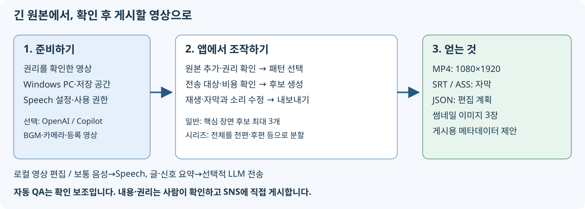

# VideoCreator 사용자 가이드

[English](../../en/users-guide/README.md) | [简体中文](../../zh-CN/users-guide/README.md) | 한국어 | [日本語](../../../users-guide/README.md)

[앱 README](../README.md)

이 가이드는 동영상 편집이나 개발에 익숙하지 않은 사용자와 구현을 사용자 지정하는 소프트웨어 엔지니어를 위한 자료입니다. 현재 구현과 실제 화면을 기준으로 합니다.

## 목적에 맞게 읽기

| 하고 싶은 일 | 읽을 자료 |
|---|---|
| 처음 실행하고 동영상 한 편 만들기 | [빠른 시작](quickstart.md) |
| 버튼, 입력란, 스위치의 의미 알아보기 | [화면·구성 요소 설명](screens.md) |
| 실패·경고 해결하기 | [문제 해결](troubleshooting.md) |
| 처리 과정과 데이터 구조를 이해하고 변경하기 | [기술 참조](technical-reference.md) |
| 시작 설정이나 API 사용하기 | [설정·API 참조](configuration-api.md) |
| 자료의 근거, 검증 범위, 화면 재생성 방법 알아보기 | [검증과 유지 관리](verification.md) |
| 이 가이드의 제작 방침(전문가 관점·1차 자료·방법·제3자 검증)과 요구 사항의 대응 알아보기 | [제작 방침](documentation-brief.md) |

## 먼저 알아둘 용어

- **프로젝트**: 원본 자료·후보·편집·내보내기를 묶는 작업 단위입니다.
- **원본 자료**: 편집의 바탕이 되는 동영상입니다. 전체 경로로 추가하면 원본 파일을 참조합니다.
- **패턴/프리셋**: 길이, 템포, 자막, 소리 등의 편집 방침입니다.
- **후보**: 사용할 장면을 제안한 것입니다. 게시용 파일은 아닙니다.
- **미리 보기**: 확인용 저해상도 동영상입니다. 최종 내보내기와 품질·QA 범위가 다릅니다.
- **텔롭**: 자막, 강조 단어, 훅(도입부의 관심 유도), 제목 등 영상에 표시하는 글자입니다.
- **편집 계획**: 컷·글자·소리·삽입물을 기록한 JSON입니다.
- **QA**: 자동 검사입니다. 통과하더라도 사람이 내용과 권리를 확인해야 합니다.
- **내보내기**: 편집 계획으로 게시용 동영상과 관련 파일을 만드는 일입니다. SNS에 게시하지는 않습니다.

## 다이어그램과 화면의 취급

개념도는 편집 가능한 벡터 SVG입니다. 스크린샷도 SVG 파일이지만, **실제 브라우저의 PNG 캡처를 내부에 삽입한 것**입니다. 상상으로 화면을 그린 것도, 모든 픽셀을 벡터화한 것도 아닙니다.

화면 예시는 합성 테스트 패턴과 정현파, 기존 전사 fixture를 사용합니다. 일반적인 발화 동영상과 달리 자막과 음성이 일치하지 않습니다. 예시의 `http://127.0.0.1:1`은 클라우드 전송을 피하기 위한 검증용 설정이므로 실제 사용에서는 지정하지 않습니다. 자세한 내용은 [검증과 유지 관리](verification.md)를 참조하세요.
