# 화면·구성 요소 설명

[앱 README](../README.md) / [가이드 목차](README.md) / [첫 동영상](quickstart.md) / [QA와 오류](troubleshooting.md) / [설정·API](configuration-api.md)

화면 예시는 2026-11-08 구현을 Microsoft Edge, viewport 1440×1000으로 캡처했으며 긴 페이지는 전체 캡처했습니다. PC 너비·선택 패턴·원본 수에 따라 항목이 달라집니다. 세로로 긴 입력 영역은 **각 열 내부**를 스크롤하세요.

## 공통 부분

| 구성 요소 | 의미·조작 |
|---|---|
| 왼쪽 위 VideoCreator 로고 | 프로젝트 목록으로 복귀. 진행 중 처리를 중지하는 버튼이 아님 |
| 오른쪽 위 전사/선정 표시 | 현재 공급자. 대상 사용 가능 여부는 연결·권한에도 의존 |
| 설정 | AI 선정 방식, 전송 대상, 저장 위치, 도구 정보 확인 |
| 원본 → 패턴 → 생성 → 후보 → 확인·수정 → 내보내기 | 작업 위치. 파란색은 현재, 체크는 통과. 탐색 탭이 아님 |
| 안전 영역 표시 | 미리 보기에 게시 UI와의 겹침 방지 기준 표시. 영상 자체는 바꾸지 않음 |
| 메시지·배지 | 성공/경고/오류/승인 상태. 색뿐 아니라 글·코드 읽기 |

## 1. 프로젝트 목록

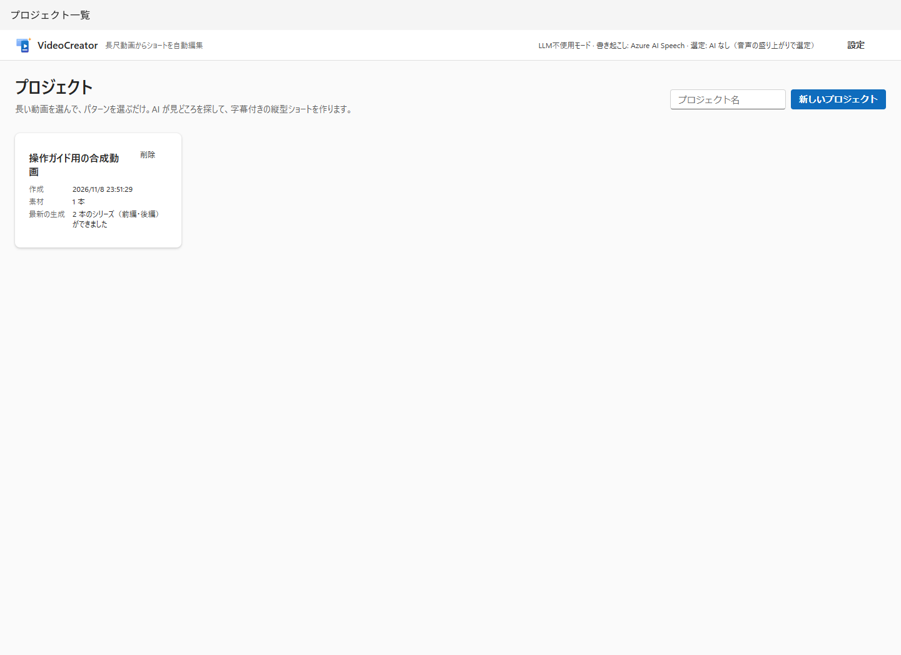

| 구성 요소 | 의미·주의 |
|---|---|
| 프로젝트 이름, 새 프로젝트 | 작업 생성. 빈 이름도 가능하지만 구분 가능한 이름 권장 |
| 프로젝트 카드 | 이름 링크로 열기. 생성 일시, 원본 수, 최신 생성 상태 표시 |
| 삭제 | 확인 대화 상자. 관리 폴더는 휴지통으로, 분석·편집 DB 기록은 삭제 |

**삭제는 정리 작업이지 작업 종료 조작이 아닙니다.** 전체 경로 원본은 삭제하지 않지만 업로드 원본·내보내기는 프로젝트와 함께 휴지통으로 이동합니다. 휴지통에서 폴더만 복원해도 DB 편집 기록은 복구되지 않습니다. 처리 중이면 완료나 취소를 기다리세요.

## 2. 원본·패턴·생성

독립 화면 세 개가 아니라 **동일 프로젝트 화면의 3열**입니다.

위쪽 **이름 변경**으로 편집란을 열어 저장·취소합니다. 프로젝트 저장 위치도 표시됩니다. 이름 변경은 폴더 이동이 아닙니다.

### 왼쪽 열: 원본

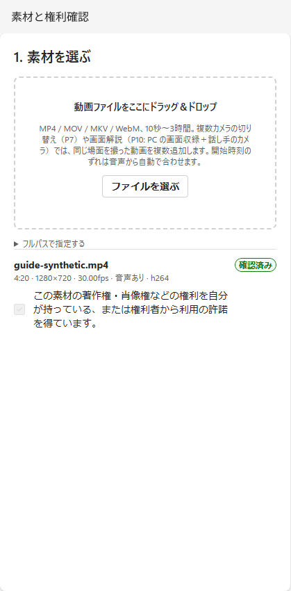

| 구성 요소 | 의미·판단 기준 |
|---|---|
| 드롭 영역/파일 선택 | PC 영상을 업로드하고 프로젝트 내부로 복사 |
| 전체 경로로 지정 → 추가 | `C:\Videos\talk.mp4` 같은 절대 경로로 원본 참조. 따옴표 없는 경로 권장 |
| 원본 정보 | 이름, 길이, 표시 해상도, fps, VFR(가변 프레임률), 음성 유무, 코덱 |
| 경고 | 회전·VFR·음성 없음 등. 영상 표시가 가능해도 자막 조건을 만족하는 것은 아님 |
| 권리 확인/확인 완료 | 각 원본 저작권·초상권 등을 직접 확인·등록. 확인 완료 체크는 편집 불가 |
| 역할(복수 원본) | 기준 영상, 카메라, 와이드, 음성 기준, 화면 등. P7/P10 영상 선택에 영향 |
| 화자(복수 원본) | 해당 카메라가 비추는 화자 번호(1~8). 전사 등장 순서. 빈 값은 자동/미지정 |
| 어긋남(초)·동기화 정보 | 기준 음성 대비 카메라 시간차. 자동 동기화 근거·잔차·드리프트 확인 후 수동 변경 |

P7은 같은 장면 카메라 영상 2개 이상, P10은 화면 녹화+발표자 카메라를 준비합니다. 서로 다른 행사를 동기화하는 기능이 아닙니다. 자동 동기화는 만능이 아니며 실패·범위 밖에서는 경고나 기준 영상 전환이 있습니다.

### 가운데 열: 패턴

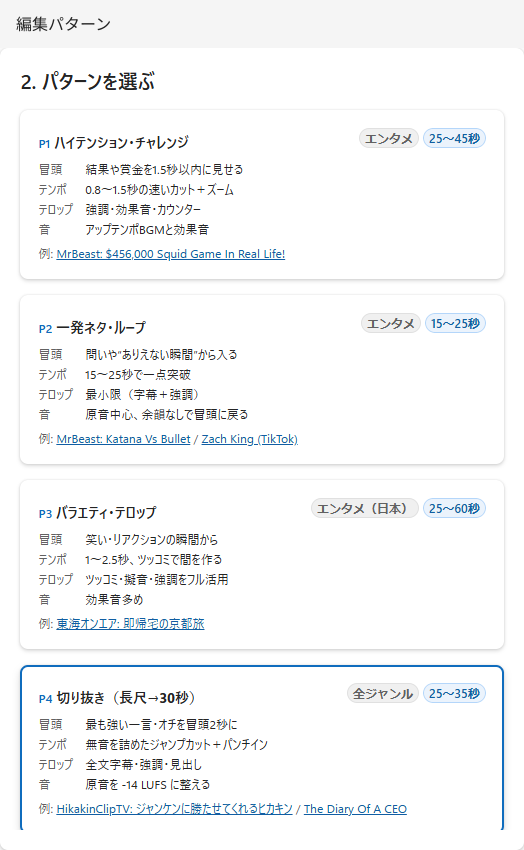

카드를 고르면 파란 테두리가 됩니다. **도입부·템포·텔롭·소리**는 편집 방침, 초수는 짧은 영상 본편 목표 범위입니다. 「예」는 외부 영상 참고 링크이며 앱 출력을 보장하지 않습니다. 스크롤해서 P10까지 볼 수 있습니다.

| ID | 이름 | 본편 목표 | 선택 상황 |
|---|---|---|---|
| P1 | 하이텐션·챌린지 | 25~45초 | 도전·결과·반응 |
| P2 | 짧은 개그·루프 | 15~25초 | 짧고 강한 한 방, 도입부로 돌아가는 루프 |
| P3 | 버라이어티·텔롭 | 25~60초 | 웃음, 강한 장식, 반응 코멘트 |
| P4 | 클립 추출(긴 영상→30초) | 25~35초 | 첫 사용 권장. 발화 중심 핵심 장면 |
| P5 | 비트 동기 몽타주 | 15~60초 | BGM 박자에 맞춘 영상 편집 |
| P6 | 해설·강의(요점 텔롭) | 30~60초 | 요점을 전달하는 설명 |
| P7 | 대담 전환 | 30~60초 | 동시 녹화 다중 카메라 |
| P8 | 과정 압축(요리/DIY) | 20~60초 | 저활동 구간을 배속하는 과정 영상 |
| P9 | 미니멀/환경음 | 30~90초 | 장식을 줄이고 원음 활용 |
| P10 | 화면 해설(화면+인셋) | 30~60초 | PC 화면 녹화·발표자 카메라 |

초수는 원본 길이가 아닙니다. 삽입물이 있으면 전체가 늘어나고 시리즈는 다른 길이 조건입니다. 프리셋 `target.aspect`만 바꿔 모든 화면·QA가 가로형을 지원하지는 않습니다.

### 오른쪽 열: 생성 기본 설정

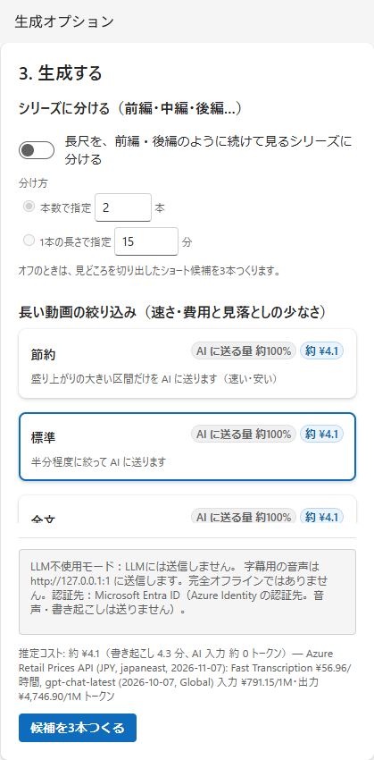

| 구성 요소 | 의미·주의 |
|---|---|
| 시리즈로 나누기 | 끔: 핵심 장면 후보. 켬: 원본 전체를 연속 파트로 분할 |
| 편수로 지정 | 2~20편. 주제 경계에서 길이가 고른 분할 탐색 |
| 한 편 길이로 지정 | 1~60분, 입력 간격 0.5분. 기준이며 완전히 같은 길이는 아닐 수 있음 |
| 분할 기준 | 원본 추가 후 표시. 전사 있으면 무음 컷 후 예상치 사용 |
| 절약 | 긴 영상의 고조 구간 우선. 비용·속도 우선이지만 조용한 중요 장면을 놓칠 수 있음 |
| 표준 | 긴 영상 전송량·누락의 균형 |
| 전체 텍스트 | 전사 전체를 선정에 사용. 필요시 분할 전송하므로 거대한 단일 요청은 아닐 수 있음 |
| 비용·전송량 | 구현 단가·추정량으로 계산. 청구액 보장 아님. 짧은 영상은 세 방식 전송량이 같을 수 있음 |
| 전송 대상 설명 | 버튼 위 항상 표시(음성→ASR, 글·신호 요약→LLM, 인증 대상. LLM 미사용이어도 ASR 별개). 「비용 상세」를 열면 전송량·비용 상세 |
| 후보 3개 만들기 | 원본·권리 확인 완료 시 생성. 부족하면 이유 표시. 최대 3개. 오른쪽에 추정 비용 |

오른쪽 설정은 「시리즈」「긴 영상 필터링」「소리」「오프닝·클로징·장면 전환」「이전 분석 결과」 그룹이며 제목을 클릭해 접습니다. 접힌 제목에 현재 설정(예: 「BGM 자동·효과음 켬·반응 코멘트 끔」)이 표시됩니다. 접힘 상태는 이 브라우저에 저장됩니다. 「오프닝·클로징·장면 전환」은 처음에 접혀 있습니다. 시리즈가 켜져 있으면 전체 텍스트를 보내므로 필터링 그룹이 접힌 표시입니다. 아래 「만든 패턴」은 화면을 스크롤하면 나옵니다.

시리즈 지원은 발화 중심 P1~P4·P6·P7·P9·P10이며 P5/P8은 불가합니다. 분할 두 항목은 한쪽만 지정합니다. **무음 컷 등 편집 후에도 한 편당 1분 이상 확보할 길이가 필요합니다.** 선공개·요약·장 제목·다음 예고 등으로 파트 전체 길이는 본편 분할 길이와 다릅니다.

### 오른쪽 아래: 소리·단어 가림·삽입물

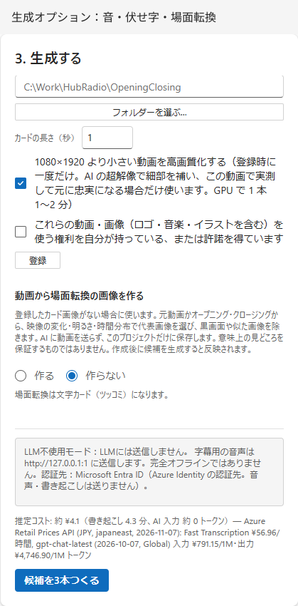

| 구성 요소 | 의미·주의 |
|---|---|
| BGM | 패턴에 맡김/없음/장면별 자동 선택(등록한 본인 곡, 없으면 내장 3곡에서 장면별 선택)/전체에 이 곡. 모두 발화 중 BGM 자동 감소(음성과 차이는 패턴 기준, 표준 14 LU 이상) |
| 효과음 | 팝·쿵 등 효과음 사용 여부 |
| AI 반응 코멘트 제안 | P3 전용. AI 제안은 내용을 읽고 승인해야 내보내기 가능 |
| 반응 코멘트 표시 방식 | 켰을 때 표시. 자동(기본: 발언 경계만 정지 카드, 나머지 오버레이. 이유는 후보 메모)/반응 텔롭(영상 정지 없음)/카드(영상 2~3초 정지, 이미지+문자+BGM) |
| 가릴 단어 | 쉼표 등으로 구분. 자막 등은 `●`, 해당 음성은 삐 소리. 원본·전사 익명화 기능이 아님 |
| 내 BGM | 여러 음원을 골라 권리 확인 후 프로젝트 곡으로 등록. BGM은 「장면별 자동 선택」으로 바뀜. 곡별 라우드니스·템포·분위기(차분함/보통/활기참)·사용 부분(처음·끝 무음 제외) 표시. 「제거」로 등록 해제(계획에서 사용 중인 곡은 제거 불가) |
| 오프닝/클로징 넣기 | 공통 등록이 있으면 사용 가능. 오프닝은 선공개 뒤, 클로징은 마지막 |
| 장면 전환 카드 | 전환 시 짧은 정지 이미지·문자·효과음 삽입. AI가 시청자 반응(코멘트·칭찬 등) 문장을 만들며 승인 대상 |
| 등록/재등록 | 폴더에서 이름에 `Opening` / `Closing`이 있는 영상과 PNG/JPG 카드 이미지 읽기. 전체 프로젝트 공통 |
| 폴더 선택… | Windows 폴더 선택 열기. 취소 시 입력 유지. 가려졌다면 작업 표시줄 확인 |
| 카드 길이 | 2~3초(기본 2.5초). 전체 화면 이미지/배경 패널 위 문자와 전용 BGM 후 본편·원음 재개. 본편 BGM 「없음」이어도 카드 BGM 재생 |
| 작은 영상 화질 개선 | 등록 후 백그라운드 처리. 실측으로 채택 여부 판단. 시간 표시는 환경 의존 |
| 등록 해제 | 공통 등록 제거. 기존 후보 계획은 별개이므로 자동 재생성으로 생각하지 않기 |
| 영상에서 장면 전환 이미지 만들기 | 기본 「만들지 않음」. 만들 때 원본 또는 등록 Opening/Closing을 골라 최대 2~6장 추출 |

이미지 추출은 로컬에서 검정/흰색/유사 이미지를 제외합니다. AI로 의미상 핵심 장면을 고르는 기능은 아닙니다. 생성 후 **새로 생성할 후보**에 반영됩니다. 「만들지 않음」으로 되돌려도 파일은 남습니다. 공통 등록 카드 이미지가 있으면 우선합니다.

### 자막·텔롭 고유명사

프로젝트 화면 아래에서 인명·지명·기업/단체명·상품/작품명 등을 등록할 수 있습니다. 자막·텔롭에 표시할 표기를 입력하고 필요하면 발음·음성 인식에 자주 나오는 다른 표기도 추가합니다. 다음 후보 생성 시 ASR 구문 힌트로 쓰이며 등록 표기는 텔롭 고유명사 대조에도 쓰입니다. 종류는 정리용이며 ASR에 전달하는 구문은 표기·발음·다른 표기입니다.

저장된 전사·단어 타임코드는 바뀌지 않습니다. 등록 후 새 후보 생성 시 사전이 바뀌었다면 전사를 다시 받아 힌트를 반영합니다. 구문 힌트는 정확도를 보장하지 않으므로 생성 후 자막·음성을 확인하고 필요하면 전사를 고치세요. 단어 시간은 음성 인식 결과를 기반으로 합니다.

## 3. 생성 진행 상황

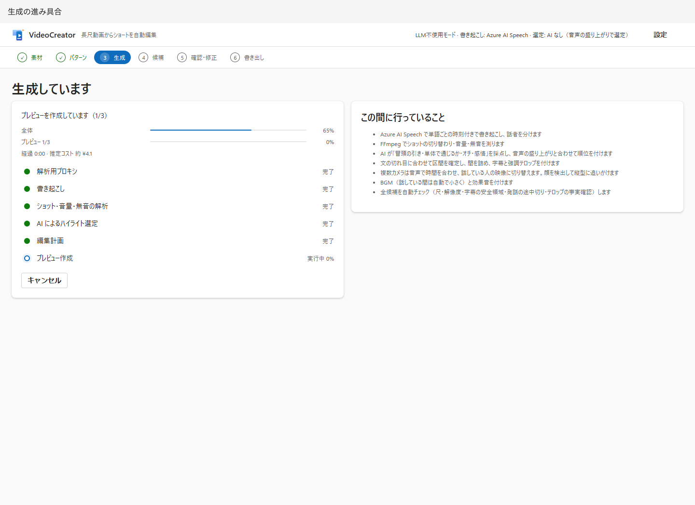

| 구성 요소 | 의미 |
|---|---|
| 전체 막대 | 전체 파이프라인 진행률. 일정 속도의 시계가 아님 |
| 현재 처리 막대 | 측정 가능한 처리의 실측 진행률. 불가하면 퍼센트 없이 움직임 |
| 경과/남은 시간 | 경과는 화면 연 이후. 남은 시간은 현재 측정 가능 처리의 추정 |
| 단계 목록 | 프록시→전사→신호 분석→선정→편집 계획→미리 보기 |
| 이 동안 수행하는 일 | 일반 처리 설명. 캐시·AI 미사용·패턴에 따라 실행 내용 다름 |
| 취소 | 생성 중지. 후보 내보내기 취소와 별개 |

화면을 떠나도 서버 처리는 계속됩니다. 실패·취소 시 이유를 읽고 「프로젝트로 돌아가기」에서 조건을 고치세요.

## 4. 후보 비교와 시리즈

| 구성 요소 | 의미·주의 |
|---|---|
| 후보 번호, 제목, 이유 | 순위·선정 근거. AI·신호 제안이며 인기 보장 아님 |
| 「○초 원본」과 원본 시간 | 선정 구간 길이·원본 위치. 무음 컷·선공개 후 완성 길이와 다름 |
| 미리 보기, 재생 컨트롤 | 실제 보고 듣기. 저해상도라 최종 화질 판정에 사용하지 않기 |
| 도입부 훅/단독 이해/결말/감정 | 내용 평가. 신호 기반에서는 내용을 이해한 AI 평가가 아닐 수 있음 |
| 음성 활력/종합 | 음량 등 신호 평가·합성 점수. 모두 0~10 기준 |
| 신호 기반 | AI 없음 또는 실패로 음량 중심 선정 전환 |
| QA 배지 | 계획 통과·경고·최종 내보내기 미실행 항목 구분 |
| 조정 기록 | 구간 보정·제약에 의한 변경 이유 |
| 확인·수정 | 해당 후보 편집 열기 |
| 지시를 붙여 다시 만들기 | 다른 후보 탐색. AI 없으면 의미상 지시가 반영되지 않을 수 있음 |
| 원본·패턴으로 돌아가기 | 패턴·생성 조건 변경 |

시리즈는 순위·점수 대신 전편/중편/후편·제n화 순서, 원본 본편 범위, 분할 근거, 챕터를 표시합니다. 경계 변경은 프로젝트에서 편수/길이를 바꿔 재생성하세요.

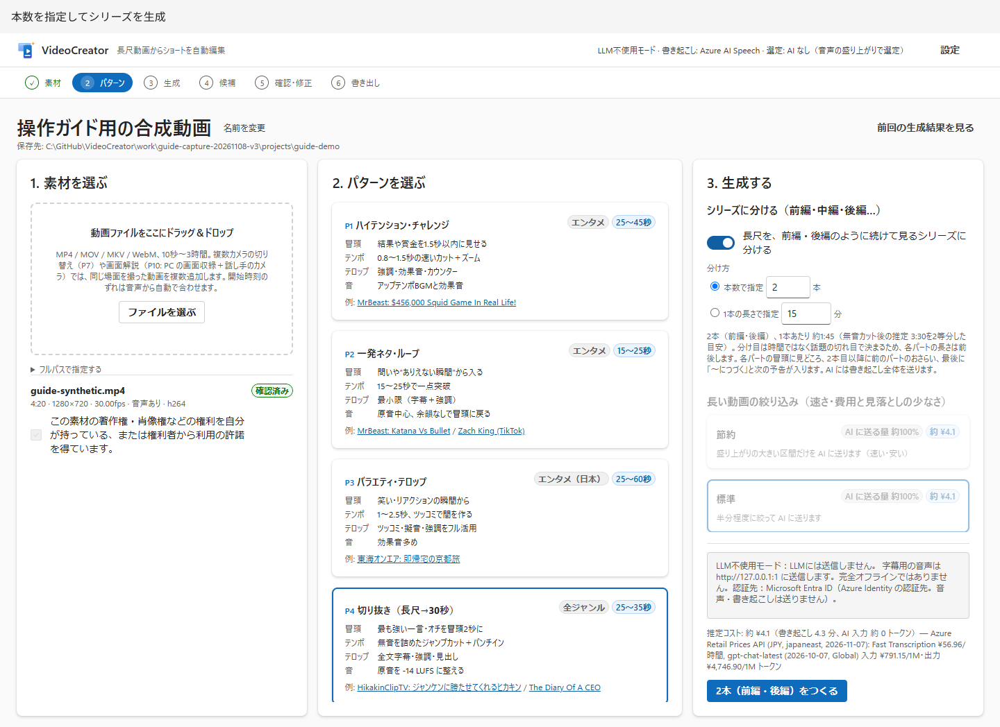

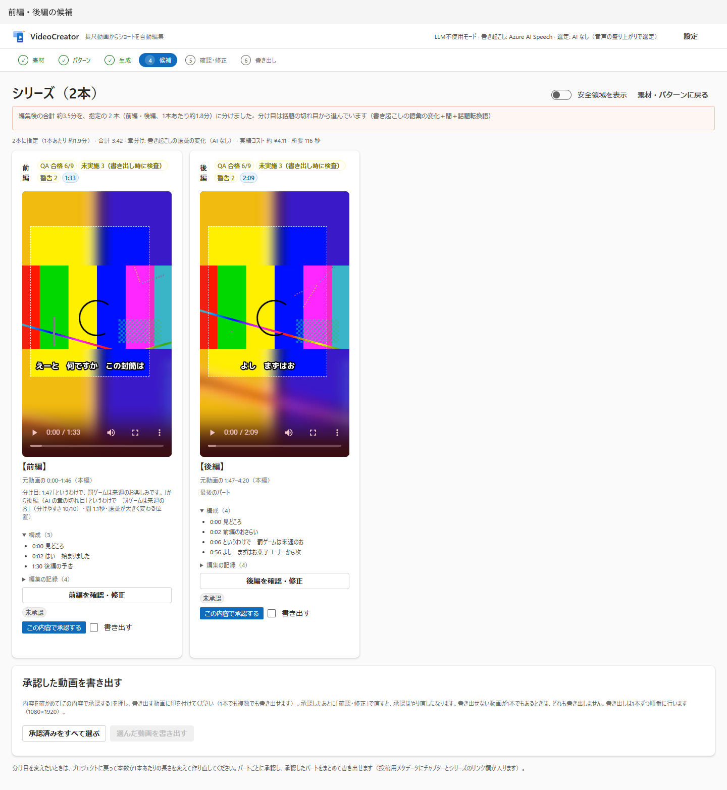

### 승인 후 일괄 내보내기

| 구성 요소 | 의미 |
|---|---|
| 이 내용으로 승인 | **해당 시점 편집 계획** 확인 기록 |
| 미승인/승인됨/승인 후 수정됨 | 편집으로 계획이 바뀌면 재승인 필요 |
| 승인 취소/다시 승인 | 본인 판단 갱신 |
| 내보내기 | 이번에 내보낼 후보 체크. 승인됨·내보내는 중 아님만 선택 가능 |
| 승인된 항목 모두 선택 | 선택 보조. 자동 승인 아님 |
| 선택한 동영상 내보내기 | 전체 사전 검증, 하나라도 불가하면 시작 안 함. 시작 후 순위/파트 순으로 한 편씩 |
| 진행률/내보낸 동영상 열기 | 각 후보 상태·완료 파일 진입점 |
| 대기 중 취소 | 미착수 내보내기만 중지. 실행 중이면 끝까지 처리 |

### 여러 동영상을 한 편씩 확인한 뒤 일괄 내보내기

한 패턴(Job)에 동영상이 2편 이상이면 후보 목록 위에 **확인 진행 상황**이 나옵니다.

| 구성 요소 | 의미 |
|---|---|
| 확인 진행 상황: 승인 n / N편 · 내보냄 m / N편 | 이 패턴 영상 중 승인 수(내보내는 중·완료 포함)와 내보내기 완료 수 |
| 다음 미승인(영상명) 확인 | 첫 미승인 영상의 「확인·수정」 열기 |
| 내보내기로 이동(승인 n편) | 「6. 내보내기」 목록으로. 승인 영상이 있으면 주 버튼 |
| 영상별 상태 | 미확인/승인됨/재승인 필요(승인 후 수정)/내보내는 중/내보냄. 이름으로 확인·수정 열기 |

단계 표시 「확인·수정」은 첫 미확인 영상, 「내보내기」는 내보내기 목록 링크입니다.

## 5. 확인·수정

| 구성 요소 | 의미·조작 |
|---|---|
| 미리 보기 업데이트 | 편집 후 다시 렌더링. 오래된 미리 보기로 판단하지 않기 |
| 길이/본편·전체/컷·텔롭 수 | 계획 정보. 전체는 활성 삽입물 포함 |
| 텔롭·장면 전환 | 텔롭·오프닝·장면 전환 카드·반응 카드·클로징을 내보낸 뒤 시간순 한 표에 표시. 위 스위치(자막·강조·제목·의성어·반응 코멘트·오프닝·장면 전환 카드·클로징)로 종류별 켜기/끄기. 「반응 코멘트」는 오버레이·반응 카드 모두 대상 |
| 오프닝·카드 행 | 삽입 위치·길이·문자·사용 여부. 카드 문장 최대 20자. 카드는 영상 정지 후 전체 화면 표시(비율 유사 이미지 확대, 다른 이미지는 같은 이미지의 흐린 배경 위 전체 표시) |
| 반응 코멘트 모두 승인/카드 모두 승인 | AI 글을 직접 읽고 확인. 사람이 수정한 카드 문장은 사람 문장으로 기록 |
| 컷 목록(영상·속도) | 사용 원본·길이·속도·얼굴 추적·화면 줌·인셋 확인. 범용 타임라인 편집 아님 |
| BGM·효과음 | 「소리·BGM」에서 BGM(없음/장면별 선택/전체에 이 곡), 발화 중 음성 차이(10~30 LU, 10 LU는 가독 음성 하한 기준), 비발화 BGM 크기 변경. 장면별 시간·분위기·측정값·곡(자동 복귀/이 장면 BGM 없음 가능)·음량(−12~+6 dB)·선택 이유 표시. 띠는 곡 흐름·BGM 감소 구간(높이=감소량), 파란 선은 재생 위치. 「미리 보기 업데이트」 후 만든 소리로 발화 중 차이 실측 표시(S-15). P5는 박자 컷이므로 곡 변경 불가(음량 가능) |
| 전사 수정 | 사용 범위 단어 수정. 시간은 유지하고 자막 재생성. 수동 자막이 덮어써질 수 있음 |
| 시작/종료를 한 문장 앞·뒤로 | 짧은 영상 구간을 문장 단위 조절. 원본 끝·길이 조건에 따라 이동 불가 |
| 자동 검사 | 계획 즉시 QA. 최종 파일 음량·해상도 측정과 별개 |
| 자동 검사 승인/승인 취소 | 결과를 확인한 기록 저장/취소. 승인 일시 표시 |
| 자동 검사 일괄 승인 | 통과 포함 실행됨·미승인 항목 일괄 승인. 미실행 제외 |
| 이 내용 승인 후 내보내기(1080×1920) | 한 편일 때. 현재 내용 승인 후 내보내기 |
| 승인만 하고 후보로 복귀 | 한 편일 때. 승인 기록 후 후보 목록 복귀 |

같은 패턴에 2편 이상이면 제목 아래 영상 전환·조작이 바뀝니다.

| 구성 요소 | 의미·조작 |
|---|---|
| ‹ 이전 영상/「영상 i / N」·영상 선택/다음 영상 › | 같은 패턴 영상 전환. 선택 항목에 각 상태(미확인·승인됨 등) 표시 |
| 승인 후 다음 영상으로(영상명) | 현재 내용 승인 후 다음 미승인 열기(끝에서는 처음으로 돌아가 탐색) |
| 승인 후 내보내기로 이동 | 나머지가 모두 승인됨일 때. 승인 후 「6. 내보내기」 목록으로 |
| 이 내용 승인 후 후보로 복귀 | 승인 후 후보 목록에서 진행 확인 |
| 이 한 편만 지금 내보내기(1080×1920) | 목록을 거치지 않고 이 영상만 승인·내보내기 |

현재 내용이 이미 승인되었다면 중복 기록하지 않습니다. 하드 제약 실패가 있으면 어떤 승인 버튼도 누를 수 없습니다.

자동 검사 승인은 「내용 확인」 기록입니다. 실패·경고를 통과로 바꾸거나 내보내기 제약을 해제하지 않습니다. 텔롭·카드 승인과 별개입니다. 새로고침 후에도 저장되지만 편집·판정 변경 후 재승인해야 합니다.

시리즈 경계는 여기서 이동할 수 없습니다. 현재 UI 전사 수정은 `replan`을 동반하므로 시리즈에서 제약 오류가 날 수 있습니다. 시리즈 오자막은 텔롭에서 수정하고 근본 전사 수정은 짧은 영상 쪽에서 처리하는 등 [API 제약](configuration-api.md#편집-조작)을 확인하세요.

### 텔롭 표

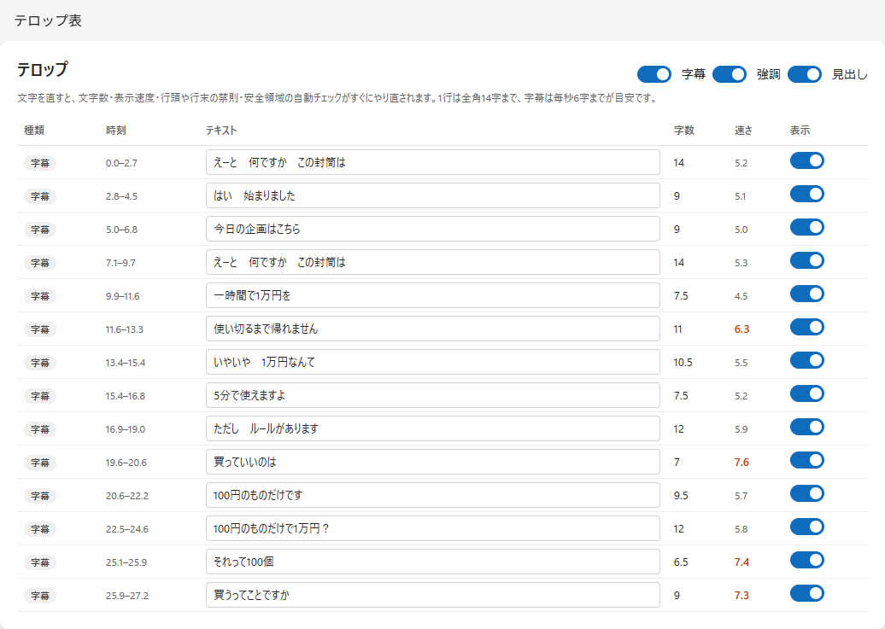

| 입력란·구성 요소 | 의미 |
|---|---|
| 종류 | 자막=발화, 강조=주목 단어, 훅=도입부 유도, 제목=주제, 반응 코멘트=보충, 의성어=소리 문자화, 카운터=수 등 |
| 시간 | 삽입물 포함 완성 영상 표시 시간(초) |
| 텍스트 | 수정 후 포커스 이동으로 저장. 40자는 입력 상한이지 읽기·안전 영역 상한이 아님 |
| 글자 수 | 전각 환산(반각 약 0.5자). 표시 폭 기준 |
| 속도 | 자막 전각 환산 글자/초. 빠르면 읽기 어려움 |
| 표시 스위치 | 행별 켜기/끄기. 비활성 행은 옅은 색 |
| 종류별 스위치 | 자막·강조 등을 일괄 표시/숨기기 |
| 승인 | 미승인 AI 문장 확인. 반응 코멘트 명시 승인 필요 |

가린 단어·숫자·고유명사를 수동 복구하면 QA가 실패할 수 있습니다. 경고 없애기보다 내용을 바꾸지 않고 읽을 수 있게 하는 것을 우선하세요.

## 6. 내보내기

### 내보내기 목록(여러 영상 일괄)

후보 목록 **내보내기로 이동** 또는 마지막 영상 **승인 후 내보내기로 이동**에서 엽니다(`#/job/{id}/exports`). 앱을 닫아도 다음에는 이 화면에서 재개합니다.

| 구성 요소 | 의미 |
|---|---|
| 확인 진행 상황 | 승인·내보내기 수, 미승인 영상 링크 |
| 영상별 행 | 이름·제목·길이·QA 배지, 확인·수정 버튼, 승인 상태, 내보내기 체크 |
| 내보내기 체크 | 기본적으로 승인됨·아직 내보내지 않음 영상 선택 |
| 선택한 동영상 내보내기 | 후보 목록과 같은 일괄 처리. 전체 사전 검증 후 하나라도 불가하면 시작 안 함 |
| 진행률/내보낸 동영상 열기 | 각 영상 상태·완료 화면 |
| 완성 영상·저장 위치 | 각 내보내기 완료 후 목록 안에 최종 플레이어 자동 표시. 재생·탐색, 안전 영역, 영상 절대 경로 확인·복사, **폴더 열기** |
| 게시용 글 | 저장된 YouTube 설명·Viva Engage 게시글·챕터를 영상별 읽기 전용 표시·개별 복사. 미생성·누락 시 **게시용 글 만들기**(목록만 열어서는 생성하지 않음) |
| 기타 결과물·미리 보기 | 펼치면 파일별 저장 경로·열기·저장. 이미지는 미리 보기, SRT·ASS·Markdown·JSON은 **내용 미리 보기**로 텍스트 표시. 긴 글은 앞 65,536자, 전체 링크도 유지 |

이전 완성 파일은 재내보내기 중에도 확인 가능합니다. 편집으로 무효화된 결과는 현재 완성 영상으로 표시하지 않습니다. 파일 누락·재생·복사·폴더 표시 실패는 해당 영상란에 이유가 나옵니다. 복사 불가 시 텍스트 선택 후 Ctrl+C를 사용하세요. 파일 이동·삭제 후 **결과물 다시 읽기**로 확인하세요.

### 완료 화면

내보내는 동안 합성·음량 조절·QA·관련 파일 생성 상태를 표시합니다. 완료 후 다음을 사용합니다.

| 구성 요소 | 의미 |
|---|---|
| 후보로 복귀(다른 영상 확인)/내보내기 목록 | 같은 패턴 다른 영상 확인·일괄 내보내기로 복귀 |
| 하드 제약 통과 수 | 최종 파일·계획 결과. 단계별 행이 있어 ID 종류 수와 통과 행 수가 다름 |
| 완성 영상 | 최종 화질 재생·내용 확인 |
| 저장 위치·경로 복사/폴더 열기 | 절대 경로 표시·복사, Windows 탐색기 완성 파일 선택. 실패 메시지 |
| 파일 링크 | MP4, SRT, ASS, JSON, 메타데이터를 브라우저에서 열기/저장 |
| 썸네일 후보 | 3장 중 직접 골라 게시 대상에 설정 |
| QA 목록 | ID, 상태, 측정값, 기준, `plan` / `final` 확인 |
| 게시용 글(복사해서 붙여 넣기) | 목록 공통 읽기 전용 스니펫. YouTube 설명(5,000자), Viva Engage 게시글(10,000자), 챕터(`00:00 제목`). 글자 수 표시·초과 시 빨간색. **복사** 후 수정은 붙여 넣는 곳에서. 미생성 시 버튼, **다른 제안 만들기**로 재생성. AI가 못 쓴 단어·이유는 노란 주의, 챕터 없는 이유는 해당 칸 대신 표시 |
| 기록 접기 | 실행 명령 등 재현 자료. 비밀정보·개인 경로 확인 후 공유 |

## 7. 설정

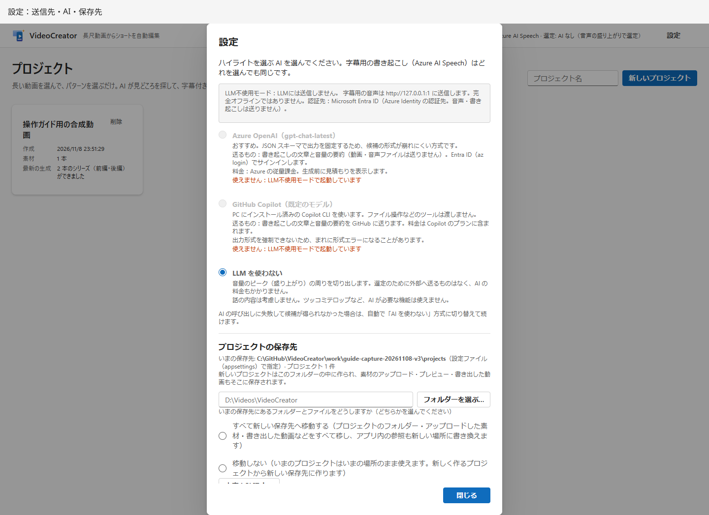

| 구성 요소 | 의미·주의 |
|---|---|
| Microsoft Foundry/GitHub Copilot/LLM 미사용 | 핵심 장면 선정 방식. 즉시 서버 반영. 「닫기」는 저장 버튼이 아님 |
| 사용할 수 없음 | 엔드포인트 부족, CLI 없음, 시작 시 LLM 미사용 고정 등 |
| 전송 대상 | 일반 음성·텍스트·인증 대상. LLM 미사용은 ASR 중지와 다름 |
| 현재 저장 위치·건수 | 신규 프로젝트 저장 위치·기존 건수 |
| 새 저장 위치/폴더 선택 | 새 위치 지정. DB·캐시 DataDir 변경란 아님 |
| 모두 이동/이동하지 않음 | 전자는 현재 위치 바로 아래 파일 등 포함, 후자는 신규 프로젝트만 새 위치 |
| 내용 확인 | 크기·여유·이동 대상·문제 확인. 아직 이동하지 않음 |
| 확인 후 변경 버튼 | 계획을 읽고 실제 변경. 처리 중·동명 충돌 등 거부 |
| FFmpeg/부족 필터/Copilot CLI/패턴 수 | 시작 환경 진단. CLI 경로 등에 개인정보가 있으면 공유 전 가림 |
| 닫기 | 대화 상자 닫기 |

AI 선택은 Runtime 상태여서 재시작 시 시작 설정으로 돌아갑니다. 화면 저장 위치 설정은 DB에 저장되어 시작 설정보다 우선합니다. 이동 후 수동으로 폴더만 복구하면 참조가 어긋나므로 [저장·복구 주의](troubleshooting.md#저장과-백업)를 읽으세요.

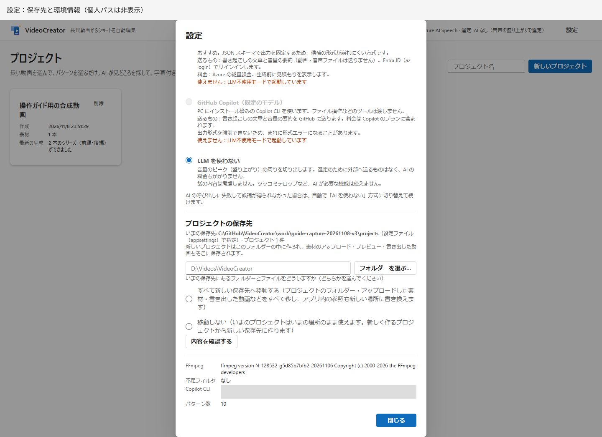
