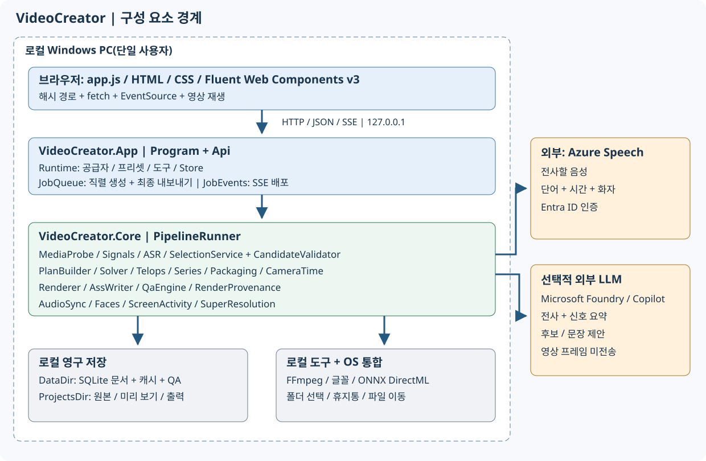
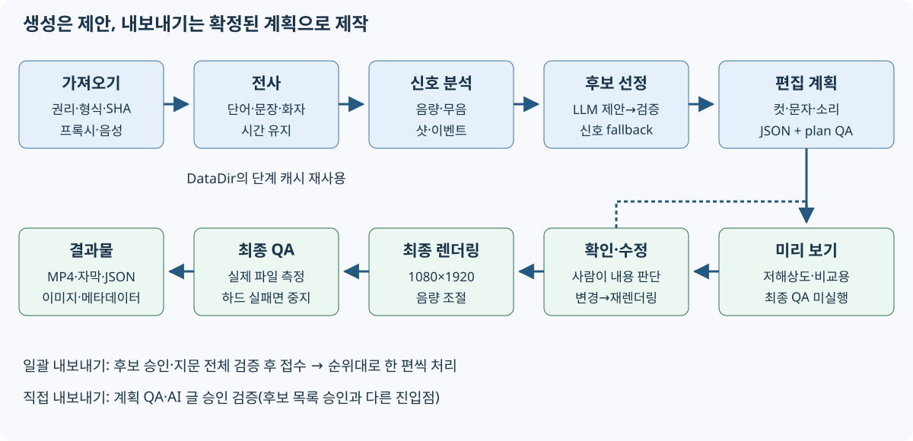
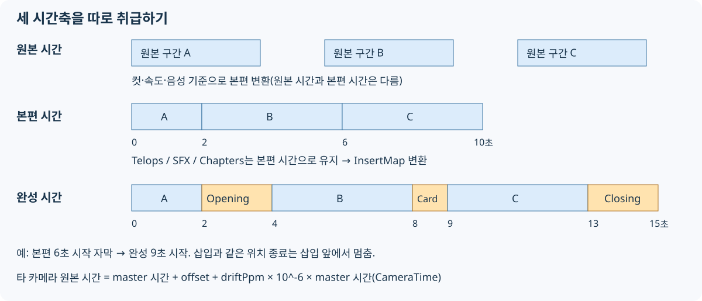

# 소프트웨어 엔지니어용 기술 참조

[↑ 문서 안내](../README.md) | [日本語](../../../users-guide/technical-reference.md) | [English](../../en/users-guide/technical-reference.md) | [简体中文](../../zh-CN/users-guide/technical-reference.md) | **한국어**


[앱 README](../README.md) / [가이드 목차](README.md) / [빠른 시작](quickstart.md) / [화면 설명](screens.md) / [문제 해결](troubleshooting.md) / [설정·API](configuration-api.md) / [검증과 유지 관리](verification.md)

대상은 현재 C#/.NET 10 구현입니다. 범용 동영상 편집 라이브러리나 다중 사용자 서비스가 아니라 Windows의 단일 사용자용 로컬 웹 앱입니다. 설계 요구 사항은 [PRD](../docs/PRD.md), 과거 실측은 [구현 보고서](../docs/IMPLEMENTATION.md)에 있습니다. 과거 검증 결과를 최신 조건의 통과 증거로 재사용하지 마세요.

## 1. 구성 요소



| 계층 | 책임·구현 진입점 |
|---|---|
| Browser UI | [index.html](../../../src/VideoCreator.App/wwwroot/index.html), [app.js](../../../src/VideoCreator.App/wwwroot/js/app.js), [app.css](../../../src/VideoCreator.App/wwwroot/css/app.css). Vanilla ES modules, Fluent Web Components v3, 해시 라우팅 |
| Hosting / HTTP | [Program.cs](../../../src/VideoCreator.App/Program.cs). Kestrel은 IPv4 loopback, Host 검증, 사용자 지정 헤더, 예외 처리, CSP. 인증된 공개 서버가 아님 |
| API | [Api.cs](../../../src/VideoCreator.App/Api.cs). 입력 검증, CRUD, 승인, 일괄 접수, 미리 보기·내보내기 진입점 |
| Runtime | [Runtime.cs](../../../src/VideoCreator.App/Runtime.cs). 설정으로 FFmpeg, Store, Presets, ASR, LLM, 음성·얼굴 서비스 구성. LLM은 실행 중 변경 가능 |
| Background work | [JobQueue.cs](../../../src/VideoCreator.App/JobQueue.cs). 생성·최종 내보내기를 단일 worker로 직렬 처리. SSE의 JobEvents와 내보내기 상태 유지 |
| OS integration | [FolderPicker.cs](../../../src/VideoCreator.App/FolderPicker.cs), [ProjectDeletion.cs](../../../src/VideoCreator.App/ProjectDeletion.cs), [ProjectsLocation.cs](../../../src/VideoCreator.App/ProjectsLocation.cs). 폴더 선택, 휴지통, 이동·복구 |
| Optional work | [SceneCardService.cs](../../../src/VideoCreator.App/SceneCardService.cs), [BrandKitWorker.cs](../../../src/VideoCreator.App/BrandKitWorker.cs). 카드 추출·등록 영상 화질 개선 |
| Pipeline | [PipelineRunner.cs](../../../src/VideoCreator.Core/Pipeline/PipelineRunner.cs). 각 단계 실행, 캐시, 진행률, 렌더링, QA, 결과물 |
| Media / analysis | [MediaProbe](../../../src/VideoCreator.Core/Media/MediaProbe.cs), [SignalExtractor](../../../src/VideoCreator.Core/Signals/SignalExtractor.cs), [AudioSync](../../../src/VideoCreator.Core/Audio/AudioSync.cs), [FaceService](../../../src/VideoCreator.Core/Faces/FaceService.cs), [ScreenActivity](../../../src/VideoCreator.Core/Media/ScreenActivity.cs) |
| ASR / selection | [AzureFastTranscriber](../../../src/VideoCreator.Core/Asr/AzureFastTranscriber.cs), [Providers](../../../src/VideoCreator.Core/Selection/Providers.cs), [SelectionService](../../../src/VideoCreator.Core/Selection/SelectionService.cs), [CandidateValidator](../../../src/VideoCreator.Core/Selection/CandidateValidator.cs) |
| Planning | [PlanBuilder](../../../src/VideoCreator.Core/Planning/PlanBuilder.cs), [Solver](../../../src/VideoCreator.Core/Planning/Solver.cs), [Planners](../../../src/VideoCreator.Core/Planning/Planners.cs), [ScreenPlanner](../../../src/VideoCreator.Core/Planning/ScreenPlanner.cs), [Series](../../../src/VideoCreator.Core/Planning/Series.cs), [TelopBuilder](../../../src/VideoCreator.Core/Planning/TelopBuilder.cs) |
| Rendering / QA | [Renderer](../../../src/VideoCreator.Core/Rendering/Renderer.cs), [AssWriter](../../../src/VideoCreator.Core/Rendering/AssWriter.cs), [QaEngine](../../../src/VideoCreator.Core/Qa/QaEngine.cs), [RenderProvenance](../../../src/VideoCreator.Core/Rendering/RenderProvenance.cs) |
| Storage / schemas | [Store](../../../src/VideoCreator.Core/Storage/Store.cs), [Models](../../../src/VideoCreator.Core/Models/Models.cs), [Json](../../../src/VideoCreator.Core/Json.cs), [Preset](../../../src/VideoCreator.Core/Presets/Preset.cs) |

App과 Tests는 `net10.0-windows`, Core는 `net10.0`입니다. [App csproj](../../../src/VideoCreator.App/VideoCreator.App.csproj)는 Windows Forms를 사용합니다. Core의 [csproj](../../../src/VideoCreator.Core/VideoCreator.Core.csproj)는 DirectML ONNX Runtime 등을 참조하므로 Core TFM만 보고 모든 기능이 크로스 플랫폼이라고 해석하지 마세요.

## 2. 생성·내보내기 흐름



1. **가져오기**: 존재·형식·길이를 확인하고 SHA-256, 프록시, 분석용 음성을 만듭니다. 복수 원본에서는 음성 기준·동기화·역할을 처리합니다.
2. **전사**: ITranscriber에서 단어·문장·화자·시간을 얻습니다. 사전을 구문 목록으로 전달합니다. 캐시가 있으면 재사용합니다.
3. **신호 분석**: 샷, 100ms 음량, 무음, 이벤트. LLM이 없을 때의 선정 근거이기도 합니다.
4. **후보 선정**: IHighlightSelector 결과를 코드로 검증·보정·중복 제거합니다. 긴 영상은 분할·신호 필터링과 필요시 재순위화를 수행합니다. 결과가 없으면 신호 기반으로 전환합니다.
5. **계획**: Solver로 클립을 만들고 프리셋에 따른 speech / switch / speed / beat / screen, 시리즈, 얼굴 추적, 텔롭, 소리, 삽입물, 단어 가림을 적용합니다.
6. **미리 보기**: 편집 계획에 따라 렌더링하고 단계에 맞는 QA를 저장합니다. 최대 3개 후보를 표시합니다.
7. **편집**: PlanEditor 등으로 계획 갱신, 이력 저장, 계획 QA 재실행. 미리 보기는 명시적으로 업데이트합니다. 계획이 바뀌면 후보 승인 지문이 일치하지 않습니다.
8. **최종 출력**: 계획의 하드 QA를 먼저 확인합니다. 1080×1920 합성, 음량 조절, 최종 QA 후 모든 하드 결과가 pass일 때만 게시용 출력을 확정하고 SRT·ASS·계획·썸네일·메타데이터를 만듭니다.

**설계 경계**: AI는 구간·문안을 제안합니다. Renderer는 확정된 계획과 원본으로 영상을 만듭니다. LLM 프롬프트만으로 품질 제약을 보장하지 않습니다. 원음 의미와 권리의 최종 판단은 사용자에게 남깁니다.

## 3. 데이터 모델과 영구 저장

| 모델 | 저장·관계 |
|---|---|
| Project | 폴더, 언어, 카드 설정. Asset / Rights / Job의 부모 |
| SourceAsset | 원본 절대 경로, SHA-256, MediaInfo, 역할, 화자, 동기화 값 |
| Transcript / Word / Sentence | 캐시 JSON. 단어 ID·시간은 자막·추출·내용 대조의 근거 |
| SignalSet | 캐시 JSON. 샷·무음·음량·이벤트 |
| Job | 생성 설정, 상태, 비용 계산, 단계 시간, 경고, 후보 ID |
| Candidate | Job 자식. 선정 구간·이유·점수·EditPlan과 미리 보기 Render ID, 승인 |
| EditPlan | Project 자식. Canvas, Timeline, Telops, Audio, Inserts, Series, Provenance |
| Render | EditPlan 자식. preview / final, 실제 파일, Outputs, 단계별 QA, 재현 기록 |
| BrandKit / BgmTrack / setting | 공통 등록 또는 프로젝트용 소리, 저장 위치 설정 |

Store는 SQLite `docs(kind,id,parent,json,updated)`를 사용하는 JSON document store입니다. JSON은 공유 `Json.Options`에 따른 snake_case·문자열 enum입니다. 폴더 파일과 DB는 별개이며 출력 JSON만으로 프로젝트 전체를 가져오는 API는 없습니다.

캐시는 DataDir의 `cache\<원본 SHA-256 앞 16자>`입니다. 전사 키는 ASR Name과 사전, 신호는 `signals.v2.json`(샷 경계·암전·음량 등)이며 얼굴·화면 분석 등도 있습니다. **ASR 엔드포인트·locale만 바꾼다고 전사 캐시가 반드시 무효화되지는 않습니다.** 새 공급자나 분석 알고리즘을 추가할 때는 기존 키 충돌·호환성·무효화 방침을 시험하세요.

원본 절대 경로 변경은 [StorePaths](../../../src/VideoCreator.Core/Storage/StorePaths.cs)의 재루트 처리를 사용합니다. 같은 드라이브는 rename, 다른 드라이브는 copy·파일 수/크기 대조 후 JSON 참조를 트랜잭션으로 갱신합니다. 모든 파일 내용의 암호학적 대조와 같은 의미는 아닙니다.

## 4. 혼동하면 안 되는 세 시간축



1. **원본/master 시간**: 단어 시간과 원본 영상 위치. 다른 카메라 시간은 `SourceAsset.CameraTime(masterT, masterId)`에 따라 `masterT + offset + driftPpm × 10^-6 × masterT`.
2. **편집 본편 시간**: Timeline 각 클립 길이 `(src_out-src_in)/speed`를 누적합니다. Telops, SFX, 시리즈 챕터는 여기서 계획합니다.
3. **완성 파일 시간**: 본편에 Opening/Card/Closing을 삽입한 뒤의 시간. [InsertMap](../../../src/VideoCreator.Core/Planning/Packaging.cs)으로 변환합니다. 시작이 삽입 위치와 같으면 삽입 뒤, 종료면 삽입 앞입니다.

예: 본편 2초에 2초 Opening, 본편 6초에 1초 Card를 삽입하면 본편 6초 시작 자막은 완성 파일 9초에 시작합니다. 카드를 가로지르는 자막은 분할 렌더링하고 카드 위에는 표시하지 않습니다. 클립 배속과 카메라 동기화를 삽입물 시간 덧셈으로 대체하면 안 됩니다.

## 5. 승인·QA·재현성 계약

- `CandidateApproval`은 승인자·일시·`EditPlanFingerprint.Of(plan)`의 SHA-256을 기록합니다. 서명이나 사용자 인증은 아닙니다.
- 일괄 접수는 모든 후보의 소속·승인·지문·처리 중 여부·계획 QA를 먼저 검증합니다. 하나라도 불가하면 시작하지 않습니다. 접수 후 큐에서는 승인된 스냅샷을 사용합니다.
- 확인 화면의 직접 render API는 후보 승인을 요구하지 않습니다. AI 텔롭 등의 승인과 계획 QA는 요구합니다. 두 진입점의 승인 조건이 같다고 생각하지 마세요.
- 일괄 「사전 접수가 전부 아니면 0건」인 것과 실행 후 「모든 파일이 일괄 성공·실패」하는 것은 다릅니다. 실행 중 개별 실패는 각 후보에 표시합니다.
- QA의 `Stage`, `PlanHash`, `not_run`을 유지하며 오래된 결과나 미리 보기를 최종 통과로 재사용하지 않습니다.
- `Render.Reproducibility`는 계획·FFmpeg·buildconf·글꼴·프리셋·원본 해시, 텍스트 라이브러리 정보, encoder threads 등입니다. 비교 대상은 **디코딩된 프레임**이며 컨테이너 바이트 일치만이 아닙니다.
- 재현성의 전제는 원본·계획·도구·글꼴·환경을 일치시키는 것입니다. LLM을 다시 호출해서 같은 후보가 나온다는 보장은 아닙니다.

## 6. 사용자 지정 진입점과 검증

| 바꿀 내용 | 변경 위치·유지 조건 | 대응 테스트 |
|---|---|---|
| 길이·템포·소리·장식 초기값 | [presets](../../../presets), PresetStore.Validate. `P숫자` ID, semver, 시작 시 로드하므로 재시작 | [PlanningTests](../../../tests/VideoCreator.Tests/PlanningTests.cs), [VarietyTests](../../../tests/VideoCreator.Tests/VarietyTests.cs) |
| 글자 크기·외곽선·줄바꿈 | AssWriter Metrics/Band/CaptionLineChars, JapaneseText, TelopBuilder 공통 사용. 렌더링·자동 축소·QA에 별도 표를 만들지 않기 | [CaptionLayoutTests](../../../tests/VideoCreator.Tests/CaptionLayoutTests.cs), [JapaneseTextTests](../../../tests/VideoCreator.Tests/JapaneseTextTests.cs), [RenderingTests](../../../tests/VideoCreator.Tests/RenderingTests.cs) |
| 후보 제안 방식 | IHighlightSelector, Providers, SelectionPrompt, SelectionService, Runtime과 설정 UI. 출력 검증·재시도·fallback·비용·전송 대상 일치 | [SelectionTests](../../../tests/VideoCreator.Tests/SelectionTests.cs), [V12Tests](../../../tests/VideoCreator.Tests/V12Tests.cs) |
| ASR | ITranscriber, Runtime, 설정·전송 대상, 캐시 키. 단어 ID·시간·화자·문장 구조 유지 | [PlanningTests](../../../tests/VideoCreator.Tests/PlanningTests.cs), 사용 원본으로 시간·인식 정확도 별도 실측 |
| 카메라·화면 편집 | AudioSync, CameraTime, SwitchPlanner, ScreenPlanner. 동기화는 AudioSync.TimelineFilter의 시간 정합 PCM 사용 | [MultiSourceTests](../../../tests/VideoCreator.Tests/MultiSourceTests.cs), [V11Tests](../../../tests/VideoCreator.Tests/V11Tests.cs) |
| 시리즈·삽입물 | Series, Packaging, InsertMap. 텔롭·SRT·QA·메타데이터 시간 모두 일치 | [SeriesTests](../../../tests/VideoCreator.Tests/SeriesTests.cs), [PackagingTests](../../../tests/VideoCreator.Tests/PackagingTests.cs), [SceneCardTests](../../../tests/VideoCreator.Tests/SceneCardTests.cs) |
| 게시용 글·챕터 | PostCopy(Planning). 챕터 시간은 코드가 InsertMap으로 내보낸 후 시간으로 변환하며 AI에 작성시키지 않음. AI에는 가림 처리한 전사만 전달하고 PostCopy.Check(길이·URL·시간·가린 단어·발화에 없는 단어)를 통과한 글만 사용. 거부한 부분은 이유와 함께 한 번만 재생성 | [PostCopyTests](../../../tests/VideoCreator.Tests/PostCopyTests.cs) |
| UI 입력 구성 요소 | app.js, app.css, Fluent v3. checkbox/switch는 field의 label/input slot. esc(), 이벤트 후 상태 다시 렌더링, 키보드 조작 유지 | [E2E](../../../ui/e2e.mjs), [v1.1 E2E](../../../ui/e2e-v11.mjs), 실제 Edge |
| API·승인·저장 | Api, Models, Store, JobQueue, ProjectsLocation. snake_case, 코드가 있는 오류, 편집 후 재승인, 경로 경계 | [ApprovalExportTests](../../../tests/VideoCreator.Tests/ApprovalExportTests.cs), [ProjectsLocationTests](../../../tests/VideoCreator.Tests/ProjectsLocationTests.cs), [RenderRecordTests](../../../tests/VideoCreator.Tests/RenderRecordTests.cs) |

프리셋을 추가하는 최소 방법은 기존 JSON을 복사해 ID·version·name과 필요한 항목을 바꾸고 재시작하는 것입니다. 새 planner라면 PlanBuilder나 PresetStore 허용 목록도 변경해야 합니다. JSON에 이름만 추가해서 처리가 늘어나지는 않습니다.

현재 Canvas·내보내기 UI·QA는 세로 1080×1920을 전제로 합니다. 가로형은 일관된 변경·검증이 필요합니다. 공개 네트워크화도 Listen만 바꾸지 말고 인증, 권한, CSRF, 파일 접근, 작업 격리를 별도로 설계하세요.

FFmpeg 호출은 인수 배열로 합니다. raw frame을 pipe로 전달하는 자식 프로세스에서는 `-nostdin`을 유지하세요. 명령 문자열을 셸로 연결하는 확장은 피하세요. ASS 제어 문자와 사용자/LLM 문자열 이스케이프도 유지하세요.

## 7. 빌드와 테스트

저장소 루트에서 실행합니다. 의존 도구가 있다면 다시 받을 필요가 없습니다.

```powershell
pwsh scripts\get-tools.ps1
dotnet build src\VideoCreator.App\VideoCreator.App.csproj -c Release
dotnet test --project tests\VideoCreator.Tests
```

[global.json](../../../global.json)은 Microsoft.Testing.Platform runner를 지정합니다. 테스트 수는 변하므로 고정값을 수용 기준으로 삼지 않습니다. UI 번들을 바꾼다면 [ui/package.json](../../../ui/package.json)의 `npm run build`, E2E는 실행 중 앱에 `node e2e.mjs <동영상> <URL>`을 사용합니다. E2E는 외부 서비스 사용·과금과 기존 스크린샷 갱신을 수반하므로 격리된 저장 위치를 지정하세요.

이번 자료 작성에서 실행한 검증은 [검증과 유지 관리](verification.md)에 따로 기록했습니다.
---

[↑ 문서 안내](../README.md) | [日本語](../../../users-guide/technical-reference.md) | [English](../../en/users-guide/technical-reference.md) | [简体中文](../../zh-CN/users-guide/technical-reference.md) | **한국어**
