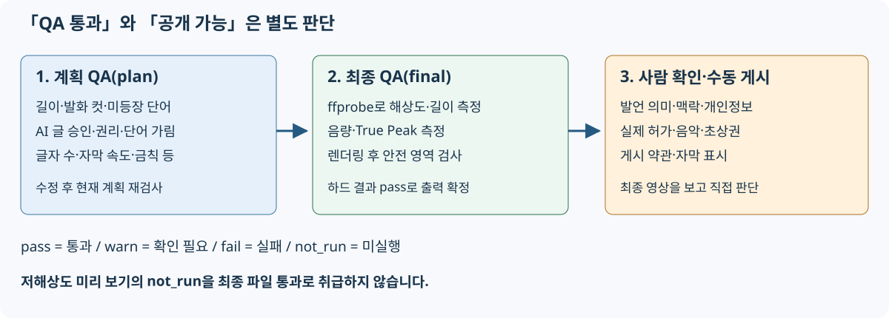

# 문제 해결: 오류, QA, 저장

[앱 README](../README.md) / [가이드 목차](README.md) / [빠른 시작](quickstart.md) / [화면 설명](screens.md) / [설정과 API](configuration-api.md) / [검증과 유지 관리](verification.md)

## 먼저 원인 구분하기

1. 시작 터미널이 실행 중인지 확인합니다. 브라우저만 열어서는 서버가 시작되지 않습니다.
2. 「설정」의 공급자와 전송 대상이 **본인의 설정**인지 확인합니다.
3. 원본의 음성, 길이, 권리 확인, 선택한 패턴이 맞는지 확인합니다.
4. 실패 단계, 오류 코드, QA ID·측정값을 기록합니다. 로그인 토큰은 공유하지 않습니다.
5. 조건을 수정해 다시 시도합니다. 같은 설정으로 반복하기 전에 원인을 확인하세요.

## 자주 발생하는 증상

| 증상·코드 | 확인 사항·다음 조작 |
|---|---|
| 시작 불가, 도구 부족 | `.\run.cmd --check`의 `FAIL` 확인. `.\run.cmd --setup`으로 다시 설치. 오프라인이나 조직의 설치 제한은 관리자에게 문의 |
| 브라우저 연결 불가 | 시작 로그의 URL 사용. 기본값은 `http://127.0.0.1:8765/`. 포트를 바꾸면 URL도 변경. 다른 PC에서는 접근할 수 없는 설계 |
| 시작 시 포트 사용 중 | 기존 앱 확인. 다른 프로세스를 무차별 종료하지 말고 다른 포트를 설정해 실행 |
| `E-RIGHTS-REQUIRED` | 모든 원본의 권리 확인에 체크. BGM·등록 영상·이미지 권리도 별도 확인 |
| `E-ING-UNSUPPORTED` | 경로, 실제 영상 형식, 영상 트랙, 10초~3시간 조건 확인. 확장자만 바꿔서는 해결되지 않음 |
| 수신·복사 실패 | OS 임시 영역과 프로젝트 저장 위치의 여유 확인. 큰 원본은 전체 경로 참조도 검토 |
| `E-ASR-PROVIDER`, 401 | 본인 엔드포인트, 인터넷, 리소스 테넌트에 대한 `az login` 확인 |
| Speech/OpenAI 403 | 사용자 역할과 네트워크 제한을 관리자에게 확인. 관리 화면 접근 권한과 데이터 처리 권한은 별개 |
| Azure 로그인 후에도 인증 불가 | 다른 계정이 우선된다면 시작 환경에서 `AZURE_TOKEN_CREDENTIALS=AzureCliCredential` 설정 |
| 429 또는 일시적 서비스 오류 | 속도 제한·용량·서비스 상태 확인. 자동 재시도 후에도 실패하면 잠시 기다리기 |
| 자막/전사 없음 | 음성 없는 원본인지, ASR이 비활성·미설정인지 확인. LLM을 켜도 ASR을 대신하지 않음 |
| 「신호 기반」 후보만 나옴 | LLM 미설정·사용 불가·응답 검증 실패. 계속 동작하기 위한 대체 선정이며 내용을 이해한 후보가 아님 |
| 조용하지만 중요한 장면이 후보에 없음 | 필터링을 전체 텍스트로 변경. AI 미사용 시 음량 중심이므로 AI 설정이나 다른 패턴 검토 |
| `E-SOL-INFEASIBLE` | 조건에 맞는 구간 없음. 발화량·길이가 충분한 다른 영상이나 패턴 시도 |
| P7/P10 실패 | 동시 녹화 원본 수, 음성, 역할, 동기화 결과 확인. P10은 화면 원본과 발표자를 구분 |
| 시리즈 실패 | 발화 영상, 지원 패턴, 편수/길이 조건 확인. 주제 도중 분할 경고가 있다면 내용 재검토 |
| 「미리 보기가 오래되었습니다」 | 변경은 계획에 저장됨. 미리 보기를 업데이트한 뒤 판단 |
| `E-NOT-APPROVED` | 미승인 동영상 존재. 「확인·수정」에서 승인. 일괄 내보내기는 오류 아래에 영상별 이유(미승인·승인 후 변경·계획 QA 실패·내보내는 중)를 표시하며 하나라도 해당하면 아무것도 시작하지 않음. 코드는 가장 먼저 해당한 이유의 코드(개별 내보내기와 동일) |
| `E-EXPORT-BUSY` | 같은 편집 계획의 내보내기 완료 대기(개별·일괄 모두) |
| `E-QA-HARDFAIL` | 아래 QA 표 참조. 계획 실패는 수정, 완성 파일 실패는 측정값·렌더링 환경 확인. 일괄 내보내기는 실패 영상별 항목 표시 |
| `E-RND-FFMPEG` | 여유 공간, FFmpeg·필터, 원본 존재 여부, 출력 위치 권한 확인 |
| `E-PROJECT-BUSY`, 삭제 불가 | 생성·내보내기 완료 대기. 생성과 아직 시작하지 않은 내보내기는 취소 가능 |
| `E-FILE-IN-USE` | 프로젝트의 영상 등을 열고 있는 앱을 닫은 뒤 다시 조작 |
| 저장 위치 이동 불가 | 실행 중인 작업, 같은 이름 파일, 용량, 원래 위치 내부를 지정하지 않았는지 확인. 실패·잔여 항목 표시 읽기 |

설정의 `--check`도 설정 대상에 연결 요청을 보냅니다. 조직의 원본으로 외부 전송을 시험하기 전에 데이터 사용 허가를 확인하세요.

## QA 올바르게 읽기

- **통과(pass)**: 해당 검사·해당 단계의 조건을 충족했습니다.
- **경고(warn)**: 확인이 필요합니다. 내보낼 수 있어도 다시 살펴보세요.
- **실패(fail)**: `H-` 하드 항목이면 내보내기를 막습니다.
- **미실행(not_run)**: 아직 측정하지 않았습니다. 최종 내보내기에서 측정할 항목은 미리 보기에서 이 상태입니다.
- **plan**: 현재 편집 계획 검사. **final**: 완성 파일 측정.

| ID | 검사 | 대처·한계 |
|---|---|---|
| H-01 | 길이 | 짧은 영상의 본편은 패턴 범위, 삽입물 포함 전체는 별도 조건. 구간·삽입물 조절. 시리즈는 시리즈 길이 조건 |
| H-02 | 해상도·비율 | 완성 파일의 1080×1920. 저해상도 미리 보기를 최종 통과로 취급하지 않기 |
| H-03 | 라우드니스 | 최종 파일 목표 −14 LUFS, 허용 ±1 LU. 무음 원본 등은 조건을 충족하지 못할 수 있음 |
| H-04 | True Peak | 최종 파일 −1 dBTP 이하. 음량 조절과 재측정 필요 |
| H-05 | 텔롭 안전 영역 | 위치·글자 수·글꼴 확인. 최종 단계는 렌더링 결과 실측. 안내선만으로 판정하지 않음 |
| H-06 | 발화 도중 컷 | 문장 단위 구간 조절. ASR 시간 허용 ±150ms. P5는 박자 우선으로 경고가 될 수 있음 |
| H-07 | 텔롭의 미등장 단어 | 숫자·고유 토큰 등을 전사/사전과 대조. **의미·맥락 전체에 대한 사실 확인이 아님** |
| H-08 | 미승인 텔롭·카드 | AI 문장을 읽고 승인하거나 표시 끄기 |
| H-09 | 원본 권리 확인 | 사용하는 원본·이미지·삽입물 모두 확인. 체크가 법적 허가의 증명은 아님 |
| H-10 | 단어 가림(설정 시) | 가릴 단어가 수동 편집으로 되살아나지 않았는지 확인. 출력 대상 기능이며 원본·캐시·클라우드 입력의 익명화가 아님 |
| S-01 / S-02 / S-08 | 자막 속도/행 폭/금칙 | 의미를 유지하며 줄이기. 읽는 속도와 자연스러운 줄바꿈도 확인 |
| 기타 S 항목 | 훅, 장식, 검은 화면 등 | 화면 메시지·측정값·기준과 영상을 대조. 전체 정의는 [QaEngine](../../../src/VideoCreator.Core/Qa/QaEngine.cs) |

통과 수는 고정되어 있지 않습니다. H-01/H-05처럼 계획과 최종에 같은 ID가 여러 행 존재하며, 단어 가림 등 조건부 항목도 있습니다. **하드 QA 통과는 「해당 자동 검사 통과」라는 뜻이며 내용 충실성·권리·개인정보·인기·게시 대상의 승인을 보장하지 않습니다.**

최종 QA에 실패한 MP4는 프로젝트의 `rejected`로 이동할 수 있습니다. 게시용 성공 파일로 취급하지 마세요.

## 저장과 백업

| 저장 위치 | 내용 |
|---|---|
| DataDir(기본 `%LOCALAPPDATA%\VideoCreator`) | SQLite DB, 전사·신호 캐시, QA 작업 영역, 음원 등 |
| ProjectsDir(기본 Windows 「동영상」의 VideoCreator) | 프로젝트별 원본 복사본, 미리 보기, 내보내기, 카드 이미지 등 |
| 전체 경로로 참조한 외부 파일 | 원본 영상·등록 영상. 관리 폴더 밖이라면 별도 백업 필요 |

개발·운영 권장 사항: 처리를 마치고 앱을 종료한 뒤 DataDir, 실제 사용 중인 각 프로젝트 폴더, 외부 참조 원본을 함께 백업하세요. SQLite는 WAL 방식이므로 실행 중 DB 파일 하나만 복사하는 방법은 피하세요. 음성·전사·개인 경로가 포함되므로 백업 취급에도 주의하세요.

저장 위치 변경은 「설정」에서 합니다. 「이동하지 않음」이면 과거 프로젝트는 원래 위치에 남습니다. 「이동함」이면 현재 저장 위치의 기타 파일도 대상입니다. **DataDir이나 관리 밖의 외부 참조까지 이동하지는 않습니다.**

이동이 도중에 멈추면 실패·잔여 항목 표시를 기록하고 사용 중인 파일을 닫으세요. 다음 실행 때 `projects-move.json`을 기반으로 복구합니다. 저널을 수동 삭제하거나 DB 절대 경로만 변경하지 마세요.

생성은 재시작 시 미완료 작업을 다시 넣고 사용 가능한 단계 캐시를 재사용합니다. **아직 시작하지 않은 최종 내보내기 큐는 메모리에 있으므로** 중지 전의 일괄 내보내기가 반드시 재개되는 것은 아닙니다. 완료 파일을 확인하고 필요한 후보를 다시 내보내세요.
