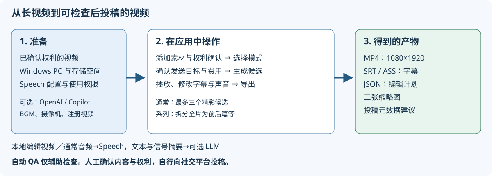

# VideoCreator

[English](../en/README.md) | 简体中文 | [한국어](../ko/README.md) | [日本語](../../README.md)

### 界面语言与视频语言

界面语言切换支持日语、英语、简体中文和韩语，选择保存在浏览器中，与视频语言独立。请在项目界面按素材发言指定 `language`（`ja-JP` / `en-US` / `zh-CN` / `ko-KR`，默认 `ja-JP`）。字幕保留原语言发言，不会自动翻译。钩子、标题、吐槽、转场卡、系列标签和投稿文案均使用视频语言。已有编辑计划保留创建时的语言；改变项目语言后请重新生成。

中文与韩文渲染需要通过 `scripts/get-tools.ps1` 获取 Noto Sans CJK SC / KR（OFL），文件名为 `NotoSansCJKsc-Bold.otf` / `NotoSansCJKkr-Bold.otf`；缺失时导出会明确报错。翻译文档在 `locales/` 镜像原始结构。此处引用的日文截图是拍摄当时的历史真实界面，不表示已翻译界面截图。

选择长视频，**只需选择编辑模式**，AI 就会寻找精彩片段，自动制作带字幕和强调文字的**竖屏短视频（1080×1920）**。这是一个本地 Web 应用。

**界面语言与项目视频语言相互独立。** 项目字段 `language` 支持 `ja-JP`、`en-US`、`zh-CN`、`ko-KR`，在项目界面配置；切换界面语言不会改变项目视频语言。

## 首次使用：准备 → 操作 → 产物

**使用自己拥有使用权的视频，制作可在投稿前检查的带字幕视频。** 仅选择源视频不会公开。请比较、修改候选，导出后自行投稿。

| 需要准备 | 应用中的操作 | 得到什么 |
|---|---|---|
| Windows 10/11（x64 / ARM64）、互联网、存储空间 | 用 `run.cmd` 安装所需工具并启动 | 在自己 PC 浏览器中使用的本地 Web 应用 |
| 已确认授权的 MP4 / MOV / MKV / WebM（10 秒～3 小时）；需要字幕时使用含讲话视频 | 创建项目、添加素材、确认权利 | 源视频分析信息与带时间的转写 |
| **自己的** Azure Speech 支持资源、端点和权限。使用 AI 筛选时需 Microsoft Foundry 部署或已登录 Copilot CLI | 选模式，确认费用与发送目标后生成 | 最多 3 个短视频候选和低分辨率预览（某些条件下不足 3 个） |
| 检查内容的时间 | 检查字幕、声音、剪辑，必要时修改并导出 | 竖屏 MP4（1080×1920、H.264/AAC）、SRT、ASS、编辑计划 JSON、3 张缩略图、投稿元数据建议 |



首次建议**一个视频＋P4“精华剪辑（长视频→30 秒）”＋标准筛选**。启用系列会拆分整个长视频为前后篇等，而非生成精彩候选。先成功导出一个，再尝试 BGM、多摄像机、片头和转场。

> **重要**：虽是本地 Web 应用，通常仍会向 Azure Speech 发送生成字幕所需的音频。“不使用 LLM”或“无 LLM 模式”不等于完全离线。界面权利确认和自动 QA 均不保证实际授权、内容忠实或符合平台规则。配置示例中的端点属于发布者，请改为自己的值。安装程序不会创建 Azure 资源或重写端点。

### 指南

- [用户指南目录](users-guide/README.md)：按目的阅读与术语
- [快速入门](users-guide/quickstart.md)：准备和第一个视频
- [界面与组件说明](users-guide/screens.md)：实际界面 SVG 截图和操作含义
- [遇到问题与 QA 读法](users-guide/troubleshooting.md)
- [面向软件工程师的技术参考](users-guide/technical-reference.md)：架构图、数据和时间轴、扩展位置
- [配置与 API 参考](users-guide/configuration-api.md)
- [资料验证与截图重建](users-guide/verification.md)
- [制作方针与需求、验证结果对应](users-guide/documentation-brief.md)


截图将真实应用捕获嵌入 SVG。显示字幕为测试内容，不是对合成影像和音频的识别结果。界面费用为计算值，不是本次实际账单。

- 需求：[docs/PRD.md](docs/PRD.md) / 调研：[docs/VideoCreator-AnalyticsReport.md](docs/VideoCreator-AnalyticsReport.md)
- 实现与验证记录：[docs/IMPLEMENTATION.md](docs/IMPLEMENTATION.md)

## 主要功能

| | |
|---|---|
| 素材 | 拖放／完整路径指定，ffprobe 验证（检测 VFR、旋转、无音频），强制权利确认 |
| 转写 | Azure AI Speech **Fast Transcription**（单词时间戳、说话人分离、短语列表、无密钥认证） |
| 筛选 | Microsoft Foundry（**Structured Outputs**）或 **GitHub Copilot（SDK 调用 OS 已安装 CLI）**。长视频根据信号筛选后分块并重新排名，失败时按音频高涨选择 |
| 编辑 | 吸附句子边界、时长调整、冷开场（先行亮点）、静音跳切＋推近、9:16 模糊背景 |
| 屏幕文字 | 日文换行规则（不以助词、小写假名开头，均衡二分）、强调、钩子、标题、自动缩小防溢出 |
| 质量 | 自动 QA（PRD §13）：时长、分辨率、**−14 LUFS / −1 dBTP**、**实测文字安全区域**、讲话中途剪切、**文字事实检查**、权利。硬性违规禁止导出 |
| 输出 | MP4（H.264/AAC）、SRT、编辑计划 JSON、ASS、3 张缩略图、投稿元数据建议 |
| 前后篇 | **指定数量（2～20）或每条长度（如 15 分钟）**，立即显示每条时长参考（已转写时估计静音剪除后），将整个长视频按相同编辑（字幕、强调、跳切、竖屏、QA）拆为**前／后篇（3 条含中篇，4 条以上第 n 集）**。断点不按时钟，而结合**话题断点**（AI 章节＋词汇和语义嵌入变化＋话题转换词，**先只将话题断点作为候选，即使长度略有偏差也优先断点**，不足才警告后优先长度）与**讲话断点**（前句是否结束、下一句是否用“所以”等承接、笑声后、画面黑场或切换），用动态规划满足数量并均衡长度。避免在“但是…”“这个有点…”等中途截断，并按间隔补全转写漏句号的句末。话题断点不足导致中途拆分、讲话未完的部分会警告，详见 [docs/IMPLEMENTATION.md §14、§15](docs/IMPLEMENTATION.md)。各部分构成为“亮点先行→上部分回顾→正文（章节标题）→‘待续’与下集预告”。投稿元数据包含满足 YouTube 条件的章节和系列链接栏（超过 3 分钟，不加 #Shorts） |
| 片头与片尾 | 在“3. 生成”按文件夹注册频道**片头／片尾视频**（按文件名 Opening / Closing 区分，有 9:16 和 16:9 时自动选适合输出版本，强制权利确认）。片头在先行亮点后，片尾在最后，先匹配正文音量再整体归一化至 −14 LUFS。**比输出（1080×1920）小的视频在注册时只提升一次画质**（lanczos 放大，仅加入 AI 超分 Real-ESRGAN 的轮廓细节，针对该视频用 VMAF、XPSNR 实测，仅比 lanczos 更忠实原图时采用。GPU 每条 1～2 分钟，后台运行） |
| 吐槽暂停卡 | AI 吐槽（P3）在发言后、转场卡在话题变化处，插入暂停画面和原声的 **2～3 秒（默认 2.5）卡片**。全屏注册图像（没有则独立背景面板）上弹出文字，播放专用 BGM 后恢复正文。AI 根据前后场景自动生成**观众代言**（吐槽、称赞、共鸣，如“搞什么！”“太棒了！”；无 AI 时模板）。展示可选“自动（默认）／吐槽文字（不暂停叠加）／卡片”；自动仅在发言结束且有间隔处用卡片，回应中、靠近其他卡片或暂停超正文 10% 则叠字（备注显示原因）。AI 文本批准前不可导出，检查界面可编辑、批准、逐项开关。字幕、音效和章节自动偏移，卡片上无普通字幕（[实现与验证](docs/IMPLEMENTATION.md)） |
| 多素材自动同步 | 同场景多摄像机和屏幕录制**根据音频自动同步到不足一帧**。录制起点相差数分钟也从全长搜索，正确处理音轨晚于视频开始的文件，并测量修正长录制**时钟漂移（ppm）**。仅多个区间匹配才采用，在素材栏显示偏移 ms、漂移及匹配区间数。无音频素材按拍摄日期同步并警告 |
| 屏幕讲解（P10） | 自动区分 **PC 屏幕录制＋讲解者摄像机**（低运动与有人脸，显示依据）。屏幕操作中及“这里”“点击”等指示发言期间用**屏幕＋讲解者圆形画中画**，屏幕静止时用**讲解者全屏**。竖屏为可读性**自动缩放平移至操作位置**，画中画放在避开操作和密集文字的角落，文字不覆盖屏幕（[实现与验证](docs/IMPLEMENTATION.md)） |

**P1～P10 全部可用**（含 BGM、音效、吐槽、拟声、人脸跟随竖屏、多摄像机切换、屏幕＋画中画、节拍同步、加速，见 [presets/](../../presets)）。长视频筛选（节省／标准／全文）可在界面选择。

片头片尾注册可用**“选择文件夹…”**（.NET 标准 `FolderBrowserDialog`，含与资源管理器相同地址栏、搜索、快速访问，记住上次文件夹）。选择后确认权利并点击“注册”。保留完整路径手输，取消不修改输入。

没有卡片图像时，**“从视频生成转场图像”**按项目选择［生成］／［不生成］（默认不生成，已有图像项目为生成）。选择生成可从权利确认素材或**已注册片头／片尾**的横竖版本提取最多 2～6 张（默认 4）代表图。片头片尾以注册权利确认为依据，不能指定未注册文件；取消注册后由其生成图不再使用。不生成会保留已生成图，但后续候选不使用（转场为文字卡）。基于画面变化、亮度和时间分布排除黑、白和相似图（近静态视频可能不足数量，不保证语义亮点）。界面可检查图及源时间。不发送外部 AI，PNG 存项目 `scene-cards`，不覆盖共享或已生成图。创建后启用转场，**后续生成／重新生成候选**依序使用，共享注册图优先。不改变文字卡和 AI 批准流程，取消源权利确认也禁止含图导出。

“3. 生成”、导出和“更新预览”显示**整体进度**与**当前子任务进度**。代理、镜头检测、预览合成、导出依据 FFmpeg `-progress`（已输出时间÷输出长度）实测，整体不倒退。转写、AI 筛选等不可测处理不虚构数值，用不确定动画。可测子任务还按耗时估算剩余时间。重新预览进度通过 `GET /api/editplans/{id}/preview/progress` 获取（[progress.http](../../src/VideoCreator.App/progress.http)）。

“候选”（系列相同）逐项点击**“批准当前内容”**，可从已批准候选选择**一个或多个**批量导出。批准记录计划 SHA-256 指纹、批准人和时间。批准后修改显示“批准后已修改（需重新批准）”，重批前不能导出。硬性 QA 失败候选不可批准。批量先检查全部，任一不可（未批准、修改后、导出中、失败）则**任何项都不导出**并显示原因。按排名／部分顺序逐条导出，等待期间即使编辑，也使用批准时内容。逐候选显示进度、完成链接、失败原因，可取消等待项（运行中处理完以免残留中间文件）。“检查与修改”单独导出保留（[exports.http](../../src/VideoCreator.App/exports.http)）。

**［设置］→“项目保存位置”**可输入或通过 OS 对话框选文件夹，明确选择［全部迁移］或［不迁移］（无默认）。先“确认内容”检查项目、其他文件、总大小、同驱动器与否、空余空间和问题。相同驱动器仅重命名，跨驱动器复制后核对文件数与大小再删除源。应用中指向迁移文件的绝对路径（上传源视频、BGM、预览、导出、转场图、注册片头等）在单个事务中重写，记录的 FFmpeg 命令不变。同名冲突、空间不足、选自身内部或项目目录、生成或导出中均不迁移。占用导致某项失败会停止并显示已迁移和留在原处项目（均可继续用）。应用迁移中停止，下次按数据目录 `projects-move.json` 自动恢复。不迁移时删除旧位置项目仍将整个文件夹移到回收站（[projects-dir.http](../../src/VideoCreator.App/projects-dir.http)）。

“1. 选择素材”的文件选择／拖放支持超过 128 MiB 的 MOV 等大视频，不设应用自身接收上限。接收时在 `ASPNETCORE_TEMP`（未配置则 OS 临时目录）缓冲，再复制到项目 `assets`，两处均需素材大小空间。同驱动器共约两倍。**完整路径不需此复制**，直接引用原文件。其他 API 接收上限不变。

## 必需条件

- Windows 10/11（x64 / ARM64）及互联网。**其他软件由 `run.cmd` 自动安装**。
- Azure（字幕转写必需，筛选 AI 可选）：支持 Fast Transcription 的资源、自有端点、用户 `Cognitive Services User` 角色。仅使用 Microsoft Foundry 时需对应模型部署和 `Cognitive Services OpenAI User`。不使用密钥，通过 Azure CLI 等登录认证。准备方法见[快速入门](users-guide/quickstart.md#2-准备自己的云端配置)。
- 使用 GitHub Copilot 时：已登录 GitHub Copilot CLI（可用 `run.cmd --setup --with-copilot` 安装）。

## 安装与启动

**Windows 快速启动**：双击仓库根 `run.cmd`（或终端 `.\run.cmd`）。

1. 首次自动安装配置缺失项，后续简易检查。
2. 每次构建当前源码并启动，就绪后通过 **PC 已安装配置的 Windows 默认浏览器**打开 <http://127.0.0.1:8765/>（改端口则对应 URL）。`run.cmd` 显式启用浏览器，不额外安装或创建配置文件。失败终端显示警告与 URL。构建失败、`--check`、`--no-start` 均不启动应用和浏览器。
3. 关闭启动窗口或 Ctrl+C 退出。

首次安装 [scripts/setup.ps1](../../scripts/setup.ps1) 在 Windows 自带 PowerShell 5.1 运行，无预装要求，可重复运行跳过已有项。

| 对象 | 方法 |
|---|---|
| .NET SDK 10（满足 `global.json`） | winget，无 winget 时用官方 `dotnet-install.ps1` 装用户区，无需管理员 |
| FFmpeg、日文字体、人脸检测及画质提升模型 | [scripts/get-tools.ps1](../../scripts/get-tools.ps1) 获取到 `tools/`，模型校验哈希 |
| Azure CLI | winget，否则官方 MSI（管理员确认） |
| Azure 登录 | 未登录时打开 `az login` |
| Azure 连通检查 | 向已配置 Speech 和 OpenAI 用**真实令牌发送最小请求**（1 秒静音转写、短响应），按 HTTP 判定。403 缺角色则显示授予命令，同意后给自己授予 |
| GitHub Copilot CLI | 可选，仅带 `--with-copilot` 安装 |

结果显示 `OK` / `INSTALLED` / `WARN` / `FAIL`。有 `FAIL` 不启动。Azure 问题为 `WARN`，可启动但无字幕。

| 命令 | 内容 |
|---|---|
| `run.cmd` | 首次安装、后续简查，每次构建后启动 |
| `run.cmd --check` | 不更改，检查状态，含 Azure 连通 |
| `run.cmd --setup` | 重新安装后启动（授予角色或修改 PC 后） |
| `--with-copilot` / `--assign-roles` / `--skip-azure` / `--non-interactive` / `--no-start` | 安装 Copilot CLI／无确认授予缺角色／不处理 Azure／不显示确认登录界面／仅安装不启动 |

补充：应用用 `DefaultAzureCredential`。Visual Studio 其他账号可能优先，配置 `AZURE_TOKEN_CREDENTIALS=AzureCliCredential` 可固定 Azure CLI 登录。

**手动启动**

```powershell
powershell -ExecutionPolicy Bypass -File scripts/setup.ps1   # 仅首次，-CheckOnly 仅检查
dotnet run --project src/VideoCreator.App -c Release
# → 浏览器打开 http://127.0.0.1:8765/
```

配置 `src/VideoCreator.App/appsettings.json` 的 `VideoCreator` 节。

| 键 | 默认 | 说明 |
|---|---|---|
| `Asr:Endpoint` | — | `https://<resource>.cognitiveservices.azure.com/`，必须自定义域 |
| `Llm:Provider` | `azure-openai` | `azure-openai` / `copilot` / `none`，也可在设置切换 |
| `Llm:Endpoint` / `Deployment` | — / `gpt-chat-latest` | `https://<resource>.cognitiveservices.azure.com/openai/v1` |
| `Llm:SingleCallCharBudget` | 12000 | 超出则信号筛选分块（NFR-COST-03），质量优先可增大 |
| `LocalOnly` | false | true 不用 LLM 筛选，字幕转写仍用 Azure AI Speech |
| `DataDir` / `ProjectsDir` | `%LOCALAPPDATA%\VideoCreator` / `视频\VideoCreator` | DB 与缓存／项目和导出。ProjectsDir 可界面修改且界面值优先 |
| `Dictionary` | [] | 专有名词，用于转写短语列表和文字事实检查 |

## 版本管理

应用版本仅由根 [Directory.Build.props](../../Directory.Build.props) 的 `VersionPrefix` 管理，共用于 App/Core 程序集及 `dotnet build` / `dotnet publish` 产物。可在设置“应用版本”、`GET /api/health` 的 `version` 和启动日志查看。`informational_version` 和“构建信息”在 Git 构建时包含 .NET SDK 附加提交标识 `+...`，不识别未提交内容。

遵循 Semantic Versioning（`MAJOR.MINOR.PATCH`）：破坏兼容升 MAJOR、兼容新增升 MINOR、修复升 PATCH。`ui/package.json` 版本仅为非公开 UI 构建工具，不是应用版本。预设和存储数据模式版本也独立。

发布步骤：

1. 修改 `Directory.Build.props` 的 `VersionPrefix`，不在各 `.csproj` 重复指定。
2. 执行以下测试构建，检查设置和 `/api/health`。
3. 提交更改后给该提交打 `v<version>` 标签，如 `v1.0.0`。标签仅记录，不自动改版本，不移动已公开标签。

```powershell
dotnet test --project tests\VideoCreator.Tests --filter-class "*VersionTests"
dotnet build src\VideoCreator.App -c Release
# 在 Edge 验证运行应用的 API 和设置，需 ui 依赖
node ui\verify-version.mjs http://127.0.0.1:8765 1.0.0
# 仅需要时生成分发产物
dotnet publish src\VideoCreator.App -c Release
# 预发布示例，正式版不指定 VersionSuffix
dotnet build src\VideoCreator.App -c Release -p:VersionSuffix=rc.1
```

程序集和文件数值版本为 SDK 标准 `MAJOR.MINOR.PATCH.0`，显示／产品版本为 `MAJOR.MINOR.PATCH[-suffix][+commit]`。预发布验证后重新常规构建恢复正式产物。

## 测试

```powershell
dotnet test --project tests/VideoCreator.Tests   # 151 项，含 FFmpeg 与人脸模型集成测试，需要 tools/
cd ui; npm ci; node e2e.mjs ..\path\to\video.mp4 # 对运行应用 E2E，无头使用 OS Microsoft Edge
```

`spikes/*.cs` 是整合功能前的验证程序，可单独运行，如 `dotnet run spikes/01-ingest.cs`。

## 结构

```
src/VideoCreator.Core   导入、信号、ASR、筛选、约束求解、文字、ASS、渲染、QA、SQLite
src/VideoCreator.App    ASP.NET Core（仅 127.0.0.1）＋ Fluent 2 Web Components UI
presets/                编辑模式 P1～P10，JSON，可不更新应用而调整
tests/                  xUnit v3
ui/                     Fluent UI 包（esbuild）、图标生成、E2E
spikes/                 小型验证程序
```

设计要点（PRD §6.1）：**AI“决策”，渲染器“确定性制作”**。AI 输出落实编辑计划 JSON，FFmpeg 仅依据该 JSON 生成视频。硬性约束由代码强制，不依赖提示。

## 安全

- 仅监听 127.0.0.1，无认证，单用户本地使用。Host 验证防 DNS 重绑定，改状态 API 要求跨站无法发送的 `X-VideoCreator: 1`，带 CSP。
- Azure 无密钥 `DefaultAzureCredential`，资源禁用本地认证。
- 云端仅接收音频与转写文本，不发送视频帧。
- FFmpeg 用参数数组不经 shell，ASS 控制字符转义，写入限制项目文件夹内。

## 许可证

MIT（[LICENSE](../../LICENSE)）。预期附带的 M PLUS 1p 字体为 SIL Open Font License；FFmpeg（BtbN GPL 构建）为 GPL；Real-ESRGAN realesr-animevideov3（Xintao Wang）为 BSD 3-Clause。均由 `scripts/get-tools.ps1` 获取，不包含于仓库。
