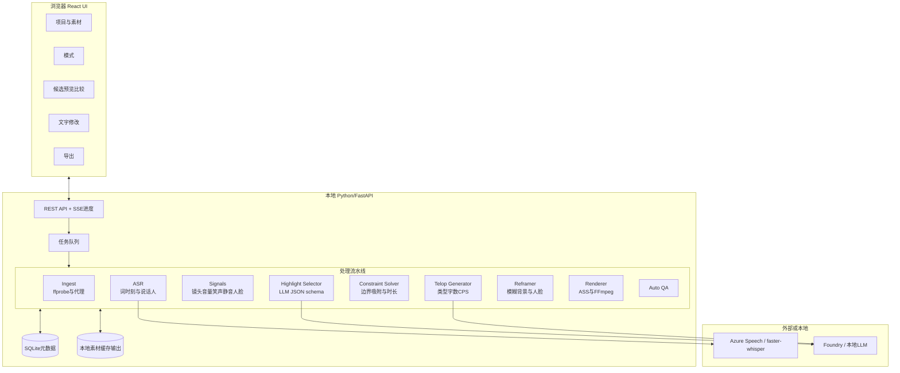
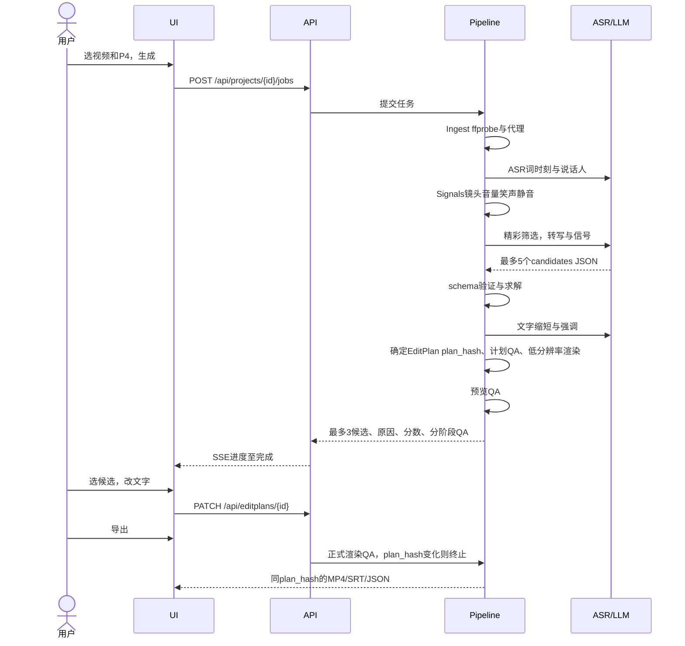
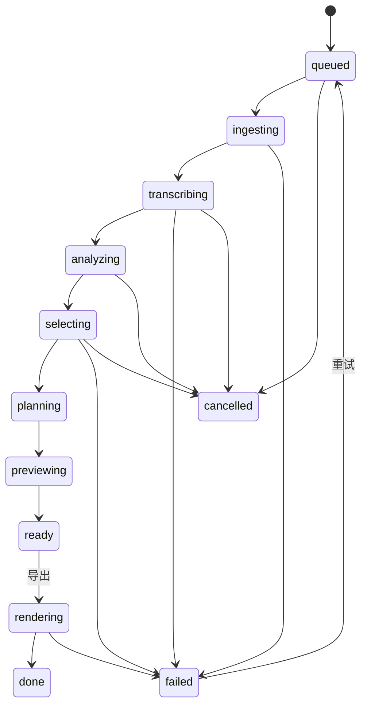
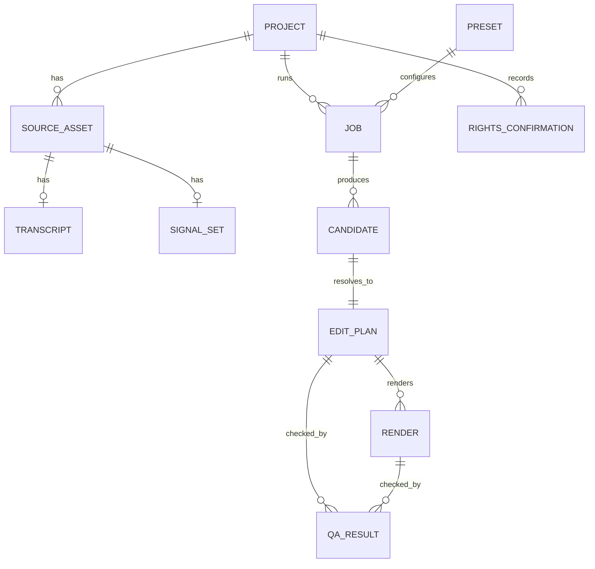

# VideoCreator — 产品需求定义（PRD）

[↑ 文档导航](../README.md) | [日本語](../../../docs/PRD.md) | [English](../../en/docs/PRD.md) | **简体中文** | [한국어](../../ko/docs/PRD.md)


| 项目 | 内容 |
|---|---|
| 文档 ID | VC-PRD-001 |
| 版本 | 1.2.7（可复制导出视频的投稿文案及带时间码章节） |
| 创建日期 | 2026-11-07 |
| 最后更新 | 2026-11-10 |
| 状态 | Draft，待评审 |
| 依据 | [VideoCreator 调研报告](VideoCreator-AnalyticsReport.md)，下称报告，节号表示为 `R§x.y` |
| 读者 | 产品负责人、开发者、QA、设计师 |

### 修订历史

| 版本 | 日期 | 更改 | 分类 |
|---|---|---|---|
| 1.0 | 2026-11-07 | 初版 | — |
| 1.1 | 2026-11-07 | 反映 v1.1 实现：修订 NFR-SEC-04（不使用 LLM 仍发送转写音频），新增 FR-SEL-10 筛选选择，开放 P1/P3/P8，提前提供 P5/P7（§17） | 反映实现 |
| 1.2 | 2026-11-08 | 反映审计：①US-11 改名“无 LLM 模式”，明确发送目标（NFR-SEC-04、AT-10、RK-06），完全离线在 v2 另定义；②QG-01 拆为流出、完成、数量、首次通过四指标并定义分母；③H-07 改为未出现词，新增发言对应 H-11、S-09、FR-REV-06、AT-13；④QA 增计划／预览／正式阶段及 `not_run`；⑤定义无法满足 CPS 时处理，SRT 为全文不受 CPS 限制；⑥候选最多三条，定义不足显示（AT-14）；⑦§5.2 增约束强度、来源、确认日，新增 C-8（超过一分钟 Shorts 版权声明）、S-10；⑧预先固定盲评分析（§15.2）；⑨用 EditPlan `plan_hash` 关联批准、QA、渲染、附属输出（FR-REV-07）；⑩扩充复现固定条件（NFR-REL-04）；⑪文档管理，两个依据链接、§17 提前提供标记、在 §7.4 定义历史中已有但未定义的 FR-SEL-10 | ①不调用 LLM 但发送转写音频、⑨批准失效 `CandidateApproval.PlanHash` 和 FR-SEL-10 反映已实现内容，其他为新需求 |
| 1.2.1 | 2026-11-08 | 实现验证无 LLM 名称、ASR／认证目标显示、QA 阶段／not_run／内容哈希、字幕延长 0.5 秒上限及片段边界、解码帧比较与复现记录。静态链接未公开的库版本以可执行文件 SHA-256 固定。§15.6 增质量目标未校正及发货阻塞条件 | 反映实现验证。指定语料 AT-01、真实云通信 AT-10、质量门槛未通过（[验证报告](IMPLEMENTATION.md) §2.1） |
| 1.2.2 | 2026-11-08 | 授权的 18 分钟真实视频两模式均完成 P4，区分 ASR/LLM HTTP 方法路径验证 AT-10；应用进程环境抑制认证子进程 Azure CLI 遥测 | 此 Azure CLI 配置 AT-10 通过，AT-01、AT-13～15、质量门槛仍未通过（[真实通信验证](IMPLEMENTATION.md) §2.2） |
| 1.2.3 | 2026-11-09 | 实现 H-11 发言对应、S-09 否定丢失、拒绝过短与不足说明、批准／QA／输出失效、拒绝并隔离渲染竞争，原摄像机／章节检查拆为 S-13／S-14 | AT-13～15 通过指定反例、真实 FFmpeg/API、Edge UI fixture。按用户指示 AT-01 保留未完成；QG-01～04 缺真实语料、独立评价表、参照标签，未通过，不改阈值分母（[本次验证](IMPLEMENTATION.md) §2.3） |
| 1.2.4 | 2026-11-10 | 针对无法修复的问题也显示“修复此项”：①新增 FR-REV-11 执行前判断及按钮、FR-REV-12 不可修复原因；②FR-REV-09 按词而非字幕 ID 判采纳；③§13.3 定义建议与分类，补定义已实现 S-11、S-12，Q-9 记录 S-11 来源未定；④新增 AT-16 修复承诺与结果一致、AT-17 逐字保持；⑤§15.6、Q-8 记录 S-01 每秒六字与真实语速差 | ①～④反映实现，AT-16/17 自动测试通过；⑤不改标准（[验证报告](IMPLEMENTATION.md) §17） |
| 1.2.5 | 2026-11-10 | 同一 Job 多候选或系列，“5 检查修改”逐条，“6 导出”批量。①增 US-13；②增 FR-REV-13 顺序、FR-REV-14 进度、FR-EXP-05 全件预验证、FR-EXP-06 列表与位置保存；③§10 补已实现候选批准／批导 API、E-NOT-APPROVED／E-EXPORT-BUSY、exports 阶段；④更新 SC-5～7；⑤增 AT-18 界面流程、AT-19 全件预检；⑥增 Q-10 错误码统一 | ②～⑤反映实现，AT-18 Edge UI fixture/API mock、AT-19 真实 Kestrel/FFmpeg 测试通过；⑥记录不改行为（[验证报告](IMPLEMENTATION.md) §18） |
| 1.2.6 | 2026-11-10 | Q-10 决定 b，批量错误码与单独 `POST /api/editplans/{id}/render` 对齐：①逐候选同序判未批准→批准后修改→硬失败→导出中，detail 带同单导 code，硬失败带结果，导出中带 render_id；②状态码取所有候选最优先命中，单选等同单导；③更新 FR-EXP-05、§10、E-NOT-APPROVED、AT-19、Q-10 | ①②代码更改，不改全件验证任一失败则零启动及原因列表，AT-19 真实 Kestrel/FFmpeg 通过（[报告](IMPLEMENTATION.md) §18） |
| 1.2.7 | 2026-11-10 | 完成页可复制介绍精彩内容的 YouTube／Microsoft Viva Engage 文案及 `00:00 章节标题`。①增 US-14 与 §4.1 Should；②官方原文确认 C-9 章节；③增 FR-EXP-07 文案章节、08 AI 安全、09 重写，FR-EXP-03 仅传屏蔽后转写；④§10 增 GET/POST post；⑤更新 SC-7；⑥增 AT-20 规则、AT-21 实际时刻界面；⑦增 Q-11 Engage 时间码和 Shorts 章节 | ①～⑥反映实现；③修复向 LLM 发送屏蔽前转写问题；AT-20 PostCopyTests 通过，AT-21 授权真实 541.6 秒视频正式输出和真实 Edge 通过；⑦未确认，界面称“目录”不作断言 |

---

## 目录

1. [背景与目的](#1-背景与目的)
2. [术语](#2-术语)
3. [用户画像与用例](#3-用户画像与用例)
4. [范围](#4-范围)
5. [前提约束与依赖](#5-前提约束与依赖)
6. [系统概要与架构](#6-系统概要与架构)
7. [功能需求](#7-功能需求)
8. [编辑模式预设规格](#8-编辑模式预设规格)
9. [数据模型](#9-数据模型)
10. [API 规格](#10-api-规格)
11. [UIUX 需求](#11-uiux-需求)
12. [非功能需求](#12-非功能需求)
13. [自动 QA 规格](#13-自动-qa-规格)
14. [验收标准](#14-验收标准)
15. [KPI 与评价计划](#15-kpi-与评价计划)
16. [风险法务与伦理](#16-风险法务与伦理)
17. [发布计划里程碑](#17-发布计划里程碑)
18. [未决事项](#18-未决事项)
19. [可追溯性报告与需求](#19-可追溯性报告与需求)
20. [附录](#20-附录)

---

## 1. 背景与目的

### 1.1 背景

- 从一小时以上直播存档、对谈、授课、Vlog 素材制作约 30 秒 YouTube Shorts/TikTok 竖屏视频，人工每条需数小时。
- 报告发现热门编辑可分为**可测变量**（R§0、R§3）：
  - 开头钩子秒数
  - 再次吸引间隔
  - 镜头长度与一致性
  - 文字字数、速度、大小、位置
  - 响度
  - 循环结构
- 固定为**预设编辑模式**后，可由 AI 与确定性渲染器组合自动化（R§5）。

### 1.2 产品愿景

> **“只需选视频、选模式，就得到有趣的短视频候选。”**

### 1.3 目标（Goals）

| ID | 目标 | 测量 |
|---|---|---|
| G-1 | 一个长视频自动生成可公开竖屏候选 | 任务完成率、数量满足率、修正前 QA 通过率 QG-01、采纳率 §15 |
| G-2 | 预设重现高娱乐性的钩子、节奏、文字、循环 | 盲测成对比较胜基线 §15.2 |
| G-3 | **可靠**满足时长、比例、安全区、音量 | 导出硬约束违规零件，対象为 §5.2 官方／自定必需 |
| G-4 | 无需高级技巧，只选择、检查、修改 | 完成操作次数和时间 §15.3 |
| G-5 | 保护权利、AI 披露、事实准确 | 权利确认完成率；自动 H-07/H-11 零违规及人工审计 AT-13 反例、成品抽查零事实错误，两者并用，自动检测不保证准确 |

### 1.4 非目标（Non-Goals）

| ID | 不做什么 | 原因 |
|---|---|---|
| NG-1 | 多轨、关键帧、调色等专业时间线 | 无高级编辑要求，不与专业 NLE 竞争 |
| NG-2 | AI 合成本人声脸令其说未说的话 | 伦理及 YouTube AI 披露 R§2、5.7 |
| NG-3 | 下载他人视频或 URL 生成 | 条款与版权 R§1.3、5.7 |
| NG-4 | v1.0 自动投稿社交平台 | API 审核、账户风险，v2 后考虑 |
| NG-5 | 攻略推荐算法或保证爆红 | 内部不公开，争取指标改善但不保证 |

---

## 2. 术语

| 术语 | 定义 |
|---|---|
| 源视频 | 用户选择的输入文件 |
| 项目 | 一次编辑工作，汇集至少一个源视频和结果 |
| 编辑模式／预设 | 编辑规则参数集合 P1～P9，§8 |
| Candidate | AI 选定精彩区间集合、分数和原因 |
| EditPlan | 求解器确定、**可确定性渲染**的编辑指示，类似 EDL，§9.3 |
| 渲染 | EditPlan 经 FFmpeg 生成视频 |
| 屏幕文字 | 视频文字总称，①～⑥，§7.6 |
| Safe Zone | 不被竖屏平台按钮、说明等遮盖区域 R§2.1 |
| 钩子 | 开头促进继续看的结果、异常、问题、强主张 |
| 循环 | 结尾在语义或视觉接开头 |
| CPS | Characters Per Second，字幕显示速度 |
| LUFS / dBTP | ITU-R BS.1770 响度／True Peak |
| ASL | 平均镜头长度 |
| 推近 | 约 1.1～1.2 数码变焦，模拟换摄像机 |
| 无 LLM 模式 | US-11，不用 LLM 筛选和生成文字，但向默认 Azure Speech ASR 发送转写音频。兼容配置键仍为 LocalOnly |
| 完全离线模式 | ASR 和 LLM 均本地，零外发，v2 定义 §4.1 Could |
| plan_hash | EditPlan 规范 JSON SHA-256（EditPlanFingerprint），关联批准、QA、渲染、附属输出，§9.3 |

---

## 3. 用户画像与用例

### 3.1 用户画像

| ID | 用户 | 情况 | 需求 | 模式 |
|---|---|---|---|---|
| PS-1 | 游戏／闲聊个人主播 | 每周 2～3 小时存档 | 快剪笑点反应为 Shorts | P4,P1,P3 |
| PS-2 | 商业频道运营 | 每周一小时对谈授课，多机位 | 要点文字剪辑及摄像机切换 | P4,P6,P7 |
| PS-3 | 烹饪、DIY、旅游创作者 | 长工序素材 | 压缩节奏与原声 | P8,P5,P9 |
| PS-4 | 企业公关营销 | 研讨会和活动 | 不损品牌且文字准确 | P4,P6 |

### 3.2 用户故事

| ID | 故事 | 优先 |
|---|---|---|
| US-01 | PS-1 选两小时存档和精华模式，最多三个 30 秒候选，免人工搜索；不足时知数量与原因 | Must |
| US-02 | 所有人查看**为何选中**的原因分数，快速判断 | Must |
| US-03 | 所有人轻松仅改错字，不操作时间线 | Must |
| US-04 | 所有人希望保证 Shorts/TikTok 时长、比例、音量、不遮字幕 | Must |
| US-05 | PS-2 选双摄像机与一音频，按说话人自动切 | Should |
| US-06 | PS-1 要综艺吐槽，但公开前必检查不当表达 | Should |
| US-07 | PS-3 选择无文字无 BGM、仅环境音 | Should |
| US-08 | 所有人用更短、其他场景等指示重生成 | Should |
| US-09 | PS-4 要保证文字专名数字匹配原发言 | Must |
| US-10 | 所有人保存视频、SRT、编辑计划 JSON | Must |
| US-11 | 所有人处理机密素材可不用 LLM，预知外发数据与目标（仅转写音频） | Could |
| US-12 | PS-2 也要长片转 3～5 分钟横屏摘要 | Could |
| US-13 | 同模式多个候选／前后篇时逐条检查批准再批导，避免丢失检查／导出进度 | Should |
| US-14 | 导出后可直接复制精彩、有趣的 YouTube／内部 Viva Engage 文案与 `00:00 章节标题`，免从头撰写和手拾时间 | Should |

---

## 4. 范围

### 4.1 MoSCoW

| 分类 | 范围 |
|---|---|
| **Must，MVP v0.1～v1.0** | 单素材、转写、信号、LLM 精彩、求解、9:16 模糊背景、文字①②④、ASS、loudnorm、QA、最多三预览、文字修改、MP4/SRT/JSON；**P4**、P6、P2 |
| **Should，v1.x** | 人脸跟随、③吐槽⑤拟声⑥计数、BGM 闪避／音效、重新生成指示、同 Job 逐条检查批导 US-13（不同于 Could 批处理）、文案章节复制 US-14，不实际投稿；P1/P3/P7/P8/P9 |
| **Could，v2** | P5、横屏、完全离线本地 ASR＋LLM 零外发、多模态、批处理。历史“英语 UI／字幕未来支持”已由 A-3、Q-5 四语言实现更新；字幕不自动翻译 |
| **Won't** | NG-1～5 |

### 4.2 支持输入输出

| 分类 | 规格 |
|---|---|
| 输入容器 | MP4,MOV,MKV,WebM |
| 输入编码 | H.264,H.265/HEVC,VP9,AV1,ProRes，FFmpeg 可解码 |
| 输入分辨率 | 720p～4K，4K 内部降至 1080p |
| 输入时长 | 10 秒～3 小时，超过三小时警告建议拆分而非报错；短于预设下限或场景不足可少于三候选，FR-SEL-08 |
| 输入音频 | 必需，无声除 P9 外警告 |
| 输出画面 | H.264 High、1080×1920、源 fps 最大60默认30、CRF18～20、+faststart |
| 输出声音 | AAC-LC、48kHz、立体声、192kbps、−14±1 LUFS、TP≤−1 dBTP |
| 附属 | SRT 全文（不同于烧录①，不受 S-01）、EditPlan JSON、三 PNG，全部来自同 plan_hash |

---

## 5. 前提约束与依赖

### 5.1 前提（Assumptions）

| ID | 前提 | 确认 |
|---|---|---|
| A-1 | 仓库无既有应用，新开发 | 2026-11-07 仅 LICENSE 与 work/ |
| A-2 | **本地 Web 应用**，浏览器＋本地 API，避免上传巨大素材 | Q-1 最终决定 |
| A-3 | UI／文档日、英、简中、韩；项目视频语言独立传到 ASR、逐字字幕、装饰文字、渲染、投稿，不自动翻译字幕 | Q-5 |
| A-4 | 生成 AI 位于**可替换提供程序抽象层**后，默认 Speech＋Foundry | Q-2 |
| A-5 | 仅用户自有或授权素材 | FR-ING-06 |

### 5.2 约束强度与来源

分四类，只有官方必需和自定必需可作硬 QA（H-*）。外部标准或建议假设，只有说明理由采纳为自定必需后可硬性化。

- **官方必需**：平台规定，违规可能不分发、被封锁。
- **他方标准**：其他公司或行业交付标准，不自动约束本产品。
- **自定必需**：产品自行品质保证条件，硬 QA。
- **建议／假设**：经验或二手数值，§15.5 校正。

| ID | 约束 | 分类 | 来源与确认日 |
|---|---|---|---|
| C-1 | Shorts 竖／正方形，最多180秒，2024-10-15后上传 | 官方 | YouTube15424877，2026-11-08 原文，R§2 S1 |
| C-2 | Shorts 每曲最多90秒，部分60/30 | 官方 | 同上 |
| C-3 | 烧录①默认每行≤14全角、最多2行、≤6字秒；参考 Netflix13字、2行、4字秒后为竖屏快节奏放宽；S-02/S-01为软 | 参考外部的自定 | Netflix，R§2/3.3 S5 |
| C-4 | 1080×1920 正文避顶250、底580、右160、左60px，标题可顶300。平台无官方像素，是多资料保守概算（报告底580～670、右160～190）；H-05采纳自定必需 | 建议转自定必需 | R§2.1 S11/S12 二手 |
| C-5 | −14±1LUFS、TP≤−1dBTP；YouTube降过大不升过小，避免过小，H-03/04 | 建议转自定必需 | R§2/3.4 S7 二手 |
| C-6 | 写实 AI 生成修改时提醒投稿披露 AI use | 官方 | R§2 S9 |
| C-7 | Shorts 不支持 A/B，效果用准实验 | 官方评价限制 | R§6.3 S10 |
| C-8 | 超过一分钟 Shorts 有效版权声明（含 Content ID／人工）将全球封锁，无播放推荐盈利；一分钟以下不变 | 官方 | YouTube15424877，2026-11-08原文 |
| C-9 | YouTube 描述章节从00:00，至少3个升序，每章≥10秒，否则不作为章节 | 官方 | YouTube9884579，2026-11-10原文 |

> C-8 因此超过60秒（P9最大90）且含用户音乐等第三方素材，S-10 警告。平台会变 RK-07，更新官方行确认日。

### 5.3 外部依赖

| ID | 依赖 | 用途 | 替代 |
|---|---|---|---|
| D-1 | FFmpeg7.x+，附win-x64/arm64/macOS/Linux | 解码分析合成编码 | 无，必需 |
| D-2 | Azure Speech 批转写、词时刻、说话人 | ASR | 本地 faster-whisper |
| D-3 | Foundry 支持 JSON schema 的 LLM | 精彩筛选缩短文字 | OpenAI兼容本地，Could |
| D-4 | PySceneDetect AdaptiveDetector | 镜头边界 | FFmpeg `select='gt(scene,x)'` |
| D-5 | MediaPipe等人脸检测 | 跟随，Should | 模糊背景，Must |
| D-6 | 可分发烧录日文字体，如Noto Sans JP/M PLUS | 文字 | OS Yu Gothic UI等，需查许可 |

> 报告验证用 Windows Yu Gothic UI（R§5.5），产品附**可再分发 OFL**，Q-6。

---

## 6. 系统概要与架构

### 6.1 设计原则

| ID | 原则 | 原因 |
|---|---|---|
| AP-1 | **AI 决策，渲染器确定性制作**，LLM落实EditPlan，渲染仅以其为输入 | 复现、测试、人工修改 |
| AP-2 | **非 LLM 独断**，结合音量、笑声、镜头数值 | 抑制幻觉 R§5.3 |
| AP-3 | **代码保证硬约束**，求解QA强制时长比例安全音量，不靠提示。CPS字数尽量整形，剩余S-01/02警告交用户，优先忠实 | G-3,C-3 |
| AP-4 | **抽象提供程序**，ASR/LLM/人脸置接口后 | 避锁定，无LLM及未来离线 |
| AP-5 | **阶段缓存**，转写信号一次，换预设复用 | 性能费用 |

### 6.2 组件架构

此为需求中的建议架构；实际 C#/.NET 实现参见[技术参考](../users-guide/technical-reference.md)。



### 6.3 P4 处理顺序



### 6.4 任务状态



---

## 7. 功能需求

ID 格式 `FR-<领域>-<编号>`，M=Must、S=Should、C=Could。

### 7.1 项目与素材导入（ING）

| ID | 需求 | 优先 | 依据 |
|---|---|---|---|
| FR-ING-01 | 用户可以选择一个或多个本地视频文件创建项目。 | M | R§5.1 |
| FR-ING-02 | 使用 ffprobe 获取时长、分辨率、帧率、声道及旋转元数据；超出 §4.2 支持范围时，附具体原因拒绝或警告。 | M | §4.2 |
| FR-ING-03 | 生成约 720p 的分析用视频代理和 16kHz 单声道 WAV，并缓存这些产物。 | M | AP-5 |
| FR-ING-04 | 对可变帧率 VFR 输入，在分析前进行归一化，以便按固定帧率处理。 | M | R§5.5 timebase |
| FR-ING-05 | 多素材通过音频互相关自动同步，并以毫秒显示偏移量。 | S | R§3.6 |
| FR-ING-06 | 必须勾选“拥有素材权利或已获得许可”，并保存确认记录。 | M | R§5.7,A-5 |
| FR-ING-07 | 重新导入哈希相同的文件时，复用其分析缓存。 | S | AP-5 |
| FR-ING-08 | 每次生成可选复用缓存（默认），或从最初步骤重新执行全部分析。重新分析前必须说明增加的费用，以及已手动修正的转写会被覆盖。 | S | AP-5 |

### 7.2 转写（ASR）

| ID | 需求 | 优先 | 依据 |
|---|---|---|---|
| FR-ASR-01 | 每个词附开始和结束时刻；日语可采用词素或字符串单位。 | M | R§5.3-1 |
| FR-ASR-02 | 支持最多四名说话人的分离，并为每段发言附说话人 ID。 | M | R§3.6 |
| FR-ASR-03 | 日语转写缺少标点时，以 LLM 或规则重新估计句子边界。 | M | R§5.3-1 |
| FR-ASR-04 | 可通过配置在 Azure Speech 和 faster-whisper 之间切换。 | M | AP-4,D-2 |
| FR-ASR-05 | 用户可以注册专有名词、产品名称词典，用于 ASR 短语提示和文字比对。 | S | US-09 |
| FR-ASR-06 | 界面显示可编辑的转写，允许用户手动修正识别错误。 | S | US-03 |

### 7.3 信号提取（SIG）

| ID | 需求 | 优先 | 依据 |
|---|---|---|---|
| FR-SIG-01 | 使用 PySceneDetect AdaptiveDetector 检测镜头边界，默认 `adaptive_threshold=3.0`、`min_scene_len=15` 帧。 | M | R§5.3,S24 |
| FR-SIG-02 | 每 100ms 计算短时 RMS 或 LUFS-M，输出时间序列及音量急升点。 | M | R§5.3-2 |
| FR-SIG-03 | 检测低于 −40dBFS 的静音区间，最短持续长度由 §8 预设指定。 | M | R§3.2 |
| FR-SIG-04 | 通过声学事件分类器检测笑声、欢呼和掌声。 | S | R§5.3-2 |
| FR-SIG-05 | 根据 ASR 结果计算每秒字数，输出语速时间序列。 | S | R§5.3-2 |
| FR-SIG-06 | 以 2fps 采样人脸位置与数量，并保存为时间序列。 | S | R§5.3-6 |
| FR-SIG-07 | 将前 N 个峰值的时刻和类型汇总为 JSON，作为不超过 token 限额的 LLM 输入摘要。 | M | R§5.4 |

### 7.4 精彩筛选（SEL）

| ID | 需求 | 优先 | 依据 |
|---|---|---|---|
| FR-SEL-01 | 向 LLM 输入带时间戳转写、信号摘要和模式规则，按 §20.2 schema 返回最多五个候选。 | M | R§5.4 |
| FR-SEL-02 | 验证 LLM 响应；失败时最多重试两次，仍失败则回退到音频峰值前后各 15 秒的信号候选。 | M | AP-2 |
| FR-SEL-03 | 输入超出上下文限制时，按约十分钟分块生成候选，最后进行全局重新排名，采用 map-reduce。 | M | 超一小时输入 |
| FR-SEL-04 | 每个候选给出 hook、standalone、payoff、emotion 四项 0～10 分，以及一句选择理由。 | M | R§5.4,US-02 |
| FR-SEL-05 | 将 LLM 分和信号分合成为最终分，默认权重分别为 0.6、0.4，可配置。 | M | AP-2 |
| FR-SEL-06 | 若以“这个、那个”等指示词开头，或缺少前文背景就无法理解，则扣减 standalone 分。 | M | R§5.7 |
| FR-SEL-07 | 同时向 LLM 提供候选前后各 30 秒，检查切出后是否改变原意，改变时排除。 | S | R§5.7 |
| FR-SEL-08 | IoU>0.5重叠候选合并，不同场景**最多三件**。时长FR-SOL-03或质量不足不凑数，不用重叠／违规区间填满；显示实际数量原因，如10秒达不到P4最低25秒、仅一场景；零件E-SOL-INFEASIBLE | M | US-01 |
| FR-SEL-09 | 接受“更短”“换场景”“更好笑”等重新生成指示，并排除已经提供的候选后再筛选。 | S | US-08 |
| FR-SEL-10 | 长视频可选择节省、标准（默认）或全文模式；选择前分别显示发送给 AI 的量和预计费用。全文模式不做预筛，不受 NFR-COST-03 的减量目标限制。 | S | NFR-COST-01/03 |

### 7.5 约束求解（SOL）

| ID | 需求 | 优先 | 依据 |
|---|---|---|---|
| FR-SOL-01 | 在前后 1.5 秒的搜索窗口内，将区间端点吸附到最接近“句末”且同时符合“镜头边界或静音”的位置。 | M | R§5.3-4 |
| FR-SOL-02 | 确认剪切边界前后 150ms 内没有跨越边界的单词，禁止在词中剪切。 | M | R§5.6 |
| FR-SOL-03 | 总时长须落在预设范围内，如 P4 的 25～35 秒。过长时先移除低分句，过短时增加前后句。 | M | R§5.2 |
| FR-SOL-04 | 多区间时将 hook 分最高的片段移至最前作为冷开场；若改变顺序会改变含义，则保持时间顺序。 | M | R§3.1/5.3-4 |
| FR-SOL-05 | 预设开启静音剪切时，移除超过阈值的静音；剪切后的每个镜头仍须符合最短时长。 | M | R§3.2 |
| FR-SOL-06 | 开启循环时，以 LLM 判断末句与首句的语义连接，或用 SSIM 判断最后与最初画面的连接，选择评分较高的结束位置。 | S | R§3.5 |
| FR-SOL-07 | 求解器输出 §9.3 的 EditPlan；相同输入和配置必须得到相同 EditPlan，以保证确定性。LLM 调用不在这一确定性保证范围内。 | M | AP-1 |

### 7.6 屏幕文字生成（TEL）

类型 R§3.3：①发言字幕、②强调、③吐槽／内心话、④情境标题、⑤拟声／SE、⑥数字计数。

| ID | 需求 | 优先 | 依据 |
|---|---|---|---|
| FR-TEL-01 | 从 ASR 生成①发言字幕。每行字数上限采用预设值，默认十四字；竖屏默认一行，最多两行。 | M | C-3 |
| FR-TEL-02 | ①**逐字保留发言**。生成和自动修复都不得改写、摘要、省略、删除词语；迟疑、句尾语、附和、重复也必须保留，只有显式配置的屏蔽词及显示用标点、空白整形例外。为了接近预设显示速度上限（默认每秒六字），在保留词语及顺序的前提下分割、合并、调整边界或延长显示。最多延长到发言结束后 0.5 秒，不与下一字幕重叠，也不超出视频区间。无法解决时不删字幕，以 S-01 警告并显示不能修复的原因。用户知悉警告仍导出时，将此事实记入 EditPlan 的 provenance。SRT（§4.2）也输出字幕全文。装饰文字、卡片与发言字幕区别处理，优先外观；AI 可在保留事实、依据、否定的前提下修改，但须人工批准。 | M | C-3,AP-3,S5 |
| FR-TEL-03 | 在标点、文节边界换行，不在助词、助动词之前换行，遵守日语换行规则。遵守 JIS X 4051 行首禁则（闭括号、标点、小假名、长音等）、行尾禁则（开括号等）及不可拆分规则（数字和单位、英文单词、片假名单词）。每条字幕的长度须同时符合预设上限及字体、长体、描边、安全区域决定的实际绘制宽度上限，并考虑文节、换气间隔、最短显示时间 0.8 秒后自动选择。单个词超出上限时不拆词，而缩小字体。 | M | R§3.3 |
| FR-TEL-04 | ②强调文字：LLM 为每个候选提取最多三个关键词，在选段中每个出现位置显示。强调较少的区间，从发言原文补充短语，以约四秒间隔为目标；不增加静音区、与字幕相同的句子或重复显示。颜色、大小按预设，并使用弹出动画。 | M | R§3.3 |
| FR-TEL-05 | ④标题：为每个候选生成十六字以内标题，带框显示在画面上部、距顶部 300px 处。 | M | R§3.3 |
| FR-TEL-06 | ③吐槽文字：只在 P1、P3 用户显式启用时生成。生成内容初始为**未批准**，用户批准前不得导出。 | S | R§5.7,US-06 |
| FR-TEL-07 | ⑤拟声／SE 文字：对笑声、惊讶、静音（如“シーン…”）的信号区间，从预设词典选择文字，并同步对应效果音。 | S | R§3.3/3.4 |
| FR-TEL-08 | ⑥计数器：用 LLM 提取转写中的数值、天数、金额，以“DAY 3”“¥1,000,000”等形式显示。 | S | R§3.1 |
| FR-TEL-09 | **未出现词检查**：②③④⑥中的数字、专名必须存在于原转写或用户词典；不存在则自动移除并警告。此检查只能检出捏造词语，不能保证与发言内容一致；后者由 FR-TEL-12、FR-REV-06 检查。 | M | R§5.6,US-09 |
| FR-TEL-10 | 统一颜色含义：白色为发言、黄色为强调、红色为惊讶或警告、浅蓝为补充。P7 可以固定各说话人的字幕颜色。 | M | R§3.3 |
| FR-TEL-11 | 将文字样式保存为主题，以便跨项目复用。 | C | — |
| FR-TEL-12 | **与发言对应**：②④⑥中含数字、专名者，必须以 `source_word_ids` 关联依据发言，且发言必须位于候选区间内。(a) 正规化后的数字、专名确实出现在所关联发言中，仅出现在转写其他位置或词典中不合格；(b) 数字、单位、对象（如 A／B 公司）的组合与发言一致；(c) 带说话人属性的文字（如 P7 说话人色）与关联发言的说话人一致；(d) 发言有“ない”“ず”“ません”“じゃない”等否定而文字遗漏时，以 S-09 警告。③吐槽不是发言摘要，不受 (a)～(c) 约束，改由 FR-TEL-06 的批准保证。ASR 误识别导致发言缺词时，先按 FR-ASR-06 修正转写，再重新评价。 | M | US-09,G-5,RK-03 |
| FR-TEL-13 | **避脸布局**：新生成计划中，②～⑥和钩子采用固定位置，在整个显示期间不与检测到的人脸、字幕、其他装饰文字重叠。也分析竖屏素材，并考虑跟随裁剪、缩放、速度、切换、画中画。为人脸移动范围保留 32px 余白，并计入弹出动画最大 1.12 倍放大。分析信息不足或没有安全位置时，只隐藏装饰文字，在候选备注说明原因；不改变①字幕及 SRT 的正文、时刻。脸检测为 2fps 推估，不能完全保证不漏检或覆盖急速动作。已有计划需重新生成才能应用。 | M | US-07,FR-TEL-02 |

### 7.7 重构（RFM）

| ID | 需求 | 优先 | 依据 |
|---|---|---|---|
| FR-RFM-01 | 以模糊背景方式将 16:9 素材转为 9:16：背景放大、裁剪并应用 `boxblur(20:2)`；前景缩小到宽 1080，置于中心上方 120px。 | M | R§5.5A |
| FR-RFM-02 | 人脸跟随裁剪：单脸区间以脸为中心做 9:16 裁剪。用至少一秒移动平均和最大速度限制平滑位置，只有镜头边界可以瞬间移动。 | S | R§5.3-6 |
| FR-RFM-03 | 两张以上人脸或检测不到脸的区间，自动回退到模糊背景方式。 | S | R§5.3-6 |
| FR-RFM-04 | 素材已经是 9:16 或 1:1 时，不重新构图，直接装入 1080×1920；1:1 在上下添加背景。 | M | C-1 |
| FR-RFM-05 | 推近：在预设指定区间，如强调词发言时、第二区间以后，应用 1.10～1.20 倍缩放。 | M | R§3.2/5.5A |

### 7.8 多素材切换（SWT）— P7

| ID | 需求 | 优先 | 依据 |
|---|---|---|---|
| FR-SWT-01 | 可为各摄像机分配说话人或麦克风；支持依说话人分离和人脸位置自动分配，也可手动修正。 | S | R§3.6 |
| FR-SWT-02 | 选择正在讲话者的机位，每个镜头最短保持默认 2.0 秒，可设为 1.5～2.5 秒。 | S | R§3.6 |
| FR-SWT-03 | 听者出现笑声、惊讶等声学或表情事件时，插入 0.8～1.5 秒反应镜头。 | S | R§3.6 |
| FR-SWT-04 | 已分配全景机位时，在每节开头及默认每 45 秒插入全景镜头，间隔可设为 30～60 秒。 | S | R§3.6 |
| FR-SWT-05 | 默认硬切；交叉淡化（0.2～0.4 秒）只用于场景转换。 | S | R§3.6 |
| FR-SWT-06 | 全程使用用户指定的一条主音轨，不随机位切换音频。 | S | R§3.6 |
| FR-SWT-07 | 使用 `xfade` 时，两侧输入均通过 `settb=AVTB,fps=<输出fps>` 正规化。 | S | R§5.5C 实际发生的故障 |

### 7.9 音频（AUD）

| ID | 需求 | 优先 | 依据 |
|---|---|---|---|
| FR-AUD-01 | 通过 `loudnorm` 将输出音频正规化为 −14 LUFS、TP −1.5 dBTP、LRA 11，建议两遍处理。 | M | C-5 |
| FR-AUD-02 | 可添加用户准备或随附授权库的 BGM。同一项目可批量注册多首曲目，注册时逐曲用 FFmpeg `ebur128` 测量 ITU-R BS.1770／EBU R128 响度、去除开头结尾静音和淡变后的可用区间、节奏、谱通量 onset、谱质心亮度。依据转写单词时刻提前 0.25 秒降低 BGM，短于 0.8 秒的词间空隙继续保持降低，使讲话期间“人声 − BGM”响度差达到目标，标准 14 LU、下限 10 LU（Torcoli 等，JAES 2019，建议 Commentary over Music 至少 10 LU）。按各曲响度补偿曲间音量差；人声较弱或音乐高涨处进一步降低。旧计划继续使用原有 `sidechaincompress`。 | S | R§3.4/5.5D |
| FR-AUD-08 | “根据场景自动选择”：按视频自身的角色切换、场景转换卡、章节、交叉淡化、源视频跳跃，将正文分为至少二十秒的场景。用 Viterbi 动态规划，根据场景势头（语速、声音大小、笑声）与音乐势头（节奏、onset、亮度）的接近程度，加上换曲成本，逐场选曲。换曲采用等功率交叉淡化；BGM 停止的插入物中，交叉须在插入物内完成。相同曲目连续场景继续播放，只在可用区间内循环。显示测量值和选择理由。 | S | R§3.4 |
| FR-AUD-09 | 在导出前检查页，可逐场改变曲目（包括恢复自动、无 BGM）、音量（−12～+6 dB），以及全片“讲话时与人声的响度差”（10～30 LU）、“无声处 BGM 大小”（比人声低 0～30 LU），并记入计划。预览与正式导出，用同一流程生成的人声、BGM 音轨通过 `ebur128` 实测，以 S-15 显示讲话期间的响度差。 | S | US-02 |
| FR-AUD-03 | 与⑤文字同步插入随附效果音，并注明许可。 | S | R§3.4 |
| FR-AUD-04 | 可以在包袱前加入静音演出，使 BGM 静音 0.3～1.0 秒。 | C | R§3.4 |
| FR-AUD-05 | 不自动添加商业曲目；用户添加的曲目须确认使用权利。 | M | C-2,R§5.7 |

### 7.10 渲染与导出（RND / EXP）

| ID | 需求 | 优先 | 依据 |
|---|---|---|---|
| FR-RND-01 | EditPlan生成ASS和filtergraph，单次FFmpeg渲染 | M | R§5.5 |
| FR-RND-02 | 540×960 ultrafast预览，目标每候选15秒内；不满足正式§4.2，正式才可测项not_run | M | US-02 |
| FR-RND-03 | 正式渲染遵§4.2 | M | §4.2 |
| FR-RND-04 | 任务日志保存FFmpeg命令版本stderr，供复现排障 | M | AP-1 |
| FR-EXP-01 | 输出MP4、SRT、计划JSON、三PNG，全部同正式EditPlan plan_hash，JSON含hash | M | US-10,FR-REV-07 |
| FR-EXP-02 | 文件名 `<项目名>_<模式ID>_<候选号>_<YYYYMMDD-HHMM>.mp4` | M | — |
| FR-EXP-03 | 导出文本元数据含三标题、描述、标签、源链接填写栏。LLM仅收到应用Job屏蔽词后的转写 | S | R§2 S2 |
| FR-EXP-04 | 写实AI修改如生成镜头时显示“需要披露AI use” | M | C-6 |
| FR-EXP-05 | **批量导出**：同Job一请求多条。①启动前全件按单导相同序：未批准→hash变化→计划硬失败→导出中；任一则零启动，逐视频原因code，同单导§10.1 Q-10。②按排名／部分顺序串行正式，不并发。③用受理时EditPlan，拒等待／执行中计划和批准修改FR-REV-07。④可单取消等待，执行中不停止避免残片。⑤个别失败取消不阻其他，逐条结果。⑥遵EXP01～03文件不重名 | S | US-13,REV07,REL01 |
| FR-EXP-06 | **导出列表**：“6”列Job全部视频状态，默认选批准未导出，按EXP05批导；逐条进度结果链接。保存exports阶段含Job供下次恢复，不保存选择组合 | S | US-13,UX05 |
| FR-EXP-07 | **文案章节**：正式完成生成三类存`<视频名>.post.json`，在metadata.md末尾便于粘贴追加；SC7分别显示文本、复制、字数。①YouTube≤5000：≤60字有趣开头（更多前可见）→介绍→2～3亮点→章节→呼吁观看→≤5标签，≤3分竖屏加#Shorts。②Engage≤10000：≤80字礼貌亲切同事推荐→介绍→亮点→目录→≤3主题标签。③每行00:00标题，**应用算时刻，不让AI写**，使用成品时间含片头卡片片尾；章为片头、正文（系列章／非系列场景卡或素材切换）、片尾，吐槽卡只偏移不成章。首00:00，<10秒并邻、末尾<10秒去除以满足C9；<3章等则不加并说明。Engage目录不受C9，但<3秒合并。优先计划已有卡文字、系列章、片头尾；仅未作为画面标题显示且标题为发言原文如“开始拍了”的系列章或无标题章，使用≤20字AI标题 | S | US14,C9,§4.2 |
| FR-EXP-08 | **文案安全**：①仅屏蔽后转写和章发言给LLM；②逐项检查，只用通过者，五类拒绝：超字数、URL、时间码、屏蔽词、转写无的数字／片假名／英文字，章标题仅章内词；③提示禁止不符煽动如“震惊”“慎看”和断言夸张；④拒绝导致任一普通／内部开头／介绍为空或亮点不足2时附原因仅重写一次，保留通过部分补不足；⑤不用词原因先屏蔽再显示警告；⑥无LLM、失败、格式错则按标题章模板，不令导出失败。汉字专名不在②检测，用户投稿前查 | S | US14,REV06,SEC04,H10,NG2 |
| FR-EXP-09 | **其他方案**：完成页按EXP07/08重写覆盖post.json，传上次YouTube描述，在相同事实范围换亮点角度、开头、表达，章时间不变。界面直接改文是复制对象，不因导出进度刷新消失 | S | US14 |

### 7.11 人工检查修改（REV）

| ID | 需求 | 优先 | 依据 |
|---|---|---|---|
| FR-REV-01 | 候选列表预览、四轴分、原因、分阶段通过／警告／失败／未执行 | M | US02 |
| FR-REV-02 | 列表直接改文，立即重评CPS字数安全区未出现词及发言对应H07/H11计划QA | M | US03 |
| FR-REV-03 | 起止前后±一句微调，不提供逐帧时间线 | S | NG1 |
| FR-REV-04 | 逐条或按类型批开关 | M | US07 |
| FR-REV-05 | 未批准吐槽存在则禁用导出 | S | R§5.7 |
| FR-REV-06 | ②④⑥含数字专名，与关联发言原文、说话人、时间并列，供确认 | M | G5,US09 |
| FR-REV-07 | **版本一致**：编辑变hash，旧批准／QA／渲染stale，重批重评重渲前禁导。正式渲染中变计划不发布该结果 | M | H08,AP1 |
| FR-REV-08 | 检查页右独立自动QA面板，逐失败警告显示成品时间码、字幕／文字／卡片对象、原因建议；选项定位预览并强调对应文字 | M | US02/03 |
| FR-REV-09 | **修复**：全局Copilot自动修复或逐项修复，先规则再LLM（Foundry/Copilot）改装饰卡词。每方案重跑全部计划QA，仅目标消失、其他不恶化、无新问题时采纳，记录provenance可撤销；不能修的保数量原因。①字幕分合改ID，按source_word_ids判采纳而非ID；受指词脱离问题且无新增问题词才算消失，方法§13.3 | M | US03,AP3,REV07 |
| FR-REV-10 | **范围**：①逐字保留，仅改显示时间、分段、前后合并，不改词顺序，不送LLM改写摘要省删。机械比较全文和源词序列，一致才采纳。装饰／卡优先外观可LLM改，但保事实依据否定，改文未批准待人工 | M | TEL02,G5,H08 |
| FR-REV-11 | **事前判定**：每次取得／编辑／修复／撤销后显示结果时，不执行修复，逐指摘用同候选标准预判，避免显示执行不一。rule／ai（仅配置LLM）／无三类。只有至少一可修指摘才有项按钮，多指摘列目标数；零显示不能自动修且无按钮；“可自动／AI修”亦至少一件。全局按钮下列项目数件数，零禁用。非保证，按钮写“N件目标”不称必修（前修可能占用空隙使后修失败） | M | US03,REV09 |
| FR-REV-12 | **不可修原因**：逐条原因，组内“不可自动N件”并按原因计数。S01按词时间算“发言每秒X字，延到前后空隙仍Y字，标准Z”，说明不改词最长仍超限。保留警告，不为减数量删词 | M | TEL02,REV09/11 |
| FR-REV-13 | **逐视频顺序**：Job≥2时①顶部前后／列表切换及i/N，列表状态REV14；②主“批准并下一个（名）”只批当前，找下个未批，到尾回头，不选当前；③批准后重读最新，其他页已批不再回，全部其他已批则“批准并进入导出”EXP06；④可批准回候选，单独立即导出为辅助；⑤同hash已批不重复；⑥计划硬失败全部批准按钮禁；⑦单条仍主批准并导出 | S | US13,REV07 |
| FR-REV-14 | **进度**：Job≥2候选含系列和导出列表显示批准n/N、已导m/N，逐条未检查／已批／需重批／导出中／已导，首未批准链接及导出入口。步骤检查链接首未批，导出链接列表；批准后改计划不计已批 | S | US13,REV07 |

---

## 8. 编辑模式预设规格

### 8.1 模式与默认值

目标值需校正，来自R§3.2经验，按§15.5校正。

| ID | 名称 | 秒 | 钩子上限秒 | 目标ASL秒※ | 去静音秒 | 推近 | 文字型 | 音 | 循环 | 发布 |
|---|---|---|---|---|---|---|---|---|---|---|
| P1 | 高能挑战 | 25–45 | 1.5 | 0.8–1.5 | 0.4 | 多 | ①②④⑤⑥ | 快BGM多SE | 可选 | v1.x |
| P2 | 一击循环 | 15–25 | 1.0 | 1.0–2.0 | 0.5 | 少 | ①② | 原声 | **必需** | MVP |
| P3 | 综艺文字 | 25–60 | 2.0 | 1.0–2.5 | 0.5 | 中 | ①②③④⑤ | 多SE | 可选 | v1.x |
| P4 | 长转30秒精华 | 25–35 | 2.0 | 1.5–3.0 | 0.7 | 中 | ①②④ | 原声可选BGM | 推荐 | **MVP** |
| P5 | 节拍蒙太奇 | 15–60 | 1.5 | 节拍间隔 | — | 少 | ④ | BGM主导 | 可选 | v2 |
| P6 | 讲解授课 | 30–60 | 2.0 | 2.0–4.0 | 0.6 | 中 | ①②④⑥ | 原声轻BGM | 可选 | MVP |
| P7 | 对谈切换 | 30–60 | 2.0 | 2.0–6.0说话人切 | 1.2 | 少 | ①②④说话人色 | 单master原声 | 可选 | v1.x |
| P8 | 工序压缩烹饪DIY | 20–60 | 1.5 | 1.0–2.0成品长 | 0.5 | 少 | ②④⑥ | ASMR原声 | 推荐 | v1.x |
| P9 | 极简环境音 | 30–90 | 3.0 | 3.0–8.0 | 不剪 | 无 | 默认无 | 仅原声 | 可选 | v1.x |

※ ASL为待校正目标。

### 8.2 组合规则

- 用户选**一个主模式**和**零个以上修饰模式**，修饰仅P2循环、P3文字、P5同步BGM。
- 优先：§5.2官方／自定硬约束＞主模式＞修饰。
- 禁P9与P3，无字与多字矛盾，UI不可选。

### 8.3 预设数据

JSON `presets/*.json`，§20.1 schema验证，不更新应用可加调预设。

---

## 9. 数据模型

### 9.1 实体关系



### 9.2 主要实体

| 实体 | 主要属性 |
|---|---|
| Project | id,name,created_at,language,output_dir |
| SourceAsset | id,project_id,path,sha256,duration_s,width,height,fps,vfr(bool),audio_channels,role(main/camA/camB/wide/audio_master),sync_offset_ms |
| RightsConfirmation | id,project_id,asset_id,confirmed_by,confirmed_at,statement_version |
| Transcript | asset_id,provider,model_version,language,words[{id,t0,t1,text,speaker,conf}],sentences[{t0,t1,text,speaker}] |
| SignalSet | asset_id,shots[{t0,t1}],loudness_100ms[],silences[{t0,t1}],events[{t0,t1,type:laugh/cheer/applause,conf}],speech_rate[],faces[{t,boxes[]}] |
| Preset | id,version,json §20.1 |
| Job | id,project_id,preset_ids[],status §6.4,progress,started_at,finished_at,error_code,llm_model,llm_prompt_version,seed |
| Candidate | id,job_id,rank,segments[{asset_id,t0,t1}],scores{hook,standalone,payoff,emotion,signal,final},reason,hook_text,headline,emphasis_words[],approval{at,by,plan_hash} |
| EditPlan | §9.3，含plan_hash |
| Render | id,editplan_id,kind(preview/final),path,ffmpeg_version,reproducibility{plan_hash,ffmpeg_sha256,buildconf_sha256,text_library_info,font_sha256[{path,sha256}],preset{id,version},preset_sha256,source_sha256[{path,sha256}],encoder_threads}，正式保存；commands[],duration,created_at |
| QAResult | editplan_id,plan_hash,stage(plan/preview/final),render_id（plan为null）,check_id,status(pass/warn/fail/not_run),measured,threshold,message |

### 9.3 EditPlan（确定性渲染输入）

EditPlan为**核心产物**，全部人工修改记录为差异。

```json
{
  "schema_version": "1.0",
  "editplan_id": "ep_01J9Z8EXAMPLE",
  "plan_hash": "sha256:<规范JSON哈希，不包含plan_hash自身>",
  "preset": {"id": "P4", "version": "1.0.0"},
  "canvas": {"width": 1080, "height": 1920, "fps": 30},
  "timeline": [
    {
      "clip_id": "c1",
      "asset_id": "a_main",
      "src_in": 812.04,
      "src_out": 819.88,
      "reframe": {"mode": "blur_bg", "fg_offset_y": -120},
      "zoom": {"scale": 1.0},
      "transition_in": {"type": "cut"}
    },
    {
      "clip_id": "c2",
      "asset_id": "a_main",
      "src_in": 845.10,
      "src_out": 855.02,
      "reframe": {"mode": "blur_bg", "fg_offset_y": -120},
      "zoom": {"scale": 1.15},
      "transition_in": {"type": "cut"}
    }
  ],
  "telops": [
    {"id": "t1", "type": "headline", "start": 0.0, "end": 2.5, "text": "意想不到的结局…！", "style": "Hook", "approved": true},
    {"id": "t2", "type": "caption", "start": 0.2, "end": 2.4, "text": "今天一小时内", "style": "Caption", "source_word_ids": ["w1201", "w1202"], "approved": true},
    {"id": "t3", "type": "emphasis", "start": 2.4, "end": 4.6, "text": "花完一百万日元", "style": "Emph", "animation": "pop", "source_word_ids": ["w1203", "w1204", "w1205"], "approved": true}
  ],
  "audio": {
    "master": "a_main",
    "bgm": null,
    "sfx": [],
    "loudnorm": {"I": -14, "TP": -1.5, "LRA": 11}
  },
  "provenance": {
    "job_id": "job_01J9Z7EXAMPLE",
    "candidate_id": "cand_02",
    "llm_model": "<deployment-name>",
    "prompt_version": "sel-1.0.0",
    "edits": [{"at": "2026-11-07T10:12:00+09:00", "op": "replace_text", "target": "t3", "from": "花完一百万", "to": "花完一百万日元"}]
  }
}
```

- 时刻秒，三位小数，src_in/out为源时间，telops.start/end为输出。
- source_word_ids追踪原发言，用于未出现词和对应检查。
- hash排除自身的规范JSON SHA256，EditPlanFingerprint实现。文字、区间、BGM、插入编辑均改变；批准、QA、Render记录，仅匹配当前值有效。

---

## 10. API 规格

默认`http://127.0.0.1:8765`，v1.0不认证，仅回环监听，§12.4。

| 方法 | 路径 | 说明 | 主要响应 |
|---|---|---|---|
| POST | `/api/projects` | 创建 | 201 `{id}` |
| GET | `/api/projects/{id}` | 详情含resume_state最后阶段及有效资源 | 200项目素材任务／404 |
| PATCH | `/api/projects/{id}` | 改显示名{name}，不改文件夹或已有路径，影响以后文件名 | 200 Project／404／422空、>80字、控制字符 |
| PUT | `/api/projects/{id}/generation-settings` | 存模式和生成配置 | 200／404／422非法 |
| PUT | `/api/projects/{id}/workflow-state` | 存阶段目标；exports必需job_id且Job ready/done | 200／404／422阶段归属非法 |
| DELETE | `/api/projects/{id}` | 删DB后代素材权利任务候选计划导出BGM，qa及未被他项目用缓存；直属应用项目文件夹回收站，管理外与路径源保留；文件夹不能删不改DB | 200 `{folder: removed\|missing\|kept, documents, cache_dirs}`／404／409 E-PROJECT-BUSY、E-FILE-IN-USE |
| POST | `/api/projects/{id}/assets` | 路径注册ffprobe分析 | 201／422超范围 |
| POST | `/api/projects/{id}/rights` | 权利记录 | 201 |
| GET | `/api/presets` | 预设 | 200 Preset[] |
| POST | `/api/projects/{id}/jobs` | `{preset_ids,options}` | 202 job_id／409未确认权利 |
| GET | `/api/jobs/{job_id}` | 状态 | 200 Job |
| GET | `/api/jobs/{job_id}/events` | SSE | stage,progress,message |
| POST | `/api/jobs/{job_id}/cancel` | 取消 | 202 |
| GET | `/api/jobs/{job_id}/candidates` | 分数原因预览QA，approval含stale、最近export、有效final_render_id | 200 Candidate[] |
| PUT | `/api/jobs/{job_id}/candidates/{id}/approval` | approved绑定当前hash，false撤销 | 200 candidate_id/approval／404／409 E-PLAN-STALE导出中／422 E-QA-HARDFAIL |
| POST | `/api/jobs/{job_id}/exports` | candidate_ids，全件预检任一失败零启动 | 202 exports候选render按排名；404非列表候选；422空；不可导按所有候选最优先：404 E-NOT-FOUND无计划→409 E-NOT-APPROVED→409 E-PLAN-STALE→422 E-QA-HARDFAIL→409 E-EXPORT-BUSY；detail逐项candidate_id,name,code,reason,detail（失败检查或render_id） |
| POST | `/api/jobs/{job_id}/regenerate` | instruction,exclude_candidate_ids | 202 |
| GET | `/api/editplans/{id}` | 计划 | 200 hash及计划QA，逐指摘repair/note、逐项advice.fixable/remaining |
| PATCH | `/api/editplans/{id}` | 文字区间JSON Patch | 200新hash与QA |
| POST | `/api/editplans/{id}/qa/repair` | check_ids，省略全项 | 200 repair_id,changes,skipped,fixed_count及result；无改无repair_id；409 E-PLAN-STALE修中变化／导出中 |
| POST | `/api/editplans/{id}/qa/repair/{repair_id}/undo` | 精确恢复修前计划与hash | 200／404／409修后又编辑 |
| POST | `/api/editplans/{id}/render` | 当前hash，不符409 | 202 render_id／409 E-PLAN-STALE、E-NOT-APPROVED、E-EXPORT-BUSY／422 E-QA-HARDFAIL |
| POST | `/api/renders/{id}/cancel` | 仅等待，不停执行 | 200／409 |
| GET | `/api/renders/{id}` | 结果QA路径 | 200 |
| GET | `/api/renders/{id}/post` | 正式文案章节，已有post.json则返回，无则生成保存 | 200 PostKit{youtube,engage,chapters,outline[{start,title,kind,fixed}],source(ai/template),notes[],duration}／404非正式或无候选／409失效 |
| POST | `/api/renders/{id}/post` | 其他方案覆盖post.json | 同GET |
| GET | `/api/media/{render_id}` | Range预览 | 206 |

### 10.1 错误代码

| 代码 | HTTP | 含义 | 显示与对策 |
|---|---|---|---|
| E-ING-UNSUPPORTED | 422 | 不支持容器编码 | 显示支持格式与转换 |
| E-ING-NOAUDIO | 422 | 无音轨 | 建议P9 |
| E-RIGHTS-REQUIRED | 409 | 权利未完成 | 引确认框 |
| E-ASR-PROVIDER | 502 | ASR错超时 | 指数退避三次，失败建议本地 |
| E-LLM-SCHEMA | 502 | schema不符 | 两次重试再信号回退 |
| E-LLM-QUOTA | 429 | 限流配额 | 等待显示自动恢复 |
| E-SOL-INFEASIBLE | 422 | 零可行区间 | 显示短于预设等原因，建议放宽尺或换模式；1～2不报错，显示数原因 |
| E-RND-FFMPEG | 500 | FFmpeg失败 | 日志ID，保存stderr |
| E-QA-HARDFAIL | 422 | 硬QA失败 | 显示违规禁导 |
| E-PLAN-STALE | 409 | 批准QA渲染hash非当前 | 显示确认后修改，重新确认渲染 |
| E-NOT-APPROVED | 409 | 单批未批候选 | 列不可导原因，明确零启动，引检查页 |
| E-EXPORT-BUSY | 409 | 同视频等待／导出中 | 等完成 |
| E-DISK-SPACE | 507 | 空间不足 | 显示估计所需 |

---

## 11. UIUX 需求

### 11.1 界面

| ID | 界面 | 主要元素 |
|---|---|---|
| SC-1 | 首页 | 最近项目、新建 |
| SC-2 | 素材 | 文件拖放、元数据、P7角色、权利勾选 |
| SC-3 | 模式 | P1～9卡，说明类型及**实例链接R§4**，9:16／时长、折叠高级 |
| SC-4 | 进度 | 分阶段条、估计剩余、取消 |
| SC-5 | 比较 | 最多三竖预览、雷达分、原因、分阶段QA未执行区别、不足原因、重生成；≥2则进度和下一检查链接 |
| SC-6 | 检查修改 | 预览文字列表按类型色、即时字数CPS、批准、数字专名依据发言、±一句；≥2切换并批准下个 |
| SC-7 | 导出 | 规格QA元数据AI提示开文件夹；完成文案复制粘贴，YouTube/Engage/章节、复制重写、字数、不用词及无章节原因；≥2列Job选择批导 |

### 11.2 UX

| ID | 需求 | 优先 |
|---|---|---|
| UX-01 | 素材到候选≤五点击：文件、权利、模式、生成、候选 | M |
| UX-02 | 预览可开关TikTok/Shorts安全叠层 | M |
| UX-03 | 模式卡开头、节奏、文字、声音各一行 | M |
| UX-04 | 失败不用术语，说明发生什么及下一步 | M |
| UX-05 | 关浏览器长任务继续，重开恢复 | S |
| UX-06 | 键盘、读屏，目标WCAG2.2AA | S |

---

## 12. 非功能需求

### 12.1 性能

目标参考8核CPU、16GB、SSD、无GPU、云ASR/LLM。

| ID | 指标 | 目标 |
|---|---|---|
| NFR-PERF-01 | 60分1080p到三个P4预览 | p50≤15分，p90≤25分 |
| NFR-PERF-02 | 缓存ASR信号后换模式 | ≤2分 |
| NFR-PERF-03 | 正式30秒1080×1920 | ≤60秒 |
| NFR-PERF-04 | 改文重QA | ≤1秒 |
| NFR-PERF-05 | 三小时峰值内存 | ≤4GB |
| NFR-PERF-06 | 工作磁盘 | 最多输入1.5倍＋1GB，开始查空间 |

### 12.2 质量可靠性

| ID | 需求 |
|---|---|
| NFR-REL-01 | 硬失败或stale文件不得导出，流出零，以阻止导出保证，QG01a计；通过率另QG01d |
| NFR-REL-02 | 各阶段幂等，失败从已完成产物恢复 |
| NFR-REL-03 | API临时错1、4、16秒指数退避 |
| NFR-REL-04 | 条件相同则解码帧哈希全同：①plan_hash；②FFmpeg版、exe SHA256、buildconf哈希；③字幕公开libass API/source及FriBidi/HarfBuzz标识，静链未公开FreeType等用exe哈希固定、不猜版本；④字体哈希；⑤预设id/version/内容哈希；⑥实际素材BGMSE插入文件直接算哈希不信缓存；⑦固定编码线程。全部正式Render.reproducibility记录，动态链接／其他OS不在保证 |

### 12.3 费用

| ID | 需求 |
|---|---|
| NFR-COST-01 | 启动前估显示60分输入ASR分钟与LLM tokens费用 |
| NFR-COST-02 | 各素材ASR信号仅一次缓存 |
| NFR-COST-03 | 分块信号预筛目标LLM输入≤全文50% |

### 12.4 安全隐私

| ID | 需求 |
|---|---|
| NFR-SEC-01 | 仅127.0.0.1，v1不公开 |
| NFR-SEC-02 | 凭据存OS安全库如Credential Manager，不明文；Azure推荐Entra/DefaultAzureCredential无密钥 |
| NFR-SEC-03 | 云仅**音频及转写**，无视频帧，v2多模态主动启用 |
| NFR-SEC-04 | LocalOnly **不向LLM发送**，字幕必需故仍ASR默认Speech；不可称仅本地／离线等误导名称，任务前显示外发与ASR端点。零外发在v2本地ASR；v1原定义零外发导致无字幕，v1.1改，v1.2整名称目标 |
| NFR-SEC-05 | 用户路径规范验证，禁项目外写入防遍历 |
| NFR-SEC-06 | FFmpeg参数数组不经shell，ASS转义 `{`、`}`、`\` |
| NFR-SEC-07 | 默认日志不含全文转写或凭据 |

### 12.5 维护移植

| ID | 需求 |
|---|---|
| NFR-MNT-01 | Windows11 x64/arm64、macOS14+arm64、Ubuntu22.04+ |
| NFR-MNT-02 | 附FFmpeg，启动查版本与subtitles/libass、loudnorm、xfade、sidechaincompress、boxblur |
| NFR-MNT-03 | 提示版本文件管理，记录provenance |
| NFR-MNT-04 | 求解、文字整形、QA、ASS单测覆盖≥90% |

### 12.6 可观测性

| ID | 需求 |
|---|---|
| NFR-OBS-01 | 逐Job JSON Lines记录阶段耗时、API次数、token、错误 |
| NFR-OBS-02 | 匿名模式采纳统计仅用户主动同意收集 |

---

## 13. 自动 QA 规格

H硬性，失败禁导；S软性，仅警告。

### 13.1 阶段与状态

三阶段结果带plan_hash、stage存QAResult。

| 阶段 | 对象 | 时间 |
|---|---|---|
| plan | 计划、转写、DB、1080×1920布局ASS | 计划确定／修改 |
| preview | 540×960预览 | 生成预览后 |
| final | §4.2正式结果 | 正式渲染后导出前 |

- 仅在适用阶段判通过，否则not_run，不算通过。
- API合并各阶段，同ID不同stage为不同结果。预览H02～04记stage=final、status=not_run。
- SC5显示plan/preview，正式专用项显示“未执行，导出时检查”。
- 导出需当前hash的plan及final全部硬项pass，not_run不可。

### 13.2 检查项

| ID | 分类 | 检查 | 阈值 | 方法 | 阶段 |
|---|---|---|---|---|---|
| H-01 | H | 时长 | 预设且≤180秒C1 | 计划总长／ffprobe format.duration | plan,final |
| H-02 | H | 分辨率比例 | 1080×1920 | ffprobe | final |
| H-03 | H | 积分响度 | −14±1LUFS C5 | loudnorm summary Input Integrated | final |
| H-04 | H | True Peak | ≤−1dBTP C5 | 同上 | final |
| H-05 | H | 安全区域 | 正文矩形不入底580右160顶250左60，标题除外C4 | ASS样式和libass布局 | plan,final |
| H-06 | H | 词中剪切 | 边界±150ms无跨词 | ASR词时间 | plan |
| H-07 | H | 未出现词 | ②③④⑥专名数字在转写／词典，只看存在不判含义H11 | 正规化字符串 | plan |
| H-08 | H | 未批及失效 | approved=false零条，候选批准hash当前 | 计划及批准 | plan |
| H-09 | H | 权利 | 全素材RightsConfirmation | DB | plan |
| H-10 | H | 屏蔽词 | 指定时文字卡无残词，转写全部出现处哔声覆盖 | 计划转写 | plan |
| H-11 | H | 发言对应 | 含数字专名②④⑥以source_word_ids关联区间内发言，满足TEL12a～c | 计划转写正规化 | plan |
| S-01 | S | 字幕速度 | ①≤6字秒，TEL02未解决余项警告 | ASS | plan |
| S-02 | S | 每行字数 | ≤14全角，半角0.5；字幕逐显示行按预设和宽度限 | ASS | plan |
| S-03 | S | 开场 | 最初2秒有发言、峰值或大帧差 | ASR信号 | plan |
| S-04 | S | 最短镜头 | ≥预设 | 计划 | plan |
| S-05 | S | 脸文字重叠 | 矩形不交，避脸隐藏亦带原因警告 | 脸布局，final起中末附近重检，preview显示隐藏原因 | preview,final |
| S-06 | S | 黑帧冻结 | 无≥0.5秒黑静帧，P9除外 | blackdetect/freezedetect | preview,final |
| S-07 | S | 指示词开头 | 首句不以指示词开始 | 转写 | plan |
| S-08 | S | 字幕禁则 | 各行JIS X4051首尾，后续字幕不助词助动词开头，含手改 | 计划转写 | plan |
| S-09 | S | 否定丢失 | ②④⑥关联发言有否定而文字无 | 计划转写 | plan |
| S-10 | S | 超一分钟版权 | >60秒且第三方曲等，警告有效声明全球封锁C8 | 长度BGM插入素材 | plan |
| S-11 | S | 系列平台时限 | 每条≤60分，当前TikTok实现值但来源日期未登记Q9 | 含插入总长 | plan |
| S-12 | S | 片头尾分辨率 | 有效非卡插入放大不超1.05倍；注册时提画质，按提后判 | 插入及输出尺寸 | plan |
| S-13 | S | P7说话人与机位 | ≥90%区间选择与发言量最大机位同 | 计划ASR角色 | plan |
| S-14 | S | 系列YouTube章节 | 00:00起、≥3、每≥10秒 | 含插入输出时刻 | plan |
| S-15 | S | 讲话声BGM差 | 讲话400ms块积分差≥10LU且≥计划目标−1.5LU | 同输出处理分声/BGM，ebur128 | preview,final |

结果保存QAResult并SC5/SC7显示。

H11为保守词语比对，不是完整语义事实核查；验证数字单位对象连续表达、区间连续词ID及说话人，词典不单独作依据。正确改写也可能失败，需贴近原发言并重新关联，不能靠人工批准解除失败。S09仅已定义否定检测，不保证所有否定或反义。

### 13.3 建议修改与自动修复类别

对每个失败或警告，按 FR-REV-08 显示建议修正。`rule` 表示规则修复，`ai` 表示先由 LLM 提案、再通过 QA，`manual` 表示需要人工处理。即使检查项目本身属于 rule 或 ai，FR-REV-11 的事前判断发现没有任何可修复指摘时，也必须显示 `none`，明确不能自动修复。所有修复均须重新执行 §13.2 的检查；①发言字幕不得修改词语。

| ID | 建议 | 分类 |
|---|---|---|
| H-01 | 调整使用区间，或改变生成条件后重新生成，使时长符合要求。 | manual |
| H-02～H-04 | 重新导出。H-03、H-04 也可通过减少 BGM 或效果音，更容易符合目标。 | manual |
| H-05 | 缩短越界的装饰文字，或将该项禁用。 | manual |
| H-06 | 将区间端点移至单词边界。 | manual |
| H-07 | 移除原发言中没有的数字和专名，按原发言修改；修改后需要批准。 | ai |
| H-08 | 人工检查并批准，不进行自动批准。 | manual |
| H-09 | 确认素材使用权利。 | manual |
| H-10 | 对文字、卡片中残留的屏蔽词重新屏蔽；若只在声音中残留，则重新设置屏蔽词并重新生成。 | 文字为 rule，音频为 manual |
| H-11 | 先尝试以规则重新关联区间内的依据词；无法重新关联时，由 LLM 按依据发言修正文字，修改后需要批准。 | ai；可由规则解决者在无 LLM 时也为 rule |
| S-01 | 将显示时间延伸至前后空隙：发言后最多 0.5 秒、发言前最多 0.25 秒，且不跨下一字幕或片段端点。仍不足时尝试合并相邻字幕或调整边界单词；无法解决则保留警告及不能修复原因。 | rule |
| S-02 | ①发言字幕在词边界分为两条，或将超出的单词交给相邻字幕；②～⑥装饰文字按依据由 LLM 缩短，修改后需要批准。 | 字幕为 rule，装饰文字为 ai |
| S-03～S-07、S-13、S-14 | 按具体项目提供调整区间、素材、配置后重新生成的操作建议。 | manual |
| S-08 | 将行首助词、助动词移到前一字幕末尾；无法放入或仍有行首禁则时，重新划分或合并相邻字幕。 | rule |
| S-09 | 恢复依据发言中的否定表达，修改后需要批准。 | ai |
| S-11 | 缩短单条视频后重新生成。 | manual |
| S-12 | 更换为分辨率不低于输出的片头、片尾。 | manual |

- 字幕的分割、合并、边界单词转移不得跨说话人切换、剪切边界或超过 0.6 秒的间隔。分割后的后一条从其首个单词被说出的时刻开始显示。
- 只有渲染后才能判断的正式 H-02～H-04、预览／正式 S-05、S-06，不属于计划级自动修复范围。
- S-10 只是依据 C-8 提示的版权声明警告，没有建议修正或自动修复分类；是否使用第三方素材由用户判断。

---

## 14. 验收标准

### 14.1 MVP P4 验收

| ID | Given / When / Then |
|---|---|
| AT-01 | **Given** 授权项目、60分1080p日语双人对谈TC-JA-60；**When** P4生成；**Then**25分内三候选，各四轴原因，plan H01/H05～11全过，final才测H02～04显示not_run；语料场景充足，不足三条不通过 |
| AT-02 | **Given** AT01候选；**When**正式渲染；**Then**ffprobe1080×1920、25～35秒，loudnorm−14±1LUFS、TP≤−1，final H01～05全pass |
| AT-03 | **Given**计划；**When**同环境固定REL04七条件渲两次；**Then**全部解码帧framemd5同且Render七记录同 |
| AT-04 | **Given**mock端点句中；**When**求解；**Then**移句末H06过 |
| AT-05 | **Given**mock强调“500万日元”转写无；**When**QA；**Then**H07失败、移文字、警告 |
| AT-06 | **Given**>14字字幕；**When**生成；**Then**标点文节拆，S02过 |
| AT-07 | **Given**LLM连续两次schema错；**When**筛选；**Then**信号候选，UI说明AI失败按音频高涨选择 |
| AT-08 | **Given**权利未完；**When**生成；**Then**409 E-RIGHTS-REQUIRED及确认框 |
| AT-09 | **Given**改文UI；**When**改22字；**Then**1秒内S02 |
| AT-10 | **Given**LocalOnly=true；**When**P4跑完，包捕获／代理记应用及ffmpeg认证子进程通信；**Then**仅ASR端点及必需Entra，LLM零，遥测等无关尝试亦失败；任务前UI显示目标。正常模式同法检出LLM为阳性对照。共host按HTTP方法路径分，不存认证音频转写正文 |
| AT-11 | **Given**9:16源；**When**P4；**Then**不重构，无黑边模糊背景1080×1920 |
| AT-12 | **Given**正式输出；**When**安全叠层；**Then**正文不重UI，目视同H05 |
| AT-13 | **Given**mock①“A公司100万B公司500万”→“A公司500万”；②“没卖出”→“卖出”；③P7B发言A颜色；④仅词典有产品、段内无。**When**QA；**Then**①③④H11失败、②S09警告，并确认仅H07会放过①～③ |
| AT-14 | **Given**a10秒素材、b仅一可用场景mock；**When**P4；**Then**a E-SOL-INFEASIBLE说明小于25秒，b一候选说明原因，不重叠违规凑数 |
| AT-15 | **Given**已批正式QA；**When**改金额或正式渲中改计划；**Then**hash变批准QA渲染stale，409 E-PLAN-STALE禁导 |
| AT-16 | **Given**mock字幕a孤立超行、b夹异说话人且15字秒；**When**获取显示后先S01后S02修再撤；**Then**①预判S02 rule1、S01 none0，b含15.0字秒原因；②S01不改、件0/hash同/无撤项；③S02a词边界二分通过，不增S01，全文词ID序列同并provenance；④撤后hash回原 |
| AT-17 | **Given**速度行宽警告及LLM mock建议缩字幕删迟疑重复；**When**修；**Then**①一字不变含重复，不发送字幕词给LLM，时间分合不能修则带逐字保持原因留警告，只有装饰LLM缩且未批 |
| AT-18 | **Given**UI fixture三未批视频；**When**首检查批准下个，二批准回列表，打开已批首返回，二打开后第三在他页批准，再二批准下个，最后三批准进导出批导；**Then**①初0/3首未批链接及步骤导出；②1/3及三状态切换、主按钮下个名；③只请求当前一批准转二；④回列表2/3下一三；⑤最新已批不重复；⑥三他页已批从二直接导出不返三；⑦最后主批准进导出；⑧保存exports，默认三条已批未导，一请求三、逐链接 |
| AT-19 | **Given**真实可渲三候选；**When**未批导、批二后改一批导、去权利尝试批、保持去权利已批单批导及混未批、三批准乱序导取消第三等待、执行中单批重导、改等待计划；**Then**①未批409 NOT-APPROVED、修改409 PLAN-STALE且detail仅改项同code，零启动；②硬失败422不能批，单批同422带检查，混未批409且各自code；③排名受理，第三cancelled其余done；④重请求单批409 EXPORT-BUSY，等/执行改计划409 PLAN-STALE，输出JSON等受理快照；⑤两本独立1080×1920含元数据 |
| AT-20 | **Given**含片头场景卡吐槽卡片尾计划、屏蔽词、mock a返回屏蔽词时间URL无依据数字片假名、b坏格式，另无LLM、少三章短片、非画面发言式系列章、emoji文；**When**文案；**Then**①章时含插入，吐槽非章，00:00且C9；②a坏部不用，原因屏蔽并仅附原因重写一次；③b/无LLM模板不失败；④短片无章带因；⑤仅发言式章换AI，画面标题不变；⑥重案传前文换角度；⑦emoji屏蔽不失败 |
| AT-21 | **Given**授权真实片含片头尾正式输出；**When**真实Edge完成页改文复制重案；**Then**①ffprobe时长与文案duration差≤0.1秒；②章时帧SRT匹配，如尾章为尾视频；③数秒后修改仍在且剪贴板等；④新文不同；⑤无页面错 |

### 14.2 MVP 质量发布判定

| ID | 标准 |
|---|---|
| QG-01 | §15.1除HiSum全部素材×目标模式分别测：a**失败流出零**，分母导出文件数，零文件也不改变零违规条件；b**Job完成≥95%**，初目标M2复核，分母启动Job，TC-EDGE按§4.2应拒输入除分母并另验拒绝；c**三候选满足100%**，分母TC-JA-60/LEC/GAME素材×模式Job；d**首次硬通过≥90%**，初目标M2复核，分母人工修前已显示候选；零候选组合另报数量原因 |
| QG-02 | §15.2盲测P4胜B1随机同编辑≥70%、B2开头同编辑≥60%，素材簇bootstrap95%CI下限两者>50% |
| QG-03 | HiSum固定随机seed优先会话200条，选段与最高10%重播时间IoU均值>等长随机每片1000次均值，配对单侧排列10000次p<0.05 |
| QG-04 | 人工正解10素材①字幕CER−单ASR CER的素材bootstrap95%CI上限≤+0.5**百分点**，初提未校正§15.6；同段同正规化 |

---

## 15. KPI 与评价计划

### 15.1 测试语料

| ID | 内容 | 用途 |
|---|---|---|
| TC-JA-60 | 内部授权日语对谈60分双机 | P4/P7 |
| TC-JA-LEC | 日语授课45分单机 | P6 |
| TC-JA-GAME | 授权日语游戏120分 | P4/P1/P3 |
| TC-COOK | 烹饪30分含环境音 | P8/P9 |
| TC-VERT | 竖源5分 | RFM04 |
| TC-EDGE | VFR、长静音、无音、4K、HEVC、旋转 | 异常 |
| Mr. HiSum | 31892条，YouTube重播统计标签 | 离线筛选R§6.1 S23 |

### 15.2 离线评价

1. **盲测成对比较**：评价前固定分析，变动需评价前升版记录。
   - **对象**：P4对B1随机30秒、B2首30秒，同重构文字响度，仅比较**选场效果**用于QG02；B3同P4区间无编辑仅参考**编辑效果**不判合格。
   - **样本**：至少20授权素材，语料加额外，每素材每比较一对；至少五位未参与制作者全评所有对，顺序左右随机并记seed。
   - **问题**：主要“更想看哪个”判QG02，次要“哪个正确传达”，强制选无相同。
   - **分析**：P4占全评价胜率；按素材簇bootstrap10000次95%CI，同素材多评不独立；评者及素材随机效应混合逻辑回归作敏感分析。
   - **保存**：评者ID、pairID、顺序、回答原表、刺激视频hash、脚本seed，第三方可重算。
2. **选定精度**：HiSum Hit@1/mAP比随机、音峰，QG03判法§14.2。
3. **QA统计**：按预设阶段回归追踪硬软违规。

### 15.3 发布后产品 KPI（主动同意遥测）

| KPI | 定义 | 初始可调目标 |
|---|---|---|
| 候选采纳率 | 导出／显示 | ≥40% |
| 无修采纳率 | 零文字改动导出比例 | ≥25% |
| 完成时间 | 选素材至导出操作，不含等待 | ≤5分 |
| 重生成率 | 至少一次重生成Job | 参考 |

### 15.4 平台成果（自愿输入，Analytics API v2）

| 指标 | 含义 | 来源 |
|---|---|---|
| Stayed to watch | 钩子 | R§6.3 S3 |
| 平均观看比例留存 | 节奏结构 | R§6.3 |
| 相关视频带长片流量 | 导流 | R§2 S2 |

- Shorts无A/B，错时发布同素材不同模式，相比频道历史中位数准实验。

### 15.5 预设校正

- 授权素材`scenedetect -i input.mp4 detect-adaptive list-scenes`测镜头分布，更新§8.1 ASL。
- 结果提升预设version记录。

### 15.6 初始值验证状态与质量门槛

**2026-11-09 尚无以下数值真实校正证据。AT13～15实现验证完成，不将单测合成成功当质量通过或数值合理证明。**

| 对象 | 已确认 | 未确认与所需证据 |
|---|---|---|
| QG-01a 零违规流出、c 三条满足率 100% | 测试确认拒绝错误数字、说话人和仅来自词典的主张；确认过短素材拒绝、单场景真实生成、失效产物不分发及竞争输出隔离。 | 仍缺指定全部语料 × 模式的真实输出日志。不得用实现测试数量当分母；保留 AT-01 不表示允许省略 TC-JA-60。 |
| QG-01b 完成率 95%、d 首次通过率 90% | 已定义分母与判定条件。 | 缺 Job 执行日志及逐候选首次 QA，实际比率和目标合理性均未验证。M2 保存素材版本、失败原因和分母，报告观测值及二项分布 95% 置信区间。 |
| QG-02 胜率及置信区间 | 比较对象、盲化条件和分析方法已事前固定。 | 缺至少 20 个授权素材的 P4/B1/B2 输出，以及五位独立评者的原始评价表。AI 评分或重复使用一个素材不可替代。 |
| QG-03 IoU 与排列检验 | 样本、重复次数、显著性条件已定义。 | 缺固定的 200 条子集、抽样 seed、重播最高 10% 的参照区间和筛选结果。单条 18 分钟真实视频没有所需重播标签。 |
| FR-TEL-02 最多延长 0.5 秒 | 代码限制下一字幕和片段末端，边界测试确认长静音也不超过 0.5 秒；仍超速时不删字而警告。 | 可读性与同步感未校正。应由独立日语读者盲比同一字幕不延长、延长 0.25 秒、延长 0.5 秒，以评价确定初始值。 |
| S01逐字6字秒 | 2026-11-09十二真实P3/P4、每520～570字幕无LLM，发言中位7.6字秒，91%间隔<0.1秒中位0；故时间分合只能修一部，其余本语速警告。事前实际一致S02 66/66、S08 3/3、H11 9/9、S01 346/359即96% | 六字为Netflix四字放宽自定C3，逐字适用未校正Q8；无独立日语可读评价不为少警告改标准。13不一致因前修占空隙，以“N件目标”处理 |
| QG04+0.5百分点 | CER0.005，不同相对0.5% | 缺人工10素材ASR字幕；双侧同序NFKC去空白标点、同说话人同段Levenshtein，逐素材差bootstrap10000 seed20261108，报均差2.5/97.5百分位；另以零上限敏感分析，专名数字否定另报不以CER抵消 |

- 产品负责人和QA看数据分析后记录采否，改值留版因并用保留素材重评。
- 人工正解评表来自授权素材，保存可重算。
- QG01～04实测校正未完，M2/M3**未通过**，不能用用户以后评价替代完成。
- 既有合成不能代真实对谈或人工10样，[验证报告](IMPLEMENTATION.md) §2.1区分部分验证发布判定。
- AT13～15与缺证据见[本次验证](IMPLEMENTATION.md) §2.3；率CI p值未测，不填零或通过。

---

## 16. 风险法务与伦理

| ID | 风险 | 影响 | 概率 | 对策 |
|---|---|---|---|---|
| RK-01 | 未授权剪辑侵权 | 高 | 中 | ING06、无URL NG3、不自动商曲AUD05 |
| RK-02 | 脱上下文误导诽谤 | 高 | 中 | SEL06/07、人工§7.11、standalone |
| RK-03 | 幻觉词、数字错配、否定丢失 | 高 | 中 | H07/H11/S09、REV06、AT13 |
| RK-04 | 吐槽侮辱歧视 | 高 | 低中 | 主动启用、H08、Azure Content Safety等 |
| RK-05 | 漏AI披露 | 中 | 低 | EXP04、不合成脸声NG2 |
| RK-06 | 机密云发送 | 高 | 中 | 无帧SEC03，无LLM但ASR音频事前显示SEC04、同意框；需零外发素材等v2离线 |
| RK-07 | 平台时长安全变化 | 中 | 高 | 约束预设配置，不更新应用可改 |
| RK-08 | 字体SEBGM许可 | 中 | 低 | 仅明确OFL/CC0，THIRD_PARTY_NOTICES记录 |
| RK-09 | 时间费用超预期 | 中 | 中 | 事前估、缓存分块 |
| RK-10 | 速度唯一同质化 | 中 | 中 | P9慢模式 |
| RK-11 | 把转载误官方，报告实遇 | 低 | 中 | 链接按投稿者名确认R附A |

---

## 17. 发布计划里程碑

| 里程碑 | 内容 | 结束条件 |
|---|---|---|
| **M0 技术** | FFmpeg配方库化、ASS、计划渲、H01～05 | 合成AT02/03/11/12 |
| **M1 MVPα P4** | 导入ASR信号LLM求解①②④模糊最多三UI | AT01～09、13～17 |
| **M2 MVPβ P2/P6** | 循环、静音剪、⑥P6、修改UI、费用 | QG01/04 |
| **M3 v1.0** | 无LLM、错误、安装、文档 | QG02/03、AT10 |
| M4 v1.1 | 人脸P1/P3③⑤SE闪避P8/P9 | 按模式§15.2盲胜≥60% |
| M5 v1.2 | 同步P7 | 说话人≥90%验收 |
| M6 v2 | P5横屏完全离线多模态Analytics、历史英语支持计划（现Q5已实现四语言） | 另PRD |

> **提前提供**：P5/P7预设v1.1已可选，正式发布仍需M5/M6通过；此前UI标提前提供。

---

## 18. 未决事项

| ID | 议题 | 选项 | 暂定 | 期限 |
|---|---|---|---|---|
| Q-1 | 运行形式 | a本地Web bTauri/Electron cSaaS | a，v1可考虑b包装 | M0末 |
| Q-2 | 默认AI | Azure Speech/Foundry或Whisper/本地 | Azure质量分离，本地替代 | M0末 |
| Q-3 | 模型部署 | — | JSON schema日语强，M1离线定 | M1 |
| Q-4 | 笑欢呼检测 | 既有或自训 | 先评既有 | M1 |
| Q-5 | 语言 | 日、英、简中、韩 | 四语言UI文档视频，UI与视频独立 | 已实现，真实语音精度逐语需评价 |
| Q-6 | 字体 | Noto Sans JP/M PLUS/BIZ等 | 仅OFL，对比粗字可见性 | M0 |
| Q-7 | 认证远程 | 无需／未来 | v1无需 | M3 |
| Q-8 | 逐字S01 | a保6警告 b另上限 c最短时长 | a，不删，REV12原因，§15.6可读评价定 | M2 |
| Q-9 | S11 60分来源 | a官方确认记§5.2日期 b无则废 | a，未确认不改限以警告 | M2 |
| Q-10 | 批导硬失败／忙code | a都409 NOT-APPROVED分原因 b同单422 HARDFAIL/409 BUSY | **2026-11-10用户定b**，逐候选同序附code，全局最先，零启动列表不变v1.2.6 | 已定 |
| Q-11 | Engage00:00是否跳转、Shorts≤3分章节条是否显示 | a官方实际确认存C表 b未确认不断言 | b，Engage称目录不称链接，Shorts提示可能不显示 | M2 |

---

## 19. 可追溯性报告与需求

| 报告节 | 内容 | 需求 |
|---|---|---|
| R§0/2 | 平台硬约束 | C1～8,H01～05,S10,AUD01,§4.2 |
| R§2.1 | 安全 | C4,H05,UX02,AT12 |
| R§3.1 | 钩子再吸引冷开 | SOL04,S03,§8.1,TEL08 |
| R§3.2 | 镜头组跳切推近 | SOL05,RFM05,§8.1,§15.5 |
| R§3.3 | 六型大小位置CPS | TEL01～12,S01/02,H05 |
| R§3.4 | 响度闪避SE静音观看 | AUD01～05,TEL01 |
| R§3.5 | 循环回报 | SOL06,P2 |
| R§3.6 | 多机切换 | SWT01～07,ING05 |
| R§4 | 实例模式 | §8.1,SC3 |
| R§4.4 | 非唯快 | P9,RK10 |
| R§5.1～3 | UX目录流水线 | §6/7/8/11 |
| R§5.4 | 提示评分 | SEL01/04,§20.2 |
| R§5.5 | 验证配方时基 | RFM01,RND01,SWT07,ING04,M0 |
| R§5.6 | QA | §13含H07/H11/S09、§13.3修复、REV08～12,AT16/17 |
| R§5.7 | 失败护栏 | SEL06/07,TEL06/09/12,REV06/07,AUD05,§16 |
| R§5.8 | AI位置 | D2/3,AP4,SEC03 |
| R§6 | 评价 | §14.2/15 |
| R附录A | 转载辨识 | RK11 |
| 报告外YouTube15424877 | >一分钟版权封锁，2026-11-08原文 | C8,S10 |
| 报告外用户2026-11-10 | 多视频逐查批导 | US13,REV13/14,EXP05/06,SC5～7,AT18/19,Q10 |
| 报告外YouTube9884579 | 00:00、三以上升序每十秒，2026-11-10原文 | C9,EXP07 |
| 报告外用户2026-11-10 | YouTube/Engage有趣文案与章复制 | US14,EXP03/07～09,§10,SC7,AT20/21,Q11 |

---

## 20. 附录

### 20.1 预设 JSON Schema（节选）

```json
{
  "$schema": "https://json-schema.org/draft/2020-12/schema",
  "$id": "https://videocreator.local/schemas/preset.schema.json",
  "title": "VideoCreator Preset",
  "type": "object",
  "required": ["id", "version", "name", "target", "hook", "cut", "telop", "audio", "loop"],
  "properties": {
    "id": {"type": "string", "pattern": "^P[0-9]+$"},
    "version": {"type": "string", "pattern": "^[0-9]+\\.[0-9]+\\.[0-9]+$"},
    "name": {"type": "string"},
    "target": {
      "type": "object",
      "required": ["aspect", "duration_sec"],
      "properties": {
        "aspect": {"enum": ["9:16", "1:1", "16:9"]},
        "duration_sec": {"type": "array", "items": {"type": "number", "minimum": 5, "maximum": 180}, "minItems": 2, "maxItems": 2}
      }
    },
    "hook": {
      "type": "object",
      "required": ["max_sec"],
      "properties": {
        "max_sec": {"type": "number", "minimum": 0.5, "maximum": 5},
        "prefer": {"type": "array", "items": {"enum": ["strong_claim", "laughter", "surprise", "question", "result"]}}
      }
    },
    "cut": {
      "type": "object",
      "properties": {
        "remove_silence_over_sec": {"type": ["number", "null"], "minimum": 0.2},
        "min_shot_sec": {"type": "number", "minimum": 0.3},
        "target_asl_sec": {"type": "array", "items": {"type": "number"}, "minItems": 2, "maxItems": 2},
        "snap_to": {"type": "array", "items": {"enum": ["sentence_end", "shot_boundary", "silence"]}},
        "punch_in_scale": {"type": "number", "minimum": 1.0, "maximum": 1.3}
      }
    },
    "telop": {
      "type": "object",
      "properties": {
        "types": {"type": "array", "items": {"enum": ["caption", "emphasis", "tsukkomi", "headline", "sfx", "counter"]}},
        "look": {"enum": ["standard", "variety"]},
        "caption": {
          "type": "object",
          "properties": {
            "font_px": {"type": "integer", "minimum": 48, "maximum": 128},
            "max_chars_per_line": {"type": "integer", "minimum": 8, "maximum": 16},
            "max_lines": {"type": "integer", "minimum": 1, "maximum": 2},
            "max_cps": {"type": "number", "minimum": 3, "maximum": 10},
            "margin_v": {"type": "integer", "minimum": 580},
            "margin_r": {"type": "integer", "minimum": 160}
          }
        }
      }
    },
    "audio": {
      "type": "object",
      "properties": {
        "loudnorm": {"type": "object", "properties": {"I": {"const": -14}, "TP": {"type": "number", "maximum": -1.0}}},
        "bgm_duck_db": {"type": "number", "minimum": -24, "maximum": 0},
        "sfx": {"enum": ["none", "light", "heavy"]}
      }
    },
    "loop": {"type": "object", "properties": {"enabled": {"type": "boolean"}, "required": {"type": "boolean"}}}
  }
}
```

### 20.2 精彩片段筛选的 LLM 输出 JSON Schema

```json
{
  "$schema": "https://json-schema.org/draft/2020-12/schema",
  "title": "HighlightCandidates",
  "type": "object",
  "required": ["candidates"],
  "additionalProperties": false,
  "properties": {
    "candidates": {
      "type": "array",
      "maxItems": 5,
      "items": {
        "type": "object",
        "required": ["segments", "hook_text", "headline", "emphasis_words", "reason", "scores"],
        "additionalProperties": false,
        "properties": {
          "segments": {
            "type": "array",
            "minItems": 1,
            "maxItems": 4,
            "items": {
              "type": "object",
              "required": ["start", "end"],
              "additionalProperties": false,
              "properties": {"start": {"type": "number", "minimum": 0}, "end": {"type": "number", "minimum": 0}}
            }
          },
          "hook_text": {"type": "string", "maxLength": 14},
          "headline": {"type": "string", "maxLength": 16},
          "emphasis_words": {"type": "array", "items": {"type": "string"}, "maxItems": 3},
          "reason": {"type": "string", "maxLength": 120},
          "scores": {
            "type": "object",
            "required": ["hook", "standalone", "payoff", "emotion"],
            "additionalProperties": false,
            "properties": {
              "hook": {"type": "integer", "minimum": 0, "maximum": 10},
              "standalone": {"type": "integer", "minimum": 0, "maximum": 10},
              "payoff": {"type": "integer", "minimum": 0, "maximum": 10},
              "emotion": {"type": "integer", "minimum": 0, "maximum": 10}
            }
          }
        }
      }
    }
  }
}
```

### 20.3 P4 预设示例（符合§20.1）

```json
{
  "id": "P4",
  "version": "1.0.0",
  "name": "精彩剪辑（长视频→30秒）",
  "target": {"aspect": "9:16", "duration_sec": [25, 35]},
  "hook": {"max_sec": 2.0, "prefer": ["strong_claim", "laughter", "surprise"]},
  "cut": {"remove_silence_over_sec": 0.7, "min_shot_sec": 1.0, "target_asl_sec": [1.5, 3.0], "snap_to": ["sentence_end", "shot_boundary"], "punch_in_scale": 1.15},
  "telop": {
    "types": ["caption", "emphasis", "headline"],
    "caption": {"font_px": 78, "max_chars_per_line": 14, "max_lines": 1, "max_cps": 6, "margin_v": 620, "margin_r": 160}
  },
  "audio": {"loudnorm": {"I": -14, "TP": -1.5}, "bgm_duck_db": -15, "sfx": "light"},
  "loop": {"enabled": true, "required": false}
}
```

### 20.4 建议技术栈（基于前提 A-2/A-4）

此表保留设计阶段建议；当前实际实现使用 C#/.NET 10，见[实现文档](IMPLEMENTATION.md)。

| 层 | 技术 | 理由 |
|---|---|---|
| 前端 | React + TypeScript + Vite | 视频预览和状态管理生态完善 |
| API | Python 3.12 + FastAPI + Pydantic v2 | 适合音视频库PySceneDetect、faster-whisper及schema验证 |
| Job | 进程内worker asyncio＋进程池，未来可移RQ/Celery | 减少本地依赖 |
| 持久化 | SQLite（SQLModel）＋本地FS | 单用户本地 |
| 视频 | FFmpeg7.x附带、libass | 已验证R§5.5 |
| AI | Azure AI Speech SDK、Microsoft Foundry SDK、faster-whisper | §5.3 |
| 测试 | pytest、Playwright E2E、testsrc2/sine合成渲染黄金测试 | CI自动AT02/03/11/12 |

### 20.5 参考资料

- [VideoCreator 调研报告](VideoCreator-AnalyticsReport.md)，含S1～S25。
---

[↑ 文档导航](../README.md) | [日本語](../../../docs/PRD.md) | [English](../../en/docs/PRD.md) | **简体中文** | [한국어](../../ko/docs/PRD.md)
