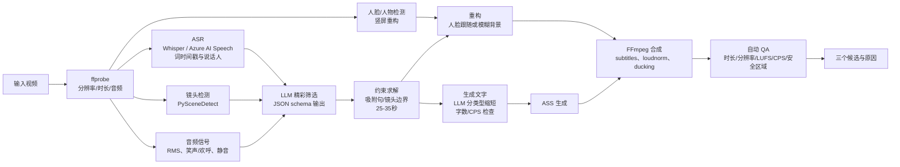

# VideoCreator 调研报告：热门社交视频编辑风格分析与“模式选择式自动编辑”功能设计

[↑ 文档导航](../README.md) | [日本語](../../../docs/VideoCreator-AnalyticsReport.md) | [English](../../en/docs/VideoCreator-AnalyticsReport.md) | **简体中文** | [한국어](../../ko/docs/VideoCreator-AnalyticsReport.md)


- 创建日期：2026-11-07
- 对象：以 YouTube（长视频／Shorts）和 TikTok 为主的社交视频
- 重点：**娱乐性（观看时感到有趣）**
- 设想功能：“选择一个或多个视频→选择编辑模式→自动编辑”。可使用生成式 AI，无需高级编辑功能。

---

## 0. 执行摘要

1. **热门视频编辑不是“感觉”，几乎都能分解为可测变量。** 本报告以六个变量分析：(a) 开场钩子秒数、(b) 再次吸引的精彩场面间隔、(c) 镜头长度及其一致性、(d) 屏幕文字字数／每秒字数／大小／位置、(e) 响度 LUFS 与音效、(f) 循环结构，并给出分类型预设（§3、§4）。
2. **不可改变的约束可由一手资料确定。** Shorts 为正方形或竖屏、最多 3 分钟（2024-10-15 后上传）；TikTok 广告建议前 6 秒钩子、前 3 秒主题、每秒 5～10 词；Netflix 日文字幕每行 13 全角字、最多 2 行、每秒 4 字；YouTube 播放将音量降低至约 −14 LUFS，不提高。这些作为自动编辑**硬性约束**（§2）。
3. **产生乐趣的编辑核心有三项。** ①开头 1～3 秒展示结果、异常、问题以建立期待；②每几秒通过剪辑、缩放、文字、音效变化提示仍有事情发生；③明确包袱／回报并使末尾接开头循环。日本另有**源自电视的吐槽／强调文字文化**（§3.3）。
4. **“越快越好”是错误的。** Primitive Technology **没有旁白、BGM、文字仍获数千万观看**。关键是选择适合类型的节奏，应选择“模式”而非“速度”（§4）。
5. **现有组件足以实现。** 转写（Whisper／Azure AI Speech）→镜头、音量、笑声／欢呼、人脸信号→**LLM 结构化精彩候选输出**→吸附句／镜头边界→9:16 重构→ASS 文字→loudnorm→导出。FFmpeg 配方已**实际执行并验证输出**（1080×1920、26 秒、−14.0 LUFS，§5.5）。
6. **把正确性验证交给“自己之外”。** 结合 YouTube Studio “Stayed to watch”率、平均观看比例、公开数据集离线评价（Mr. HiSum 31,892 条，以 YouTube 最多重播片段统计为标签）、第三方盲测成对比较。**YouTube A/B 测试不支持 Shorts**，需注意评价设计（§6）。

---

## 1. 报告制作方式（深化提示与方法论）

### 1.1 深化请求的四点

| 视角 | 内容 |
|---|---|
| (1) 顶尖专家额外做什么 | 不凭印象描述热门风格，分解为**留存曲线、平均镜头长度 ASL、字幕每秒字数、LUFS**。按类型×时长形成**可复现参数表**，先定义自动编辑**失败模式**（失去上下文、讲话中断、文字错误、被 UI 遮挡、侵权），设计评价计划 |
| (2) 最原始素材 | 平台一手规格（YouTube Help、TikTok 广告帮助）、字幕行业标准（Netflix、BBC）、同行评审论文（镜头长度历史变化、精彩检测数据集）、顶尖制作公司原始手册（MrBeast）、**视频本身**（oEmbed API 验证 URL 存在） |
| (3) 具体方法与工具 | Whisper／Azure AI Speech（词时间戳、说话人分离）、PySceneDetect、音频能量／笑声检测、人脸重构、LLM JSON schema 精彩评分、FFmpeg trim/concat/xfade/subtitles(ASS)/loudnorm |
| (4) 第三方验证 | 引用官方文档和论文、YouTube/TikTok oEmbed 验证、FFmpeg/ffprobe 机械验证、YouTube Studio 实测、独立盲评、公开数据集基准 |

### 1.2 重写后的提示

> 根据一手信息（平台官方规格、字幕指南、学术研究、顶尖创作者制作指南），将热门社交视频（YouTube 长视频、Shorts、TikTok）的编辑风格分解为**可测指标**（钩子秒数、再次吸引间隔、镜头长度、字幕每秒字数／大小／位置、响度、循环）分析。重视娱乐性，将娱乐／商业／爱好类编辑模式定义为“自动编辑应用可直接使用的参数表”。给出已验证存在的示例视频，展示用生成式 AI＋FFmpeg 实现长视频→30 秒短片、多素材切换、文字表现的设计（流水线、LLM 提示、**已执行验证的** FFmpeg 命令、失败模式、评价方法），保存到 `work\VideoCreator-AnalyticsReport.md`。列出全部来源，无法验证的主张明确标为假设。

### 1.3 方法与局限

- **方法**：获取官方帮助、论文、指南原文→提取数值→oEmbed 验证真实视频（2026-11-07，§4 全部 URL）→FFmpeg 执行及 ffprobe/loudnorm 验证（§5.5）。
- **局限（如实记录）**：
  - 因 YouTube/TikTok 条款，未下载他人视频逐帧测镜头长度。§3 数值为**实务经验假设**，需按 §6.2 用自有或获授权素材测量校正。
  - 行业博客等二手统计（如“63% TikTok 广告在 3 秒内展示主题”）一手性弱，仅作**参考**，不作为设计依据。
  - 推荐算法内部不公开，仅讨论官方指标和编辑可控变量的关系。

---

## 2. 可由一手信息确定的不可变约束

自动编辑引擎将这些作为**硬性约束**。

| 项目 | 值 | 一手来源 |
|---|---|---|
| YouTube Shorts 判定 | 正方形或竖屏，最多 3 分钟，2024-10-15 后上传 | YouTube Help “Understand three-minute YouTube Shorts” [S1] |
| Shorts 音乐 | 库中多数曲目在 3 分钟 Short 最多用 90 秒，部分 60/30 秒 | [S1] |
| 官方长转短 | Studio “Clips and Shorts”从转写选范围，**自动把源视频链接为相关视频** | [S2] |
| Shorts 初始指标 | “How many chose to view”，观看选择比例与划走 | [S3] |
| TikTok 广告建议 | 9:16、720p 以上、有声，**前 6 秒钩子，前 3 秒主题，每秒 5～10 词** | TikTok Ads，2025-06 更新 [S4] |
| 日文行业字幕 | 横排**每行最多 13 全角字、最多 2 行、每秒最多 4 字**，原则避免顶部，白色无衬线 | Netflix [S5] |
| 英文字幕参考 | BBC 160～180 wpm，行长在 16:9 宽的 68% 内，原则 2 行 | [S6] |
| 响度 | YouTube 约 −14 LUFS，**只降低大音量，不提高小音量**，建议 True Peak 约 −1 dBTP | [S7]，可自行用 YouTube 详细统计 content loudness 验证 |
| 静音观看 | 公共场所 69% 静音，字幕用户 80% 无听障，美国 5,616 人调查 | Verizon×Publicis，报道 [S8] |
| 生成式 AI 披露 | 让真人说未说的话、改真实事件等**写实 AI 生成／修改必须披露** | [S9] |
| A/B 测试 | 标题／缩略图最多 3 案，**按总观看时间决定胜者，不支持 Shorts** | [S10] |

### 2.1 竖屏安全区域（Safe Zone）

TikTok 和 YouTube Shorts **不公开官方像素值**。TikTok 称随形式和说明长度改变，仅提供叠加素材；Meta Reels 广告公开顶部 14%、底部 35%、左右 6% [S11]。多平台保守取值：1080×1920 避开**顶部约 250px、底部约 580～670px、右侧 160～190px、左侧 60px**，中间约 860×1100px 安全 [S11][S12]。

→ 默认正文字幕距底部 **620px（MarginV=620），右边距 160px**，开场标题距顶 300px。

---

## 3. 将热门视频编辑语法分解为指标

### 3.1 注意力结构：最初一分钟（Shorts 最初一秒）决定一切

**MrBeast 制作手册“How to Succeed in MrBeast Production”**基于逐秒分析设定以下分钟框架 [S13][S14]：

| 时间 | 指示 | 编辑转换 |
|---|---|---|
| 0–1 分钟 | 与标题／缩略图承诺**完全一致**，甚至物体颜色，把最好素材放最前 | 冷开场先展示结果、最大亮点 |
| 1–3 分钟 | “疯狂推进”，不只第一天，推进多天 | 蒙太奇、天数计数器压缩时间 |
| 3 分钟 | 首次再次吸引，独有奇观 | 约每 3 分钟布置亮点 |
| 3–6 分钟 | 快速转场，简单刺激 | 形成较短且均衡镜头 |
| 6 分钟 | 第二次再次吸引 | 同上 |
| 6 分钟后 | 后半易松懈，靠结构吸引 | “最后会有…”预告、倒计时 |

手册称典型视频**最初 60 秒流失 2,100 万人**，核心指标为 **CTR、平均观看时间 AVD、平均观看比例 AVP** [S14]。

**映射 Shorts/TikTok**：长视频一分钟在竖屏压缩为 **1～3 秒**。YouTube 将观看选择／划走列独立指标 [S3]，TikTok 建议主题 3 秒内、钩子 6 秒内 [S4]。

### 3.2 剪辑与节奏：一致性比速度更重要

- **同行评审研究**：Cutting 等逐镜头分析 1935～2005 年 150 部好莱坞电影，发现相邻镜头长度**相关性逐年提高，接近 1/f 模式**，动作片短镜头成组，对话长镜头成组 [S15]。启示：不是全部快，而是**相似长度成组，组间变节奏**（慢→快→慢）。
- **跳切（移除静音和迟疑）**：讲解、谈话 YouTube 标准技巧。经验上单人只移除超过 0.6～0.8 秒、对谈超过 1.2～1.5 秒的静音，保留对话停顿 [S16]。
- **推近**：单摄像机在强调处数码变焦 1.1～1.2 倍，制造双机节奏，§5.5 已验证。
- **镜头长度参考（假设，需校正）**：

| 形式 | ASL 参考 | 依据强度 |
|---|---|---|
| 娱乐 Shorts/TikTok 挑战反应 | 0.8～2.0 秒 | 经验假设 |
| 讲解／商业 Shorts | 2～4 秒，以文字变化带变化 | 经验假设 |
| 娱乐长视频 | 2～4 秒，亮点前后成组不足 1 秒 | MrBeast 快转场 [S14]＋经验 |
| 对谈／播客长视频 | 5～15 秒，主要随说话人切换 | 经验假设 |
| 烹饪／DIY 过程 | 工序加速／1～2 秒，成品较长 | 经验假设 |

### 3.3 文字与字幕：将日本电视语法移植竖屏

日本电视文字从帮助理解扩展为**用自然语言显示制作者想法（吐槽、强调）**，也存在过度使用批评（早稻田大学濑户口等）[S17]。关键是**区分种类、控制数量**。

**文字类型（实现单位）**

| 类型 | 作用 | 表现 | 自动生成 |
|---|---|---|---|
| ① 全文发言字幕 | 支持静音观看 | 白字黑边、底部、每行 13～16 字 | ◎ ASR |
| ② 强调 | 放大关键词并着色 | 黄／红、1.2～1.3 倍、弹出缩放动画 | ◎ LLM 提取 |
| ③ 吐槽／内心话 | 辅助笑点 | 斜体、气泡、异色、上部或说话人旁 | ○ LLM，**错误和不当风险高，需检查 UI** |
| ④ 情境标题 | 提供上下文 | 上方条框常显 | ◎ LLM 摘要 |
| ⑤ 拟声／SE 文字 | 夸张反应 | “轰”“鸦雀无声…”与音效同步 | ○ 笑声／欢呼／静音检测 |
| ⑥ 数字计数器 | MrBeast 式推进感 | DAY 3、剩余 10 秒、¥1,000,000 | ○ LLM 提取 |

**1080×1920 默认大小、位置与速度**

| 参数 | 默认 | 依据 |
|---|---|---|
| 正文字号 | 72～84px，强调 96～110px | 13×约 78px≈1,014px，Netflix 13 字 [S5] 换算竖屏宽度 |
| 每行字数 | 最多 13～16 全角字，最多 2 行，竖屏**推荐 1 行** | [S5][S6] |
| 显示速度 | 全文**每秒 4～6 字**，短视频强调可按词更快 | Netflix 4 字 [S5]，TikTok 5～10 词 [S4] |
| 描边 | 黑边 6～9px＋影 2～3px | §5.5 验证黄色背景黄色文字仍可读 |
| 位置 | 距底约 620px，避右 160px，顶部专作标题 | §2.1 |
| 颜色含义 | 白发言、黄强调、红惊讶／危险、浅蓝补充、说话人固定色 | 电视经验 |

### 3.4 音频：一半乐趣来自声音

- **响度**：导出前 `loudnorm=I=-14:TP=-1.5`。YouTube 只降低不提高，太小会吃亏 [S7]。
- **BGM 闪避**：讲话时降低 BGM −12～−18dB，FFmpeg `sidechaincompress`。
- **SE**：与⑤同步，笑、惊讶、包袱前的静音本身也是表演。
- **兼顾静音**：公共场所 69% 静音 [S8]，字幕必需；TikTok 又有有声文化 [S4]，因此**字幕和音频都要成立**。

### 3.5 循环与回报

- 持续重播的 Shorts/TikTok **末尾自然接开头**，如末句回答开头问题、末帧匹配首帧。
- YouTube 自 2025-03-31 起每次开始播放／重播计数（二手 [S18]），循环有指标优势。
- **Zach King** 魔术（被称 TikTok 历史最高播放，§4）15～20 秒形成“不可能画面的问题→揭秘→想重看”。

### 3.6 多素材切换（多摄像机／素材切换）

把电视切换导演规则自动化 [S16][S19]：

1. **展示讲话者**，由说话人分离或分麦音量判断。
2. **最短保持** 1.5～2.5 秒，过快不稳。
3. **反应镜头**：听者笑或惊讶时切听者，产生娱乐性。
4. **全景**：段落开始和每 30～60 秒重新建立空间。
5. **在动作／发言断点切换**，展示有意义而非仅有运动的一方。
6. **音频始终一条 master**，避免音量／环境跳变。
7. **基本硬切**，仅时间推进／转场用 0.2～0.4 秒交叉淡化。

---

## 4. 示例视频（2026-11-07 已通过 oEmbed 验证存在）

> 播放量变化，故不记录。所有 URL 经 `https://www.youtube.com/oembed?url=...` / `https://www.tiktok.com/oembed?url=...` 确认返回投稿者与标题。观察点映射编辑模式。

### 4.1 娱乐

| 视频 | 类型 | 观察点 → 模式 |
|---|---|---|
| MrBeast “$456,000 Squid Game In Real Life!” <https://www.youtube.com/watch?v=0e3GPea1Tyg> | 长企划 | 立即展示奖金规模，淘汰计数推进，每几分钟亮点 → **P1 高能挑战** |
| MrBeast “I Spent 50 Hours Buried Alive” <https://www.youtube.com/watch?v=9bqk6ZUsKyA> | 长企划 | 时间计数、压缩蒙太奇 → **P1**／⑥ |
| MrBeast “Katana Vs Bullet” <https://www.youtube.com/shorts/L5kIXRdwGAI> | Short | 一行问题→慢镜头→结果 → **P2 一击循环** |
| Zach King 哈利波特扫帚（被称 TikTok 历史最高播放）<https://www.tiktok.com/@zachking/video/6768504823336815877> | TikTok | 开头不可能画面、揭秘、循环诱发重看 → **P2** |
| Bella Poarch “M to the B” <https://www.tiktok.com/@bellapoarch/video/6862153058223197445> | TikTok | 音乐主导、表情特写、节拍剪辑 → **P5** |
| 东海 On Air“提出常规目的地就立即回家的京都之旅” <https://www.youtube.com/watch?v=SJdhLwEKDc4> | 长综艺 | 标题即规则与观看理由，日式吐槽强调 → **P3** |
| HikakinClipTV“让你赢猜拳的 Hikakin” <https://www.youtube.com/watch?v=rYNxkATSgk0> | 官方剪辑 Short | **官方长转短**，聚焦一个反应 → **P4** |
| Mark Rober “Glitter Bomb 1.0 vs Porch Pirates” <https://www.youtube.com/watch?v=xoxhDk-hwuo> | 科学娱乐长片 | 动机→制作→犯人反应回报，连续反应镜头 |

### 4.2 商业与讲解

| 视频 | 类型 | 观察点 → 模式 |
|---|---|---|
| 中田敦彦 YouTube 大学 <https://www.youtube.com/watch?v=qh5t4WMroyU> | 长授课 | 单人高能讲述，标题分章 → **P6** |
| PIVOT 官方 <https://www.youtube.com/watch?v=JOE7Y_b7RlE> | 长对谈 | 高信息标题、多机位、要点文字 → **P7** |
| The Diary Of A CEO <https://www.youtube.com/watch?v=a1mI-ozLyYM> | 长播客 | 最强发言冷开场、电影感多机位 → **P7／P4** |
| Joe Rogan Experience #1169 - Elon Musk <https://www.youtube.com/watch?v=ycPr5-27vSI> | 超两小时播客 | 一小时以上转短典型，正文少编辑，价值来自**剪辑端** → **P4** |
| Ali Abdaal “How I Manage My Time - 10 Time Management Tips” <https://www.youtube.com/watch?v=iONDebHX9qk> | 长讲解 | 编号列表、B-roll 与文字 → **P6** |
| Veritasium “The Most Misunderstood Concept in Physics” <https://www.youtube.com/watch?v=DxL2HoqLbyA> | 科学长讲解 | 问题开场、演示回答，慢节奏也靠问题吸引 |
| “慢速讲解：自己感染梅毒？疯狂医生约翰·亨特” <https://www.youtube.com/watch?v=Bk308b1JqGc> | 日本特有形式 | 合成音声＋角色＋**全文文字**，文字主导 |

### 4.3 爱好与生活

| 视频 | 类型 | 观察点 → 模式 |
|---|---|---|
| Nick DiGiovanni “MasterChef Potatoes” <https://www.youtube.com/watch?v=HE_rKC9B6BY> | 烹饪 Short | 超短工序剪辑、成品 ASMR 和试吃 → **P8** |
| Casey Neistat “DO WHAT YOU CAN'T” <https://www.youtube.com/watch?v=jG7dSXcfVqE> | Vlog | 音乐高速蒙太奇、延时 → **P5** |
| Primitive Technology “Tiled Roof Hut” <https://www.youtube.com/watch?v=P73REgj-3UE> | DIY 长片 | **无旁白、BGM、文字**，环境音与可靠工序形成娱乐的反例 → **P9** |
| Kurzgesagt “The Egg - A Short Story” <https://www.youtube.com/watch?v=h6fcK_fRYaI> | 动画 | 旁白主导，画面始终运动 |

### 4.4 跨类型共同原则

1. **第一画面为结果、异常或问题**：MrBeast、Zach King、Veritasium、Diary Of A CEO。
2. **用一行表达观看理由（规则、赌注、问题）**，标题和文字重复：东海、MrBeast。
3. **每几秒某物改变**：剪辑、缩放、文字、SE，周期随类型差异大。
4. **反应是最强素材**：Mark Rober、HikakinClipTV。
5. **允许例外**：Primitive Technology 靠**沉浸**而非速度获胜，只有加速一种自动编辑会失败。

---

## 5. 自动编辑功能设计

### 5.1 最小用户体验

```
[1] 选择一个或多个视频
[2] 选择输出：竖屏短片（15/30/60 秒）／横屏摘要（3～5 分钟）
[3] 选择模式，可多选，下表 P1～P9
[4] 生成→提供三个候选，附理由和得分
[5] 检查：仅修正文字错字与不当表达→导出
```

不提供高级时间线 UI，限定**选择候选＋修改文字**。

### 5.2 编辑模式目录（预设）

| ID | 模式 | 适合类型 | 主要参数 |
|---|---|---|---|
| P1 | 高能挑战 | 娱乐 | 钩子≤1.5 秒，ASL 0.8～1.5 秒，多推近、⑥计数、多 SE、快 BGM |
| P2 | 一击循环 | 娱乐 | 15～25 秒，问题→结果，末尾接开头，最少文字 |
| P3 | 综艺文字 | 日本娱乐 | 全用①②③⑤，LLM 吐槽需确认，讲解者小窗 |
| P4 | 精华剪辑（长→30 秒） | 全部 | 最强发言／反应置首，句边界剪，④标题，引导源视频 |
| P5 | 节拍同步蒙太奇 | 爱好／Vlog | 检测 BGM 节拍剪辑，最少文字 |
| P6 | 讲解授课 | 商业 | 移除 0.6 秒静音，②④要点，编号章节，ASL 2～4 秒 |
| P7 | 对谈切换 | 商业／播客 | 随说话人切，最短 2 秒，反应镜头、定期全景 |
| P8 | 过程压缩 | 烹饪／DIY | 工序 1～2 秒／加速，成品与声音较长，Before/After |
| P9 | 极简／环境音 | 爱好 | 无文字、BGM，长镜头，仅调整色彩音量 |

预设作为数据，例如：

```json
{
  "id": "P4",
  "name": "精华剪辑（长视频→30秒）",
  "target": {"aspect": "9:16", "duration_sec": [25, 35]},
  "hook": {"max_sec": 2.0, "prefer": ["strong_claim", "laughter", "surprise"]},
  "cut": {"remove_silence_over_sec": 0.7, "snap_to": ["sentence_end", "shot_boundary"], "punch_in_scale": 1.15},
  "telop": {
    "types": ["caption", "emphasis", "headline"],
    "caption": {"font_px": 78, "max_chars_per_line": 14, "max_lines": 1, "max_cps": 6, "margin_v": 620, "margin_r": 160},
    "emphasis": {"font_px": 100, "color": "yellow", "animation": "pop"},
    "headline": {"position": "top", "margin_v": 300, "box": true}
  },
  "audio": {"loudnorm": {"I": -14, "TP": -1.5}, "bgm_duck_db": -15, "sfx": "light"},
  "loop": {"enabled": true}
}
```

### 5.3 流水线



**各阶段要点**

1. **ASR** 必需词时间戳（Whisper `word_timestamps=True`、Azure 词级时间／说话人分离），日文易漏标点，用 LLM 重估句边界。
2. **原始高涨信号**：音量急升、笑声欢呼、语速上升、镜头密度、人脸数变化，不只靠 LLM，**结合数值信号共同决策**以抑制貌似合理的错误。
3. **LLM** 输入带时间转写和信号摘要，返回候选**结构化 JSON**。
4. **约束求解** 吸附“句末”且“镜头边界或静音”，避免中途剪。多段合并时**最强置首**冷开场、结论置末，尽量语义循环。
5. **文字** ①全文 13～14 字换行与 CPS，②提强调，④标题摘要，③吐槽**主动启用且必须人工确认**。
6. **重构** 一张人脸用平滑跟随 9:16 裁剪，多人或无人用**模糊背景＋中间 16:9**，官方 Shorts 也用模糊裁剪 [S2]。
7. **QA** 见 §5.6。

### 5.4 LLM 提示（精彩筛选）

```text
[System]
你是 YouTube/TikTok 短视频编辑。从给定带秒数转写与音视频信号，
选择最多五个约 30 秒短视频候选。
规则：
- 最初 2 秒内出现结果、惊讶、强主张或问题
- 不在讲话中途开始结束，start/end 为句边界
- 无上下文也可理解，避免以“那个”“这个”等代词开头
- 不夸张或错误概述，不把转写没有的内容做成文字
- 仅输出指定 JSON schema

[User]
模式：P4 精华剪辑／目标 25-35 秒／语言：日语
信号摘要：{"laughter":[[812.4,815.0],...], "loudness_peaks":[...], "shots":[...]}
转写：
[00:13:32.1] 那么一小时内花完一百万日元
...

[输出 JSON schema]
{
  "candidates": [{
    "segments": [{"start": 812.0, "end": 829.5}],
    "hook_text": "string(<=14字)",
    "headline": "string(<=16字)",
    "emphasis_words": ["string"],
    "reason": "为何有趣，一句话",
    "scores": {"hook": 0-10, "standalone": 0-10, "payoff": 0-10, "emotion": 0-10}
  }]
}
```

参考 OpusClip Hook/Flow/Value/Trend [S20] 和 QVHighlights 五级 saliency [S21]，评分四轴为 **hook／standalone／payoff／emotion**。

### 5.5 FFmpeg 配方（已执行验证）

环境：FFmpeg N-128532，2026-11-06 构建，win-arm64。用 1920×1080、60 秒有声合成视频执行，由 ffprobe 和 loudnorm 确认。

**(A) 长转竖屏**：提三段→第二段推近→拼接→模糊背景 9:16→ASS 烧录→−14 LUFS。

```powershell
$fc = @(
 "[0:v]trim=10:18,setpts=PTS-STARTPTS[v1];[0:a]atrim=10:18,asetpts=PTS-STARTPTS[a1]",
 "[0:v]trim=30:40,setpts=PTS-STARTPTS,scale=iw*1.15:ih*1.15,crop=1920:1080[v2];[0:a]atrim=30:40,asetpts=PTS-STARTPTS[a2]",
 "[0:v]trim=50:58,setpts=PTS-STARTPTS[v3];[0:a]atrim=50:58,asetpts=PTS-STARTPTS[a3]",
 "[v1][a1][v2][a2][v3][a3]concat=n=3:v=1:a=1[cv][ca]",
 "[cv]split[fg0][bg0]",
 "[bg0]scale=1080:1920:force_original_aspect_ratio=increase,crop=1080:1920,boxblur=20:2[bg]",
 "[fg0]scale=1080:-2[fg]",
 "[bg][fg]overlay=(W-w)/2:(H-h)/2-120,subtitles=telop.ass[vout]",
 "[ca]loudnorm=I=-14:TP=-1.5:LRA=11[aout]"
) -join ';'
ffmpeg -y -i src.mp4 -filter_complex $fc -map "[vout]" -map "[aout]" `
  -c:v libx264 -preset veryfast -crf 20 -c:a aac -b:a 192k -ar 48000 -movflags +faststart short.mp4
```

结果：`short.mp4: duration=26.000000 video=1080x1920`，`Input Integrated: -14.0 LUFS`。

**(B) ASS 文字**：发言字幕、弹出强调、框状钩子标题。

```ini
[Script Info]
ScriptType: v4.00+
PlayResX: 1080
PlayResY: 1920

[V4+ Styles]
Format: Name, Fontname, Fontsize, PrimaryColour, SecondaryColour, OutlineColour, BackColour, Bold, Italic, Underline, StrikeOut, ScaleX, ScaleY, Spacing, Angle, BorderStyle, Outline, Shadow, Alignment, MarginL, MarginR, MarginV, Encoding
Style: Caption,Yu Gothic UI,78,&H00FFFFFF,&H0000FFFF,&H00000000,&H80000000,-1,0,0,0,100,100,0,0,1,7,2,2,90,160,620,1
Style: Emph,Yu Gothic UI,96,&H0000F0FF,&H0000FFFF,&H00000000,&H80000000,-1,0,0,0,100,100,0,0,1,9,3,2,90,160,620,1
Style: Hook,Yu Gothic UI,88,&H00FFFFFF,&H0000FFFF,&H000000C0,&H00000000,-1,0,0,0,100,100,0,0,3,14,0,8,90,160,300,1

[Events]
Format: Layer, Start, End, Style, Name, MarginL, MarginR, MarginV, Effect, Text
Dialogue: 1,0:00:00.00,0:00:02.50,Hook,,0,0,0,,{\fad(80,0)}意想不到的结局…！
Dialogue: 0,0:00:00.20,0:00:02.40,Caption,,0,0,0,,{\t(0,120,\fscx112\fscy112)\t(120,240,\fscx100\fscy100)}今天一小时内
Dialogue: 0,0:00:02.40,0:00:04.60,Emph,,0,0,0,,{\t(0,120,\fscx115\fscy115)\t(120,240,\fscx100\fscy100)}花完一百万日元
Dialogue: 0,0:00:08.00,0:00:10.50,Caption,,0,0,0,,这里出现{\c&H0000F0FF&}意外{\c&HFFFFFF&}发展
```

- ASS 色值 `&HAABBGGRR` 为 BGR，`&H0000F0FF` 为黄色。
- `BorderStyle=3` 框背景标题，`1` 描边字幕。
- `Alignment=2` 底中，`8` 顶中，`MarginV=620` 避平台底部 UI。
- 目视确认第 3 秒“一百万日元花完”黄色黑边位于底 UI 上方。

**(C) 多素材切换**：A→B 硬切→A 0.3 秒交叉淡化。

```powershell
$fc2 = "[0:v]trim=0:5,setpts=PTS-STARTPTS[a];[1:v]trim=5:10,setpts=PTS-STARTPTS[b];" +
       "[0:v]trim=10:15,setpts=PTS-STARTPTS[c];" +
       "[a][b]concat=n=2:v=1:a=0,settb=AVTB,fps=30[ab];[c]settb=AVTB,fps=30[c2];" +
       "[ab][c2]xfade=transition=fade:duration=0.3:offset=9.7[v]"
ffmpeg -y -i camA.mp4 -i camB.mp4 -filter_complex $fc2 -map "[v]" -map 0:a -t 14.7 -c:v libx264 -c:a aac switch.mp4
```

结果：`switch.mp4: duration=14.700000 video=1920x1080`。
**实际遇到的陷阱**：concat 后输出与 trim 后输入时基不同，xfade 报 `First input link main timebase ... do not match`。**两侧用 `settb=AVTB,fps=30` 归一化**可解决。

**(D) BGM 闪避（语法参考）**

```text
[1:a]volume=0.5[bgm];[bgm][0:a]sidechaincompress=threshold=0.03:ratio=8:attack=20:release=300[ducked];
[0:a][ducked]amix=inputs=2:duration=first,loudnorm=I=-14:TP=-1.5[aout]
```

### 5.6 自动 QA（输出前检查）

| 检查 | 阈值 | 方法 |
|---|---|---|
| 时长 | 预设范围，如 25～35 秒，Shorts≤180 秒 | ffprobe |
| 分辨率／比例 | 1080×1920，9:16 | ffprobe |
| 响度 | −14±1 LUFS，TP≤−1 dBTP | `loudnorm=print_format=summary` |
| 字幕速度 | 全文≤6 字／秒，每行≤14 字 | 解析 ASS |
| 安全区域 | 除标题外不进入底 580px／右 160px／顶 250px | ASS Margin 计算 |
| 讲话中途剪 | 边界 ±150ms 无跨越单词 | ASR 词时间 |
| 开场钩子 | 首 2 秒有发言或大音／动作 | ASR、音量、帧差 |
| 文字忠实 | 专有名词数字出现在转写 | 字符串比对检测幻觉 |

### 5.7 失败模式与护栏

| 失败 | 示例 | 对策 |
|---|---|---|
| 上下文断裂 | “那个最糟糕”开头 | standalone 评分，对指示词开头扣分 |
| 含义改变 | 将讽刺剪成认真主张 | 向 LLM 同时传前后 ±30 秒，自检原意一致 |
| 文字错误／不当 | 侮辱吐槽、数字错误 | 吐槽主动启用、数字专名 QA、人工 UI |
| 权利 | 未经许可剪他人直播、商用曲 | 仅**权利人许可范围**，日本有官方剪辑指南 [S22]；只用授权曲库 |
| AI 披露 | 合成本人未说的话 | 不合成本人音声，写实修改按 YouTube AI use 披露 [S9] |
| UI 遮挡 | 字幕与点赞重叠 | 安全 QA |
| 太快难读 | 每秒 20 字 | CPS QA、缩短文字 |
| 节奏全同 | 每条像一样 | 分模式 ASL 与分组结构 §3.2，也提供 P9 慢模式 |

### 5.8 生成式 AI 使用位置（Azure 示例）

| 处理 | 选项 |
|---|---|
| 转写与说话人 | Azure AI Speech 批转写、分离、词时间／可本地 Whisper |
| 精彩筛选与缩短文字 | Microsoft Foundry LLM，JSON schema |
| 可选视频理解 | 向多模态 LLM 传几张关键帧，辅助理解发生什么 |
| 基础设施 | 本地含 FFmpeg 起步，仅重处理上云 |

---

## 6. 评价计划（由你我之外证明正确的机制）

### 6.1 发布前离线评价

1. **精彩筛选精度**：Mr. HiSum 31,892 视频，以逾 5 万用户观看行为形成 YouTube 重播标签 [S23]；QVHighlights 超一万人工 saliency 视频 [S21]，测区间与最高重播一致 mAP／Hit@1。
   - 自己频道长视频的 Studio **最多重播片段**是最佳标签。
2. **盲测成对比较**：同素材本输出与随机／开头 30 秒基线，至少五位未参与制作者选更想看的，报告胜率和置信区间。
3. **机械 QA**：全部输出执行 §5.6 并记录违规率。

### 6.2 校正镜头长度等假设

对自有或授权素材：

```bash
scenedetect -i input.mp4 detect-adaptive list-scenes   # CSV 镜头边界列表
```

计算镜头长度均值、中位数、相邻相关性（Cutting 指标 [S15]），更新 §3.2。

### 6.3 发布后在线评价

| 指标 | 含义 | 获取位置 |
|---|---|---|
| How many chose to view / Stayed to watch | 开头不离开比例，评价钩子 | Shorts Studio [S3] |
| 平均观看比例 APV／留存曲线 | 评价结构与节奏 | Studio |
| 播放／展示次数 | 综合 | Studio／TikTok Analytics |
| 相关视频带来的长片流量 | 剪辑是否导流正文 | Shorts 相关链接 [S2] |

- **注意**：YouTube A/B **仅标题／缩略图且不支持 Shorts** [S10]。同素材多模式错时发布与频道中位数比较仅是准实验，无普遍基准，按**自己频道历史中位数相对比较**判断。

---

## 7. 结论与下一步

1. 先实现 **P4 长转 30 秒**，需求最大，最小 ASR＋LLM＋模糊 9:16＋ASS＋loudnorm，本配方已技术验证。
2. 再加 **P6 讲解**和 **P3 综艺**，P3 吐槽配套检查 UI。
3. 多素材从 **P7 对谈**开始，说话人从分麦音量升级为分离。
4. 一开始就在全部模式集成 §5.6 QA 与 §6 评价。

---

## 参考文献（优先一手）

- [S1] YouTube Help, “Understand three-minute YouTube Shorts”. <https://support.google.com/youtube/answer/15424877>
- [S2] YouTube Help, “Video clips and Shorts in YouTube Studio”. <https://support.google.com/youtube/answer/15824265> ／ “Create YouTube Shorts from your videos”. <https://support.google.com/youtube/answer/12836917>
- [S3] YouTube Help, “Content tab analytics tips – Shorts”. <https://support.google.com/youtube/answer/12942217>
- [S4] TikTok Ads Help, “Creative best practices for performance ads”，2025-06 更新。<https://ads.tiktok.com/help/article/creative-best-practices>
- [S5] Netflix Partner Help Center, “Japanese Timed Text Style Guide”（I.5 字数、I.14 行数、I.16 位置、I.19 阅读速度）。<https://partnerhelp.netflixstudios.com/hc/en-us/articles/215767517-Japanese-Timed-Text-Style-Guide>
- [S6] BBC Subtitle Guidelines 摘要。<https://www.clevercast.com/bbc-subtitling-guidelines/> ／原文 <https://www.bbc.co.uk/accessibility/forproducts/guides/subtitles/>
- [S7] LOUDMETER, “YouTube LUFS: −14 LUFS Normalization Explained”，含详细统计验证方法。<https://www.loudmeter.net/youtube-loudness>
- [S8] Streaming Media, “80% of Video Caption Users Aren't Hearing Impaired, Finds Verizon” (2019). <https://www.streamingmedia.com/Articles/ReadArticle.aspx?ArticleID=131860>
- [S9] YouTube Help, “Disclosing use of GenAI content”. <https://support.google.com/youtube/answer/14328491>
- [S10] YouTube Help, “A/B test titles & thumbnails”. <https://support.google.com/youtube/answer/16391400>
- [S11] CapQA, “Social media safe zones: pixel reference” (2026-09-11). <https://capqa.app/guides/social-media-safe-zones>
- [S12] ReelMind, “TikTok Safe Zone Overlay”. <https://reelmind.ai/blogs/tiktok-safe-zone-overlay-essential-framing-guidelines>
- [S13] “How to Succeed in MrBeast Production”，原 PDF 转换版。<https://manuals.plus/m/54dc97c41faebbcd9e295bc7463eb6b332faa85d5abddbc908cab21104c9bd1e>
- [S14] Daniel Scrivner, “How to Succeed in MrBeast Production” summary (2025-08-15). <https://www.danielscrivner.com/how-to-succeed-in-mrbeast-production-summary/>
- [S15] Cutting, J. E., DeLong, J. E., & Nothelfer, C. E. (2010). Attention and the evolution of Hollywood film. *Psychological Science*, 21(3), 432–439. doi:10.1177/0956797610361679. <https://pubmed.ncbi.nlm.nih.gov/20424081/>
- [S16] EditBuddy, “How to Edit a Multicam Podcast”，最短保持与静音阈值。<https://editbuddy.app/blog/how-to-edit-multicam-podcast-premiere-pro>
- [S17] 濑户口史、坂井滋和《电视节目中文字显示的探讨》，映像信息媒体学会。<https://www.jstage.jst.go.jp/article/itetaikai/2003w/0/2003w_0_17/_pdf/-char/ja>
- [S18] Creator Essentials, “Viewed vs. Swiped Away”，提及 2025-03-31 Shorts 计数变化。<https://www.creatoressentials.com/glossary/viewed-vs-swiped-away/>
- [S19] Mellius, “Multicam Editing Workflow”. <https://www.melliusai.com/multicam-edit>
- [S20] OpusClip virality score，Hook / Flow / Value / Trend。<https://artificial-intelligence-wiki.com/ai-for-content-creators/ai-image-and-video-generation/opus-clip-viral-score-explained/>
- [S21] Lei, J., Berg, T. L., & Bansal, M. (2021). QVHighlights: Detecting Moments and Highlights in Videos via Natural Language Queries. NeurIPS 2021. <https://arxiv.org/abs/2107.09609>
- [S22] NoLang《YouTube 剪辑视频制作：许可、版权、盈利确认》(2026-10-24)。<https://no-lang.com/learn/youtube-kirinuki-guide> ／Monolith 律师事务所《剪辑视频规则》。<https://monolith.law/youtuber-vtuber/youtuber-clippedvideo-rules>
- [S23] Sul, J. et al. (2023). Mr. HiSum: A Large-scale Dataset for Video Highlight Detection and Summarization. NeurIPS 2023 Datasets and Benchmarks. <https://papers.nips.cc/paper/2023/file/7f880e3a325b06e3601af1384a653038-Paper-Datasets_and_Benchmarks.pdf> ／ <https://github.com/MRHiSum/MR.HiSum>
- [S24] PySceneDetect Documentation, Detectors. <https://www.scenedetect.com/docs/latest/api/detectors.html>
- [S25] Mark, G. (2023). *Attention Span*. Hanover Square Press。屏幕注意平均 47 秒转移，作为节奏背景参考。

### 附录 A：示例视频验证日志（2026-11-07，oEmbed）

返回的投稿者、标题作为原始证据保留：

| ID / URL | 返回投稿者 | 返回标题 |
|---|---|---|
| 0e3GPea1Tyg | MrBeast | $456,000 Squid Game In Real Life! |
| 9bqk6ZUsKyA | MrBeast | I Spent 50 Hours Buried Alive |
| xoxhDk-hwuo | Mark Rober | Glitter Bomb 1.0 vs Porch Pirates |
| h6fcK_fRYaI | Kurzgesagt – In a Nutshell | The Egg - A Short Story |
| ycPr5-27vSI | PowerfulJRE | Joe Rogan Experience #1169 - Elon Musk |
| jG7dSXcfVqE | CaseyNeistat | DO WHAT YOU CAN'T |
| DxL2HoqLbyA | Veritasium | The Most Misunderstood Concept in Physics |
| P73REgj-3UE | Primitive Technology | Primitive Technology: Tiled Roof Hut |
| iONDebHX9qk | Ali Abdaal | How I Manage My Time - 10 Time Management Tips |
| qh5t4WMroyU | 中田敦彦のYouTube大学 - NAKATA UNIVERSITY | 【消費減税】食料品8%→1%で物価高から救われる？… |
| JOE7Y_b7RlE | PIVOT 公式チャンネル | 【高校バスケ レベル高すぎ】… |
| SJdhLwEKDc4 | 東海オンエア | 定番の行き先を提案してしまったら即帰宅の京都旅！！！ |
| rYNxkATSgk0 | HikakinClipTV | ジャンケンに勝たせてくれるヒカキン |
| HE_rKC9B6BY | Nick DiGiovanni | MasterChef Potatoes |
| a1mI-ozLyYM | The Diary Of A CEO | Iran War Expert: … |
| Bk308b1JqGc | 五回目は正直【ゆっくり解説】 | 【ゆっくり解説】自ら梅毒に感染？狂気の医師ジョン・ハンター |
| L5kIXRdwGAI (Shorts) | MrBeast | Katana Vs Bullet |

> 排除例：首次搜索的 `4VXVfj0mEX4`（“Katana vs bullet @MrBeast”）oEmbed 投稿者是 **MrBeast 以外的第三方转载**，因此不采用。示例应以**投稿者名确认官方性**而非标题，自动剪辑也有此问题。

| TikTok URL ID | 投稿者 | 结果 |
|---|---|---|
| TikTok 6768504823336815877 | @zachking | oEmbed 有响应 |
| TikTok 6862153058223197445 | @bellapoarch | oEmbed 有响应 |
---

[↑ 文档导航](../README.md) | [日本語](../../../docs/VideoCreator-AnalyticsReport.md) | [English](../../en/docs/VideoCreator-AnalyticsReport.md) | **简体中文** | [한국어](../../ko/docs/VideoCreator-AnalyticsReport.md)
