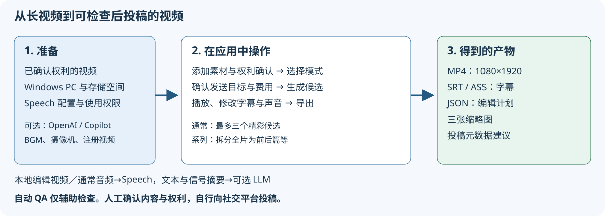

# VideoCreator 用户指南

[English](../../en/users-guide/README.md) | 简体中文 | [한국어](../../ko/users-guide/README.md) | [日本語](../../../users-guide/README.md)

[应用 README](../README.md)

本指南面向不熟悉视频编辑或开发的用户，以及希望自定义实现的软件工程师。内容以当前实现和实际界面为准。

## 按目的阅读

| 想做什么 | 阅读资料 |
|---|---|
| 首次启动并制作一个视频 | [快速入门](quickstart.md) |
| 了解按钮、输入框和开关的含义 | [界面与组件说明](screens.md) |
| 解决失败和警告 | [故障排除](troubleshooting.md) |
| 理解并修改处理流程和数据结构 | [技术参考](technical-reference.md) |
| 使用启动配置和 API | [配置与 API 参考](configuration-api.md) |
| 了解资料依据、验证范围和界面重建方法 | [验证与维护](verification.md) |
| 了解本指南制作方针（专家视角、一手资料、方法、第三方验证）与需求的对应关系 | [制作方针](documentation-brief.md) |

## 预先了解的术语

- **项目**：汇集素材、候选、编辑和导出的工作单元。
- **素材**：用于编辑的源视频。通过完整路径添加时，引用原始文件。
- **模式／预设**：时长、节奏、字幕、声音等编辑方针。
- **候选**：对使用哪些场景的建议，不是用于发布的文件。
- **预览**：用于检查的低分辨率视频，与最终导出的质量和 QA 范围不同。
- **屏幕文字**：显示在视频中的字幕、强调词、开场钩子、标题等文字。
- **编辑计划**：记录剪辑、文字、声音及插入内容的 JSON。
- **QA**：自动检查。即使通过，也仍需人工检查内容和权利。
- **导出**：根据编辑计划生成用于发布的视频及相关文件，不会向社交平台投稿。

## 图示和界面的处理

示意图是可编辑的矢量 SVG。截图也是 SVG 文件，但**内部嵌入的是真实浏览器的 PNG 截图**，并非凭想象绘制的界面，也不是将所有像素转换为矢量。

界面示例使用合成测试图、正弦波和现有转写 fixture。与正常讲话视频不同，字幕和声音并不对应。示例中的 `http://127.0.0.1:1` 是避免发送到云端的验证配置，实际使用时不要指定。详见[验证与维护](verification.md)。

引用的嵌入式日文截图保留拍摄时的历史界面，并非本地化后的截图。
