# 界面与组件说明

[应用 README](../README.md) / [指南目录](README.md) / [第一个视频](quickstart.md) / [QA 与错误](troubleshooting.md) / [配置与 API](configuration-api.md)

界面示例使用 2026-11-08 的实现在 Microsoft Edge、1440×1000 视口中获取，长页面截取全页。项目会随 PC 宽度、模式和素材数量变化。较长的栏目请在**各列内部**滚动。

以下嵌入式日文截图是拍摄当时的历史实际界面，不是本地化后的截图。当前界面语言保存在浏览器，项目视频语言在项目界面独立配置；改变项目语言后请重新生成，已有编辑计划不变。

## 共通部分

| 组件 | 含义与操作 |
|---|---|
| 左上 VideoCreator 标志 | 返回项目列表，不是停止处理的按钮 |
| 右上转写／筛选显示 | 当前提供程序。配置目标是否可用还取决于连接与权限 |
| 设置 | 确认 AI 筛选方式、发送目标、保存位置和工具信息 |
| 素材 → 模式 → 生成 → 候选 → 检查与修改 → 导出 | 工作位置。蓝色为当前，勾号为已通过，不是导航标签 |
| 显示安全区域 | 在预览上显示避免与平台 UI 重叠的参考，不改变视频本身 |
| 消息与徽章 | 成功／警告／错误／批准状态。不要只看颜色，也读文字和代码 |

## 1. 项目列表

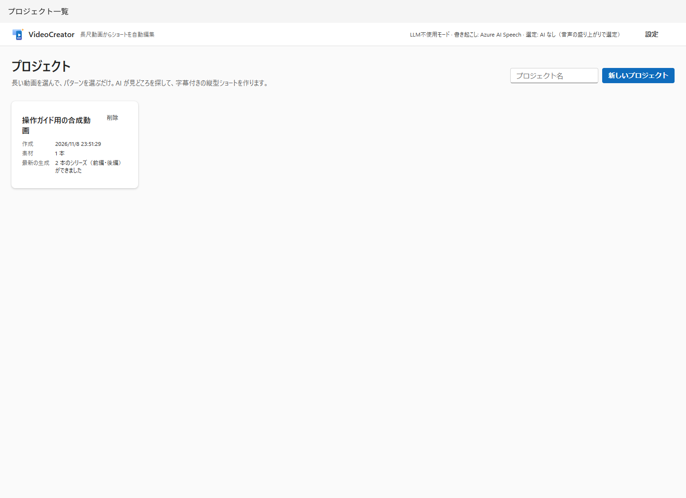

| 组件 | 含义与注意事项 |
|---|---|
| 项目名称、新建项目 | 创建工作。允许空名称，但建议使用可区分名称 |
| 项目卡片 | 点击名称打开，显示创建时间、素材数和最新生成状态 |
| 删除 | 打开确认对话框。管理文件夹移到回收站，分析与编辑 DB 记录被删除 |

**删除是清理，不是结束工作的操作。** 不删除完整路径引用的源视频，但上传素材和导出随项目移入回收站。仅从回收站恢复文件夹不会恢复 DB 编辑记录。处理中需等待完成或取消。

## 2. 素材、模式与生成

这不是三个独立界面，而是**同一项目界面的三列**。

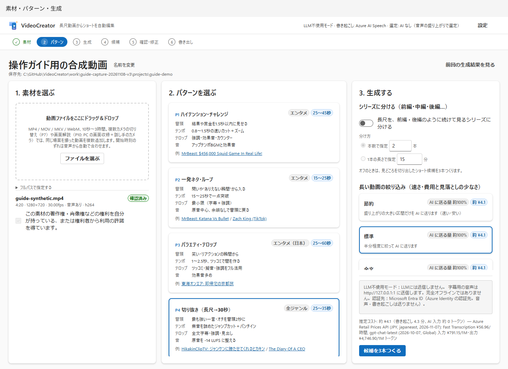

上方**重命名**打开编辑栏，可保存或取消。也显示项目保存位置，重命名不迁移文件夹。

### 左列：素材

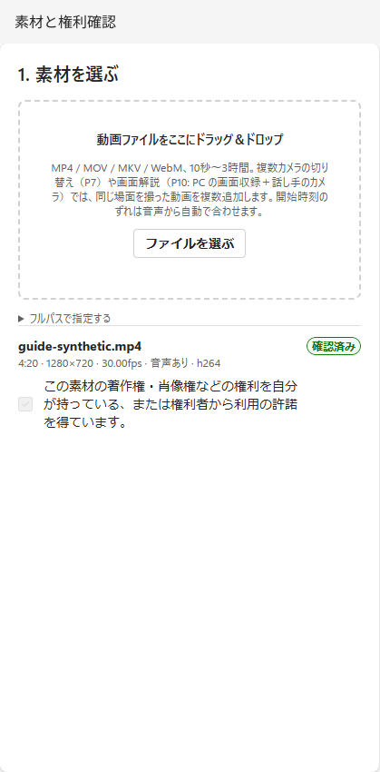

| 组件 | 含义与判断依据 |
|---|---|
| 拖放区域／选择文件 | 上传 PC 视频并复制到项目 |
| 指定完整路径 → 添加 | 使用 `C:\Videos\talk.mp4` 等绝对路径引用源文件，不带引号更易处理 |
| 素材信息 | 名称、时长、显示分辨率、fps、VFR（可变帧率）、有无音频、编解码器 |
| 警告 | 旋转、VFR、无音频等。能显示画面不一定满足字幕条件 |
| 权利确认／已确认 | 自行确认各素材版权、肖像权等并注册。已确认勾选不可编辑 |
| 角色（多素材时） | 基准视频、摄像机、全景、音频基准、屏幕等，影响 P7/P10 视频选择 |
| 说话人（多素材时） | 摄像机拍摄的说话人编号（1～8），按转写出场顺序，空为自动／未指定 |
| 偏移（秒）与同步信息 | 摄像机相对基准音频的时间差，检查自动同步依据、残差、漂移后再手动修改 |

P7 需同一场景至少两路摄像机，P10 需屏幕录制＋讲解者摄像机。不是同步不同事件视频的功能。自动同步并非万能，失败或范围外时会警告或回退基准视频。

### 中列：模式

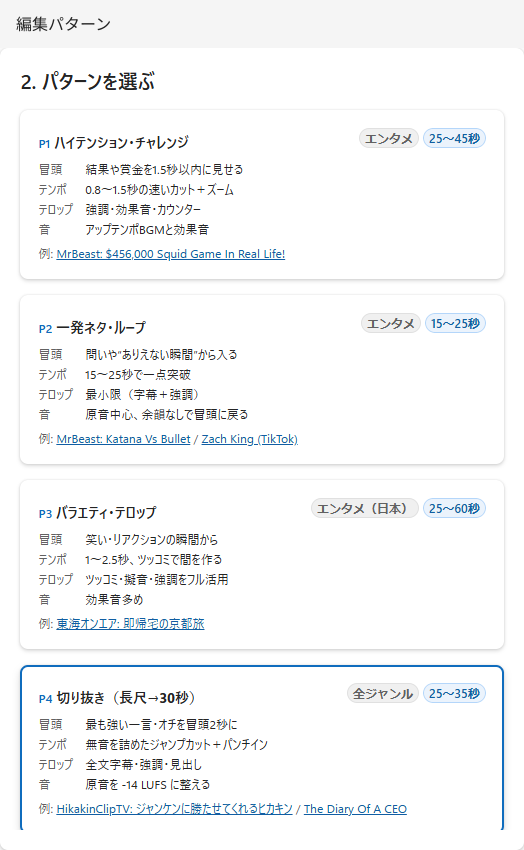

选择卡片后显示蓝框。**开场、节奏、屏幕文字、音频**是编辑方针，秒数为短视频正文目标范围。“示例”是外部视频参考链接，不保证应用输出。滚动卡片可看到 P10。

| ID | 名称 | 正文目标 | 使用场景 |
|---|---|---|---|
| P1 | 高能挑战 | 25～45 秒 | 挑战、结果、反应 |
| P2 | 一击笑点循环 | 15～25 秒 | 简短爆点、回到开头的循环 |
| P3 | 综艺文字 | 25～60 秒 | 笑点、强装饰、吐槽 |
| P4 | 精华剪辑（长视频→30 秒） | 25～35 秒 | 首次推荐，讲话为主的精彩段落 |
| P5 | 节拍同步蒙太奇 | 15～60 秒 | 按 BGM 节拍剪辑 |
| P6 | 讲解与授课（要点文字） | 30～60 秒 | 传达要点 |
| P7 | 对谈切换 | 30～60 秒 | 同时录制的多摄像机 |
| P8 | 过程压缩（烹饪／DIY） | 20～60 秒 | 对低活动区间加速的过程视频 |
| P9 | 极简／环境音 | 30～90 秒 | 少装饰，保留原声 |
| P10 | 屏幕讲解（屏幕＋画中画） | 30～60 秒 | PC 屏幕录制与讲解者摄像机 |

秒数不是源视频时长。插入物会延长总长，系列使用其他时长条件。仅修改预设 `target.aspect` 也不使全部界面和 QA 支持横屏。

### 右列：基本生成设置

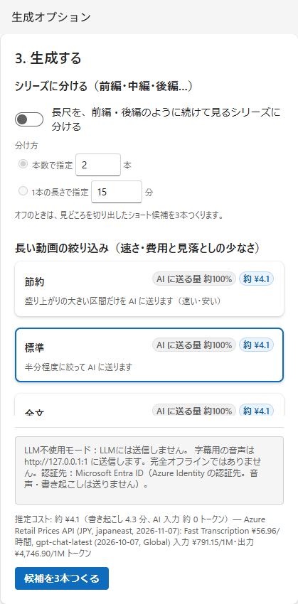

| 组件 | 含义与注意事项 |
|---|---|
| 拆分为系列 | 关：精彩候选；开：将整个源视频拆为连续部分 |
| 按数量指定 | 2～20 条，从话题断点寻找长度均衡的拆分 |
| 按每条时长指定 | 1～60 分钟，输入步长 0.5 分钟，仅为参考，不一定完全等长 |
| 拆分预估 | 添加素材后显示，有转写时使用移除静音后的预估 |
| 节省 | 长视频优先高涨区间，节省费用和时间，但可能漏掉安静的重要场景 |
| 标准 | 平衡长视频发送量和遗漏 |
| 全文 | 用全文筛选，按需分块发送，不一定是一次巨大请求 |
| 费用与发送量 | 用实现内单价和预估量计算，不保证账单金额。短视频三种方式发送量可能相同 |
| 发送目标说明 | 始终显示在按钮上方（音频→ASR，文本与信号摘要→LLM，认证目标；不用 LLM 也不影响 ASR）。展开“费用明细”查看发送量和费用 |
| 生成 3 个候选 | 素材及权利齐备后生成，不足显示原因。最多 3 个，右侧为预计费用 |

右列分为“系列”“长视频筛选”“音频”“片头、片尾与转场”“上次分析结果”等组，点击标题折叠／展开。折叠标题显示当前配置（如“BGM 自动、音效开、吐槽关”）。折叠状态保存在此浏览器。“片头、片尾与转场”最初折叠。启用系列时筛选组折叠（因为发送全文）。下方“已制作的模式”滚动后可见。

系列支持以讲话为主的 P1～P4、P6、P7、P9、P10，不支持 P5/P8。数量和时长只能指定一项。**素材需足够长，移除静音等编辑后仍能保证每条至少一分钟。** 先行亮点、回顾、章节标题、下集预告等使总时长不同于正文拆分时长。

### 右列下部：音频、屏蔽词与插入物

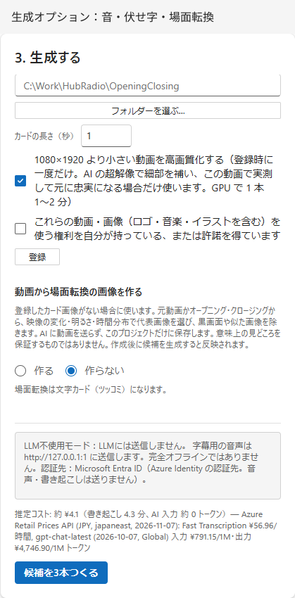

| 组件 | 含义与注意事项 |
|---|---|
| BGM | 交给模式／无／按场景自动选择（优先自己注册的曲目，否则从三首内置曲选择）／全程此曲。所有模式讲话时自动降低 BGM（人声差以预设为准，标准至少 14 LU） |
| 音效 | 是否使用“叮”“轰”等音效 |
| 让 AI 建议吐槽 | 仅 P3，AI 建议在阅读批准前不能导出 |
| 吐槽展示方式 | 启用吐槽时显示。自动（默认，仅发言断点用暂停卡，其他为叠字，原因在候选备注）／吐槽文字（不暂停）／卡片（暂停 2～3 秒，图像＋文字＋BGM） |
| 屏蔽词 | 顿号／逗号分隔，字幕等变 `●`，对应声音变哔声。不会匿名化源文件或转写 |
| 自己的 BGM | 批量选音频并确认权利注册为项目曲目，BGM 自动切为“按场景自动选择”。每曲显示响度、节奏、活跃度（平静／普通／热闹）、使用部分（去除头尾静音）；可“移除”，但计划使用中的曲目不可移除 |
| 加入片头／片尾 | 有共享注册时可用，片头在先行亮点后，片尾在最后 |
| 转场卡 | 切换场景时插入短暂静态图、文字和音效。AI 自动生成观众代言（吐槽、称赞等），需要批准 |
| 注册／重新注册 | 从文件夹读取名称含 `Opening` / `Closing` 的视频和 PNG/JPG 卡片图，注册为全部项目共享 |
| 选择文件夹… | 打开 Windows 文件夹选择，取消不修改输入。隐藏时查看任务栏 |
| 卡片时长 | 2～3 秒（默认 2.5）。全屏图像／背景面板上显示文字并播放专用 BGM，随后恢复正文原声。即使正文 BGM 为“无”，卡片仍播放 BGM |
| 提升小视频画质 | 注册后后台处理，以实测决定是否采用，耗时依环境 |
| 取消注册 | 移除共享注册。已有候选的编辑计划独立，不会自动重新生成 |
| 从视频生成转场图像 | 默认“不生成”，选择生成时从素材或注册 Opening/Closing 提取最多 2～6 张 |

图像在本地提取，排除黑、白和相似图像，不是 AI 语义亮点选择功能。生成后仅影响**新生成候选**。改回“不生成”仍保留图像文件，共享注册卡片图像优先。

### 字幕与屏幕文字的专有名词

项目界面下方可注册人名、地名、企业／组织名、商品／作品名等。输入希望显示的写法，按需添加读音和语音识别易出现的别名。下次生成时用于 ASR 短语提示，注册写法也用于屏幕文字专名比对。类别仅用于整理，传给 ASR 的是写法、读音、别名。

不会修改已保存转写或单词时间码。注册后生成新候选，词典变化时会重新转写以应用提示。短语提示不保证识别精度，生成后需检查字幕和音频，必要时修正转写。单词时间以语音识别结果为依据。

## 3. 生成进度

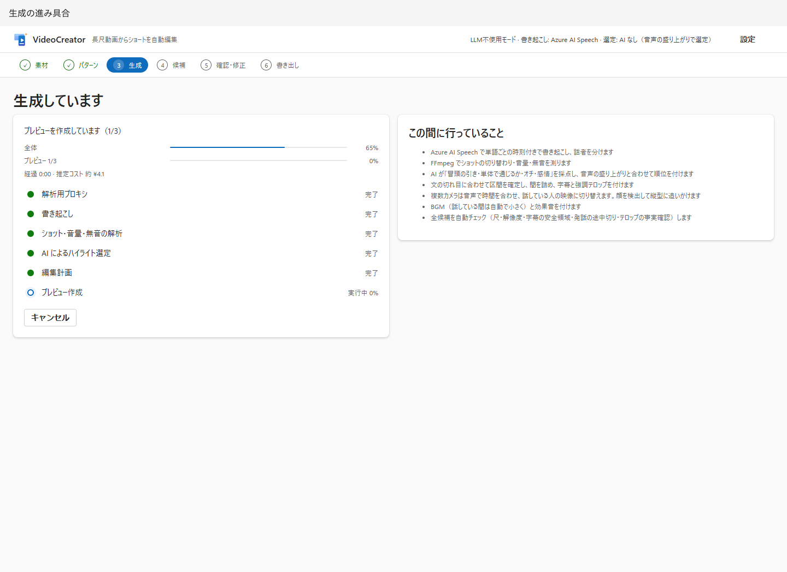

| 组件 | 含义 |
|---|---|
| 整体进度条 | 流水线整体进度，不是匀速时钟 |
| 当前处理进度条 | 可测处理显示实测进度，无法测量时无百分比动画 |
| 已用／预计剩余时间 | 已用从打开界面起算；剩余为当前可测处理估计 |
| 阶段列表 | 代理→转写→信号分析→筛选→编辑计划→预览 |
| 此期间的处理 | 常规说明，缓存、无 AI、模式会影响实际执行 |
| 取消 | 取消生成，不同于取消候选导出 |

离开界面后服务端仍继续。失败或取消时读原因，从“返回项目”修改条件。

## 4. 候选比较与系列

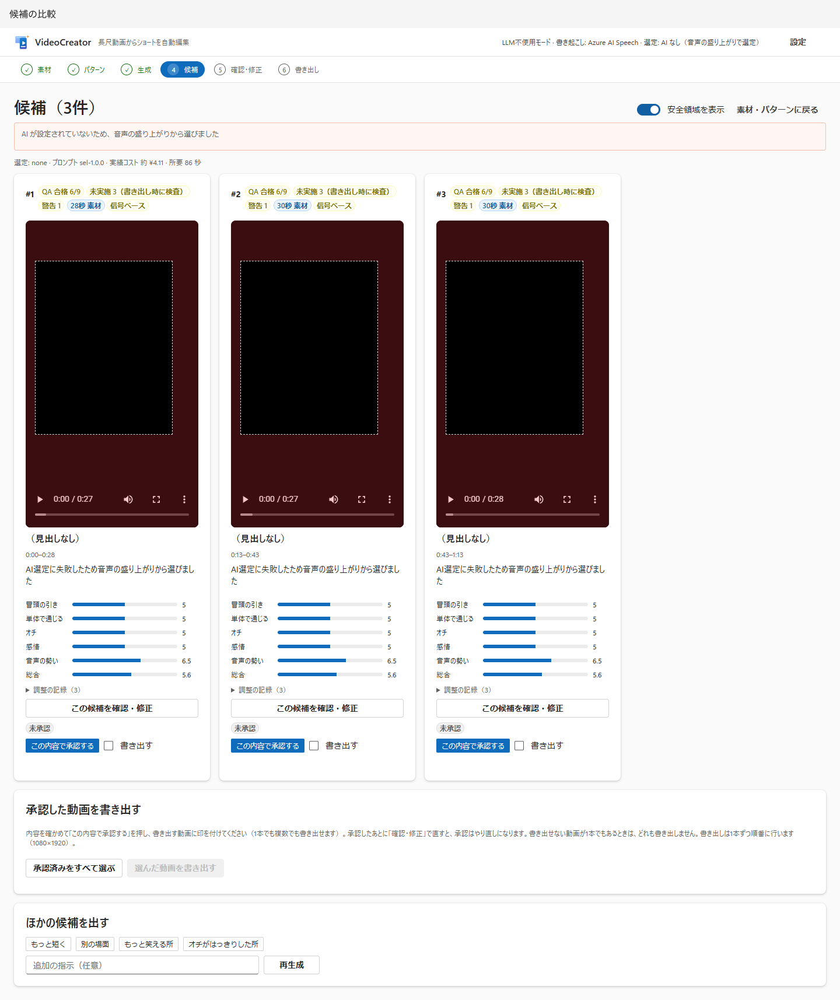

| 组件 | 含义与注意事项 |
|---|---|
| 候选编号、标题、原因 | 排名与筛选依据，为 AI 或信号建议，不保证受欢迎 |
| “○秒素材”与原视频时间 | 所选区间长度及源位置，不是静音剪除／先行亮点后的成品时长 |
| 预览与播放控件 | 实际观看并听声音，低分辨率不可用于判断最终画质 |
| 开场吸引力／独立可理解／包袱／情感 | 内容评价。基于信号时不一定是理解内容的 AI 评价 |
| 音频活跃度／综合 | 音量等信号评价与合成分数，均为 0～10 参考 |
| 基于信号 | 没有 AI 或失败后改为主要依据音量筛选 |
| QA 徽章 | 区分计划通过、警告及最终导出才检查的未执行项 |
| 调整记录 | 区间修正或约束引起的修改原因 |
| 检查与修改 | 打开该候选编辑界面 |
| 附指示重新生成 | 寻找其他候选，没有 AI 时不一定体现语义指示 |
| 返回素材与模式 | 修改模式和生成条件 |

系列不显示排名和分数，而显示前篇／中篇／后篇／第 n 集顺序、原视频正文范围、拆分依据及章节。改拆分需在项目修改数量／时长后重新生成。

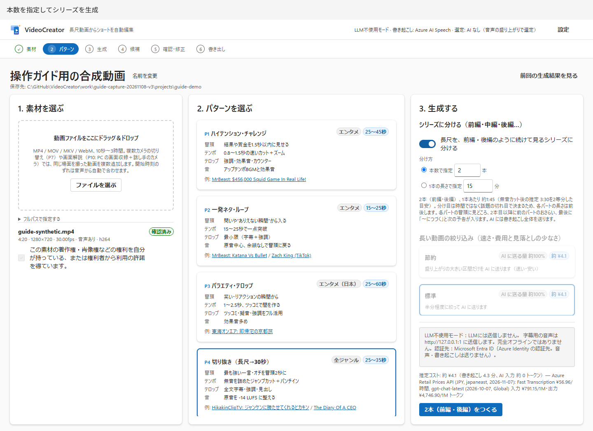

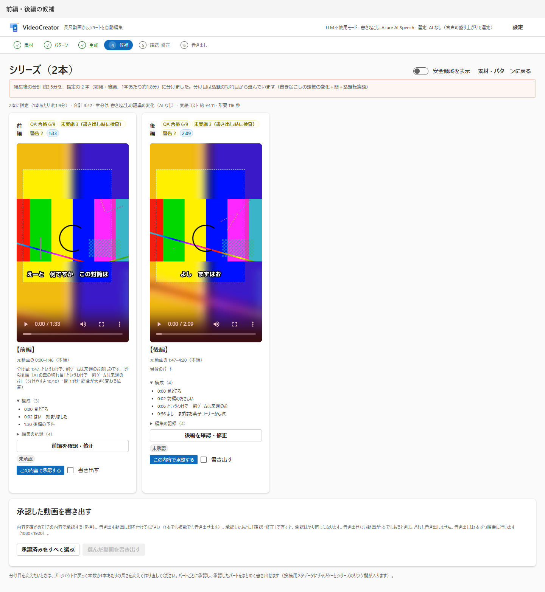

### 批准后批量导出

| 组件 | 含义 |
|---|---|
| 批准当前内容 | 记录对**此时编辑计划**的确认 |
| 未批准／已批准／批准后已修改 | 编辑改变计划后需要重新批准 |
| 撤销批准／重新批准 | 更新自己的判断 |
| 导出 | 勾选本次导出候选，可选已批准且未在导出的项 |
| 选择所有已批准 | 辅助选择，不会自动批准 |
| 导出所选视频 | 全部预验证，任一不可则不启动任何项；开始后按排名／部分顺序逐条处理 |
| 进度／打开已导出视频 | 各候选状态及完成文件入口 |
| 取消等待项 | 仅取消未开始导出，执行中会处理到最后 |

### 逐个检查多个视频后批量导出

同一模式（Job）有两个以上视频时，候选列表上方显示**检查进度**。

| 组件 | 含义 |
|---|---|
| 检查进度：批准 n / N 条 · 已导出 m / N 条 | 此模式已批准数（含导出中、已导出）及已导出数 |
| 检查下一个未批准（视频名） | 打开首个未批准视频的“检查与修改” |
| 进入导出（已批准 n 条） | 进入“6. 导出”列表，有已批准视频时成为主按钮 |
| 各视频状态 | 未检查／已批准／需重新批准（批准后修改）／导出中／已导出，可点击名称打开“检查与修改” |

步骤显示的“检查与修改”链接到首个未检查视频，“导出”链接到导出列表。

## 5. 检查与修改

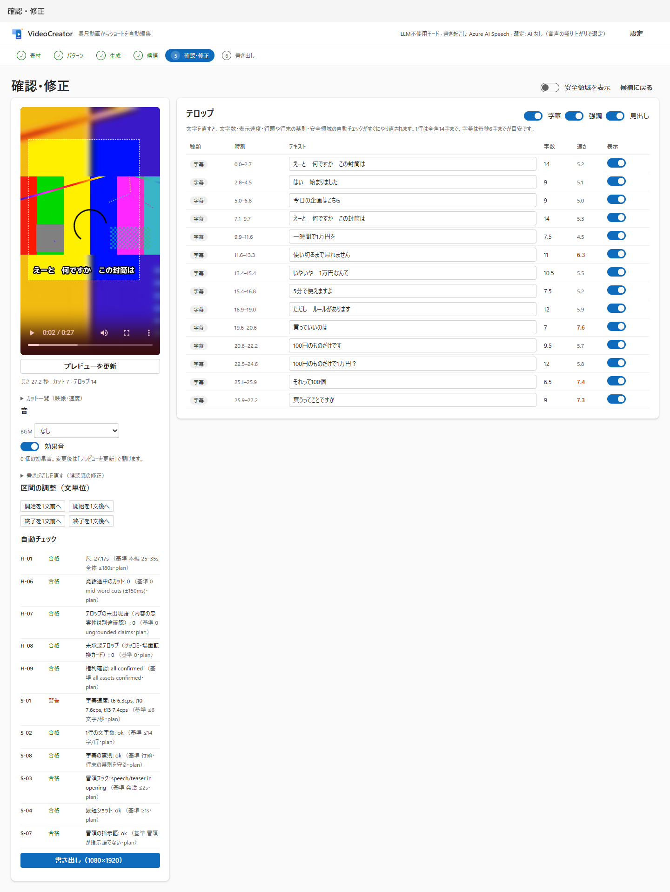

| 组件 | 含义与操作 |
|---|---|
| 更新预览 | 重绘编辑后的内容，不用旧预览判断 |
| 时长／正文与整体／剪辑与文字数 | 计划信息，整体包含启用插入物 |
| 屏幕文字与转场 | 文字、片头、转场卡、吐槽卡、片尾按导出后时间在同一表显示。上方开关按类型（字幕、强调、标题、拟声、吐槽、片头、转场卡、片尾）批量开关，“吐槽”同时影响叠字及吐槽卡 |
| 片头与卡片行 | 插入位置、时长、文字、使用开关，卡片最多 20 字符。卡片暂停视频全屏显示（比例接近时放大铺满，否则以相同图像模糊背景显示全图） |
| 批准所有吐槽／卡片 | 自行阅读 AI 文本。人工改写卡片记录为人工文字 |
| 剪辑列表（画面与速度） | 检查素材、长度、速度、人脸跟随、屏幕缩放、画中画，不是通用时间线编辑 |
| BGM 与音效 | “音频与 BGM”可改 BGM（无／按场景／全程此曲）、讲话时人声差（10～30 LU，10 LU 为易听下限参考）、无讲话处 BGM 音量。逐场景显示时间、场景活跃度及测量值、曲目（可恢复自动／此场景无 BGM）、音量（−12～+6 dB）、选择原因。色带显示曲目流及降低 BGM 处（高度＝降低幅度），蓝线为播放位置。更新预览后实测并显示讲话时差值（S-15）。P5 按拍剪辑不可换曲，可改音量 |
| 修正转写 | 修改使用范围单词，不改时间并重建字幕，手改字幕可能被覆盖 |
| 开始／结束前移或后移一句 | 按句调整短视频区间，素材边界和时长条件可能限制 |
| 自动检查 | 当前计划即时 QA，不同于最终文件音量、分辨率测量 |
| 批准／撤销自动检查 | 保存／撤销确认各检查结果的记录，显示批准时间 |
| 批量批准自动检查 | 批准包括通过项在内的已执行、未批准项，未执行不在范围 |
| 批准当前内容并导出（1080×1920） | 一个视频时，批准当前内容后导出 |
| 仅批准并返回候选 | 一个视频时，记录批准并返回列表 |

同模式两个以上视频时，标题下出现视频切换，操作变为：

| 组件 | 含义与操作 |
|---|---|
| ‹ 上一个／“视频 i / N”与选择／下一个 › | 切换同模式视频，选项显示各视频状态 |
| 批准并转到下一个（视频名） | 批准当前内容，打开下个未批准视频（到末尾后从头寻找） |
| 批准并进入导出 | 其他视频全部批准时，批准当前视频后进入“6. 导出” |
| 批准当前内容并返回候选 | 批准后返回列表查看进度 |
| 仅立即导出这一个（1080×1920） | 不经列表，只批准并导出此视频 |

当前内容已批准时不重复建立记录。存在硬性失败时任何批准按钮均不可用。

批准自动检查仅记录“已确认内容”，不会将失败或警告改为通过，也不解除导出约束。与文字／卡片批准是不同操作，刷新后保留，但编辑或结果变化需重新批准。

系列断点不可在此移动。当前 UI 转写修正伴随 `replan`，系列可能产生约束错误。系列误字幕在文字栏修正，如需根本修改转写，可在短视频侧处理，参见 [API 限制](configuration-api.md#编辑操作)。

### 文字表

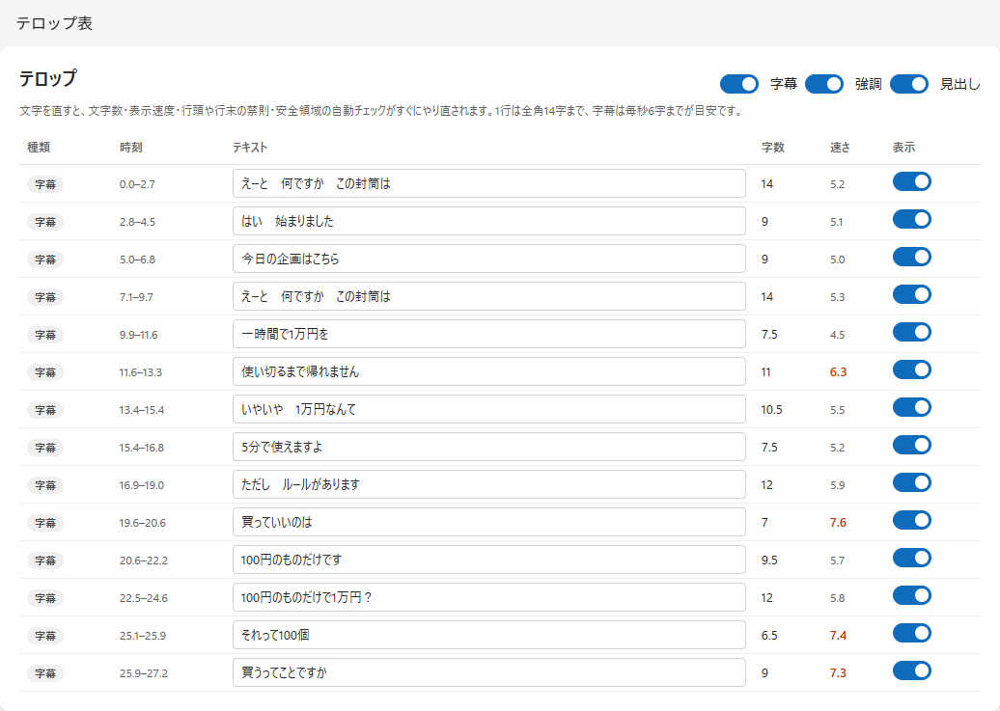

| 栏与组件 | 含义 |
|---|---|
| 类型 | 字幕＝发言，强调＝关注词，钩子＝开场吸引，标题＝话题，吐槽＝补充，拟声＝声音文字化，计数器＝数字等 |
| 时间 | 含插入物的成品视频显示时间（秒） |
| 文本 | 改写并移出焦点保存。40 字符是输入上限，不保证可读或处于安全区域 |
| 字数 | 全角换算（半角约 0.5 字），为显示宽度参考 |
| 速度 | 每秒全角换算字数，过快不易阅读 |
| 显示开关 | 每行开关，禁用行浅色 |
| 类型开关 | 批量显示／隐藏字幕、强调等 |
| 批准 | 确认未批准 AI 文本，吐槽需显式批准 |

手动恢复屏蔽词、数字、专有名词可能导致 QA 失败。优先在不改变内容的前提下保持可读，而不是只消除警告。

## 6. 导出

### 导出列表（批量视频）

从候选列表的**进入导出**或最后视频的**批准并进入导出**打开（`#/job/{id}/exports`）。关闭应用后下次从此恢复。

| 组件 | 含义 |
|---|---|
| 检查进度 | 批准数、已导出数及未批准视频链接 |
| 各视频行 | 名称、标题、时长、QA 徽章、“检查与修改”、批准状态、导出勾选 |
| 导出勾选 | 初始选择已批准且未导出视频 |
| 导出所选视频 | 与候选列表相同批量处理，全部预验证，任一不可则不启动 |
| 进度／打开已导出视频 | 各视频导出状态与完成界面入口 |
| 成品与保存位置 | 完成后列表内自动显示最终文件播放器，支持播放、定位、安全区域、绝对路径查看复制及**打开文件夹** |
| 投稿文案 | 逐视频只读显示已保存 YouTube 描述、Viva Engage 帖文和章节，可单独复制。未生成或缺失时点击**生成投稿文案**，仅打开列表不会生成 |
| 其他产物与预览 | 展开显示各文件路径及“打开”“保存”。图像可预览，SRT、ASS、Markdown、JSON 可**预览内容**。长文最多前 65,536 字符，保留全文链接 |

重新导出中也可检查上次成品。编辑导致失效的结果不显示为当前成品。文件缺失或播放／复制／文件夹显示失败时，在对应视频栏说明原因。无法复制时选择文本 Ctrl+C。移动或删除文件后用**重新加载产物**检查。

### 完成界面

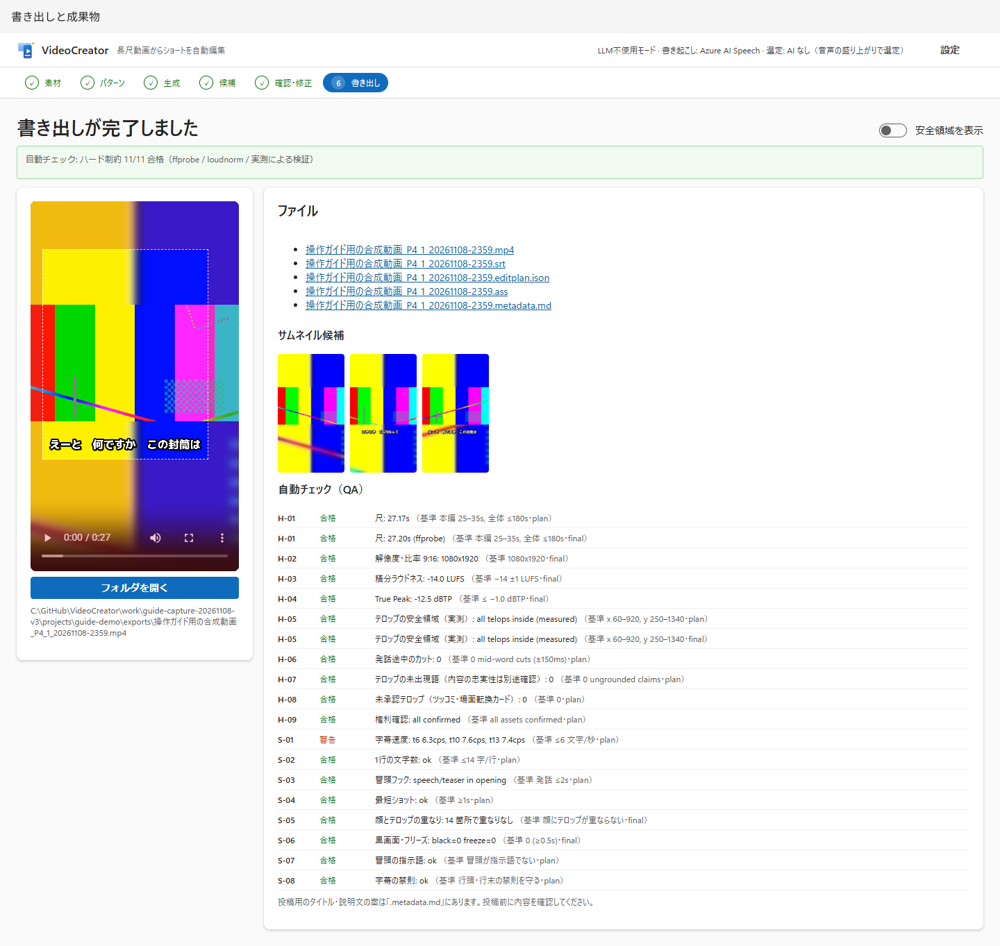

导出时显示画面合成、音量调整、QA、相关文件生成状态。完成后可用：

| 组件 | 含义 |
|---|---|
| 返回候选（检查其他视频）／导出列表 | 返回同模式其他视频检查或批量导出 |
| 硬性约束通过数 | 最终文件与计划结果，分阶段多行使 ID 种类数不等于通过行数 |
| 成品视频 | 最终画质播放检查 |
| 保存位置、复制路径／打开文件夹 | 显示复制绝对路径，在 Windows 资源管理器选中成品，失败显示消息 |
| 文件链接 | 浏览器打开／保存 MP4、SRT、ASS、JSON、元数据 |
| 缩略图候选 | 三张，自己选择用于平台 |
| QA 列表 | ID、状态、测量值、标准、`plan` / `final` |
| 投稿文案（复制粘贴） | 与列表共用的只读片段。YouTube 描述（最多 5,000 字）、Viva Engage 帖文（最多 10,000 字）、章节（`00:00 标题`）。显示字数，超限红色。**复制**后在目标修改。未生成时按钮创建，**生成其他方案**重写。AI 不可用词及原因黄色提示，不添加章节原因显示在该栏 |
| 折叠记录 | 执行命令等复现资料，分享前检查秘密和个人路径 |

## 7. 设置

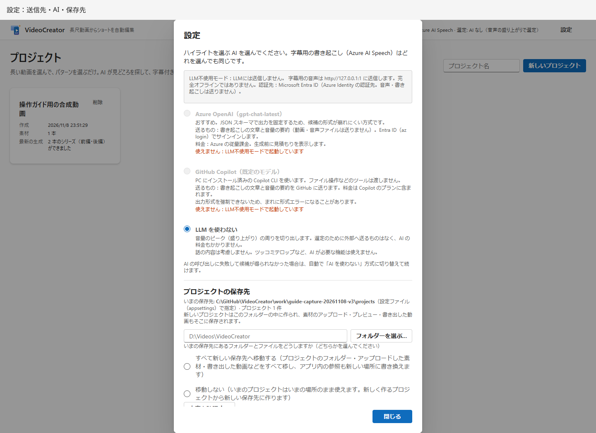

| 组件 | 含义与注意事项 |
|---|---|
| Microsoft Foundry／GitHub Copilot／不使用 LLM | 亮点筛选方式，修改立即反映服务端，“关闭”不是保存按钮 |
| 不可用 | 缺端点、无 CLI、启动时强制不使用 LLM 等 |
| 发送目标 | 正常音频与文本目标及认证目标，不使用 LLM 不等于停 ASR |
| 当前保存位置与数量 | 新项目保存位置及已有数量 |
| 新保存位置／选择文件夹 | 指定新项目位置，不是修改 DB／缓存 DataDir |
| 全部迁移／不迁移 | 前者连当前保存位置直属文件一起迁移，后者仅新项目到新位置 |
| 确认内容 | 检查大小、空余空间、迁移对象和问题，尚不迁移 |
| 确认后修改按钮 | 阅读计划后实际修改，处理中、同名冲突等会被拒绝 |
| FFmpeg／缺少滤镜／Copilot CLI／模式数 | 诊断启动环境，分享前遮盖 CLI 路径个人信息 |
| 关闭 | 关闭对话框 |

AI 选择为 Runtime 状态，重启恢复启动配置。保存位置界面配置保存到 DB 并优先。迁移后手动移回文件夹会导致引用错位，请阅读[保存与恢复注意](troubleshooting.md#保存与备份)。

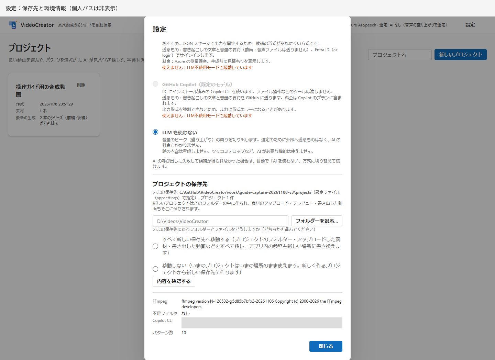
