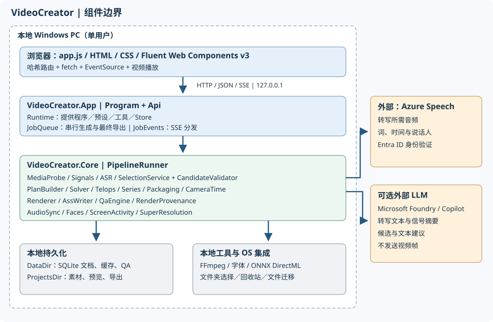
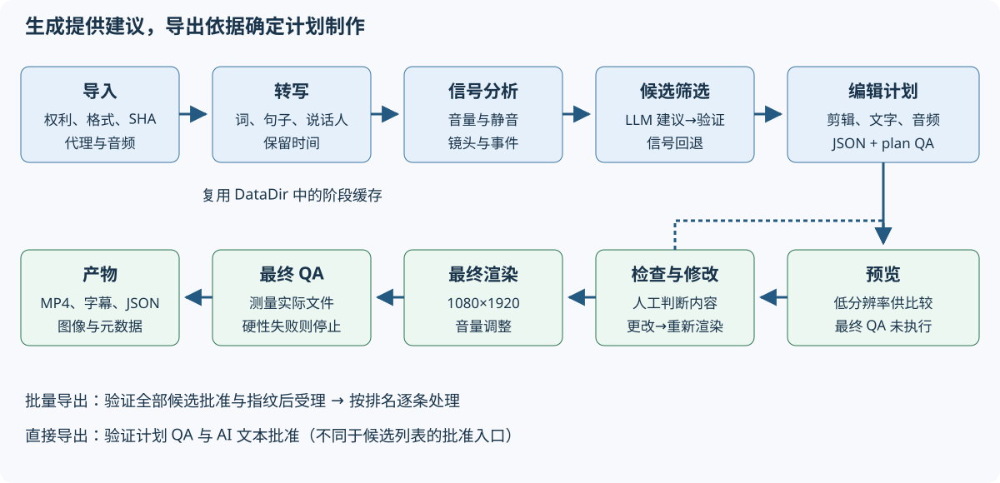
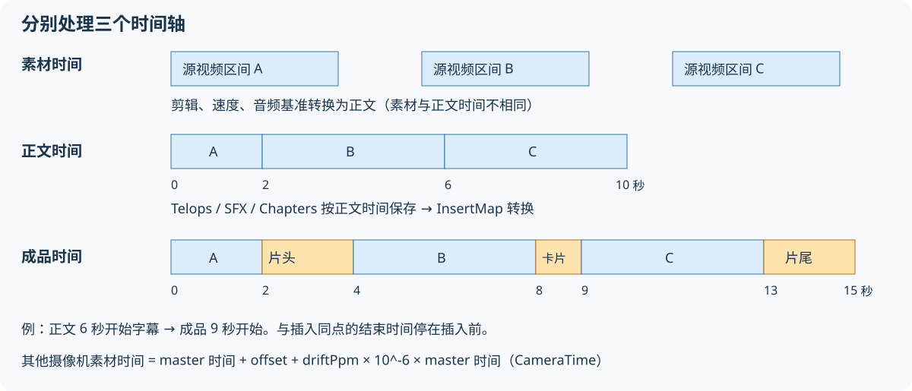

# 面向软件工程师的技术参考

[应用 README](../README.md) / [指南目录](README.md) / [快速入门](quickstart.md) / [界面说明](screens.md) / [遇到问题](troubleshooting.md) / [配置与 API](configuration-api.md) / [验证与维护](verification.md)

对象为当前 C#/.NET 10 实现。它不是通用视频编辑库或多用户服务，而是 Windows 上面向单个用户的本地 Web 应用。设计需求见 [PRD](../docs/PRD.md)，历史实测见[实现报告](../docs/IMPLEMENTATION.md)。不要将历史验证结果用于证明最新条件已通过。

## 1. 组件架构



| 层 | 职责与实现入口 |
|---|---|
| Browser UI | [index.html](../../../src/VideoCreator.App/wwwroot/index.html)、[app.js](../../../src/VideoCreator.App/wwwroot/js/app.js)、[app.css](../../../src/VideoCreator.App/wwwroot/css/app.css)。Vanilla ES modules、Fluent Web Components v3、哈希路由 |
| Hosting / HTTP | [Program.cs](../../../src/VideoCreator.App/Program.cs)。Kestrel 使用 IPv4 回环、Host 验证、自定义标头、异常处理、CSP。不是带身份验证的公开服务器 |
| API | [Api.cs](../../../src/VideoCreator.App/Api.cs)。输入验证、CRUD、批准、批量受理、预览与导出入口 |
| Runtime | [Runtime.cs](../../../src/VideoCreator.App/Runtime.cs)。根据配置构建 FFmpeg、Store、Presets、ASR、LLM、音频与人脸服务。LLM 可运行时修改 |
| Background work | [JobQueue.cs](../../../src/VideoCreator.App/JobQueue.cs)。单 worker 串行处理生成和最终导出，维护 SSE JobEvents 与导出状态 |
| OS integration | [FolderPicker.cs](../../../src/VideoCreator.App/FolderPicker.cs)、[ProjectDeletion.cs](../../../src/VideoCreator.App/ProjectDeletion.cs)、[ProjectsLocation.cs](../../../src/VideoCreator.App/ProjectsLocation.cs)。文件夹选择、回收站、迁移与恢复 |
| Optional work | [SceneCardService.cs](../../../src/VideoCreator.App/SceneCardService.cs)、[BrandKitWorker.cs](../../../src/VideoCreator.App/BrandKitWorker.cs)。卡片提取与注册视频画质提升 |
| Pipeline | [PipelineRunner.cs](../../../src/VideoCreator.Core/Pipeline/PipelineRunner.cs)。各阶段执行、缓存、进度、渲染、QA、产物 |
| Media / analysis | [MediaProbe](../../../src/VideoCreator.Core/Media/MediaProbe.cs)、[SignalExtractor](../../../src/VideoCreator.Core/Signals/SignalExtractor.cs)、[AudioSync](../../../src/VideoCreator.Core/Audio/AudioSync.cs)、[FaceService](../../../src/VideoCreator.Core/Faces/FaceService.cs)、[ScreenActivity](../../../src/VideoCreator.Core/Media/ScreenActivity.cs) |
| ASR / selection | [AzureFastTranscriber](../../../src/VideoCreator.Core/Asr/AzureFastTranscriber.cs)、[Providers](../../../src/VideoCreator.Core/Selection/Providers.cs)、[SelectionService](../../../src/VideoCreator.Core/Selection/SelectionService.cs)、[CandidateValidator](../../../src/VideoCreator.Core/Selection/CandidateValidator.cs) |
| Planning | [PlanBuilder](../../../src/VideoCreator.Core/Planning/PlanBuilder.cs)、[Solver](../../../src/VideoCreator.Core/Planning/Solver.cs)、[Planners](../../../src/VideoCreator.Core/Planning/Planners.cs)、[ScreenPlanner](../../../src/VideoCreator.Core/Planning/ScreenPlanner.cs)、[Series](../../../src/VideoCreator.Core/Planning/Series.cs)、[TelopBuilder](../../../src/VideoCreator.Core/Planning/TelopBuilder.cs) |
| Rendering / QA | [Renderer](../../../src/VideoCreator.Core/Rendering/Renderer.cs)、[AssWriter](../../../src/VideoCreator.Core/Rendering/AssWriter.cs)、[QaEngine](../../../src/VideoCreator.Core/Qa/QaEngine.cs)、[RenderProvenance](../../../src/VideoCreator.Core/Rendering/RenderProvenance.cs) |
| Storage / schemas | [Store](../../../src/VideoCreator.Core/Storage/Store.cs)、[Models](../../../src/VideoCreator.Core/Models/Models.cs)、[Json](../../../src/VideoCreator.Core/Json.cs)、[Preset](../../../src/VideoCreator.Core/Presets/Preset.cs) |

App 和 Tests 为 `net10.0-windows`，Core 为 `net10.0`。[App csproj](../../../src/VideoCreator.App/VideoCreator.App.csproj) 使用 Windows Forms。Core 的 [csproj](../../../src/VideoCreator.Core/VideoCreator.Core.csproj) 引用 DirectML 的 ONNX Runtime 等，不应仅根据 Core TFM 就认为全部功能跨平台。

## 2. 生成与导出流程



1. **导入**：检查存在、格式、时长，生成 SHA-256、代理和分析用音频。多素材处理音频基准、同步和角色。
2. **转写**：从 ITranscriber 获取词、句子、说话人和时间。词典作为短语列表传入，有缓存则复用。
3. **信号分析**：镜头、100ms 音量、静音、事件，也作为没有 LLM 时的筛选依据。
4. **候选筛选**：代码验证、修正 IHighlightSelector 结果并去重。长视频分块并基于信号筛选，必要时重新排名。没有结果则回退到信号筛选。
5. **规划**：Solver 生成片段，按预设应用 speech / switch / speed / beat / screen、系列、人脸跟随、屏幕文字、音频、插入物及屏蔽词。
6. **预览**：依据编辑计划渲染，按阶段保存 QA，显示最多 3 个候选。
7. **编辑**：通过 PlanEditor 等更新计划、保存历史并重跑计划 QA。显式更新预览，修改计划使候选批准指纹不匹配。
8. **最终输出**：先检查计划硬性 QA。以 1080×1920 合成、调整音量、执行最终 QA。仅全部硬性结果 pass 时确定发布输出，并生成 SRT、ASS、计划、缩略图与元数据。

**设计边界**：AI 建议区间和文案，Renderer 从已确定计划与素材生成视频。不能仅靠 LLM 提示保证质量约束。源音频含义与权利的最终判断仍由用户承担。

## 3. 数据模型与持久化

| 模型 | 保存与关系 |
|---|---|
| Project | 文件夹、语言、卡片设置；Asset / Rights / Job 的父对象 |
| SourceAsset | 源文件绝对路径、SHA-256、MediaInfo、角色、说话人、同步值 |
| Transcript / Word / Sentence | 缓存 JSON。词 ID 和时间是字幕、剪辑及内容比对依据 |
| SignalSet | 缓存 JSON，含镜头、静音、音量、事件 |
| Job | 生成配置、状态、费用计算、阶段时间、警告、候选 ID |
| Candidate | Job 子对象。筛选区间、原因、得分、EditPlan 与预览 Render ID、批准 |
| EditPlan | Project 子对象。Canvas、Timeline、Telops、Audio、Inserts、Series、Provenance |
| Render | EditPlan 子对象。preview / final、实际文件、Outputs、分阶段 QA、复现记录 |
| BrandKit / BgmTrack / setting | 共享注册或项目音频、保存位置配置 |

Store 是使用 SQLite `docs(kind,id,parent,json,updated)` 的 JSON 文档存储。JSON 按共享 `Json.Options` 使用 snake_case 和字符串枚举。文件夹文件与 DB 分离，没有仅凭输出 JSON 导入整个项目的 API。

缓存位于 DataDir 的 `cache\<素材SHA-256前16字符>`。转写键包含 ASR Name 和词典，信号为 `signals.v2.json`（镜头边界、黑场、音量等），另有人脸、屏幕分析等。**仅改变 ASR 端点或 locale 不一定使转写缓存失效。** 添加新提供程序或算法时需测试与现有键的冲突、兼容性及失效方针。

素材绝对路径更改使用 [StorePaths](../../../src/VideoCreator.Core/Storage/StorePaths.cs) 重新设根。同驱动器 rename，跨驱动器 copy 后核对文件数／大小，再事务更新 JSON 引用。这不等于对全部文件内容进行密码学比对。

## 4. 不可混淆的三个时间轴



1. **素材／master 时间**：词时间与源视频位置。其他摄像机时间通过 `SourceAsset.CameraTime(masterT, masterId)` 转为 `masterT + offset + driftPpm × 10^-6 × masterT`。
2. **编辑后正文时间**：累计 Timeline 各片段时长 `(src_out-src_in)/speed`。Telops、SFX、系列章节在此规划。
3. **成品文件时间**：向正文插入 Opening／Card／Closing 后，用 [InsertMap](../../../src/VideoCreator.Core/Planning/Packaging.cs) 转换。开始时间与插入点相同时在插入后，结束时间相同时在插入前。

例如正文 2 秒处插入 2 秒 Opening，6 秒处插入 1 秒 Card，正文 6 秒开始的字幕在成品 9 秒开始。跨卡片字幕拆分渲染，卡片上不显示。不能用插入物时间相加替代片段加速和摄像机同步。

## 5. 批准、QA 与可复现性契约

- `CandidateApproval` 记录批准人、时间及 `EditPlanFingerprint.Of(plan)` SHA-256，不是签名或用户认证。
- 批量受理先验证所有候选归属、批准、指纹、处理状态和计划 QA；任一不可则不启动。受理后的队列使用已批准快照。
- 检查界面的直接 render API 不要求候选批准，但要求 AI 屏幕文字等批准和计划 QA。不要认为两个入口批准条件相同。
- 批量“预受理全有或全无”不等于开始执行后“全部文件一起成功或失败”。运行中个别失败显示在对应候选。
- 保留 QA `Stage`、`PlanHash`、`not_run`，不将旧结果或预览复用为最终通过。
- `Render.Reproducibility` 包含计划、FFmpeg、buildconf、字体、预设、素材哈希、文本库信息、encoder threads 等。比较对象为**解码后的帧**，不只是容器字节一致。
- 复现前提是素材、计划、工具、字体和环境一致，不保证重新调用 LLM 得到相同候选。

## 6. 自定义入口与验证

| 想修改什么 | 修改位置与约束 | 对应测试 |
|---|---|---|
| 时长、节奏、音频和装饰默认值 | [presets](../../../presets)、PresetStore.Validate。ID 为 `P数字`、semver，启动加载因此需重启 | [PlanningTests](../../../tests/VideoCreator.Tests/PlanningTests.cs)、[VarietyTests](../../../tests/VideoCreator.Tests/VarietyTests.cs) |
| 字号、描边、换行 | 共用 AssWriter Metrics/Band/CaptionLineChars、JapaneseText、TelopBuilder。渲染、自动缩小、QA 不另建不同表 | [CaptionLayoutTests](../../../tests/VideoCreator.Tests/CaptionLayoutTests.cs)、[JapaneseTextTests](../../../tests/VideoCreator.Tests/JapaneseTextTests.cs)、[RenderingTests](../../../tests/VideoCreator.Tests/RenderingTests.cs) |
| 候选建议方式 | IHighlightSelector、Providers、SelectionPrompt、SelectionService、Runtime 与设置 UI。统一输出验证、重试、fallback、费用及发送目标 | [SelectionTests](../../../tests/VideoCreator.Tests/SelectionTests.cs)、[V12Tests](../../../tests/VideoCreator.Tests/V12Tests.cs) |
| ASR | ITranscriber、Runtime、配置及发送目标、缓存键。保留词 ID、时间、说话人、句子结构 | [PlanningTests](../../../tests/VideoCreator.Tests/PlanningTests.cs)，另用实际素材测量时间及识别精度 |
| 摄像机与屏幕编辑 | AudioSync、CameraTime、SwitchPlanner、ScreenPlanner，同步使用 AudioSync.TimelineFilter 时间一致 PCM | [MultiSourceTests](../../../tests/VideoCreator.Tests/MultiSourceTests.cs)、[V11Tests](../../../tests/VideoCreator.Tests/V11Tests.cs) |
| 系列与插入物 | Series、Packaging、InsertMap。统一文字、SRT、QA、元数据时间 | [SeriesTests](../../../tests/VideoCreator.Tests/SeriesTests.cs)、[PackagingTests](../../../tests/VideoCreator.Tests/PackagingTests.cs)、[SceneCardTests](../../../tests/VideoCreator.Tests/SceneCardTests.cs) |
| 投稿文案与章节 | PostCopy（Planning）。代码用 InsertMap 转换导出后章节时间，不让 AI 编写。仅将已屏蔽转写提供给 AI，只使用通过 PostCopy.Check（长度、URL、时间、屏蔽词、发言中没有的词）的文本。拒绝部分附原因仅重写一次 | [PostCopyTests](../../../tests/VideoCreator.Tests/PostCopyTests.cs) |
| UI 输入组件 | app.js、app.css、Fluent v3。checkbox/switch 使用 field 的 label/input slot。保留 esc()、事件后状态重绘及键盘操作 | [E2E](../../../ui/e2e.mjs)、[v1.1 E2E](../../../ui/e2e-v11.mjs)、真实 Edge |
| API、批准与保存 | Api、Models、Store、JobQueue、ProjectsLocation。snake_case、带代码错误、编辑后重新批准、路径边界 | [ApprovalExportTests](../../../tests/VideoCreator.Tests/ApprovalExportTests.cs)、[ProjectsLocationTests](../../../tests/VideoCreator.Tests/ProjectsLocationTests.cs)、[RenderRecordTests](../../../tests/VideoCreator.Tests/RenderRecordTests.cs) |

添加预设最简单方式是复制现有 JSON，修改 ID、version、name 和所需字段后重启。添加新 planner 则也要修改 PlanBuilder 和 PresetStore 允许列表，仅在 JSON 加名称不会增加处理。

当前 Canvas、导出 UI 和 QA 以竖屏 1080×1920 为前提。横屏需一致修改与验证。公开网络服务也不能仅修改 Listen，需另行设计认证、授权、CSRF、文件访问和任务隔离。

FFmpeg 使用参数数组调用。经管道传输原始帧的子进程需保留 `-nostdin`。避免经 shell 拼接命令字符串，保留 ASS 控制字符及用户／LLM 文本转义。

## 7. 构建与测试

从仓库根目录执行。已有依赖工具时无需重新获取。

```powershell
pwsh scripts\get-tools.ps1
dotnet build src\VideoCreator.App\VideoCreator.App.csproj -c Release
dotnet test --project tests\VideoCreator.Tests
```

[global.json](../../../global.json) 指定 Microsoft.Testing.Platform runner。测试数量会变化，不将固定数值作为验收标准。修改 UI 包时使用 [ui/package.json](../../../ui/package.json) 的 `npm run build`；E2E 对运行中的应用使用 `node e2e.mjs <视频> <URL>`。E2E 涉及外部服务、费用和已有截图更新，请指定隔离保存位置。

本次资料制作中实际执行的验证单独记录于[验证与维护](verification.md)。
