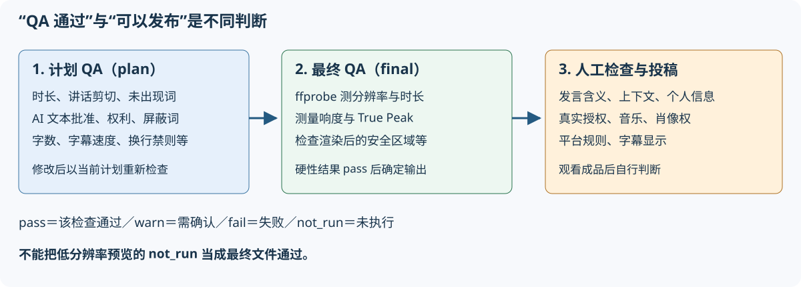

# 遇到问题：错误、QA 与保存

[应用 README](../README.md) / [指南目录](README.md) / [快速入门](quickstart.md) / [界面说明](screens.md) / [配置与 API](configuration-api.md) / [验证与维护](verification.md)

## 首先定位问题

1. 启动终端是否仍在运行？仅打开浏览器不会启动服务器。
2. “设置”中的提供程序和发送目标是否为**自己的配置**？
3. 素材音频、时长、权利确认及选择的模式是否正确？
4. 记录失败阶段、错误代码、QA ID 及测量值，不要分享登录令牌。
5. 修正条件后重试。在相同配置下重复操作前先确认原因。

## 常见症状

| 症状与代码 | 检查事项与下一步 |
|---|---|
| 无法启动、缺少工具 | 检查 `.\run.cmd --check` 的 `FAIL`，用 `.\run.cmd --setup` 重新安装。离线或组织安装限制请咨询管理员 |
| 浏览器无法连接 | 使用启动日志的 URL，默认为 `http://127.0.0.1:8765/`。改端口需改 URL。设计上不允许其他 PC 访问 |
| 启动时端口占用 | 检查已有应用。不要无差别停止其他进程，改用其他端口 |
| `E-RIGHTS-REQUIRED` | 勾选所有素材权利确认，BGM、注册视频及图像需另行确认 |
| `E-ING-UNSUPPORTED` | 检查路径、真实格式、视频轨及 10 秒～3 小时条件。仅改扩展名无效 |
| 接收或复制失败 | 检查 OS 临时区域及项目保存位置空间，大素材可考虑完整路径引用 |
| `E-ASR-PROVIDER`、401 | 检查自己的端点、网络及是否通过 `az login` 登录资源租户 |
| Speech/OpenAI 403 | 向管理员确认用户角色和网络限制。可打开管理界面的权限不同于处理数据权限 |
| 已登录 Azure 仍无法认证 | 若其他账户被优先使用，在启动环境配置 `AZURE_TOKEN_CREDENTIALS=AzureCliCredential` |
| 429 或临时服务错误 | 检查速率限制、容量和服务状态，自动重试后仍失败则稍后再试 |
| 没有字幕／转写 | 是否素材无音频，或 ASR 被禁用／未配置？启用 LLM 也不能替代 ASR |
| 只有“基于信号”的候选 | LLM 未配置、不可用或响应验证失败。这是为继续运行使用的替代筛选，并不理解内容 |
| 安静的重要场景未入选 | 筛选改为全文。未使用 AI 时主要依据音量，可考虑配置 AI 或其他模式 |
| `E-SOL-INFEASIBLE` | 无符合条件区间。尝试讲话量与时长充足的其他视频或模式 |
| P7/P10 失败 | 检查同时录制的素材数量、音频、角色和同步结果。P10 区分屏幕与讲解者素材 |
| 系列失败 | 检查含讲话的视频、支持模式、数量／时长条件。对话题中途拆分警告需检查内容 |
| “预览已过时” | 更改已保存到计划，更新预览后再判断 |
| `E-NOT-APPROVED` | 存在未批准视频，请在“检查与修改”批准。批量导出在错误下列出各视频原因（未批准、批准后修改、计划 QA 失败、导出中），任一符合就不启动任何项。代码取最先命中的原因，与单独导出相同 |
| `E-EXPORT-BUSY` | 等待同一编辑计划导出完成（单独或批量均如此） |
| `E-QA-HARDFAIL` | 参照下方 QA 表。计划失败需修改，成品文件失败则检查测量值和渲染环境。批量导出逐个列出失败视频的项目 |
| `E-RND-FFMPEG` | 检查空间、FFmpeg 与滤镜、素材是否仍存在、输出位置权限 |
| `E-PROJECT-BUSY`、无法删除 | 等待生成／导出完成，可取消生成或尚未开始的导出 |
| `E-FILE-IN-USE` | 关闭正在打开项目视频等文件的应用后重试 |
| 无法迁移保存位置 | 检查运行中任务、同名文件、容量及是否指定源位置内部，阅读失败和遗留项目显示 |

安装程序的 `--check` 也会向配置目标发出连通请求。使用组织素材测试外部发送前请确认数据使用许可。

## 正确理解 QA

- **通过（pass）**：该检查在该阶段满足条件。
- **警告（warn）**：需要确认，即使能导出也应复查。
- **失败（fail）**：`H-` 硬性项会阻止导出。
- **未执行（not_run）**：尚未测量，最终导出才测量的项目在预览阶段为此状态。
- **plan**：检查当前编辑计划。**final**：测量完成文件。

| ID | 检查 | 处理与局限 |
|---|---|---|
| H-01 | 时长 | 短视频正文在模式范围内，含插入物总时长另有条件。调整区间或插入物；系列使用系列时长条件 |
| H-02 | 分辨率与比例 | 成品需为 1080×1920，不要把低分辨率预览当作最终通过 |
| H-03 | 响度 | 最终文件目标 −14 LUFS，容差 ±1 LU，无音频素材等可能不满足 |
| H-04 | True Peak | 最终文件不超过 −1 dBTP，需调整音量并重新测量 |
| H-05 | 文字安全区域 | 检查位置、字数和字体；最终阶段实测渲染结果，不是仅看辅助线 |
| H-06 | 讲话中途剪切 | 按句调整区间，ASR 时间容差 ±150ms。P5 优先节拍，可能为警告 |
| H-07 | 文字中的未出现词 | 将数字、专有 token 等与转写／词典比对，**不是对整体语义和上下文的事实核查** |
| H-08 | 未批准文字与卡片 | 阅读 AI 文本后批准，或关闭显示 |
| H-09 | 素材权利确认 | 完成所用素材、图像及插入内容确认。勾选不是法律授权证明 |
| H-10 | 屏蔽词（配置时） | 检查手动编辑是否恢复屏蔽词。仅针对输出，不会匿名化原视频、缓存或云端输入 |
| S-01 / S-02 / S-08 | 字幕速度／行宽／禁则 | 保持含义并缩短，检查朗读速度和自然换行 |
| 其他 S 项 | 钩子、装饰、黑屏等 | 对照界面信息、测量值、标准和视频。全部定义见 [QaEngine](../../../src/VideoCreator.Core/Qa/QaEngine.cs) |

通过数量并不固定。H-01/H-05 等在计划和最终阶段会以相同 ID 出现多行，也有屏蔽词等条件项。**硬性 QA 通过只表示“通过了该自动检查”，不保证内容忠实、权利、隐私、受欢迎程度或平台审核通过。**

最终 QA 失败的 MP4 可能移到项目的 `rejected`。不要将其当作可发布的成功文件。

## 保存与备份

| 保存位置 | 内容 |
|---|---|
| DataDir（默认 `%LOCALAPPDATA%\VideoCreator`） | SQLite DB、转写与信号缓存、QA 工作区域、音频素材等 |
| ProjectsDir（默认 Windows“视频”中的 VideoCreator） | 各项目素材副本、预览、导出、卡片图像等 |
| 通过完整路径引用的外部文件 | 源视频和注册视频。位于管理文件夹之外时需另行备份 |

开发与运维建议：处理完成并退出应用后，将 DataDir、所有实际使用的项目文件夹和外部引用素材一起备份。SQLite 使用 WAL，避免在运行时仅复制单个 DB 文件。备份包含音频、转写和个人路径，也需注意保管。

保存位置通过“设置”修改。选择“不迁移”时旧项目留在原位置；选择“迁移”时当前保存位置内其他文件也属于迁移对象。**不会迁移 DataDir 或管理范围外的外部引用。**

迁移中断时记录失败／遗留项目显示，关闭占用文件。下次启动将根据 `projects-move.json` 恢复。不要手动删除日志或仅修改 DB 中的绝对路径。

重启会重新提交未完成生成任务，并复用可用阶段缓存。**尚未开始的最终导出队列位于内存中**，因此停止前的批量导出不一定恢复。检查完成文件，重新导出需要的候选。
