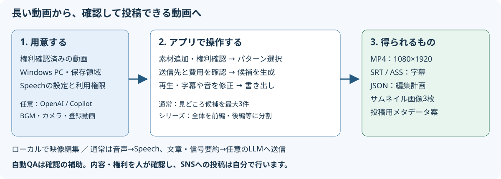

# VideoCreator 利用者ガイド

このガイドは、動画編集や開発に詳しくない利用者と、実装をカスタマイズするSoftware Engineerのための資料です。現在の実装と実画面を基準にしています。

## 目的に合わせて読む

| やりたいこと | 読む資料 |
|---|---|
| 初めて起動して1本の動画を作る | [クイックスタート](quickstart.md) |
| ボタン、欄、スイッチの意味を知る | [画面・コンポーネント説明](screens.md) |
| 失敗・警告を解消する | [トラブルシューティング](troubleshooting.md) |
| 処理やデータ構造を理解して変更する | [テクニカルリファレンス](technical-reference.md) |
| 起動設定やAPIを使う | [設定・APIリファレンス](configuration-api.md) |
| 資料の根拠、検証範囲、画面の再作成方法を知る | [検証と保守](verification.md) |
| このガイドの制作方針（専門家の観点・一次資料・手法・第三者検証）と要件の対応を知る | [制作方針](documentation-brief.md) |

## 先に知っておく用語

- **プロジェクト**：素材・候補・編集・書き出しをまとめる作業単位。
- **素材**：編集の元になる動画。フルパスで追加した場合は元ファイルを参照します。
- **パターン／プリセット**：尺、テンポ、テロップ、音などの編集方針。
- **候補**：どの場面を使うかを提案したもの。公開用ファイルではありません。
- **プレビュー**：確認用の低解像度動画。最終書き出しとは品質・QAの範囲が異なります。
- **テロップ**：字幕、強調語、フック（冒頭の引き）、見出しなど、映像に表示する文字。
- **編集計画**：カット・文字・音・挿入物を記録したJSON。
- **QA**：自動チェック。合格しても、人による内容・権利の確認は必要です。
- **書き出し**：編集計画から公開用の動画と関連ファイルを作ること。SNSへの投稿はしません。

## 図と画面の扱い

模式図は編集可能なベクターSVGです。スクリーンショットもSVGファイルですが、**実ブラウザーのPNGキャプチャを内部に埋め込んだもの**です。画面の絵を想像で描いたものでも、すべての画素をベクター化したものでもありません。

画面例は合成テストパターンと正弦波、既存の書き起こしfixtureを使用しています。通常の発話動画とは異なり、字幕と音声は一致しません。例の `http://127.0.0.1:1` はクラウド送信を避ける検証用設定であり、実利用では指定しません。詳しくは[検証と保守](verification.md)を参照してください。

[アプリのREADMEへ戻る](../README.md)
