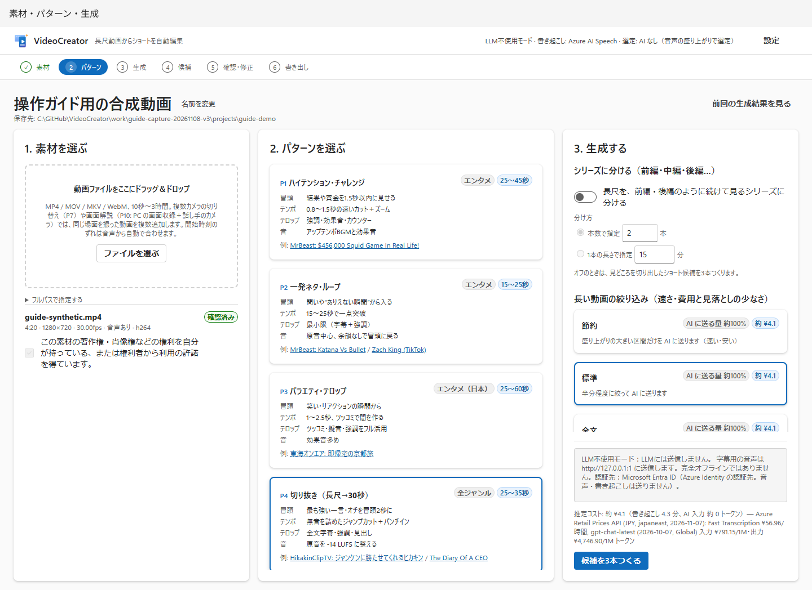
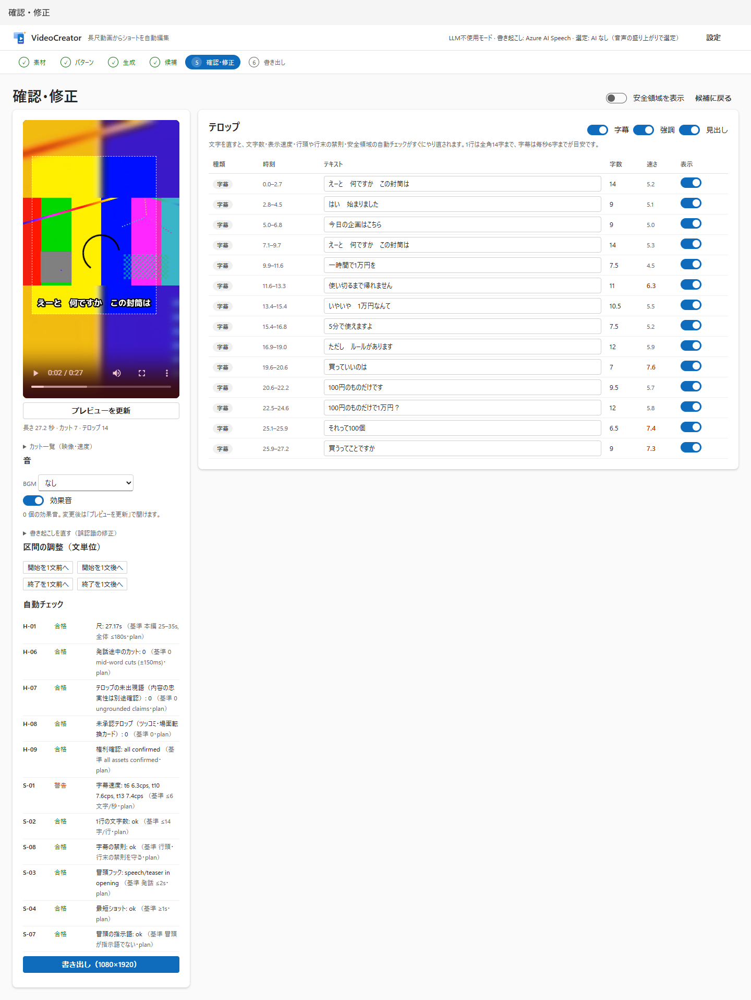
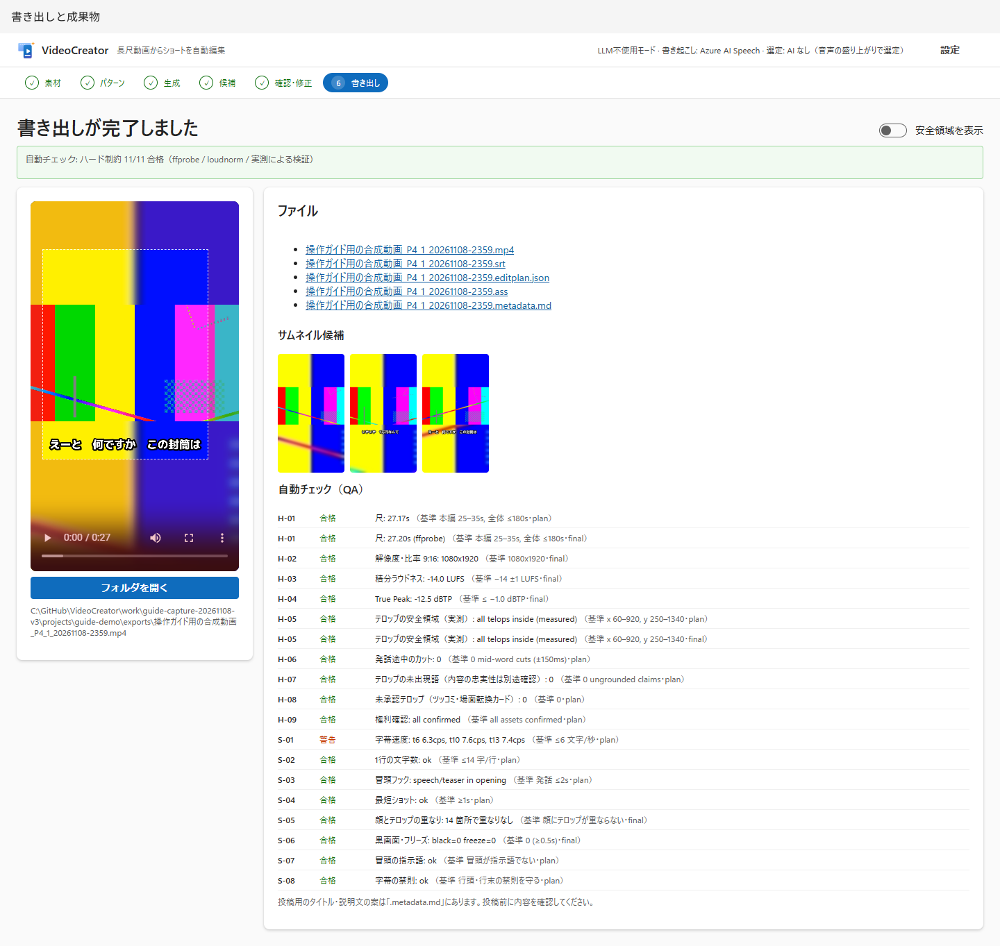

# Quickstart: make your first video

<!-- language-nav -->
[日本語](../quickstart.md) | [English](quickstart.md) | [한국어](../ko/quickstart.md) | [简体中文](../zh-CN/quickstart.md)
<!-- /language-nav -->

[Start](start.md) / [Guide index](README.md) / [Detailed overview](overview.md) / [For engineers](technical-reference.md)


[App README](start.md) / [Guide index](README.md) / [Screens](screens.md) / [Troubleshooting](troubleshooting.md) / [Configuration/API](configuration-api.md)

**Goal:** install the packaged edition, make P4 candidates from one speech video, review the content, and save a portrait (1080×1920) MP4 plus subtitles and other files. Processing time depends on footage, PC, and services; no fixed completion time is guaranteed.

## Before starting: agree on the administrator handoff

Ordinary users do not need to create cloud resources or grant themselves access. Complete this handoff first.

| Owner | Confirm |
|---|---|
| Employee | Footage, permission for people/slides/music, approval to send audio/transcripts outside the company, and who reviews before posting |
| Administrator / IT | Approved package, whether Azure CLI may be installed, account, Microsoft Foundry resource name / deployment name / tenant ID, role assignment, billing owner and spending-limit process, support contact |
| Together | The signed-in account matches the configured services. Test transcription through saving with approved short footage, not just opening the page |

**The easiest route is the packaged edition (the executable from Releases).** It needs no installer, .NET, or FFmpeg; the only thing you install beforehand is Azure CLI. Follow steps 1–3 below in order. Launching from source (`run.cmd` and the setup script) is for people who develop or customize the app and is collected in the [appendix](#appendix-launch-the-source-edition-runcmd). Choose one route, not both. Administrators can use [Configuration/API](configuration-api.md); engineers making changes should use the [technical reference](technical-reference.md).

## 1. Prepare your PC and footage

- Windows 10/11 (x64) or Windows 11 (ARM64), and an Internet connection. Screens are verified in Microsoft Edge. For Apple Silicon macOS, see the [packaged-edition instructions in the detailed overview](overview.md#single-executable-windows--macos).
- To check your PC type, open Windows **Settings → System → About** and look at “System type”. “x64-based processor” means x64; “ARM-based processor” means ARM64.
- Prepare **one video you have permission to use**, including music, faces, logos. Listed formats: MP4 / MOV / MKV / WebM, 10 seconds–3 hours. Start with a few minutes of speech. P4 requires 25–35 seconds of main content; a 10-second input does not guarantee success.
- Check free space. File selection/drag-drop needs the source size in both temporary and destination storage. On one drive allow about twice the source size plus proxies, cache, previews, exports.
- **Full-path input** avoids copying, but moving/deleting the original makes the project unusable.
- Ask your administrator for **the name of the Azure resource (Microsoft Foundry) to use** and, if it is in a tenant other than your default, the **tenant ID**. Assigning the roles (`Cognitive Services Speech User` and `Cognitive Services OpenAI User`) is the administrator's job ([Azure access](azure-access.md)).

## 2. Install (3 steps)

### Step 1: Install Azure CLI and sign in

Subtitle transcription (Azure Speech) and AI selection authenticate with the Microsoft Entra ID account you sign in with on this PC. Azure CLI is used for that sign-in.

1. Right-click the Start button and open **Terminal** (or **Windows PowerShell**).
2. Paste the following and press Enter. If a confirmation appears, choose **Yes**.

   ```powershell
   winget install -e --id Microsoft.AzureCLI
   ```

3. **Close the terminal and open it again.** Otherwise `az` is not found.
4. Run the following and choose your work account in the browser that opens. If asked for a subscription number, choose the one your administrator specified (press Enter if you are not sure).

   ```powershell
   az login
   ```

   If the resource is in a tenant other than your default, use `az login --tenant <tenant ID>`. If `winget` is unavailable or software installation is restricted, ask IT to install Azure CLI.

### Step 2: Download VideoCreator

1. Open the [latest release](https://github.com/dahatake/VideoCreator/releases/latest) and download only the one file for your PC from **Assets**.
   - x64: `VideoCreator.exe`
   - ARM64: `VideoCreator-<version>-win-arm64.exe`
2. Move the downloaded file to a folder that is easy to find (for example `Documents\VideoCreator`). It also works from the Downloads folder.
3. You do not need to download `appsettings.json`. You set the connection on screen in step 3.

To confirm the file has not been tampered with, use the `SHA256SUMS.txt` and `gh attestation verify` checks in the [detailed overview](overview.md#maintainers-build-verify-and-publish).

### Step 3: Launch

1. Double-click the downloaded exe. If “Windows protected your PC” appears, choose **More info** → **Run anyway**. The packaged edition is not code-signed, so this prompt may appear.
2. A black window (console) opens, and after startup your default browser opens <http://127.0.0.1:8765/> (if another program is using port 8765, the URL uses a free port number instead). The first launch takes a little longer while components are extracted. If the browser does not open, open the `http://127.0.0.1:…` URL shown in the black window.
3. **Do not close the black window.** Closing it stops the app. Closing the browser does not stop the app.
4. Next time, just double-click the same exe. If you double-click it again while it is running, a second copy does not start; instead the running app's page opens in your browser (the new window closes immediately).

## 3. Set up the AI connection on first launch

1. On first launch, a “Welcome to VideoCreator” tour (6 screens) appears. Read through it with **Next**, or choose **Skip**. You can view it again later from **Settings** → **Watch the tutorial again**.
2. Check the status at the top of the screen. While it shows `Transcription: None`, subtitles cannot be made yet.
3. Open **Settings** at the top right and, under **AI connections** → **Microsoft Foundry**, do the following.
   1. Leave **Authentication** as **Microsoft Entra ID (recommended)**.
   2. Choose **Choose from Azure** and select the resource your administrator told you. The endpoint is filled in, and you can pick the chat, embedding, and image deployment names from the suggestions. If your administrator did not specify them, the suggestions shown are fine. If the resource is not listed, ask your administrator for the endpoint (`https://<resource-name>.cognitiveservices.azure.com/`) and the chat model's deployment name, and type them in.
   3. Choose **Test and save**. Settings are saved only when the chat, embedding, and subtitle transcription tests all pass.
4. Close Settings. When the top of the screen changes to something like `Transcription: MAI-Transcribe-2 · Selection: Microsoft Foundry (<deployment name>)`, you are ready. Depending on the resource's region, transcription may use the standard model.

- Before you connect, Settings shows “Unavailable: Microsoft Foundry is not connected yet. Choose your resource under “AI connections” below, then choose “Test and save”.” It disappears once you save with the steps above. Packaged editions 1.2.2 and earlier show “Run scripts/setup.ps1.” instead; that message is meant for the source edition, and the same steps above resolve it.
- The connection test sends one second of synthesized silence and a short text, so small metered charges may occur. Your videos are not sent.
- If a test fails, follow the on-screen explanation. If you are asked to run `az login`, recheck step 1 (especially reopening the terminal). If you lack permission (403), ask your administrator to assign the roles and wait a few minutes. If the deployment is not found, enter the deployment name, not the model name. For details, see [Azure access](azure-access.md#persistence-tests-and-troubleshooting).
- Even if you do not use AI selection, subtitles still need the Microsoft Foundry connection (Speech on the same resource). You can switch the selection method with **Do not use an LLM** at the top of Settings; candidates are then chosen from volume peaks.
- If your organization's policy requires API key authentication, choose **API key** under **Authentication** and enter the key you received securely from your administrator. Azure CLI is not needed in that case. The key is stored so that only this Windows user on this PC can decrypt it.
- Azure services are metered. Destinations and estimated costs are shown before generation. Check your organization's transmission/data-use policy.

## 4. Add footage and choose P4

1. Enter Project name; click **New project**.
2. **Choose file** or drag/drop footage.
3. Check name, duration, resolution, audio; confirm rights for each asset.
4. Choose **P4 Clip (long video → 30 seconds)**; a blue border indicates selection.
5. In the right column, set **Output orientation** to **Portrait 9:16 (1080×1920)**. If you leave the default “Match the input”, a landscape video produces a landscape (1920×1080) result.
6. Series off; **Standard** narrowing. BGM/openings are unnecessary initially.
7. Read the destinations and cost estimate shown above the button, then **Create 3 candidates**.



This screen has three columns. Scroll within each to reveal lower controls. Settings in the right column are grouped; click a heading to expand or collapse it. The six-stage indicator shows progress. Click a completed stage (✓) to return to that screen; you cannot jump ahead to stages not yet reached.

## 5. Review and revise candidates

Generation shows overall/current-task progress. Play each candidate and check:

- Does it preserve the original meaning and make sense independently?
- Subtitle spelling, proper nouns, numbers, readability.
- Face/screen framing, volume, speech boundaries.
- QA failures, warnings, not-run checks. **Not run does not mean passed.**

Open **Review/edit**. After text changes, move focus out of the field to apply, then **Update preview** and review again. Correct transcription errors before manual subtitle edits: transcript corrections regenerate subtitles.



## 6. Export and save

**Your first success:** seeing candidates is not completion. Open the output folder, play the exported MP4 from beginning to end, and check that the subtitle files are present.

Choose either:

- **Export one directly:** in Review, **Approve and export this content** (or **Export only this video now** with multiple videos). Approves current content before exporting. Hard QA and required AI-text approvals must also pass.
- **Review multiple videos individually, export together:** **Approve and next video**, then on the last **Approve and proceed to export** → **Export selected videos**. **Approve this content and return to candidates** lets you check remaining work in the candidates' **Review progress**. Editing requires reapproval.

Finished files are saved in a **folder named after the pattern** (the pattern name shown on screen; with the English UI, e.g. `Highlight clip (long → 30 s)`) inside the project storage location (default `Videos\VideoCreator`). In the export list, play/seek each completed final file. Inspect its absolute path; **Copy path** or **Open folder** opens storage. Individual completion screens offer the same operations and final QA.



| File | Purpose |
|---|---|
| `.mp4` | Publishable video with burned-in subtitles; watch to the end before posting |
| `.srt` | Timestamped subtitles for compatible platforms/editors |
| `.ass` | Subtitle rendering data including fonts, placement, decoration |
| `.editplan.json` | Cuts/captions/audio/insertions; development/reproduction record |
| Three thumbnails | Posting-image candidates; choose yourself |
| `.metadata.md` | Proposed title/description/hashtags; fact-check and manually paste |
| `.post.json` | Same posting text as completion screen: YouTube description, Viva Engage post, chapters; also appended to `.metadata.md` for easy copying |

**Posting text (copy/paste)** in export/completion displays saved YouTube descriptions, Viva Engage posts, and `00:00 Chapter title` chapters, each with **Copy**. If missing, **Create posting text**. Expand **Other artifacts/previews** to inspect subtitles, metadata, edit plans, thumbnails, and open/save individual files.

- Chapter times are actual exported-video times, including openings/cards. Omitted unless YouTube rules are satisfied: start 00:00, at least three, each ≥10 seconds. Vertical videos ≤3 minutes may be Shorts, without player-bar chapters.
- AI uses transcripts; unsupported numbers, katakana/Latin names, URLs, and masked words are automatically removed (kanji proper nouns cannot all be detected). Reasons appear on screen. No-LLM mode uses templates.
- **Create another proposal** changes the angle. The display is read-only saved text; make revisions after copying into the destination. If Copy fails, select the displayed text and Ctrl+C.

Showing SRT alongside burned-in subtitles may double captions; choose the platform's display behavior. The app does not post/publish or automatically populate series URLs.

To stop, press Ctrl+C in the black window (the launch terminal for the source edition). Reopen a project next time to resume its last project-settings, generation, candidates, review, or export stage; missing references fall back to a recoverable earlier stage. See [backup](troubleshooting.md#storage-and-backups).

## Appendix: launch the source edition (run.cmd)

This is for people who develop or customize the app. You do not need it if you use the packaged edition.

1. Download/extract the repository. Without Git, use GitHub “Code → Download ZIP”; open the extracted folder, not the ZIP.
2. Double-click [run.cmd](../../run.cmd) in the extracted folder. On first run, the [setup script](../../scripts/setup.ps1) installs whichever of .NET SDK 10, FFmpeg, fonts, models, and Azure CLI are missing, and opens the `az login` screen if you are not signed in. It then builds the current sources and opens your default browser. To register the app in the Start menu, run `.\install.ps1` in the repository folder instead.
3. As with the packaged edition, you can save the connection under **Settings → AI connections**. To specify it in startup settings instead, edit the `VideoCreator` section in [appsettings.json](../../src/VideoCreator.App/appsettings.json). This is a section example, not a replacement for the entire file.

```json
{
  "Llm": {
    "Provider": "azure-openai",
    "Endpoint": "https://<your-resource>.cognitiveservices.azure.com/openai/v1",
    "Deployment": "<chat model deployment name>"
  }
}
```

- Subtitle transcription (Speech) uses the same resource as `Llm.Endpoint`. `Asr.Endpoint` is a setting for verification, so normally leave it unset. Configure **the deployment name you created**, not a model name.
- The source edition's example settings contain the distributor's endpoint. Change it to your organization's values or save the connection on screen. Do not store keys/tokens in settings files.
- Every launch builds current sources; failed builds do not launch old artifacts. If the configured port is in use, a free local port is used and that URL is opened. Keep the launch terminal open.
- `.\run.cmd --check` checks status without installing anything. `FAIL` means missing required local components; `WARN` is a warning. **It sends minimal Speech/OpenAI requests to the configured endpoints, potentially causing traffic and small charges.** It checks the startup settings (appsettings.json and azd values); check connections saved on screen with the connection test in Settings.
- To install Copilot CLI too, use `.\run.cmd --setup --with-copilot`. Creating Azure resources (`--provision-azure`) and assigning missing roles (`--assign-roles`) are for administrators. Do not use them casually; read [Azure access](azure-access.md).

Official references: [Fast Transcription](https://learn.microsoft.com/en-us/azure/ai-services/speech-service/fast-transcription-create) / [Speech Entra ID authentication](https://learn.microsoft.com/en-us/azure/ai-services/speech-service/how-to-configure-azure-ad-auth) / [Regions](https://learn.microsoft.com/en-us/azure/ai-services/speech-service/regions).

---

