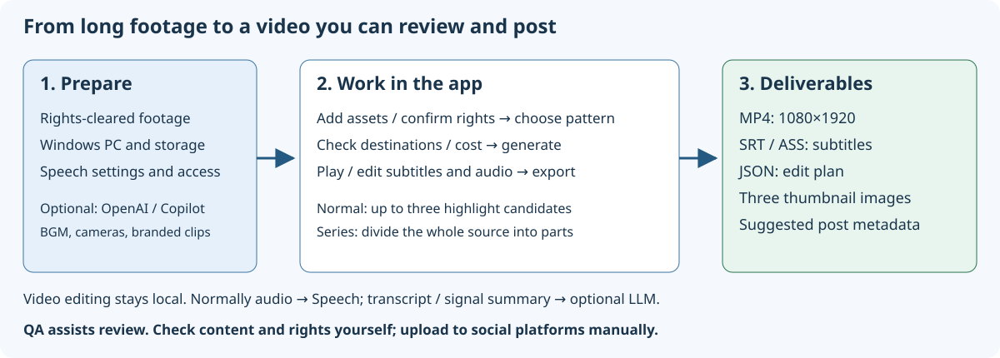

# VideoCreator

<!-- language-nav -->
[日本語](../../README.md) | [English](start.md) | [한국어](../ko/start.md) | [简体中文](../zh-CN/start.md)
<!-- /language-nav -->

[Start](start.md) / [Guide index](README.md) / [Detailed overview](overview.md) / [For engineers](technical-reference.md) / [Website](https://dahatake.github.io/VideoCreator/en/)

**Turn an internal video into a short subtitled video, even if you have never edited video.**
Choose footage on your PC, select an editing pattern, review and revise candidates, then save. The app does not automatically post to social media or internal sites.

## Prepare first

- **One video you may use:** a few minutes of speech in an MP4 or another supported format. Check permission for people, slides and music, and approval to send data to external services.
- **A Windows 10/11 (x64) or Windows 11 (ARM64) PC, Internet and free storage:** follow your company's installation rules. A macOS edition for Apple Silicon is also available ([detailed overview](overview.md#single-executable-windows--macos)).
- **An administrator handoff:** confirm the Microsoft Foundry resource name to use (and tenant ID if needed), role assignment, billing owner and support contact. Do not guess missing endpoints; ask your administrator.

> **Local does not mean fully offline.** Normally audio goes to Azure Speech (default model: MAI-Transcribe-2); AI features also send transcripts to the configured service. Disabling the LLM does not disable Speech traffic. Never paste keys or tokens into documentation or support messages.

## Install (3 steps)

The packaged edition is a single executable. It needs no installer, .NET, or FFmpeg; the only thing to install beforehand is Azure CLI. Detailed explanations and screens for each step are in the [quickstart](quickstart.md#2-install-3-steps).

1. In a terminal, run `winget install -e --id Microsoft.AzureCLI`, then **reopen the terminal** and sign in with `az login`.
2. Download `VideoCreator.exe` (on ARM64 PCs, `VideoCreator-<version>-win-arm64.exe`) from the [latest release](https://github.com/dahatake/VideoCreator/releases/latest) and double-click it. If SmartScreen appears, choose **More info** → **Run anyway**.
3. In the browser that opens, go to **Settings** → **AI connections** → **Choose from Azure**, select your resource, and choose **Test and save**. When the top of the screen changes to something like `Transcription: MAI-Transcribe-2`, you are ready.

Developers launching from source can double-click `run.cmd` in the repository; the setup script installs the required tools ([quickstart appendix](quickstart.md#appendix-launch-the-source-edition-runcmd)).

## Your first video

1. Create a project in the browser, add one video and confirm usage rights.
2. Choose **P4 (long video → 30-second clip)** and set **Output orientation** to **Portrait 9:16 (1080×1920)**. Leave series off and filtering at standard, check destinations/costs, then generate.
3. Play a candidate; check subtitles, meaning, framing and sound. Approve and export.
4. Play the entire finished MP4. **Opening the saved MP4 and subtitles from their output folder (default `Videos\VideoCreator\<pattern name>`) is your first success.** Post manually under company policy.

If something fails, do not repeatedly regenerate: open [troubleshooting](troubleshooting.md). Even if the page opens, subtitle generation is not ready while the top still shows `Transcription: None` (with the source edition's `run.cmd`, `FAIL` indicates a local prerequisite failure and `WARN` is a warning). Give support the time, operation, error code and app version, without attaching footage or confidential subtitles.

## Find the right help

| Goal | Read |
|---|---|
| Follow preparation through saving | [Quickstart](quickstart.md) |
| Find terms, buttons and operations | [Guide index](README.md) / [Screens](screens.md) |
| Errors, warnings and backup | [Troubleshooting](troubleshooting.md) |
| Detailed features, packaged edition details and source-edition setup | [Detailed overview](overview.md) |
| Customize safely as an engineer | [Technical reference](technical-reference.md) / [Configuration/API](configuration-api.md) |
| Azure setup, shared users, key / Entra ID authentication | [Azure access](azure-access.md) |
| Verification, builds and release details | [Verification](verification.md) / [Detailed overview](overview.md) |

Display language and video language are independent. Subtitles are not automatically translated. Generate new candidates after changing video language. The [detailed overview](overview.md) retains the full feature, distribution, versioning, testing, architecture and security information.

[Requirements](docs/PRD.md) / [Implementation record](docs/IMPLEMENTATION.md) / [Research](docs/VideoCreator-AnalyticsReport.md) / [Documentation brief](documentation-brief.md) / [MIT License](../../LICENSE) / [Third-party notices](../../THIRD-PARTY-NOTICES.txt)
