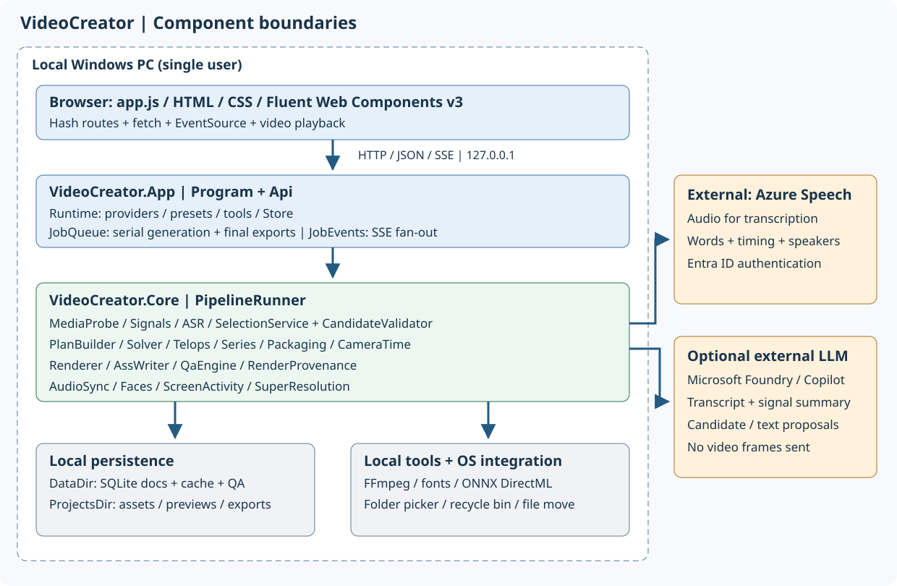
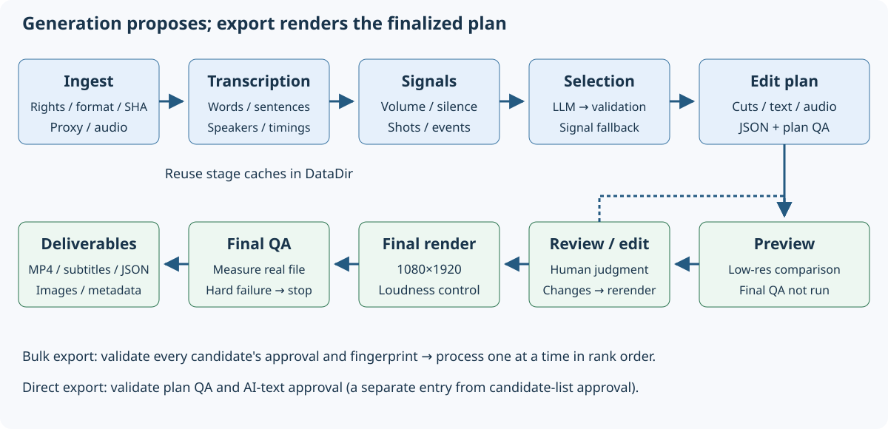
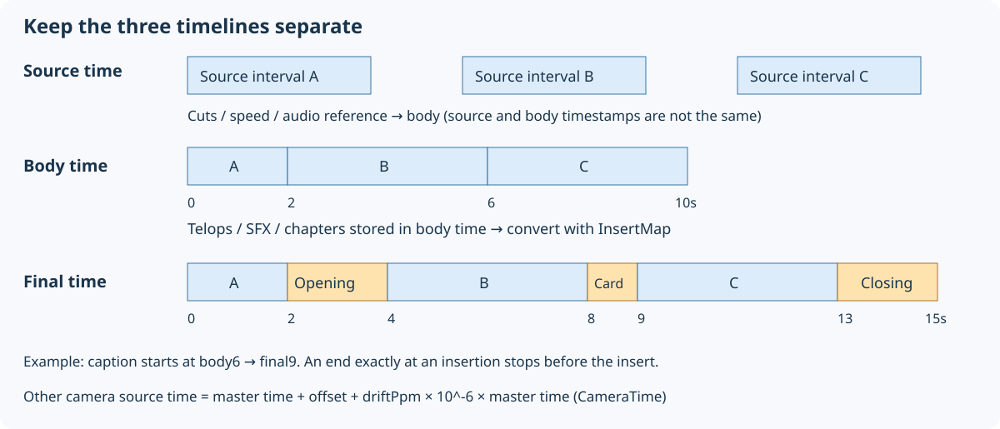

# Technical reference for software engineers

<!-- language-nav -->
[日本語](../technical-reference.md) | [English](technical-reference.md) | [한국어](../ko/technical-reference.md) | [简体中文](../zh-CN/technical-reference.md)
<!-- /language-nav -->

[Start](start.md) / [Guide index](README.md) / [Detailed overview](overview.md) / [For engineers](technical-reference.md)


[App README](start.md) / [Guide index](README.md) / [Quickstart](quickstart.md) / [Screens](screens.md) / [Troubleshooting](troubleshooting.md) / [Configuration/API](configuration-api.md) / [Verification](verification.md)

Applies to the current C#/.NET 10 implementation: a single-user local Windows web app, not a general video-editing library or multiuser service. Design requirements: [PRD](docs/PRD.md); historical measurements: [implementation report](docs/IMPLEMENTATION.md). Historical results are not proof of passing under current conditions.

## 1. Components



| Layer | Responsibility / entry point |
|---|---|
| Browser UI | [index.html](../../src/VideoCreator.App/wwwroot/index.html), [app.js](../../src/VideoCreator.App/wwwroot/js/app.js), [app.css](../../src/VideoCreator.App/wwwroot/css/app.css): vanilla ES modules, Fluent Web Components v3, hash routing |
| Hosting/HTTP | [Program.cs](../../src/VideoCreator.App/Program.cs): IPv4 loopback Kestrel, Host validation, custom header, exceptions, CSP; not an authenticated public server |
| API | [Api.cs](../../src/VideoCreator.App/Api.cs): validation, CRUD, approvals, batch acceptance, preview/export entry |
| Runtime | [Runtime.cs](../../src/VideoCreator.App/Runtime.cs): configures FFmpeg, Store, Presets, ASR, LLM, audio/face services; LLM runtime switching |
| Background | [JobQueue.cs](../../src/VideoCreator.App/JobQueue.cs): single worker serializes generation/final export; holds SSE JobEvents/export state |
| OS | [FolderPicker.cs](../../src/VideoCreator.App/FolderPicker.cs), [ProjectDeletion.cs](../../src/VideoCreator.App/ProjectDeletion.cs), [ProjectsLocation.cs](../../src/VideoCreator.App/ProjectsLocation.cs): picker, recycle bin, move/recovery |
| Optional work | [SceneCardService.cs](../../src/VideoCreator.App/SceneCardService.cs), [BrandKitWorker.cs](../../src/VideoCreator.App/BrandKitWorker.cs): card extraction/registered-clip enhancement |
| Pipeline | [PipelineRunner.cs](../../src/VideoCreator.Core/Pipeline/PipelineRunner.cs): stages, cache, progress, rendering, QA, outputs |
| Media/analysis | [MediaProbe](../../src/VideoCreator.Core/Media/MediaProbe.cs), [SignalExtractor](../../src/VideoCreator.Core/Signals/SignalExtractor.cs), [AudioSync](../../src/VideoCreator.Core/Audio/AudioSync.cs), [FaceService](../../src/VideoCreator.Core/Faces/FaceService.cs), [ScreenActivity](../../src/VideoCreator.Core/Media/ScreenActivity.cs) |
| ASR/selection | [AzureFastTranscriber](../../src/VideoCreator.Core/Asr/AzureFastTranscriber.cs), [Providers](../../src/VideoCreator.Core/Selection/Providers.cs), [SelectionService](../../src/VideoCreator.Core/Selection/SelectionService.cs), [CandidateValidator](../../src/VideoCreator.Core/Selection/CandidateValidator.cs) |
| Planning | [PlanBuilder](../../src/VideoCreator.Core/Planning/PlanBuilder.cs), [Solver](../../src/VideoCreator.Core/Planning/Solver.cs), [Planners](../../src/VideoCreator.Core/Planning/Planners.cs), [ScreenPlanner](../../src/VideoCreator.Core/Planning/ScreenPlanner.cs), [Series](../../src/VideoCreator.Core/Planning/Series.cs), [TelopBuilder](../../src/VideoCreator.Core/Planning/TelopBuilder.cs) |
| Rendering/QA | [Renderer](../../src/VideoCreator.Core/Rendering/Renderer.cs), [AssWriter](../../src/VideoCreator.Core/Rendering/AssWriter.cs), [QaEngine](../../src/VideoCreator.Core/Qa/QaEngine.cs), [RenderProvenance](../../src/VideoCreator.Core/Rendering/RenderProvenance.cs) |
| Storage/schemas | [Store](../../src/VideoCreator.Core/Storage/Store.cs), [Models](../../src/VideoCreator.Core/Models/Models.cs), [Json](../../src/VideoCreator.Core/Json.cs), [Preset](../../src/VideoCreator.Core/Presets/Preset.cs) |

App/Tests target `net10.0-windows`; Core `net10.0`. [App csproj](../../src/VideoCreator.App/VideoCreator.App.csproj) uses Windows Forms. [Core csproj](../../src/VideoCreator.Core/VideoCreator.Core.csproj) references DirectML ONNX Runtime etc.; Core's TFM alone does not imply all features are cross-platform.

## 2. Generation and export



1. **Ingest:** existence/format/duration validation, SHA-256, proxy, analysis audio; multisource audio master, sync, roles.
2. **Transcribe:** ITranscriber returns words/sentences/speakers/times; dictionary phrase list; cache reuse.
3. **Signals:** shots, 100 ms volume, silence, events; fallback selection evidence.
4. **Select:** validate/correct/deduplicate IHighlightSelector outputs; split/filter long sources, rerank when needed; signal fallback.
5. **Plan:** Solver clips, preset speech/switch/speed/beat/screen planners, series, face tracking, captions, audio, inserts, masking.
6. **Preview:** render plan, save stage-appropriate QA, show up to three candidates.
7. **Edit:** PlanEditor updates/history/plan QA; explicit preview refresh; plan changes invalidate candidate approval fingerprints.
8. **Final output:** preflight hard plan QA; 1080×1920 rendering, loudness, final QA. Commit publication outputs only when all hard checks pass; create SRT/ASS/plan/thumbnails/metadata.

**Boundary:** AI proposes ranges/text. Renderer builds from confirmed plans/assets. Prompts alone do not ensure constraints. Users retain final responsibility for meaning/rights.

## 3. Models and persistence

| Model | Storage/relationships |
|---|---|
| Project | Folder, language, card settings; parent of Assets/Rights/Jobs |
| SourceAsset | Absolute path, SHA-256, MediaInfo, role, speaker, sync |
| Transcript / Word / Sentence | Cached JSON; word IDs/times underpin captions/cuts/factuality |
| SignalSet | Cached shots/silence/volume/events |
| Job | Options/state/costs/stage timings/warnings/candidate IDs |
| Candidate | Job child; range/reason/score/EditPlan/preview Render IDs/approval |
| EditPlan | Project child; Canvas/Timeline/Telops/Audio/Inserts/Series/Provenance |
| Render | EditPlan child; preview/final, files, Outputs, staged QA, reproduction record |
| BrandKit / BgmTrack / setting | Shared/project audio registrations and storage settings |

Store is a SQLite JSON-document store, `docs(kind,id,parent,json,updated)`. Shared `Json.Options` uses snake_case/string enums. Files and DB are separate; exported JSON is not a full-project import format/API.

Cache: DataDir `cache\<first 16 source SHA-256 characters>`. [PipelineRunner.TranscriptFile](../../src/VideoCreator.Core/Pipeline/PipelineRunner.cs) keys transcripts by ASR Name, project video language and dictionary, separating languages (`ja-JP` omits the language prefix for backward compatibility). AzureFastTranscriber.Name is constant, not locale-dependent. [Runtime.AsrForLanguage](../../src/VideoCreator.App/Runtime.cs) supplies the actual recognition language. **Changing only the endpoint does not necessarily invalidate transcripts.** Signals use `signals.v2.json` (shots/fades/volume); face/screen caches also exist. Test collision/compatibility/invalidation policies for new providers/algorithms.

Absolute path changes use [StorePaths](../../src/VideoCreator.Core/Storage/StorePaths.cs) rerooting. Same-drive rename or cross-drive copy plus count/size verification, then transactional JSON references. This is not cryptographic verification of all file contents.

## 4. Three distinct timelines



1. **Source/master:** word/source times. Always use [SourceAsset.CameraTime(masterT, masterId)](../../src/VideoCreator.Core/Models/Models.cs): identity for the main asset; affine `masterT + offset + driftPpm × 10^-6 × masterT` only without SyncMap. Otherwise it uses the measured delay map, switching `audio-map` jumps >1/30 s at their midpoint and interpolating smaller changes. Use [PipPlanner.MasterTime](../../src/VideoCreator.Core/Planning/PipPlanner.cs) for the inverse and split constant-offset pieces at `SyncJumps`; never reimplement only the affine formula.
2. **Edited main:** accumulated `(src_out-src_in)/speed`; captions/SFX/series chapters planned here.
3. **Final file:** main with Opening/Card/Closing insertions; [InsertMap](../../src/VideoCreator.Core/Planning/Packaging.cs) converts. Starts at insertion points map after insert; ends map before it.

Example: a 2-second opening at main time 2, a 1-second card at main time 6: a subtitle starting at main 6 starts at final 9. Spanning captions split around cards, never overlay them. Insertion offsets cannot substitute for clip speed/camera synchronization.

## 5. Approval, QA, reproducibility

- `CandidateApproval` records approver/time/`EditPlanFingerprint.Of(plan)` SHA-256, not signatures/user authentication.
- Batch preflight verifies membership, approval, fingerprint, busy state, plan QA for every candidate; any failure starts none. Queued work uses approved snapshots.
- Direct render from Review also requires candidate approval. [Api.cs](../../src/VideoCreator.App/Api.cs) checks unapproved (409 `E-NOT-APPROVED`), approval PlanHash mismatch (`E-PLAN-STALE`), hard plan failure (422 `E-QA-HARDFAIL`), then active export (409 `E-EXPORT-BUSY`), in the same order as batch export. QA-result review is not a substitute for candidate or AI-caption approval.
- All-or-zero acceptance is not atomic all-file success after execution starts; individual runtime failures appear per candidate.
- Preserve QA `Stage`, `PlanHash`, `not_run`; do not reuse old/preview results as final passes.
- `Render.Reproducibility`: plan/FFmpeg/buildconf/font/preset/source hashes, text-library information, encoder threads. Compare **decoded frames**, not just container bytes.
- Reproduction requires matching assets/plans/tools/fonts/environment; no guarantee that a fresh LLM call proposes identical candidates.

## 6. Customization entry points and tests

### A safe change workflow

1. Employees should use [on-screen settings](screens.md) for daily editing and ask the responsible engineer to change code/presets. Agree on the goal and acceptance criteria first, such as caption readability or allowed duration.
2. Create a working branch. Stop the app before [backing up](troubleshooting.md) the database, settings and projects. Test with authorized short footage and separate DataDir/ProjectsDir values, never production storage.
3. Check whether startup settings or presets in [Configuration/API](configuration-api.md) suffice. Make a small change at the entry point below and keep the original values/files. Never commit keys, tokens, internal footage or transcripts.
4. Run the relevant tests below. Compare before/after previews and final MP4s using the same footage; inspect SRT timing, audio, QA and reapproval after edits. For UI changes, check keyboard use and all four languages. Obtain separate destination/cost approval before cloud tests.
5. After review, hand over the settings diff, app version and restart requirements. To roll back, stop the app and restore previous code/settings. If storage formats changed, do not assume old code reads new data: restore a tested backup.

Build/test commands follow. Packaging, versioning, releases and security details remain in the [detailed overview](overview.md). Return to the [quickstart](quickstart.md) for the employee workflow.

| Change | Location / conditions | Tests |
|---|---|---|
| Duration/tempo/audio/decor defaults | [presets](../../presets), PresetStore.Validate; `P<number>` ID, semver; restart | [PlanningTests](../../tests/VideoCreator.Tests/PlanningTests.cs), [VarietyTests](../../tests/VideoCreator.Tests/VarietyTests.cs) |
| Font/outline/line breaking | Share AssWriter Metrics/Band/CaptionLineChars, JapaneseText, TelopBuilder; no divergent tables for rendering/shrinking/QA | [CaptionLayoutTests](../../tests/VideoCreator.Tests/CaptionLayoutTests.cs), [JapaneseTextTests](../../tests/VideoCreator.Tests/JapaneseTextTests.cs), [RenderingTests](../../tests/VideoCreator.Tests/RenderingTests.cs) |
| Candidate proposals | IHighlightSelector, Providers, SelectionPrompt, SelectionService, Runtime/settings UI; align validation/retries/fallback/cost/destinations | [SelectionTests](../../tests/VideoCreator.Tests/SelectionTests.cs), [V12Tests](../../tests/VideoCreator.Tests/V12Tests.cs) |
| ASR | ITranscriber, Runtime, settings/destinations/cache keys; preserve word IDs/times/speakers/sentences | [PlanningTests](../../tests/VideoCreator.Tests/PlanningTests.cs); separately measure real-footage timing/accuracy |
| Camera/screen editing | AudioSync, CameraTime, SwitchPlanner, ScreenPlanner; aligned PCM via AudioSync.TimelineFilter | [MultiSourceTests](../../tests/VideoCreator.Tests/MultiSourceTests.cs), [V11Tests](../../tests/VideoCreator.Tests/V11Tests.cs) |
| Series/inserts | Series, Packaging, InsertMap; align captions/SRT/QA/metadata times | [SeriesTests](../../tests/VideoCreator.Tests/SeriesTests.cs), [PackagingTests](../../tests/VideoCreator.Tests/PackagingTests.cs), [SceneCardTests](../../tests/VideoCreator.Tests/SceneCardTests.cs) |
| Posting copy/chapters | Planning PostCopy; code converts chapter times with InsertMap, never AI. Send masked transcript only; use text passing PostCopy.Check (length/URLs/times/masking/unsupported words). Rejected parts retry once with reasons | [PostCopyTests](../../tests/VideoCreator.Tests/PostCopyTests.cs) |
| UI controls | app.js/app.css/Fluent v3; checkbox/switch field label/input slots; preserve esc(), event rerendering, keyboard access | [E2E](../../ui/e2e.mjs), [v1.1 E2E](../../ui/e2e-v11.mjs), actual Edge |
| API/approval/storage | Api/Models/Store/JobQueue/ProjectsLocation; snake_case, coded errors, reapproval, path boundaries | [ApprovalExportTests](../../tests/VideoCreator.Tests/ApprovalExportTests.cs), [ProjectsLocationTests](../../tests/VideoCreator.Tests/ProjectsLocationTests.cs), [RenderRecordTests](../../tests/VideoCreator.Tests/RenderRecordTests.cs) |

For a new preset, copy JSON and change ID/version/name/needed fields. Also add all four languages' metadata to `presetDisplays` in [server-resources.js](../../src/VideoCreator.App/wwwroot/js/server-resources.js), plus translation resources for new controls/descriptions. Run [verify-localization](../../ui/verify-localization.mjs) and [browser checks](../../ui/verify-localization-browser.mjs) across four languages and keyboard use before restarting/regenerating; do not ship Japanese-only names/descriptions. New planners also require PlanBuilder/PresetStore allow-list changes; a JSON name alone adds no implementation.

Canvas/export UI/QA assume vertical 1080×1920. Landscape requires consistent changes/tests. Public networking requires separate authentication/authorization/CSRF/file-access/job-isolation design, not just changing Listen.

FFmpeg uses argument arrays. Preserve `-nostdin` for raw-frame pipe subprocesses. Do not extend through shell-concatenated commands; preserve ASS/user/LLM escaping.

## 7. Build and test

From repository root; no need to reacquire already-installed tools.

```powershell
pwsh scripts\get-tools.ps1
dotnet build src\VideoCreator.App\VideoCreator.App.csproj -c Release
dotnet test --project tests\VideoCreator.Tests
```

[global.json](../../global.json) selects Microsoft.Testing.Platform. Test counts change; do not use a fixed count as acceptance. UI bundle: [ui/package.json](../../ui/package.json) `npm run build`. Against a running app: `node e2e.mjs <video> <URL>`. E2E may use paid external services/update existing screenshots; isolate storage.

Documentation-production checks are recorded separately in [verification](verification.md).
---

