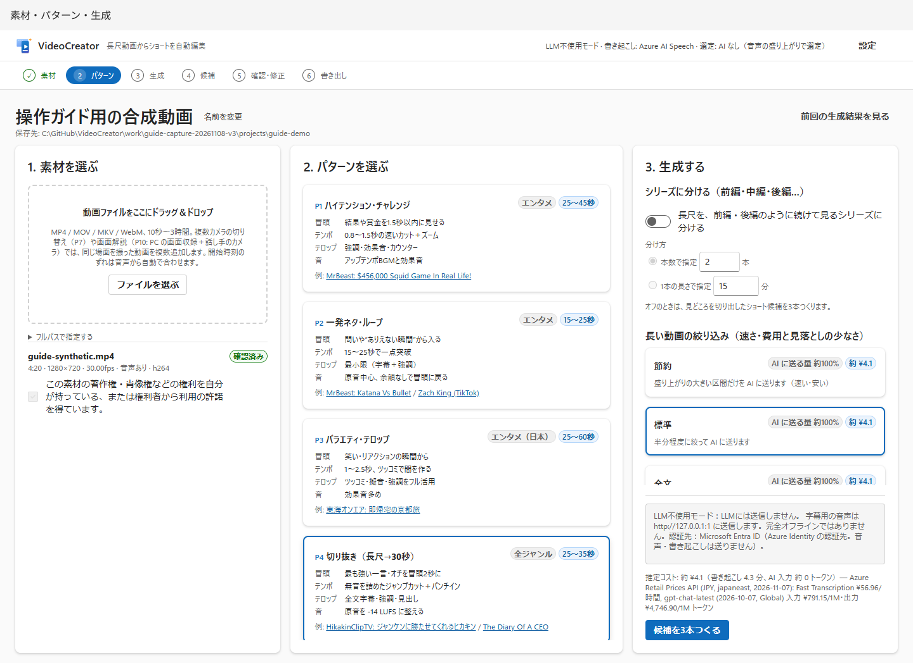
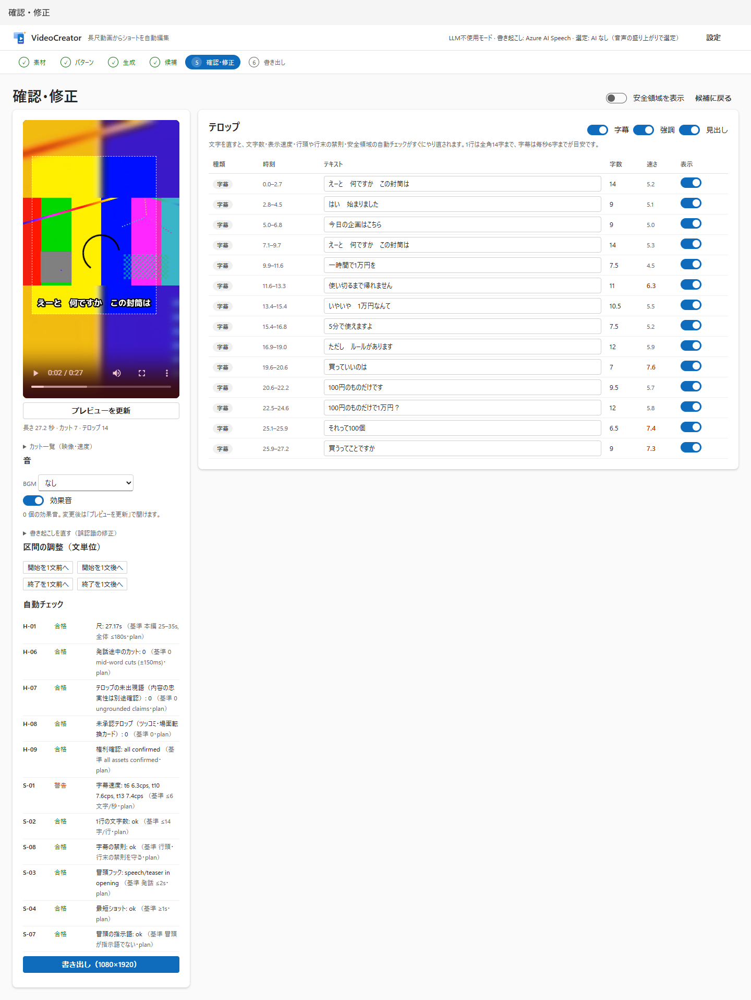
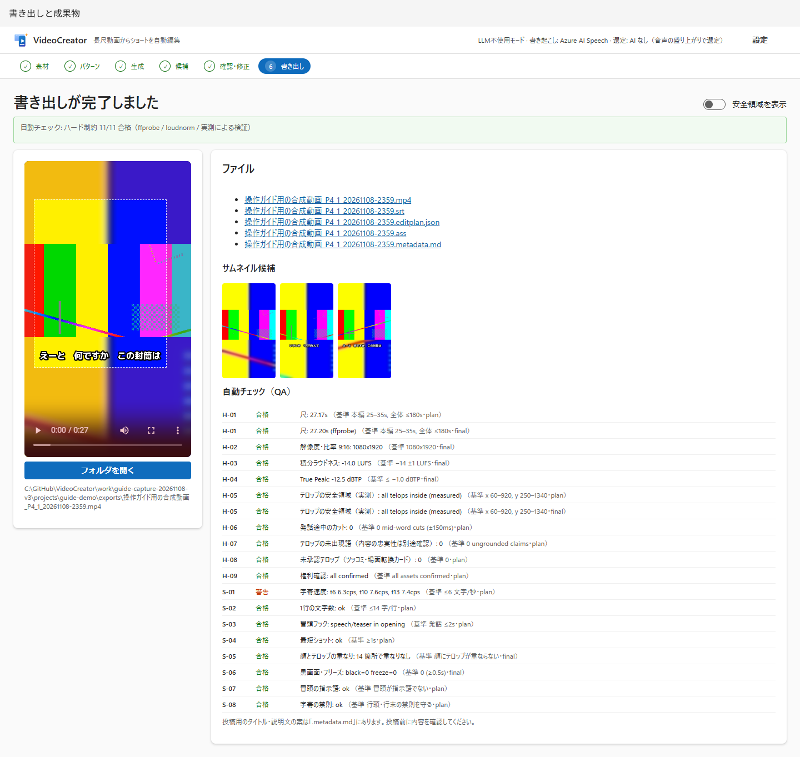

# 빠른 시작: 첫 동영상 만들기

<!-- language-nav -->
[日本語](../quickstart.md) | [English](../en/quickstart.md) | [한국어](quickstart.md) | [简体中文](../zh-CN/quickstart.md)
<!-- /language-nav -->

[처음 시작](start.md) / [가이드 목차](README.md) / [상세 개요](overview.md) / [엔지니어용](technical-reference.md)


[앱 README](start.md) / [가이드 목차](README.md) / [화면 설명](screens.md) / [문제 해결](troubleshooting.md) / [설정·API](configuration-api.md)

**목표**: 배포 버전을 설치하고, 발화가 있는 동영상 한 편으로 P4 후보를 만들고, 내용을 확인한 뒤 세로형(1080×1920) MP4와 자막 등을 저장합니다. 처리 시간은 원본·PC·서비스 상태에 따라 달라지므로 일정 시간 안에 완료됨을 보장하지 않습니다.

## 시작 전: 관리자와 역할 나누기

일반 사용자가 클라우드 리소스를 만들거나 스스로 권한을 넓힐 필요는 없습니다. 다음 인계를 마친 뒤 진행하세요.

| 담당 | 확인할 내용 |
|---|---|
| 사용자 | 사용할 영상, 출연자·자료·음악의 허락, 음성·전사문의 외부 전송 허용 여부, 게시 전 검토 담당자 |
| 관리자·사내 IT | 승인된 배포물, Azure CLI 설치 허용 여부, 사용 계정, Microsoft Foundry 리소스 이름·배포 이름·테넌트 ID, 사용 역할 부여, 비용 담당자와 사용 한도 관리 절차, 문의처 |
| 함께 확인 | 로그인 계정과 설정된 서비스가 일치하는지 확인하고, 화면 열기뿐 아니라 승인된 짧은 영상의 전사부터 저장까지 시험 |

**가장 간단한 방법은 배포 버전(Releases의 실행 파일)입니다.** 설치 프로그램, .NET, FFmpeg가 필요 없으며 사용자가 미리 설치할 것은 Azure CLI뿐입니다. 아래 1~3을 순서대로 진행하세요. 소스에서 실행하는 방법(`run.cmd`와 설정 스크립트)은 개발·사용자 지정을 하는 분을 위해 [부록](#부록-소스-버전runcmd으로-실행하기)에 정리했습니다. 둘 중 하나만 선택하면 됩니다. 관리자는 [설정·API](configuration-api.md), 변경 작업을 하는 엔지니어는 [기술 참조](technical-reference.md)를 확인하세요.

## 1. PC와 동영상 준비하기

- Windows 10/11(x64) 또는 Windows 11(ARM64)과 인터넷 연결이 필요합니다. 브라우저는 Microsoft Edge로 화면을 확인했습니다. Apple Silicon macOS는 [상세 개요의 배포 버전 절차](overview.md#단일-실행-파일windows--macos)를 참조하세요.
- PC 종류는 Windows **설정 → 시스템 → 정보**의 「시스템 종류」에서 확인합니다. 「x64 기반 프로세서」이면 x64, 「ARM 기반 프로세서」이면 ARM64입니다.
- **본인에게 사용할 권리가 있는 동영상** 한 편을 준비합니다. 음악·얼굴·로고 등의 허가도 확인하세요. 지원 표시는 MP4 / MOV / MKV / WebM, 길이 10초~3시간입니다. 처음에는 몇 분 정도의 발화 동영상이 다루기 쉽습니다. P4는 25~35초 본편을 만들므로, 10초 동영상이면 반드시 성공한다는 뜻은 아닙니다.
- 디스크 여유 공간을 확인합니다. 파일 선택·끌어서 놓기에서는 임시 영역과 저장 위치 모두에 원본 크기만큼의 여유가 필요합니다. 같은 드라이브라면 원본의 약 2배에 프록시, 캐시, 미리 보기, 내보내기용 공간을 더 확보하세요.
- **전체 경로로 지정**하면 원본 복사를 생략할 수 있습니다. 다만 원본 동영상을 이동·삭제하면 해당 프로젝트를 사용할 수 없게 됩니다.
- 관리자에게 **사용할 Azure 리소스(Microsoft Foundry)의 이름**과, 기본값이 아닌 테넌트에 있다면 **테넌트 ID**를 미리 물어 둡니다. 사용 역할(`Cognitive Services Speech User`와 `Cognitive Services OpenAI User`) 부여는 관리자의 작업입니다([Azure 접근 설정](azure-access.md)).

## 2. 설치하기(3단계)

### 1단계: Azure CLI 설치하고 로그인하기

자막 받아쓰기(Azure Speech)와 AI 선정은 이 PC에서 로그인한 Microsoft Entra ID 계정으로 인증합니다. 그 로그인에 Azure CLI를 사용합니다.

1. 시작 버튼을 마우스 오른쪽 단추로 클릭하고 **터미널**(또는 **Windows PowerShell**)을 엽니다.
2. 다음을 붙여 넣고 Enter를 누릅니다. 확인 화면이 나타나면 **예**를 선택합니다.

   ```powershell
   winget install -e --id Microsoft.AzureCLI
   ```

3. **터미널을 한 번 닫았다가 다시 엽니다.** 다시 열지 않으면 `az`를 찾을 수 없습니다.
4. 다음을 실행하고, 열린 브라우저에서 회사 계정을 선택합니다. 구독 번호를 물으면 관리자가 지정한 것을 선택합니다(모르면 Enter).

   ```powershell
   az login
   ```

   리소스가 기본값이 아닌 테넌트에 있다면 `az login --tenant <테넌트 ID>`를 사용합니다. `winget`을 사용할 수 없거나 소프트웨어 설치가 제한되어 있다면 사내 IT에 Azure CLI 설치를 요청하세요.

### 2단계: VideoCreator 다운로드하기

1. [최신 릴리스](https://github.com/dahatake/VideoCreator/releases/latest)를 열고 **Assets**에서 본인 PC용 파일을 하나만 다운로드합니다.
   - x64: `VideoCreator.exe`
   - ARM64: `VideoCreator-<버전>-win-arm64.exe`
2. 다운로드한 파일을 알기 쉬운 폴더(예: `문서\VideoCreator`)로 옮깁니다. 다운로드 폴더에 그대로 두어도 동작합니다.
3. `appsettings.json`은 다운로드할 필요가 없습니다. 접속 대상은 3단계에서 화면으로 설정합니다.

파일이 변조되지 않았는지 확인하려면 [상세 개요](overview.md#유지-관리자-빌드검증공개)의 `SHA256SUMS.txt`와 `gh attestation verify`를 이용한 검증을 사용합니다.

### 3단계: 실행하기

1. 다운로드한 exe를 더블 클릭합니다. 「Windows의 PC 보호」가 표시되면 **추가 정보** → **실행**을 누릅니다. 배포 버전은 코드 서명이 없어 이 확인이 표시될 수 있습니다.
2. 검은 창(콘솔)이 열리고, 시작 후 기본 브라우저에서 <http://127.0.0.1:8765/>가 열립니다(8765번을 다른 프로그램이 사용 중이면 비어 있는 번호의 URL이 됩니다). 처음에는 구성 요소를 풀어 놓느라 시간이 조금 걸립니다. 열리지 않으면 검은 창에 표시된 `http://127.0.0.1:…` URL을 브라우저에서 엽니다.
3. **검은 창은 닫지 마세요.** 닫으면 앱이 멈춥니다. 브라우저를 닫아도 앱은 멈추지 않습니다.
4. 다음부터도 같은 exe를 더블 클릭하기만 하면 됩니다. 실행 중에 다시 더블 클릭해도 두 번째 앱은 시작되지 않고, 실행 중인 앱의 화면이 브라우저에서 열립니다(새 창은 바로 닫힙니다).

## 3. 첫 화면에서 AI 연결 설정하기

1. 처음에는 「VideoCreator에 오신 것을 환영합니다」 안내(6화면)가 나타납니다. **다음**으로 읽어 나가거나 **건너뛰기**를 누릅니다. 나중에 **설정** → **튜토리얼 다시 보기**로 다시 볼 수 있습니다.
2. 화면 위쪽 표시를 확인합니다. `받아쓰기: 없음`으로 표시되는 동안은 아직 자막을 만들 수 없습니다.
3. 오른쪽 위 **설정**을 열고 **AI 연결** → **Microsoft Foundry**에서 다음을 진행합니다.
   1. **인증 방식**은 **Microsoft Entra ID(권장)** 그대로 둡니다.
   2. **Azure에서 선택**을 누르고 관리자에게 들은 리소스를 선택합니다. 엔드포인트가 입력되고 채팅·임베딩·이미지 배포 이름을 후보에서 고를 수 있습니다. 관리자의 지정이 없으면 표시된 후보 그대로 두어도 됩니다. 목록에 나타나지 않으면 엔드포인트(`https://<리소스 이름>.cognitiveservices.azure.com/`)와 채팅용 모델의 배포 이름을 관리자에게 물어 입력합니다.
   3. **테스트 후 저장**을 누릅니다. 채팅·임베딩·자막 받아쓰기 테스트를 모두 통과했을 때만 저장됩니다.
4. 설정을 닫습니다. 화면 위쪽이 `받아쓰기: MAI-Transcribe-2 · 선택: Microsoft Foundry(<배포 이름>)`처럼 바뀌면 준비 완료입니다. 리소스 지역에 따라서는 받아쓰기가 표준 모델이 됩니다.

- 연결 전 설정 화면에는 「사용 불가: Microsoft Foundry가 아직 연결되지 않았습니다. 아래 “AI 연결”에서 리소스를 선택한 뒤 “테스트 후 저장”을 누르세요.」가 표시됩니다. 위 절차로 저장하면 사라집니다. 1.2.2 이전 배포 버전에서는 「scripts/setup.ps1을 실행하세요」가 표시되지만 소스 버전용 안내이므로, 마찬가지로 위 절차로 해결됩니다.
- 연결 테스트는 합성한 1초 무음과 짧은 글을 보내므로 소액의 사용량 기반 과금이 발생할 수 있습니다. 사용자의 동영상은 보내지 않습니다.
- 테스트에 실패하면 화면의 설명을 따릅니다. `az login`을 요구하면 1단계(특히 터미널 다시 열기)를 확인하고, 권한이 없으면(403) 관리자에게 역할 부여를 요청한 뒤 몇 분 기다립니다. 배포를 찾을 수 없으면 모델 이름이 아니라 배포 이름을 입력합니다. 자세한 내용은 [Azure 접근 설정](azure-access.md#저장테스트문제-해결)을 참조하세요.
- AI 선정을 사용하지 않더라도 자막을 위해 Microsoft Foundry 연결(같은 리소스의 Speech)은 필요합니다. 선정 방식은 설정 위쪽의 **LLM 사용 안 함**으로 전환할 수 있으며, 이때 후보는 음량이 높아지는 구간에서 고릅니다.
- 조직 방침상 API 키 인증을 사용한다면 **인증 방식**에서 **API 키**를 선택하고 관리자에게서 안전하게 받은 키를 입력합니다. 이 경우 Azure CLI는 필요 없습니다. 키는 이 PC의 이 Windows 사용자만 복호화할 수 있는 형태로 저장됩니다.
- Azure 서비스는 사용량 기반으로 과금됩니다. 전송 대상과 예상 비용은 생성 전 화면에 표시됩니다. 조직의 전송·데이터 사용 정책을 확인하세요.
## 4. 원본 추가 후 P4 선택하기

1. 「프로젝트 이름」을 입력하고 **새 프로젝트**를 누릅니다.
2. **파일 선택**을 누르거나 동영상을 끌어서 놓습니다.
3. 원본 이름, 길이, 해상도, 음성 유무를 확인하고 각 원본의 권리 확인에 체크합니다.
4. **P4 클립 추출(긴 영상→30초)**을 선택합니다. 파란 테두리가 선택 상태입니다.
5. 오른쪽 열의 **출력 방향**에서 **세로 9:16(1080×1920)**을 선택합니다. 기본값인 「입력에 맞춤」 그대로 두면 가로 영상에서는 가로(1920×1080) 영상이 만들어집니다.
6. 시리즈는 끄고, 필터링은 **표준**으로 둡니다. 첫 시도에는 BGM이나 오프닝이 필요 없습니다.
7. 버튼 위에 표시되는 전송 대상과 예상 비용을 읽고 **후보 3개 만들기**를 누릅니다.



이 화면은 3열입니다. 열 내부를 스크롤하면 아래 항목이 보입니다. 오른쪽 열의 설정은 그룹으로 나뉘며 제목을 누르면 펼치거나 접힙니다. 위쪽의 6단계 표시는 진행 상황을 나타냅니다. 끝난 단계(✓)는 누르면 그 화면으로 돌아갈 수 있지만, 아직 하지 않은 단계로는 건너뛸 수 없습니다.

## 5. 후보를 확인하고 필요하면 수정하기

생성 화면에는 전체 진행률과 현재 처리 단계의 진행률이 표시됩니다. 후보가 만들어지면 동영상을 재생해 다음을 확인하세요.

- 원래 발언의 의미가 달라지지 않았는지. 단독으로 봐도 이야기가 통하는지.
- 자막 오탈자, 고유명사, 숫자, 가독성.
- 얼굴이나 화면에서 보고 싶은 부분, 음량, 발화 경계.
- QA의 「실패」「경고」「미실행」. **미실행은 통과가 아닙니다**.

후보의 **확인·수정**을 엽니다. 글자를 고쳤다면 입력란 밖으로 포커스를 옮겨 변경을 반영하고 **미리 보기 업데이트** 후 다시 확인하세요. 전사의 오인식을 수정하면 자막이 다시 생성되므로, 수동 자막 수정 전에 처리하세요.



## 6. 내보내고 저장하기

**첫 성공의 기준**: 후보가 보인다고 완료된 것은 아닙니다. 저장 폴더를 열어 내보낸 MP4를 처음부터 끝까지 재생하고 자막 파일도 있는지 확인하세요.

다음 중 하나를 선택합니다.

- **한 편 바로 내보내기**: 「확인·수정」의 **승인 후 내보내기**(동영상이 여러 개라면 **이 영상만 지금 내보내기**). 현재 내용을 승인한 뒤 내보냅니다. 하드 QA와 필요한 AI 문장 승인도 충족해야 합니다.
- **여러 동영상을 하나씩 확인하고 한꺼번에 내보내기**: 「확인·수정」에서 **승인 후 다음 동영상으로**를 눌러 차례대로 확인하고, 마지막 동영상에서 **승인 후 내보내기로 이동** → 내보내기 목록의 **선택한 동영상 내보내기**를 누릅니다. 도중에 **이 내용으로 승인 후 후보로 돌아가기**를 누르면 후보 목록의 **확인 진행 상황**에서 남은 항목을 볼 수 있습니다. 변경하면 다시 승인해야 합니다.

완성 파일은 프로젝트 저장 위치(기본값은 `동영상\VideoCreator`) 안의 **패턴 이름 폴더**(화면에 표시된 패턴 이름. 한국어 표시라면 예: `하이라이트(긴 영상→30초)`)에 저장됩니다. 내보내기 목록에서는 완료된 동영상별로 완성 파일을 재생·탐색해 확인할 수 있습니다. 동영상 파일의 절대 경로를 확인하고 **경로 복사** 또는 **폴더 열기**로 저장 위치에 접근하세요. 개별 완료 화면에서도 같은 조작과 최종 QA 확인이 가능합니다.



| 파일 | 용도 |
|---|---|
| `.mp4` | 자막을 영상에 삽입한 게시용 동영상. 게시 전에 끝까지 재생해 확인 |
| `.srt` | 시간 정보가 있는 자막. 외부 자막을 지원하는 게시 대상·편집 도구에서 사용 |
| `.ass` | 글꼴·위치·장식이 포함된 자막 렌더링 데이터 |
| `.editplan.json` | 컷, 텔롭, 소리, 삽입물의 편집 기록. 개발·재현용 |
| 썸네일 이미지 3장 | 게시용 이미지 후보. 직접 선택 |
| `.metadata.md` | 제목·설명·해시태그 등의 제안. 사실 확인 후 게시 입력란에 수동으로 옮기기 |
| `.post.json` | 완료 화면의 「게시용 글」과 같은 내용(YouTube 설명·Viva Engage 게시글·챕터). `.metadata.md` 끝에도 붙여 넣기 쉬운 형태로 포함 |

내보내기 목록과 완료 화면의 **게시용 글(복사해서 붙여 넣기)**에는 저장된 YouTube 설명, Viva Engage 게시글, `00:00 장 제목` 형식의 챕터가 나열되며 각각의 **복사** 버튼으로 붙여 넣을 수 있습니다. 아직 생성하지 않았다면 **게시용 글 만들기**를 누르세요. **기타 결과물·미리 보기**를 펼치면 자막·메타데이터·편집 계획 내용과 썸네일을 확인하고 각 파일을 열거나 저장할 수 있습니다.

- 챕터 시간은 내보낸 동영상의 실제 시간입니다(오프닝·카드 분량도 반영). YouTube 조건(00:00부터 시작·3개 이상·각 10초 이상)을 충족하지 않으면 붙이지 않습니다. 3분 이내의 세로 영상은 Shorts로 취급되어 재생 막대에 챕터가 나타나지 않을 수 있습니다.
- 글은 AI가 전사를 바탕으로 만들며, 발화에 없는 숫자·가타카나 단어·영문 이름, URL, 가린 단어를 자동으로 제외합니다(한자 고유명사까지는 판별하지 못합니다). 제외 이유는 화면에 표시됩니다. LLM을 사용하지 않는 설정에서는 서식으로 만듭니다.
- **다른 제안 만들기**로 이전과 다른 관점의 제안을 다시 만들 수 있습니다. 화면은 저장된 글의 읽기 전용 표시입니다. 필요한 수정은 복사 후 붙여 넣을 곳에서 하세요. 복사에 실패하면 표시된 글을 선택하고 Ctrl+C를 사용하세요.

SRT와 영상에 삽입된 자막을 동시에 표시하면 게시 대상에 따라 자막이 이중으로 보일 수 있습니다. 게시 대상의 표시 방식을 선택하세요. 앱은 게시·공개·시리즈 URL 자동 설정까지 수행하지 않습니다.

종료하려면 검은 창(소스 버전에서는 시작 터미널)에서 Ctrl+C를 누릅니다. 다음에는 프로젝트 목록에서 열면 마지막으로 표시했던 프로젝트 설정, 생성, 후보, 확인·수정, 내보내기 단계에서 재개합니다. 참조 대상이 없어졌다면 복원 가능한 이전 단계를 표시합니다. 백업은 [문제 해결](troubleshooting.md#저장과-백업)을 참조하세요.

## 부록: 소스 버전(run.cmd)으로 실행하기

개발이나 사용자 지정을 하는 분을 위한 내용입니다. 배포 버전을 사용한다면 필요 없습니다.

1. 저장소를 내려받아 압축을 풉니다. Git을 사용하지 않는다면 GitHub의 「Code → Download ZIP」으로 받고, ZIP 내부가 아니라 압축을 푼 폴더를 여세요.
2. 압축을 푼 폴더의 [run.cmd](../../run.cmd)를 더블 클릭합니다. 처음에는 [설정 스크립트](../../scripts/setup.ps1)가 .NET SDK 10, FFmpeg, 글꼴, 모델, Azure CLI 중 부족한 것을 설치하고, 로그인하지 않았다면 `az login` 화면을 엽니다. 이어서 현재 소스를 빌드하고 기본 브라우저를 엽니다. 시작 메뉴에 등록하려면 대신 저장소 폴더에서 `.\install.ps1`을 실행합니다.
3. 접속 대상은 배포 버전과 마찬가지로 **설정 → AI 연결**에서 저장할 수 있습니다. 시작 설정으로 지정하려면 [appsettings.json](../../src/VideoCreator.App/appsettings.json)의 `VideoCreator` 섹션을 바꿉니다. 아래는 해당 섹션의 예시이지, 파일 전체를 대체하는 내용이 아닙니다.

```json
{
  "Llm": {
    "Provider": "azure-openai",
    "Endpoint": "https://<본인-리소스>.cognitiveservices.azure.com/openai/v1",
    "Deployment": "<채팅용 모델의 배포 이름>"
  }
}
```

- 자막 받아쓰기(Speech)는 `Llm.Endpoint`와 같은 리소스를 사용합니다. `Asr.Endpoint`는 검증용 설정이므로 보통은 지정하지 않습니다. 모델 이름이 아니라 **본인이 만든 배포의 이름**을 설정합니다.
- 소스 버전의 설정 예에는 배포자의 엔드포인트가 들어 있습니다. 본인 조직의 값으로 바꾸거나 화면에서 저장하세요. 키나 토큰은 설정 파일에 쓰지 마세요.
- 시작할 때마다 현재 소스를 빌드합니다. 빌드에 실패하면 이전 결과물로 시작하지 않습니다. 설정된 포트가 사용 중이면 비어 있는 로컬 포트를 사용하고 그 URL을 엽니다. 시작 터미널을 닫지 마세요.
- `.\run.cmd --check`는 아무것도 설치하지 않고 상태를 확인합니다. `FAIL`은 필수 로컬 구성 요소 부족, `WARN`은 경고입니다. **설정된 대상으로 최소한의 Speech/OpenAI 요청을 보내므로 통신과 소액 과금이 발생할 수 있습니다.** 확인 대상은 시작 설정(appsettings.json과 azd 값)이며, 화면에서 저장한 연결은 설정 화면의 연결 테스트로 확인합니다.
- Copilot CLI도 설치하려면 `.\run.cmd --setup --with-copilot`을 사용하세요. Azure 리소스 생성(`--provision-azure`)이나 부족한 역할 부여(`--assign-roles`)는 관리자용입니다. 가볍게 사용하지 말고 [Azure 접근 설정](azure-access.md)을 읽으세요.

공식 자료: [Fast Transcription](https://learn.microsoft.com/en-us/azure/ai-services/speech-service/fast-transcription-create) / [Speech의 Entra ID 인증](https://learn.microsoft.com/en-us/azure/ai-services/speech-service/how-to-configure-azure-ad-auth) / [지원 지역](https://learn.microsoft.com/en-us/azure/ai-services/speech-service/regions).---

