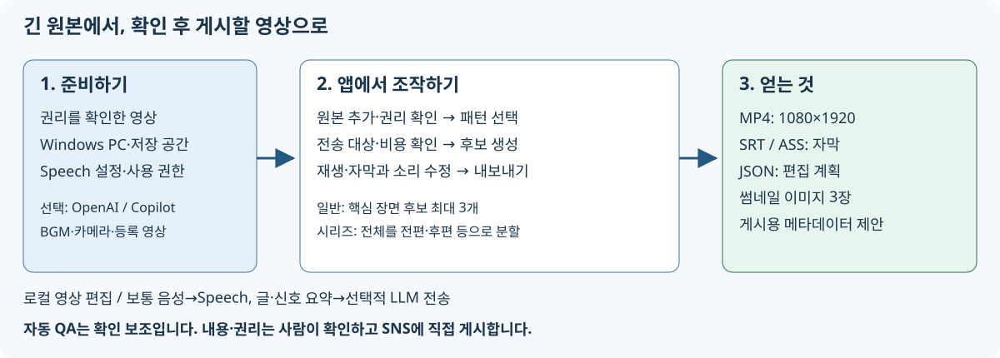

# VideoCreator

<!-- language-nav -->
[日本語](../../README.md) | [English](../en/start.md) | [한국어](start.md) | [简体中文](../zh-CN/start.md)
<!-- /language-nav -->

[처음 시작](start.md) / [가이드 목차](README.md) / [상세 개요](overview.md) / [엔지니어용](technical-reference.md) / [웹사이트](https://dahatake.github.io/VideoCreator/ko/)

**영상 편집이 처음이어도 사내 영상으로 자막이 있는 짧은 영상을 만들 수 있습니다.**
PC에서 영상을 선택하고 편집 패턴을 지정한 뒤 후보를 확인·수정하여 저장합니다. SNS나 사내 사이트에 자동 게시하지 않습니다.

## 먼저 준비하기

- **사용 권한이 있는 영상 1개**: 말소리가 있는 몇 분 분량의 MP4 등. 출연자·자료·음악의 이용 허락과 외부 서비스로의 전송 허용 여부를 확인합니다.
- **Windows 10/11(x64) 또는 Windows 11(ARM64) PC, 인터넷, 저장 공간**: 회사의 설치 규정을 따르세요. Apple Silicon용 macOS 버전도 있습니다([상세 개요](overview.md#단일-실행-파일windows--macos)).
- **관리자의 인계**: 사용할 Microsoft Foundry 리소스 이름(필요하면 테넌트 ID), 사용 역할 부여, 비용 담당자, 문의처를 확인하세요. 접속 주소를 모르면 추측하지 말고 관리자에게 요청합니다.

> **로컬 앱도 완전한 오프라인은 아닙니다.** 일반적으로 음성을 Azure Speech(기본 모델은 MAI-Transcribe-2)로 보내고, AI를 사용하면 전사문도 설정된 서비스로 보냅니다. LLM을 꺼도 Speech 통신은 남습니다. 키·토큰을 문서나 문의에 붙여 넣지 마세요.

## 설치하기(3단계)

배포 버전은 실행 파일 하나입니다. 설치 프로그램, .NET, FFmpeg가 필요 없으며 미리 설치할 것은 Azure CLI뿐입니다. 각 단계의 자세한 설명과 화면은 [빠른 시작](quickstart.md#2-설치하기3단계)에 있습니다.

1. 터미널에서 `winget install -e --id Microsoft.AzureCLI`를 실행하고 **터미널을 다시 연 뒤** `az login`으로 로그인합니다.
2. [최신 릴리스](https://github.com/dahatake/VideoCreator/releases/latest)에서 `VideoCreator.exe`(ARM64 PC는 `VideoCreator-<버전>-win-arm64.exe`)를 다운로드하고 더블 클릭합니다. SmartScreen이 표시되면 **추가 정보** → **실행**.
3. 열린 브라우저에서 **설정** → **AI 연결** → **Azure에서 선택**으로 리소스를 선택하고 **테스트 후 저장**을 누릅니다. 화면 위쪽이 `받아쓰기: MAI-Transcribe-2`처럼 바뀌면 준비 완료입니다.

소스에서 실행하는 개발자는 저장소의 `run.cmd`를 더블 클릭하면 설정 스크립트가 필요한 도구를 설치합니다([빠른 시작의 부록](quickstart.md#부록-소스-버전runcmd으로-실행하기)).

## 첫 영상 만들기

1. 브라우저에서 프로젝트를 만들고 영상 1개를 추가하여 이용 권리를 확인합니다.
2. **P4(긴 영상 → 30초 클립)**를 선택하고 **출력 방향**을 **세로 9:16(1080×1920)**으로 합니다. 시리즈는 끄고 필터링은 표준 그대로 두며, 전송 대상·비용을 확인하여 생성합니다.
3. 후보를 재생하고 자막·발언의 의미·구도·소리를 확인한 뒤 승인하여 내보냅니다.
4. 완성된 MP4를 끝까지 재생합니다. **저장 폴더(기본값은 `동영상\VideoCreator\<패턴 이름>`)에서 MP4와 자막을 열면 첫 성공입니다.** 게시할 때는 사내 규칙에 따라 직접 진행합니다.

실패하면 반복 생성하지 말고 [문제 해결](troubleshooting.md)을 확인하세요. 화면이 열려도 위쪽이 `받아쓰기: 없음` 그대로라면 자막 생성 준비가 끝나지 않은 것입니다(소스 버전의 `run.cmd`에서 `FAIL`은 로컬 필수 도구 문제, `WARN`은 경고입니다). 시간·수행 작업·오류 코드·앱 버전을 기록하여 관리자에게 전달하고 영상이나 기밀 자막은 첨부하지 마세요.

## 필요한 설명 찾기

| 목적 | 읽을 문서 |
|---|---|
| 준비부터 저장까지 순서대로 진행 | [빠른 시작](quickstart.md) |
| 용어·버튼·조작 알아보기 | [가이드 목차](README.md) / [화면 설명](screens.md) |
| 오류·경고·백업 | [문제 해결](troubleshooting.md) |
| 상세 기능·배포 버전 상세·소스 버전 설치 | [상세 개요](overview.md) |
| 엔지니어의 안전한 사용자 지정 | [기술 참조](technical-reference.md) / [설정·API](configuration-api.md) |
| Azure 준비·공유 사용자·키 / Entra ID 인증 | [Azure 접근 설정](azure-access.md) |
| 검증·빌드·릴리스 근거 | [검증 및 유지 관리](verification.md) / [상세 개요](overview.md) |

화면 언어와 영상 언어는 별개입니다. 자막은 자동 번역하지 않습니다. 영상 언어를 바꾸면 후보를 새로 생성하세요. 기능·배포·버전 관리·테스트·구조·보안의 상세 정보는 [상세 개요](overview.md)에 보존했습니다.

[요구 사항](docs/PRD.md) / [구현 기록](docs/IMPLEMENTATION.md) / [조사](docs/VideoCreator-AnalyticsReport.md) / [문서 제작 방침](documentation-brief.md) / [MIT 라이선스](../../LICENSE) / [타사 고지](../../THIRD-PARTY-NOTICES.txt)
