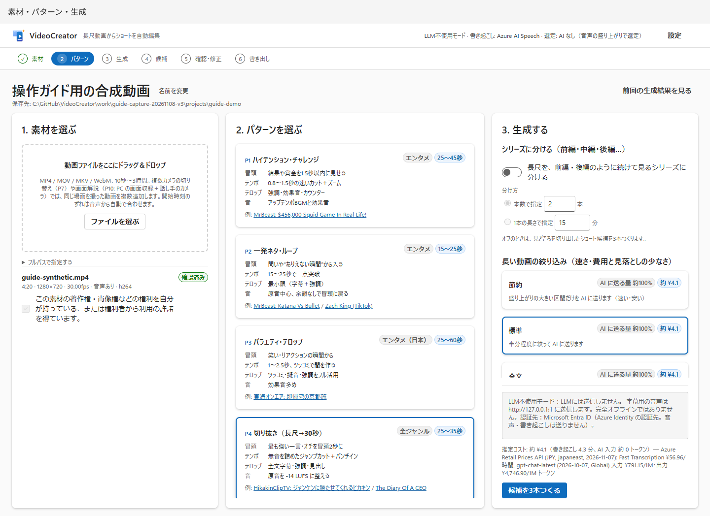
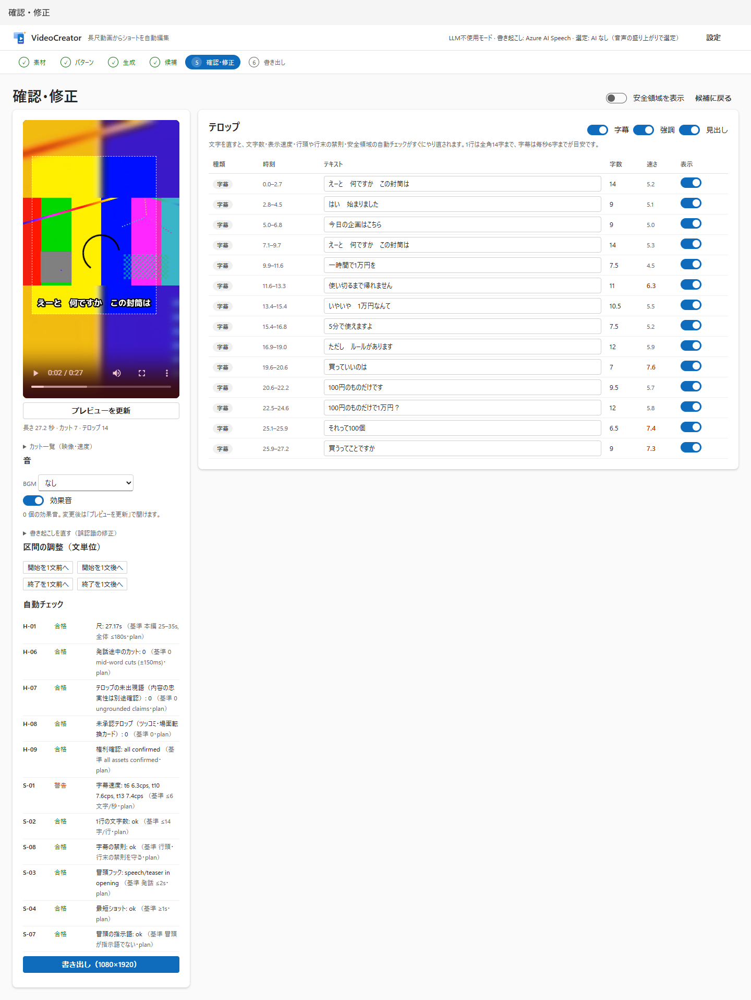
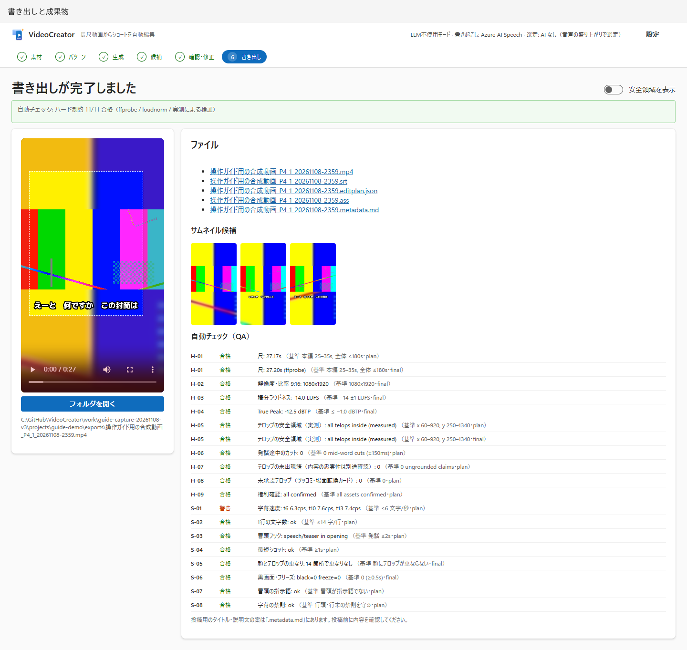

# クイックスタート：最初の1本を作る

<!-- language-nav -->
[日本語](quickstart.md) | [English](en/quickstart.md) | [한국어](ko/quickstart.md) | [简体中文](zh-CN/quickstart.md)
<!-- /language-nav -->

[はじめに](../README.md) / [ガイド目次](README.md) / [詳細概要](overview.md) / [エンジニア向け](technical-reference.md)

[アプリREADME](../README.md) / [ガイド目次](README.md) / [画面説明](screens.md) / [困ったとき](troubleshooting.md) / [設定・API](configuration-api.md)

**ゴール**：配布版をインストールし、発話のある動画1本からP4の候補を作り、内容を確認して縦型（1080×1920）のMP4と字幕などを保存します。処理時間は素材・PC・サービスの状況で変わるため、一定時間での完了は保証しません。

## 始める前に：管理者と分担する

一般の利用者がクラウドのリソースを作ったり、アクセス権を自分で広げたりする必要はありません。次の引き継ぎが済んでから進めてください。

| 担当 | 確認すること |
|---|---|
| 利用者 | 使ってよい動画、出演者・資料・音楽の許諾、音声・書き起こしの社外送信可否、投稿前の確認担当 |
| 管理者・社内IT | 会社で認めた配布物、Azure CLI の導入可否、利用アカウント、Microsoft Foundry のリソース名・デプロイ名・テナント ID、利用ロールの付与、費用負担先と利用上限の運用、問い合わせ先 |
| 一緒に確認 | サインインするアカウントと設定先が一致すること。画面が開くだけでなく、許可された短い動画で字幕生成から保存まで試せること |

**いちばん簡単なのは配布版（Releases の実行ファイル）です。** インストーラー、.NET、FFmpeg は不要で、利用者が事前に入れるのは Azure CLI だけです。下の1〜3を順に進めてください。ソースから起動する方法（`run.cmd` とセットアップスクリプト）は、開発・カスタマイズをする人向けに[付録](#付録ソース版runcmdで起動する)へまとめました。どちらか片方だけで構いません。管理者向けの設定詳細は[設定・API](configuration-api.md)、変更作業は[テクニカルリファレンス](technical-reference.md)を参照してください。

## 1. PCと動画を用意する

- Windows 10/11（x64）または Windows 11（ARM64）と、インターネット接続。ブラウザーは Microsoft Edge で画面確認済みです。Apple Silicon の macOS は[詳細概要の配布版手順](overview.md#単一実行ファイルwindows--macos)を参照してください。
- PCの種類は Windows の **設定 → システム → バージョン情報** の「システムの種類」で確認します。「x64 ベース プロセッサ」なら x64、「ARM ベース プロセッサ」なら ARM64 です。
- **自分が利用する権利を持つ動画**を1本用意します。音楽・顔・ロゴなどの許諾も確認します。対応表示は MP4 / MOV / MKV / WebM、長さ10秒〜3時間。最初は数分程度の発話動画が扱いやすいです。P4では25〜35秒の本編を作るため、10秒の動画なら必ず成功するという意味ではありません。
- ディスクの空きを確認します。ファイル選択・ドラッグ＆ドロップでは、一時領域と保存先の両方に素材サイズ分の空きが必要です。同じドライブなら素材の約2倍に加え、プロキシ、キャッシュ、プレビュー、書き出し分を確保します。
- **フルパスで指定する**なら素材コピーを省けます。ただし元動画を移動・削除すると、そのプロジェクトが使えなくなります。
- 管理者から、**使う Azure リソース（Microsoft Foundry）の名前**と、既定以外のテナントにある場合は**テナント ID** を聞いておきます。利用ロール（`Cognitive Services Speech User` と `Cognitive Services OpenAI User`）の付与は管理者の作業です（[Azure の準備と認証](azure-access.md)）。

## 2. インストールする（3ステップ）

### ステップ1：Azure CLI を入れてサインインする

字幕の書き起こし（Azure Speech）とAIの選定は、このPCでサインインした Microsoft Entra ID のアカウントで認証します。そのサインインに Azure CLI を使います。

1. スタートボタンを右クリックし、**ターミナル**（または **Windows PowerShell**）を開きます。
2. 次を貼り付けて Enter を押します。確認画面が出たら **はい** を選びます。

   ```powershell
   winget install -e --id Microsoft.AzureCLI
   ```

3. **ターミナルをいったん閉じて、開き直します。** 開き直さないと `az` が見つかりません。
4. 次を実行し、開いたブラウザーで会社のアカウントを選びます。サブスクリプションの番号を聞かれたら、管理者に指定されたものを選びます（分からなければ Enter）。

   ```powershell
   az login
   ```

   リソースが既定以外のテナントにある場合は `az login --tenant <テナント ID>` を使います。`winget` が使えない、またはソフトの導入が制限されている場合は、社内IT に Azure CLI の導入を依頼してください。

### ステップ2：VideoCreator をダウンロードする

1. [最新のリリース](https://github.com/dahatake/VideoCreator/releases/latest)を開き、**Assets** から自分のPC用のファイルを1つだけダウンロードします。
   - x64：`VideoCreator.exe`
   - ARM64：`VideoCreator-<バージョン>-win-arm64.exe`
2. ダウンロードしたファイルを、分かりやすいフォルダー（例：`ドキュメント\VideoCreator`）へ移します。ダウンロードフォルダーのままでも動きます。
3. `appsettings.json` のダウンロードは不要です。接続先は手順3で画面から設定します。

ファイルが改ざんされていないことを確かめたい場合は、[詳細概要](overview.md#github-actions-で作成公開するメンテナー)の `SHA256SUMS.txt` と `gh attestation verify` による検証を使います。

### ステップ3：起動する

1. ダウンロードした exe をダブルクリックします。「Windows によって PC が保護されました」と出たら、**詳細情報** → **実行** を押します。配布版はコード署名をしていないため、この確認が出ることがあります。
2. 黒いウィンドウ（コンソール）が開き、起動後に既定のブラウザーで <http://127.0.0.1:8765/> が開きます（8765番を別のソフトが使っているときは、空いている番号のURLになります）。初回は部品の展開のため少し時間がかかります。開かない場合は、黒いウィンドウに表示された `http://127.0.0.1:…` のURLをブラウザーで開きます。
3. **黒いウィンドウは閉じないでください。** 閉じるとアプリが止まります。ブラウザーを閉じてもアプリは止まりません。
4. 次回からも同じ exe をダブルクリックするだけです。起動中にもう一度ダブルクリックしても2つ目は起動せず、起動中のアプリの画面がブラウザーで開きます（新しいウィンドウはすぐ閉じます）。

## 3. 初回の画面で AI の接続を設定する

1. 初回は「VideoCreator へようこそ」の案内（6画面）が出ます。**次へ** で読み進めるか、**スキップ** を押します。あとから **設定** → **チュートリアルをもう一度見る** で見直せます。
2. 画面上部の表示を確認します。`書き起こし: なし` と出ている間は、まだ字幕を作れません。
3. 右上の **設定** を開き、**AI の接続** → **Microsoft Foundry** で次を行います。
   1. **認証方式** は **Microsoft Entra ID（推奨）** のままにします。
   2. **Azure から選択** を押し、管理者に聞いたリソースを選びます。エンドポイントが入り、チャット・埋め込み・画像のデプロイ名を候補から選べます。管理者の指定がなければ表示された候補のままで構いません。一覧に出ない場合は、エンドポイント（`https://<リソース名>.cognitiveservices.azure.com/`）とチャット用モデルのデプロイ名を管理者に聞いて入力します。
   3. **テストして保存** を押します。チャット・埋め込み・字幕の書き起こしのテストにすべて合格したときだけ保存されます。
4. 設定を閉じます。画面上部が `書き起こし: MAI-Transcribe-2 · 選定: Microsoft Foundry（<デプロイ名>）` のように変われば準備完了です。リソースのリージョンによっては、書き起こしが標準モデルになります。

- 接続前の設定画面には「使えません：Microsoft Foundry の接続が未設定です…」と表示されます。上の手順で保存すれば消えます。1.2.2 以前の配布版では「scripts/setup.ps1 を実行してください」と表示されますが、ソース版向けの案内なので、同じく上の手順で解消します。
- 接続テストは合成した1秒の無音と短い文章を送るため、少額の従量課金が発生し得ます。利用者の動画は送りません。
- テストに失敗したら、画面の説明に従います。`az login` を求められる場合はステップ1（特にターミナルの開き直し）を確認し、権限がない（403）場合は管理者にロールの付与を依頼して数分待ちます。デプロイが見つからない場合は、モデル名ではなくデプロイ名を入力します。詳しくは[Azure の準備と認証](azure-access.md#保存テストトラブル対応)を参照してください。
- AIによる選定を使わない場合でも、字幕のために Microsoft Foundry の接続（同じリソースの Speech）は必要です。選定方式は設定上部の **LLM を使わない** で切り替えられ、候補は音量の盛り上がりから選びます。
- 組織の方針で API キー認証を使う場合は、**認証方式** で **API キー** を選び、管理者から安全に受け取ったキーを入力します。この場合 Azure CLI は不要です。キーはこのPCのこのWindowsユーザーだけが復号できる形で保存されます。
- Azure サービスは従量課金です。送信先と費用の目安は生成前の画面に表示されます。組織の送信・データ利用方針を確認してください。

## 4. 素材を追加し、P4を選ぶ

1. 「プロジェクト名」を入力し、**新しいプロジェクト**を押します。
2. **ファイルを選ぶ**、または動画をドラッグ＆ドロップします。
3. 素材の名前、長さ、解像度、音声の有無を確認し、各素材の権利確認にチェックします。
4. **P4 切り抜き（長尺→30秒）**を選びます。青い枠が選択中です。
5. 右列の **出力の向き** で **縦 9:16（1080×1920）** を選びます。既定の「入力に合わせる」のままだと、横長の動画からは横長（1920×1080）の動画ができます。
6. シリーズはオフ、絞り込みは**標準**。BGMやオープニングなどは初回には不要です。
7. ボタンの上に表示される送信先と費用の目安を読み、**候補を3本つくる**を押します。



この画面は3列です。列の中をスクロールすると下の項目が見えます。右列の設定はグループに分かれ、見出しを押すと開閉します。上の6段階の表示は進み具合を示します。済んだ段階（✓）は押すとその画面へ戻れますが、まだの段階へは飛べません。

## 5. 候補を確認して、必要なら直す

生成画面には全体と現在の処理の進み具合が表示されます。候補ができたら、動画を再生して以下を確認します。

- 元の発言の意味を変えていないか。単体で見ても話が通じるか。
- 字幕の誤字、固有名詞、数字、読みやすさ。
- 顔や画面の見たい部分、音量、発話の切れ目。
- QAの「不合格」「警告」「未実施」。**未実施は合格ではありません**。

候補の **確認・修正** を開きます。文字を直したら入力欄からフォーカスを移動して変更を反映し、**プレビューを更新**して見直します。書き起こしの誤認識を直すと字幕が再生成されるので、手作業の字幕修正より先に行ってください。



## 6. 書き出して保存する

**最初の成功の目印**：候補が見えただけでは完了ではありません。書き出し後に保存先を開き、完成MP4を最後まで再生し、字幕ファイルも存在することを確認してください。

次のどちらかを選びます。

- **1本を直接書き出す**：「確認・修正」の **この内容を承認して書き出す**（動画が複数あるときは **この1本だけ今すぐ書き出す**）。現在の内容を承認してから書き出します。ハードQAと必要なAI文の承認も満たす必要があります。
- **複数の動画を1本ずつ確認して、まとめて書き出す**：「確認・修正」で **承認して次の動画へ** を押して順に確認し、最後の動画で **承認して書き出しへ進む** → 書き出し一覧で **選んだ動画を書き出す**。途中で **この内容で承認して候補に戻る** を押すと、候補一覧の **確認の進み具合** で残りを確認できます。変更すると再承認が必要です。

完成ファイルは、プロジェクトの保存先（既定は `ビデオ\VideoCreator`）の中の **パターン名のフォルダー**（画面に表示されているパターン名。日本語表示なら例：`切り抜き（長尺→30秒）`）に保存されます。書き出し一覧では、完了した動画ごとに完成ファイルを再生・シークして確認できます。動画ファイルの絶対パスを確認し、**パスをコピー** または **フォルダーを開く** で保存先へ進みます。個別の完了画面でも同じ操作と最終QAの確認ができます。



| ファイル | 使い道 |
|---|---|
| `.mp4` | 字幕を映像に焼き込んだ公開用動画。投稿前に最後まで再生して確認 |
| `.srt` | 時刻付きの字幕。外部字幕に対応する投稿先・編集ツールで利用 |
| `.ass` | 書体・位置・装飾を含む字幕描画用データ |
| `.editplan.json` | カット、テロップ、音、挿入物の編集記録。開発・再現用 |
| サムネイル画像3枚 | 投稿用画像の候補。自分で選ぶ |
| `.metadata.md` | タイトル・説明文・ハッシュタグなどの案。事実確認して手動で投稿欄へ転記 |
| `.post.json` | 完了画面の「投稿用の文章」と同じ内容（YouTube 説明文・Viva Engage 投稿文・チャプター）。`.metadata.md` の末尾にも貼り付けやすい形で入ります |

書き出し一覧と完了画面の **投稿用の文章（コピーして貼り付け）** には、保存済みの YouTube の説明文、Viva Engage の投稿文、`00:00 章のタイトル` 形式のチャプターが並び、それぞれの **コピー** ボタンで貼り付けられます。未生成の場合は **投稿用の文章を作る** を押します。**その他の成果物・プレビュー** を展開すると、字幕・メタデータ・編集計画の内容やサムネイルを確認し、各ファイルを開く／保存できます。

- チャプターの時刻は、書き出した動画の実際の時刻です（オープニング・カードの分も反映）。YouTube の条件（00:00 から・3つ以上・各10秒以上）を満たさないときは付けません。3分以内の縦型動画はショートとして扱われ、チャプターが再生バーに出ないことがあります。
- 文章は AI が書き起こしをもとに作り、発話にない数字・カタカナ語・英字の名前、URL、伏せ字にした語は自動で除きます（漢字の固有名詞までは判定できません）。除いた理由は画面に表示します。LLM を使わない設定ではひな形で作ります。
- **別の案を作る** で、前回とは別の切り口の案を作り直せます。画面は保存済み文章の読み取り専用表示です。必要な修正はコピー後の貼り付け先で行ってください。コピーに失敗した場合は表示された文章を選択して Ctrl+C を使います。

SRTと映像への焼き込み字幕を両方表示させると、投稿先によって字幕が二重になります。投稿先の表示方法を選んでください。アプリは投稿・公開・シリーズURLの自動設定までは行いません。

終了するときは、黒いウィンドウ（ソース版では起動ターミナル）で Ctrl+C を押します。次回はプロジェクト一覧から開くと、最後に表示していたプロジェクト設定、生成、候補、確認・修正、書き出しの段階から再開します。参照先がなくなった場合は復元できる前段階を表示します。バックアップは[トラブルシューティング](troubleshooting.md#保存とバックアップ)を参照してください。

## 付録：ソース版（run.cmd）で起動する

開発やカスタマイズをする人向けです。配布版を使う場合は不要です。

1. リポジトリを取得して展開します。Gitを使わない場合はGitHubの「Code → Download ZIP」で取得し、ZIPの中ではなく展開したフォルダーを開きます。
2. 展開したフォルダーの [run.cmd](../run.cmd) をダブルクリックします。初回は[セットアップスクリプト](../scripts/setup.ps1)が、.NET SDK 10、FFmpeg、フォント、モデル、Azure CLI のうち足りないものを導入し、未サインインなら `az login` の画面を開きます。続けて現在のソースをビルドし、既定のブラウザーを開きます。スタートメニューに登録したい場合は、代わりにリポジトリのフォルダーで `.\install.ps1` を実行します。
3. 接続先は配布版と同じく **設定 → AI の接続** で保存できます。起動設定で指定する場合は、[appsettings.json](../src/VideoCreator.App/appsettings.json) の `VideoCreator` セクションを変更します。以下はそのセクションの例であり、ファイル全体の置き換え用ではありません。

```json
{
  "Llm": {
    "Provider": "azure-openai",
    "Endpoint": "https://<自分のリソース>.cognitiveservices.azure.com/openai/v1",
    "Deployment": "<チャット用モデルのデプロイ名>"
  }
}
```

- 字幕の書き起こし（Speech）は `Llm.Endpoint` と同じリソースを使います。`Asr.Endpoint` は検証用の設定なので、通常は指定しません。モデル名ではなく、**自分が作成したデプロイの名前**を設定します。
- ソース版の設定例には配布者のエンドポイントが入っています。自分の組織の値に変えるか、画面で保存してください。キーやトークンは設定ファイルに書かないでください。
- 起動のたびに現在のソースをビルドします。ビルドが失敗した場合、古い成果物では起動しません。設定されたポートが使用中なら空いているローカルポートを使い、そのURLを開きます。起動ターミナルは閉じないでください。
- `.\run.cmd --check` は何もインストールせずに状態を確認します。`FAIL` は必要なローカル部品の不足、`WARN` は警告です。**設定先への最小のSpeech/OpenAI要求を送るため、通信と小額の課金が発生し得ます。** 確認対象は起動設定（appsettings.json と azd の値）で、画面で保存した接続は設定画面の接続テストで確認します。
- Copilot CLI も導入する場合は `.\run.cmd --setup --with-copilot` を使います。Azure リソースの作成（`--provision-azure`）や不足ロールの付与（`--assign-roles`）は管理者向けです。安易に使わず、[Azure の準備と認証](azure-access.md)を読んでください。

公式資料：[Fast Transcription](https://learn.microsoft.com/en-us/azure/ai-services/speech-service/fast-transcription-create) / [SpeechのEntra ID認証](https://learn.microsoft.com/en-us/azure/ai-services/speech-service/how-to-configure-azure-ad-auth) / [対応リージョン](https://learn.microsoft.com/en-us/azure/ai-services/speech-service/regions)。
