# 画面・コンポーネント説明

[アプリREADME](../README.md) / [ガイド目次](README.md) / [最初の1本](quickstart.md) / [QAとエラー](troubleshooting.md) / [設定・API](configuration-api.md)

画面例は2026-11-08の実装をMicrosoft Edge、viewport 1440×1000で取得し、長いページは全体をキャプチャしています。PCの幅や選んだパターン、素材の数で項目が変わります。縦に長い欄は**各列の内側**をスクロールしてください。

## 共通部分

| 部品 | 意味・操作 |
|---|---|
| 左上のVideoCreatorロゴ | プロジェクト一覧へ戻る。進行中の処理を止めるボタンではない |
| 右上の書き起こし／選定表示 | 現在のプロバイダー。設定先が利用可能かは接続や権限にも依存 |
| 設定 | AI選定の方式、送信先、保存先、ツール情報を確認 |
| 素材 → パターン → 生成 → 候補 → 確認・修正 → 書き出し | 作業位置。青が現在、チェックが通過済み。ナビゲーションタブではない |
| 安全領域を表示 | プレビュー上に投稿UIとの重なりを避ける目安を表示。動画そのものを書き換えない |
| メッセージ・バッジ | 成功／警告／エラー／承認状況。色だけでなく文章とコードを読む |

## 1. プロジェクト一覧

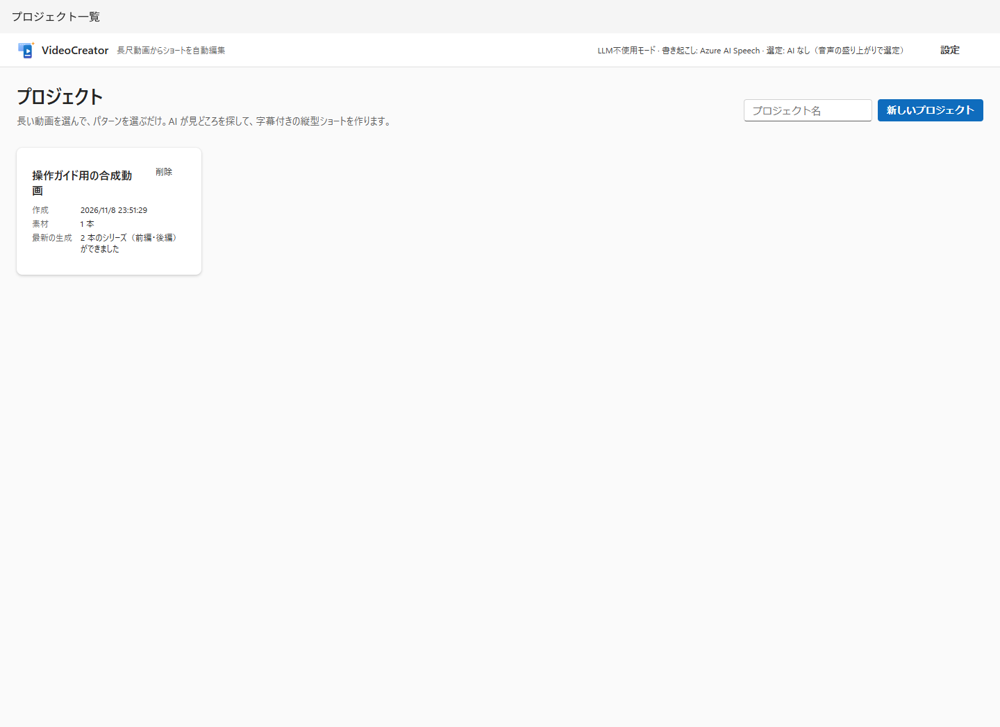

| 部品 | 意味・注意 |
|---|---|
| プロジェクト名、新しいプロジェクト | 作業を作る。空名でも作成できるが、区別できる名前がおすすめ |
| プロジェクトカード | 名前のリンクで作業を開く。作成日時、素材数、最新の生成状態を表示 |
| 削除 | 確認ダイアログを開く。管理対象フォルダーはごみ箱へ、解析・編集のDB記録は削除される |

**削除は後片付けであり、作業終了の操作ではありません。** フルパスで参照した元動画は削除しませんが、アップロード素材・書き出しはプロジェクトと一緒にごみ箱へ移ります。ごみ箱からフォルダーを戻すだけではDBの編集記録は復元されません。処理中は完了かキャンセルを待ってください。

## 2. 素材・パターン・生成

これは3つの独立した画面ではなく、**同じプロジェクト画面の3列**です。

上部の **名前を変更** で編集欄を開き、保存またはキャンセルします。プロジェクトの保存先も表示されます。名前変更はフォルダーの移動ではありません。

### 左列：素材

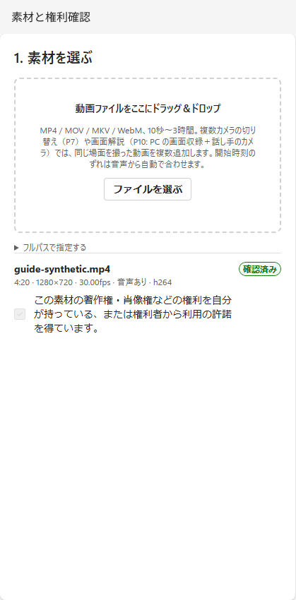

| 部品 | 意味・判断基準 |
|---|---|
| ドロップ領域／ファイルを選ぶ | PCの動画をアップロードし、プロジェクト内へコピー |
| フルパスで指定する → 追加 | `C:\Videos\talk.mp4` のような絶対パスで元ファイルを参照。引用符なしのパスが扱いやすい |
| 素材情報 | 名前、長さ、表示解像度、fps、VFR（可変フレームレート）、音声有無、コーデック |
| 警告 | 回転・VFR・音声なしなど。映像が表示できても字幕の条件を満たすとは限らない |
| 権利確認／確認済み | 各素材の著作権・肖像権等を自分で確認して登録。確認済みチェックは編集不可 |
| 役割（複数素材時） | 基準映像、カメラ、引き、音声基準、画面など。P7/P10の映像選択に影響 |
| 話者（複数素材時） | そのカメラが映す話者番号（1〜8）。書き起こしの登場順。空欄は自動／未指定 |
| ずれ(秒)・同期情報 | 基準音声に対するカメラ側の時刻差。自動同期の根拠・残差・ドリフトを確認してから手動変更 |

P7は同じ場面のカメラ動画を2本以上、P10は画面収録＋話し手のカメラを用意します。違うイベントの動画を同期する機能ではありません。同期の自動判定は万能ではなく、失敗時・範囲外は警告や基準映像への切り替えがあります。

### 中央列：パターン

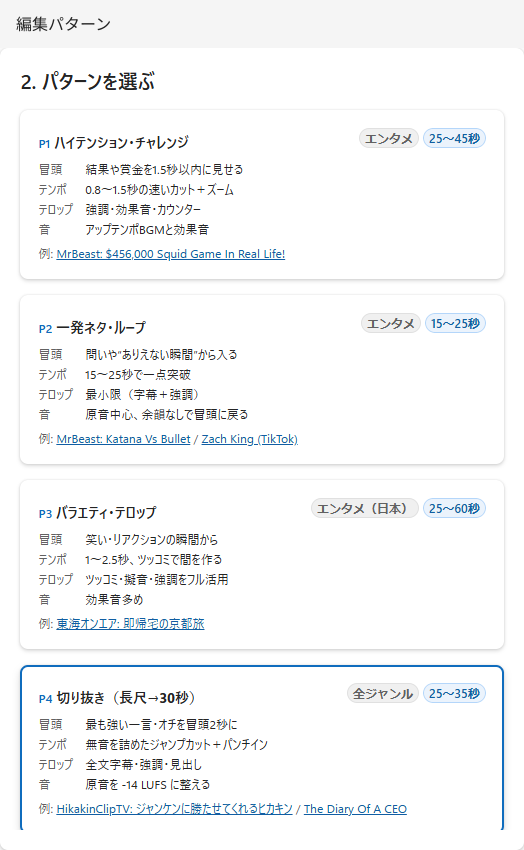

カードを選ぶと青枠になります。**冒頭・テンポ・テロップ・音**が編集方針、秒数がショート本編の目標範囲です。「例」は外部動画への参考リンクで、このアプリの出力を保証するものではありません。カードはスクロールしてP10まで見られます。

| ID | 名前 | 本編の目標 | 選ぶ場面 |
|---|---|---|---|
| P1 | ハイテンション・チャレンジ | 25〜45秒 | 挑戦・結果・リアクション |
| P2 | 一発ネタ・ループ | 15〜25秒 | 短い一撃、冒頭へ戻るループ |
| P3 | バラエティ・テロップ | 25〜60秒 | 笑い、強い装飾、ツッコミ |
| P4 | 切り抜き（長尺→30秒） | 25〜35秒 | 初回におすすめ。発話中心の見どころ |
| P5 | ビート同期モンタージュ | 15〜60秒 | BGMの拍に合わせる映像編集 |
| P6 | 解説・講義（要点テロップ） | 30〜60秒 | 要点を伝える説明 |
| P7 | 対談スイッチング | 30〜60秒 | 同時収録した複数カメラ |
| P8 | プロセス圧縮（料理/DIY） | 20〜60秒 | 低活動区間を早送りする工程動画 |
| P9 | ミニマル/環境音 | 30〜90秒 | 装飾を控え、元の音を活かす |
| P10 | 画面解説（画面＋ワイプ） | 30〜60秒 | PC画面収録と話し手のカメラ |

秒数は元動画の長さではありません。挿入物があると全体が伸び、シリーズでは別の尺条件になります。プリセットの `target.aspect` を変えるだけで全画面・全QAが横型対応になるわけでもありません。

### 右列：生成の基本設定

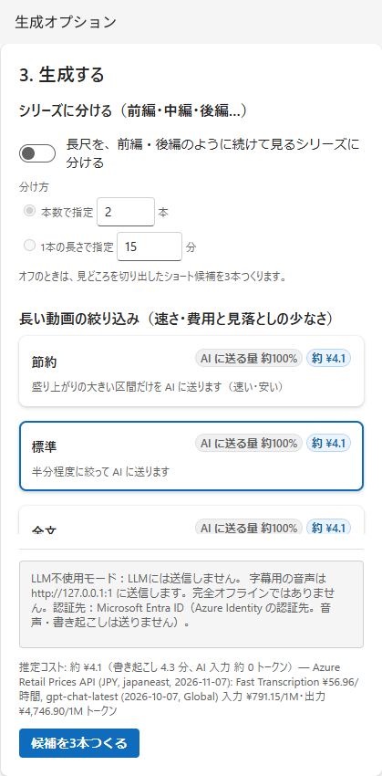

| 部品 | 意味・注意 |
|---|---|
| シリーズに分ける | オフ：見どころ候補。オン：元動画全体を連続パートに分ける |
| 本数で指定 | 2〜20本。話題の切れ目から、長さがそろう分割を探す |
| 1本の長さで指定 | 1〜60分、入力刻み0.5分。目安であり、完全に同じ長さとは限らない |
| 分割の目安 | 素材追加後に表示。書き起こしがある場合は無音カット後の見込みを使う |
| 節約 | 長尺では盛り上がりの強い区間を優先。費用・速度優先だが静かな重要場面を見落とし得る |
| 標準 | 長尺の送信量と見落としのバランス |
| 全文 | 全文を選定に使う。必要に応じて分割送信するため、1回の巨大要求になるとは限らない |
| 費用・送る量 | 実装内の単価と推定量から計算。請求額の保証ではない。短い動画では3方式の送信量が同じ場合もある |
| 送信先の説明 | ボタンの上に常に表示（音声→ASR、文章・信号要約→LLM、認証先。LLM不使用でもASRは別）。「費用の内訳」を開くと送信量と費用の詳細 |
| 候補を3本つくる | 素材・権利がそろうと生成。足りない場合は理由を表示。結果は最大3件。右に推定コスト |

右列の設定は「シリーズ」「長い動画の絞り込み」「音」「オープニング・クロージング・場面転換」「前回の解析結果」のグループに分かれ、見出しをクリックすると開閉できます。閉じたグループの見出しには現在の設定（例:「BGM 自動・効果音 オン・ツッコミ オフ」）が表示されます。開閉の状態はこのブラウザーに保存されます。「オープニング・クロージング・場面転換」は最初は閉じています。シリーズがオンのときは、絞り込みグループは閉じた表示になります（全文を送るため）。下の「作ったパターン」は、画面をスクロールすると表示されます。

シリーズが使えるのは発話軸のP1〜P4・P6・P7・P9・P10です。P5/P8では使えません。分け方の2項目はどちらか一方を指定します。**無音カット等の編集後にも、1本あたり1分以上を確保できる長さが必要**です。先出し、おさらい、章見出し、次回予告等により、パートの全体尺は本編の分割尺と異なります。

### 右列の下部：音・伏せ字・挿入物

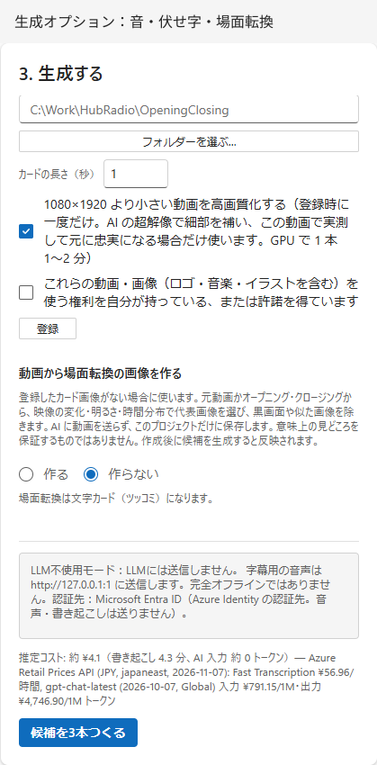

| 部品 | 意味・注意 |
|---|---|
| BGM | パターンに任せる／なし／ライブラリ曲／追加した自分の曲 |
| 効果音 | ポン・ドーン等の効果音を使うか |
| ツッコミを AI に提案させる | P3のみ。AI提案は内容を読んで承認するまで書き出せない |
| ツッコミの見せ方 | ツッコミがオンのときに表示。自動（既定。発言の切れ目だけ停止カード、それ以外は重ねテロップ。理由は候補のメモに表示）／ツッコミテロップ（映像を止めずに重ねる）／カード（映像を2〜3秒止めて画像＋文字＋BGM） |
| 伏せる語 | 読点・カンマ区切りで指定。字幕等は `●`、該当音声はピー音。元ファイルや書き起こしを匿名化する機能ではない |
| 自分のBGMを追加する | 音声ファイルを選び、権利確認して登録。プロジェクト用の曲 |
| オープニング／クロージングを入れる | 共通登録がある場合に利用可能。オープニングは先出しのあと、クロージングは最後 |
| 場面転換カード | 場面の切り替わりで短い静止画・文字・効果音を挿入。文字はAIが視聴者の代弁（ツッコミ・称賛など）を自動作成し、承認対象 |
| 登録する／登録し直す | フォルダー内の `Opening` / `Closing` を含む動画名とPNG/JPGカード画像を読み込む。登録は全プロジェクト共通 |
| フォルダーを選ぶ… | Windowsのフォルダー選択を開く。キャンセルは入力を変更しない。隠れた場合はタスクバーを確認 |
| カードの長さ | 2〜3秒（既定2.5秒）。全画面の画像／背景パネルの上に文字を表示し、専用BGMを流してから本編・元音声に戻る。本編のBGMが「なし」でもカードのBGMは流れる |
| 小さい動画を高画質化する | 登録後のバックグラウンド処理。実測で採用可否を判断。時間表示は環境依存 |
| 登録を解除 | 共通登録を外す。既存候補の編集計画は別なので、既存候補が自動で作り直されるとは考えない |
| 動画から場面転換の画像を作る | 既定「作らない」。作る場合は素材か登録済みOpening/Closingを選び、最大2〜6枚を抽出 |

画像抽出はローカルで行い、黒／白／類似画像を除きます。意味上の見どころをAIで選ぶ機能ではありません。作成後は**新しく生成する候補**に反映されます。「作らない」に戻しても画像ファイルは残ります。共通登録のカード画像があればそちらが優先されます。

### 字幕・テロップの固有名詞

プロジェクト画面の下部で、人名・地名・企業／団体名・商品／作品名などを登録できます。字幕・テロップに表示したい表記を入力し、必要なら読みと音声認識で出やすい別表記も追加します。これらの語句は次回の候補生成時にASRのフレーズヒントとして使われ、登録表記はテロップの固有名詞照合にも使われます。種類は整理用で、ASRに渡す語句自体は表記・読み・別表記です。

保存済みの書き起こしや単語のタイムコードは変更されません。登録後に新しい候補を生成すると、辞書が変わった場合は書き起こしを取り直してヒントを反映します。フレーズヒントは認識精度を保証するものではないため、生成後に字幕と音声を確認し、必要なら書き起こしを修正してください。単語時刻は音声認識結果に基づきます。

## 3. 生成の進み具合

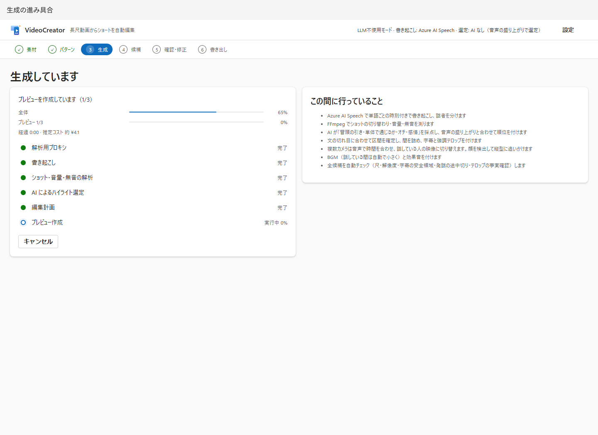

| 部品 | 意味 |
|---|---|
| 全体のバー | パイプライン全体の進み具合。一定速度の時計ではない |
| 現在の処理のバー | 計測できる処理の実測進捗。計測できない場合は割合なしで動く |
| 経過／残り目安 | 経過は画面を開いてから。残り目安は現在の計測可能な処理についての推定 |
| 段階の一覧 | プロキシ→書き起こし→信号解析→選定→編集計画→プレビュー |
| この間に行っていること | 通常の処理の説明。キャッシュ利用・AIなし・パターン次第で実行内容は異なる |
| キャンセル | 生成を中止。候補を書き出す操作の取り消しとは別 |

画面を離れてもサーバー側の処理は続きます。失敗・キャンセル時は理由を読み、「プロジェクトに戻る」から条件を直します。

## 4. 候補の比較とシリーズ

| 部品 | 意味・注意 |
|---|---|
| 候補番号、見出し、理由 | 順位と選定根拠。AIや信号に基づく提案であり、人気の保証ではない |
| 「○秒 素材」と元動画の時刻 | 選定区間の長さ・元動画の場所。無音カットや先出し後の完成尺とは異なる |
| プレビュー、再生コントロール | 実際に見て音を聞く。低解像度なので最終画質の判定には使わない |
| 冒頭の引き／単体で通じる／オチ／感情 | 内容面の評価。信号ベースでは内容を理解したAIの評価とは限らない |
| 音声の勢い／総合 | 音量などの信号評価と合成スコア。すべて0〜10の目安 |
| 信号ベース | AIがない、または失敗して音量中心の選定に切り替わった |
| QAバッジ | 計画チェックの合格、警告、最終書き出し時の未実施項目を区別 |
| 調整の記録 | 区間補正や制約による変更理由 |
| 確認・修正 | その候補の編集画面を開く |
| 指示を添えて作り直す | 別候補を探す。AIなしでは意味的な指示が反映されるとは限らない |
| 素材・パターンに戻る | パターンや生成条件を変更する |

シリーズでは順位・スコアの代わりに前編／中編／後編・第n話の順、元動画の本編範囲、分け目の根拠、チャプターを表示します。区切りを変更するときはプロジェクトで本数／長さを変えて再生成します。

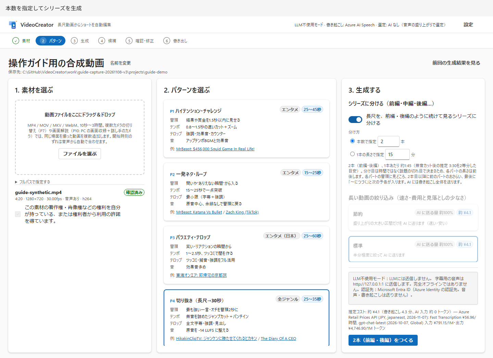

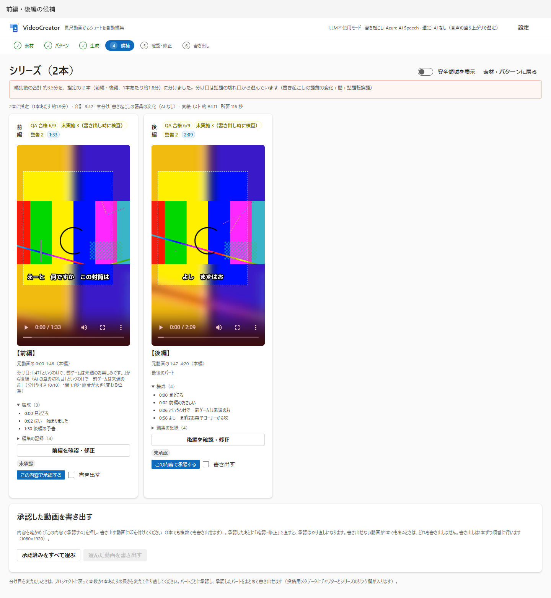

### 承認してまとめて書き出す

| 部品 | 意味 |
|---|---|
| この内容で承認する | **その時点の編集計画**に対する確認を記録 |
| 未承認／承認済み／承認後に修正あり | 編集で計画が変わると再承認が必要 |
| 承認を取り消す／もう一度承認する | 自分の判断を更新 |
| 書き出す | 今回書き出す候補にチェック。承認済みかつ書き出し中でないものを選べる |
| 承認済みをすべて選ぶ | 選択を補助。自動承認する機能ではない |
| 選んだ動画を書き出す | 全件を事前検証し、1件でも不可なら何も開始しない。開始後は順位／パート順で1本ずつ |
| 進捗／書き出した動画を開く | 各候補の状態と完了ファイルへの入口 |
| 待機中の取り消し | 未着手の書き出しだけを中止。実行中は最後まで処理する |

### 複数の動画を1本ずつ確認してから、まとめて書き出す

1つのパターン（Job）で動画が2本以上あるとき、候補一覧の上に **確認の進み具合** が出ます。

| 部品 | 意味 |
|---|---|
| 確認の進み具合: 承認 n / N 本 · 書き出し済み m / N 本 | このパターンの動画のうち、承認した数（書き出し中・書き出し済みを含む）と、書き出し済みの数 |
| 次の未承認（動画名）を確認 | まだ承認していない最初の動画の「確認・修正」を開く |
| 書き出しへ進む（承認 n 本） | 「6. 書き出し」の一覧画面へ進む。承認済みの動画があると主ボタンになる |
| 動画ごとの状態 | 未確認／承認済み／要再承認（承認後に修正あり）／書き出し中／書き出し済み。名前から「確認・修正」を開ける |

ステップ表示の「確認・修正」は最初の未確認の動画へ、「書き出し」は書き出し一覧へのリンクになります。

## 5. 確認・修正

| 部品 | 意味・操作 |
|---|---|
| プレビューを更新 | 編集後の内容を描画し直す。古いプレビューをそのまま判断材料にしない |
| 長さ／本編・全体／カット・テロップ数 | 計画の情報。全体には有効な挿入物を含む |
| テロップ・場面転換 | テロップとオープニング・場面転換カード・ツッコミカード・クロージングを、書き出し後の時刻順に1つの表で表示。上部のスイッチ（字幕・強調・見出し・擬音・ツッコミ・オープニング・場面転換カード・クロージング）で種類ごとにまとめてオン／オフ。「ツッコミ」は重ねテロップとツッコミカードの両方が対象 |
| オープニング・カードの行 | 挿入位置・長さ・文字・使用オン／オフ。カード文は20文字まで。カードは映像を止めて全画面で表示（画面と縦横比が近い画像は全面に拡大、異なる画像はぼかした同じ画像を背景に全体を表示） |
| ツッコミをすべて承認／カードをすべて承認 | AIの文を自分で読み確認。人が書き換えたカード文は人の文として記録される |
| カット一覧（映像・速度） | 使用素材、長さ、速度、顔追従、画面ズーム、ワイプを確認。汎用タイムライン編集ではない |
| BGM・効果音 | 音の変更後はプレビュー更新。P5のBGM変更はカットも変わるため再生成が必要 |
| 書き起こしを直す | 使用範囲の単語を修正。時刻は変えず字幕を作り直す。手修正の字幕は上書きされ得る |
| 開始／終了を1文前・後へ | ショートの区間を文単位で調整。素材端や尺条件で動かせない場合がある |
| 自動チェック | 計画に対する即時QA。最終ファイルの音量・解像度測定とは別 |
| 自動チェックの承認／承認を取り消す | 各チェックの結果を確認した記録を保存／取り消し。承認済みの日時を表示 |
| 自動チェックの一括承認 | 合格を含む実施済み・未承認の項目をまとめて承認。未実施は対象外 |
| この内容を承認して書き出す（1080×1920） | 動画が1本のとき。現在の内容を承認してから書き出す |
| 承認だけして候補に戻る | 動画が1本のとき。承認を記録して候補一覧へ戻る |

同じパターンに動画が2本以上あるときは、見出しの下に動画の切り替えと操作が変わります。

| 部品 | 意味・操作 |
|---|---|
| ‹ 前の動画／「動画 i / N」と動画の選択／次の動画 › | 同じパターンの動画を切り替える。選択肢には各動画の状態（未確認・承認済み等）を表示 |
| 承認して次の動画へ（動画名） | この動画の現在の内容を承認し、まだ承認していない次の動画を開く（最後は先頭に戻って探す） |
| 承認して書き出しへ進む | ほかの動画がすべて承認済みのとき。承認して「6. 書き出し」の一覧画面へ |
| この内容で承認して候補に戻る | 承認して候補一覧へ戻り、進み具合を確認する |
| この1本だけ今すぐ書き出す（1080×1920） | 一覧を経由せず、この動画だけを承認して書き出す |

すでに現在の内容で承認済みなら、承認の記録は重ねて作りません。ハード制約の不合格があるときは、どの承認ボタンも押せません。

自動チェックの承認は「内容を確認した」という記録です。不合格・警告を合格に変えたり、書き出しの制約を解除したりはしません。テロップ・カードの承認とは別の操作です。再読み込み後も保存されますが、編集や判定結果の変更後は再承認が必要です。

シリーズの区切りはここでは動かせません。また現在のUIの書き起こし修正は `replan` を伴うため、シリーズでは制約エラーになる場合があります。シリーズの誤字幕はテロップ欄で直し、根本の書き起こし修正が必要ならショート側で修正するなど、[APIの制約](configuration-api.md#編集操作)を確認してください。

### テロップ表

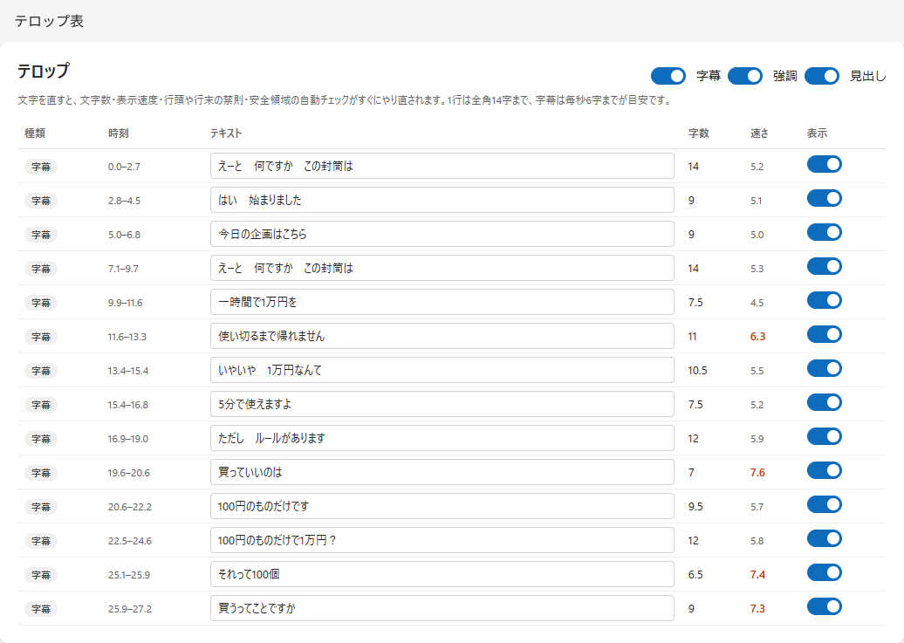

| 欄・部品 | 意味 |
|---|---|
| 種類 | 字幕＝発話、強調＝注目語、フック＝冒頭の引き、見出し＝話題、ツッコミ＝補足、擬音＝音の文字化、カウンター＝数など |
| 時刻 | 挿入物を含む完成動画上の表示時刻（秒） |
| テキスト | 書き換え、フォーカス移動で保存。40文字は入力上限であり、読める・安全領域に入る上限ではない |
| 字数 | 全角換算（半角はおおむね0.5字）。表示幅の目安 |
| 速さ | 字幕の全角換算文字数／秒。速すぎると読みにくい |
| 表示スイッチ | 行ごとのオン／オフ。無効行は淡色 |
| 種類ごとのスイッチ | 字幕・強調等をまとめて表示／非表示 |
| 承認 | 未承認AI文を確認。ツッコミには明示承認が必要 |

伏せ字、数字、固有名詞を手で戻すとQAが不合格になることがあります。警告を消すことより、内容を変えず読めることを優先してください。

## 6. 書き出し

### 書き出し一覧（複数の動画をまとめて）

候補一覧の **書き出しへ進む**、または最後の動画で **承認して書き出しへ進む** から開きます（`#/job/{id}/exports`）。アプリを閉じても、次回はこの画面から再開します。

| 部品 | 意味 |
|---|---|
| 確認の進み具合 | 承認数・書き出し済み数と、未承認の動画へのリンク |
| 動画ごとの行 | 名前・見出し・長さ・QAバッジ、「確認・修正」ボタン、承認の状態、書き出すチェック |
| 書き出すチェック | 初期状態では、承認済みでまだ書き出していない動画が選ばれている |
| 選んだ動画を書き出す | 候補一覧と同じ一括処理。全件を事前検証し、1件でも不可なら何も開始しない |
| 進捗／書き出した動画を開く | 各動画の書き出し状態と完了画面への入口 |

### 完了画面

書き出し中は映像合成、音量調整、QA、関連ファイル作成の状態が表示されます。完了後は以下を使います。

| 部品 | 意味 |
|---|---|
| 候補に戻る（ほかの動画を確認）／書き出し一覧 | 同じパターンのほかの動画の確認や、まとめての書き出しへ戻る |
| ハード制約の合格数 | 最終ファイルと計画のチェック結果。段階別の行があるため「項目IDの種類数」と合格行数は一致しない |
| 完成動画 | 最終画質で再生して内容を確認 |
| フォルダを開く | Windowsエクスプローラーで出力場所を開く |
| ファイルのリンク | MP4、SRT、ASS、JSON、メタデータをブラウザーで開く／保存 |
| サムネイル候補 | 3枚の候補。自分で選択して投稿先に設定 |
| QA一覧 | ID、状態、測定値、基準、`plan` / `final` を確認 |
| 記録の折りたたみ | 実行コマンド等の再現資料。秘密情報・個人パスがないか確認して共有 |

## 7. 設定

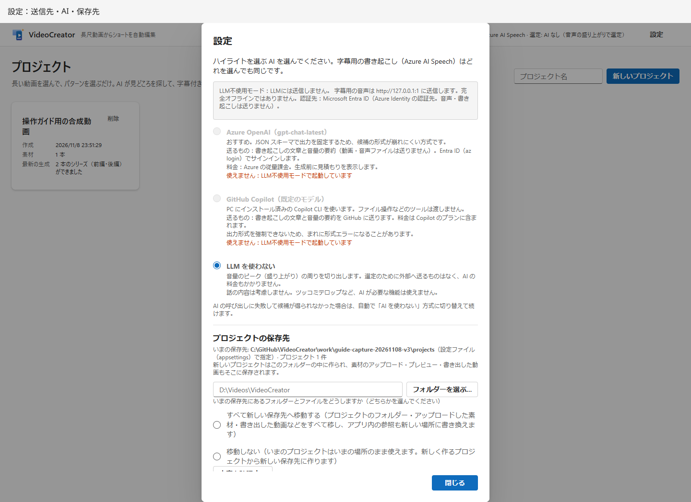

| 部品 | 意味・注意 |
|---|---|
| Azure OpenAI／GitHub Copilot／LLMを使わない | ハイライトの選定方式。変更はその場でサーバーに反映。「閉じる」は保存ボタンではない |
| 使えません | エンドポイント不足、CLIなし、起動時のLLM不使用固定など |
| 送信先 | 通常の音声・文章の送信先と認証先。LLM不使用はASR停止と同義ではない |
| いまの保存先・件数 | 新規プロジェクトの保存先と既存件数 |
| 新しい保存先／フォルダーを選ぶ | 新規保存先を指定。DB・キャッシュのDataDirを変える欄ではない |
| すべて移動する／移動しない | 前者は現在の保存先直下のファイル等も含め移動。後者は新規プロジェクトだけ新しい場所 |
| 内容を確認する | サイズ、空き容量、移動対象、問題点を確認。まだ移動しない |
| 確認後の変更ボタン | 計画を読み、実際に変更。処理中・同名衝突などは拒否される |
| FFmpeg／不足フィルタ／Copilot CLI／パターン数 | 起動環境を診断。CLIのパス等に個人情報があれば共有前に隠す |
| 閉じる | ダイアログを閉じる |

AIの選択はRuntimeの状態で、アプリ再起動時には起動設定に戻ります。保存先の画面設定はDBに保存され、起動設定より優先されます。移動後に手でフォルダーだけ戻すと参照がずれるため、[保存・復旧の注意](troubleshooting.md#保存とバックアップ)を読んでください。

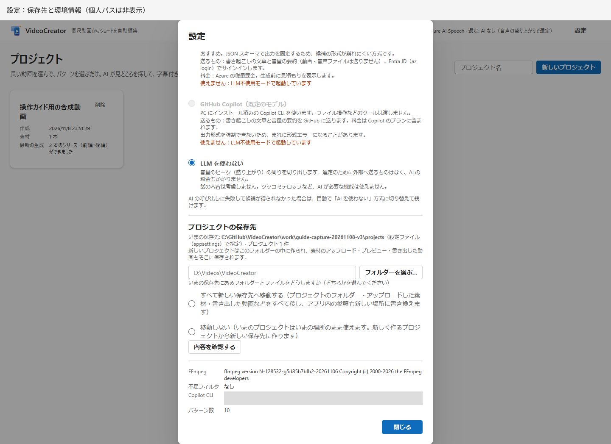
