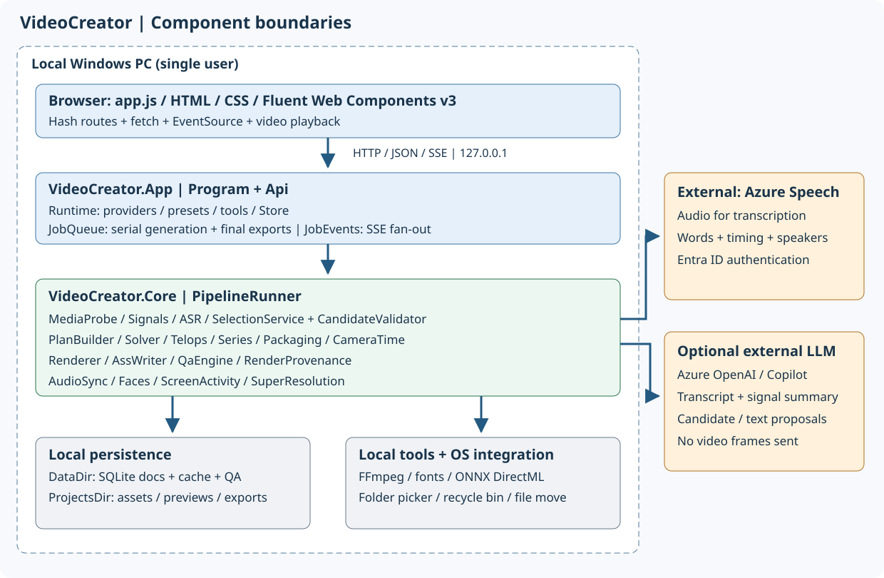
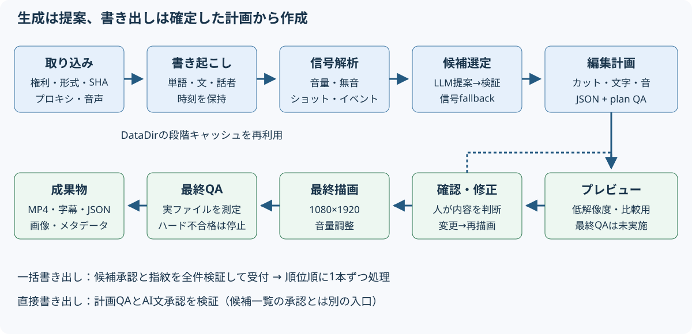
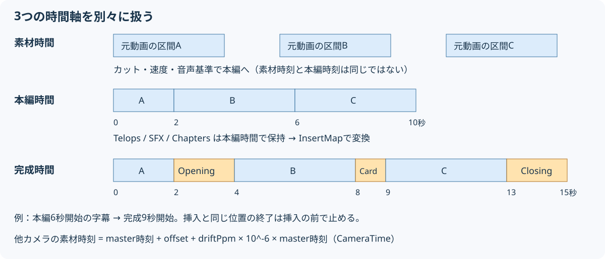

# Software Engineer向けテクニカルリファレンス

[アプリREADME](../README.md) / [ガイド目次](README.md) / [クイックスタート](quickstart.md) / [画面説明](screens.md) / [困ったとき](troubleshooting.md) / [設定・API](configuration-api.md) / [検証と保守](verification.md)

対象は現在のC#/.NET 10実装です。これは汎用動画編集ライブラリやマルチユーザーサービスではなく、Windows上の単一ユーザー用ローカルWebアプリです。設計上の要求は[PRD](../docs/PRD.md)、過去の実測は[実装レポート](../docs/IMPLEMENTATION.md)にあります。過去の検証結果を最新条件の合格証拠として流用しないでください。

## 1. コンポーネント構成



| 層 | 責務・実装の入口 |
|---|---|
| Browser UI | [index.html](../src/VideoCreator.App/wwwroot/index.html)、[app.js](../src/VideoCreator.App/wwwroot/js/app.js)、[app.css](../src/VideoCreator.App/wwwroot/css/app.css)。Vanilla ES modules、Fluent Web Components v3、ハッシュルーティング |
| Hosting / HTTP | [Program.cs](../src/VideoCreator.App/Program.cs)。KestrelはIPv4 loopback、Host検証、独自ヘッダー、例外処理、CSP。認証付きの公開サーバーではない |
| API | [Api.cs](../src/VideoCreator.App/Api.cs)。入力検証、CRUD、承認、一括受付、プレビューと書き出しの入口 |
| Runtime | [Runtime.cs](../src/VideoCreator.App/Runtime.cs)。設定からFFmpeg、Store、Presets、ASR、LLM、音・顔サービスを構成。LLMは実行時変更可 |
| Background work | [JobQueue.cs](../src/VideoCreator.App/JobQueue.cs)。生成と最終書き出しを単一workerで直列処理。SSEのJobEventsと書き出し状態を保持 |
| OS integration | [FolderPicker.cs](../src/VideoCreator.App/FolderPicker.cs)、[ProjectDeletion.cs](../src/VideoCreator.App/ProjectDeletion.cs)、[ProjectsLocation.cs](../src/VideoCreator.App/ProjectsLocation.cs)。フォルダー選択、ごみ箱、移動・回復 |
| Optional work | [SceneCardService.cs](../src/VideoCreator.App/SceneCardService.cs)、[BrandKitWorker.cs](../src/VideoCreator.App/BrandKitWorker.cs)。カード抽出・登録動画の高画質化 |
| Pipeline | [PipelineRunner.cs](../src/VideoCreator.Core/Pipeline/PipelineRunner.cs)。各段の実行、キャッシュ、進捗、描画、QA、成果物 |
| Media / analysis | [MediaProbe](../src/VideoCreator.Core/Media/MediaProbe.cs)、[SignalExtractor](../src/VideoCreator.Core/Signals/SignalExtractor.cs)、[AudioSync](../src/VideoCreator.Core/Audio/AudioSync.cs)、[FaceService](../src/VideoCreator.Core/Faces/FaceService.cs)、[ScreenActivity](../src/VideoCreator.Core/Media/ScreenActivity.cs) |
| ASR / selection | [AzureFastTranscriber](../src/VideoCreator.Core/Asr/AzureFastTranscriber.cs)、[Providers](../src/VideoCreator.Core/Selection/Providers.cs)、[SelectionService](../src/VideoCreator.Core/Selection/SelectionService.cs)、[CandidateValidator](../src/VideoCreator.Core/Selection/CandidateValidator.cs) |
| Planning | [PlanBuilder](../src/VideoCreator.Core/Planning/PlanBuilder.cs)、[Solver](../src/VideoCreator.Core/Planning/Solver.cs)、[Planners](../src/VideoCreator.Core/Planning/Planners.cs)、[ScreenPlanner](../src/VideoCreator.Core/Planning/ScreenPlanner.cs)、[Series](../src/VideoCreator.Core/Planning/Series.cs)、[TelopBuilder](../src/VideoCreator.Core/Planning/TelopBuilder.cs) |
| Rendering / QA | [Renderer](../src/VideoCreator.Core/Rendering/Renderer.cs)、[AssWriter](../src/VideoCreator.Core/Rendering/AssWriter.cs)、[QaEngine](../src/VideoCreator.Core/Qa/QaEngine.cs)、[RenderProvenance](../src/VideoCreator.Core/Rendering/RenderProvenance.cs) |
| Storage / schemas | [Store](../src/VideoCreator.Core/Storage/Store.cs)、[Models](../src/VideoCreator.Core/Models/Models.cs)、[Json](../src/VideoCreator.Core/Json.cs)、[Preset](../src/VideoCreator.Core/Presets/Preset.cs) |

AppとTestsは `net10.0-windows`、Coreは `net10.0`。[Appのcsproj](../src/VideoCreator.App/VideoCreator.App.csproj)はWindows Formsを使います。Coreの[csproj](../src/VideoCreator.Core/VideoCreator.Core.csproj)はDirectMLのONNX Runtime等を参照するため、CoreのTFMだけを見て全機能をクロスプラットフォームと解釈しないでください。

## 2. 生成・書き出しの流れ



1. **取り込み**：存在・形式・尺を確認、SHA-256、プロキシ、解析用音声を作る。複数素材では音声基準・同期・役割を扱う。
2. **書き起こし**：ITranscriberから単語・文・話者・時刻を取得。辞書をフレーズリストとして渡す。キャッシュがあれば再利用。
3. **信号解析**：ショット、100ms音量、無音、イベント。LLMがない場合の選定根拠にもなる。
4. **候補選定**：IHighlightSelectorの結果をコードで検証・補正・重複除去。長尺は分割と信号による絞り込み、必要に応じて再ランキング。結果が得られなければ信号ベースへ。
5. **計画**：Solverからクリップを作り、プリセットに応じたspeech / switch / speed / beat / screen、シリーズ、顔追従、テロップ、音、挿入物、伏せ字を適用。
6. **プレビュー**：編集計画に基づき描画し、段階に応じたQAを保存。最大3件の候補を表示。
7. **編集**：PlanEditor等で計画を更新、履歴保存、計画QA再実行。プレビューは明示更新。計画変更で候補承認の指紋が不一致になる。
8. **最終出力**：計画のハードQAを先に確認。1080×1920で合成、音量調整、最終QA。すべてのハード結果がpassの場合だけ公開用出力を確定し、SRT・ASS・計画・サムネイル・メタデータを作る。

**設計上の境界**：AIは区間・文案を提案します。Rendererは確定した計画と素材から映像を作ります。LLMのプロンプトだけで品質制約を保証しません。元音声の意味や権利の最終判断は利用者に残します。

## 3. データモデルと永続化

| モデル | 保存・関係 |
|---|---|
| Project | フォルダー、言語、カード設定。Asset / Rights / Jobの親 |
| SourceAsset | 元ファイルの絶対パス、SHA-256、MediaInfo、役割、話者、同期値 |
| Transcript / Word / Sentence | キャッシュJSON。単語IDと時刻は字幕・切り出し・内容照合の根拠 |
| SignalSet | キャッシュJSON。ショット・無音・音量・イベント |
| Job | 生成設定、状態、コスト計算、段階時間、警告、候補ID |
| Candidate | Jobの子。選定区間・理由・スコア・EditPlanとプレビューRenderのID、承認 |
| EditPlan | Projectの子。Canvas、Timeline、Telops、Audio、Inserts、Series、Provenance |
| Render | EditPlanの子。preview / final、実ファイル、Outputs、段階別QA、再現記録 |
| BrandKit / BgmTrack / setting | 共通登録またはプロジェクト用の音、保存先設定 |

StoreはSQLiteの `docs(kind,id,parent,json,updated)` を使うJSON document storeです。JSONは共有の `Json.Options` によるsnake_caseと文字列enumです。フォルダーのファイルとDBは別であり、出力JSONだけでプロジェクト全体をインポートするAPIはありません。

キャッシュはDataDirの `cache\<素材SHA-256の先頭16文字>`。書き起こしキーはASRのNameと辞書、信号は `signals.json`、ほかに顔・画面解析等があります。**ASRのエンドポイント・localeを変えるだけで必ず書き起こしキャッシュが無効になるとは限りません。** 新プロバイダーや解析アルゴリズムを追加する際は、既存キーとの衝突・互換性・無効化方針をテストしてください。

素材の絶対パス変更は[StorePaths](../src/VideoCreator.Core/Storage/StorePaths.cs)による再ルート処理を使います。移動は同一ドライブでrename、別ドライブでcopy・ファイル数/サイズ照合を行い、JSON参照をトランザクションで更新します。これは全ファイル内容の暗号学的照合と同義ではありません。

## 4. 混同してはいけない3つの時間軸



1. **素材／master時間**：単語時刻と元動画の位置。他カメラの時刻は `SourceAsset.CameraTime(masterT, masterId)` により `masterT + offset + driftPpm × 10^-6 × masterT`。
2. **編集した本編時間**：Timelineの各クリップの長さ `(src_out-src_in)/speed` を積算。Telops、SFX、シリーズチャプターはここで計画。
3. **完成ファイル時間**：本編にOpening／Card／Closingを挿入した後。[InsertMap](../src/VideoCreator.Core/Planning/Packaging.cs)で変換。開始が挿入位置と同時なら挿入の後、終了なら挿入の前。

例：本編2秒で2秒のOpening、本編6秒で1秒のCardを挿入すると、本編6秒開始の字幕は完成9秒開始になります。カードにまたがる字幕は分割して描画し、カード上には出しません。クリップの早送りとカメラ同期を、挿入物の加算で代用してはいけません。

## 5. 承認・QA・再現性の契約

- `CandidateApproval` は承認者・日時・ `EditPlanFingerprint.Of(plan)` のSHA-256を記録。署名や利用者認証ではありません。
- 一括受付は全候補の所属・承認・指紋・処理中・計画QAを先に検証。どれか不可なら開始しません。受付後のキューでは承認済みスナップショットを使います。
- 確認画面の直接render APIは候補承認を要求しません。AIテロップ等の承認と計画QAは要求します。両入口を同じ承認条件と思い込まないでください。
- 一括の「事前受付が全件かゼロ」と、実行開始後に「全ファイルが一括成功・失敗する」は別です。実行中の個別失敗は各候補に表示します。
- QAの `Stage`、`PlanHash`、`not_run` を保持し、古い結果やプレビューを最終合格として再利用しません。
- `Render.Reproducibility` は計画・FFmpeg・buildconf・フォント・プリセット・素材のハッシュ、テキストライブラリ情報、encoder threads等。比較対象は**デコード済みフレーム**で、コンテナーのバイト一致だけではありません。
- 再現性の前提は素材・計画・ツール・フォント・環境をそろえること。LLMをもう一度呼んで同じ候補になる保証ではありません。

## 6. カスタマイズの入口と検証

| 変更したいもの | 変更箇所・守る条件 | 対応テスト |
|---|---|---|
| 尺・テンポ・音・装飾の初期値 | [presets](../presets)、PresetStore.Validate。`P数字`のID、semver、読み込みは起動時なので再起動 | [PlanningTests](../tests/VideoCreator.Tests/PlanningTests.cs)、[VarietyTests](../tests/VideoCreator.Tests/VarietyTests.cs) |
| 文字サイズ・縁・改行 | AssWriterのMetrics/Band/CaptionLineChars、JapaneseText、TelopBuilderを共通利用。描画・自動縮小・QAで別の表を作らない | [CaptionLayoutTests](../tests/VideoCreator.Tests/CaptionLayoutTests.cs)、[JapaneseTextTests](../tests/VideoCreator.Tests/JapaneseTextTests.cs)、[RenderingTests](../tests/VideoCreator.Tests/RenderingTests.cs) |
| 候補の提案方式 | IHighlightSelector、Providers、SelectionPrompt、SelectionService、Runtimeと設定UI。出力検証・再試行・fallback・コスト・送信先をそろえる | [SelectionTests](../tests/VideoCreator.Tests/SelectionTests.cs)、[V12Tests](../tests/VideoCreator.Tests/V12Tests.cs) |
| ASR | ITranscriber、Runtime、設定・送信先、キャッシュキー。単語ID・時刻・話者・文の構造を維持 | [PlanningTests](../tests/VideoCreator.Tests/PlanningTests.cs)、使用素材で時刻と認識精度を別途実測 |
| カメラ・画面編集 | AudioSync、CameraTime、SwitchPlanner、ScreenPlanner。同期はAudioSync.TimelineFilterの時間整合PCMを使う | [MultiSourceTests](../tests/VideoCreator.Tests/MultiSourceTests.cs)、[V11Tests](../tests/VideoCreator.Tests/V11Tests.cs) |
| シリーズ・挿入物 | Series、Packaging、InsertMap。テロップ・SRT・QA・メタデータの時間をすべて合わせる | [SeriesTests](../tests/VideoCreator.Tests/SeriesTests.cs)、[PackagingTests](../tests/VideoCreator.Tests/PackagingTests.cs)、[SceneCardTests](../tests/VideoCreator.Tests/SceneCardTests.cs) |
| UIの入力部品 | app.js、app.css、Fluent v3。checkbox/switchはfieldのlabel/input slot。esc()とイベント後の状態再描画、キーボード操作を維持 | [E2E](../ui/e2e.mjs)、[v1.1 E2E](../ui/e2e-v11.mjs)、実Edge |
| API・承認・保存 | Api、Models、Store、JobQueue、ProjectsLocation。snake_case、コード付きエラー、編集後の再承認、パス境界 | [ApprovalExportTests](../tests/VideoCreator.Tests/ApprovalExportTests.cs)、[ProjectsLocationTests](../tests/VideoCreator.Tests/ProjectsLocationTests.cs)、[RenderRecordTests](../tests/VideoCreator.Tests/RenderRecordTests.cs) |

プリセットを増やす最小の方法は既存JSONをコピーし、ID・version・nameと必要項目を変更して再起動することです。ただし新plannerを追加する場合はPlanBuilderやPresetStoreの許可リストまで変更します。JSONに名前を足すだけでは処理は増えません。

現在のCanvasと書き出しUI、QAには縦型1080×1920の前提があります。横型化はその一貫した変更と検証が必要です。公開ネットワーク化も、単にListenを変えるのではなく認証、権限、CSRF、ファイルアクセス、ジョブ分離の設計を別途行ってください。

FFmpeg呼び出しは引数配列で行います。生フレームをpipeで渡す子プロセスでは `-nostdin` を維持してください。コマンド文字列をシェル経由で連結する拡張は避けます。ASS制御文字やユーザー／LLM文字列のエスケープも維持します。

## 7. ビルドとテスト

リポジトリ直下から実行します。既に依存ツールがある場合は再取得は不要です。

```powershell
pwsh scripts\get-tools.ps1
dotnet build src\VideoCreator.App\VideoCreator.App.csproj -c Release
dotnet test --project tests\VideoCreator.Tests
```

[global.json](../global.json)はMicrosoft.Testing.Platform runnerを指定します。テスト数は変わるため固定値を受け入れ基準にしません。UIバンドルを変更する場合は[ui/package.json](../ui/package.json)の `npm run build`、E2Eは起動済みアプリに対し `node e2e.mjs <動画> <URL>` を使います。E2Eは外部サービスの利用・課金と既存スクリーンショットの更新を伴うので、隔離した保存先を指定してください。

今回の資料作成で実行した検証は[検証と保守](verification.md)に分けて記録しています。
