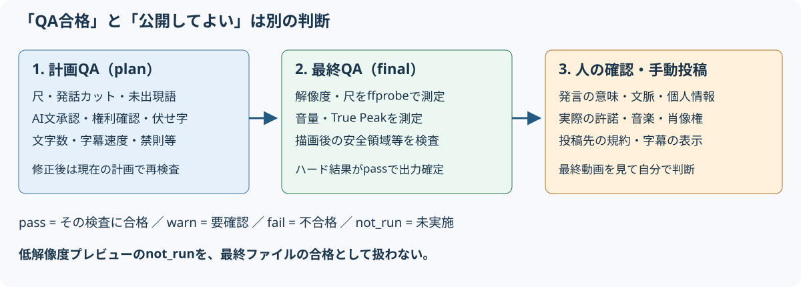

# 困ったとき：エラー、QA、保存

[アプリREADME](../README.md) / [ガイド目次](README.md) / [クイックスタート](quickstart.md) / [画面説明](screens.md) / [設定とAPI](configuration-api.md) / [検証と保守](verification.md)

## 最初に切り分ける

1. 起動ターミナルが動いているか。ブラウザーを開くだけではサーバーは起動しません。
2. 「設定」のプロバイダーと送信先が**自分の設定**か。
3. 素材の音声、長さ、権利確認、選んだパターンが合っているか。
4. 失敗した段階、エラーコード、QAのID・測定値を記録します。サインイントークンは共有しません。
5. 条件を直して再試行します。同じ設定で繰り返す前に原因を確認します。

## よくある症状

| 症状・コード | 確認すること・次の操作 |
|---|---|
| 起動しない、ツール不足 | `.\run.cmd --check` の `FAIL` を確認。`.\run.cmd --setup` で再導入。オフラインや組織のインストール制限は管理者へ相談 |
| ブラウザーがつながらない | 起動ログのURLを使う。既定は `http://127.0.0.1:8765/`。ポート変更時はURLも変更。別PCからはアクセスできない仕様 |
| 起動時にポートが使用中 | 既存のアプリを確認。ほかのプロセスを無差別に停止せず、別ポートを設定して起動 |
| `E-RIGHTS-REQUIRED` | すべての素材の権利確認にチェック。BGM・登録動画・画像の権利も別途確認 |
| `E-ING-UNSUPPORTED` | パス、実際の動画形式、映像トラック、10秒〜3時間の条件を確認。拡張子だけ変えても直らない |
| 受信・コピーが失敗する | OS一時領域とプロジェクト保存先の空きを確認。大きな素材はフルパス参照も検討 |
| `E-ASR-PROVIDER`、401 | 自分のエンドポイント、インターネット、リソースのテナントへの `az login` を確認 |
| Speech/OpenAIの403 | 利用者のロールとネットワーク制限を管理者へ確認。管理画面を開ける権限とデータを処理する権限は別 |
| Azureにサインイン済みでも認証できない | 別アカウントが優先されている場合は `AZURE_TOKEN_CREDENTIALS=AzureCliCredential` を起動環境で設定 |
| 429や一時的なサービスエラー | レート制限・容量・サービス状態を確認。自動再試行後も失敗したら時間を置く |
| 字幕がない／書き起こしがない | 音声のない素材か、ASRが無効・未設定か。LLMを有効にしてもASRの代わりにはならない |
| 「信号ベース」の候補しかない | LLM未設定・利用不能・応答検証失敗。動作継続のための代替選定。内容を理解した候補ではない |
| 静かな大切な場面が候補にない | 絞り込みを全文へ。AI未使用なら音量中心なので、AI設定や別パターンを検討 |
| `E-SOL-INFEASIBLE` | 条件内の区間がない。発話量や尺が十分な別動画、別パターンを試す |
| P7/P10で失敗 | 同時収録素材の数、音声、役割、同期結果を確認。P10なら画面素材と話し手を区別 |
| シリーズで失敗 | 発話のある動画、対応パターン、本数／長さの条件を確認。話題の途中で分かれた警告は内容を見直す |
| 「プレビューが古くなっています」 | 変更は計画に保存済み。プレビューを更新してから判断 |
| `E-NOT-APPROVED` | 未承認の動画がある。「確認・修正」で承認する。一括書き出しは、エラーの下に動画ごとの理由（未承認・承認後の変更・計画QA不合格・書き出し中）が並び、1件でも当てはまると何も開始しない。コードは一番先に当たった理由のもの（単独の書き出しと同じ） |
| `E-EXPORT-BUSY` | 同じ編集計画の書き出し完了を待つ（単独・一括とも） |
| `E-QA-HARDFAIL` | 下のQA表を参照。計画の不合格なら修正、完成ファイルの不合格なら測定値やレンダリング環境を確認。一括書き出しでは、不合格の動画ごとに項目が並ぶ |
| `E-RND-FFMPEG` | 空き容量、FFmpeg・フィルタ、素材がまだ存在するか、出力先の権限を確認 |
| `E-PROJECT-BUSY`、削除不可 | 生成・書き出しの完了を待つ。生成や未着手の書き出しはキャンセル可能 |
| `E-FILE-IN-USE` | プロジェクト内の動画等を開いているアプリを閉じて再操作 |
| 保存先を移動できない | 動作中のジョブ、同名ファイル、容量、移動元の内部を指定していないかを確認。失敗項目・残留項目の表示を読む |

セットアップの `--check` も設定先への疎通要求を送ります。組織の素材を使って外部送信を試す前に、データ利用の許可を確認してください。

## QAを正しく読む

- **合格（pass）**：そのチェック・その段階の条件を満たした。
- **警告（warn）**：確認が必要。書き出しできる場合でも見直す。
- **不合格（fail）**：`H-`のハード項目なら書き出しを止める。
- **未実施（not_run）**：まだ測っていない。最終書き出しで測る項目がプレビューではこの状態になる。
- **plan**：現在の編集計画に対するチェック。**final**：完成ファイルに対する測定。

| ID | チェック | 対処・限界 |
|---|---|---|
| H-01 | 尺 | ショートの本編はパターン範囲、挿入込み全体は別条件。区間や挿入物を調整。シリーズはシリーズの尺条件 |
| H-02 | 解像度・比率 | 完成ファイルの1080×1920。低解像度プレビューを最終合格と扱わない |
| H-03 | ラウドネス | 最終ファイルで目標−14 LUFS、許容±1 LU。無音素材などでは条件を満たせない場合がある |
| H-04 | True Peak | 最終ファイルが−1 dBTP以下。音量調整と再測定が必要 |
| H-05 | テロップ安全領域 | 位置・字数・書体を確認。最終段階は描画結果を実測。ガイド線だけでの判定ではない |
| H-06 | 発話途中のカット | 文単位で区間調整。ASRの時刻許容±150ms。P5は拍優先で警告になる場合がある |
| H-07 | テロップの未出現語 | 数字や固有トークン等を書き起こし／辞書と照合。**意味・文脈全体の事実確認ではない** |
| H-08 | 未承認テロップ・カード | AI文を読み、承認するか表示をオフにする |
| H-09 | 素材の権利確認 | 使用する素材・画像・挿入物の確認をそろえる。チェックは法的許諾の証明ではない |
| H-10 | 伏せ字（設定時） | 隠す語が手編集で戻っていないか。指定は出力を対象とし、元動画・キャッシュ・クラウド入力の匿名化ではない |
| S-01 / S-02 / S-08 | 字幕速度／行幅／禁則 | 意味を保って短くする。読み上げ速度や自然な行分割も確認 |
| その他のS項目 | フック、装飾、黒画面等 | 画面のメッセージ・測定値・基準と動画を照合。全項目の定義は[QaEngine](../src/VideoCreator.Core/Qa/QaEngine.cs) |

合格数は固定ではありません。H-01/H-05のように計画と最終で同じIDが複数行あり、伏せ字など条件付き項目もあります。**ハードQAの合格は「その自動検査に合格」の意味で、内容忠実性・権利・プライバシー・人気・投稿先の合格を保証しません。**

最終QAで落ちたMP4はプロジェクトの `rejected` に移る場合があります。これを公開用の成功ファイルと扱わないでください。

## 保存とバックアップ

| 保存場所 | 内容 |
|---|---|
| DataDir（既定 `%LOCALAPPDATA%\VideoCreator`） | SQLite DB、書き起こし・信号のキャッシュ、QA作業領域、音素材等 |
| ProjectsDir（既定 Windowsの「ビデオ」内のVideoCreator） | プロジェクトごとの素材コピー、プレビュー、書き出し、カード画像等 |
| フルパスで参照した外部ファイル | 元動画や登録動画。管理フォルダー外なら別途バックアップが必要 |

開発・運用上の推奨：処理を完了させてアプリを終了してから、DataDir、実際に使用中の各プロジェクトフォルダー、外部参照素材を一緒にバックアップします。SQLiteはWAL方式なので、起動中のDBファイル1個だけをコピーする方法は避けます。音声・書き起こし・個人パスを含むため、バックアップの扱いにも注意してください。

保存先の変更は「設定」から行います。「移動しない」なら過去のプロジェクトは元の場所に残ります。「移動する」なら現在の保存先内のその他のファイルも対象です。**DataDirや管理外の外部参照まで移るわけではありません。**

移動が途中で止まったら、失敗・残留項目の表示を記録し、使用中のファイルを閉じます。次の起動で `projects-move.json` に基づく回復が行われます。手でジャーナルを削除したり、DBの絶対パスだけ変更したりしないでください。

生成は再起動時に未完了ジョブを再投入し、利用可能な段階キャッシュを再利用します。**未着手の最終書き出しキューはメモリー上**なので、停止前の一括書き出しが必ず再開するとは限りません。完了ファイルを確認し、必要な候補をもう一度書き出してください。
