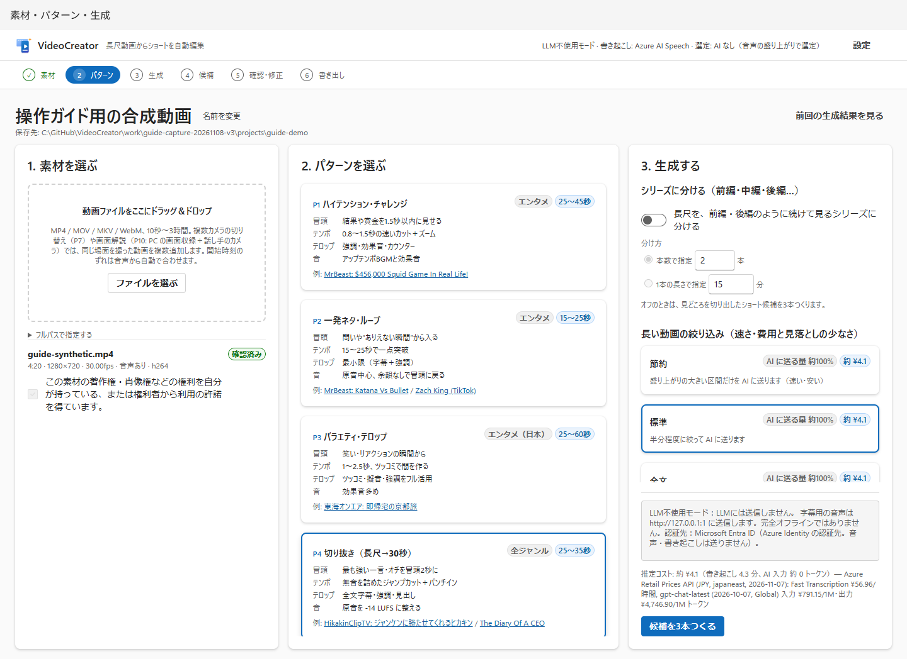
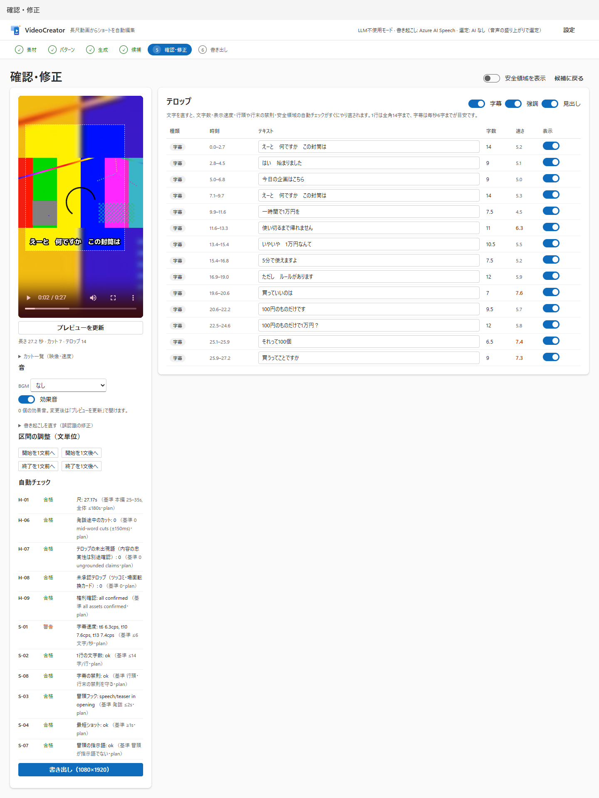
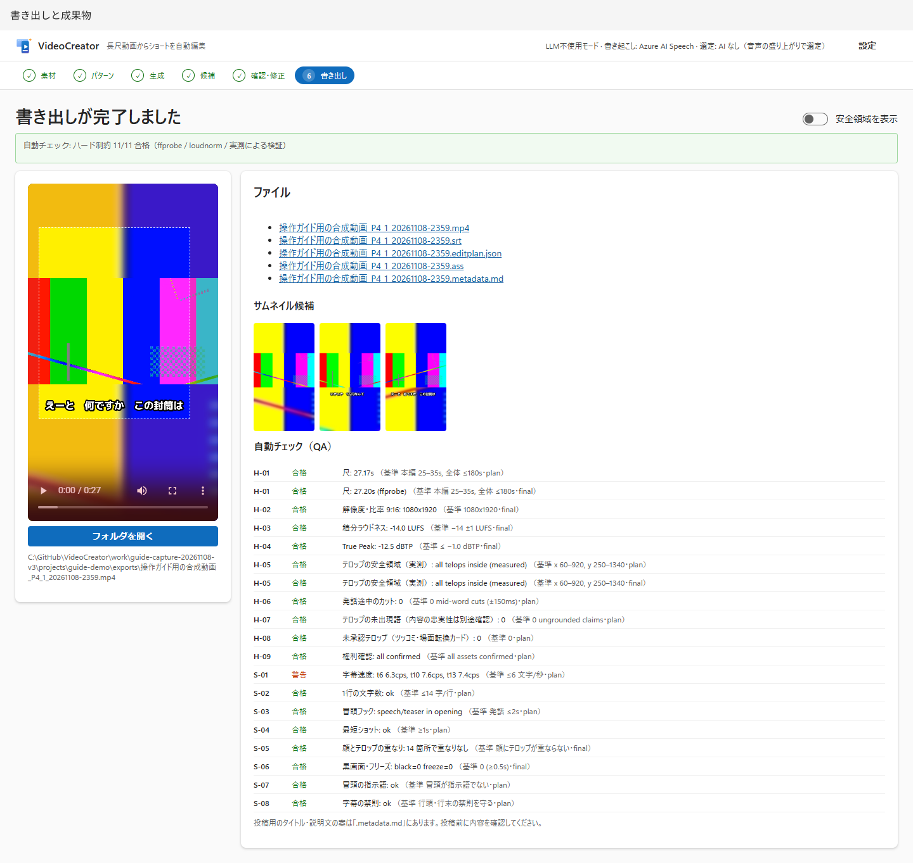

# 快速入门：制作第一个视频

<!-- language-nav -->
[日本語](../quickstart.md) | [English](../en/quickstart.md) | [한국어](../ko/quickstart.md) | [简体中文](quickstart.md)
<!-- /language-nav -->

[开始使用](start.md) / [指南目录](README.md) / [详细概览](overview.md) / [工程师参考](technical-reference.md)


[应用 README](start.md) / [指南目录](README.md) / [界面说明](screens.md) / [遇到问题](troubleshooting.md) / [配置与 API](configuration-api.md)

**目标**：安装发行版，从一个含讲话的视频生成 P4 候选，检查内容，保存竖屏（1080×1920）的 MP4、字幕等。处理时间取决于素材、PC 和服务状态，不保证在固定时间内完成。
## 开始前：与管理员明确分工

普通使用者无需自行创建云资源或扩大访问权限。请先完成以下交接。

| 负责人 | 确认事项 |
|---|---|
| 使用者 | 可用素材，人物、资料和音乐许可，音频与转录文本能否外传，发布前的审核人 |
| 管理员／IT | 批准的发行包、能否安装 Azure CLI、使用账号、Microsoft Foundry 的资源名称、部署名称和租户 ID、使用角色的授予、费用负责人及用量限制管理流程、支持联系人 |
| 共同确认 | 登录账号与配置的服务一致；使用批准的短视频，验证从转录到保存的全过程，而不只是打开页面 |

**最简单的方式是使用发行版（Releases 中的可执行文件）。** 不需要安装程序、.NET 或 FFmpeg，使用者事先只需安装 Azure CLI。请按顺序完成下面的第 1～3 步。从源码启动的方法（`run.cmd` 和安装脚本）面向开发和定制人员，已整理在[附录](#附录使用源码版runcmd启动)中。选择一种方式即可。管理员可参考[配置与 API](configuration-api.md)，工程师修改实现时请看[技术参考](technical-reference.md)。

## 1. 准备 PC 和视频

- Windows 10/11（x64）或 Windows 11（ARM64），以及互联网连接。界面已在 Microsoft Edge 中检查。Apple Silicon 的 macOS 请参阅[详细概览中的发行版步骤](overview.md#单一可执行文件windows--macos)。
- 在 Windows 的 **设置 → 系统 → 系统信息** 中查看“系统类型”，即可确认电脑类型。显示“基于 x64 的处理器”即为 x64，显示“基于 ARM 的处理器”即为 ARM64。
- 准备一个**自己拥有使用权的视频**。同时确认音乐、人脸、标志等的授权。支持的格式为 MP4 / MOV / MKV / WebM，时长为 10 秒至 3 小时。首次建议使用几分钟的讲话视频。P4 生成 25～35 秒的正文，因此不表示 10 秒视频一定能成功。
- 检查磁盘空间。文件选择和拖放均需要在临时区域及保存位置各留出素材大小的空间。同一驱动器需留出约两倍素材大小，再加上代理、缓存、预览及导出的空间。
- **使用完整路径指定**可省去素材复制。但移动或删除源视频会导致该项目无法使用。
- 事先向管理员询问**要使用的 Azure 资源（Microsoft Foundry）名称**；如果资源不在默认租户中，还要询问**租户 ID**。授予使用角色（`Cognitive Services Speech User` 和 `Cognitive Services OpenAI User`）由管理员负责（[Azure 访问](azure-access.md)）。

## 2. 安装（3 步）

### 第 1 步：安装 Azure CLI 并登录

字幕转写（Azure Speech）和 AI 筛选使用在此 PC 上登录的 Microsoft Entra ID 账号进行身份验证。登录需要使用 Azure CLI。

1. 右键单击“开始”按钮，打开 **终端**（或 **Windows PowerShell**）。
2. 粘贴以下命令并按 Enter。出现确认界面时选择 **是**。

   ```powershell
   winget install -e --id Microsoft.AzureCLI
   ```

3. **先关闭终端，再重新打开。** 不重新打开会找不到 `az`。
4. 运行以下命令，在打开的浏览器中选择公司账号。询问订阅编号时，选择管理员指定的订阅（不清楚时直接按 Enter）。

   ```powershell
   az login
   ```

   如果资源不在默认租户中，请使用 `az login --tenant <租户 ID>`。如果无法使用 `winget`，或软件安装受到限制，请让公司 IT 安装 Azure CLI。

### 第 2 步：下载 VideoCreator

1. 打开[最新版本](https://github.com/dahatake/VideoCreator/releases/latest)，从 **Assets** 中只下载一个适合自己电脑的文件。
   - x64：`VideoCreator.exe`
   - ARM64：`VideoCreator-<版本>-win-arm64.exe`
2. 将下载的文件移到容易找到的文件夹（例如 `文档\VideoCreator`）。留在“下载”文件夹中也能运行。
3. 无需下载 `appsettings.json`。连接目标将在第 3 步中通过界面设置。

如果想确认文件未被篡改，请使用[详细概览](overview.md#维护者构建验证与发布)中介绍的 `SHA256SUMS.txt` 和 `gh attestation verify` 进行验证。

### 第 3 步：启动

1. 双击下载的 exe。如果出现“Windows 已保护你的电脑”，点击 **更多信息** → **仍要运行**。发行版未进行代码签名，因此可能出现此确认。
2. 会打开一个黑色窗口（控制台），启动后默认浏览器会打开 <http://127.0.0.1:8765/>（8765 端口被其他软件占用时，会改用空闲端口的 URL）。首次启动需要解压组件，会稍等片刻。如果浏览器没有打开，请在浏览器中打开黑色窗口中显示的 `http://127.0.0.1:…` URL。
3. **不要关闭黑色窗口。** 关闭后应用会停止。关闭浏览器不会停止应用。
4. 以后也只需双击同一个 exe。应用运行时再次双击，也不会启动第二个应用，而是在浏览器中打开正在运行的应用页面（新窗口会立即关闭）。

## 3. 在首次界面中设置 AI 连接

1. 首次会显示“欢迎使用 VideoCreator”向导（6 个画面）。点击 **下一步** 阅读，或点击 **跳过**。之后可在 **设置** → **再看一遍教程** 中重新查看。
2. 查看界面顶部的显示。显示 `转写：无` 时，还不能生成字幕。
3. 打开右上角的 **设置**，在 **AI 连接** → **Microsoft Foundry** 中完成以下操作。
   1. **身份验证方式** 保持 **Microsoft Entra ID（推荐）**。
   2. 点击 **从 Azure 选择**，选择向管理员询问的资源。终结点会自动填入，并可从候选中选择聊天、嵌入和图像的部署名称。管理员没有指定时，保持显示的候选即可。资源不在列表中时，请向管理员询问终结点（`https://<资源名称>.cognitiveservices.azure.com/`）和聊天模型的部署名称并输入。
   3. 点击 **测试并保存**。只有聊天、嵌入和字幕转写的测试全部通过时才会保存。
4. 关闭设置。当界面顶部变为 `转写：MAI-Transcribe-2 · 选择：Microsoft Foundry（<部署名称>）` 之类的显示时，准备就完成了。根据资源所在区域，转写可能使用标准模型。

- 连接前设置界面中会显示“不可用：尚未连接 Microsoft Foundry。…”。按上面的步骤保存后即会消失。1.2.2 及更早的发行版会显示“请运行 scripts/setup.ps1”，这是面向源码版的提示，同样按上面的步骤即可解决。
- 连接测试会发送合成的 1 秒静音和短文本，可能产生少量按量费用。不会发送使用者的视频。
- 测试失败时，请按界面说明操作。要求 `az login` 时，请检查第 1 步（尤其是重新打开终端）；没有权限（403）时，请让管理员授予角色并等待几分钟。找不到部署时，请输入部署名称而不是模型名称。详情请参阅 [Azure 访问](azure-access.md#保存测试和故障排除)。
- 即使不使用 AI 筛选，为了生成字幕，也需要 Microsoft Foundry 连接（同一资源的 Speech）。筛选方式可在设置顶部切换为 **不使用 LLM**，此时候选按音量高涨程度选择。
- 如果组织方针要求使用 API 密钥身份验证，请在 **身份验证方式** 中选择 **API 密钥**，并输入从管理员处安全获取的密钥。这种情况下不需要 Azure CLI。密钥会以只有此 PC 上的此 Windows 用户才能解密的形式保存。
- Azure 服务按量计费。发送目标和预计费用会在生成前的界面中显示。请确认组织的数据发送和使用方针。

## 4. 添加素材并选择 P4

1. 输入“项目名称”，点击**新建项目**。
2. 点击**选择文件**，或拖放视频。
3. 确认素材名称、时长、分辨率及是否有音频，并勾选每个素材的权利确认。
4. 选择 **P4 精华剪辑（长视频→30 秒）**。蓝色边框表示已选中。
5. 在右列的 **输出方向** 中选择 **竖屏 9:16（1080×1920）**。如果保持默认的“与输入一致”，横屏视频会生成横屏（1920×1080）视频。
6. 关闭系列，筛选选择**标准**。首次无需 BGM 或片头等。
7. 阅读按钮上方显示的发送目标和预计费用，点击**创建 3 个候选**。



此界面有三列。滚动各列可看到下方项目。右列的设置分为若干组，点击标题可展开或折叠。上方的六阶段显示表示进度。已完成的阶段（✓）可点击返回该界面，但不能跳到尚未进行的阶段。

## 5. 检查候选，必要时修改

生成界面显示整体及当前处理进度。生成候选后，播放视频并检查：

- 是否改变原发言的含义，单独观看是否也能理解。
- 字幕错字、专有名词、数字和可读性。
- 人脸或屏幕中希望展示的部分、音量和讲话断点。
- QA 的“不通过”“警告”“未执行”。**未执行不等于通过**。

打开候选的**检查与修改**。修改文字后将焦点移出输入框以应用更改，再点击**更新预览**重新检查。修正转写识别错误会重新生成字幕，因此应先修正转写，再手动编辑字幕。



## 6. 导出并保存

**第一次成功的标志**：看到候选视频还不算完成。请打开输出文件夹，从头到尾播放导出的 MP4，并确认字幕文件也已保存。

选择以下任一种方式。

- **直接导出一个视频**：在“检查与修改”中点击**批准并导出此内容**（有多个视频时为**立即仅导出此视频**）。先批准当前内容，再导出。同时需满足硬性 QA 和所需 AI 文本批准。
- **逐个检查多个视频，再批量导出**：在“检查与修改”中点击**批准并转到下一个视频**依次检查，最后一个视频点击**批准并进入导出** → 在导出列表点击**导出所选视频**。中途点击**批准当前内容并返回候选**，可在候选列表的**检查进度**中查看剩余项。修改后需要重新批准。

成品文件保存在项目保存位置（默认为 `视频\VideoCreator`）中的**模式名称文件夹**（即界面上显示的模式名称。中文界面示例：`精彩剪辑（长视频→30 秒）`）里。导出列表可播放和拖动定位每个已完成的视频。确认视频文件的绝对路径，通过**复制路径**或**打开文件夹**进入保存位置。单个完成界面也支持相同操作及最终 QA 检查。



| 文件 | 用途 |
|---|---|
| `.mp4` | 字幕烧录到画面中的发布视频。投稿前完整播放检查 |
| `.srt` | 带时间戳字幕，用于支持外部字幕的平台和编辑工具 |
| `.ass` | 包含字体、位置和装饰的字幕渲染数据 |
| `.editplan.json` | 剪辑、屏幕文字、声音及插入内容的编辑记录，用于开发和复现 |
| 3 张缩略图 | 投稿图像候选，由自己选择 |
| `.metadata.md` | 标题、描述和话题标签等建议，核实事实后手动复制到投稿栏 |
| `.post.json` | 与完成界面的“投稿文案”相同（YouTube 描述、Viva Engage 帖文、章节），也会以便于粘贴的形式附在 `.metadata.md` 末尾 |

导出列表和完成界面的**投稿文案（复制粘贴）**显示已保存的 YouTube 描述、Viva Engage 帖文及 `00:00 章节标题` 格式的章节，各自可用**复制**按钮。尚未生成时点击**生成投稿文案**。展开**其他产物与预览**可查看字幕、元数据、编辑计划和缩略图，并打开／保存各文件。

- 章节时间是导出视频中的实际时间（已计入片头和卡片）。不满足 YouTube 条件（从 00:00 开始、至少 3 章、每章至少 10 秒）时不添加。3 分钟以内的竖屏视频作为 Shorts 处理，章节可能不显示在播放进度条上。
- 文案由 AI 根据转写生成，自动删除发言中没有的数字、片假名词、英文名称、URL 和已屏蔽的词（无法判断汉字专有名词）。删除原因显示在界面中。不使用 LLM 时用模板生成。
- **生成其他方案**可重新生成与上次角度不同的建议。界面以只读形式显示已保存文案；需要修改时在复制后的粘贴目标中修改。复制失败可选择显示文字并按 Ctrl+C。

同时显示 SRT 和烧录字幕时，某些平台会出现双重字幕。请选择平台的显示方式。应用不会投稿、公开或自动配置系列 URL。

退出时在黑色窗口（源码版为启动终端）中按 Ctrl+C。下次从项目列表打开时，将恢复到上次显示的项目设置、生成、候选、检查与修改或导出阶段。引用目标不存在时，显示可恢复的前一阶段。备份请参阅[故障排除](troubleshooting.md#保存与备份)。

## 附录：使用源码版（run.cmd）启动

面向开发和定制人员。使用发行版时无需此操作。

1. 获取并解压仓库。不使用 Git 时，可在 GitHub 上选择“Code → Download ZIP”；打开解压后的文件夹，而不是 ZIP 内部。
2. 双击解压文件夹中的 [run.cmd](../../run.cmd)。首次运行时，[安装脚本](../../scripts/setup.ps1)会安装 .NET SDK 10、FFmpeg、字体、模型和 Azure CLI 中缺少的部分；如果尚未登录，会打开 `az login` 界面。随后构建当前源代码并打开默认浏览器。如需添加到“开始”菜单，请改为在仓库文件夹中运行 `.\install.ps1`。
3. 与发行版相同，可以在 **设置 → AI 连接** 中保存连接目标。若要在启动配置中指定，请修改 [appsettings.json](../../src/VideoCreator.App/appsettings.json) 的 `VideoCreator` 节。以下仅为该节的示例，不用于替换整个文件。

```json
{
  "Llm": {
    "Provider": "azure-openai",
    "Endpoint": "https://<自己的资源>.cognitiveservices.azure.com/openai/v1",
    "Deployment": "<聊天模型的部署名称>"
  }
}
```

- 字幕转写（Speech）使用与 `Llm.Endpoint` 相同的资源。`Asr.Endpoint` 是用于验证的设置，通常无需指定。配置的是**自己创建的部署的名称**，不是模型名称。
- 源码版的配置示例中含有分发者的终结点。请改为自己组织的值，或在界面中保存。不要将密钥或令牌写入配置文件。
- 每次启动都会构建当前源代码。构建失败时不会使用旧产物启动。配置的端口被占用时，会使用空闲的本地端口并打开对应 URL。不要关闭启动终端。
- `.\run.cmd --check` 不安装任何内容，仅检查状态。`FAIL` 表示缺少必需的本地组件，`WARN` 是警告。**会向配置的目标发送最小 Speech/OpenAI 请求，可能产生网络通信和少量费用。** 检查对象是启动配置（appsettings.json 和 azd 的值）；在界面中保存的连接请使用设置界面的连接测试来确认。
- 如需同时安装 Copilot CLI，请使用 `.\run.cmd --setup --with-copilot`。创建 Azure 资源（`--provision-azure`）和授予缺少的角色（`--assign-roles`）面向管理员。不要轻率使用，请先阅读 [Azure 访问](azure-access.md)。

官方资料：[Fast Transcription](https://learn.microsoft.com/en-us/azure/ai-services/speech-service/fast-transcription-create) / [Speech 的 Entra ID 身份验证](https://learn.microsoft.com/en-us/azure/ai-services/speech-service/how-to-configure-azure-ad-auth) / [支持的区域](https://learn.microsoft.com/en-us/azure/ai-services/speech-service/regions)。

---

