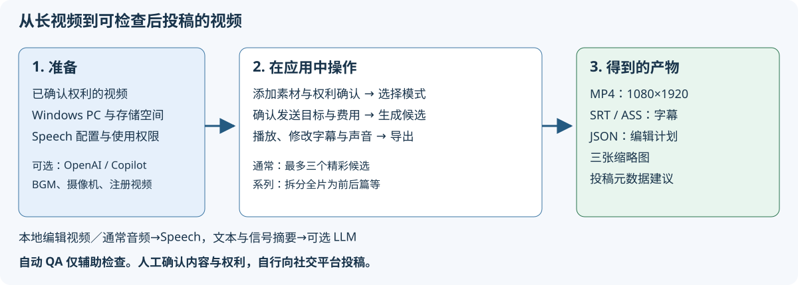

# VideoCreator

<!-- language-nav -->
[日本語](../../README.md) | [English](../en/start.md) | [한국어](../ko/start.md) | [简体中文](start.md)
<!-- /language-nav -->

[开始使用](start.md) / [指南目录](README.md) / [详细概览](overview.md) / [工程师参考](technical-reference.md) / [网站](https://dahatake.github.io/VideoCreator/zh-CN/)

**即使没有视频编辑经验，也能将内部视频制作成带字幕的短视频。**
在自己的电脑上选择素材和编辑模式，检查并修改候选视频后保存。应用不会自动发布到社交媒体或内部网站。

## 先做好准备

- **一段有权使用的视频**：建议使用几分钟、有讲话的 MP4 等素材。确认人物、资料和音乐的使用许可，以及是否允许向外部服务发送数据。
- **Windows 10/11（x64）或 Windows 11（ARM64）电脑、互联网和可用空间**：请遵守公司的软件安装规定。另有 Apple Silicon 的 macOS 版（[详细概览](overview.md#单一可执行文件windows--macos)）。
- **管理员交接**：确认要使用的 Microsoft Foundry 资源名称（必要时还有租户 ID）、使用角色的授予、费用负责人及支持联系人。不知道连接地址时请联系管理员，不要猜测。

> **本地应用不等于完全离线。** 通常会将音频发送到 Azure Speech（默认模型为 MAI-Transcribe-2）；使用 AI 时还会将转录文本发送到配置的服务。禁用 LLM 后仍有 Speech 通信。不要在文档或求助信息中粘贴密钥和令牌。

## 安装（3 步）

发行版只有一个可执行文件。不需要安装程序、.NET 或 FFmpeg，事先只需安装 Azure CLI。各步骤的详细说明和界面见[快速入门](quickstart.md#2-安装3-步)。

1. 在终端中运行 `winget install -e --id Microsoft.AzureCLI`，然后**重新打开终端**，用 `az login` 登录。
2. 从[最新版本](https://github.com/dahatake/VideoCreator/releases/latest)下载 `VideoCreator.exe`（ARM64 电脑下载 `VideoCreator-<版本>-win-arm64.exe`）并双击。如果出现 SmartScreen，点击 **更多信息** → **仍要运行**。
3. 在打开的浏览器中，依次点击 **设置** → **AI 连接** → **从 Azure 选择** 选择资源，然后点击 **测试并保存**。当界面顶部变为 `转写：MAI-Transcribe-2` 之类的显示时，准备就完成了。

从源码启动的开发者可双击仓库中的 `run.cmd`，安装脚本会安装所需工具（[快速入门附录](quickstart.md#附录使用源码版runcmd启动)）。

## 制作第一个视频

1. 在浏览器中创建项目，添加一段视频并确认使用权。
2. 选择 **P4（长视频 → 30 秒剪辑）**，将 **输出方向** 设为 **竖屏 9:16（1080×1920）**。保持关闭系列、标准筛选，确认发送目标和费用后生成。
3. 播放候选视频，检查字幕、原意、构图和声音，批准后导出。
4. 完整播放最终 MP4。**能够从保存文件夹（默认为 `视频\VideoCreator\<模式名称>`）打开 MP4 和字幕，就是第一次成功。** 发布时请遵守公司规定并手动操作。

如果失败，请不要反复生成，先查看[故障排除](troubleshooting.md)。即使页面能打开，只要顶部仍显示 `转写：无`，就说明字幕生成尚未准备就绪（在源码版的 `run.cmd` 中，`FAIL` 表示本地必备组件问题，`WARN` 表示警告）。向管理员提供时间、操作、错误代码和应用版本，不要附带视频或机密字幕。

## 查找所需说明

| 目的 | 阅读内容 |
|---|---|
| 从准备到保存逐步操作 | [快速入门](quickstart.md) |
| 了解术语、按钮和操作 | [指南目录](README.md) / [界面说明](screens.md) |
| 错误、警告和备份 | [故障排除](troubleshooting.md) |
| 详细功能、发行版详情和源码版安装 | [详细概览](overview.md) |
| 工程师安全定制 | [技术参考](technical-reference.md) / [配置与 API](configuration-api.md) |
| Azure 准备、共享用户、密钥 / Entra ID 身份验证 | [Azure 访问](azure-access.md) |
| 验证、构建和发布依据 | [验证与维护](verification.md) / [详细概览](overview.md) |

界面语言与视频语言相互独立。字幕不会自动翻译。更改视频语言后请重新生成候选视频。功能、分发、版本管理、测试、结构和安全详情均保留在[详细概览](overview.md)中。

[需求](docs/PRD.md) / [实现记录](docs/IMPLEMENTATION.md) / [研究](docs/VideoCreator-AnalyticsReport.md) / [文档制作说明](documentation-brief.md) / [MIT 许可证](../../LICENSE) / [第三方声明](../../THIRD-PARTY-NOTICES.txt)
